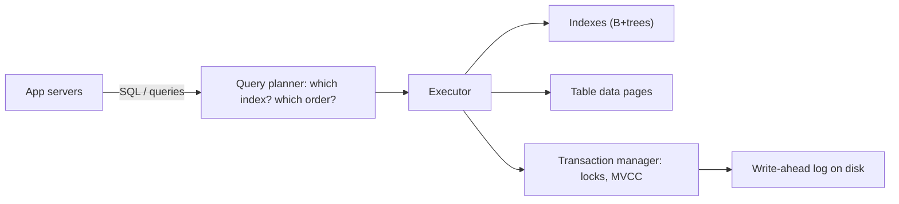
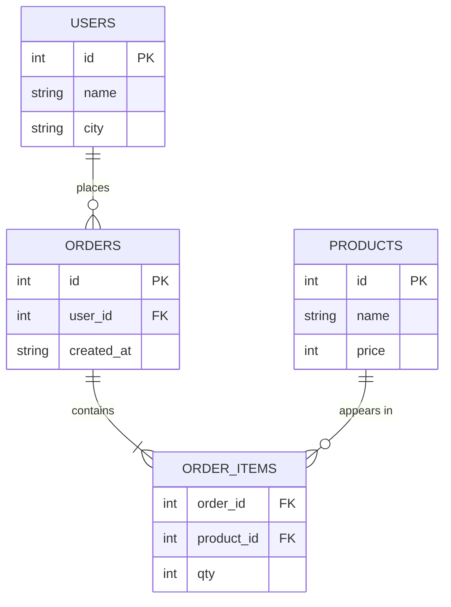
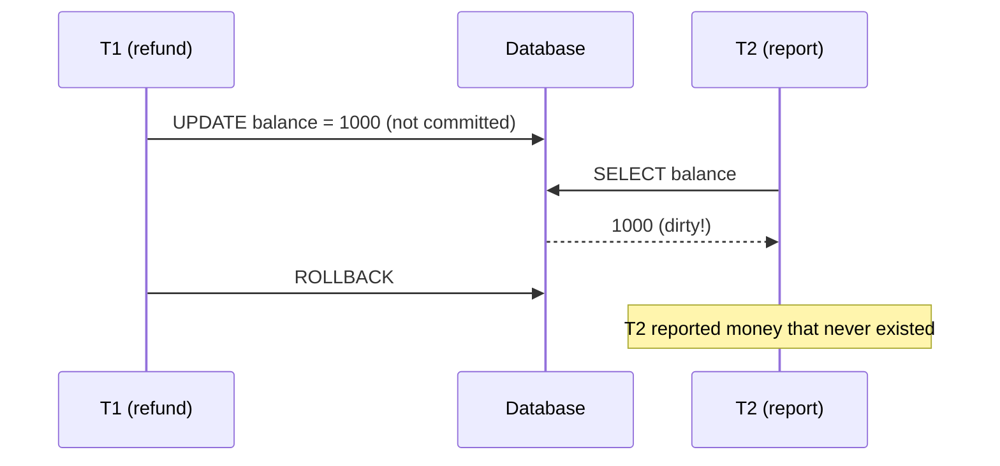
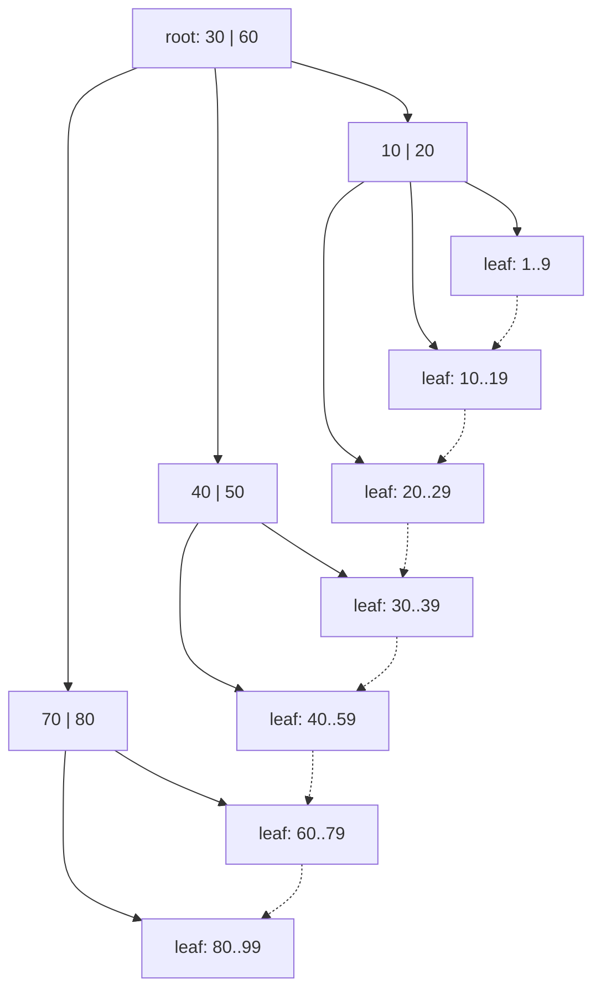
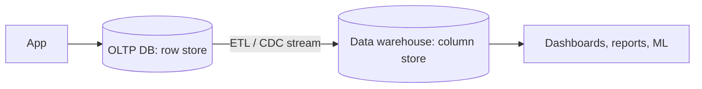
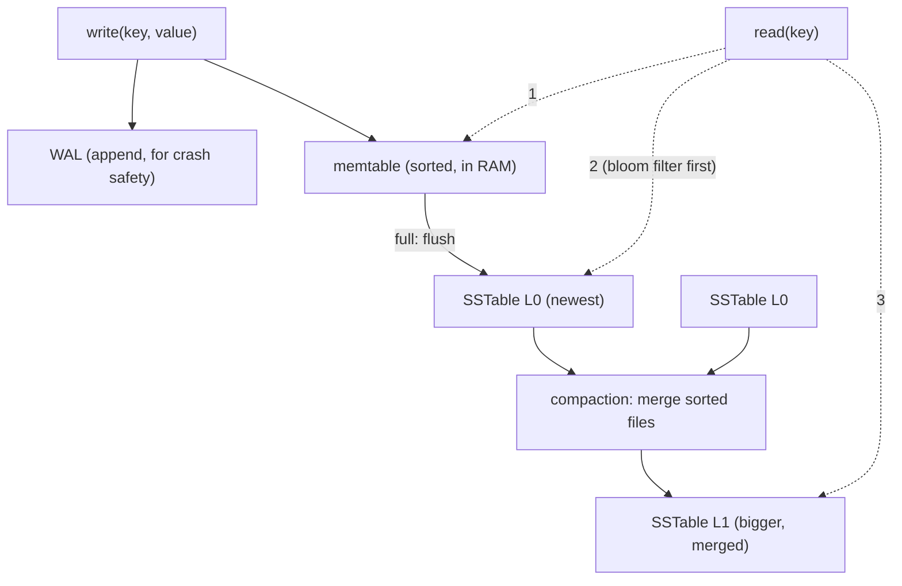

# Chapter 03 · Databases: SQL, NoSQL, Indexes & Transactions

> At 11:59 pm on sale night, two people click "Buy" on the last iPhone at the exact same millisecond. Your server is fast, your load balancer is perfect, but if your database isn't careful, you just sold one phone twice. Databases are where data lives and where correctness is won or lost.

**You will learn:**
- The relational model and the SQL you actually need (SELECT, JOIN, GROUP BY), run live with Python's built-in `sqlite3`
- Normalization (1NF, 2NF, 3NF) and when to deliberately denormalize
- ACID explained with concrete examples, isolation levels, and the anomalies they prevent (dirty read, non-repeatable read, phantom, lost update, write skew)
- Indexes: B-tree, B+tree, hash, composite, covering, and how the query planner uses them
- NoSQL families (key-value, document, wide-column, graph, time-series, search) and when to pick each
- A SQL vs NoSQL decision guide, OLTP vs OLAP, connection pooling, and storage engines (B-tree vs LSM tree)

**Before this:** [Chapter 01 · Foundations](01-foundations-internet.md) · [Chapter 02 · Scalability & Load Balancing](02-scalability-load-balancing.md) · helpful from DSA: [Hashing](../part-2-dsa/05-hashing.md), [Binary Search](../part-2-dsa/08-binary-search.md), [Binary Search Trees](../part-2-dsa/14-binary-search-trees.md)

---

## 🧠 The Big Idea

A database is a **library with a very strict librarian**.

- The **books** are your data.
- The **catalogue cards** (sorted by author, by title) are **indexes**: they let the librarian find a book without walking every shelf.
- The librarian's **rules** ("you can't borrow a book that's already out", "a return is either fully recorded or not at all") are **transactions** and **constraints**.
- Different libraries organise differently: some use strict shelves and catalogue numbers (**relational / SQL**), some just have labelled boxes you grab by name (**key-value**), some keep whole folders per person (**document**).



Remember from [Chapter 02](02-scalability-load-balancing.md): we made app servers stateless by pushing state *here*. So the database must be **correct** (no double-sold iPhones), **fast** (indexes), and **durable** (never forget a committed order). This chapter is about all three on a single machine. [Chapter 05](05-replication-sharding.md) then spreads it across many machines.

> 💡 **The core insight:** pick the data model that matches how you *read* the data, use indexes so reads don't scan everything, and use transactions so concurrent writes can't corrupt each other.

---

## 🔨 Building It Up

### 1. Why not just use files or a Python dict?

You could save orders in a JSON file. Then ask:

- Two servers write at the same time. Who wins? Does the file get corrupted?
- The power cuts halfway through a write. Is the file half-written?
- "Find all orders over ₹500 from Pune last week" over 50 million orders. Read the whole file every time?
- Money moves from account A to B. The program crashes after subtracting from A. Where did the money go?

A database management system (**DBMS**) solves exactly these: **concurrency**, **crash safety**, **fast queries**, and **all-or-nothing changes**. That's why you almost never build your own.

### 2. The relational model

A **relational database** (PostgreSQL, MySQL, SQLite, Oracle, SQL Server) stores data in **tables** (also called **relations**):

- A table has **columns** with fixed types (`id INTEGER`, `name TEXT`).
- Each **row** is one record.
- A **primary key** uniquely identifies each row (`users.id`).
- A **foreign key** is a column that refers to another table's primary key (`orders.user_id → users.id`). This is how tables **relate**.



Read `||--o{` as "one user has zero or more orders". You describe **what** you want with **SQL** (Structured Query Language), and the database figures out **how** to get it. That separation is the relational model's superpower.

### 3. SQL essentials, live

Python ships with **SQLite**, a real relational database in a library. With `":memory:"` it lives entirely in RAM, so we can run real SQL without any setup.

```python
import sqlite3

db = sqlite3.connect(":memory:")
db.executescript("""
CREATE TABLE users (
    id    INTEGER PRIMARY KEY,
    name  TEXT NOT NULL,
    city  TEXT NOT NULL
);
CREATE TABLE orders (
    id       INTEGER PRIMARY KEY,
    user_id  INTEGER NOT NULL REFERENCES users(id),
    amount   INTEGER NOT NULL,          -- in rupees
    status   TEXT NOT NULL
);
INSERT INTO users VALUES (1, 'Asha', 'Pune'), (2, 'Ravi', 'Delhi'),
                         (3, 'Meera', 'Pune'), (4, 'Kabir', 'Goa');
INSERT INTO orders VALUES (101, 1, 450, 'DELIVERED'), (102, 1, 1200, 'DELIVERED'),
                          (103, 2, 300, 'CANCELLED'), (104, 3, 800, 'DELIVERED'),
                          (105, 2, 650, 'DELIVERED');
""")

print("1) Pune users:")
for row in db.execute("SELECT id, name FROM users WHERE city = 'Pune' ORDER BY name"):
    print("  ", row)

print("2) Orders with user names (INNER JOIN):")
for row in db.execute("""
        SELECT o.id, u.name, o.amount
        FROM orders o JOIN users u ON u.id = o.user_id
        WHERE o.status = 'DELIVERED'
        ORDER BY o.amount DESC"""):
    print("  ", row)

print("3) Every user, even with no orders (LEFT JOIN):")
for row in db.execute("""
        SELECT u.name, COUNT(o.id) AS n_orders
        FROM users u LEFT JOIN orders o ON o.user_id = u.id
        GROUP BY u.id ORDER BY u.id"""):
    print("  ", row)

print("4) Revenue per city, only cities over 1000 (GROUP BY + HAVING):")
for row in db.execute("""
        SELECT u.city, SUM(o.amount) AS revenue
        FROM orders o JOIN users u ON u.id = o.user_id
        WHERE o.status = 'DELIVERED'
        GROUP BY u.city
        HAVING SUM(o.amount) > 1000
        ORDER BY revenue DESC"""):
    print("  ", row)
```

```text
1) Pune users:
   (1, 'Asha')
   (3, 'Meera')
2) Orders with user names (INNER JOIN):
   (102, 'Asha', 1200)
   (104, 'Meera', 800)
   (105, 'Ravi', 650)
   (101, 'Asha', 450)
3) Every user, even with no orders (LEFT JOIN):
   ('Asha', 2)
   ('Ravi', 2)
   ('Meera', 1)
   ('Kabir', 0)
4) Revenue per city, only cities over 1000 (GROUP BY + HAVING):
   ('Pune', 2450)
```

What just happened, query by query:

1. `WHERE` filters rows, `ORDER BY` sorts them.
2. `JOIN ... ON` glues each order to its user where the keys match. An **INNER JOIN** keeps only rows that match on both sides.
3. A **LEFT JOIN** keeps *every* row from the left table; missing matches become `NULL`. Kabir has no orders but still appears, with count 0. (`COUNT(o.id)` counts non-null values.)
4. `GROUP BY` collapses rows into groups and lets you aggregate (`SUM`, `COUNT`, `AVG`, `MIN`, `MAX`). `WHERE` filters rows **before** grouping; `HAVING` filters groups **after**.

The order SQL logically runs in (not the order you write it):

```text
FROM / JOIN  ->  WHERE  ->  GROUP BY  ->  HAVING  ->  SELECT  ->  ORDER BY  ->  LIMIT
```

That's why you can't use a `SELECT` alias inside `WHERE` in most databases: `WHERE` runs first.

The JOIN family at a glance:

| Join | Keeps |
|---|---|
| `INNER JOIN` | Only rows matching on both sides |
| `LEFT JOIN` | All left rows; right side `NULL` if no match |
| `RIGHT JOIN` | All right rows; left side `NULL` if no match |
| `FULL OUTER JOIN` | All rows from both sides |
| `CROSS JOIN` | Every combination (rarely what you want) |

### 4. Normalization: one fact, one place

Here's a tempting "everything in one table" design:

```text
order_id | customer | customer_city | product  | product_price | qty
---------+----------+---------------+----------+---------------+----
101      | Asha     | Pune          | Keyboard | 1500          | 1
101      | Asha     | Pune          | Mouse    | 500           | 2
102      | Asha     | Pune          | Mouse    | 500           | 1
```

Problems (called **anomalies**):

- **Update anomaly**: Asha moves to Mumbai. You must update *every* row with her name. Miss one and the data contradicts itself.
- **Insert anomaly**: you can't add a new product until someone orders it.
- **Delete anomaly**: delete order 102 and, if it was the only Mouse order, you lose the Mouse's price.

**Normalization** splits tables so each fact is stored **once**. The normal forms are a ladder:

**1NF (First Normal Form):** every column holds a single atomic value, no lists in a cell, no repeating groups.

```text
❌  order 101 | items = "Keyboard, Mouse, Mouse"
✅  one row per (order, product) pair
```

**2NF:** 1NF + every non-key column depends on the **whole** primary key, not just part of it. In the table above with key `(order_id, product)`, `product_price` depends only on `product`, and `customer` only on `order_id`. Partial dependencies → split them out.

**3NF:** 2NF + no non-key column depends on **another non-key column** (no "transitive" dependencies). `customer_city` depends on `customer`, not on the order. → move it to a `customers` table.

A memorable summary (a classic saying): every non-key column must depend on **"the key (1NF), the whole key (2NF), and nothing but the key (3NF)"**.

The normalized result:

```text
customers(id, name, city)
products(id, name, price)
orders(id, customer_id, created_at)
order_items(order_id, product_id, qty)
```

(There are higher forms, BCNF, 4NF, 5NF, that matter rarely in interviews. 3NF is the practical target.)

### 5. Denormalization: copying on purpose

Normalized data is clean, but reading it needs **joins**, and joins over huge tables (or across machines, [Chapter 05](05-replication-sharding.md)) are expensive. **Denormalization** deliberately stores redundant copies to make reads fast:

- Store `customer_name` inside each order row so the order history page needs no join.
- Keep a `like_count` column on posts instead of `COUNT(*)` over a likes table every time.
- Precompute a `user_feed` table ([Chapter 13](13-case-studies-2.md)).

The cost: every write must update every copy, and copies can **drift** out of sync.

```python
import sqlite3

db = sqlite3.connect(":memory:")
db.executescript("""
CREATE TABLE posts (id INTEGER PRIMARY KEY, title TEXT, like_count INTEGER DEFAULT 0);
CREATE TABLE likes (post_id INTEGER, user_id INTEGER, PRIMARY KEY (post_id, user_id));
INSERT INTO posts (id, title) VALUES (1, 'My first dosa');
""")

def like(post_id, user_id):
    with db:                                  # one transaction: both writes or neither
        db.execute("INSERT INTO likes VALUES (?, ?)", (post_id, user_id))
        db.execute("UPDATE posts SET like_count = like_count + 1 WHERE id = ?", (post_id,))

for uid in (10, 11, 12):
    like(1, uid)

normalized = db.execute("SELECT COUNT(*) FROM likes WHERE post_id = 1").fetchone()[0]
denormalized = db.execute("SELECT like_count FROM posts WHERE id = 1").fetchone()[0]
print("count via aggregate:", normalized)
print("count via stored column:", denormalized)
```

```text
count via aggregate: 3
count via stored column: 3
```

What just happened: the `like_count` column is a denormalized copy of `COUNT(*)`. Reading it is O(1) instead of counting rows. We kept it correct by updating both in **one transaction** (`with db:` commits both or rolls back both).

| | Normalized | Denormalized |
|---|---|---|
| Duplication | None | Deliberate |
| Writes | Simple, one place | Must update every copy |
| Reads | Need joins | Fast, fewer joins |
| Consistency risk | Low | Copies can drift |
| Best for | OLTP with many writes, correctness | Read-heavy views, analytics, NoSQL |

> 💡 Rule of thumb: **normalize by default, denormalize where measurements show reads hurt.**

### 6. Transactions and ACID, concretely

A **transaction** is a group of operations treated as one unit. The classic: transfer ₹100 from Asha to Ravi = subtract from Asha + add to Ravi. **ACID** is the set of promises a transaction makes:

| Letter | Promise | Concrete meaning | Bank example |
|---|---|---|---|
| **A**tomicity | All or nothing | If any step fails, every step is undone (rollback) | Never "debited but not credited" |
| **C**onsistency | Rules always hold | Constraints (NOT NULL, foreign keys, CHECK balance >= 0) are never violated by a committed transaction | Balance never goes negative |
| **I**solation | Concurrent transactions don't trip over each other | Result is as if they ran one after another (to a degree set by the isolation level) | Two transfers at once don't lose an update |
| **D**urability | Committed = permanent | Survives crashes and power cuts (written to disk via the log) | After "success", a power cut can't undo it |

> ⚠️ The "C" in ACID (respecting database rules) is **not** the same as the "C" in CAP (all replicas agree, [Chapter 06](06-cap-consistency.md)). Interviewers love checking whether you know this.

Atomicity in action, with a `CHECK` constraint for consistency:

```python
import sqlite3

db = sqlite3.connect(":memory:")
db.executescript("""
CREATE TABLE accounts (
    name    TEXT PRIMARY KEY,
    balance INTEGER NOT NULL CHECK (balance >= 0)
);
INSERT INTO accounts VALUES ('asha', 500), ('ravi', 100);
""")

def transfer(src, dst, amount):
    try:
        with db:                                         # BEGIN ... COMMIT / ROLLBACK
            db.execute("UPDATE accounts SET balance = balance + ? WHERE name = ?",
                       (amount, dst))                    # credit first, on purpose
            db.execute("UPDATE accounts SET balance = balance - ? WHERE name = ?",
                       (amount, src))                    # may violate the CHECK
        print(f"transfer {amount}: committed")
    except sqlite3.IntegrityError as e:
        print(f"transfer {amount}: rolled back ({e})")

def balances():
    return dict(db.execute("SELECT name, balance FROM accounts ORDER BY name"))

transfer("asha", "ravi", 200)
print(balances())
transfer("asha", "ravi", 1000)         # asha only has 300 left
print(balances())
```

```text
transfer 200: committed
{'asha': 300, 'ravi': 300}
transfer 1000: rolled back (CHECK constraint failed: balance >= 0)
{'asha': 300, 'ravi': 300}
```

What just happened: in the second transfer, Ravi was credited ₹1000 *first*, then Asha's debit broke the `CHECK`. Because both statements were in one transaction, the database **undid the credit too**. Ravi didn't get free money. That's atomicity + consistency working together.

**How durability works:** before changing data pages, the database appends the change to a **write-ahead log (WAL)** on disk and forces it to disk (`fsync`). On `COMMIT`, the log record is safely on disk. If the machine crashes, on restart the database **replays** the log to redo committed changes and undo uncommitted ones. Sequential log writes are fast (remember from [Chapter 01](01-foundations-internet.md): sequential beats random).

### 7. Isolation: when transactions overlap

Running transactions strictly one at a time (**serial** execution) is perfectly safe but slow. Databases run them **concurrently** and offer **isolation levels**: weaker levels are faster but allow certain **anomalies**. Let's meet the anomalies through a two-person story.

**Dirty read**: you read data another transaction wrote but **hasn't committed** yet. If it rolls back, you acted on data that never existed.



**Non-repeatable read**: you read the same row twice in one transaction and get **different values**, because someone committed a change in between.

**Phantom read**: you run the same **range query** twice and get a **different set of rows**, because someone inserted or deleted rows matching your condition. ("How many bookings for room 7 tonight?" 0... then 1.)

**Lost update**: two transactions read the same value, both modify it, both write back. One update silently overwrites the other.

**Write skew**: two transactions read the **same set** of data, each makes a decision based on it, and each writes to **different** rows. Each write is fine alone; together they break a rule. Classic example: a hospital requires **at least one doctor on call**. Alice and Bob are both on call. Both check "are at least 2 on call?" (yes), both go off call at the same moment. Now zero doctors are on call. Neither transaction touched the other's row, so simple row locks don't catch it.

Here's a simulation of lost update and write skew, with transactions as interleaved steps over a shared "database":

```python
def lost_update():
    db = {"stock": 1}                        # one iPhone left
    t1_read = db["stock"]                    # T1 reads 1
    t2_read = db["stock"]                    # T2 reads 1 (before T1 writes)
    sold = []
    if t1_read > 0:
        db["stock"] = t1_read - 1; sold.append("T1")
    if t2_read > 0:
        db["stock"] = t2_read - 1; sold.append("T2")
    print(f"lost update: sold to {sold}, stock now {db['stock']}  <- oversold!")

def write_skew():
    on_call = {"alice": True, "bob": True}
    # both transactions read a snapshot first
    alice_sees = sum(on_call.values())
    bob_sees = sum(on_call.values())
    if alice_sees >= 2:
        on_call["alice"] = False             # Alice writes HER row
    if bob_sees >= 2:
        on_call["bob"] = False               # Bob writes HIS row
    print(f"write skew: doctors on call = {sum(on_call.values())}  <- rule broken!")

def lost_update_fixed():
    db = {"stock": 1}
    sold = []
    for t in ("T1", "T2"):                   # atomic conditional update, one at a time
        # SQL: UPDATE items SET stock = stock - 1 WHERE id = ? AND stock > 0
        if db["stock"] > 0:
            db["stock"] -= 1
            sold.append(t)
    print(f"fixed: sold to {sold}, stock now {db['stock']}")

lost_update()
write_skew()
lost_update_fixed()
```

```text
lost update: sold to ['T1', 'T2'], stock now 0  <- oversold!
write skew: doctors on call = 0  <- rule broken!
fixed: sold to ['T1'], stock now 0
```

What just happened: in both broken cases, each transaction made a decision from a value that was **already stale** when it wrote. The fix for lost update was to make "check and decrement" a **single atomic statement**, which the database executes under a row lock.

The four standard **isolation levels** (from the SQL standard) and what they prevent:

| Isolation level | Dirty read | Non-repeatable read | Phantom | Lost update / write skew |
|---|---|---|---|---|
| Read Uncommitted | Possible | Possible | Possible | Possible |
| Read Committed | **Prevented** | Possible | Possible | Possible |
| Repeatable Read | Prevented | **Prevented** | Possible (by the standard) | Lost update often prevented; write skew possible |
| Serializable | Prevented | Prevented | **Prevented** | **Prevented** |

Real-world notes (good to mention, carefully):

- **PostgreSQL** defaults to Read Committed. Its Repeatable Read is implemented as **snapshot isolation** (each transaction sees a consistent snapshot), which prevents phantoms in practice but still allows write skew. Its Serializable level (SSI) detects write skew and aborts one transaction.
- **MySQL InnoDB** defaults to Repeatable Read and uses locks on index ranges ("gap locks") to block many phantoms.

Fixes you can use at any level:

```sql
-- 1. Atomic update instead of read-modify-write (fixes lost update)
UPDATE products SET stock = stock - 1 WHERE id = 42 AND stock > 0;

-- 2. Pessimistic locking: lock the rows you read until you commit
BEGIN;
SELECT * FROM doctors WHERE shift_id = 7 AND on_call = true FOR UPDATE;
-- decide, then update
COMMIT;

-- 3. Optimistic locking: a version column; fail if someone changed it meanwhile
UPDATE products SET stock = 4, version = 8 WHERE id = 42 AND version = 7;
-- 0 rows updated => someone else won; re-read and retry

-- 4. Constraints: let the database enforce the rule
ALTER TABLE bookings ADD CONSTRAINT one_booking UNIQUE (room_id, night);
```

| Technique | How | Best when |
|---|---|---|
| Atomic statement | `SET x = x - 1 WHERE x > 0` | Simple counters, stock |
| Pessimistic (`SELECT ... FOR UPDATE`) | Lock first, then work | High contention, conflicts likely |
| Optimistic (version column / compare-and-set) | Work, then check nothing changed | Low contention, conflicts rare |
| Unique / check constraints | DB rejects violating writes | Rules expressible as constraints |
| Serializable isolation | DB detects conflicts and aborts | Complex invariants; app must retry |

### 8. Indexes: the catalogue cards

Without an index, `SELECT * FROM users WHERE email = 'x@y.com'` must check **every row**: a **full table scan**, O(n). With 100 million users, that's a disaster.

An **index** is a separate data structure that maps column values to row locations, kept **sorted** (or hashed) so lookups are fast. It's the index at the back of a textbook: instead of reading 800 pages to find "Dijkstra", you look it up and jump to page 412.

Let's see the speedup with SQLite and its query planner:

```python
import sqlite3
import time

db = sqlite3.connect(":memory:")
db.execute("CREATE TABLE users (id INTEGER PRIMARY KEY, email TEXT, city TEXT, age INTEGER)")
db.executemany("INSERT INTO users (email, city, age) VALUES (?, ?, ?)",
               ((f"user{i}@mail.com", ["Pune", "Delhi", "Goa", "Agra"][i % 4], 18 + i % 50)
                for i in range(100_000)))

query = "SELECT id FROM users WHERE email = 'user65432@mail.com'"

def plan(sql):
    return [row[-1] for row in db.execute("EXPLAIN QUERY PLAN " + sql)]

def timed(sql, repeat=10):
    start = time.perf_counter()
    for _ in range(repeat):
        db.execute(sql).fetchall()
    return (time.perf_counter() - start) / repeat

print("plan without index:", plan(query))
slow = timed(query)
db.execute("CREATE INDEX idx_users_email ON users(email)")
print("plan with index   :", plan(query))
fast = timed(query)
print("index is faster by more than 100x:", slow / fast > 100)
```

```text
plan without index: ['SCAN users']
plan with index   : ['SEARCH users USING COVERING INDEX idx_users_email (email=?)']
index is faster by more than 100x: True
```

What just happened: `EXPLAIN QUERY PLAN` shows the database's strategy. Without an index it **SCANs** all 100,000 rows. With the index it **SEARCHes**: a tree lookup of a few steps. (It says "covering" because in SQLite every index also stores the row id, which is all we asked for; more on covering indexes below.) The exact speedup depends on your machine, so we just check it's huge.

### 9. B-trees and B+trees: why indexes are trees

In DSA you met binary search trees ([Chapter 14](../part-2-dsa/14-binary-search-trees.md)): each node has 2 children, height ~log₂(n). For 1 billion keys, that's ~30 levels, and on disk, each level could be a **separate random disk read**. 30 random reads per lookup is too slow.

A **B-tree** fixes this by making nodes **fat**: each node is one disk **page** (typically 4–16 KB) holding **hundreds of keys** and hundreds of child pointers. With a branching factor of ~500, the height for a billion keys is about log₅₀₀(10⁹) ≈ 3.3, so **3–4 page reads**, and the top levels are almost always cached in RAM.

A **B+tree** (what nearly every relational database actually uses) is a B-tree variant where:

- **Internal nodes hold only keys** (signposts), so more fit per page → even shorter tree.
- **All values / row pointers live in the leaves.**
- **Leaves are linked** in a sorted chain → range scans (`WHERE age BETWEEN 20 AND 30`, `ORDER BY`) just walk sideways along the leaves.



A tiny calculation makes the "fat nodes" point unforgettable:

```python
import math

rows = 1_000_000_000
for fanout in (2, 100, 500):
    height = math.ceil(math.log(rows, fanout))
    print(f"fanout {fanout:>3}: about {height:>2} levels -> {height:>2} page reads per lookup")
```

```text
fanout   2: about 30 levels -> 30 page reads per lookup
fanout 100: about  5 levels ->  5 page reads per lookup
fanout 500: about  4 levels ->  4 page reads per lookup
```

### 10. Hash indexes

A **hash index** is a hash table ([Hashing](../part-2-dsa/05-hashing.md)): `hash(key) → location`. Lookups by exact key are O(1) on average.

But a hash scatters keys randomly, so it **can't** do ranges (`age > 30`), sorting (`ORDER BY`), or prefix search (`LIKE 'ab%'`). That's why B+trees are the default. Hash indexes appear in key-value stores (Redis is a giant in-memory hash table), in some engines (Bitcask), and as an option in PostgreSQL.

| | B+tree index | Hash index |
|---|---|---|
| Exact match `=` | O(log n), few page reads | O(1) average |
| Range `<`, `>`, `BETWEEN` | Yes (walk leaves) | No |
| `ORDER BY`, `MIN`, `MAX` | Yes (already sorted) | No |
| Prefix `LIKE 'ab%'` | Yes | No |
| Typical use | Default in relational DBs | Key-value stores, equality-only lookups |

### 11. Composite indexes and the leftmost-prefix rule

A **composite index** covers several columns, e.g. `(city, age)`. It's sorted by `city` first, then by `age` *within* each city, exactly like a phone book sorted by last name, then first name.

That ordering decides which queries can use it:

| Query | Uses `(city, age)` index? | Why |
|---|---|---|
| `WHERE city = 'Pune'` | ✅ | Leftmost column |
| `WHERE city = 'Pune' AND age = 25` | ✅ | Both, in order |
| `WHERE city = 'Pune' AND age > 25` | ✅ | Equality then range: perfect |
| `WHERE age = 25` | ❌ (mostly) | Skips the first column; like finding "all Rahuls" in a phone book sorted by surname (some DBs can "skip scan" if the first column has very few values) |
| `WHERE city = 'Pune' ORDER BY age` | ✅ | Rows already sorted by age within Pune |

**Column order rule of thumb:** equality-filtered columns first, then the range or sort column.

```python
import sqlite3

db = sqlite3.connect(":memory:")
db.execute("CREATE TABLE users (id INTEGER PRIMARY KEY, email TEXT, city TEXT, age INTEGER)")
db.executemany("INSERT INTO users (email, city, age) VALUES (?, ?, ?)",
               ((f"u{i}@m.com", ["Pune", "Delhi", "Goa", "Agra"][i % 4], 18 + i % 50)
                for i in range(20_000)))
db.execute("CREATE INDEX idx_city_age ON users(city, age)")
db.execute("ANALYZE")

def plan(sql):
    return " / ".join(row[-1] for row in db.execute("EXPLAIN QUERY PLAN " + sql))

print(plan("SELECT id FROM users WHERE city = 'Pune' AND age > 60"))
print(plan("SELECT id FROM users WHERE age = 25"))
print(plan("SELECT email FROM users WHERE city = 'Goa' AND age = 30"))
```

```text
SEARCH users USING COVERING INDEX idx_city_age (city=? AND age>?)
SEARCH users USING COVERING INDEX idx_city_age (ANY(city) AND age=?)
SEARCH users USING INDEX idx_city_age (city=? AND age=?)
```

(The exact wording can differ slightly between SQLite versions.)

What just happened: the first query used the index fully. The second is interesting: the index can't be searched by `age` alone, but `ANALYZE` told SQLite that `city` has only 4 distinct values, so it did a **skip scan**: `ANY(city)` means "one small search per city: Pune with age 25, Delhi with age 25, ...". That trick only works when the leading column has very few values; with a leading column like `email` it would have to scan everything. The third used the index to find matching rows but then had to visit the table to fetch `email`, which isn't in the index.

### 12. Covering indexes

A **covering index** contains **every column the query needs**, so the database answers from the index alone without touching the table (an "index-only scan"). That saves one random read per row.

```sql
-- Query: SELECT email FROM users WHERE city = 'Goa' AND age = 30;
CREATE INDEX idx_city_age_email ON users(city, age, email);   -- now covering
-- PostgreSQL also supports: CREATE INDEX ... ON users(city, age) INCLUDE (email);
```

### 13. The cost of indexes

Indexes aren't free:

- **Writes get slower**: every `INSERT`/`UPDATE`/`DELETE` must update **every** index on the table.
- **Storage**: each index is a copy of some columns plus pointers.
- **Low selectivity** columns (like `gender` with 2–3 values, or a boolean) often aren't worth indexing alone: the planner may prefer a scan, because fetching half the table through an index means lots of random reads.

**Selectivity** = distinct values / total rows. High (emails, ids) → great index. Low → poor alone, but useful as part of a composite index.

When to add an index:

- Columns in frequent `WHERE`, `JOIN ... ON`, `ORDER BY` clauses.
- Foreign keys (joins and deletes use them).
- Unique constraints (they create an index anyway).

### 14. Query planning basics

When you send SQL, the database:

1. **Parses** it into a tree.
2. The **planner/optimizer** generates candidate plans (scan vs index, which join order, which join algorithm) and **estimates the cost** of each using **statistics** (row counts, value distributions, gathered by `ANALYZE`).
3. The **executor** runs the cheapest plan.

Join algorithms the planner chooses between:

| Algorithm | How | Good when |
|---|---|---|
| Nested loop | For each row in A, look up matches in B (ideally via B's index) | One side small, the other indexed |
| Hash join | Build a hash table on the smaller table, probe it with the larger | Large unsorted tables, equality joins |
| Merge join | Sort both by the key (or use indexes), then zip them like merge sort | Both already sorted/indexed on the key |

The hash join is just DSA you already know:

```python
users = [(1, "Asha"), (2, "Ravi"), (3, "Meera")]
orders = [(101, 1, 450), (102, 1, 1200), (104, 3, 800), (105, 2, 650)]

def hash_join(small, large):
    table = {uid: name for uid, name in small}          # build phase: O(len(small))
    for oid, uid, amount in large:                      # probe phase: O(len(large))
        if uid in table:
            yield oid, table[uid], amount

for row in hash_join(users, orders):
    print(row)
```

```text
(101, 'Asha', 450)
(102, 'Asha', 1200)
(104, 'Meera', 800)
(105, 'Ravi', 650)
```

What just happened: O(n + m) instead of the O(n × m) nested loop without an index. The planner picks this automatically when it's cheapest.

How to debug a slow query (memorise this loop):

```sql
EXPLAIN ANALYZE SELECT ...;     -- PostgreSQL: real plan + real timings
-- Look for: Seq Scan on big tables, huge row estimates vs actual rows,
-- sorts spilling to disk, nested loops over large inputs.
-- Then: add/adjust an index, rewrite the query, or refresh statistics (ANALYZE).
```

Common reasons a query **won't use** your index: a function on the column (`WHERE LOWER(email) = ...` unless you index `LOWER(email)`), a leading wildcard (`LIKE '%gmail.com'`), type mismatch (comparing a text column to a number), skipping the leftmost column of a composite index, or low selectivity.

### 15. NoSQL: why it exists

Relational databases are wonderful, but in the 2000s companies like Google, Amazon and Facebook hit limits:

- **Scale-out writes**: a single primary can only take so many writes; joins and multi-row transactions are hard to spread across hundreds of machines.
- **Flexible schemas**: product catalogues where every product has different attributes.
- **Specific access patterns**: "get this user's last 50 events by time", "who are friends of friends?", "full-text search".

**NoSQL** ("not only SQL") is a family of databases that trade some relational features (joins, multi-row transactions, strict schemas) for **easier horizontal scaling**, **flexible models**, or **specialised performance**. Many now support SQL-like queries and transactions too, so the line has blurred.

### 16. Key-value stores

The simplest model: a giant dictionary. `put(key, value)`, `get(key)`, `delete(key)`. The value is opaque to the database.

- **Examples:** Redis, Memcached (in-memory), Amazon DynamoDB (also more than KV), etcd, RocksDB (embedded).
- **Strengths:** extremely fast O(1) lookups, trivially sharded by key.
- **Weaknesses:** no queries by value ("find all users in Pune" needs a separate index you maintain).
- **Use for:** caching ([Chapter 04](04-caching-cdn.md)), sessions, shopping carts, feature flags, rate-limit counters, leaderboards (Redis sorted sets).

```text
SET session:k7Qx '{"user": 42, "cart": [7, 9]}' EX 3600
GET session:k7Qx
```

### 17. Document stores

Store **documents** (JSON-like objects) that can be nested and differ in shape. You can query and index fields **inside** documents.

- **Examples:** MongoDB, Couchbase, Firestore, Amazon DocumentDB.
- **Strengths:** natural fit for objects your code already uses; one read gets a whole aggregate (an order *with* its items); flexible schema.
- **Weaknesses:** joins across documents are weak or manual; data duplicated across documents must be kept in sync.
- **Use for:** product catalogues, user profiles, content management, apps where each entity is read as a whole.

```text
{
  "_id": "order_9001",
  "user": {"id": 42, "name": "Asha"},          <- denormalized copy
  "items": [{"sku": "KB-1", "qty": 1, "price": 1500},
            {"sku": "MS-2", "qty": 2, "price": 500}],
  "status": "PLACED"
}
```

**Embed or reference?** Embed data that is read together and owned by the parent (order items inside the order). Reference data that is shared or grows without bound (a user's millions of followers should not be one giant array).

### 18. Wide-column stores

Data is organised into rows with a **partition key** that decides which machine stores it, and within a partition, rows are **sorted by a clustering key**. Each row can have many columns, and different rows can have different columns. Think: a distributed, sorted map of maps.

- **Examples:** Apache Cassandra, ScyllaDB, HBase, Google Bigtable.
- **Strengths:** massive write throughput (LSM trees, section 22), linear horizontal scaling, fast range reads **within a partition** ("last 100 messages of chat 77").
- **Weaknesses:** you must design tables **around your queries** up front; no joins; queries not using the partition key are expensive.
- **Use for:** messaging history, activity feeds, IoT and event data, time-ordered data at huge scale.

```text
Table: messages_by_chat
  partition key: chat_id        -> all messages of a chat live together
  clustering key: sent_at DESC  -> sorted newest first inside the partition

chat_id=77 | 2026-10-31 10:05 | from=asha | "on my way"
           | 2026-10-31 10:01 | from=ravi | "where are you?"
           | ...
```

### 19. Graph databases

Data is **nodes** (people, products) and **edges** (FOLLOWS, BOUGHT, FRIEND_OF) with properties. Traversing relationships is the main operation, and each hop is a direct pointer, not a join.

- **Examples:** Neo4j, Amazon Neptune, JanusGraph.
- **Strengths:** multi-hop queries ("friends of friends who like cricket", "shortest path", fraud rings) that would need many self-joins in SQL.
- **Weaknesses:** harder to shard (graphs don't split cleanly), niche tooling.
- **Use for:** social graphs, recommendations, fraud detection, knowledge graphs, network topology.

```text
MATCH (me:User {name: 'Asha'})-[:FRIEND]->(f)-[:FRIEND]->(fof)
WHERE NOT (me)-[:FRIEND]->(fof) AND fof <> me
RETURN fof.name, count(*) AS mutual ORDER BY mutual DESC LIMIT 5
```

(That's Cypher, Neo4j's query language: "suggest friends of friends ranked by mutual friends". It's BFS from [Graphs I](../part-2-dsa/16-graphs-bfs-dfs.md), built into the database.)

### 20. Time-series and search databases

**Time-series databases** are optimised for data points stamped with time, arriving constantly, mostly appended, queried by time ranges and aggregated (avg CPU per minute over the last hour).

- **Examples:** InfluxDB, TimescaleDB (on PostgreSQL), Prometheus (for metrics).
- **Tricks:** append-only writes, compression of similar consecutive values, automatic **downsampling** (keep per-second data for a week, per-hour forever) and retention policies.
- **Use for:** metrics and monitoring ([Chapter 09](09-microservices-reliability.md)), IoT sensors, stock ticks.

**Search engines** build an **inverted index**: for each word, the list of documents containing it (like the index at the back of a book, but for every word). They support full-text search, relevance ranking, typo tolerance, filters and facets.

- **Examples:** Elasticsearch, OpenSearch, Apache Solr.
- **Use for:** product search, log search, autocomplete. Usually a **secondary** store fed from the primary database, not the source of truth. Covered in [Chapter 10](10-storage-search-ids.md).

```python
from collections import defaultdict

docs = {
    1: "red cotton shirt",
    2: "blue denim jeans",
    3: "red silk saree",
    4: "cotton saree blue border",
}

index = defaultdict(set)                    # word -> set of doc ids (posting list)
for doc_id, text in docs.items():
    for word in text.split():
        index[word].add(doc_id)

def search(query):
    words = query.split()
    result = set(index[words[0]])
    for w in words[1:]:
        result &= index[w]                  # AND: intersect posting lists
    return sorted(result)

print("red        ->", search("red"))
print("cotton     ->", search("cotton"))
print("blue saree ->", search("blue saree"))
```

```text
red        -> [1, 3]
cotton     -> [1, 4]
blue saree -> [4]
```

What just happened: instead of scanning every document for "blue", we jumped straight to the set of docs containing each word and intersected them. That's the core of every search engine.

### 21. OLTP vs OLAP

Two very different workloads:

**OLTP (Online Transaction Processing)**: the app's day-to-day operations. "Place this order", "show my profile". Many small, fast reads and writes touching a few rows each, by key. Needs low latency and transactions.

**OLAP (Online Analytical Processing)**: analysis. "Total revenue per city per month for 3 years". Few huge queries that scan millions of rows but only a few columns, mostly reads.

| | OLTP | OLAP |
|---|---|---|
| Users | Customers via the app | Analysts, dashboards, data scientists |
| Query shape | Point lookups, small updates | Big scans, aggregations |
| Rows per query | A few | Millions to billions |
| Freshness | Real-time | Minutes to a day behind is often fine |
| Storage layout | **Row-oriented** (whole row together) | **Column-oriented** (each column together) |
| Examples | PostgreSQL, MySQL, DynamoDB | Snowflake, BigQuery, Redshift, ClickHouse |

Why **columnar** storage wins for analytics: `SELECT AVG(amount) FROM orders` only needs the `amount` column. A row store reads every column of every row; a column store reads just one column, and similar values next to each other compress extremely well.

Data usually flows from OLTP to OLAP through an **ETL/ELT** pipeline (Extract, Transform, Load) or change-data-capture streams ([Chapter 08](08-queues-events.md)) into a **data warehouse**.



> ⚠️ Never run heavy analytics queries on your production OLTP primary. One giant scan can slow every customer's checkout. Use a replica or a warehouse.

### 22. Storage engines: B-tree vs LSM tree

Under the SQL (or NoSQL API) sits a **storage engine** that decides how bytes live on disk. Two dominant designs:

**B-tree engines** (PostgreSQL, MySQL InnoDB, SQL Server): data lives in fixed-size pages in a B+tree. Updates modify pages **in place** (plus a WAL for safety).

- Reads: fast and predictable (a few page reads).
- Writes: each write may touch several random pages → **random I/O**, and one logical write can cause several physical writes (**write amplification**).

**LSM-tree engines** (Log-Structured Merge tree: Cassandra, RocksDB, LevelDB, HBase, ScyllaDB): turn random writes into sequential ones.

1. A write goes to a WAL (for durability) and an in-memory sorted structure, the **memtable**.
2. When the memtable is full, it's flushed to disk as an immutable sorted file, an **SSTable** (Sorted String Table). Sequential write: fast.
3. Reads check the memtable, then SSTables from **newest to oldest**. **Bloom filters** (a compact structure that answers "definitely not here" or "maybe here") skip files that can't contain the key.
4. In the background, **compaction** merges SSTables (like merge sort's merge step), dropping overwritten and deleted values (deletes are written as **tombstones**).



A runnable toy LSM tree:

```python
class ToyLSM:
    def __init__(self, memtable_limit=3):
        self.memtable = {}
        self.sstables = []                    # list of sorted lists, newest last
        self.limit = memtable_limit

    def put(self, key, value):
        self.memtable[key] = value            # (a real engine also appends to a WAL)
        if len(self.memtable) >= self.limit:
            self.sstables.append(sorted(self.memtable.items()))   # flush: sequential write
            self.memtable = {}

    def delete(self, key):
        self.put(key, None)                   # tombstone

    def get(self, key):
        if key in self.memtable:
            return self.memtable[key]
        for table in reversed(self.sstables): # newest first
            for k, v in table:                # (real engines binary-search + bloom filters)
                if k == key:
                    return v
        return None

    def compact(self):
        merged = {}
        for table in self.sstables:           # oldest to newest: newer values win
            merged.update(table)
        self.sstables = [sorted((k, v) for k, v in merged.items() if v is not None)]

db = ToyLSM()
for k, v in [("a", 1), ("b", 2), ("c", 3), ("a", 10), ("d", 4), ("e", 5)]:
    db.put(k, v)
db.delete("b")
print("sstables before compaction:", db.sstables)
print("get a:", db.get("a"), "| get b:", db.get("b"))
db.put("f", 6); db.put("g", 7)               # forces a flush that includes the tombstone
db.compact()
print("sstables after compaction :", db.sstables)
```

```text
sstables before compaction: [[('a', 1), ('b', 2), ('c', 3)], [('a', 10), ('d', 4), ('e', 5)]]
get a: 10 | get b: None
sstables after compaction : [[('a', 10), ('c', 3), ('d', 4), ('e', 5), ('f', 6), ('g', 7)]]
```

What just happened: writes only ever appended sorted files. Key `a` existed in two SSTables; the read returned the newest. The delete was just a tombstone in the memtable. Compaction merged everything, kept the newest value per key, and physically removed `b`.

| | B-tree engine | LSM-tree engine |
|---|---|---|
| Write pattern | Random, in place | Sequential appends |
| Write throughput | Good | Excellent |
| Read latency | Very predictable | May check several files (bloom filters help) |
| Range scans | Excellent | Good (merge across files) |
| Space | Some fragmentation | Old versions until compaction |
| Background work | Little | Compaction (can cause latency spikes) |
| Used by | PostgreSQL, MySQL InnoDB, SQLite | Cassandra, RocksDB, LevelDB, HBase, ScyllaDB |
| Choose when | Read-heavy, transactional OLTP | Write-heavy: logs, events, time-series, messaging |

### 23. Connection pooling

Opening a database connection is expensive: TCP handshake, maybe TLS, authentication, and on PostgreSQL a whole new **server process** per connection (several MB of memory each). Databases can handle hundreds, not tens of thousands, of connections well.

If each of 200 app servers opens 50 connections, that's 10,000 connections hammering one database. Solution: a **connection pool**: keep a fixed set of open connections and **lend** them to requests, returning them afterwards.

```python
from collections import deque

class ConnectionPool:
    def __init__(self, size):
        self.idle = deque(f"conn-{i}" for i in range(size))
        self.created = size                  # expensive work done once, up front
        self.waits = 0

    def acquire(self):
        if not self.idle:
            self.waits += 1                  # real pools block with a timeout here
            return None
        return self.idle.popleft()

    def release(self, conn):
        self.idle.append(conn)

pool = ConnectionPool(size=3)
handled = 0
for request in range(1000):                  # 1000 sequential requests
    conn = pool.acquire()
    handled += 1                             # ...run queries on conn...
    pool.release(conn)

print(f"requests handled: {handled}, connections ever opened: {pool.created}")

burst = [pool.acquire() for _ in range(5)]   # 5 requests at the same instant
print("burst got:", burst, "| had to wait:", pool.waits)
```

```text
requests handled: 1000, connections ever opened: 3
burst got: ['conn-1', 'conn-2', 'conn-0', None, None] | had to wait: 2
```

What just happened: 1000 requests reused just 3 connections, so we paid the connection cost 3 times instead of 1000. During a burst, requests beyond the pool size **wait** (in real pools, with a timeout). Pool sizing is a balance: too small → requests queue; too big → the database drowns in connections.

Where pools live:

- **In each app process** (most ORMs and drivers have one built in, e.g. SQLAlchemy, HikariCP).
- **As a separate proxy** in front of the database (**PgBouncer** for PostgreSQL, **ProxySQL** for MySQL, cloud RDS Proxy), which lets thousands of app connections share a small number of real DB connections.

---

## 🔬 Under the Hood

### How MVCC gives you snapshots without blocking readers

Most modern databases (PostgreSQL, MySQL InnoDB, Oracle) use **MVCC (Multi-Version Concurrency Control)**: an update doesn't overwrite a row; it creates a **new version** tagged with the transaction ID that wrote it. Each transaction reads the versions that were committed when its **snapshot** was taken.

Result: **readers never block writers and writers never block readers.** A long report reads a consistent snapshot while checkouts keep writing. Old versions are cleaned up later (PostgreSQL's **VACUUM**).

```python
class MVCCStore:
    def __init__(self):
        self.versions = {}            # key -> list of (commit_ts, value)
        self.clock = 0

    def commit_write(self, key, value):
        self.clock += 1
        self.versions.setdefault(key, []).append((self.clock, value))

    def snapshot(self):
        return self.clock             # a reader remembers "the world as of now"

    def read(self, key, snapshot_ts):
        visible = [v for ts, v in self.versions.get(key, []) if ts <= snapshot_ts]
        return visible[-1] if visible else None

store = MVCCStore()
store.commit_write("price", 100)
report_snapshot = store.snapshot()             # long report starts
store.commit_write("price", 120)               # a writer commits meanwhile
print("report sees:", store.read("price", report_snapshot))
print("new reader sees:", store.read("price", store.snapshot()))
```

```text
report sees: 100
new reader sees: 120
```

Read Committed takes a new snapshot **per statement**; Repeatable Read / snapshot isolation takes one **per transaction**. That single difference explains which anomalies each allows.

### How write skew slips through snapshots

Under snapshot isolation, Alice and Bob each read a snapshot where 2 doctors are on call, and each updates **a different row**. Their write sets don't overlap, so there's no write-write conflict for the database to notice. Serializable isolation (e.g. PostgreSQL's SSI) also tracks **what each transaction read** and aborts one when the read-write dependencies form a dangerous cycle. That's why serializable costs more: more tracking and more aborted transactions to retry.

### Why the WAL makes commits both safe and fast

Changing data pages in place requires random writes all over the disk. Instead, on commit the database appends a compact log record **sequentially** and `fsync`s it; the actual pages are updated later in batches (**checkpoints**). Crash recovery replays the log from the last checkpoint. Bonus: the same log stream is what replication ships to replicas ([Chapter 05](05-replication-sharding.md)) and what change-data-capture tools read.

### Why page size and fan-out matter

Disks and SSDs read in blocks. Reading 8 KB costs about the same as reading 100 bytes. B-trees exploit this by making each node exactly one page and packing it with keys: high fan-out → low height → few I/Os. Also, the top levels of the tree are touched by every lookup, so they stay hot in the database's **buffer pool** (its RAM cache of pages), and a lookup usually costs only 1–2 actual disk reads.

---

## 🧩 Pattern Decoder

### Decision guide: SQL or NoSQL?

| If you need... | Choose | Because |
|---|---|---|
| Transactions across multiple rows/tables (payments, inventory, bookings) | Relational (PostgreSQL/MySQL) | ACID, constraints, mature |
| Complex queries, ad-hoc reporting, joins | Relational | SQL + query planner |
| Clear, stable structure with relationships | Relational | Schema enforces correctness |
| Simple get/put by key at massive scale, sub-ms | Key-value (Redis, DynamoDB) | O(1), trivially sharded |
| Flexible, nested, per-entity data read as a whole | Document (MongoDB) | Natural JSON aggregates |
| Huge write volume, time-ordered data per entity | Wide-column (Cassandra) | LSM writes, partition + clustering keys |
| Many-hop relationship queries | Graph (Neo4j) | Traversals without joins |
| Metrics, sensor data, ticks | Time-series (InfluxDB, TimescaleDB) | Compression, retention, time aggregations |
| Full-text search, relevance, autocomplete | Search engine (Elasticsearch) | Inverted index |
| Big analytical scans | Columnar warehouse (BigQuery, Snowflake) | Reads only needed columns |

> 💡 **Interview default:** "I'll start with PostgreSQL because the data is relational and we need transactions. If one access pattern needs massive scale, I'll move *that* part to a store built for it." This is called **polyglot persistence**: different stores for different jobs.

### Trade-off table: isolation level

| Level | Allows | Cost | Use when |
|---|---|---|---|
| Read Committed | Non-repeatable reads, phantoms, lost updates (if read-modify-write), write skew | Cheapest | Most web requests, with atomic updates/constraints for critical rules |
| Repeatable Read / Snapshot | Write skew (phantoms depending on DB) | Moderate | Reports needing a consistent view, multi-step reads |
| Serializable | Nothing | Highest: locks or aborts + retries | Complex invariants (on-call rules, double booking) |

### Decision guide: indexing

| Query pattern | Index |
|---|---|
| `WHERE email = ?` | Single-column B-tree (unique) |
| `WHERE user_id = ? ORDER BY created_at DESC LIMIT 20` | Composite `(user_id, created_at)` |
| `WHERE status = ? AND created_at > ?` | Composite `(status, created_at)`: equality first, range last |
| Query reads only a few columns, hot path | Covering index (add those columns / `INCLUDE`) |
| `WHERE LOWER(email) = ?` | Expression index on `LOWER(email)` |
| Exact key lookups only, no ranges | Hash index (or a KV store) |
| Full-text "contains words" | Inverted index (search engine or DB full-text) |
| Low-selectivity column alone (`is_active`) | Probably none, or a partial index (`WHERE is_active`) |

### Decision guide: storage engine

| Workload | Engine | Why |
|---|---|---|
| Read-heavy OLTP, predictable latency | B-tree | Few page reads, in-place updates |
| Write-heavy (logs, events, chat, IoT) | LSM tree | Sequential writes, high ingest |
| Analytics over many rows, few columns | Columnar | Scan only needed columns, compression |

### Trade-off table: normalization

| Situation | Choose |
|---|---|
| Write-heavy, correctness-critical | Normalize (3NF) |
| Read-heavy hot path with expensive joins | Denormalize that path (cached column, materialized view) |
| Data sharded across machines | Denormalize to avoid cross-shard joins |
| Analytics | Star schema in a warehouse (a fact table plus dimension tables, deliberately denormalized) |

### When NOT to reach for NoSQL

- "Because it scales" with only a few thousand users. PostgreSQL on one good machine handles a lot of traffic, and its replicas handle more.
- When you need multi-entity transactions and you'd end up re-implementing them in application code.
- When you don't yet know your query patterns. Relational databases forgive changing queries; Cassandra-style stores do not.

---

## ⚠️ Traps & Common Mistakes

1. **Read-modify-write in application code** (lost update). Use an atomic `UPDATE ... SET x = x - 1 WHERE x > 0`, a version check, or `SELECT ... FOR UPDATE`.

```py
# ❌ two requests both read stock=1 and both sell
stock = db.execute("SELECT stock FROM items WHERE id = 42").fetchone()[0]
if stock > 0:
    db.execute("UPDATE items SET stock = ? WHERE id = 42", (stock - 1,))

# ✅ the check and the write are one atomic statement
cur = db.execute("UPDATE items SET stock = stock - 1 WHERE id = 42 AND stock > 0")
if cur.rowcount == 0:
    raise SoldOut()
```

2. **Confusing ACID consistency with CAP consistency.** ACID-C = rules/constraints hold. CAP-C = all replicas return the latest write.
3. **Indexing everything.** Each index slows every write and uses storage. Index for real query patterns.
4. **Wrong composite index order.** `(created_at, user_id)` doesn't help `WHERE user_id = ? ORDER BY created_at`. Equality columns first.
5. **Functions on indexed columns** (`WHERE YEAR(created_at) = 2026`) block index use. Rewrite as a range: `created_at >= '2026-01-01' AND created_at < '2027-01-01'`.
6. **SQL built by string formatting** → SQL injection. Always use parameters:

```py
# ❌ attacker sends name = "x'; DROP TABLE users; --"
db.execute(f"SELECT * FROM users WHERE name = '{name}'")

# ✅ parameters are never interpreted as SQL
db.execute("SELECT * FROM users WHERE name = ?", (name,))
```

7. **N+1 queries**: fetching 50 orders, then running one query per order for its user. Use a JOIN or one `WHERE id IN (...)` query.
8. **Choosing NoSQL, then needing joins everywhere.** Model by access patterns *before* choosing.
9. **Huge unbounded documents/arrays** (all followers inside the user document). Documents have size limits and every update rewrites them.
10. **Analytics on the production primary.** Use a replica or warehouse.
11. **One connection per request without pooling**, or a pool so large that 100 app servers × 50 connections overwhelm the database.
12. **`SELECT *` everywhere.** It defeats covering indexes and transfers useless bytes.

---

## 💡 Tips & Tricks

- Say **"EXPLAIN ANALYZE"** in interviews when asked about slow queries. It signals real experience.
- For "get the latest N items for X", the answer is almost always a composite index `(X, created_at DESC)` or a wide-column table partitioned by X and clustered by time.
- Remember B+tree height: **3–4 levels for billions of rows**. That's why indexed lookups are fast even on huge tables.
- Use **UUIDs or snowflake IDs** for distributed systems (no central counter); random UUIDs scatter inserts across a B-tree, so prefer time-ordered IDs ([Chapter 10](10-storage-search-ids.md)).
- Put rules in the database where possible (`UNIQUE`, `CHECK`, foreign keys). Application checks race; constraints don't.
- **Optimistic locking** for low contention (profile edits), **pessimistic** for high contention (seat booking).
- Keep transactions **short**: no network calls (like calling a payment API) while holding locks.
- Mnemonic for SQL execution order: **"Fresh Water Gives Healthy Sweet Oranges Lately"** (FROM, WHERE, GROUP BY, HAVING, SELECT, ORDER BY, LIMIT).

---

## 🎯 Interview Questions

### 1. SQL vs NoSQL: how do you choose? 🔥🔥🔥

<details><summary>Answer</summary>

Start from **data shape, access patterns, consistency needs, and scale**.

Choose **relational** when data is structured and related, you need multi-row ACID transactions (payments, inventory, bookings), and queries are varied or ad hoc. Relational DBs scale well vertically and with read replicas, and can be sharded.

Choose **NoSQL** when one access pattern dominates and must scale horizontally: key-value for O(1) lookups and caching; document for self-contained flexible entities; wide-column for huge write volumes of time-ordered data per key; graph for multi-hop relationships; time-series for metrics; search engines for full-text.

Mention trade-offs: NoSQL often gives up joins and multi-entity transactions and demands query-first modelling. Many systems are **polyglot**: PostgreSQL for orders, Redis for cache, Elasticsearch for search, Cassandra for activity logs.

</details>

### 2. Explain ACID with examples. 🔥🔥🔥

<details><summary>Answer</summary>

- **Atomicity**: a transfer debits A and credits B, or neither happens. Implemented with the log and rollback.
- **Consistency**: committed transactions never violate constraints (balance ≥ 0, foreign keys, uniqueness).
- **Isolation**: concurrent transactions don't see each other's partial work; with serializable isolation the result equals some serial order. Weaker levels allow some anomalies for speed.
- **Durability**: once committed, data survives crashes, via the write-ahead log flushed to disk (and replication for machine loss).

Note ACID consistency ≠ CAP consistency.

</details>

### 3. What are isolation levels and which anomalies does each prevent? 🔥🔥🔥

<details><summary>Answer</summary>

- **Read Uncommitted**: can see uncommitted data (dirty reads).
- **Read Committed**: no dirty reads; but re-reading a row may give a new value (non-repeatable read) and range queries may change (phantoms).
- **Repeatable Read**: rows you read stay the same; by the SQL standard phantoms are still possible (many implementations prevent them using snapshots or range locks).
- **Serializable**: equivalent to some serial order; prevents everything including **write skew**.

Also mention lost updates (fix with atomic updates, `SELECT ... FOR UPDATE` or optimistic version checks) and that PostgreSQL's Repeatable Read is snapshot isolation, which still permits write skew.

</details>

### 4. What is write skew? Give an example and a fix. 🔥🔥

<details><summary>Answer</summary>

Two transactions read an overlapping set of data, each decides based on it, and each writes **different** rows; together they violate an invariant. Example: the "at least one doctor on call" rule. Alice and Bob both see 2 on call and both go off call → 0. Another: two users both check a username is free and both insert it (if there's no unique constraint), or two meeting bookings for the same room and time slot.

Fixes: **Serializable** isolation (aborts one, app retries); **lock the rows read** with `SELECT ... FOR UPDATE`; **materialize the conflict** (e.g. a row per time slot that both must update); or a **constraint** (unique index on `(room, slot)`).

</details>

### 5. How does a database index work? Why B+trees? 🔥🔥🔥

<details><summary>Answer</summary>

An index is a separate structure mapping column values to row locations so lookups avoid full scans. Relational DBs use **B+trees**: balanced, high fan-out trees where each node is a disk page holding hundreds of keys, so height is 3–4 even for billions of rows (few disk reads, top levels cached). Internal nodes hold only keys; leaves hold row pointers (or rows) and are **linked**, making range queries and `ORDER BY` efficient. Hash indexes give O(1) equality lookups but can't do ranges or sorting.

Costs: slower writes (every index must be updated), extra storage, and they help only selective queries.

</details>

### 6. What is a composite index and the leftmost-prefix rule? What's a covering index? 🔥🔥

<details><summary>Answer</summary>

A composite index on `(a, b, c)` is sorted by a, then b within a, then c. It can serve queries filtering on `a`, `a and b`, `a, b and c` (and ranges on the last used column), but not efficiently on `b` or `c` alone, just as a phone book sorted by surname can't find all "Rahuls". Put equality columns first and range/sort columns last.

A **covering index** includes every column a query needs, so the database answers from the index alone (index-only scan) without visiting the table.

</details>

### 7. Normalization vs denormalization? 🔥🔥

<details><summary>Answer</summary>

**Normalization** (1NF atomic values, 2NF no partial dependency on a composite key, 3NF no dependency between non-key columns) stores each fact once, preventing update/insert/delete anomalies and making writes simple. Reads need joins.

**Denormalization** duplicates data on purpose (cached counts, embedded names, precomputed feeds) to make hot reads fast and avoid joins, especially across shards, at the cost of more complex writes and possible inconsistency. Normalize by default; denormalize measured hot paths, keeping copies in sync via transactions, triggers, or async events.

</details>

### 8. B-tree vs LSM-tree storage engines? 🔥🔥

<details><summary>Answer</summary>

**B-tree** engines update fixed-size pages in place (with a WAL): predictable fast reads and great range scans, but random-write I/O and write amplification. Used by PostgreSQL, MySQL InnoDB.

**LSM** engines buffer writes in an in-memory memtable (plus WAL), flush them as immutable sorted SSTables, and merge files in background **compaction**. Writes are sequential and very fast; reads may consult several files (mitigated by bloom filters and compaction); compaction uses I/O and can cause latency spikes. Used by Cassandra, RocksDB, HBase. Choose LSM for write-heavy workloads, B-tree for read-heavy transactional ones.

</details>

### 9. OLTP vs OLAP? Row vs column storage? 🔥🔥

<details><summary>Answer</summary>

**OLTP** serves the application: many small, low-latency reads/writes by key with transactions; row-oriented storage keeps a whole row together, ideal for "fetch/update this order". **OLAP** serves analytics: few large queries scanning millions of rows but few columns; column-oriented storage reads only needed columns and compresses well. Data moves from OLTP to a warehouse via ETL/ELT or CDC. Don't run analytics on the OLTP primary.

</details>

### 10. What is connection pooling and why is it needed? 🔥🔥

<details><summary>Answer</summary>

Opening a DB connection costs network handshakes, authentication and server memory (PostgreSQL forks a process per connection), and databases handle only a limited number of connections well. A pool keeps a fixed set of open connections and lends them to requests, so the setup cost is paid once and total connections stay bounded. Pools live in the app (driver/ORM) and/or as a proxy (PgBouncer, ProxySQL, RDS Proxy) that multiplexes many clients onto few DB connections. Size it so `app_instances × pool_size` stays within what the DB handles; requests beyond the pool wait with a timeout.

</details>

### 11. When would you use a document database vs a relational one? 🔥🔥

<details><summary>Answer</summary>

Document DBs fit entities read and written as self-contained aggregates with flexible or varied attributes: product catalogues, user profiles, CMS content, event payloads. One read returns the whole object without joins, and schemas can evolve per document.

Relational fits data with many relationships, shared entities referenced from many places, and multi-entity transactions and ad-hoc queries. If you find yourself manually joining documents or duplicating data that changes often, relational is a better fit. Many teams use PostgreSQL's JSONB column to get both.

</details>

### 12. A query is slow. How do you investigate? 🔥🔥🔥

<details><summary>Answer</summary>

1. Reproduce and run `EXPLAIN ANALYZE` to see the actual plan: full scans on big tables, bad row estimates, nested loops over large inputs, sorts spilling to disk.
2. Check indexes: missing index on filter/join/sort columns? Wrong composite order? Function or leading wildcard preventing index use? Type mismatch?
3. Refresh statistics (`ANALYZE`).
4. Reduce work: select fewer columns (covering index), paginate with keyset/cursor pagination instead of large OFFSET, fix N+1 patterns.
5. Check locking/contention and resource saturation (CPU, I/O, connections).
6. If it's inherently heavy: cache results ([Chapter 04](04-caching-cdn.md)), precompute (materialized views/denormalization), move to a read replica or warehouse.

</details>

### 13. How do you prevent two users booking the same seat? 🔥🔥🔥

<details><summary>Answer</summary>

Make the database enforce it. Options: a **unique constraint** on `(show_id, seat_id)` in a bookings table, so the second insert fails; or an **atomic conditional update** `UPDATE seats SET status='HELD', held_by=?, held_until=? WHERE id=? AND status='FREE'` and check the row count; or `SELECT ... FOR UPDATE` on the seat row inside a transaction. Add a hold with expiry (e.g. 10 minutes) during payment, and make the payment callback idempotent. Avoid read-then-write in app code without a lock: that's the lost-update race.

</details>

---

## 🏋️ Practice

**🟢 1. Write the SQL.** Using `users(id, name, city)` and `orders(id, user_id, amount, status)`, find the top 2 customers by total delivered amount, with their totals.

<details><summary>Solution</summary>

```python
import sqlite3

db = sqlite3.connect(":memory:")
db.executescript("""
CREATE TABLE users (id INTEGER PRIMARY KEY, name TEXT, city TEXT);
CREATE TABLE orders (id INTEGER PRIMARY KEY, user_id INTEGER, amount INTEGER, status TEXT);
INSERT INTO users VALUES (1,'Asha','Pune'),(2,'Ravi','Delhi'),(3,'Meera','Pune');
INSERT INTO orders VALUES (1,1,450,'DELIVERED'),(2,1,1200,'DELIVERED'),
  (3,2,300,'CANCELLED'),(4,3,800,'DELIVERED'),(5,2,650,'DELIVERED');
""")
rows = db.execute("""
    SELECT u.name, SUM(o.amount) AS total
    FROM orders o JOIN users u ON u.id = o.user_id
    WHERE o.status = 'DELIVERED'
    GROUP BY u.id
    ORDER BY total DESC
    LIMIT 2
""").fetchall()
print(rows)
```

```text
[('Asha', 1650), ('Meera', 800)]
```

</details>

**🟢 2. Normalize it.** Normalize this table to 3NF: `enrolments(student_id, student_name, student_hostel, course_id, course_name, instructor, grade)` with key `(student_id, course_id)`.

<details><summary>Solution</summary>

- `student_name`, `student_hostel` depend only on `student_id` (partial dependency → 2NF violation) → `students(student_id, name, hostel)`.
- `course_name`, `instructor` depend only on `course_id` → `courses(course_id, name, instructor)`.
- `grade` depends on the whole key → `enrolments(student_id, course_id, grade)`.

If an instructor has attributes (like office), and instructor determined the office, that would be a transitive dependency → a separate `instructors` table for 3NF.

</details>

**🟡 3. Design the index.** The hottest query is `SELECT id, total FROM orders WHERE customer_id = ? AND status = 'PLACED' ORDER BY created_at DESC LIMIT 10`. Propose one index and verify with `EXPLAIN QUERY PLAN` that no separate sort step is needed.

<details><summary>Solution</summary>

Equality columns first (`customer_id`, `status`), then the sort column (`created_at`), and include `total` to make it covering.

```python
import sqlite3

db = sqlite3.connect(":memory:")
db.execute("""CREATE TABLE orders (id INTEGER PRIMARY KEY, customer_id INTEGER,
              status TEXT, created_at TEXT, total INTEGER)""")
db.executemany("INSERT INTO orders (customer_id, status, created_at, total) VALUES (?,?,?,?)",
               ((i % 500, ["PLACED", "DELIVERED"][i % 2], f"2026-10-{1 + i % 28:02d}", i)
                for i in range(10_000)))
db.execute("CREATE INDEX idx_orders_hot ON orders(customer_id, status, created_at, total)")
sql = """SELECT id, total FROM orders WHERE customer_id = 7 AND status = 'PLACED'
         ORDER BY created_at DESC LIMIT 10"""
for row in db.execute("EXPLAIN QUERY PLAN " + sql):
    print(row[-1])
```

```text
SEARCH orders USING COVERING INDEX idx_orders_hot (customer_id=? AND status=?)
```

No "USE TEMP B-TREE FOR ORDER BY" line: rows come out of the index already sorted by `created_at`, and the index alone answers the query.

</details>

**🟡 4. Optimistic locking.** Implement `update_price(product, new_price, expected_version)` on an in-memory store that succeeds only if the version matches, and show two concurrent editors where the second must retry.

<details><summary>Solution</summary>

```python
store = {"kb-1": {"price": 1500, "version": 1}}

def update_price(sku, new_price, expected_version):
    row = store[sku]
    if row["version"] != expected_version:      # SQL: ... WHERE id=? AND version=?
        return False
    row["price"], row["version"] = new_price, row["version"] + 1
    return True

alice_v = store["kb-1"]["version"]              # both editors read version 1
bob_v = store["kb-1"]["version"]
print("alice:", update_price("kb-1", 1400, alice_v))
print("bob  :", update_price("kb-1", 1600, bob_v))    # stale version -> rejected
bob_v = store["kb-1"]["version"]                       # bob re-reads and retries
print("bob retry:", update_price("kb-1", 1600, bob_v), store["kb-1"])
```

```text
alice: True
bob  : False
bob retry: True {'price': 1600, 'version': 3}
```

</details>

**🟡 5. Pick the database.** For each, choose a database family and justify: (a) a bank ledger; (b) storing 2 billion chat messages/day, read as "latest 50 in a chat"; (c) "people you may know"; (d) server CPU metrics every 10 s from 50,000 machines; (e) a product catalogue where TVs and T-shirts have totally different attributes; (f) a session store.

<details><summary>Solution</summary>

(a) **Relational** (ACID, constraints, auditability). (b) **Wide-column** (Cassandra/ScyllaDB): partition by `chat_id`, cluster by time; LSM handles the write volume. (c) **Graph DB** (or precomputed in batch): friends-of-friends traversals. (d) **Time-series** DB: compression, downsampling, retention. (e) **Document** DB (or PostgreSQL JSONB): flexible attributes per product, with a search engine for search. (f) **Key-value** in memory (Redis) with TTLs.

</details>

**🔴 6. Bloom filter for the LSM tree.** Implement a simple Bloom filter (bit array + k hash functions using `hashlib`) and show it never gives false negatives and rarely gives false positives.

<details><summary>Solution</summary>

```python
import hashlib

class BloomFilter:
    def __init__(self, size_bits=1000, k=3):
        self.bits = [False] * size_bits
        self.size, self.k = size_bits, k

    def _positions(self, item):
        for i in range(self.k):
            digest = hashlib.sha256(f"{i}:{item}".encode()).hexdigest()
            yield int(digest, 16) % self.size

    def add(self, item):
        for p in self._positions(item):
            self.bits[p] = True

    def might_contain(self, item):
        return all(self.bits[p] for p in self._positions(item))

bf = BloomFilter()
present = [f"key{i}" for i in range(100)]
for key in present:
    bf.add(key)

false_negatives = sum(not bf.might_contain(k) for k in present)
absent = [f"other{i}" for i in range(10_000)]
false_positives = sum(bf.might_contain(k) for k in absent)
print("false negatives:", false_negatives)
print(f"false positive rate: {false_positives / len(absent):.1%}")
```

```text
false negatives: 0
false positive rate: 1.9%
```

An item that was added always has all its bits set → **no false negatives**. An absent item may hit bits set by others → occasional false positives (1.9% here; theory predicts ≈ (1 − e^(−kn/m))^k ≈ 1.7% for k=3, n=100, m=1000). In an LSM tree, a "definitely not" answer skips reading an SSTable entirely.

</details>

**🔴 7. Fix the double booking.** Using `sqlite3`, create a `bookings` table and show that without a constraint two inserts for the same `(room, night)` both succeed, and with a `UNIQUE` constraint the second fails cleanly.

<details><summary>Solution</summary>

```python
import sqlite3

def try_book(with_constraint):
    db = sqlite3.connect(":memory:")
    unique = ", UNIQUE (room, night)" if with_constraint else ""
    db.execute(f"CREATE TABLE bookings (guest TEXT, room INTEGER, night TEXT{unique})")
    results = []
    for guest in ("asha", "ravi"):          # both checked "room free?" earlier and saw yes
        try:
            with db:
                db.execute("INSERT INTO bookings VALUES (?, 101, '2026-12-31')", (guest,))
            results.append(f"{guest}: booked")
        except sqlite3.IntegrityError:
            results.append(f"{guest}: rejected, already booked")
    return results

print("no constraint  :", try_book(False))
print("with UNIQUE    :", try_book(True))
```

```text
no constraint  : ['asha: booked', 'ravi: booked']
with UNIQUE    : ['asha: booked', 'ravi: rejected, already booked']
```

The constraint turns a write-skew-prone "check then insert" into a conflict the database detects, at any isolation level.

</details>

---

## 🧠 Never-Forget Summary

- Relational = tables, keys, SQL, joins, ACID. Run order: FROM → WHERE → GROUP BY → HAVING → SELECT → ORDER BY → LIMIT.
- **Normalize** (key, whole key, nothing but the key) for clean writes; **denormalize** hot reads on purpose.
- **ACID**: all-or-nothing, rules hold, no interference, committed is forever (WAL).
- Anomalies: **dirty read, non-repeatable read, phantom, lost update, write skew.** Serializable prevents all; weaker levels trade safety for speed.
- Fix races with **atomic updates, `FOR UPDATE`, optimistic versions, constraints, serializable.**
- **Indexes** turn scans into seeks. B+tree: fat pages, 3–4 levels, linked leaves for ranges. Hash: equality only.
- **Composite** index: leftmost prefix; equality first, range last. **Covering** = index-only answers.
- Indexes cost write speed and space. Verify with **EXPLAIN**.
- NoSQL families: **KV, document, wide-column, graph, time-series, search**, each for an access pattern.
- **OLTP** row stores for the app, **OLAP** column stores for analytics.
- **B-tree** = read-friendly, in place. **LSM** = write-friendly, append + compact.
- **Pool connections**; databases handle hundreds, not tens of thousands.

**Memory hooks:**
- **"All Rules In Disk"**: Atomicity, Rules (Consistency), Isolation, Durability.
- **"Dirty, Non-repeatable, Phantom, Skew"** go away one by one as you climb the isolation ladder.
- **"Phone book index"**: sorted by surname then first name, so you can't search first names alone.
- **"B-tree edits the book; LSM writes new pages and tidies up later."**

**One picture:**

| Need | Tool |
|---|---|
| Money, bookings, inventory | Relational + transactions + constraints |
| Fast lookups on a column | B+tree index (composite/covering as needed) |
| Get by key, sub-ms | Key-value (Redis/DynamoDB) |
| Flexible whole objects | Document (MongoDB) |
| Firehose of time-ordered writes | Wide-column / LSM (Cassandra) |
| Relationships many hops deep | Graph (Neo4j) |
| Metrics | Time-series |
| Text search | Inverted index (Elasticsearch) |
| Analytics | Columnar warehouse |

> **If you remember only one thing:** choose the database by how you will *read* the data, index for your real queries, and let the database (transactions and constraints), not your app code, guard your invariants.

---
**Next:** [Chapter 04 · Caching & CDNs](04-caching-cdn.md)  ·  **Back to** [Contents](../README.md)
