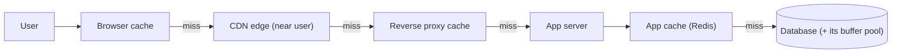
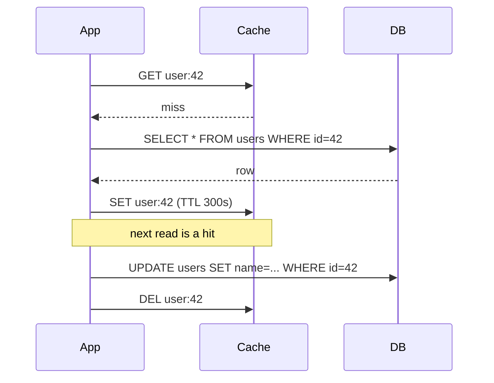
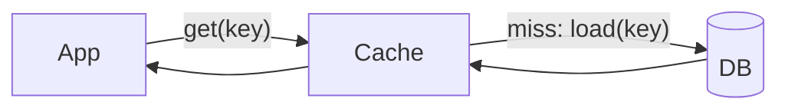
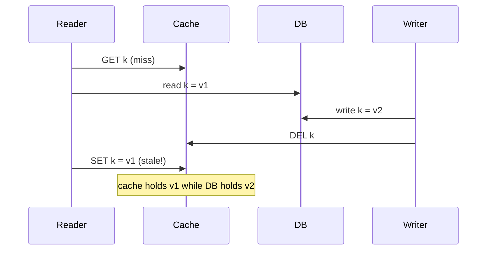
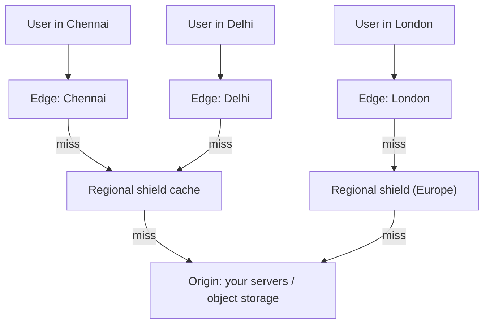

# Chapter 04 · Caching & CDNs

> Your mother doesn't walk to the market every time she needs salt. She keeps a small jar in the kitchen, and only refills it from the big bag in the store room, which gets refilled from the market once a month. That jar is a cache. It's the single most powerful trick for making systems fast, and also the source of some of the nastiest bugs in computing.

**You will learn:**
- Why caching works (locality, skewed popularity) and how to measure it (hit ratio)
- The cache layers: browser, CDN, reverse proxy, application, database
- Caching strategies: cache-aside, read-through, write-through, write-back, write-around
- Eviction policies (LRU, LFU, FIFO, TTL) with runnable implementations
- Invalidation and consistency problems, and how to live with them
- Thundering herd / cache stampede, cache penetration, cache avalanche, hot keys, and their fixes
- Redis vs Memcached, Redis data structures and use cases, CDN push vs pull, cache keys and TTL design

**Before this:** [Chapter 01 · Foundations](01-foundations-internet.md) (latency numbers, HTTP headers) · [Chapter 02 · Scalability](02-scalability-load-balancing.md) · [Chapter 03 · Databases](03-databases.md) · from DSA: [Hashing](../part-2-dsa/05-hashing.md), [Linked Lists](../part-2-dsa/10-linked-lists.md), [Heaps](../part-2-dsa/15-heaps.md)

---

## 🧠 The Big Idea

Recall the latency table from [Chapter 01](01-foundations-internet.md): RAM ≈ 100 ns, a database query over the network ≈ 1–10 ms, a cross-continent trip ≈ 150 ms. A **cache** is a small, fast store that keeps **copies** of data that's expensive to fetch or compute, **closer** to where it's needed.



Each layer answers if it can; only misses travel further. Every hit saves time **and** protects everything behind it from load.

Why does it work so well? Because access is **skewed**: a small fraction of data gets most of the requests. Today's viral video, the home page, the top 100 products. If 20% of your items get 80% of the reads, caching that 20% removes most of the load.

> 💡 **The core insight:** a cache trades **freshness** and **memory** for **speed**. Every caching decision is really the question: *how stale can this data be, and what happens when the cache is wrong or empty?*

---

## 🔨 Building It Up

### 1. Hit ratio: the number that rules caching

- **Hit**: the data was in the cache. Fast.
- **Miss**: not in the cache; go to the slow source (and usually store the result).
- **Hit ratio** = hits / (hits + misses).

The **average latency** depends heavily on the hit ratio:

```python
CACHE_MS = 0.5     # Redis in the same datacenter
DB_MS = 10.0       # database query

for hit_ratio in (0.0, 0.5, 0.9, 0.99):
    avg = hit_ratio * CACHE_MS + (1 - hit_ratio) * (CACHE_MS + DB_MS)   # misses check cache first
    db_load = 1 - hit_ratio
    print(f"hit ratio {hit_ratio:>4.0%}: avg latency {avg:5.2f} ms, DB sees {db_load:4.0%} of reads")
```

```text
hit ratio   0%: avg latency 10.50 ms, DB sees 100% of reads
hit ratio  50%: avg latency  5.50 ms, DB sees  50% of reads
hit ratio  90%: avg latency  1.50 ms, DB sees  10% of reads
hit ratio  99%: avg latency  0.60 ms, DB sees   1% of reads
```

What just happened: going from 90% to 99% hits cut the database load **10×** (10% → 1%). That's why teams fight for every percent of hit ratio. It also shows the danger: if the cache suddenly empties, the database gets 10–100× its normal load **instantly**. Keep that thought; it comes back in section 13.

Now let's see why popularity skew makes small caches effective. We simulate requests where item popularity follows a **Zipf-like** distribution (item *k* is requested proportionally to 1/k, typical of real web traffic):

```python
import random
from collections import OrderedDict

random.seed(0)
N_ITEMS = 10_000
weights = [1 / k for k in range(1, N_ITEMS + 1)]      # item 1 is most popular
requests = random.choices(range(N_ITEMS), weights=weights, k=50_000)

def hit_ratio(capacity):
    cache, hits = OrderedDict(), 0
    for item in requests:
        if item in cache:
            hits += 1
            cache.move_to_end(item)
        else:
            cache[item] = True
            if len(cache) > capacity:
                cache.popitem(last=False)              # evict least recently used
    return hits / len(requests)

for pct in (1, 5, 10, 20):
    cap = N_ITEMS * pct // 100
    print(f"cache holds {pct:>2}% of items -> hit ratio {hit_ratio(cap):.0%}")
```

```text
cache holds  1% of items -> hit ratio 39%
cache holds  5% of items -> hit ratio 58%
cache holds 10% of items -> hit ratio 67%
cache holds 20% of items -> hit ratio 76%
```

What just happened: a cache holding just **1%** of the items already serves **39%** of all requests, and 20% of the items serve about three quarters, because the popular items dominate. Notice the diminishing returns: each doubling of cache size adds less. (Real traffic is often even more skewed than this, giving higher hit ratios.) In interviews, this justifies "cache the hot 20%" estimates ([Chapter 11](11-estimation-framework.md)).

### 2. What to cache

Good candidates:

- **Read-heavy, rarely changing data**: product details, user profiles, configuration, country lists.
- **Expensive computations**: a rendered home page, a recommendation list, the result of a heavy SQL aggregation.
- **Remote API results**: exchange rates, weather, a partner's catalogue.
- **Session data** and **auth tokens** lookups.
- **Static files**: images, CSS, JS, videos (that's what CDNs are for).

Poor candidates:

- Data that changes on almost every read (a live stock order book), unless short staleness is OK.
- Data read once (a one-time report), so the cache never gets a hit.
- Highly personalised data with low reuse, unless the computation is expensive.
- Data where **staleness is dangerous**: account balance right before a withdrawal. Read those from the source of truth.

### 3. The cache layers

**1. Browser (client) cache.** The browser stores responses according to HTTP headers. Zero network cost on a hit.

```text
HTTP/1.1 200 OK
Cache-Control: public, max-age=31536000, immutable
ETag: "v3-7f2a9c"
Content-Type: application/javascript
```

- `Cache-Control: max-age=N`: fresh for N seconds; no request at all during that time.
- `no-cache`: you may store it, but **revalidate** before each use. (Confusing name!)
- `no-store`: never store it (bank statements, sensitive pages).
- `private`: only the user's browser may cache it, not shared caches like CDNs. `public`: shared caches may too.
- `ETag` / `Last-Modified`: version tags for **revalidation**. The browser asks `If-None-Match: "v3-7f2a9c"`; if unchanged, the server replies **`304 Not Modified`** with no body.

**2. CDN (Content Delivery Network).** A worldwide network of **edge servers** (also called PoPs, points of presence) that cache content close to users. A user in Chennai gets the image from a Chennai edge (5 ms) instead of a Virginia origin (220 ms). Covered in depth in section 17.

**3. Reverse proxy cache.** NGINX, Varnish or the API gateway in front of your app caches whole HTTP responses. Great for public pages and API responses shared by many users.

**4. Application cache.** Your code stores objects in:
- **Local in-process memory** (a Python dict / `functools.lru_cache`): fastest (nanoseconds), but each server has its own copy (inconsistent across servers) and it's lost on restart.
- **Distributed cache** (Redis, Memcached): shared by all servers, ~0.5–1 ms over the network, survives app restarts.

**5. Database cache.** The DB keeps hot pages in RAM (the **buffer pool**, [Chapter 03](03-databases.md)). Also **materialized views** (precomputed query results). (MySQL's old "query cache" was removed in MySQL 8.0 because invalidating it on every write hurt more than it helped, a nice lesson in itself.)

| Layer | Latency on hit | Shared by | Typical TTL | Invalidation control |
|---|---|---|---|---|
| Browser | 0 ms | One user | Seconds to a year | Weak (you can't reach into users' browsers) |
| CDN | ~5–30 ms | Users in a region | Minutes to days | Purge API, versioned URLs |
| Reverse proxy | ~1 ms | All users | Seconds to minutes | Purge, short TTL |
| App local memory | ~100 ns | One process | Seconds | Per-process, hard to sync |
| Distributed cache | ~0.5–1 ms | All app servers | Seconds to hours | Explicit delete, TTL |
| DB buffer pool | inside DB | The DB | Managed automatically | Automatic |

### 4. Strategy 1: Cache-aside (lazy loading)

The most common pattern. The **application** manages the cache:

- **Read**: check the cache. On a miss, read the DB, **put the result in the cache**, return it.
- **Write**: write to the DB, then **delete** (invalidate) the cache key.



```python
class FakeDB:
    def __init__(self):
        self.rows = {42: {"name": "Asha", "city": "Pune"}}
        self.reads = 0

    def get(self, uid):
        self.reads += 1
        return dict(self.rows[uid])

    def update(self, uid, **fields):
        self.rows[uid].update(fields)

db = FakeDB()
cache = {}

def get_user(uid):
    key = f"user:{uid}"
    if key in cache:
        return cache[key], "hit"
    value = db.get(uid)                  # miss: load from the source of truth
    cache[key] = value                   # ...and populate the cache
    return value, "miss"

def update_user(uid, **fields):
    db.update(uid, **fields)             # 1. write the database
    cache.pop(f"user:{uid}", None)       # 2. invalidate (delete, don't update)

print(get_user(42))
print(get_user(42))
update_user(42, city="Mumbai")
print(get_user(42))
print("DB reads:", db.reads)
```

```text
({'name': 'Asha', 'city': 'Pune'}, 'miss')
({'name': 'Asha', 'city': 'Pune'}, 'hit')
({'name': 'Asha', 'city': 'Mumbai'}, 'miss')
DB reads: 2
```

What just happened: the second read never touched the DB. After the update we **deleted** the key, so the next read reloaded fresh data.

**Pros:** only requested data gets cached; a cache outage doesn't break reads (they just go to the DB, slowly); simple. **Cons:** the first request for each key is slow (a miss); data can be stale until TTL/invalidation; there are race conditions (section 11).

> 💡 Why **delete** instead of updating the cache on writes? Two concurrent writers can update the DB in one order and the cache in the other, leaving the cache permanently wrong. Deleting is simpler: the next read reloads the truth. Also, you avoid computing cache values nobody may read.

### 5. Strategy 2: Read-through

Like cache-aside, but the **cache itself** loads from the database on a miss. The app only ever talks to the cache. The loading logic lives in a cache library or provider.



**Pros:** application code is simpler; loading logic is in one place. **Cons:** needs a cache that supports loaders (e.g. libraries like Caffeine in Java, or a caching layer you build); same staleness issues.

### 6. Strategy 3: Write-through

Every write goes **to the cache and the database synchronously**; the write succeeds only when both are done.

**Pros:** cache is always up to date for written keys; reads right after writes are hits. **Cons:** every write pays two writes (higher write latency); the cache fills with data that may never be read (combine with TTLs).

### 7. Strategy 4: Write-back (write-behind)

Writes go **only to the cache** and return immediately. The cache **asynchronously** flushes changes to the database later, often in batches.

**Pros:** very fast writes; batching and coalescing (10 updates to the same counter become 1 DB write). **Cons:** **risk of data loss** if the cache node dies before flushing; the DB is temporarily behind; more complex.

Good for: view counters, likes, analytics events, game scores, anything where losing a few seconds of updates is acceptable. Bad for: payments, orders.

### 8. Strategy 5: Write-around

Writes go **directly to the database**, skipping the cache. The cache is filled only on reads (usually via cache-aside).

**Pros:** the cache isn't flooded with data written once and rarely read (e.g. log entries, bulk imports). **Cons:** a read right after a write is a miss.

Let's compare the strategies side by side on the same workload:

```python
class Backend:
    def __init__(self):
        self.data, self.writes = {}, 0

    def write(self, k, v):
        self.writes += 1
        self.data[k] = v

def run(strategy):
    db, cache, dirty = Backend(), {}, set()
    for i in range(5):                       # 5 updates to the same hot counter
        if strategy == "write-through":
            cache["views"] = i; db.write("views", i)
        elif strategy == "write-back":
            cache["views"] = i; dirty.add("views")      # flush later
        elif strategy == "write-around":
            db.write("views", i); cache.pop("views", None)
    db_before_flush = db.data.get("views")
    if strategy == "write-back":                         # periodic flush
        for k in dirty:
            db.write(k, cache[k])
    return f"{strategy:<13} DB writes={db.writes}  DB before flush={db_before_flush}  " \
           f"cache has views? {'views' in cache}"

for s in ("write-through", "write-back", "write-around"):
    print(run(s))
```

```text
write-through DB writes=5  DB before flush=4  cache has views? True
write-back    DB writes=1  DB before flush=None  cache has views? True
write-around  DB writes=5  DB before flush=4  cache has views? False
```

What just happened: write-back coalesced 5 updates into **1** DB write, but until the flush the DB had **nothing**: if the cache crashed then, all 5 updates were lost. Write-through kept both in sync at the cost of 5 DB writes plus 5 cache writes. Write-around kept the cache clean but left it empty for the next read.

| Strategy | Read path | Write path | Consistency | Risk | Best for |
|---|---|---|---|---|---|
| Cache-aside | App checks cache, loads DB on miss | App writes DB, deletes key | Stale until TTL/invalidate | Races, cold misses | General purpose default |
| Read-through | Cache loads DB on miss | (paired with a write strategy) | Same as cache-aside | Needs loader support | Simplifying app code |
| Write-through | Hits for recently written data | Cache + DB synchronously | Strong for written keys | Slower writes, cache pollution | Read-after-write heavy data |
| Write-back | Hits | Cache now, DB later | DB lags | **Data loss on cache failure** | Counters, high write rates |
| Write-around | Miss after write | DB only | Fresh on next load | Read-after-write misses | Write-once, read-rarely data |

### 9. Eviction policies

Caches are small, so when full, something must go. The **eviction policy** chooses what.

- **LRU (Least Recently Used)**: evict the item not accessed for the longest time. Assumes recent = likely to be used again. The most common default.
- **LFU (Least Frequently Used)**: evict the item with the fewest accesses. Keeps long-term favourites; but an item that was popular yesterday can linger (real LFUs **decay** counts over time).
- **FIFO (First In, First Out)**: evict the oldest inserted item, regardless of use. Simple, usually worse.
- **TTL (Time To Live)**: each item expires after a set time. This is about **freshness**, not space, and is used together with LRU/LFU.
- **Random**: evict a random item. Surprisingly decent and very cheap.

**LRU** is a classic interview problem (*LRU Cache*, LeetCode 146): O(1) `get` and `put` with a **hash map + doubly linked list** ([Linked Lists](../part-2-dsa/10-linked-lists.md)). The map finds a node in O(1); the list keeps nodes in recency order so moving and evicting are O(1).

```python
class Node:
    __slots__ = ("key", "value", "prev", "next")

    def __init__(self, key=None, value=None):
        self.key, self.value = key, value
        self.prev = self.next = None

class LRUCache:
    def __init__(self, capacity):
        self.capacity = capacity
        self.map = {}
        self.head, self.tail = Node(), Node()      # sentinels: head.next = most recent
        self.head.next, self.tail.prev = self.tail, self.head

    def _remove(self, node):
        node.prev.next, node.next.prev = node.next, node.prev

    def _add_front(self, node):
        node.prev, node.next = self.head, self.head.next
        self.head.next.prev = node
        self.head.next = node

    def get(self, key):
        if key not in self.map:
            return None
        node = self.map[key]
        self._remove(node)
        self._add_front(node)                      # mark as most recently used
        return node.value

    def put(self, key, value):
        if key in self.map:
            self._remove(self.map[key])
        node = Node(key, value)
        self.map[key] = node
        self._add_front(node)
        if len(self.map) > self.capacity:
            lru = self.tail.prev                   # least recently used is at the back
            self._remove(lru)
            del self.map[lru.key]
            print(f"  evicted {lru.key}")

    def order(self):
        out, node = [], self.head.next
        while node is not self.tail:
            out.append(node.key)
            node = node.next
        return out

cache = LRUCache(3)
for k in ["a", "b", "c"]:
    cache.put(k, k.upper())
print("order (recent first):", cache.order())
cache.get("a")                                     # touch a
print("after get(a):", cache.order())
cache.put("d", "D")                                # evicts b, the least recent
print("after put(d):", cache.order())
```

```text
order (recent first): ['c', 'b', 'a']
after get(a): ['a', 'c', 'b']
  evicted b
after put(d): ['d', 'a', 'c']
```

What just happened: `get("a")` moved `a` to the front, so when `d` arrived the least recently used item was `b`. In Python, `collections.OrderedDict` with `move_to_end` and `popitem(last=False)` gives you the same thing in a few lines (we used it in section 1), and `functools.lru_cache` does it for function results.

**LFU** in O(1) uses a map from key → frequency and a map from frequency → ordered set of keys, plus a `min_freq` tracker (*LFU Cache*, LeetCode 460):

```python
from collections import defaultdict, OrderedDict

class LFUCache:
    def __init__(self, capacity):
        self.capacity = capacity
        self.values = {}                             # key -> value
        self.freq = {}                               # key -> access count
        self.buckets = defaultdict(OrderedDict)      # count -> keys (LRU order inside)
        self.min_freq = 0

    def _touch(self, key):
        f = self.freq[key]
        del self.buckets[f][key]
        if not self.buckets[f] and self.min_freq == f:
            self.min_freq += 1
        self.freq[key] = f + 1
        self.buckets[f + 1][key] = None

    def get(self, key):
        if key not in self.values:
            return None
        self._touch(key)
        return self.values[key]

    def put(self, key, value):
        if self.capacity == 0:
            return
        if key in self.values:
            self.values[key] = value
            self._touch(key)
            return
        if len(self.values) >= self.capacity:
            victim, _ = self.buckets[self.min_freq].popitem(last=False)
            del self.values[victim], self.freq[victim]
            print(f"  evicted {victim}")
        self.values[key], self.freq[key] = value, 1
        self.buckets[1][key] = None
        self.min_freq = 1

lfu = LFUCache(2)
lfu.put("home", 1); lfu.put("about", 2)
for _ in range(3):
    lfu.get("home")                                  # home is a long-term favourite
lfu.get("about")
lfu.put("promo", 3)                                  # evicts about (freq 2 < home's 4)
print(sorted(lfu.values), lfu.freq)
```

```text
  evicted about
['home', 'promo'] {'home': 4, 'promo': 1}
```

A **TTL cache** stores an expiry time with each value:

```python
class TTLCache:
    def __init__(self):
        self.store = {}                      # key -> (value, expires_at)

    def set(self, key, value, ttl, now):
        self.store[key] = (value, now + ttl)

    def get(self, key, now):
        item = self.store.get(key)
        if item is None:
            return None
        value, expires_at = item
        if now >= expires_at:                # lazy expiry: checked on access
            del self.store[key]
            return None
        return value

c = TTLCache()
c.set("rate:USD-INR", 83.2, ttl=60, now=0)
print(c.get("rate:USD-INR", now=30))
print(c.get("rate:USD-INR", now=61))
```

```text
83.2
None
```

(Redis does the same **lazy expiry** on access, plus a background job that samples keys and deletes expired ones, so memory doesn't fill with dead keys.)

| Policy | Evicts | Strength | Weakness |
|---|---|---|---|
| LRU | Longest unused | Great for recency patterns; O(1) | A one-time scan of many items flushes the hot set |
| LFU | Least used overall | Keeps steady favourites | Old popular items linger without decay; more bookkeeping |
| FIFO | Oldest inserted | Trivial | Evicts hot items just because they're old |
| Random | Any | Very cheap, no metadata | Unpredictable |
| TTL | Expired items | Bounds staleness | Not a space policy by itself |

### 10. Invalidation: the hard part

There's a famous joke attributed to Phil Karlton: *"There are only two hard things in computer science: cache invalidation and naming things."* Invalidation is hard because the cache is a **copy**, and copies drift.

Ways to keep a cache honest:

1. **TTL expiry**: simplest. Staleness is bounded by the TTL. Pick the TTL from "how stale is acceptable?"
2. **Explicit invalidation on write**: delete the key when the data changes (cache-aside). Fresh, but you must find **every** key derived from the data (the user object, the user's profile page, the "top users" list...).
3. **Event-driven invalidation**: the database's change stream (change data capture, CDC) or an event on a message queue triggers deletes in all caches ([Chapter 08](08-queues-events.md)). Decouples writers from caches.
4. **Versioned keys**: include a version in the key (`product:42:v7`). A write bumps the version; old entries are simply never read again and age out. This is how static assets work: `app.3f9a1c.js` changes name when content changes, so it can be cached "forever".

```python
cache = {}
versions = {"product:42": 1}

def key_for(entity):
    return f"{entity}:v{versions[entity]}"

def read(entity, load):
    k = key_for(entity)
    if k not in cache:
        cache[k] = load()
    return cache[k]

price = {"value": 999}
print(read("product:42", lambda: dict(price)))
price["value"] = 899                         # DB updated...
versions["product:42"] += 1                  # ...and the version bumped: no delete needed
print(read("product:42", lambda: dict(price)))
print("keys in cache:", sorted(cache))       # old version just ages out via TTL/LRU
```

```text
{'value': 999}
{'value': 899}
keys in cache: ['product:42:v1', 'product:42:v2']
```

### 11. Consistency problems you must know

**a) The stale-set race in cache-aside.** Reader R misses and reads the DB (old value). Before R writes to the cache, writer W updates the DB and deletes the key. Then R writes the **old** value into the cache. Now the cache is stale until the TTL expires.



Fixes: always set a **TTL** (bounds the damage); **delayed double delete** (delete again a short time after the write); Memcached-style **leases** (the cache hands the missing reader a token; a delete invalidates the token so the late `SET` is rejected); or versioned writes (only set if version is newer).

**b) Write ordering.** "Update cache, then DB" can leave the cache holding a value the DB rejected. "Update DB, then cache" with two concurrent writers can leave the cache with the older value. **Write DB, then delete cache** is the safest simple rule.

**c) Failed invalidation.** The DB write succeeds, the delete call to Redis times out. Mitigate with retries, TTLs, and event-driven invalidation from the DB's change log.

**d) Multiple local caches.** Each app server's in-process cache may hold a different version. Keep local TTLs short, or broadcast invalidations (Redis pub/sub).

**e) Read-your-own-writes.** A user edits their profile, refreshes, and sees the old one from cache. Fix: delete on write (so their next read misses), or bypass the cache for the user's own data for a few seconds. (We'll meet this "read-your-writes" idea again with replicas in [Chapter 05](05-replication-sharding.md).)

> 💡 The honest interview answer: "Caches are **eventually consistent** with the database. I'll use cache-aside with delete-on-write and a TTL as a safety net, and I won't cache data where staleness is unacceptable."

### 12. Thundering herd / cache stampede

A very popular key (the home page, a celebrity profile) **expires**. In the next millisecond, 5,000 requests miss at once, and all 5,000 go to the database to rebuild the same value. The DB falls over. This is a **cache stampede** (a kind of **thundering herd**: many waiters woken at once for one resource).

Fixes:

1. **Request coalescing / single-flight / mutex**: only the **first** miss rebuilds the value; others wait for it (or briefly serve the stale value). In Redis, the first request grabs a lock with `SET lock:key token NX EX 10`.
2. **Stale-while-revalidate**: keep serving the old value while **one** background task refreshes it. (HTTP has a header for this: `Cache-Control: max-age=60, stale-while-revalidate=30`.)
3. **Early probabilistic refresh**: each reader, as expiry approaches, has a small and growing chance to refresh early, so one request refreshes before everyone misses together.
4. **Never-expiring hot keys** refreshed by a background job.

```python
import threading
import time

class Database:
    def __init__(self):
        self.queries = 0
        self.lock = threading.Lock()

    def expensive_query(self):
        with self.lock:
            self.queries += 1
        time.sleep(0.05)                       # a slow query
        return "home page data"

def naive(db, cache, n=50):
    def handle():
        if "home" not in cache:
            cache["home"] = db.expensive_query()   # every miss hits the DB
    threads = [threading.Thread(target=handle) for _ in range(n)]
    for t in threads: t.start()
    for t in threads: t.join()

def single_flight(db, cache, n=50):
    rebuild_lock = threading.Lock()
    def handle():
        if "home" in cache:
            return
        with rebuild_lock:                     # only one thread rebuilds
            if "home" not in cache:            # double-check after acquiring the lock
                cache["home"] = db.expensive_query()
    threads = [threading.Thread(target=handle) for _ in range(n)]
    for t in threads: t.start()
    for t in threads: t.join()

for strategy in (naive, single_flight):
    db = Database()
    strategy(db, cache={})
    print(f"{strategy.__name__:<14}: 50 concurrent misses -> {db.queries} DB queries")
```

```text
naive         : 50 concurrent misses -> 50 DB queries
single_flight : 50 concurrent misses -> 1 DB queries
```

What just happened: with the naive approach, all 50 threads saw an empty cache and all queried the DB. With single-flight, one thread rebuilt the value while the other 49 waited on the lock, then found the cache filled (the **double-check** after acquiring the lock is essential). In a distributed system, the lock lives in Redis instead of in one process.

### 13. Cache avalanche

Many keys expire **at the same time**, or the whole cache cluster restarts, and a flood of misses hits the DB. Example: you warm 1 million product keys at 9:00 with TTL = 1 hour. At 10:00 they all expire together.

Fixes:

- **TTL jitter**: add randomness, e.g. `ttl = 3600 + random(0, 600)`, so expiries spread out.
- **High availability for the cache** (replicas, clustering), so a node failure doesn't empty it.
- **Cache warming** before sending traffic to a fresh cache.
- **Circuit breakers, rate limiting and load shedding** in front of the database ([Chapter 09](09-microservices-reliability.md)), so it degrades instead of collapsing.

```python
import random
from collections import Counter

random.seed(42)
KEYS = 10_000
BASE_TTL = 3600

no_jitter = Counter(BASE_TTL // 60 for _ in range(KEYS))
jitter = Counter((BASE_TTL + random.randint(0, 600)) // 60 for _ in range(KEYS))

print("without jitter: worst minute has", max(no_jitter.values()), "expiries")
print("with jitter   : worst minute has", max(jitter.values()), "expiries")
```

```text
without jitter: worst minute has 10000 expiries
with jitter   : worst minute has 1039 expiries
```

What just happened: without jitter, all 10,000 keys expire in the same minute. With up to 10 minutes of random jitter, they spread over 11 minutes, so the worst minute sees about a tenth of the refreshes. A wider jitter window spreads them even thinner.

### 14. Cache penetration

Requests ask for keys that **don't exist** in the DB (a bug, or an attacker requesting `product:-1`, `product:999999999` in a loop). Each request misses the cache (nothing to cache), hits the DB, finds nothing. The cache provides zero protection.

Fixes:

- **Negative caching**: cache the "not found" result too, with a short TTL (`product:999999999 → NULL, TTL 60 s`).
- **Bloom filter** in front: a compact structure holding all valid IDs. If it says "definitely not present", reject without touching cache or DB ([Chapter 03](03-databases.md) practice built one).
- **Input validation** and **rate limiting** per client.

```python
class Service:
    def __init__(self):
        self.db = {1: "phone", 2: "laptop"}
        self.cache = {}
        self.db_hits = 0
        self.MISSING = object()                       # sentinel for "known not to exist"

    def get(self, pid, negative_caching):
        if pid in self.cache:
            value = self.cache[pid]
            return None if value is self.MISSING else value
        self.db_hits += 1
        value = self.db.get(pid)
        if value is not None:
            self.cache[pid] = value
        elif negative_caching:
            self.cache[pid] = self.MISSING            # remember the absence (short TTL in real life)
        return value

for neg in (False, True):
    s = Service()
    for _ in range(1000):
        s.get(999_999, negative_caching=neg)          # attacker hammers a missing id
    print(f"negative caching={neg!s:<5}: DB hits = {s.db_hits}")
```

```text
negative caching=False: DB hits = 1000
negative caching=True : DB hits = 1
```

| Problem | What happens | Fixes |
|---|---|---|
| **Stampede / thundering herd** | One hot key expires, many concurrent misses rebuild it | Single-flight lock, stale-while-revalidate, early refresh |
| **Avalanche** | Many keys expire together / cache dies | TTL jitter, HA cache, warming, DB protection |
| **Penetration** | Requests for non-existent keys always reach DB | Negative caching, Bloom filter, validation, rate limits |
| **Hot key** | One key gets so much traffic one cache node melts | Local cache, key replication/splitting, CDN |

### 15. Hot keys

In a distributed cache, each key lives on **one** node (picked by consistent hashing, [Chapter 05](05-replication-sharding.md)). If one key is extremely hot (a celebrity's profile during a scandal, a flash-sale product), that one node takes all its traffic and melts, while the other nodes idle.

Fixes:

- **Local in-process cache** for the hottest keys (even a 1–5 second TTL absorbs most reads).
- **Key splitting / replication**: store copies under `product:42#0` … `product:42#9` on different nodes; readers pick a random suffix; writers update all copies.
- **Read replicas** of the cache node.
- **Push it to the CDN** if it's public.
- **Detect hot keys** (Redis has `--hotkeys` sampling with the LFU policy; or count keys in a sampled access log).

```python
import hashlib
import random
from collections import Counter

random.seed(1)
NODES = 4

def node_for(key):
    return int(hashlib.md5(key.encode()).hexdigest(), 16) % NODES

traffic = ["celeb:profile"] * 9000 + [f"user:{i}" for i in range(1000)]
random.shuffle(traffic)

plain = Counter(node_for(k) for k in traffic)
split = Counter(node_for(f"{k}#{random.randrange(16)}") if k == "celeb:profile" else node_for(k)
                for k in traffic)

print("per-node load, no splitting:", [plain[n] for n in range(NODES)])
print("per-node load, hot key x16 :", [split[n] for n in range(NODES)])
```

```text
per-node load, no splitting: [9268, 249, 247, 236]
per-node load, hot key x16 : [2540, 2501, 1885, 3074]
```

What just happened: without splitting, one node carries almost all 9,000 hot reads. Splitting the hot key into 16 copies (`celeb:profile#0` … `#15`, which hash to different nodes) spreads that traffic across all nodes. The cost: a write must update (or delete) all 16 copies.

### 16. Redis vs Memcached, and Redis data structures

Both are in-memory key-value stores used as distributed caches.

| | Memcached | Redis |
|---|---|---|
| Data types | Strings (blobs) only | Strings, hashes, lists, sets, sorted sets, streams, bitmaps, HyperLogLog, geo |
| Threading | Multi-threaded | Command execution is mainly single-threaded (I/O threads optional), so each command is atomic |
| Persistence | None | Optional: RDB snapshots, AOF (append-only log) |
| Replication / HA | None built in (client-side sharding) | Replicas, Sentinel for failover, Redis Cluster for sharding |
| Extras | Simple, fast | Pub/sub, Lua scripts, transactions (MULTI), TTL per key, streams |
| Eviction | LRU | Configurable: `allkeys-lru`, `allkeys-lfu`, `volatile-ttl`, `noeviction`, ... |
| Choose when | Pure, simple, large object cache, multi-core scaling | Almost everything else |

**Redis data structures and what they're for:**

| Structure | Commands (examples) | Use cases |
|---|---|---|
| String | `SET`, `GET`, `INCR`, `SETNX`, `EXPIRE` | Cached objects, counters, rate-limit counters, distributed locks |
| Hash | `HSET`, `HGET`, `HINCRBY` | Objects with fields (user profile), partial updates |
| List | `LPUSH`, `RPOP`, `LRANGE`, `BLPOP` | Recent items, simple queues |
| Set | `SADD`, `SISMEMBER`, `SINTER` | Unique visitors, tags, "mutual friends" |
| Sorted set (ZSET) | `ZADD`, `ZINCRBY`, `ZREVRANGE`, `ZRANGEBYSCORE` | **Leaderboards**, priority queues, timelines by score, sliding-window rate limiting |
| Bitmap | `SETBIT`, `BITCOUNT` | Daily active users per day as one bit per user ID |
| HyperLogLog | `PFADD`, `PFCOUNT` | Approximate unique counts with ~12 KB memory (≈0.81% error) |
| Geo | `GEOADD`, `GEOSEARCH` | "Drivers within 2 km" |
| Stream | `XADD`, `XREADGROUP` | Event logs, lightweight message queues with consumer groups |
| Pub/Sub | `PUBLISH`, `SUBSCRIBE` | Fire-and-forget notifications, cache invalidation broadcasts |

A Redis sorted set is roughly a hash map plus a skip list (a sorted structure with O(log n) inserts). Here's the leaderboard idea in plain Python, to see what `ZINCRBY` and `ZREVRANGE` give you:

```python
import heapq

scores = {}                                    # member -> score (Redis keeps this sorted)

def zincrby(member, delta):
    scores[member] = scores.get(member, 0) + delta

def zrevrange(n):
    return heapq.nlargest(n, scores.items(), key=lambda kv: (kv[1], kv[0]))

for player, pts in [("asha", 50), ("ravi", 30), ("meera", 70), ("asha", 40), ("kabir", 10)]:
    zincrby(player, pts)
print("top 3:", zrevrange(3))
```

```text
top 3: [('asha', 90), ('meera', 70), ('ravi', 30)]
```

(Real Redis does `ZREVRANGE leaderboard 0 2 WITHSCORES` in O(log n + k) because the set is always kept sorted; our `nlargest` is O(n log k), fine for a demo.)

**Eviction config matters:** set `maxmemory` and a policy. For a pure cache, `allkeys-lru` or `allkeys-lfu`. If Redis also stores data you can't lose (sessions without a DB copy), be careful: eviction will delete it. Many teams run **separate** Redis clusters for "cache" (evictable) and "data" (not evictable).

### 17. CDNs in depth

A **CDN** is a geographically distributed set of caching proxy servers. Users are routed (by GeoDNS or anycast, [Chapter 02](02-scalability-load-balancing.md)) to the nearest **edge**. The edge serves cached content or fetches it from your **origin** (your servers or object storage).



What CDNs serve:

- **Static assets**: images, CSS, JS, fonts. The classic use.
- **Video and large files**: video segments for streaming ([Chapter 13](13-case-studies-2.md)), software downloads.
- **Dynamic content acceleration**: even uncacheable API calls benefit, because TLS terminates near the user and the edge keeps warm, optimised connections to the origin.
- **Security**: DDoS absorption, web application firewall (WAF), bot filtering.
- **Edge compute**: small functions running at the edge (redirects, A/B tests, auth checks).

**Pull CDN** (the common default): the edge fetches from the origin **on the first request** (a miss), then caches according to `Cache-Control` headers.

- Pros: zero setup per file; only requested content occupies edge storage.
- Cons: the first user in each region pays the miss; origin must be available.

**Push CDN**: **you upload** content to the CDN ahead of time; the CDN never pulls.

- Pros: no first-request miss; full control of what's there; good for large files known in advance (a game patch, a movie release).
- Cons: you manage uploads and deletions; storage costs for content nobody requests.

| | Pull CDN | Push CDN |
|---|---|---|
| Content arrives at edge | On first request | When you upload |
| First request | Slow (miss) | Fast |
| Operational effort | Low | Higher (upload pipeline) |
| Storage use | Only what's requested | Everything you push |
| Best for | Websites, many small assets, frequently changing sites | Large files, predictable releases, low-traffic big content |

**Origin shield**: an extra cache tier between edges and the origin. Instead of 200 edges each missing and hitting your origin, they ask a regional shield, so the origin sees roughly one request per object per region. It's stampede protection at the CDN level.

**Invalidating CDN content:**

- **Versioned file names** (`logo.8c1f2e.png`), the best way: new content = new URL, so old caches don't matter. Set `max-age=31536000, immutable`.
- **Purge API** (by URL, by tag, or everything), slower to propagate and easy to forget.
- **Short TTLs** for HTML pages that reference the versioned assets.

### 18. Designing cache keys and TTLs

**Cache keys** must uniquely identify the content **and everything that changes it**.

- Use a clear namespace: `service:entity:id[:variant]`, e.g. `catalog:product:42:en-IN`.
- Include anything that changes the response: language, currency, device type, API version, user ID for personalised data, query parameters (sorted, so `?a=1&b=2` and `?b=2&a=1` share a key).
- Exclude noise: tracking parameters like `utm_source` that don't change the content, otherwise each campaign creates a new key and the hit ratio collapses.
- Hash very long keys (e.g. a search query) to a fixed length.
- Never let a key for **personal** data be shared: `profile:42` must not be served to user 43. With HTTP caches, use `Cache-Control: private` or the `Vary` header for anything that depends on cookies or auth.

```python
import hashlib
from urllib.parse import urlencode

IGNORED_PARAMS = {"utm_source", "utm_medium", "utm_campaign", "fbclid"}

def cache_key(path, params, locale, api_version="v2"):
    kept = sorted((k, v) for k, v in params.items() if k not in IGNORED_PARAMS)
    raw = f"{api_version}:{locale}:{path}?{urlencode(kept)}"
    digest = hashlib.sha256(raw.encode()).hexdigest()[:16]   # fixed-length key
    return f"search:{digest}", raw

print(cache_key("/search", {"q": "shoes", "page": "2", "utm_source": "insta"}, "en-IN"))
print(cache_key("/search", {"page": "2", "q": "shoes"}, "en-IN"))
print(cache_key("/search", {"page": "2", "q": "shoes"}, "hi-IN"))
```

```text
('search:bac8bea3b8561061', 'v2:en-IN:/search?page=2&q=shoes')
('search:bac8bea3b8561061', 'v2:en-IN:/search?page=2&q=shoes')
('search:7e758dc8b78c3ced', 'v2:hi-IN:/search?page=2&q=shoes')
```

What just happened: the first two requests (different parameter order, one with a tracking parameter) map to the **same** key, so they share a cache entry. A different locale gets a different key, as it should.

**TTL design**: ask "how stale can this be, and how expensive is a miss?"

| Data | Suggested TTL | Reason |
|---|---|---|
| Versioned static assets (`app.3f9a.js`) | 1 year, `immutable` | Content never changes under this name |
| Product images | Days | Rarely change; use versioned URLs if they do |
| Product details / prices | 1–10 minutes + delete on write | Changes occasionally; staleness mildly bad |
| Home page / trending lists | 30–60 s + stale-while-revalidate | Expensive to build, fine if slightly old |
| User session | Session lifetime (e.g. 30 min sliding) | Security |
| Exchange rates, weather | Matches source update rate | No point refreshing faster than the source |
| Negative results ("not found") | 30–60 s | Block penetration but allow new items to appear |
| Account balance, stock at checkout | Don't cache (or ~0) | Staleness causes real harm |

Always add **jitter** to TTLs of keys created in bulk.

---

## 🔬 Under the Hood

### Why LRU needs a doubly linked list, not just a dict

To evict the least recent item you need the **order** of use. A list where you move an element to the front on each access is O(n) to find and move. A doubly linked list gives O(1) unlink-and-move **if you already have a pointer to the node**, and the hash map gives you that pointer in O(1). The `prev` pointer is needed so a node can unlink itself without searching for its predecessor. Python's `OrderedDict` is implemented with exactly this idea (a dict plus a doubly linked list of keys).

### How Redis approximates LRU

Exact LRU needs a linked list across all keys, which costs memory and pointer updates on every read. Redis instead stores a small "last access" clock in each key and, when it must evict, **samples** a few random keys (5 by default, configurable with `maxmemory-samples`) and evicts the oldest among them (keeping a small pool of good candidates). With 10 samples it's very close to true LRU, at a fraction of the cost. Redis's LFU mode uses a tiny **logarithmic counter** per key with **decay** over time, so old popularity fades.

### Why a single-threaded Redis is so fast

All data is in RAM, operations are simple O(1) or O(log n) data-structure updates, and an event loop handles thousands of connections without context switches between threads. A single Redis node can typically serve on the order of 100,000+ simple operations per second. Single-threaded command execution also makes each command **atomic** without locks: `INCR` can never lose an update. To use more cores, you run more Redis nodes (Redis Cluster shards keys across 16,384 **hash slots**).

### What really happens at a CDN edge

The edge computes a cache key (by default the URL plus some headers), looks it up in RAM, then SSD. On a miss it fetches from the shield/origin, often **collapsing** concurrent identical requests into one (request coalescing), stores the response according to `Cache-Control`/`s-maxage`, and streams it to the user. Edges also keep long-lived, tuned TCP/TLS connections to origins, so even an uncacheable request is faster than the user connecting to the origin directly.

### HTTP revalidation saves bandwidth, not round trips

When a cached response is stale, the browser sends a conditional request (`If-None-Match: "etag"`). If unchanged, the server answers `304 Not Modified` with no body. That saves bytes but still costs a full round trip. That's why `max-age` (no request at all) plus **versioned URLs** beats ETags alone for static assets.

---

## 🧩 Pattern Decoder

### Decision guide: which strategy?

| If you need... | Choose | Because |
|---|---|---|
| A safe default for read-heavy data | Cache-aside + delete on write + TTL | Simple, resilient to cache outages |
| Simpler app code, centralised loading | Read-through | Cache library owns the loading |
| Reads right after writes to hit the cache | Write-through | Cache updated synchronously |
| Extreme write rates, OK to lose a little | Write-back | Batching and coalescing |
| Bulk writes rarely read back | Write-around | Avoids cache pollution |

### Decision guide: which layer?

| Content | Layer |
|---|---|
| Static files, images, video | CDN + browser cache (versioned URLs) |
| Public HTML pages / public API responses | CDN or reverse proxy, short TTL |
| Per-user data (profile, cart, session) | Distributed cache (Redis), keyed by user |
| Ultra-hot config / feature flags | Local in-process cache with short TTL |
| Expensive DB aggregates | Distributed cache or materialized view |

### Decision guide: eviction policy

| Access pattern | Policy |
|---|---|
| Recent items are likely reused (sessions, feeds) | LRU |
| Steady long-term favourites (catalogue, popular pages) | LFU (with decay) |
| Data must not be older than X | TTL (plus LRU/LFU for space) |
| Everything in the cache is equally valuable | Random / FIFO is fine |

### Decision guide: failure modes

| Symptom | Diagnosis | Fix |
|---|---|---|
| DB spikes when one popular key expires | Stampede | Single-flight lock, stale-while-revalidate, early refresh |
| DB spikes at regular intervals or after cache restart | Avalanche | TTL jitter, HA cache, warm-up, DB protection |
| DB load from IDs that don't exist | Penetration | Negative caching, Bloom filter, validation |
| One cache node at 100% CPU, others idle | Hot key | Local cache, key splitting, replicas |
| Users see old data after edits | Invalidation gaps / stale-set race | Delete on write, TTL, leases/versions, read-your-writes bypass |

### Trade-off table: Redis vs Memcached

| Need | Pick |
|---|---|
| Rich structures, leaderboards, rate limiters, locks, pub/sub, persistence, replication | Redis |
| Simple large-blob cache, multi-threaded scaling on big machines | Memcached |

### When NOT to cache

- Data that must be **exactly** current at the moment of use (balances during a transfer, inventory at final checkout). Read from the source of truth.
- When the hit ratio would be low (unique queries, one-time reads): you add latency (a miss costs cache + DB) and complexity for nothing.
- As a band-aid for a missing index. Fix the query first ([Chapter 03](03-databases.md)).
- When you can't answer "what happens when the cache is empty?". Every design must survive a cold cache.

---

## ⚠️ Traps & Common Mistakes

1. **No TTL.** A missed invalidation then lives forever. Always set a TTL as a safety net.
2. **Updating the cache instead of deleting on write.** Concurrent writers can leave the older value cached. Delete, and let the next read reload.
3. **Caching personalised responses in a shared cache** without the user in the key, which leaks one user's data to another. Use `private`, `Vary`, or user-specific keys.
4. **Same TTL for millions of keys** → avalanche. Add jitter.
5. **Not caching "not found"** → penetration. Cache negatives briefly.
6. **Treating the cache as the source of truth** (with eviction on!). Evicted = lost. Keep durable data in a database.
7. **Unbounded local caches** that grow until the process runs out of memory:

```py
# ❌ grows forever
_cache = {}
def get_price(pid):
    if pid not in _cache:
        _cache[pid] = load_price(pid)
    return _cache[pid]

# ✅ bounded, evicts least recently used
from functools import lru_cache

@lru_cache(maxsize=10_000)
def get_price(pid):
    return load_price(pid)
```

8. **Write-back for money.** A cache node crash loses acknowledged writes.
9. **Cache keys including noise** (`utm_*`, timestamps), which destroys the hit ratio.
10. **Forgetting to invalidate derived keys** ("top products", search results) when a product changes.
11. **Ignoring cold start**: deploying a fresh cache cluster at peak traffic sends 100% of reads to the DB.
12. **Using `no-cache` thinking it means "don't cache".** It means "revalidate before use". `no-store` means "don't store".

---

## 💡 Tips & Tricks

- Interview opener: **"This is read-heavy, so I'll add a cache-aside Redis layer in front of the DB and a CDN for static content."** Then discuss invalidation and failure modes; that's where points are won.
- Quote the **hit ratio math**: 99% hits = 1% of reads reach the DB. A cache outage = 100× DB load. So plan for cache failure.
- For static assets: **content-hashed file names + `max-age=31536000, immutable`**. Invalidation solved.
- Use **stale-while-revalidate** wherever slightly old data is fine: it hides both latency and stampedes.
- Put a **short local cache (1–5 s)** in front of Redis for the hottest keys. It absorbs hot-key spikes cheaply.
- Size the cache from the working set: estimate "hot data = 20% of daily reads' unique items × object size" ([Chapter 11](11-estimation-framework.md)).
- Monitor **hit ratio, eviction rate, memory, latency, and hot keys**. A falling hit ratio is an early warning.
- Remember LRU = **hash map + doubly linked list**; LFU = **key→freq + freq→ordered keys + min_freq**.

---

## 🎯 Interview Questions

### 1. Design an LRU cache with O(1) get and put. 🔥🔥🔥

<details><summary>Answer</summary>

Use a hash map from key → node and a doubly linked list ordered by recency (with head/tail sentinels). `get`: look up the node, move it to the front, return its value. `put`: if present, update and move to front; otherwise insert at front and, if over capacity, remove the node before the tail (least recent) and delete its key from the map. All operations are O(1) because the map gives direct node access and the doubly linked list allows O(1) unlinking. In Python, `OrderedDict` with `move_to_end` and `popitem(last=False)` implements the same structure. See the full implementation in section 9. (LeetCode 146: *LRU Cache*.)

</details>

### 2. Explain cache-aside, write-through, write-back and write-around. 🔥🔥🔥

<details><summary>Answer</summary>

- **Cache-aside**: app reads cache; on miss loads DB and populates cache; on write updates DB and deletes the key. Default choice; resilient; possible staleness.
- **Write-through**: writes go to cache and DB synchronously; cache stays fresh for written keys; slower writes, cache pollution.
- **Write-back**: writes go to cache, flushed to DB asynchronously in batches; fastest writes; risk of losing data if the cache fails; DB lags.
- **Write-around**: writes go only to DB; cache filled on reads; avoids polluting the cache with write-once data; first read after write misses.
- (**Read-through**: the cache itself loads from the DB on a miss.)

</details>

### 3. How do you keep the cache consistent with the database? 🔥🔥🔥

<details><summary>Answer</summary>

Accept that caches are eventually consistent, then bound and reduce staleness: write the DB first, then **delete** the cache key; always set a **TTL**; for races (a reader setting a stale value after a delete) use leases/version checks or delayed double delete; drive invalidation from the DB change stream (CDC) or events for reliability; use versioned keys for immutable snapshots; for read-your-own-writes, bypass or delete the user's keys on write. Don't cache data where staleness is unacceptable; read it from the source of truth.

</details>

### 4. What is a cache stampede (thundering herd) and how do you prevent it? 🔥🔥🔥

<details><summary>Answer</summary>

When a hot key expires or is evicted, many concurrent requests miss simultaneously and all hit the backend to recompute the same value, potentially overloading it. Prevention: **request coalescing / single-flight** (one rebuilder holds a lock, e.g. Redis `SET NX EX`; others wait or serve stale); **stale-while-revalidate** (serve old value while one background refresh runs); **probabilistic early expiration** (refresh slightly before TTL with increasing probability); background refresh of known hot keys; CDN origin shields and request collapsing for HTTP.

</details>

### 5. Cache penetration vs cache avalanche vs hot keys? 🔥🔥

<details><summary>Answer</summary>

- **Penetration**: queries for keys that don't exist bypass the cache every time and hit the DB. Fix: cache negative results with short TTL, Bloom filter of valid keys, input validation, rate limits.
- **Avalanche**: many keys expire at once or the cache cluster fails, flooding the DB. Fix: TTL jitter, highly available cache (replicas/cluster), warming, circuit breakers and load shedding on the DB.
- **Hot key**: one key's traffic overwhelms the single node holding it. Fix: local in-process caching, replicating/splitting the key across nodes, read replicas, CDN for public data.

</details>

### 6. Redis vs Memcached? 🔥🔥

<details><summary>Answer</summary>

Memcached is a simple, multi-threaded, in-memory string cache with LRU eviction and no persistence or built-in replication: great for plain object caching. Redis offers rich data structures (hashes, lists, sets, sorted sets, streams, HyperLogLog, geo, bitmaps), atomic operations, Lua scripting, pub/sub, optional persistence (RDB/AOF), replication with Sentinel failover, and Redis Cluster sharding. Redis is usually chosen because one tool covers caching, sessions, rate limiting, leaderboards, locks and lightweight queues.

</details>

### 7. What are the different eviction policies? When would you use LFU over LRU? 🔥🔥

<details><summary>Answer</summary>

LRU evicts the least recently used item; LFU the least frequently used; FIFO the oldest inserted; random any item; TTL removes expired items (freshness, not space). Use **LRU** when recency predicts reuse (sessions, feeds). Use **LFU** when popularity is stable over time and you want to protect long-term favourites from being flushed by one-off scans (e.g. a catalogue where a crawler touches every product once); real LFUs decay counts so yesterday's hits don't stay forever.

</details>

### 8. What is a CDN, and when would you use push vs pull? 🔥🔥🔥

<details><summary>Answer</summary>

A CDN is a globally distributed network of edge caches that serve content from locations near users, cutting latency and offloading the origin; it also provides TLS termination near users, DDoS protection and sometimes edge compute. **Pull**: edges fetch from origin on first request and cache per headers; easy, efficient for many small or changing assets. **Push**: you upload content to the CDN in advance; no first-request miss, good for large, predictable content (video releases, game patches) at the cost of managing uploads and storage. Use versioned URLs for invalidation and an origin shield to protect the origin.

</details>

### 9. How would you cache a personalised home feed? 🔥🔥

<details><summary>Answer</summary>

Split the page: the shared parts (layout, trending items, static assets) go to the CDN; personalised parts are cached per user in Redis (`feed:{user_id}`, e.g. a list of post IDs with a short TTL), and post bodies are cached separately by ID (`post:{id}`) so they're shared across users. Hydrate the feed by multi-getting post IDs. Invalidate/append on new posts (push model) or rebuild on read with stale-while-revalidate. Never cache a personalised response under a shared key. (Full design in [Chapter 13](13-case-studies-2.md).)

</details>

### 10. How do you choose a TTL? 🔥🔥

<details><summary>Answer</summary>

From two questions: how stale may the data be, and how costly is a miss? Immutable/versioned assets: a year. Rarely changing data: minutes to hours plus delete-on-write. Expensive, freshness-tolerant aggregates: short TTL with stale-while-revalidate. Negative results: short (30–60 s). Security-sensitive data (sessions/tokens): tied to their lifetime. Data where staleness causes harm: don't cache. Add random jitter to avoid synchronized expiry, and monitor the hit ratio to tune it.

</details>

### 11. What happens if your cache cluster goes down? 🔥🔥

<details><summary>Answer</summary>

With cache-aside, reads fall through to the database, multiplying its load by 1/(1 − hit ratio) (e.g. 100× at 99% hits), which can cascade into a full outage. Mitigations: make the cache highly available (replicas, cluster, multi-AZ); protect the DB with circuit breakers, rate limiting, request coalescing, and load shedding; keep a small local cache; warm caches gradually after recovery; and design the DB to survive a degraded period (read replicas). Discussing this shows maturity.

</details>

### 12. Where can caching happen in a web request path? 🔥

<details><summary>Answer</summary>

Browser (HTTP cache via Cache-Control/ETag), DNS caches, CDN edges and shields, reverse proxy/API gateway caches, application in-process caches, distributed caches (Redis/Memcached), and inside the database (buffer pool, materialized views). Plus OS page cache and CPU caches at the hardware level. Each layer closer to the user is faster but harder to invalidate.

</details>

---

## 🏋️ Practice

**🟢 1. Hit ratio math.** A Redis lookup takes 1 ms, a DB query 20 ms. What hit ratio do you need for an average read latency under 3 ms (misses check the cache first)?

<details><summary>Solution</summary>

avg = h × 1 + (1 − h) × (1 + 20) = 1 + 20(1 − h) < 3 → 1 − h < 0.1 → **h > 90%**.

```python
for h in (0.85, 0.9, 0.95):
    print(h, round(1 + 20 * (1 - h), 2))   # round: floating point isn't exact
```

```text
0.85 4.0
0.9 3.0
0.95 2.0
```

Strictly under 3 ms needs just over 90%.

</details>

**🟢 2. Pick the headers.** Choose `Cache-Control` for: (a) `app.4f8e1a.js`, (b) the HTML home page that changes every few minutes, (c) `/account/statement`, (d) a user's avatar served at `/avatars/42.jpg` that users can change.

<details><summary>Solution</summary>

(a) `public, max-age=31536000, immutable` (content-hashed name).
(b) `public, max-age=60, stale-while-revalidate=30` (or `no-cache` with an ETag if it must be fresh).
(c) `no-store` (sensitive, personal).
(d) Better to version the URL (`/avatars/42.v3.jpg`) and cache long. If the URL must stay fixed: `public, max-age=300` plus an ETag, and purge the CDN on change.

</details>

**🟡 3. LRU with OrderedDict.** Implement *LRU Cache* (LeetCode 146) in under 20 lines using `OrderedDict`, returning -1 for missing keys, and run the official example.

<details><summary>Solution</summary>

```python
from collections import OrderedDict

class LRUCache:
    def __init__(self, capacity):
        self.cap, self.d = capacity, OrderedDict()

    def get(self, key):
        if key not in self.d:
            return -1
        self.d.move_to_end(key)
        return self.d[key]

    def put(self, key, value):
        self.d[key] = value
        self.d.move_to_end(key)
        if len(self.d) > self.cap:
            self.d.popitem(last=False)

c = LRUCache(2)
c.put(1, 1); c.put(2, 2)
print(c.get(1))      # 1
c.put(3, 3)          # evicts 2
print(c.get(2))      # -1
c.put(4, 4)          # evicts 1
print(c.get(1), c.get(3), c.get(4))
```

```text
1
-1
-1 3 4
```

</details>

**🟡 4. Stale-while-revalidate.** Implement a cache `get(key, now)` where each entry has `fresh_until` and `stale_until`. Fresh → return. Stale but within `stale_until` → return the old value **and** schedule one refresh (record it in a list). Beyond `stale_until` → load synchronously.

<details><summary>Solution</summary>

```python
class SWRCache:
    def __init__(self, loader, ttl=60, swr=30):
        self.loader, self.ttl, self.swr = loader, ttl, swr
        self.entries = {}                 # key -> (value, fresh_until, stale_until)
        self.refreshing = set()
        self.log = []

    def _load(self, key, now):
        value = self.loader(key, now)
        self.entries[key] = (value, now + self.ttl, now + self.ttl + self.swr)
        self.refreshing.discard(key)
        return value

    def get(self, key, now):
        entry = self.entries.get(key)
        if entry is None or now >= entry[2]:
            self.log.append(f"t={now}: sync load")
            return self._load(key, now)
        value, fresh_until, _ = entry
        if now >= fresh_until and key not in self.refreshing:
            self.refreshing.add(key)
            self.log.append(f"t={now}: serve stale, refresh in background")
        return value

    def run_background(self, now):
        for key in list(self.refreshing):
            self._load(key, now)
            self.log.append(f"t={now}: background refresh done")

cache = SWRCache(loader=lambda k, now: f"{k}@{now}")
print(cache.get("home", 0))
print(cache.get("home", 70))      # stale: old value, refresh scheduled
print(cache.get("home", 71))      # still stale, refresh NOT scheduled twice
cache.run_background(72)
print(cache.get("home", 73))
print(cache.get("home", 500))     # far past stale window: sync load
print(*cache.log, sep="\n")
```

```text
home@0
home@0
home@0
home@72
home@500
t=0: sync load
t=70: serve stale, refresh in background
t=72: background refresh done
t=500: sync load
```

</details>

**🟡 5. Design the cache for a product page.** 50,000 product page views per second, 200 price updates per second, 2 million products, 20% of products get 90% of views. Each product object is ~2 KB. Choose strategy, keys, TTLs, eviction, and estimate cache memory.

<details><summary>Solution</summary>

- **Strategy:** cache-aside on `product:{id}:{locale}`; on price update, write DB then delete the key (or publish an invalidation event). TTL 10 min with jitter as a safety net.
- **Hot set:** 20% × 2M = 400,000 products × 2 KB ≈ **800 MB** (plus overhead; say ~1.5 GB). Easily fits in one Redis node; use a small cluster with replicas for HA and throughput.
- **Eviction:** `allkeys-lfu` (steady popularity).
- **Images:** CDN with versioned URLs.
- **Hot keys during sales:** add a 2-second local in-process cache.
- **Checkout:** read price and stock from the DB (source of truth), not the cache.

</details>

**🔴 6. Distributed single-flight.** Simulate the Redis lock pattern for stampede protection: a `FakeRedis` with `set_nx(key, value, ttl, now)` and `delete_if_value(key, value)`. Ten workers miss at `now=0`; only the lock winner rebuilds. Explain why the lock needs a TTL and why delete must check the value.

<details><summary>Solution</summary>

```python
class FakeRedis:
    def __init__(self):
        self.data = {}                      # key -> (value, expires_at)

    def set_nx(self, key, value, ttl, now):
        item = self.data.get(key)
        if item and item[1] > now:
            return False                    # someone else holds it
        self.data[key] = (value, now + ttl)
        return True

    def delete_if_value(self, key, value):  # in real Redis: a small Lua script
        if key in self.data and self.data[key][0] == value:
            del self.data[key]
            return True
        return False

redis = FakeRedis()
rebuilds = []
for worker in range(10):
    token = f"worker-{worker}"
    if redis.set_nx("lock:home", token, ttl=10, now=0):
        rebuilds.append(token)              # rebuild the cache value here
    # losers: wait briefly and re-read the cache, or serve stale
print("rebuilt by:", rebuilds)
print("loser can't release winner's lock:", redis.delete_if_value("lock:home", "worker-5"))
print("winner releases its own lock    :", redis.delete_if_value("lock:home", "worker-0"))
```

```text
rebuilt by: ['worker-0']
loser can't release winner's lock: False
winner releases its own lock    : True
```

The **TTL** ensures that if the winner crashes, the lock frees itself and someone else can rebuild. The **value check** on delete ensures a slow worker whose lock already expired (and was taken by another worker) doesn't delete someone else's lock. (Locks and their limits, including fencing tokens, are covered in [Chapter 06](06-cap-consistency.md).)

</details>

**🔴 7. Compare eviction policies on a scan.** Simulate a workload of a hot set (keys 0–49, repeatedly accessed) interrupted by a one-time scan of keys 1000–1199. With capacity 60, compare LRU and LFU hit ratios on the hot traffic after the scan.

<details><summary>Solution</summary>

```python
import random
from collections import OrderedDict, Counter

random.seed(3)
hot = [random.randrange(50) for _ in range(3000)]
workload = hot[:1500] + list(range(1000, 1200)) + hot[1500:]

def lru_hits(cap):
    c, hits = OrderedDict(), []
    for k in workload:
        hit = k in c
        hits.append(hit)
        if hit:
            c.move_to_end(k)
        else:
            c[k] = 1
            if len(c) > cap:
                c.popitem(last=False)
    return hits

def lfu_hits(cap):
    c, freq, hits = set(), Counter(), []
    for k in workload:
        freq[k] += 1
        hit = k in c
        hits.append(hit)
        if not hit:
            if len(c) >= cap:
                victim = min(c, key=lambda x: freq[x])
                c.remove(victim)
            c.add(k)
    return hits

after_scan = slice(1700, 1800)               # first 100 hot requests after the scan
for name, f in (("LRU", lru_hits), ("LFU", lfu_hits)):
    h = f(60)[after_scan]
    print(f"{name}: hit ratio right after scan = {sum(h) / len(h):.0%}")
```

```text
LRU: hit ratio right after scan = 58%
LFU: hit ratio right after scan = 100%
```

The scan pushes the entire hot set out of LRU (each scanned key is "most recent"), so hot traffic misses until it re-warms. LFU keeps the hot keys because their counts are high, and the scanned keys (count 1) evict each other instead. This is called **scan resistance**.

</details>

---

## 🧠 Never-Forget Summary

- A cache keeps **copies** of expensive data **closer** to the user. It trades freshness and memory for speed.
- **Hit ratio** rules everything: 99% hits → the DB sees 1% of reads; an empty cache → 100× DB load.
- Layers: **browser → CDN → reverse proxy → app (local, Redis) → DB buffer pool**.
- Strategies: **cache-aside** (default), read-through, **write-through** (fresh), **write-back** (fast, risky), write-around (no pollution).
- Eviction: **LRU** (hash map + doubly linked list), **LFU** (frequency buckets), FIFO, random; **TTL** for freshness.
- Invalidation: **write DB, then delete key**, always with a TTL; versioned keys; event-driven invalidation.
- Failure modes: **stampede** (single-flight, stale-while-revalidate), **avalanche** (jitter, HA), **penetration** (negative cache, Bloom filter), **hot keys** (local cache, splitting).
- **Redis** = data structures + persistence + replication; **Memcached** = simple multi-threaded blobs.
- **CDN**: pull (lazy) vs push (preloaded); origin shield; invalidate with versioned URLs.
- Keys include everything that changes the response and nothing that doesn't.

**Memory hooks:**
- **"Aside, Through, Back, Around"**: who writes where and when.
- **"Write the truth, delete the copy."**
- **"Herd, Avalanche, Penetration, Hot key"**: one key expires, many keys expire, keys that don't exist, one key too popular.
- **"Hash for finding, list for ordering"**: that's LRU.

**One picture:**

| Question | Answer |
|---|---|
| Where? | As close to the user as freshness allows (browser/CDN > Redis > DB) |
| What? | Hot, read-heavy, expensive, staleness-tolerant data |
| How to fill? | Cache-aside (lazy) or write-through (eager) |
| How to keep fresh? | TTL + delete on write + versioned keys |
| How to evict? | LRU by default, LFU for stable favourites |
| How does it fail? | Stampede, avalanche, penetration, hot keys, stale races |
| What if it's gone? | DB must survive: coalescing, rate limits, HA cache |

> **If you remember only one thing:** a cache is a **copy that can lie**; decide how long it may lie (TTL), make writes delete it, and make sure the system survives when the cache is empty.

---
**Next:** [Chapter 05 · Replication, Sharding & Consistent Hashing](05-replication-sharding.md)  ·  **Back to** [Contents](../README.md)
