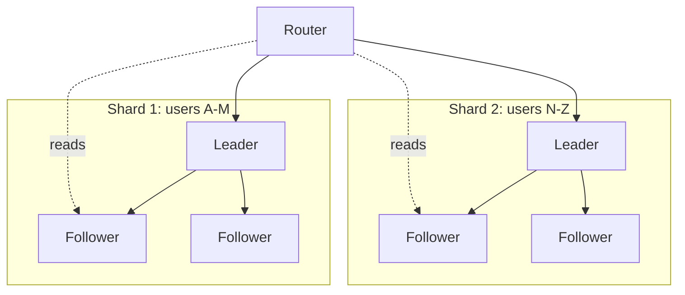
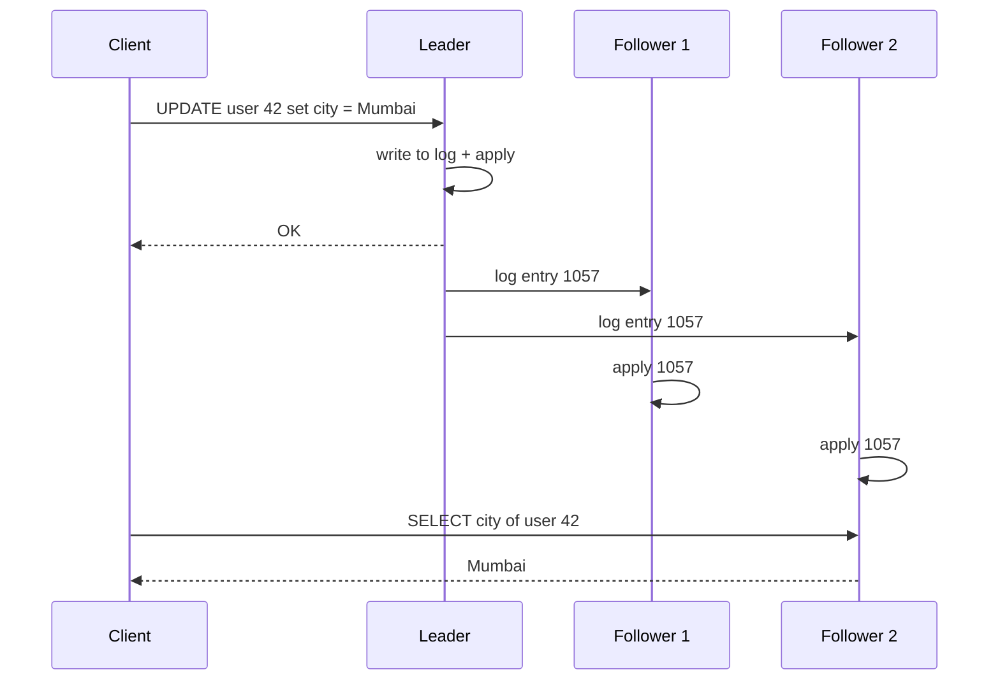
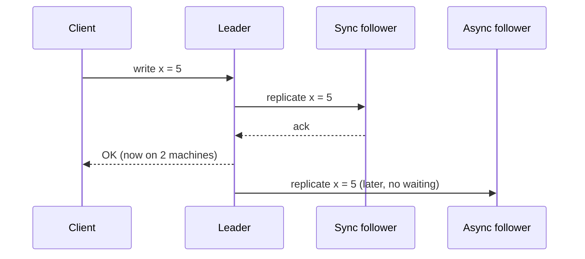
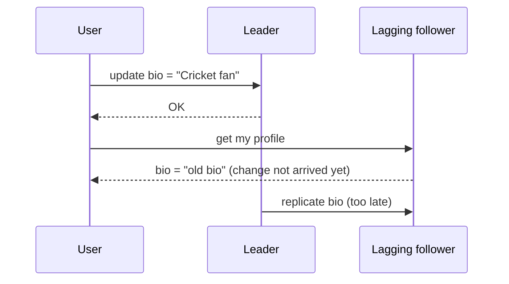
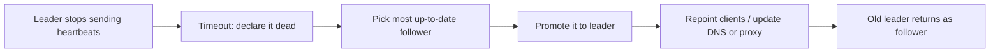
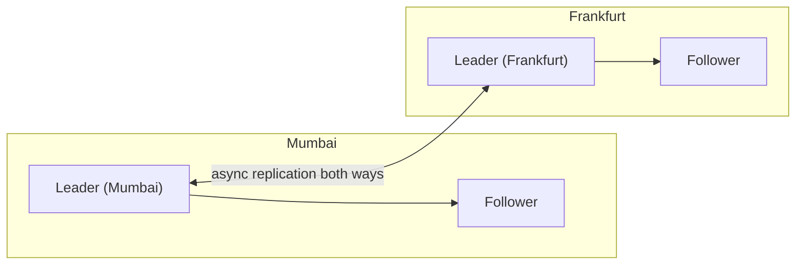
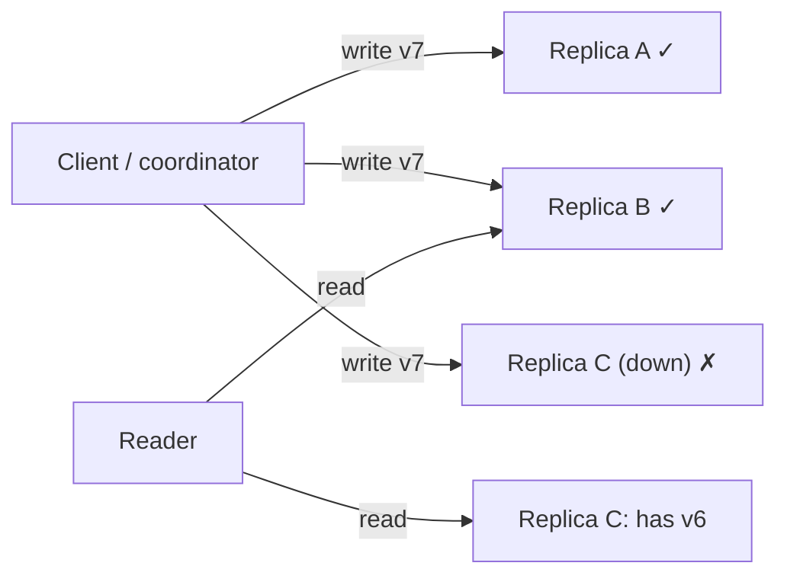
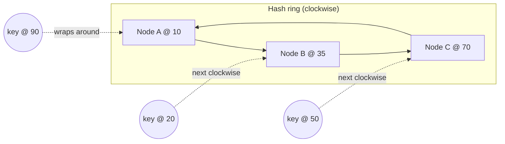
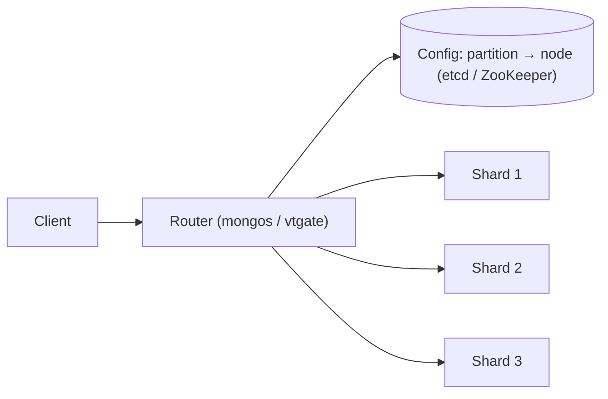
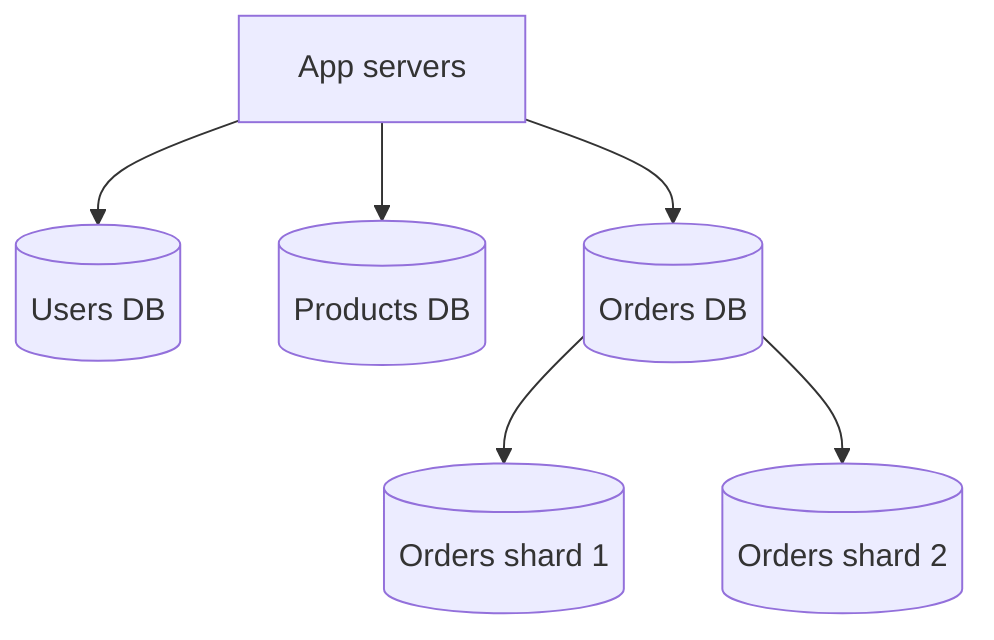

# Chapter 05 · Replication, Sharding & Consistent Hashing

> A single notebook holds every student's marks in your college. Two problems: if the notebook is lost, everything is gone, and only one clerk can write in it at a time while a queue forms out the door. Photocopy the notebook and you fix the first problem (**replication**). Split it into one notebook per department and you fix the second (**sharding**). Every large database in the world does both.

**You will learn:**
- Why one database machine isn't enough, and the two fixes: copies (replication) and splits (sharding)
- Leader-follower, multi-leader, and leaderless replication, and synchronous vs asynchronous copying
- Replication lag problems (read-your-writes, monotonic reads, consistent prefix) and their fixes
- Failover: how a new leader is chosen and what can go wrong (lost writes, split brain)
- Partitioning strategies: range, hash, directory/lookup, geo; choosing a shard key; hot spots; resharding
- Consistent hashing with virtual nodes, built and measured in Python
- Cross-shard queries and transactions, and federation (splitting by function)

**Before this:** [Chapter 02 · Scalability & Load Balancing](02-scalability-load-balancing.md) (consistent hashing preview, stateless tiers) · [Chapter 03 · Databases](03-databases.md) (transactions, WAL, indexes)

---

## 🧠 The Big Idea

In [Chapter 02](02-scalability-load-balancing.md) we made app servers stateless and pushed all the state into the database. Now the database is the bottleneck and the single point of failure. There are exactly two tools to fix that, and they solve different problems:

| Tool | What it does | Solves | Analogy |
|---|---|---|---|
| **Replication** | Keep **copies of the same data** on several machines | Availability (survive failures), read throughput, latency (copies near users) | Photocopies of the same notebook |
| **Sharding** (partitioning) | **Split the data** so each machine holds a different part | Write throughput, data size beyond one machine | One notebook per department |



Real systems **combine** them: data is split into shards, and **each shard is replicated**. Each shard has its own leader and followers.

> 💡 **The core insight:** replication copies data to survive failures and scale reads; sharding splits data to scale writes and size. Copies bring the problem of **keeping them in sync**; splits bring the problem of **finding the right piece** and **queries that span pieces**.

---

## 🔨 Building It Up

### 1. Why replicate?

1. **High availability**: if one machine dies, another has the data and takes over.
2. **Read scaling**: spread reads across many copies. Most apps read far more than they write (often 10:1 to 100:1).
3. **Lower latency**: put a copy in Mumbai and another in Frankfurt so users read nearby.
4. **Durability**: data on 3 machines survives a disk dying.
5. **Isolation of workloads**: run heavy analytics on a replica, not on the primary ([Chapter 03](03-databases.md)).

Replicating data that **never changes** is trivial: copy it once. All the difficulty is in handling **changes**. Three main approaches: single-leader, multi-leader, leaderless.

### 2. Leader-follower (single-leader) replication

One replica is the **leader** (also called primary or master). **All writes go to the leader.** The leader writes the change locally, then sends it to the **followers** (replicas, secondaries) through a **replication log** (often the WAL from [Chapter 03](03-databases.md), or a logical change stream). Followers apply changes **in the same order**. Reads can go to the leader or any follower.



Used by PostgreSQL, MySQL, SQL Server, MongoDB (replica sets), Redis, and Kafka (per partition).

**Pros:** simple mental model; **no write conflicts** (only one place accepts writes); easy to reason about ordering.
**Cons:** all writes go through one machine (write bottleneck); reads from followers may be **stale**; leader failure needs **failover**.

### 3. Synchronous vs asynchronous replication

When does the leader say "OK" to the client?

- **Synchronous**: after the follower confirms it has the change. The follower is guaranteed up to date. But if the follower is slow or down, **writes block**.
- **Asynchronous**: immediately after writing locally. Fast and never blocked by followers, but if the leader dies before shipping the change, **acknowledged writes are lost**.
- **Semi-synchronous**: one follower is synchronous, the rest asynchronous. If the sync follower is slow, another is promoted to sync. You always have the data on at least two nodes, without waiting for all of them.



| | Synchronous | Asynchronous | Semi-synchronous |
|---|---|---|---|
| Write latency | Higher (wait for follower) | Lowest | Medium |
| Data loss on leader crash | None (follower has it) | Possible (recent writes) | None for the sync follower's data |
| Follower slow/down | Writes stall | No effect | Switch which follower is sync |
| Typical use | Within one region, critical data | Cross-region replicas, read scaling | Common production default |

Let's simulate a leader crash with async replication:

```python
class Node:
    def __init__(self, name):
        self.name = name
        self.log = []                          # applied writes, in order

def run(mode):
    leader, f1, f2 = Node("leader"), Node("f1"), Node("f2")
    pending = []                               # writes not yet shipped to followers
    acked = []
    for i in range(1, 6):
        write = f"w{i}"
        leader.log.append(write)
        if mode == "sync":
            f1.log.append(write)               # wait for f1 before acking
        else:
            pending.append(write)
        acked.append(write)                    # client is told "OK"
        if i == 3 and mode == "async":         # replication catches up once, at w3
            for w in pending:
                f1.log.append(w); f2.log.append(w)
            pending.clear()
    # leader crashes now; f1 is promoted
    lost = [w for w in acked if w not in f1.log]
    print(f"{mode:<5}: client got OK for {acked}; new leader f1 has {f1.log}; LOST {lost}")

run("async")
run("sync")
```

```text
async: client got OK for ['w1', 'w2', 'w3', 'w4', 'w5']; new leader f1 has ['w1', 'w2', 'w3']; LOST ['w4', 'w5']
sync : client got OK for ['w1', 'w2', 'w3', 'w4', 'w5']; new leader f1 has ['w1', 'w2', 'w3', 'w4', 'w5']; LOST []
```

What just happened: with async replication, the client was told w4 and w5 succeeded, but they existed only on the dead leader. After failover they're **gone**. With sync replication to f1, nothing acknowledged was lost. That's the fundamental durability vs latency trade-off.

### 4. Replication lag and the anomalies it causes

With async followers, a follower may be behind the leader by milliseconds normally, and by seconds or minutes under load or network trouble. This delay is **replication lag**. The system is **eventually consistent**: if writes stop, followers eventually catch up. But meanwhile, users see weird things. Three named problems:

**a) Read-your-writes (read-after-write) violation.** You update your profile (goes to leader), refresh (read goes to a lagging follower), and your change is gone. Users think the save failed and click again.



**b) Monotonic reads violation.** You read from a fresh follower and see a new comment; you refresh, hit a more-lagged follower, and the comment **disappears**. Time seems to move backwards.

**c) Consistent prefix violation.** You see an answer before the question it replies to, because two related writes arrived at your replica out of order (common when data is spread across partitions).

Let's simulate (a) and (b), then fix them:

```python
class Replica:
    def __init__(self, name, lag):
        self.name, self.lag, self.data = name, lag, {}

class Cluster:
    def __init__(self):
        self.leader = {}
        self.history = []                          # (time, key, value) writes on leader
        self.followers = [Replica("f1", lag=1), Replica("f2", lag=5)]

    def write(self, key, value, now):
        self.leader[key] = value
        self.history.append((now, key, value))

    def sync_followers(self, now):
        for f in self.followers:                   # each sees writes older than its lag
            for t, k, v in self.history:
                if t <= now - f.lag:
                    f.data[k] = v

    def read(self, key, replica, now):
        self.sync_followers(now)
        return replica.data.get(key, "<none>")

c = Cluster()
c.write("bio", "Cricket fan", now=10)
f1, f2 = c.followers
print("t=11 read your own write from f2:", c.read("bio", f2, now=11))
print("t=12 read from f1               :", c.read("bio", f1, now=12))
print("t=13 then from f2               :", c.read("bio", f2, now=13), "<- went back in time")
```

```text
t=11 read your own write from f2: <none>
t=12 read from f1               : Cricket fan
t=13 then from f2               : <none> <- went back in time
```

What just happened: the user couldn't see their own write (read-your-writes violation), then saw it, then lost it again (monotonic reads violation), purely because of which replica answered.

**Fixes:**

| Problem | Fixes |
|---|---|
| Read-your-writes | Read **the user's own data from the leader** (e.g. "my profile" from leader, others' profiles from followers); or read from the leader for N seconds after the user writes; or the client remembers the **log position (timestamp/LSN)** of its last write and only reads from replicas that have caught up to it |
| Monotonic reads | **Pin each user to one replica** (e.g. choose replica by `hash(user_id)`); or track the last-seen log position and avoid older replicas |
| Consistent prefix | Write causally related data to the **same partition**; or track causal dependencies ([Chapter 06](06-cap-consistency.md)) |

```python
class Replica:
    def __init__(self, name, applied_upto):
        self.name, self.applied_upto = name, applied_upto   # last log position applied

def choose_replica(replicas, min_position, leader="leader"):
    """Read from any replica that has caught up to the client's last write; else the leader."""
    for r in replicas:
        if r.applied_upto >= min_position:
            return r.name
    return leader

replicas = [Replica("f1", applied_upto=1040), Replica("f2", applied_upto=1057)]
my_last_write = 1050                     # returned to the client when it wrote
print("read goes to:", choose_replica(replicas, my_last_write))
print("someone else (no recent write):", choose_replica(replicas, 0))
print("very recent write:", choose_replica(replicas, 1060))
```

```text
read goes to: f2
someone else (no recent write): f1
very recent write: leader
```

What just happened: the client carries a "freshness token" (the log position of its last write). The router sends the read only to a replica that's at least that fresh, falling back to the leader. This gives read-your-writes while still offloading most reads to followers.

### 5. Failover: when the leader dies

**Failover** = promoting a follower to be the new leader. Steps:

1. **Detect** the leader is dead. Usually by timeout: no heartbeat for, say, 10–30 seconds. (There's no perfect way to tell "dead" from "slow"; [Chapter 06](06-cap-consistency.md).)
2. **Choose a new leader**: ideally the follower with the **most up-to-date** log (to lose the least data). In robust systems this is decided by a **consensus** protocol or a coordination service (ZooKeeper, etcd), so all nodes agree.
3. **Reconfigure**: clients and other followers send writes to the new leader; the old leader, if it comes back, must become a follower.



What goes wrong (interviewers love these):

- **Lost writes**: with async replication, writes the old leader acknowledged but didn't ship are lost (we just simulated it). Worse: if the old leader comes back, its extra writes conflict with the new leader's.
- **Split brain**: the old leader wasn't dead, just cut off by a network problem. Now **two nodes think they're leader** and both accept writes, and data diverges. Defences: **fencing** (forcibly cut the old leader off from storage or the network, sometimes called STONITH, "shoot the other node in the head"), **epoch/term numbers** (writes from an old term are rejected), and **quorums** so only one side of a network split can elect a leader ([Chapter 06](06-cap-consistency.md)).
- **Wrong timeout**: too short → needless failovers during load spikes (which make things worse); too long → longer outages.
- **Stale references**: a famous incident pattern: a new leader reuses auto-increment IDs that the old leader had already handed out (and other systems like a cache still referenced), causing records to be mixed up.

**Manual vs automatic failover**: automatic is faster (seconds) but riskier; some teams prefer a human to approve failover of critical databases.

### 6. Multi-leader replication

Allow **more than one node** to accept writes; each leader replicates its changes to the others.

**When it's useful:**

- **Multi-datacenter / multi-region**: one leader per region, so writes are local and fast, and each region survives the other's failure.
- **Offline-capable clients**: every phone with a calendar app is a "leader" that syncs later.
- **Collaborative editing**: Google Docs-style simultaneous editing.



**The big problem: write conflicts.** User A in Mumbai changes a document title to "Plan A"; at the same moment user B in Frankfurt changes it to "Plan B". Both succeed locally. When the leaders sync, which wins?

Conflict resolution strategies (detailed in [Chapter 06](06-cap-consistency.md)):

- **Avoid conflicts**: route all writes for a given record to the same leader (e.g. a user's "home region"). The best strategy when possible.
- **Last write wins (LWW)**: keep the write with the latest timestamp. Simple, but **silently discards** the other write, and clock skew can pick the "wrong" one.
- **Merge**: combine values (e.g. union of shopping cart items), or use **CRDTs**, data types designed to merge automatically.
- **Keep both and ask**: store both versions and let the app or user resolve (like a Git merge conflict).

```python
def merge_lww(a, b):
    """Each write: (timestamp, node, value). Higher timestamp wins; node name breaks ties."""
    return max(a, b)

mumbai = (1000, "mumbai", "Plan A")
frankfurt = (1001, "frankfurt", "Plan B")
print("LWW keeps:", merge_lww(mumbai, frankfurt)[2], "| Plan A is silently lost")

cart_mumbai = {"phone", "case"}
cart_frankfurt = {"phone", "charger"}
print("union merge of carts:", sorted(cart_mumbai | cart_frankfurt))
```

```text
LWW keeps: Plan B | Plan A is silently lost
union merge of carts: ['case', 'charger', 'phone']
```

(Union merging has its own problem: a removed item can reappear if one replica still had it. CRDTs handle that with extra bookkeeping. [Chapter 06](06-cap-consistency.md) explains how.)

**Topologies**: leaders can replicate in a **ring**, a **star**, or **all-to-all**. All-to-all is most fault-tolerant, but messages can arrive out of order (an update arriving before the insert it modifies), which needs version tracking.

### 7. Leaderless replication

No leader at all: the client (or a coordinator node acting for it) sends each write to **several replicas in parallel** and each read to **several replicas** too. Popularised by Amazon's **Dynamo** paper; used by **Cassandra**, ScyllaDB, Riak, and DynamoDB-style systems.

- **N** = number of replicas for each key (e.g. 3).
- A write succeeds when **W** replicas confirm.
- A read queries replicas and waits for **R** responses, then takes the **newest** version.
- If **R + W > N**, the read set and the write set **must overlap** in at least one replica, so a read sees at least one copy of the latest write. Typical: N=3, W=2, R=2.



With N=3, W=2: the write landed on A and B. A read with R=2 that asks B and C gets v7 from B and v6 from C, and picks v7 (higher version). The overlap guarantee in action.

How lagging replicas catch up:

- **Read repair**: when a read notices a replica returned an old version, the client writes the new version back to it.
- **Anti-entropy**: a background process compares replicas and copies missing data (using **Merkle trees**, hash trees that let two nodes find which ranges differ without comparing every key).
- **Hinted handoff**: if a target replica is down, another node temporarily stores the write with a "hint" and hands it over when the replica returns.

We'll simulate quorums properly in [Chapter 06](06-cap-consistency.md), where we also see that R + W > N is **not** the same as strong consistency.

| | Single-leader | Multi-leader | Leaderless |
|---|---|---|---|
| Who accepts writes | One leader | Several leaders | Any replica (quorum) |
| Write conflicts | None | Yes, must resolve | Yes (concurrent writes), must resolve |
| Write availability during failures | Leader failure → failover pause | High (other leaders keep working) | High (only W replicas needed) |
| Consistency | Easiest (strong if reading leader) | Weak across leaders | Tunable via R, W |
| Examples | PostgreSQL, MySQL, MongoDB | Multi-region MySQL/Postgres setups, CouchDB, collaborative apps | Cassandra, ScyllaDB, Riak, Dynamo |

### 8. Why shard?

Replication copies **all** the data to every replica, so it doesn't help when:

- **Writes** exceed what one leader can handle (every write still goes to the one leader).
- **Data size** exceeds one machine's disk or RAM (every replica holds everything).
- Indexes no longer fit in memory, so queries slow down.

**Sharding** (also called **partitioning**) splits the dataset into pieces called **shards** (or partitions), each held by a different node (each usually with its own replicas). Each record belongs to **exactly one** shard. Ideally, load spreads evenly and each query touches **one** shard.

Terminology across systems: shard (MongoDB, Elasticsearch), partition (Kafka), region (HBase), tablet (Bigtable), vnode (Cassandra). All roughly the same idea.

The central question: **given a record, which shard holds it?** That's decided by the **shard key** (partition key) and the **partitioning strategy**.

### 9. Range partitioning

Assign **contiguous ranges** of the key to each shard, like volumes of an encyclopedia: A–F, G–M, N–S, T–Z.

```text
shard 1: user_id 1        – 1,000,000
shard 2: user_id 1,000,001 – 2,000,000
shard 3: user_id 2,000,001 – 3,000,000
```

**Pros:** **range queries are efficient**: "all orders from 1 Oct to 7 Oct" hits one or two shards; keys are kept sorted within a shard.
**Cons:** **hot spots** when the key is monotonic. If the shard key is a timestamp or an auto-increment ID, **all new writes** go to the last shard while the others sit idle.

Ranges must be chosen to match the data distribution (names starting with "S" are far more common than "X"), and systems like HBase, Bigtable and MongoDB **split** a range automatically when it grows too big.

### 10. Hash partitioning

Apply a hash function to the key and use the hash to pick the shard. A good hash spreads even sequential or skewed keys **uniformly**.

**Pros:** even distribution; no hot spots from sequential keys.
**Cons:** **range queries break**: neighbouring keys land on different shards, so "orders from 1–7 Oct" must ask every shard.

```python
import bisect
import hashlib
from collections import Counter

N_SHARDS = 4
RANGE_STARTS = [0, 1_002_500, 1_005_000, 1_007_500]   # shard i holds ids >= RANGE_STARTS[i]

def range_shard(order_id):
    return bisect.bisect_right(RANGE_STARTS, order_id) - 1

def hash_shard(order_id):
    return int(hashlib.md5(str(order_id).encode()).hexdigest(), 16) % N_SHARDS

new_orders = range(1_010_000, 1_012_600)              # today's 2,600 new, increasing ids
print("range partitioning:", dict(sorted(Counter(map(range_shard, new_orders)).items())))
print("hash partitioning :", dict(sorted(Counter(map(hash_shard, new_orders)).items())))
```

```text
range partitioning: {3: 2600}
hash partitioning : {0: 608, 1: 676, 2: 646, 3: 670}
```

What just happened: with ranges on an increasing ID, every recent insert hits shard 3 (the "latest" range): a write hot spot. Hashing scattered sequential IDs nearly evenly across all four shards.

**The compound-key trick** (used by Cassandra and DynamoDB) gets the best of both: **hash the first part, sort by the second**. Key = `(user_id, timestamp)`: `user_id` is hashed to choose the shard (even spread across users), and within the shard, a user's rows are sorted by timestamp (efficient "user's latest 20 posts" range queries).

### 11. Directory-based (lookup) partitioning

Keep an explicit **lookup table** (directory): key or key-range → shard. A small, highly available service (or a coordination store like ZooKeeper/etcd) holds it.

```text
tenant "acme"     -> shard 7
tenant "globex"   -> shard 2
tenant "initech"  -> shard 7
user range 0-99k  -> shard 1
```

**Pros:** total flexibility: move a single big customer to its own shard, rebalance without rehashing, mix strategies.
**Cons:** an extra lookup on every request (cache it in clients), and the directory itself must be highly available and consistent, or it becomes a SPOF.

Used for multi-tenant SaaS (big tenants get dedicated shards), and internally by many systems to map partitions to nodes.

### 12. Geo partitioning

Partition by **location**: Indian users' data in the Mumbai region, EU users' data in Frankfurt.

**Pros:** low latency for local users; meets **data residency** laws (some countries require citizens' data to stay inside the country, and the EU's GDPR restricts transfers).
**Cons:** uneven shard sizes (India vs Iceland); users who travel or interact across regions (a chat between Mumbai and Berlin) need cross-region access.

### 13. Choosing a shard key

The most important sharding decision; changing it later is painful. A good shard key has:

1. **High cardinality**: many distinct values, so data can spread across many shards. (`country` has ~200 values: bad. `user_id`: good.)
2. **Even distribution of data and traffic**: no single value dominates. (A celebrity's `user_id` might get 1,000,000× normal traffic.)
3. **Query alignment**: the most common queries include the shard key, so they hit **one** shard. Shard a chat app's messages by `conversation_id`, because "show messages in this conversation" is the hot query.
4. **Stability**: the value shouldn't change. (Sharding users by `city` means moving data when they move.)
5. **Locality for transactions**: data that must be updated together should share a shard (an order and its items, keyed by `order_id`, or by `customer_id` if you query by customer).

| System | Good shard key | Why | Bad shard key | Why bad |
|---|---|---|---|---|
| Chat messages | `conversation_id` | All of a chat's messages on one shard | `message_id` | "Load chat" queries every shard |
| E-commerce orders | `customer_id` (or hash of `order_id`) | "My orders" hits one shard | `created_date` | All today's writes on one shard |
| Multi-tenant SaaS | `tenant_id` (+ directory for big tenants) | Tenant isolation, single-shard queries | `region` | Low cardinality, skew |
| URL shortener | hash of `short_code` | Even spread, lookups by code | first letter of code | Uneven, low cardinality |
| IoT metrics | `(device_id, time bucket)` | Spread devices, bound partition size | `timestamp` alone | All writes to newest shard |

### 14. Hot spots and how to cool them

Even a good key can produce a **hot partition**: a viral post's likes, a celebrity's followers, a flash-sale product. Mitigations:

- **Key salting / splitting**: for a known hot key, append a random suffix 0–9 to spread its writes over 10 shards (`post:42#7`), and read all 10 and combine. Only do this for the few keys that need it (track them).
- **Write buffering / aggregation**: count likes in memory or in a queue and write aggregated increments periodically ([Chapter 08](08-queues-events.md)).
- **Caching** for hot reads ([Chapter 04](04-caching-cdn.md)).
- **Isolate**: give a mega-tenant its own shard (directory-based).
- **Time-bucketed keys**: for time series, include a time bucket (`device_id:2026-10-31`) so one partition doesn't grow forever.

```python
import hashlib
import random
from collections import Counter

random.seed(7)
N_SHARDS = 8

def shard_of(key):
    return int(hashlib.md5(key.encode()).hexdigest(), 16) % N_SHARDS

likes = ["post:viral"] * 8000 + [f"post:{i}" for i in range(2000)]

plain = Counter(shard_of(k) for k in likes)
salted = Counter(shard_of(f"{k}#{random.randrange(N_SHARDS)}") if k == "post:viral" else shard_of(k)
                 for k in likes)

print("busiest shard without salting:", max(plain.values()), "of", len(likes))
print("busiest shard with salting   :", max(salted.values()), "of", len(likes))

def total_likes_viral(counts_by_salted_key):
    return sum(counts_by_salted_key.values())     # read side: gather all salted parts

parts = Counter(f"post:viral#{random.randrange(N_SHARDS)}" for _ in range(8000))
print("reassembled viral like count:", total_likes_viral(parts))
```

```text
busiest shard without salting: 8259 of 10000
busiest shard with salting   : 2303 of 10000
reassembled viral like count: 8000
```

What just happened: unsalted, one shard handled the viral post's 8,000 writes on top of its normal share. Salting spread them across all shards. The price is visible in the last line: reading the total now requires gathering from every salted part.

### 15. Resharding: why `hash % N` is a trap

Data grows; you need more shards. With `shard = hash(key) % N`, changing N from 4 to 5 moves ~80% of keys (we measured this in [Chapter 02](02-scalability-load-balancing.md)). Moving 80% of a 10 TB database means copying 8 TB while serving traffic. Ouch.

Better approaches:

1. **Fixed number of partitions, many more than nodes.** Create, say, 1,024 partitions up front; assign several to each node. Adding a node = **moving whole partitions** to it; the key → partition mapping (`hash % 1024`) **never changes**. Used by Elasticsearch, Riak, Couchbase, Redis Cluster (16,384 hash slots), Kafka-style systems.
2. **Dynamic splitting**: when a partition grows beyond a size limit, split it in two (and merge small ones). Used by HBase, Bigtable, MongoDB (range-based chunks), CockroachDB/TiDB-style systems.
3. **Consistent hashing** (next section): adding a node moves only ~1/N of keys. Used by Cassandra, DynamoDB, Riak, and many caches and load balancers.

```python
import hashlib

def h(key):
    return int(hashlib.md5(key.encode()).hexdigest(), 16)

keys = [f"user:{i}" for i in range(20_000)]
N_PARTITIONS = 64

def node_for_partition(p, n_nodes):
    return p % n_nodes                      # simple partition -> node assignment

def moved_fraction(n_before, n_after, scheme):
    moved = 0
    for k in keys:
        if scheme == "mod-N":
            a, b = h(k) % n_before, h(k) % n_after
        else:                               # fixed partitions, reassign whole partitions
            p = h(k) % N_PARTITIONS
            a = assignment[n_before][p]
            b = assignment[n_after][p]
        moved += a != b
    return moved / len(keys)

# fixed partitions: when adding a node, steal just enough partitions for an even share
assignment = {4: {p: p % 4 for p in range(N_PARTITIONS)}}
new = dict(assignment[4])
per_node_target = N_PARTITIONS // 5          # 12 partitions for the new node
for node in range(4):                        # take 3 partitions from each old node
    victims = [p for p, n in new.items() if n == node][:per_node_target // 4]
    for p in victims:
        new[p] = 4
assignment[5] = new

print(f"hash % N, 4 -> 5 nodes        : {moved_fraction(4, 5, 'mod-N'):.0%} of keys move")
print(f"64 fixed partitions, 4 -> 5   : {moved_fraction(4, 5, 'fixed'):.0%} of keys move")
```

```text
hash % N, 4 -> 5 nodes        : 79% of keys move
64 fixed partitions, 4 -> 5   : 19% of keys move
```

What just happened: with mod-N, about 80% of keys changed nodes. With fixed partitions, only the 12 partitions handed to the new node moved: about 1/5 of the data, the theoretical minimum (the new node must end up with ~1/5 of everything).

### 16. Consistent hashing with virtual nodes

Picture the hash space as a **ring** (a clock face) from 0 to 2³²−1 (or any big number), wrapping around.

1. **Place each node** on the ring at `hash(node_name)`.
2. **Place each key** at `hash(key)`, then walk **clockwise** to the first node: that node owns the key.
3. **Adding a node**: it lands at one spot and takes over only the keys between its predecessor and itself. Every other key stays put.
4. **Removing a node**: its keys move to the next node clockwise. Nothing else moves.



**The problem with one point per node:** random positions make **uneven arcs**. One node might own 50% of the ring, another 10%. And when a node leaves, **all** its load dumps onto **one** neighbour.

**Virtual nodes (vnodes)** fix both: each physical node gets **many** positions on the ring (e.g. 100–256), by hashing `"A#0"`, `"A#1"`, ... Arcs average out, so load is even. When a node leaves, its many small arcs are spread across **many** different neighbours. Bonus: a more powerful machine can get **more vnodes** (weighted capacity).

Here's a full implementation with measurements:

```python
import bisect
import hashlib
from collections import Counter
from statistics import pstdev

def ring_hash(s):
    return int(hashlib.md5(s.encode()).hexdigest(), 16) % (2**32)

class ConsistentHashRing:
    def __init__(self, vnodes=100):
        self.vnodes = vnodes
        self.positions = []                  # sorted vnode positions
        self.owner = {}                      # position -> physical node

    def add_node(self, node, weight=1):
        for i in range(self.vnodes * weight):
            pos = ring_hash(f"{node}#{i}")
            bisect.insort(self.positions, pos)
            self.owner[pos] = node

    def remove_node(self, node):
        self.positions = [p for p in self.positions if self.owner[p] != node]
        self.owner = {p: n for p, n in self.owner.items() if n != node}

    def get_node(self, key):
        idx = bisect.bisect_right(self.positions, ring_hash(key))
        if idx == len(self.positions):       # past the last position: wrap to the start
            idx = 0
        return self.owner[self.positions[idx]]

def build(nodes, vnodes):
    ring = ConsistentHashRing(vnodes)
    for n in nodes:
        ring.add_node(n)
    return ring

keys = [f"key-{i}" for i in range(30_000)]
nodes = ["A", "B", "C", "D"]

print("1) Balance: keys per node (ideal 7,500 each)")
for v in (1, 10, 100, 500):
    ring = build(nodes, v)
    load = Counter(ring.get_node(k) for k in keys)
    counts = [load[n] for n in nodes]
    print(f"   vnodes={v:>3}: {counts}  stdev={pstdev(counts):6.0f}")

print("2) Add node E (vnodes=100): how many keys move?")
ring = build(nodes, 100)
before = {k: ring.get_node(k) for k in keys}
ring.add_node("E")
after = {k: ring.get_node(k) for k in keys}
moved = [k for k in keys if before[k] != after[k]]
print(f"   moved {len(moved) / len(keys):.1%} of keys (ideal 1/5 = 20%)")
print(f"   every moved key went to E: {all(after[k] == 'E' for k in moved)}")

print("3) Remove node B: where do its keys go?")
ring = build(nodes, 100)
before = {k: ring.get_node(k) for k in keys}
ring.remove_node("B")
inherited = Counter(ring.get_node(k) for k in keys if before[k] == "B")
print(f"   B's keys spread over: {dict(sorted(inherited.items()))}")
others_moved = sum(1 for k in keys if before[k] != "B" and ring.get_node(k) != before[k])
print(f"   keys not on B that moved: {others_moved}")
```

```text
1) Balance: keys per node (ideal 7,500 each)
   vnodes=  1: [9293, 3212, 9095, 8400]  stdev=  2498
   vnodes= 10: [5228, 4573, 9563, 10636]  stdev=  2637
   vnodes=100: [7588, 7212, 6931, 8269]  stdev=   501
   vnodes=500: [7531, 7738, 7451, 7280]  stdev=   165
2) Add node E (vnodes=100): how many keys move?
   moved 14.8% of keys (ideal 1/5 = 20%)
   every moved key went to E: True
3) Remove node B: where do its keys go?
   B's keys spread over: {'A': 2480, 'C': 2952, 'D': 1780}
   keys not on B that moved: 0
```

What just happened, in three parts:

1. With **1** vnode per node, the load is very uneven (node B got under half the share of node A). Even 10 vnodes can still be lumpy by bad luck. At 100 and 500 vnodes, every node is close to the ideal 7,500, and the standard deviation drops from ~2,500 to 165.
2. Adding E moved 14.8% of keys, all of them **to E**. Nobody else's keys shuffled around. (E's share is a bit under the ideal 20% because its 100 random positions happened to land on slightly short arcs; more vnodes bring it closer.)
3. Removing B spread B's keys over **all three** remaining nodes (not just one neighbour), and **zero** keys that weren't on B moved.

**Replication on the ring**: to keep N=3 copies, store each key on the first node clockwise **and the next 2 distinct physical nodes** after it (skipping vnodes of the same machine, and ideally of the same rack/AZ). That list is the key's **preference list** in Dynamo-style systems.

**Where consistent hashing is used:** Cassandra and DynamoDB partitioning, Riak, distributed caches (client-side sharding for Memcached), CDN request routing, load balancers that need stickiness ([Chapter 02](02-scalability-load-balancing.md)), and the classic interview question *Design a distributed key-value store* ([Chapter 12](12-case-studies-1.md)).

> 💡 A neat alternative you can mention: **rendezvous hashing** (highest random weight): for each key, compute `hash(key, node)` for every node and pick the highest. It also moves only ~1/N keys when nodes change, with no ring to maintain, at O(number of nodes) per lookup.

### 17. Request routing: how does a request find its shard?

Three designs:

1. **Routing tier / proxy**: clients talk to a router that knows the mapping and forwards (MongoDB's `mongos`, Vitess's `vtgate` for MySQL, Twemproxy).
2. **Any node**: the client contacts any node; if it doesn't own the key, it forwards to the right one (Cassandra coordinators) or tells the client where to go (Redis Cluster's `MOVED` redirect).
3. **Partition-aware client**: the client library holds the mapping and connects directly to the right node (fastest; needs mapping updates).

The mapping itself (partition → node) must be stored somewhere everyone agrees on, often a coordination service like **ZooKeeper** or **etcd** (which use consensus, [Chapter 06](06-cap-consistency.md)), or spread by **gossip** between nodes (Cassandra).



### 18. Cross-shard queries

When a query doesn't include the shard key, the router must ask **every shard** and combine the answers: **scatter-gather**.

```python
import hashlib
import heapq

N = 4
def shard_of(user_id):
    return int(hashlib.md5(str(user_id).encode()).hexdigest(), 16) % N

shards = [[] for _ in range(N)]
orders = [(uid, amount) for uid, amount in zip(range(1, 41), [17 * i % 97 for i in range(1, 41)])]
for uid, amount in orders:
    shards[shard_of(uid)].append((uid, amount))

# 1) query WITH the shard key: one shard
uid = 7
print("orders of user 7 (1 shard):", [o for o in shards[shard_of(uid)] if o[0] == uid])

# 2) query WITHOUT the shard key: top 3 orders by amount -> scatter-gather
partial = [heapq.nlargest(3, s, key=lambda o: o[1]) for s in shards]   # each shard: local top 3
top3 = heapq.nlargest(3, (o for part in partial for o in part), key=lambda o: o[1])
print("global top 3 (asked all", N, "shards):", top3)
```

```text
orders of user 7 (1 shard): [(7, 22)]
global top 3 (asked all 4 shards): [(17, 95), (34, 93), (11, 90)]
```

What just happened: the first query knew the shard. The second had to ask all four, have **each compute a local top 3**, then merge, which is correct because the global top 3 must be within the union of local top 3s. It's the same idea as merging k sorted lists ([Heaps](../part-2-dsa/15-heaps.md)).

Costs of scatter-gather: latency = the **slowest** shard (tail latency gets worse as shards grow); load multiplies (every shard does work for every such query). Fixes:

- **Choose the shard key** so hot queries include it.
- **Global secondary indexes**: a separate index, itself sharded by the indexed value (e.g. an index by `email` sharded by email), so lookups by email hit one index shard, then one data shard. Writes get more expensive (update data + index, often asynchronously).
- **Local secondary indexes**: each shard indexes only its own data; reads by that field still scatter-gather, but writes stay single-shard.
- **Denormalize** or maintain separate tables/views per access pattern (common in Cassandra: one table per query).
- **Send analytics elsewhere**: a data warehouse ([Chapter 03](03-databases.md)).

| | Local secondary index | Global secondary index |
|---|---|---|
| Stored | With each shard's data | Separately, partitioned by the indexed term |
| Writes | Single shard (cheap) | Data shard + index shard (often async) |
| Reads by indexed field | Scatter-gather all shards | One index shard (+ data fetch) |
| Examples | MongoDB, Cassandra, Elasticsearch | DynamoDB GSIs |

**Cross-shard joins** are worse: a join between tables on different shards means shipping data between machines. Usual answers: co-locate related data on the same shard (shard orders and order items by the same key), denormalize, or join in the application.

### 19. Cross-shard transactions

A transaction touching **one shard** is a normal local ACID transaction. Touching **several shards** (move money from a user on shard 1 to a user on shard 3) needs coordination so that it commits **everywhere or nowhere**.

Options (detailed in [Chapter 06](06-cap-consistency.md)):

- **Two-phase commit (2PC)**: a coordinator asks all shards to **prepare** (lock and promise they can commit), then tells all to **commit**. Atomic, but blocking if the coordinator dies at the wrong moment, and slow (multiple round trips, locks held across the network).
- **Sagas**: a sequence of local transactions, each with a **compensating action** to undo it if a later step fails ("debit A" then "credit B"; if credit fails, "refund A"). No global locks; eventually consistent.
- **Avoid it**: design the shard key so that most transactions are single-shard. This is by far the most effective strategy.
- **Distributed SQL databases** (Google Spanner, CockroachDB, YugabyteDB, TiDB) do cross-shard ACID transactions for you, using consensus and careful timestamping, at some latency cost.

### 20. Federation (functional partitioning)

Instead of splitting **one table by rows**, **federation** splits the database **by function**: users in one database, products in another, orders in a third. Each can be scaled, tuned and replicated independently.



**Pros:** smaller databases, less write contention, more of each fits in cache, teams own their data (this is natural with microservices, [Chapter 09](09-microservices-reliability.md)).
**Cons:** joins across functions become application-level work ("orders with product names" needs two queries); transactions across them need sagas; more databases to operate.

Federation is usually the **first** split (it's simpler), and **sharding** happens within a function when one table outgrows a machine (orders, in the diagram).

| Technique | Splits by | Example |
|---|---|---|
| Federation (vertical partitioning by function) | Feature / domain | Users DB, Orders DB, Products DB |
| Vertical partitioning (within a table) | Columns | Move a big `bio` text column to its own table |
| Sharding (horizontal partitioning) | Rows | Orders 1–1M on shard 1, next 1M on shard 2 |

---

## 🔬 Under the Hood

### What actually gets replicated

Three ways a leader can describe changes to followers:

- **Statement-based**: send the SQL statements. Breaks with non-deterministic functions (`NOW()`, `RAND()`) or autoincrement races. Mostly abandoned.
- **Physical / WAL shipping**: send the low-level log of byte changes to pages. Exact, but tied to the storage engine version, so followers must run the same version (painful for upgrades). PostgreSQL streaming replication works this way.
- **Logical (row-based)**: send "row with id 42 in table users changed: city → Mumbai". Independent of storage internals; allows different versions and feeding other systems (**change data capture**, e.g. Debezium streaming changes into Kafka, [Chapter 08](08-queues-events.md)). MySQL's row-based binlog works this way.

### How a new follower joins without stopping the world

1. Take a **consistent snapshot** of the leader (without locking writes; MVCC helps).
2. Copy the snapshot to the new follower.
3. The snapshot is tagged with its exact **log position** (PostgreSQL's LSN, MySQL's binlog coordinates/GTID).
4. The follower requests all changes **since that position** and applies them until it **catches up**, then streams continuously.

### Why consistent hashing moves only ~1/N keys

Each key's owner depends only on the **nearest node position clockwise**. Inserting a new node's positions changes the owner only for keys that fall in the arcs **immediately before** the new positions; those arcs total about 1/(N+1) of the ring when positions are random and numerous. No other key's "nearest clockwise node" changed. With mod-N, by contrast, every key's bucket depends on N itself, so changing N reshuffles nearly everything.

### Why more vnodes means better balance

With one position per node, each node's share is one random arc; arc sizes vary a lot (some arcs are several times the average). With *v* positions per node, a node's share is the **sum of v random arcs**, and sums of many random values cluster tightly around their mean (the spread shrinks roughly like 1/√v). That's why 100–256 vnodes per node is typical: good balance with a small, fast lookup table (binary search over N × v positions: O(log(N·v))).

### Detecting divergence with Merkle trees

Two replicas holding millions of keys need to find which keys differ. Comparing every key would mean sending everything. A **Merkle tree** hashes key ranges in a tree: leaves hash small ranges, parents hash their children's hashes. Compare root hashes: equal → identical, done. Different → compare children and descend only into differing branches. The difference is found in O(log n) hash comparisons per differing range. Cassandra's anti-entropy repair, Git, and blockchains all use this idea.

---

## 🧩 Pattern Decoder

### Decision guide: replication

| If you need... | Choose | Because |
|---|---|---|
| Simple, consistent, read-heavy scaling | Single-leader + read replicas | No conflicts; easy reasoning |
| No data loss on leader failure | Synchronous or semi-synchronous replication (within a region) | Acked writes exist on ≥2 nodes |
| Low write latency in several regions, region independence | Multi-leader (one per region) + conflict strategy | Local writes, survive region loss |
| Very high write availability, tunable consistency | Leaderless (Dynamo-style quorums) | Any W replicas can accept writes |
| Read-your-writes on replicas | Read own data from leader / freshness tokens | Avoid lagging replicas for the writer |
| Analytics without hurting production | Dedicated async replica or warehouse | Isolation of workloads |

### Decision guide: partitioning strategy

| If your hot queries are... | Choose | Watch out for |
|---|---|---|
| Ranges over the key (time windows, alphabetical) | Range partitioning | Monotonic keys → hot newest shard |
| Point lookups by key, need even spread | Hash partitioning | Range queries become scatter-gather |
| "Latest N for entity X" | Compound key: hash(X) + sort by time | Huge single entities (hot partitions) |
| Per-tenant with a few giant tenants | Directory-based | Directory must be HA and cached |
| Region-local users, legal residency | Geo partitioning | Uneven sizes, cross-region interactions |
| Frequent cluster growth | Fixed many partitions or consistent hashing | Don't use `hash % N` on nodes |

### Trade-off table: replication timing

| | Sync | Semi-sync | Async |
|---|---|---|---|
| Durability | Best | Good | Can lose recent writes |
| Write latency | Worst | Medium | Best |
| Availability of writes | Lowest (blocked by slow follower) | Good | Best |
| Typical | Critical data, same region | Production default | Cross-region, read replicas |

### Trade-off table: rebalancing approaches

| Approach | Keys moved when adding a node | Complexity | Used by |
|---|---|---|---|
| `hash % N` | ~N/(N+1) (almost all) | Trivial | Nothing serious |
| Fixed partitions (many > nodes) | ~1/(N+1), whole partitions | Low | Elasticsearch, Redis Cluster, Riak |
| Dynamic split/merge | Only split ranges | Medium | HBase, Bigtable, MongoDB |
| Consistent hashing + vnodes | ~1/(N+1) | Medium | Cassandra, Dynamo, caches |

### The scale-the-data ladder (say this in interviews)

1. **Optimise**: indexes, query fixes ([Chapter 03](03-databases.md)).
2. **Cache** hot reads ([Chapter 04](04-caching-cdn.md)).
3. **Scale up** the database machine.
4. **Read replicas** for read scaling (handle replication lag!).
5. **Federation**: split by function.
6. **Shard** the biggest tables by a well-chosen key.
7. Consider a **distributed database** (Cassandra, DynamoDB, Spanner/CockroachDB) built for it from the start.

### When NOT to shard

- Before exhausting the earlier rungs of the ladder. Sharding adds permanent complexity: cross-shard queries, transactions, rebalancing, operational burden.
- When the dataset fits comfortably on one machine and writes are moderate; a single primary with replicas is easier and more consistent.

---

## ⚠️ Traps & Common Mistakes

1. **Thinking replication scales writes.** In single-leader setups, every write still hits the one leader. Replication scales **reads**; sharding scales **writes**.
2. **Assuming replicas are up to date.** Async replicas lag. Design for read-your-writes and monotonic reads explicitly.
3. **Forgetting acknowledged writes can be lost on async failover.** Use semi-sync for data you can't lose.
4. **Ignoring split brain.** Failover without fencing / epochs / quorums can produce two leaders and divergent data.
5. **Monotonic shard keys** (timestamps, auto-increment IDs) with range partitioning: every insert hits one shard.
6. **Low-cardinality shard keys** (country, status): a few huge shards you can never split further.
7. **Shard key that doesn't match the hot query**: every request becomes scatter-gather.
8. **`hash(key) % N` for node assignment**: resharding moves almost everything.
9. **Consistent hashing without vnodes**: uneven load, and a failed node dumps everything on one neighbour.
10. **Using Python's built-in `hash()` for sharding**: randomised per process for strings, so different servers disagree on where a key lives:

```py
# ❌ each process may compute a different shard for the same key
shard = hash(user_id) % N

# ✅ deterministic everywhere
import hashlib
shard = int(hashlib.md5(user_id.encode()).hexdigest(), 16) % N
```

11. **Cross-shard transactions everywhere.** If your design needs 2PC on every request, the shard key is wrong.
12. **Rebalancing at peak traffic.** Moving data consumes network and disk; throttle it and schedule it for quiet hours.

---

## 💡 Tips & Tricks

- One-line definitions for interviews: **"Replication = same data, many places. Sharding = different data, different places."**
- Default architecture: **shard by a high-cardinality key that matches the hot query; replicate each shard 3× across AZs; semi-sync within region, async across regions.**
- Say the anomaly names: **read-your-writes, monotonic reads, consistent prefix.** Then give one fix each.
- When asked "how do you add capacity without downtime?": **fixed partitions or consistent hashing with vnodes, move partitions in the background, switch ownership atomically.**
- For time series: key by `(entity, time_bucket)`; hash the entity, sort by time.
- For multi-tenant: shard by `tenant_id` + a directory so huge tenants can get dedicated shards.
- Pre-split: create many more partitions than nodes on day one (e.g. 256 or 1,024). Splitting later is the hard part.
- Draw the shards **and** their replicas in diagrams; interviewers check that sharding didn't remove redundancy.

---

## 🎯 Interview Questions

### 1. What's the difference between replication and sharding? 🔥🔥🔥

<details><summary>Answer</summary>

**Replication** stores **copies of the same data** on multiple nodes: improves availability, durability, read throughput and read latency, but every replica holds everything and (in single-leader) writes still go through one node. **Sharding** splits the data so each node stores a **subset**: scales write throughput and total data size, but makes cross-shard queries and transactions hard. Production systems combine them: each shard is replicated (e.g. 3 replicas across AZs).

</details>

### 2. Compare single-leader, multi-leader and leaderless replication. 🔥🔥🔥

<details><summary>Answer</summary>

- **Single-leader**: all writes to one leader, followers replicate the log in order. No write conflicts, simple, strong consistency when reading the leader; write throughput limited to one node; failover needed.
- **Multi-leader**: several nodes accept writes (often one per region) and replicate to each other. Low local write latency, tolerates region failure, works offline; must resolve **write conflicts** (avoidance by home-region routing, LWW, merges/CRDTs, or app-level resolution).
- **Leaderless**: clients write to and read from multiple replicas with quorums (W, R of N). High availability and no failover; consistency is tunable; repairs via read repair, anti-entropy and hinted handoff; concurrent writes need versioning/conflict resolution. Examples: Cassandra, Riak, Dynamo.

</details>

### 3. Synchronous vs asynchronous replication? 🔥🔥🔥

<details><summary>Answer</summary>

Synchronous: the leader waits for follower acknowledgement before confirming the write: no loss of acknowledged data on failover, but higher latency and writes block if the follower is slow or unreachable. Asynchronous: the leader confirms immediately; low latency and unaffected by followers, but recent acknowledged writes can be lost if the leader fails, and followers lag. Semi-synchronous (one sync follower, rest async) is the usual compromise. Cross-region replication is usually async because waiting 100+ ms per write is too slow.

</details>

### 4. What problems does replication lag cause and how do you handle them? 🔥🔥🔥

<details><summary>Answer</summary>

- **Read-your-writes**: a user doesn't see their own update. Fix: read the user's own data from the leader, route reads to the leader for a short window after a write, or use a freshness token (log position) and only read replicas that have caught up.
- **Monotonic reads**: data appears then disappears across refreshes. Fix: pin a user's reads to one replica (hash of user ID) or track last-seen position.
- **Consistent prefix**: effects seen before causes (an answer before its question). Fix: keep causally related writes in the same partition, or track causality.

Also monitor lag and remove badly lagging replicas from the read pool.

</details>

### 5. How does leader failover work and what can go wrong? 🔥🔥

<details><summary>Answer</summary>

Detect failure by heartbeat timeout; elect the most up-to-date follower (ideally via consensus/coordination service so everyone agrees); reconfigure clients and remaining followers; demote the old leader if it returns. Risks: **losing acknowledged writes** with async replication; **split brain** (two leaders accepting writes after a network partition), countered with fencing, monotonically increasing epochs/terms, and quorum-based election; **bad timeouts** (spurious failovers under load or long outages); conflicts or ID reuse when the old leader rejoins with extra writes.

</details>

### 6. How do you choose a shard key? 🔥🔥🔥

<details><summary>Answer</summary>

Pick a key with **high cardinality**, **even distribution of data and traffic**, that **appears in the most frequent queries** (so they hit one shard), is **stable** (doesn't change), and **co-locates data that's updated together**. Avoid monotonic keys with range partitioning (hot newest shard) and low-cardinality keys. Examples: `conversation_id` for chat messages, `customer_id` for orders, `tenant_id` for SaaS (with a directory for giant tenants), hash of short code for a URL shortener, `(device_id, day)` for IoT.

</details>

### 7. Explain consistent hashing. Why virtual nodes? 🔥🔥🔥

<details><summary>Answer</summary>

Map both nodes and keys onto a circular hash space; each key belongs to the first node clockwise from its position. Adding or removing a node only moves the keys in the affected arc, about 1/N of keys, unlike `hash % N`, which remaps almost all keys. **Virtual nodes** give each physical node many positions on the ring: this evens out the arc sizes (balanced load), spreads a failed node's keys across many nodes instead of one neighbour, and allows weighting by capacity (more vnodes for bigger machines). Lookup is a binary search over sorted positions, O(log(N·v)). Replicas go on the next distinct physical nodes clockwise.

</details>

### 8. Range vs hash partitioning? 🔥🔥

<details><summary>Answer</summary>

Range partitioning keeps keys sorted in contiguous ranges: efficient range scans and ordered queries, but risk of hot spots with sequential keys and uneven ranges (needs splitting). Hash partitioning distributes keys uniformly regardless of patterns: no sequential hot spots, but range queries must hit all shards. Compound keys combine them: hash the first component (e.g. user ID) to pick the shard, sort by the second (timestamp) within it.

</details>

### 9. How do you handle a hot partition? 🔥🔥

<details><summary>Answer</summary>

Identify the hot key(s) via metrics. For write hot spots: salt/split the key across multiple partitions (`key#0..9`) and aggregate on read; buffer and batch writes (e.g. counters via a queue); isolate a giant tenant on dedicated hardware via directory-based mapping. For read hot spots: cache aggressively (local + distributed + CDN), add read replicas. Choose shard keys that avoid inherent skew (add time buckets to unbounded keys).

</details>

### 10. How do you query across shards, or do transactions across shards? 🔥🔥

<details><summary>Answer</summary>

Queries without the shard key use **scatter-gather**: send to all shards, compute partial results locally (e.g. local top-K), merge at the router; latency is bounded by the slowest shard. Reduce it with better shard keys, global secondary indexes (sharded by the indexed value, updated asynchronously), denormalized per-query tables, or offloading analytics to a warehouse. Cross-shard **transactions** use 2PC (atomic but blocking and slow), sagas with compensating actions (eventually consistent), or a distributed SQL database. Best is designing so most transactions are single-shard.

</details>

### 11. How do you add a new shard / rebalance without downtime? 🔥🔥

<details><summary>Answer</summary>

Avoid `hash % N`. Use **many fixed partitions** mapped to nodes (move whole partitions) or **consistent hashing with vnodes** (only ~1/N data moves). Process: add the node; copy the moving partitions in the background (snapshot + catch-up from the log, like a new replica); briefly pause or dual-write for those partitions; atomically switch ownership in the routing metadata (stored in ZooKeeper/etcd); clients refresh routing; delete old copies later. Throttle copying to protect live traffic.

</details>

### 12. What is federation and how is it different from sharding? 🔥

<details><summary>Answer</summary>

Federation (functional partitioning) splits the database by **domain**: users, orders and products in separate databases. Sharding splits **one dataset by rows** across nodes using a shard key. Federation reduces contention and lets each domain scale and be owned independently (fits microservices), but cross-domain joins and transactions move to the application layer. It's usually done before sharding; the largest federated domain may later be sharded.

</details>

---

## 🏋️ Practice

**🟢 1. Classify.** For each, say replication, sharding, or both: (a) the DB is at 95% CPU from read queries; (b) the dataset is 40 TB and growing; (c) the business requires surviving a datacenter fire; (d) 200,000 writes/second; (e) users in Brazil complain the site is slow.

<details><summary>Solution</summary>

(a) **Replication** (read replicas), plus caching. (b) **Sharding** (no single machine holds it comfortably), each shard replicated. (c) **Replication** across AZs (or regions). (d) **Sharding** (one leader can't take all writes). (e) **Replication** to a nearby region (read replicas or multi-leader), plus a CDN.

</details>

**🟢 2. Quorum check.** For N = 5, which (W, R) pairs guarantee read/write overlap: (1,5), (2,3), (3,3), (5,1), (2,2)?

<details><summary>Solution</summary>

Overlap requires R + W > N = 5: (1,5) ✅ 6, (2,3) ❌ 5, (3,3) ✅ 6, (5,1) ✅ 6, (2,2) ❌ 4.

```python
N = 5
for w, r in [(1, 5), (2, 3), (3, 3), (5, 1), (2, 2)]:
    print((w, r), "overlap" if r + w > N else "no guarantee")
```

```text
(1, 5) overlap
(2, 3) no guarantee
(3, 3) overlap
(5, 1) overlap
(2, 2) no guarantee
```

(W=5 means one dead replica blocks all writes; R=5 means one dead replica blocks reads. (3,3) is the balanced choice.)

</details>

**🟡 3. Pick shard keys.** Design the shard key for: (a) Instagram-like posts with "show user X's posts newest first"; (b) a ride-hailing app's trip history; (c) a global leaderboard of game scores; (d) Slack-like messages.

<details><summary>Solution</summary>

(a) Partition by `hash(user_id)`, cluster by `created_at DESC` within the partition. Celebrities are fine for reads with caching; their write volume is low (they post rarely).
(b) Partition by `hash(rider_id)` for "my trips" (and a second table by `driver_id` for drivers' history: one table per query pattern).
(c) A single global sorted structure doesn't shard well: keep per-shard top-K (scatter-gather and merge), or a Redis sorted set (100 M members fit in memory on a big node), or bucket scores into ranges for approximate ranks ([Chapter 13](13-case-studies-2.md)).
(d) Partition by `channel_id`, cluster by message time/ID; huge channels may need time-bucketing `(channel_id, month)`.

</details>

**🟡 4. Monotonic reads by pinning.** Modify the lag simulation from section 4 so each user is pinned to one replica by a stable hash of their user ID, and show that their reads never go back in time.

<details><summary>Solution</summary>

```python
import hashlib

class Replica:
    def __init__(self, name, lag):
        self.name, self.lag = name, lag

history = [(10, "bio", "Cricket fan")]                 # (time, key, value) on the leader
replicas = [Replica("f1", 1), Replica("f2", 5)]

def read(replica, key, now):
    value = "<none>"
    for t, k, v in history:
        if k == key and t <= now - replica.lag:
            value = v
    return value

def pinned_replica(user_id):
    idx = int(hashlib.md5(user_id.encode()).hexdigest(), 16) % len(replicas)
    return replicas[idx]

r = pinned_replica("viewer-1")
print("viewer-1 pinned to", r.name)
print([read(r, "bio", t) for t in range(11, 18)])
```

```text
viewer-1 pinned to f1
['Cricket fan', 'Cricket fan', 'Cricket fan', 'Cricket fan', 'Cricket fan', 'Cricket fan', 'Cricket fan']
```

This viewer hashed to f1, whose lag is 1, so it sees the value from t=11 onward. A viewer pinned to f2 would see `<none>` until t=15 and then `Cricket fan` forever. Either way, the sequence only moves **forward**: it may be stale, but never goes backwards.

</details>

**🟡 5. Weighted consistent hashing.** Node "big" has twice the capacity of "small1" and "small2". Using the ring from section 16 with `weight=2` for big, show the key distribution.

<details><summary>Solution</summary>

```python
import bisect
import hashlib
from collections import Counter

def ring_hash(s):
    return int(hashlib.md5(s.encode()).hexdigest(), 16) % (2**32)

positions, owner = [], {}
for node, weight in [("big", 2), ("small1", 1), ("small2", 1)]:
    for i in range(150 * weight):
        p = ring_hash(f"{node}#{i}")
        bisect.insort(positions, p)
        owner[p] = node

def get_node(key):
    i = bisect.bisect_right(positions, ring_hash(key)) % len(positions)
    return owner[positions[i]]

load = Counter(get_node(f"k{i}") for i in range(40_000))
total = sum(load.values())
for node in ("big", "small1", "small2"):
    print(f"{node:<7} {load[node] / total:.0%}")
```

```text
big     51%
small1  24%
small2  25%
```

"big" gets roughly 50% and each small node roughly 25%, matching the 2:1:1 capacity. Weighting by vnode count is how heterogeneous clusters stay balanced.

</details>

**🔴 6. Replicas on the ring.** Extend the consistent hash ring with `get_replicas(key, n)` that returns the first `n` **distinct physical** nodes clockwise. Verify that with 4 nodes and n=3, no key's replica list contains a duplicate, and each node appears in about 3/4 of the lists.

<details><summary>Solution</summary>

```python
import bisect
import hashlib
from collections import Counter

def ring_hash(s):
    return int(hashlib.md5(s.encode()).hexdigest(), 16) % (2**32)

class Ring:
    def __init__(self, nodes, vnodes=100):
        self.positions, self.owner = [], {}
        for n in nodes:
            for i in range(vnodes):
                p = ring_hash(f"{n}#{i}")
                bisect.insort(self.positions, p)
                self.owner[p] = n

    def get_replicas(self, key, n):
        start = bisect.bisect_right(self.positions, ring_hash(key))
        result = []
        for step in range(len(self.positions)):           # walk clockwise
            node = self.owner[self.positions[(start + step) % len(self.positions)]]
            if node not in result:                          # skip vnodes of chosen machines
                result.append(node)
                if len(result) == n:
                    break
        return result

ring = Ring(["A", "B", "C", "D"])
lists = [ring.get_replicas(f"key{i}", 3) for i in range(10_000)]
print("any duplicates:", any(len(set(l)) != len(l) for l in lists))
appear = Counter(node for l in lists for node in l)
print({n: f"{appear[n] / len(lists):.0%}" for n in sorted(appear)})
print("example:", lists[0])
```

```text
any duplicates: False
{'A': '76%', 'B': '76%', 'C': '75%', 'D': '72%'}
example: ['B', 'C', 'A']
```

Each node appears in about 75% of the lists (3 of 4 nodes hold each key). In production you'd also skip nodes in the same rack or AZ, so the 3 copies survive a zone failure.

</details>

**🔴 7. Design challenge.** A food delivery platform's single PostgreSQL holds users, restaurants, menus, and 3 billion orders, growing 10 million/day. Writes peak at 15,000/s; the "my past orders" page and the restaurant's "today's orders" dashboard are the hot reads. Propose a replication + partitioning plan.

<details><summary>Solution</summary>

1. **Federate**: separate databases for users, restaurants/menus (read-heavy, cache + replicas), and orders (the big one).
2. **Orders: shard by `customer_id`** (hash) so "my past orders" is single-shard, with `(customer_id, created_at DESC)` ordering. Start with many logical partitions (e.g. 1,024) mapped onto ~16 physical shards, so growth means moving partitions, not rehashing.
3. **Restaurant dashboard** needs orders by `restaurant_id` for today: maintain a **second, denormalized table** (or a global secondary index) partitioned by `(restaurant_id, date)`, fed asynchronously via change data capture or events ([Chapter 08](08-queues-events.md)). It may lag by a second, which is fine for a dashboard.
4. **Replication**: each shard has a semi-sync standby in another AZ (no lost orders on failover) and async read replicas; read-your-writes for "my orders" right after checkout by reading the leader for a short window.
5. **Archive**: orders older than 1–2 years move to cheaper storage / the warehouse for analytics.
6. **Cross-shard work** (e.g. a refund touching wallet + order) via sagas, since the wallet lives in another database.

</details>

---

## 🧠 Never-Forget Summary

- **Replication = copies** (availability, read scale, latency). **Sharding = splits** (write scale, data size). Real systems do both.
- **Single-leader**: no conflicts, failover needed. **Multi-leader**: local writes per region, conflicts. **Leaderless**: quorums (R + W > N), repairs.
- **Sync** = no loss, slower. **Async** = fast, can lose acked writes. **Semi-sync** = the usual middle.
- Lag anomalies: **read-your-writes, monotonic reads, consistent prefix**. Fix with leader reads, pinning, freshness tokens.
- Failover dangers: **lost writes, split brain** (fencing, epochs, quorums), bad timeouts.
- Partitioning: **range** (good scans, hot spots), **hash** (even, no scans), **compound** (hash + sort), **directory** (flexible), **geo** (latency, law).
- Shard key: **high cardinality, even load, matches hot queries, stable, co-locates transactions**.
- Never `hash % N` for nodes. Use **fixed partitions** or **consistent hashing + vnodes** (~1/N keys move).
- Cross-shard: **scatter-gather** for queries, **2PC/sagas** for transactions, but best is to **avoid** them via the shard key.
- **Federation** splits by function; sharding splits by rows.

**Memory hooks:**
- **"Copies for safety, splits for size."**
- **"Ring, walk clockwise, many little nodes."**
- **"Your writes, forward only, cause before effect"**: the three lag guarantees.
- **"A good shard key is CHEST"**: **C**ardinality high, **H**ot queries hit one shard, **E**ven load, **S**table, **T**ransactions co-located.

**One picture:**

| Problem | Tool | Price |
|---|---|---|
| Machine might die | Replicas + failover | Lag, split-brain risk |
| Too many reads | Read replicas + cache | Staleness |
| Too many writes / too much data | Sharding | Cross-shard queries & transactions |
| Adding nodes | Consistent hashing / fixed partitions | Rebalancing traffic |
| Global users | Multi-region replicas / multi-leader / geo shards | Conflicts, cross-region latency |

> **If you remember only one thing:** replicate for survival and reads, shard for writes and size, and choose the shard key so that almost every request touches exactly one shard.

---
**Next:** [Chapter 06 · CAP, Consistency Models & Consensus](06-cap-consistency.md)  ·  **Back to** [Contents](../README.md)
