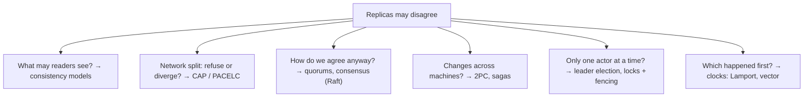
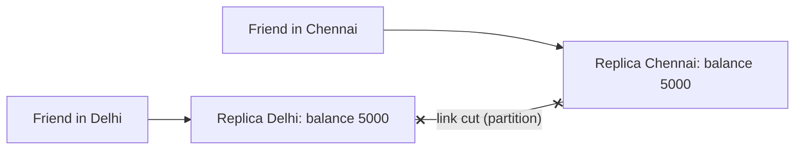
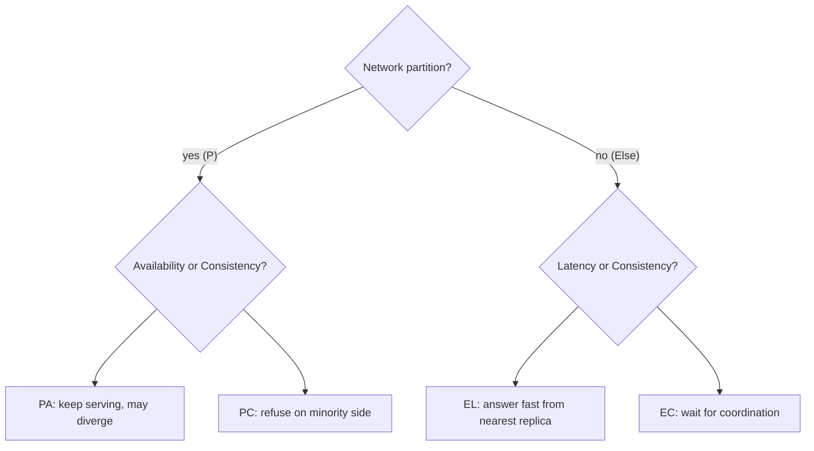
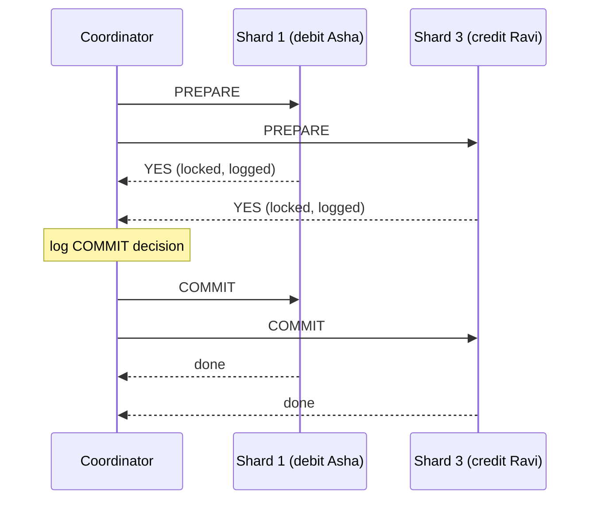
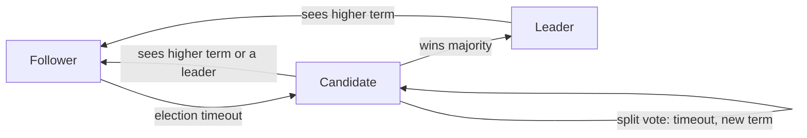
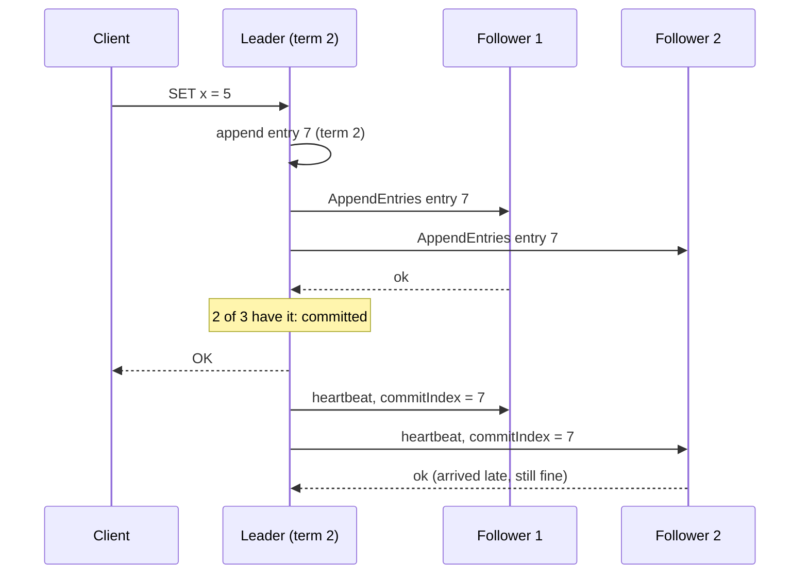
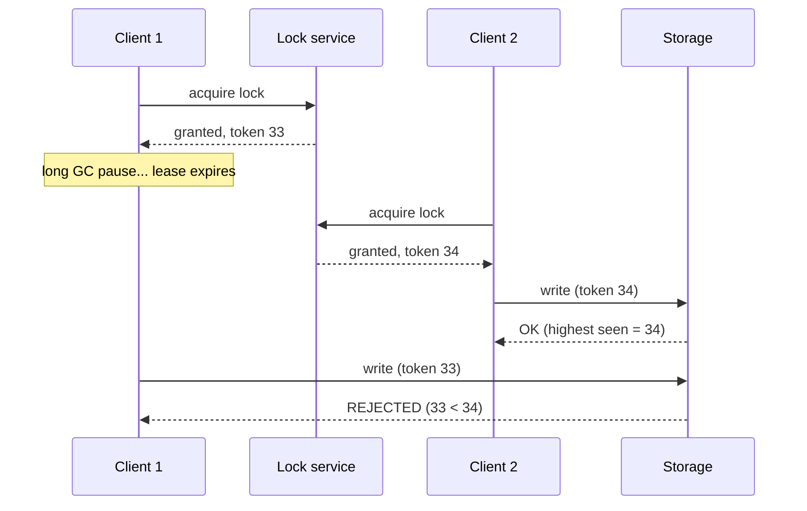

# Chapter 06 · CAP, Consistency Models & Consensus

> Two friends share a joint bank account, one in Delhi and one in Chennai. The undersea... no, the *overland* cable between the bank's two datacenters gets cut by a construction crew. Both friends try to withdraw the last ₹5,000 at the same moment. The bank must choose: refuse one of them (and look "down"), or let both withdraw (and lose ₹5,000). There is no third option. That choice is the CAP theorem, and this chapter teaches you to make it deliberately.

**You will learn:**
- The CAP theorem stated precisely, and the most common misunderstandings about it
- PACELC: the trade-off that exists even when the network is fine
- Consistency models: linearizable, sequential, causal, read-your-writes, eventual, with examples
- Quorums (N, R, W) with a simulation, and why R + W > N isn't the whole story
- Conflict resolution: last-write-wins, vector clocks, and CRDTs
- Distributed transactions: two-phase commit and the saga pattern
- Consensus: why it's needed, Raft leader election and log replication intuitively, and where Paxos fits
- Leader election, distributed locks with fencing tokens, and clocks (physical vs logical, Lamport)

**Before this:** [Chapter 05 · Replication, Sharding & Consistent Hashing](05-replication-sharding.md) (leaders, followers, quorums, failover) · [Chapter 03 · Databases](03-databases.md) (transactions, isolation)

---

## 🧠 The Big Idea

In [Chapter 05](05-replication-sharding.md) we made copies of data on several machines. Copies are wonderful until they **disagree**. This chapter is about the rules of disagreement:

- **What can a reader see?** (consistency models)
- **What happens when machines can't talk?** (CAP, PACELC)
- **How do machines agree on one truth anyway?** (quorums, consensus)
- **How do we act on several machines at once?** (2PC, sagas, locks)



The deep reason this is hard: in a distributed system, **messages can be delayed, lost or reordered, machines can pause or crash, and clocks disagree**. A node can never be sure whether another node is dead or just slow. Every idea in this chapter is a careful way of being correct anyway.

> 💡 **The core insight:** you cannot have perfect agreement, perfect availability, and tolerance of network failures all at once. So decide **per feature** how much agreement you need, and pay for exactly that.

---

## 🔨 Building It Up

### 1. The CAP theorem, precisely

CAP (conjectured by Eric Brewer in 2000, proven by Gilbert and Lynch in 2002) talks about three properties of a replicated data system:

- **C — Consistency**: here it means **linearizability**: every read returns the most recent completed write, as if there were a single copy of the data. (Not the "C" in ACID!)
- **A — Availability**: every request to a **non-failed** node receives a (non-error) response, eventually. No "sorry, try later".
- **P — Partition tolerance**: the system keeps working even when the network **drops or delays messages** between nodes (a **network partition** splits nodes into groups that can't talk).

**The theorem:** when a network partition happens, a system must choose between **C** and **A**. It cannot provide both.

Why? Imagine two replicas, Delhi and Chennai, and the link between them is cut:



A withdrawal arrives at Delhi. Delhi can't tell Chennai.

- **Choose C (CP)**: Delhi refuses (or waits) until it can coordinate. Consistent, but **not available** for that request.
- **Choose A (AP)**: Delhi accepts. Chennai, also cut off, accepts another withdrawal. Both available, but now the replicas **disagree** and the account is overdrawn. Not consistent.

```python
class Replica:
    def __init__(self, name, balance):
        self.name, self.balance = name, balance

def withdraw(replica, peer, amount, partitioned, mode):
    if partitioned and mode == "CP":
        return f"{replica.name}: ERROR, can't reach {peer.name}, try later"
    if replica.balance < amount:
        return f"{replica.name}: declined, insufficient funds"
    replica.balance -= amount
    if not partitioned:
        peer.balance = replica.balance          # normal case: replicate synchronously
    return f"{replica.name}: OK, dispensed {amount}"

for mode in ("CP", "AP"):
    delhi, chennai = Replica("Delhi", 5000), Replica("Chennai", 5000)
    print(f"--- {mode} during a partition ---")
    print(withdraw(delhi, chennai, 5000, partitioned=True, mode=mode))
    print(withdraw(chennai, delhi, 5000, partitioned=True, mode=mode))
    print(f"total dispensed: {10000 - delhi.balance - chennai.balance}, real money: 5000")
```

```text
--- CP during a partition ---
Delhi: ERROR, can't reach Chennai, try later
Chennai: ERROR, can't reach Delhi, try later
total dispensed: 0, real money: 5000
--- AP during a partition ---
Delhi: OK, dispensed 5000
Chennai: OK, dispensed 5000
total dispensed: 10000, real money: 5000
```

What just happened: the CP bank was "down" for both friends but never lost money. The AP bank served both and dispensed ₹10,000 from a ₹5,000 account. Neither is "wrong": an ATM network might choose AP with a small per-withdrawal limit and fix overdrafts later (real ATMs do something like this), while a stock exchange must choose CP.

(Note: in the CP version above, a smarter design lets the side with a **majority** of replicas keep serving. With 2 replicas there's no majority, so both refuse. That's why real systems use 3 or 5 replicas, section 13.)

### 2. Common CAP misunderstandings

1. **"Pick any two of three."** Wrong framing. Partitions **will** happen in any real network (switches fail, cables get cut, GC pauses look like partitions). You can't "give up P". The real choice is: **during a partition**, C or A?
2. **"CA systems."** A single-node database is "CA" only in the sense that there's no network between replicas. Once you replicate over a network, you must handle partitions.
3. **"CAP consistency = ACID consistency."** No. CAP-C is linearizability (replicas agree, reads see latest write). ACID-C is "constraints hold".
4. **"CAP availability = 99.99% uptime."** No. CAP-A is a strict theoretical property: *every* non-failed node must answer *every* request. Many "CP" systems are extremely available in practice (they just can't answer on the minority side of a partition).
5. **"A system is CP or AP, full stop."** Most systems are **tunable** per operation (Cassandra's consistency levels, DynamoDB's strongly consistent reads option, MongoDB's read/write concerns).
6. **"CAP explains latency."** It doesn't talk about latency at all. That's PACELC.

Typical labels (with the caveat above):

| System | Usual classification | Why |
|---|---|---|
| ZooKeeper, etcd, Consul | CP | Consensus: minority side refuses writes |
| HBase, Google Spanner, CockroachDB | CP | Consistency first; minority unavailable |
| MongoDB (default majority writes) | CP-ish | Primary on majority side only |
| Cassandra, ScyllaDB, Riak, DynamoDB (default) | AP | Accept writes on any reachable replicas; reconcile later |
| DNS, CDNs, caches | AP | Serve possibly stale data rather than fail |

### 3. PACELC: the trade-off when nothing is broken

Daniel Abadi's **PACELC** extends CAP:

> If there is a **P**artition, choose between **A**vailability and **C**onsistency; **E**lse (normal operation), choose between **L**atency and **C**onsistency.

Even with a perfect network, keeping replicas strongly consistent means **waiting** for other replicas (round trips, possibly across regions) on each write or read. Skipping the wait is faster but readers may see stale data.



| System | PACELC | Meaning |
|---|---|---|
| Cassandra, DynamoDB (defaults), Riak | PA/EL | Available in partitions, fast otherwise; eventual consistency |
| Spanner, CockroachDB, etcd, ZooKeeper (writes) | PC/EC | Consistent always; pays latency |
| MongoDB (typical config) | PA/EC or PC/EC depending on settings | Tunable |
| PNUTS (Yahoo) | PC/EL | Unusual mix: per-record master |

> 💡 PACELC is the more useful lens for everyday design: partitions are rare, but the **latency cost of consistency** is paid on every request.

### 4. Consistency models: what can a reader see?

A **consistency model** is a contract: "if you write and read like this, you're guaranteed to see that." From strongest to weakest:

**Linearizability (strong consistency).** The system behaves as if there's **one copy** of the data and every operation happens **instantly** at some point between its start and its end. Once a write completes, every later read (by anyone) sees it. Once any reader has seen a new value, no later reader sees the old one.

- Example: a username registration. Once "asha" is taken, nobody anywhere can see it as free.
- Cost: coordination on every operation (consensus or reading from a single leader).

**Sequential consistency.** All operations appear in **some single order** that every node agrees on, and each client's own operations appear in the order it issued them. But that order doesn't have to match real time: a read may return an older value even after another client's write finished, as long as everyone sees the same order.

**Causal consistency.** Operations that are **causally related** (one could have influenced the other: a reply after a message, a comment after reading a post) are seen by everyone in that order. **Concurrent** (unrelated) operations may be seen in different orders by different nodes.

- Example: Ravi posts "I got the job!", Asha replies "Congrats!". Nobody may see Asha's reply without Ravi's post. But two unrelated posts may appear in different orders for different people.
- It's the strongest model that can stay available during partitions, which makes it popular for geo-replicated systems.

**Session guarantees** (client-centric, from [Chapter 05](05-replication-sharding.md)):

- **Read-your-writes**: you always see your own writes.
- **Monotonic reads**: once you've seen a value, you never see an older one.
- **Monotonic writes**: your writes are applied in the order you made them.
- **Writes-follow-reads**: if you read something and then write, your write is ordered after what you read.

**Eventual consistency.** If writes stop, all replicas **eventually** converge to the same value. Before that, reads may return anything that was written at some point (stale data, values in different orders on different replicas). The weakest useful promise.

- Example: like counts, view counts, DNS ([Chapter 01](01-foundations-internet.md)), product reviews.

Here's a timeline that is **not linearizable**, checked by code:

```python
# Operations on one register x. Each: (client, op, value, start_time, end_time)
history = [
    ("A", "write", 1, 0, 2),
    ("B", "read", 1, 3, 4),     # B sees the new value 1 (after A's write finished)
    ("C", "read", 0, 5, 6),     # C, starting LATER, sees the old value 0
]

def violates_linearizability(history, initial=0):
    """Simplified check for a single-writer register: once a value has been
    returned by a read that ended before another read started, the later read
    must not return an older value."""
    write_order = [initial] + [v for _, op, v, _, _ in sorted(history, key=lambda h: h[3]) if op == "write"]
    reads = sorted([h for h in history if h[1] == "read"], key=lambda h: h[3])
    for i, earlier in enumerate(reads):
        for later in reads[i + 1:]:
            if earlier[4] < later[3] and write_order.index(later[2]) < write_order.index(earlier[2]):
                return f"{later[0]} read {later[2]} after {earlier[0]} already read {earlier[2]}"
    return None

print("violation:", violates_linearizability(history))
```

```text
violation: C read 0 after B already read 1
```

What just happened: B and C's reads don't overlap, B finished before C started, yet C saw an older value. On a single copy that's impossible, so this history isn't linearizable. It **could** happen with async replicas (B hit a fresh replica, C a lagging one). It would still be **eventually consistent**.

| Model | Guarantee | Typical cost | Example use |
|---|---|---|---|
| Linearizable | Single-copy, real-time order | Highest latency; unavailable in partitions | Locks, leader election, unique usernames, balances |
| Sequential | One global order, per-client order kept | High | Some replicated logs/caches |
| Causal | Cause before effect everywhere | Moderate; stays available | Comments/replies, chat, social feeds |
| Read-your-writes / monotonic | Per-session sanity | Low | Profile edits, dashboards |
| Eventual | Converges if writes stop | Lowest; always available | Likes, views, DNS, caches |

### 5. Quorums: N, R, W

Recall leaderless replication from [Chapter 05](05-replication-sharding.md): each key is stored on **N** replicas; a write waits for **W** acknowledgements; a read waits for **R** responses and takes the newest version.

- **R + W > N** → every read set overlaps every write set in at least one replica, so a read normally **sees the latest completed write**.
- **W > N/2** → two writes can't both succeed on disjoint majorities (helps ordering of writes).
- Smaller W = faster, more available writes; smaller R = faster reads. You can tune for the workload.

| Config (N=3) | Behaviour |
|---|---|
| W=3, R=1 | Fast reads; writes fail if any replica is down |
| W=1, R=3 | Fast writes; reads fail if any replica is down |
| W=2, R=2 | Balanced; tolerates 1 node down for both; overlap guaranteed |
| W=1, R=1 | Fastest, most available; **no overlap guarantee** → stale reads possible |

Let's simulate it: 3 replicas, random replica choice for each operation, and count stale reads for different R/W.

```python
import random

def simulate(n, w, r, trials=10_000, seed=1):
    rng = random.Random(seed)
    stale = 0
    for _ in range(trials):
        versions = [1] * n                            # all replicas have version 1
        for i in rng.sample(range(n), w):             # write v2 reaches only W replicas
            versions[i] = 2                           # (the rest get it later, async)
        responses = [versions[i] for i in rng.sample(range(n), r)]
        if max(responses) < 2:                        # newest version among R replies
            stale += 1
    return stale / trials

for w, r in [(1, 1), (2, 1), (1, 2), (2, 2), (3, 1), (1, 3)]:
    tag = "R+W>N" if r + w > 3 else "     "
    print(f"N=3 W={w} R={r} {tag}  stale read probability: {simulate(3, w, r):.1%}")
```

```text
N=3 W=1 R=1        stale read probability: 67.2%
N=3 W=2 R=1        stale read probability: 33.9%
N=3 W=1 R=2        stale read probability: 33.3%
N=3 W=2 R=2 R+W>N  stale read probability: 0.0%
N=3 W=3 R=1 R+W>N  stale read probability: 0.0%
N=3 W=1 R=3 R+W>N  stale read probability: 0.0%
```

What just happened: whenever R + W > 3, stale reads dropped to **0%**, because the replicas read must include at least one that got the write. With R + W ≤ 3 there's a real chance of reading only replicas the write hasn't reached yet. (Theory: for W=1, R=1 it's 2/3; for W=2, R=1 it's 1/3.)

**Why R + W > N is not full linearizability** (good interview depth):

- **Sloppy quorums / hinted handoff**: during failures, writes may land on stand-in nodes outside the key's normal N, so the overlap guarantee breaks.
- **Concurrent writes**: two writes with no clear order need conflict resolution (section 6); LWW with skewed clocks may keep the "wrong" one.
- **A write in progress**: a read concurrent with a write may see the new value on one replica, and a later read may hit replicas without it (unless reads do **read repair** synchronously before returning).
- **Partial failure**: a write that succeeded on fewer than W replicas reports failure but isn't rolled back on the replicas that did get it.

So Dynamo-style quorums give "usually fresh" reads, not a strict guarantee. For strict guarantees you need consensus (section 11).

### 6. Conflict resolution: last-write-wins

With multi-leader or leaderless replication, two replicas may accept **concurrent** writes to the same key. Something must decide the final value.

**Last-write-wins (LWW)**: attach a timestamp to each write; keep the highest. Simple and convergent: every replica ends up with the same value.

Problems:

- It **silently drops** concurrent writes. If two users add different items to a shared list at the same time, one addition vanishes.
- Physical clocks drift (section 18). A node whose clock runs 2 seconds fast **always wins**, even against writes that actually happened later.

LWW is fine when losing a concurrent update is acceptable (a "last seen online" timestamp, cache entries) or when each key is written only once (immutable data with unique IDs).

### 7. Vector clocks: detecting concurrency

A single timestamp can't tell "A happened before B" from "A and B happened at the same time without knowing about each other". A **vector clock** can.

Each replica keeps a counter per replica: `{A: 2, B: 0, C: 1}` means "this version includes 2 updates from A and 1 from C". Rules:

- When replica X updates a value, it increments its **own** entry.
- When merging, take the **element-wise maximum**.
- Compare two clocks V1, V2:
  - V1 ≤ V2 in every entry (and not equal) → V1 **happened before** V2 → V2 supersedes V1, no conflict.
  - Neither ≤ the other → **concurrent** → a real conflict; keep both (**siblings**) and resolve.

```python
def compare(v1, v2):
    keys = set(v1) | set(v2)
    le = all(v1.get(k, 0) <= v2.get(k, 0) for k in keys)
    ge = all(v1.get(k, 0) >= v2.get(k, 0) for k in keys)
    if le and ge:
        return "equal"
    if le:
        return "v1 happened before v2"
    if ge:
        return "v2 happened before v1"
    return "CONCURRENT (conflict)"

def bump(clock, node):
    new = dict(clock)
    new[node] = new.get(node, 0) + 1
    return new

def merge(v1, v2):
    return {k: max(v1.get(k, 0), v2.get(k, 0)) for k in set(v1) | set(v2)}

base = bump({}, "A")                 # A writes cart = [milk]            {A:1}
on_b = bump(base, "B")               # B, having seen base, adds bread   {A:1, B:1}
on_c = bump(base, "C")               # C, also from base, adds eggs      {A:1, C:1}
print("base vs on_b :", compare(base, on_b))
print("on_b vs on_c :", compare(on_b, on_c))
resolved = bump(merge(on_b, on_c), "A")   # A merges siblings and writes the union
print("resolved     :", dict(sorted(resolved.items())))
print("on_c vs resolved:", compare(on_c, resolved))
```

```text
base vs on_b : v1 happened before v2
on_b vs on_c : CONCURRENT (conflict)
resolved     : {'A': 2, 'B': 1, 'C': 1}
on_c vs resolved: v1 happened before v2
```

What just happened: the vector clock proved B's and C's writes were made without knowledge of each other, so instead of silently dropping one (LWW), the system kept both and merged them (cart = milk, bread, eggs). The merged version dominates both siblings, so they can be discarded. This is how Amazon's original Dynamo kept shopping carts from losing items. (Riak uses a variant called **dotted version vectors**; the idea is the same.)

Cost: clocks grow with the number of writers, and the application must know how to merge.

### 8. CRDTs: data types that merge themselves

**CRDTs (Conflict-free Replicated Data Types)** are data structures designed so that replicas can be updated independently and **always merge to the same result**, no matter the order or how many times merges happen. The merge function is **commutative** (order doesn't matter), **associative** (grouping doesn't matter) and **idempotent** (merging twice = once).

**G-Counter (grow-only counter)**: each replica counts its own increments; the value is the sum; merge takes the per-replica maximum.

```python
class GCounter:
    def __init__(self, replica_id):
        self.id = replica_id
        self.counts = {}

    def increment(self, n=1):
        self.counts[self.id] = self.counts.get(self.id, 0) + n

    def value(self):
        return sum(self.counts.values())

    def merge(self, other):
        for rid, c in other.counts.items():
            self.counts[rid] = max(self.counts.get(rid, 0), c)

mumbai, delhi = GCounter("mumbai"), GCounter("delhi")
mumbai.increment(3)                     # 3 likes in Mumbai
delhi.increment(5)                      # 5 likes in Delhi, at the same time
mumbai.merge(delhi); delhi.merge(mumbai)
mumbai.merge(delhi)                     # merging again changes nothing (idempotent)
print("mumbai sees", mumbai.value(), "| delhi sees", delhi.value())
```

```text
mumbai sees 8 | delhi sees 8
```

What just happened: no coordination, no lost increments, and both replicas converged to 8. (Why not just add the counts on merge? Because merging the same state twice would double count. Max per replica is idempotent.)

Other common CRDTs:

| CRDT | Supports | Idea |
|---|---|---|
| G-Counter | Increment | Per-replica counts, merge by max |
| PN-Counter | Increment and decrement | Two G-Counters: P (plus) and N (minus); value = P − N |
| G-Set | Add only | Union |
| 2P-Set | Add, remove once | Add-set and remove-set (tombstones); can't re-add |
| OR-Set (observed-remove) | Add and remove, re-add | Tag each add uniquely; remove only the tags you've seen. Concurrent add wins over remove |
| LWW-Register | Single value | Timestamp wins (a CRDT, but loses concurrent writes) |
| Sequence CRDTs (RGA, Logoot, Yjs/Automerge) | Collaborative text | Unique positions for each character |

Used by: Riak data types, Redis Enterprise active-active, collaborative editors (Figma-style multiplayer, Yjs, Automerge), shopping carts, presence and counters in globally replicated apps.

### 9. Distributed transactions: two-phase commit (2PC)

In [Chapter 05](05-replication-sharding.md) we met cross-shard transactions: move money from a user on shard 1 to a user on shard 3. Both must commit, or neither. **Two-phase commit** coordinates this.

**Phase 1, prepare (voting):** the **coordinator** asks every **participant** "can you commit?". Each participant does all the work, writes it durably to its log, **locks** the affected rows, and votes **YES** (a binding promise: "I will commit if told to, even after a crash") or **NO**.

**Phase 2, commit/abort (decision):** if **all** voted YES, the coordinator writes "COMMIT" to its own log (the point of no return) and tells everyone to commit. If anyone voted NO (or timed out), it tells everyone to abort.



```python
class Participant:
    def __init__(self, name, will_vote_yes=True):
        self.name, self.will_vote_yes = name, will_vote_yes
        self.state = "idle"

    def prepare(self):
        self.state = "prepared (locks held)" if self.will_vote_yes else "aborted"
        return self.will_vote_yes

    def finish(self, decision):
        if self.state.startswith("prepared"):
            self.state = "committed" if decision == "COMMIT" else "aborted"

def two_phase_commit(participants, coordinator_crashes_after_prepare=False):
    votes = [p.prepare() for p in participants]                # phase 1
    if coordinator_crashes_after_prepare:
        return "coordinator CRASHED before deciding"
    decision = "COMMIT" if all(votes) else "ABORT"              # phase 2
    for p in participants:
        p.finish(decision)
    return decision

for label, ps, crash in [
    ("all yes", [Participant("S1"), Participant("S3")], False),
    ("one no", [Participant("S1"), Participant("S3", will_vote_yes=False)], False),
    ("coordinator dies", [Participant("S1"), Participant("S3")], True),
]:
    result = two_phase_commit(ps, crash)
    print(f"{label:<17}: {result:<38} states: {[p.state for p in ps]}")
```

```text
all yes          : COMMIT                                 states: ['committed', 'committed']
one no           : ABORT                                  states: ['aborted', 'aborted']
coordinator dies : coordinator CRASHED before deciding    states: ['prepared (locks held)', 'prepared (locks held)']
```

What just happened: the third case is 2PC's famous weakness. Both participants voted YES and **promised** to obey the decision, so they can't decide on their own (committing might contradict an abort decision; aborting might contradict a commit). They're **stuck holding locks** until the coordinator recovers. 2PC is a **blocking** protocol.

**2PC trade-offs:**

- ✅ Atomic across participants; strong consistency.
- ❌ Blocking if the coordinator fails; locks held across network round trips → low throughput; latency of at least 2 round trips; every participant must be available (one slow participant slows all).
- Mitigations: make the coordinator itself replicated via consensus (what Spanner does: participants and coordinators are Paxos groups), timeouts, and keeping transactions short.
- (**3PC** adds a phase to reduce blocking but assumes bounded network delays, so it's rarely used in practice.)

Where you see 2PC: XA transactions across databases/queues, inside distributed SQL databases (Spanner, CockroachDB), and in Kafka's transactional writes.

### 10. Sagas: long transactions without global locks

In microservices ([Chapter 09](09-microservices-reliability.md)), each service owns its database, transactions may take minutes (waiting for payment or a driver), and holding locks across services is unacceptable. A **saga** breaks the big transaction into a **sequence of local transactions**, each with a **compensating transaction** that semantically undoes it.

Booking a trip: (1) reserve flight, (2) reserve hotel, (3) charge card. If charging fails: cancel hotel, cancel flight.


```python
def run_saga(steps):
    done = []
    for name, action, compensate in steps:
        try:
            action()
            done.append((name, compensate))
            print(f"  [ok]   {name}")
        except Exception as e:
            print(f"  [FAIL] {name}: {e}")
            for prev_name, comp in reversed(done):       # undo in reverse order
                comp()
                print(f"  [undo] {prev_name}")
            return "saga ABORTED (compensated)"
    return "saga COMPLETED"

def fail(msg):
    raise RuntimeError(msg)

ok = lambda: None
steps = [
    ("reserve flight", ok, ok),
    ("reserve hotel", ok, ok),
    ("charge card", lambda: fail("card declined"), ok),
]
print(run_saga(steps))
```

```text
  [ok]   reserve flight
  [ok]   reserve hotel
  [FAIL] charge card: card declined
  [undo] reserve hotel
  [undo] reserve flight
saga ABORTED (compensated)
```

Two ways to run a saga:

- **Orchestration**: a central **orchestrator** (a workflow service, e.g. built with Temporal, AWS Step Functions) tells each service what to do next and handles failures. Easy to follow and change; one more service.
- **Choreography**: no central brain; each service listens for events ("FlightReserved") and reacts by doing its step and emitting the next event ([Chapter 08](08-queues-events.md)). Loosely coupled, but the overall flow is hard to see and debug.

**Saga caveats:**

- **No isolation**: other transactions can see intermediate states (the flight is reserved before the payment is done). Handle with "pending" states, semantic locks, or ordering steps so the riskiest/most likely to fail goes first.
- Compensations must be **idempotent** and **retryable**, since they may run more than once.
- Some actions can't be undone (an email was sent); compensate semantically ("sorry, your booking was cancelled").

| | 2PC | Saga |
|---|---|---|
| Atomicity | Yes, all-or-nothing | Eventually, via compensations |
| Isolation | Yes (locks) | No (intermediate states visible) |
| Locks held | Across the whole protocol | Only within each local step |
| Failure of coordinator | Can block | Orchestrator state is persisted; resumes |
| Latency / throughput | Worse | Better |
| Best for | Short transactions inside one database system / shards | Long-running business workflows across services |

### 11. Consensus: why we need it

Many problems reduce to getting several nodes to **agree on one value** despite failures:

- **Who is the leader?** (exactly one, never two: no split brain)
- **What's the order of operations in the log?** (so every replica applies the same changes in the same order)
- **Is this transaction committed?** (2PC's coordinator decision, made fault-tolerant)
- **Who holds this lock?** **What's the current cluster configuration?**

**Consensus** is the problem of making nodes agree such that:

- **Agreement**: no two nodes decide differently.
- **Validity**: the decided value was proposed by someone.
- **Termination**: every non-crashed node eventually decides.
- And it tolerates crashes: with **2f + 1** nodes, consensus survives **f** crashed nodes (a **majority** must remain).

Why majorities? Any two majorities of the same group **overlap** in at least one node. So two conflicting decisions can't both gather a majority: the overlapping node would have to vote for both.

```python
from itertools import combinations

def all_majorities_overlap(n):
    nodes = range(n)
    majority = n // 2 + 1
    groups = list(combinations(nodes, majority))
    return all(set(a) & set(b) for a in groups for b in groups)

for n in (3, 4, 5):
    print(f"{n} nodes: majority={n // 2 + 1}, tolerates {(n - 1) // 2} failures, "
          f"every pair of majorities overlaps: {all_majorities_overlap(n)}")
```

```text
3 nodes: majority=2, tolerates 1 failures, every pair of majorities overlaps: True
4 nodes: majority=3, tolerates 1 failures, every pair of majorities overlaps: True
5 nodes: majority=3, tolerates 2 failures, every pair of majorities overlaps: True
```

What just happened: 4 nodes tolerate the same single failure as 3 nodes. That's why clusters use **odd sizes** (3 or 5): an even extra node adds cost without adding fault tolerance.

**A famous impossibility (FLP, 1985):** in a fully **asynchronous** system (no bound on message delays) where even one node may crash, no deterministic algorithm can guarantee consensus always terminates. Practical algorithms get around this with **timeouts** (assuming the network is *eventually* well-behaved): they're always **safe** (never decide two different values) and are **live** (make progress) whenever the network behaves well enough.

**Paxos** (Leslie Lamport, published 1998) was the first widely known practical solution; it's correct but famously hard to understand and to turn into a complete system (Multi-Paxos for logs). Google's Chubby lock service and Spanner use Paxos variants. **Raft** (Ongaro and Ousterhout, 2014) was designed explicitly to be **understandable** and is used by etcd, Consul, CockroachDB, TiKV, and many others. ZooKeeper uses a similar protocol called **Zab**.

### 12. Raft, intuitively: leader election

Raft splits consensus into **leader election**, **log replication**, and **safety**. Every node is in one of three states: **follower**, **candidate**, or **leader**. Time is divided into **terms** (numbered 1, 2, 3, ...), each starting with an election; each term has at most one leader.

1. Everyone starts as a **follower**. The leader sends regular **heartbeats**.
2. If a follower hears nothing for its **election timeout** (randomised, e.g. 150–300 ms), it assumes the leader is dead, becomes a **candidate**, increments the term, votes for itself, and asks others for votes (**RequestVote**).
3. Each node grants **at most one vote per term**, first come first served, and only to a candidate whose log is **at least as up to date** as its own.
4. A candidate with votes from a **majority** becomes **leader** and starts sending heartbeats.
5. If a node sees a message with a **higher term**, it immediately steps down to follower. This is how an old leader that was cut off learns it's been replaced.

**Randomised timeouts** make split votes rare: usually one follower times out first and wins before others even start.



A deterministic simulation (the "random" timeouts are fixed so the output is repeatable):

```python
class RaftNode:
    def __init__(self, name, timeout, log_len):
        self.name, self.timeout, self.log_len = name, timeout, log_len
        self.term, self.voted_for, self.state, self.alive = 0, None, "follower", True

def election(nodes):
    alive = [n for n in nodes if n.alive]
    candidate = min(alive, key=lambda n: n.timeout)       # first timeout fires first
    candidate.term += 1
    candidate.state, candidate.voted_for = "candidate", candidate.name
    votes = 1
    for peer in alive:
        if peer is candidate:
            continue
        if candidate.term > peer.term:                     # newer term: reset vote
            peer.term, peer.voted_for, peer.state = candidate.term, None, "follower"
        log_ok = candidate.log_len >= peer.log_len         # don't elect a stale log
        if peer.voted_for is None and log_ok:
            peer.voted_for = candidate.name
            votes += 1
    majority = len(nodes) // 2 + 1                          # majority of ALL nodes
    if votes >= majority:
        candidate.state = "leader"
    print(f"term {candidate.term}: {candidate.name} got {votes}/{len(nodes)} votes -> "
          f"{candidate.state}")
    return candidate if candidate.state == "leader" else None

nodes = [RaftNode("n1", 150, 10), RaftNode("n2", 210, 10), RaftNode("n3", 180, 10),
         RaftNode("n4", 270, 9), RaftNode("n5", 240, 10)]
leader = election(nodes)

leader.alive = False                                        # leader crashes
leader.state = "follower"
for n in nodes:
    n.state = "follower" if n.alive else n.state
print("n1 crashed")
nodes[2].timeout = 160                                      # n3 now times out first
leader = election(nodes)

for n in nodes:
    if n.name in ("n2", "n3"):
        n.alive = False
print("n2 and n3 crashed too (3 of 5 down)")
for n in nodes:
    n.voted_for = None                                      # fresh term, fresh votes
election(nodes)
```

```text
term 1: n1 got 5/5 votes -> leader
n1 crashed
term 2: n3 got 4/5 votes -> leader
n2 and n3 crashed too (3 of 5 down)
term 3: n5 got 2/5 votes -> candidate
```

What just happened: n1's timeout fired first, so it won term 1. When n1 crashed, n3 won term 2 with 4 of 5 votes (a majority of the whole cluster, not just of the live nodes). When 3 of 5 nodes were down, n5 could gather only 2 votes, short of the majority of 3, so **no leader was elected**. The cluster refuses to make progress rather than risk two leaders: that's Raft being **CP**.

### 13. Raft, intuitively: log replication

Once elected, the leader handles all client writes:

1. The client sends a command (e.g. `SET x = 5`) to the leader.
2. The leader **appends** it to its log (with the current term) and sends **AppendEntries** to followers.
3. Followers append it and acknowledge.
4. When a **majority** (including the leader) has the entry, it's **committed**. The leader applies it to its state machine, replies to the client, and tells followers the new **commit index** (in the next heartbeat), and they apply it too.
5. AppendEntries includes the index and term of the previous entry; a follower whose log doesn't match rejects it, and the leader walks back and **overwrites** the follower's conflicting entries. Thus all logs converge to the leader's log.



```python
def commit_index(match_index, cluster_size):
    """Highest log index stored on a majority. match_index: highest index each node has."""
    for index in sorted(set(match_index), reverse=True):
        copies = sum(1 for m in match_index if m >= index)
        if copies >= cluster_size // 2 + 1:
            return index
    return 0

# leader has entries up to 10; followers have up to 10, 8, 7, 3
match = [10, 10, 8, 7, 3]
print("committed up to index", commit_index(match, 5))
match = [12, 9, 9, 4, 4]
print("committed up to index", commit_index(match, 5))
```

```text
committed up to index 8
committed up to index 9
```

What just happened: an entry is committed once a majority stores it. In the first case, index 8 is on 3 of 5 nodes (10, 10, 8), so everything up to 8 is committed, even though one follower lags far behind at 3. A slow minority **doesn't slow down** the cluster.

**Why it's safe:** a committed entry is on a majority. A new leader needs votes from a majority, and voters only vote for candidates whose logs are at least as up to date. Any two majorities overlap, so the new leader's log **must contain every committed entry**. Committed data is never lost.

What Raft gives you: a **replicated log** that every node applies in the same order, so every node's state machine (a key-value store, a config database, a lock table) ends up identical. This is called **state machine replication**, and it's how etcd, Consul, and CockroachDB's ranges work.

### 14. Leader election in practice

You rarely implement Raft yourself. To elect a leader among your own service instances (e.g. "only one instance runs the nightly billing job" or "one scheduler is active"), you use a coordination service:

- **etcd / Consul**: create a key with a **lease** (TTL). Whoever creates it is leader and must keep renewing the lease. If the leader dies, the lease expires and others race to create the key.
- **ZooKeeper**: each candidate creates an **ephemeral sequential** node (`/election/n_0000000007`); the one with the lowest number is leader; each watches the next-lower node, so when the leader's session dies its node vanishes and the next one takes over.
- **Database-based**: a row with `leader_id, lease_expires_at`, updated with an atomic conditional `UPDATE ... WHERE lease_expires_at < now()`. Simple, but correctness depends on the DB and on clocks.

The catch: a leader can **believe** it's still leader after it isn't (it was paused by a long garbage collection or a slow disk, and its lease expired meanwhile). That leads us to locks and fencing.

### 15. Distributed locks and fencing tokens

A **distributed lock** ensures only one client does something at a time across machines: one worker processes this file, one instance runs the job, one request edits this document.

Basic recipe with Redis: `SET lock:job123 <random-token> NX PX 30000` (set if not exists, expire in 30 s). Release by deleting **only if the token matches** (a small Lua script), so you never delete someone else's lock ([Chapter 04](04-caching-cdn.md) practice).

**The fundamental problem: leases + pauses.** Client 1 acquires the lock (30 s lease), then freezes for 40 s (a stop-the-world GC pause, VM migration, or a network delay). The lease expires; client 2 acquires the lock and writes to storage. Client 1 wakes up, still **believing** it holds the lock, and also writes. Data corrupted. No lock service can prevent the pause; the client simply doesn't know time passed.

**The fix: fencing tokens.** The lock service returns a **monotonically increasing number** with every lock grant (lock #33, then #34, ...). The client sends the token with every write to the storage. The **storage** remembers the highest token it has seen and **rejects** any write with a lower one.



```python
class LockService:
    def __init__(self):
        self.holder, self.expires, self.token = None, -1, 0

    def acquire(self, client, now, lease=30):
        if self.holder is None or now >= self.expires:
            self.token += 1                         # monotonically increasing
            self.holder, self.expires = client, now + lease
            return self.token
        return None

class Storage:
    def __init__(self):
        self.max_token, self.data = 0, []

    def write(self, value, token):
        if token < self.max_token:
            return f"REJECTED {value!r} (token {token} < {self.max_token})"
        self.max_token = token
        self.data.append(value)
        return f"OK {value!r} (token {token})"

locks, storage = LockService(), Storage()
t1 = locks.acquire("client1", now=0)        # token 1, lease until t=30
# client1 pauses for 40 seconds (GC)...
t2 = locks.acquire("client2", now=35)       # lease expired: token 2
print(storage.write("from client2", t2))
print(storage.write("from client1 (woke up late)", t1))
print("final data:", storage.data)
```

```text
OK 'from client2' (token 2)
REJECTED 'from client1 (woke up late)' (token 1 < 2)
final data: ['from client2']
```

What just happened: the zombie client's write was rejected by the storage itself, because its token was older. The lock alone couldn't save us; the **storage checking tokens** did.

Lessons:

- Locks for **efficiency** (avoid doing the same work twice; occasional double work is OK): a simple Redis lock is fine.
- Locks for **correctness** (double work corrupts data): use a consensus-backed lock service (etcd, ZooKeeper) **and** fencing tokens checked by the resource. (etcd's revision numbers and ZooKeeper's `zxid` can serve as fencing tokens.)
- Redlock (acquiring a lock on a majority of independent Redis nodes) has been debated by experts precisely because it relies on timing assumptions and provides no fencing token; for correctness-critical locking, prefer consensus systems with fencing.

### 16. Clocks: physical time is a liar

Every machine has a **quartz clock** that drifts (it can gain or lose seconds per day), corrected periodically by **NTP** (Network Time Protocol) syncing with time servers. Consequences:

- Clocks on different machines differ by milliseconds normally, and by much more when NTP misbehaves.
- A clock can **jump backwards** when NTP corrects it (so "end − start" can be negative on a wall clock).
- Leap seconds and VM pauses add more surprises.

Two kinds of clock on every machine:

- **Time-of-day (wall) clock**: `time.time()`. Comparable across machines (roughly), but can jump. Use for timestamps shown to humans.
- **Monotonic clock**: `time.monotonic()`. Always moves forward; meaningless across machines. Use for **measuring durations** and timeouts.

So "order events by wall-clock timestamp" across machines is unreliable: event B can get a smaller timestamp than event A even though B happened after A and was caused by it. LWW with skewed clocks silently picks the wrong winner.

Google **Spanner** tackles this with **TrueTime**: GPS receivers and atomic clocks in each datacenter give a time **interval** `[earliest, latest]` with a known small uncertainty (a few milliseconds). Spanner **waits out the uncertainty** before committing, guaranteeing timestamps that respect real-time order. Expensive hardware, elegant result.

### 17. Logical clocks: Lamport timestamps

If we can't trust physical time, we can still capture **causality**: "A happened before B" (written A → B) if A and B are on the same node and A came first, or A is sending a message and B is receiving it, or there's a chain of such steps.

A **Lamport clock** is a counter on each node:

1. Before each local event, `counter += 1`.
2. When sending a message, attach the counter.
3. When receiving a message with timestamp `t`, set `counter = max(counter, t) + 1`.

Guarantee: if A → B, then `L(A) < L(B)`. (The reverse isn't true: a smaller timestamp doesn't prove causality; that's what vector clocks add.) Breaking ties by node ID gives a **total order** that every node agrees on, consistent with causality.

```python
class LamportNode:
    def __init__(self, name):
        self.name, self.clock, self.events = name, 0, []

    def local(self, what):
        self.clock += 1
        self.events.append((self.clock, self.name, what))

    def send(self, what):
        self.local(f"send {what}")
        return self.clock

    def receive(self, ts, what):
        self.clock = max(self.clock, ts) + 1
        self.events.append((self.clock, self.name, f"recv {what}"))

a, b, c = LamportNode("A"), LamportNode("B"), LamportNode("C")
for _ in range(5):
    c.local("busy work")                  # C is busy: its counter runs ahead
a.local("write post")
m1 = a.send("post")                       # A -> B
b.receive(m1, "post")
m2 = b.send("reply")                      # B -> C (reply depends on post)
c.receive(m2, "reply")

for ts, node, what in sorted(a.events + b.events + c.events):
    print(f"L={ts:<2} {node}: {what}")
```

```text
L=1  A: write post
L=1  C: busy work
L=2  A: send post
L=2  C: busy work
L=3  B: recv post
L=3  C: busy work
L=4  B: send reply
L=4  C: busy work
L=5  C: busy work
L=6  C: recv reply
```

What just happened: the causal chain "write post → send → receive → send reply → receive reply" got strictly increasing timestamps (1, 2, 3, 4, 6), even though C's counter had run ahead with unrelated busy work. On receiving, C jumped to `max(5, 4) + 1 = 6`, so the reply is ordered after everything C did before. Ties (L=1 on A and C) are concurrent events, ordered by node name.

| Clock | Captures | Size | Detects concurrency? | Use |
|---|---|---|---|---|
| Wall clock | Real time (approximately) | 1 number | No | Human timestamps, TTLs, LWW (risky) |
| Monotonic clock | Elapsed time on one machine | 1 number | No | Timeouts, measuring durations |
| Lamport clock | Causality → total order | 1 number | No | Ordering events, total order broadcast |
| Vector clock | Exact causality | 1 number per node | **Yes** | Conflict detection in multi-leader/leaderless |
| Hybrid logical clock (HLC) | Causality + close to wall time | 2 numbers | No (like Lamport) | CockroachDB, YugabyteDB timestamps |
| TrueTime | Real time with bounded error | Interval | n/a | Spanner's externally consistent transactions |

---

## 🔬 Under the Hood

### Why you can't tell "dead" from "slow"

A node sends a request and gets no reply. Possibilities: the request was lost, the remote node crashed, the remote node is paused, the reply was lost, or everything is just slow. From the sender's side, **these all look identical**. The only tool is a **timeout**, and any timeout is a guess: too short and you declare healthy-but-slow nodes dead (causing failovers that add load and make things worse); too long and real failures take ages to handle. That's why systems use **leases with fencing**, **majorities**, and **terms/epochs**: they stay **safe** even when the guess is wrong.

### Why Raft's "up-to-date log" voting rule protects committed data

A voter compares the candidate's last log entry with its own: higher last **term** wins; if equal, longer log wins. Suppose an entry E was committed in term T: it's on a majority M1. Any future leader needs votes from a majority M2. M1 and M2 share a node X that has E. X refuses to vote for any candidate whose log is less up to date than X's, and a log lacking E (committed earlier) would be less up to date. So every future leader has E. Followers' logs are then forced to match the leader's. Committed entries survive any sequence of crashes, as long as a majority eventually comes back.

### Linearizability vs serializability (they're different!)

- **Serializability** ([Chapter 03](03-databases.md)) is about **transactions** (groups of operations on many objects): the result equals *some* serial order of the transactions. That order need not match real time.
- **Linearizability** is about **single operations on single objects**: each operation appears to take effect instantly at a point in real time.
- **Strict serializability** = both: transactions appear in a serial order that respects real time. Spanner and some distributed SQL databases offer it.

### Why 2PC blocks but consensus doesn't

In 2PC, the decision lives in **one** place (the coordinator) and **every** participant must vote yes. Lose the coordinator after the prepare votes and nobody else can safely decide. Consensus needs only a **majority** to make and remember a decision, and any majority can carry on. That's why modern systems run 2PC **on top of** consensus groups: the coordinator's decision is itself replicated with Raft/Paxos, so a coordinator crash just means another replica of it continues.

### Why CRDT merges always converge

If a merge operation is commutative, associative and idempotent (mathematically, a **join** in a semilattice: think "max" or "set union"), then however replicas exchange states (any order, any number of times, any grouping), every replica that has received the same updates computes the same result. "Max per replica" for a G-Counter and "union" for a G-Set are exactly such operations.

---

## 🧩 Pattern Decoder

### Decision guide: what consistency does this feature need?

| If the feature is... | Choose | Because |
|---|---|---|
| Money balances, inventory at checkout, seat booking | Linearizable / serializable transactions (single leader, consensus, distributed SQL) | Wrong answers cost real money |
| Unique usernames, leader election, locks, config | Linearizable (etcd/ZooKeeper, unique constraints) | Exactly one winner |
| Comments, chat replies, social posts | Causal (+ read-your-writes) | Effects after causes; stays available |
| User's own profile, settings | Read-your-writes, monotonic reads | Users must see their own edits |
| Likes, views, counters, recommendations | Eventual (CRDT counters, async) | Speed and availability matter more |
| DNS, CDN, caches | Eventual with TTL | Staleness bounded and acceptable |

### Decision guide: CP or AP during a partition?

| Signal | Lean | Example |
|---|---|---|
| "Must never double-spend / double-book / oversell" | CP | Payments, bank ledger, ticketing |
| "Must always accept writes, reconcile later" | AP | Shopping cart, social likes, IoT ingestion |
| "Coordination metadata (who's leader, config)" | CP | etcd, ZooKeeper |
| "Global, low latency reads matter most" | AP / EL | Product catalogue, feeds |

### Decision guide: conflict handling

| Situation | Strategy |
|---|---|
| Losing concurrent updates is OK | Last-write-wins |
| Concurrent updates must be preserved, app can merge | Vector clocks + siblings + app merge |
| Data is a counter, set, or document edited concurrently | CRDTs |
| Conflicts must never happen | Route all writes for a key to one leader, or use consensus |

### Decision guide: multi-step changes

| If you need... | Choose |
|---|---|
| Atomic change across shards of one database system, short-lived | 2PC (ideally consensus-backed, e.g. a distributed SQL DB) |
| Workflow across microservices, possibly long-running | Saga (orchestrated for complex flows, choreographed for simple ones) |
| Atomic single-key updates | Compare-and-set / conditional writes, no distributed transaction |

### Trade-off table: quorum settings (N = 3)

| W | R | Read latency | Write latency | Survives for writes | Survives for reads | Stale reads possible? |
|---|---|---|---|---|---|---|
| 1 | 1 | Lowest | Lowest | 2 down | 2 down | Yes |
| 2 | 2 | Medium | Medium | 1 down | 1 down | Rarely (edge cases) |
| 3 | 1 | Lowest | Highest | 0 down | 2 down | Rarely |
| 1 | 3 | Highest | Lowest | 2 down | 0 down | Rarely |

### When NOT to reach for consensus / strong consistency

- For data where eventual consistency is fine: every consensus round costs a majority round trip, and cross-region consensus costs 100+ ms per write.
- Don't build your own consensus or lock service. Use etcd, ZooKeeper, Consul, or a database's built-in features.
- Don't use a distributed lock where a database constraint or conditional update (`UPDATE ... WHERE version = ?`) would do.

---

## ⚠️ Traps & Common Mistakes

1. **"Choose 2 of 3."** Partitions aren't optional. The real choice is C vs A *during* a partition, and latency vs consistency otherwise (PACELC).
2. **Mixing up consistencies**: ACID-C (constraints), CAP-C (linearizability), "eventual consistency" (convergence). Say which you mean.
3. **Believing R + W > N gives linearizability.** Sloppy quorums, concurrent writes, clock-based LWW and partial failures break it.
4. **Last-write-wins with wall clocks** for data where losing writes matters. Clock skew silently discards newer data.
5. **Even-sized consensus clusters.** 4 nodes tolerate 1 failure, same as 3. Use 3 or 5 (rarely 7).
6. **Treating 2PC as "free atomicity".** It blocks on coordinator failure and holds locks across the network.
7. **Sagas without idempotent compensations**, or forgetting that intermediate states are visible to others.
8. **Distributed locks without fencing** for correctness-critical work. A paused client will eventually write after losing its lease.
9. **Measuring durations with the wall clock**:

```py
# ❌ wall clock can jump (NTP adjustments), giving negative or huge durations
import time
start = time.time()
do_work()
elapsed = time.time() - start

# ✅ monotonic clock only moves forward
start = time.monotonic()
do_work()
elapsed = time.monotonic() - start
```

10. **Assuming a timeout means the other node is dead.** It might be alive and still acting (the zombie leader). Design for that.
11. **Using consensus for high-volume data.** etcd/ZooKeeper are for small, critical metadata, not your 10 TB of orders.
12. **Forgetting the minority side.** In a CP system, clients connected to the minority partition get errors; your app must handle them gracefully (retry elsewhere, show a message).

---

## 💡 Tips & Tricks

- The CAP answer that impresses: **"Partitions are inevitable, so during one I must choose consistency or availability per feature. Outside partitions the real trade-off is latency vs consistency (PACELC)."**
- Majority math: **2f + 1 nodes tolerate f failures.** 3 → 1, 5 → 2, 7 → 3.
- Remember Raft in one breath: **"Randomised timeouts elect a leader by majority vote per term; the leader appends entries and commits them once a majority has them; voters only pick candidates with up-to-date logs."**
- For any lock question, say **"lease + fencing token checked by the resource"**.
- Default for microservice workflows: **orchestrated sagas with idempotent steps and compensations**.
- Use **CRDT counters** for likes/views across regions; **causal consistency** for chat and comments.
- Durations: `time.monotonic()`; human timestamps: wall clock in UTC; ordering events across nodes: logical clocks.

---

## 🎯 Interview Questions

### 1. Explain the CAP theorem. 🔥🔥🔥

<details><summary>Answer</summary>

In a replicated system, when a **network partition** occurs, you must choose between **consistency** (linearizability: every read sees the latest write, as if one copy) and **availability** (every non-failed node answers every request). You can't have both during a partition, because a node cut off from its peers must either refuse (stay consistent) or answer with possibly stale/diverging data (stay available).

Since partitions are unavoidable in real networks, "CA" isn't a real option for distributed systems; the choice is CP vs AP per operation. Examples: etcd/ZooKeeper/Spanner are CP; Cassandra/Dynamo-style stores are AP by default with tunable consistency. Mention PACELC for the normal-operation latency vs consistency trade-off.

</details>

### 2. What is PACELC and why is it more useful than CAP? 🔥🔥

<details><summary>Answer</summary>

PACELC: if Partition, choose Availability or Consistency; Else, choose Latency or Consistency. CAP only describes behaviour during partitions, which are rare. PACELC captures the everyday cost: strong consistency requires coordination (waiting for replicas/majorities, possibly across regions) on every request, adding latency even when the network is healthy. Cassandra/DynamoDB are PA/EL; Spanner/CockroachDB/etcd are PC/EC.

</details>

### 3. Describe consistency models from strongest to weakest. 🔥🔥🔥

<details><summary>Answer</summary>

- **Linearizable**: single-copy illusion, real-time ordering; once a write completes, all later reads see it.
- **Sequential**: a single total order agreed by all, preserving each client's program order, but not necessarily real time.
- **Causal**: causally related operations seen in order everywhere; concurrent ones may differ. Strongest model that remains available under partitions.
- **Session guarantees**: read-your-writes, monotonic reads, monotonic writes, writes-follow-reads.
- **Eventual**: replicas converge if updates stop; reads can be stale meanwhile.

Pick per feature: balances linearizable, comments causal, likes eventual.

</details>

### 4. How do quorums work? Does R + W > N guarantee strong consistency? 🔥🔥🔥

<details><summary>Answer</summary>

Each key has N replicas; writes wait for W acks, reads for R responses and take the newest version. If R + W > N, read and write sets overlap, so reads normally see the latest successful write; tuning W/R trades read vs write latency and availability (N=3, W=2, R=2 is common).

It does **not** guarantee linearizability: sloppy quorums/hinted handoff can place writes outside the normal replica set; concurrent writes need conflict resolution (LWW can drop data); a read concurrent with a write can return new then old values unless read repair is synchronous; failed writes may be partially applied. For strict guarantees use consensus.

</details>

### 5. How do you resolve conflicts in multi-leader or leaderless systems? 🔥🔥

<details><summary>Answer</summary>

Options: **avoid** conflicts by routing each key's writes to one leader; **last-write-wins** by timestamp (simple, convergent, silently loses concurrent writes, vulnerable to clock skew); **version vectors / vector clocks** to detect concurrent writes and keep siblings for the application (or user) to merge; **CRDTs** whose merge is commutative, associative and idempotent so replicas converge automatically (counters, sets, collaborative text); or application-specific merge logic (e.g. union of cart items).

</details>

### 6. What are vector clocks? 🔥🔥

<details><summary>Answer</summary>

A vector clock is a map node → counter attached to each version. A node increments its own entry on each update; merges take element-wise max. Comparing two clocks: if one is ≤ the other in all entries, it happened before (safe to overwrite); if neither dominates, the writes were concurrent → conflict to resolve. Unlike a Lamport clock or timestamp, it detects concurrency precisely. Cost: size grows with the number of writers (systems prune or use dotted version vectors).

</details>

### 7. Explain two-phase commit and its problems. 🔥🔥🔥

<details><summary>Answer</summary>

A coordinator runs **prepare**: each participant durably prepares, locks resources and votes yes/no. If all vote yes, the coordinator logs and sends **commit**; otherwise **abort**. It provides atomicity across participants.

Problems: it's **blocking**: if the coordinator crashes after participants voted yes, they must hold locks until it recovers; it needs every participant available; it adds round trips and holds locks across the network, hurting throughput and latency. Mitigations: replicate the coordinator via consensus (Spanner), timeouts, short transactions, or avoid with sagas or single-shard designs.

</details>

### 8. What is the saga pattern? Orchestration vs choreography? 🔥🔥🔥

<details><summary>Answer</summary>

A saga implements a long-lived distributed transaction as a sequence of local transactions, each with a compensating action executed in reverse order if a later step fails. It avoids global locks and works across services owning separate databases, giving eventual consistency without isolation (intermediate states are visible; mitigate with pending states, semantic locks, ordering riskiest steps first). Steps and compensations must be idempotent.

**Orchestration**: a central orchestrator directs each step (clear flow, easier error handling, central state). **Choreography**: services react to each other's events (decoupled, but flow is implicit and harder to trace). Use orchestration for complex workflows.

</details>

### 9. What is consensus and how does Raft work? 🔥🔥🔥

<details><summary>Answer</summary>

Consensus lets a group of nodes agree on values (a leader, the order of log entries) despite crashes, needing a majority of 2f + 1 nodes to tolerate f failures.

Raft: nodes are followers, candidates or leaders; time is split into terms. A follower that misses heartbeats for a randomised election timeout becomes a candidate, increments the term and requests votes; nodes grant one vote per term to candidates with logs at least as up-to-date as theirs; a majority makes it leader. The leader appends client commands to its log and replicates them with AppendEntries; an entry is committed once stored on a majority, then applied to every node's state machine in the same order. Higher terms force stale leaders to step down. Overlapping majorities plus the voting rule guarantee committed entries are never lost. Used by etcd, Consul, CockroachDB, TiKV.

</details>

### 10. How do you implement a distributed lock safely? 🔥🔥

<details><summary>Answer</summary>

Acquire with a lease (TTL) so a crashed holder doesn't block forever, e.g. Redis `SET key token NX PX ttl`, or better a consensus-backed store (etcd lease, ZooKeeper ephemeral node). Release only if you still own it (compare token). Because a holder can be paused past its lease and then act as a "zombie", correctness-critical locks need **fencing tokens**: a monotonically increasing number issued with each grant, sent with every write, and checked by the storage, which rejects tokens lower than the highest seen. Use simple Redis locks only for efficiency (avoiding duplicate work), not correctness.

</details>

### 11. Why can't we just use timestamps to order events across machines? 🔥🔥

<details><summary>Answer</summary>

Physical clocks drift and are only loosely synchronised by NTP; they can jump backwards; skew of milliseconds or more means a later, causally dependent event can get an earlier timestamp. LWW based on such timestamps can silently discard newer writes. Use **logical clocks**: Lamport timestamps (consistent with causality, give a total order with tie-breaking), vector clocks (detect concurrency), or hybrid logical clocks; or special infrastructure like Spanner's TrueTime that bounds clock uncertainty and waits it out.

</details>

### 12. Why do consensus clusters have an odd number of nodes? 🔥

<details><summary>Answer</summary>

Consensus needs a majority (⌊n/2⌋ + 1). A cluster of 2f + 1 nodes tolerates f failures. Adding one node to make it even (2f + 2) raises the majority size without increasing the number of tolerable failures, while adding cost and making split partitions (2 vs 2) unable to form a majority on either side. So 3 (tolerates 1) and 5 (tolerates 2) are standard.

</details>

### 13. Linearizability vs serializability? 🔥

<details><summary>Answer</summary>

Serializability is a transaction isolation guarantee: concurrent transactions produce the same result as some serial order (not necessarily real-time order). Linearizability is a recency guarantee for individual operations on single objects: each operation takes effect atomically at a point between its start and end in real time. Strict serializability combines them (serial order consistent with real time), offered by Spanner and some distributed SQL databases.

</details>

---

## 🏋️ Practice

**🟢 1. CP or AP?** For each feature, pick CP or AP behaviour during a partition and justify: (a) Uber surge pricing display; (b) IRCTC seat booking; (c) WhatsApp "last seen"; (d) a bank transfer; (e) a YouTube view counter; (f) a config service storing which database is the primary.

<details><summary>Solution</summary>

(a) AP: a slightly stale multiplier is fine. (b) CP: no double booking. (c) AP: stale "last seen" is harmless. (d) CP: no double spending. (e) AP: use CRDT counters, reconcile later. (f) CP: two different "primaries" would cause split brain (that's why it lives in etcd/ZooKeeper).

</details>

**🟢 2. Majority sizing.** How many nodes do you need to tolerate 2 simultaneous failures? 3 failures? What's the majority size in each case?

<details><summary>Solution</summary>

2f + 1: tolerate 2 → **5 nodes**, majority 3. Tolerate 3 → **7 nodes**, majority 4.

```python
for f in (1, 2, 3):
    n = 2 * f + 1
    print(f"tolerate {f}: {n} nodes, majority {n // 2 + 1}")
```

```text
tolerate 1: 3 nodes, majority 2
tolerate 2: 5 nodes, majority 3
tolerate 3: 7 nodes, majority 4
```

</details>

**🟡 3. PN-Counter.** Implement a PN-Counter CRDT (increment and decrement) from two G-Counters, and show two replicas converging after concurrent updates and repeated merges.

<details><summary>Solution</summary>

```python
class GCounter:
    def __init__(self, rid):
        self.rid, self.c = rid, {}

    def inc(self, n=1):
        self.c[self.rid] = self.c.get(self.rid, 0) + n

    def value(self):
        return sum(self.c.values())

    def merge(self, other):
        for k, v in other.c.items():
            self.c[k] = max(self.c.get(k, 0), v)

class PNCounter:
    def __init__(self, rid):
        self.p, self.n = GCounter(rid), GCounter(rid)

    def inc(self, k=1):
        self.p.inc(k)

    def dec(self, k=1):
        self.n.inc(k)

    def value(self):
        return self.p.value() - self.n.value()

    def merge(self, other):
        self.p.merge(other.p)
        self.n.merge(other.n)

x, y = PNCounter("x"), PNCounter("y")
x.inc(10); x.dec(3)          # x: +10 -3
y.inc(4); y.dec(6)           # y: +4 -6 (concurrently)
x.merge(y); y.merge(x); x.merge(y); y.merge(x)
print(x.value(), y.value())
```

```text
5 5
```

(10 − 3 + 4 − 6 = 5 on both, regardless of merge order or repetition.)

</details>

**🟡 4. Lamport ordering.** Three nodes: A does a local event, sends m1 to B; B does a local event, then receives m1, then sends m2 to C; C receives m2. Write down every Lamport timestamp by hand, then check with code.

<details><summary>Solution</summary>

A: local (1), send m1 (2). B: local (1), receive m1 → max(1, 2) + 1 = 3, send m2 (4). C: receive m2 → max(0, 4) + 1 = 5.

```python
clock = {"A": 0, "B": 0, "C": 0}

def tick(node):
    clock[node] += 1
    return clock[node]

def recv(node, ts):
    clock[node] = max(clock[node], ts) + 1
    return clock[node]

log = []
log.append(("A local", tick("A")))
m1 = tick("A"); log.append(("A send m1", m1))
log.append(("B local", tick("B")))
log.append(("B recv m1", recv("B", m1)))
m2 = tick("B"); log.append(("B send m2", m2))
log.append(("C recv m2", recv("C", m2)))
print(log)
```

```text
[('A local', 1), ('A send m1', 2), ('B local', 1), ('B recv m1', 3), ('B send m2', 4), ('C recv m2', 5)]
```

</details>

**🟡 5. Saga design.** Design the saga for placing a food order: steps, compensations, and which step should go last. What does the user see in the middle?

<details><summary>Solution</summary>

Steps: (1) create order in `PENDING` (compensation: mark `CANCELLED`); (2) reserve items with the restaurant (compensation: release reservation); (3) authorise payment (compensation: void authorisation / refund); (4) assign rider (compensation: unassign); (5) mark order `CONFIRMED`.

Put the steps most likely to fail **early** (restaurant availability, payment) and the hard-to-undo steps (notifying the rider, sending "order confirmed") **last**. The user sees "Placing your order..." (the `PENDING` state) until confirmation; if anything fails they see "Order failed, you have not been charged" after compensations run. Use an orchestrator (a workflow engine) because the flow has many branches, and make every step and compensation idempotent with an order ID.

</details>

**🔴 6. Quorum with a failed node and read repair.** Simulate N=3 replicas where replica 2 is down during a write (W=2 succeeds on 0 and 1). Then replica 2 comes back with the old value. Show a read with R=2 that happens to query replicas 1 and 2 returns the new value and **repairs** replica 2.

<details><summary>Solution</summary>

```python
replicas = [{"v": 1, "val": "old"} for _ in range(3)]
up = [True, True, False]

def write(val, version, w):
    acks = 0
    for i, r in enumerate(replicas):
        if up[i]:
            r.update(v=version, val=val)
            acks += 1
    return acks >= w

def read(indexes):
    responses = [(replicas[i]["v"], replicas[i]["val"], i) for i in indexes]
    newest_v, newest_val, _ = max(responses)
    for v, _, i in responses:
        if v < newest_v:                                # read repair
            replicas[i].update(v=newest_v, val=newest_val)
            print(f"  read repair: replica {i} updated to v{newest_v}")
    return newest_val

print("write ok:", write("new", 2, w=2))
up[2] = True                                            # replica 2 returns, still stale
print("replica 2 before read:", replicas[2])
print("read(R=2 from 1,2):", read([1, 2]))
print("replica 2 after read :", replicas[2])
```

```text
write ok: True
replica 2 before read: {'v': 1, 'val': 'old'}
  read repair: replica 2 updated to v2
read(R=2 from 1,2): new
replica 2 after read : {'v': 2, 'val': 'new'}
```

Because R + W = 4 > 3, the read set {1, 2} overlaps the write set {0, 1} at replica 1, so the newest version is found, and the stale replica is fixed as a side effect.

</details>

**🔴 7. Split brain thought experiment.** A 5-node Raft cluster splits into {n1, n2} (containing the old leader n1) and {n3, n4, n5}. Describe what happens on each side, what clients see, and what happens when the partition heals.

<details><summary>Solution</summary>

- **Minority side {n1, n2}**: n1 still thinks it's leader (term t) and may accept client writes into its log, but it can't replicate them to a majority (only 2 of 5), so they **never commit**; clients waiting for confirmation time out or get errors.
- **Majority side {n3, n4, n5}**: they stop hearing heartbeats, one times out, starts term t+1, wins 3 votes, becomes leader, and commits new writes normally.
- **Healing**: n1 receives a message with term t+1 > t, steps down to follower. The new leader's AppendEntries finds n1's and n2's uncommitted entries conflicting and **overwrites** them. Those writes were never acknowledged as committed, so no confirmed write is lost.

Clients connected to the minority saw errors (unavailability): Raft chose **C over A**.

</details>

---

## 🧠 Never-Forget Summary

- **CAP**: during a partition, choose **consistency (linearizability)** or **availability**. Partitions aren't optional.
- **PACELC**: otherwise, choose **latency** or **consistency**. This is the everyday trade-off.
- Models, strong → weak: **linearizable → sequential → causal → session guarantees → eventual**.
- **Quorums**: R + W > N gives overlap, not full linearizability.
- Conflicts: **LWW** (simple, lossy), **vector clocks** (detect concurrency), **CRDTs** (auto-merge: commutative, associative, idempotent).
- **2PC**: atomic, but blocks if the coordinator dies. **Sagas**: local steps + compensations, no isolation.
- **Consensus** needs a **majority** of 2f + 1 nodes; majorities overlap, so decisions can't conflict.
- **Raft**: randomised timeouts → election per term → leader appends → commit on majority → all apply the same log.
- **Locks** need leases **and fencing tokens** checked by the resource.
- Clocks: wall clocks lie; use **monotonic** for durations, **Lamport/vector/HLC** for ordering.

**Memory hooks:**
- **"Cut cable, pick a side: Correct or Answer."** (CAP)
- **"PAC-ELC: Partition → A or C; Else → Latency or C."**
- **"Line, Sequence, Cause, Session, Eventually"**: the consistency ladder.
- **"Raft: Timeout, Vote, Append, Majority, Apply."**
- **"Lease to hold, fence to write."**

**One picture:**

| Question | Tool | Price |
|---|---|---|
| What can readers see? | Consistency model | Stronger = slower, less available |
| Network split? | CP (refuse minority) or AP (diverge, reconcile) | Errors or conflicts |
| Agree on one value/order? | Consensus (Raft/Paxos) via etcd/ZooKeeper | Majority round trips |
| Concurrent writes? | LWW / vector clocks / CRDTs | Lost data / complexity / limited types |
| Multi-node change? | 2PC / saga | Blocking / no isolation |
| One actor at a time? | Lease + fencing token | Storage must check tokens |
| Order events? | Lamport / vector / HLC clocks | Extra metadata |

> **If you remember only one thing:** in distributed systems you can't tell slow from dead, so stay safe with **majorities, terms and fencing**, and buy exactly as much consistency as each feature needs.

---
**Next:** [Chapter 07 · APIs & Communication Protocols](07-apis-communication.md)  ·  **Back to** [Contents](../README.md)
