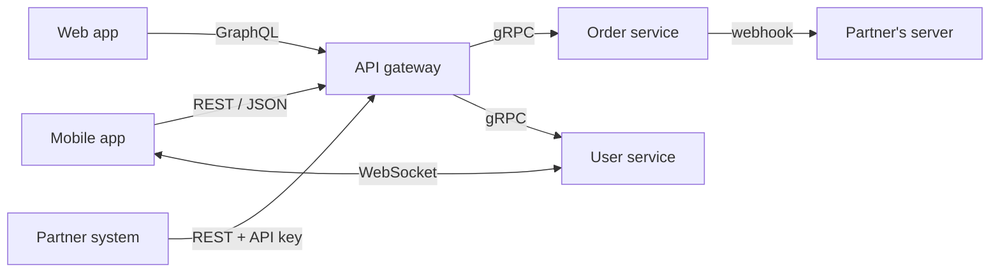
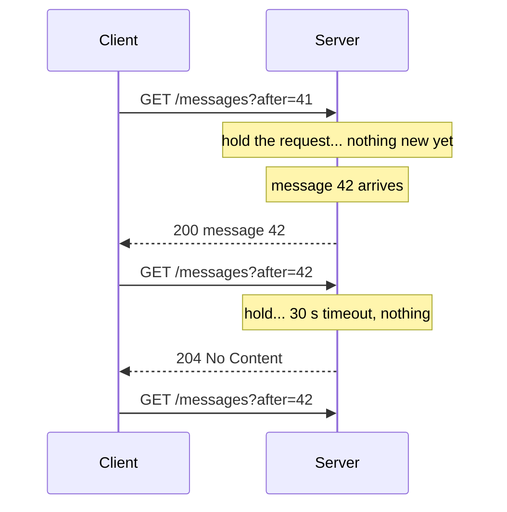
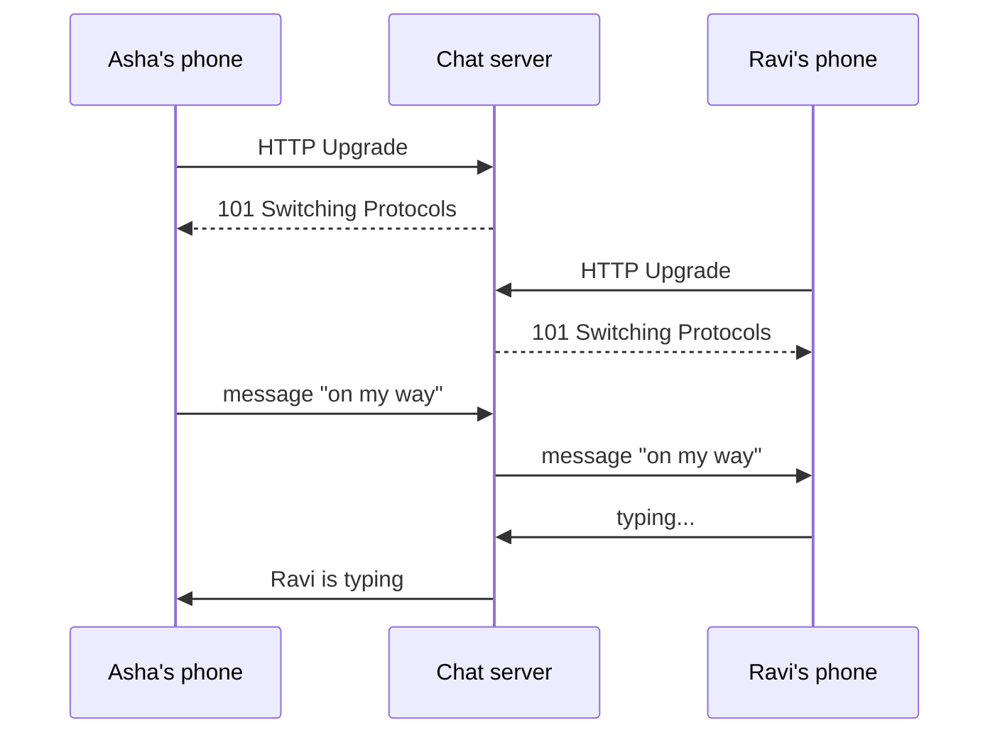
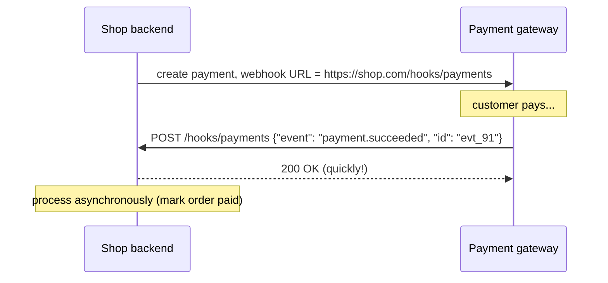
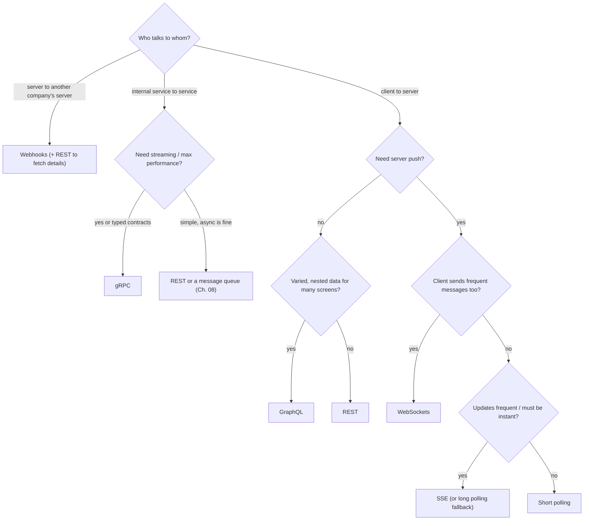
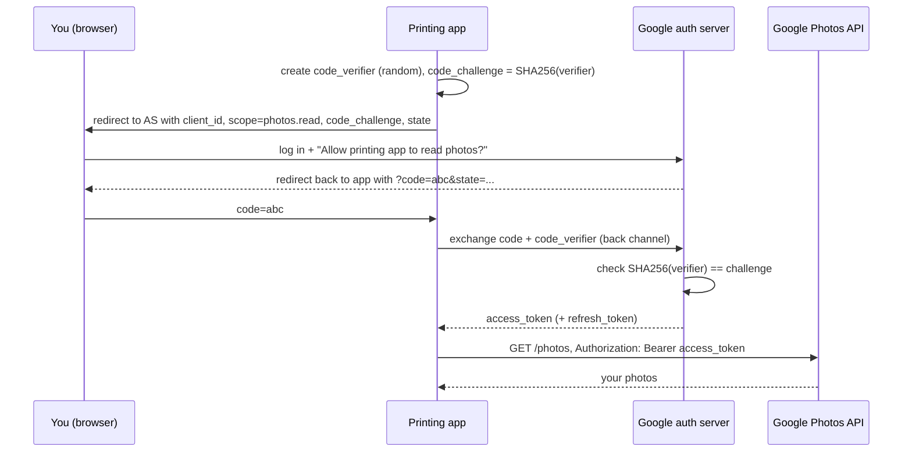
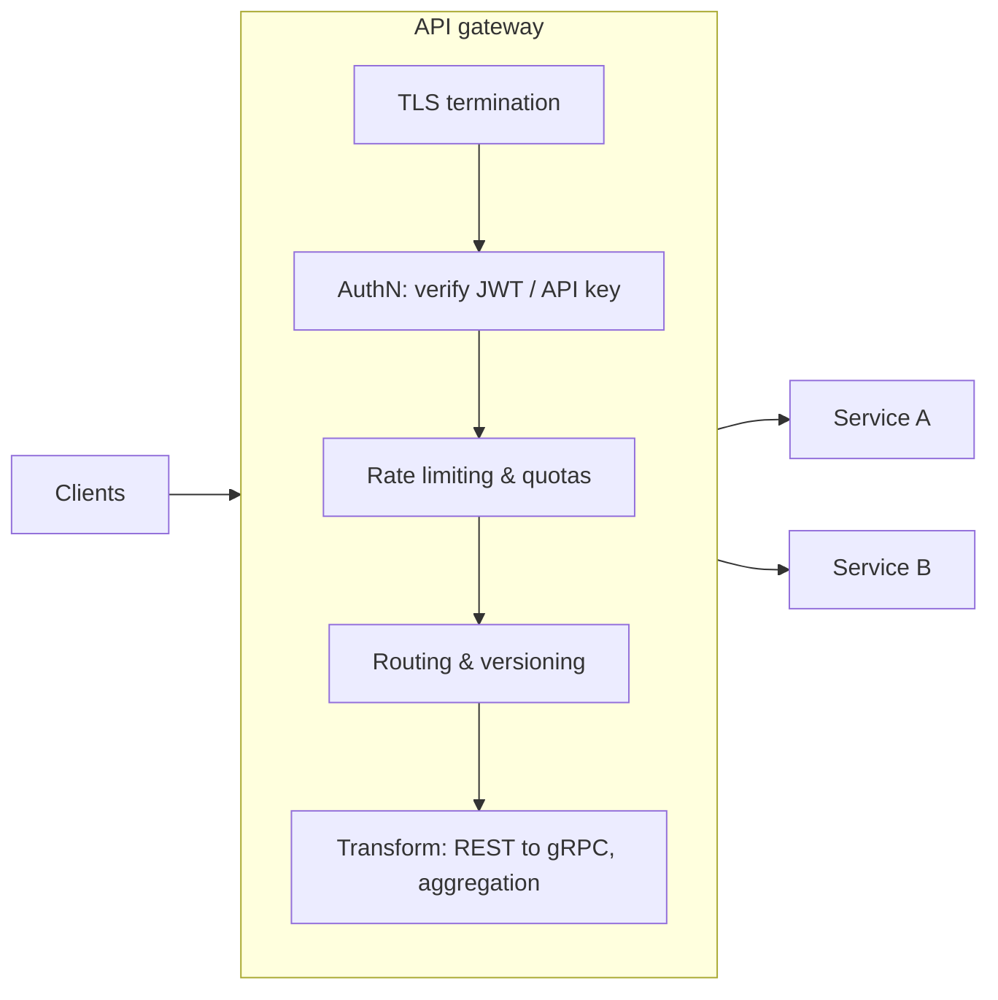

# Chapter 07 · APIs & Communication Protocols

> A restaurant works because the menu is a contract: you don't walk into the kitchen and grab ingredients, you say "one masala dosa" in a format the kitchen understands, and you get back exactly that. An API is the menu of a software system. Design it badly and every app that uses it suffers for years, because once people order from a menu, you can't easily change it.

**You will learn:**
- What an API is, and REST in depth: resources, verbs, idempotency, status codes, versioning, pagination (offset vs cursor), filtering
- GraphQL and gRPC (with protobuf): what problems they solve and what they cost
- Real-time options: polling, long polling, Server-Sent Events, WebSockets, and webhooks
- How to choose between all of them, with a decision guide
- Authentication vs authorization, sessions vs JWT, OAuth 2.0 and OpenID Connect flows, API keys
- Rate limiting headers, idempotency keys, API gateway responsibilities, and an API design interview checklist

**Before this:** [Chapter 01 · Foundations](01-foundations-internet.md) (HTTP, status codes, cookies, TLS) · [Chapter 02 · Scalability](02-scalability-load-balancing.md) (API gateway, stateless servers) · [Chapter 04 · Caching](04-caching-cdn.md) (Cache-Control, ETags)

---

## 🧠 The Big Idea

An **API (Application Programming Interface)** is a contract that says: "send me a request in **this** shape, and I'll respond in **that** shape." The client doesn't need to know how the server works inside, only the contract.



There's no single "best" protocol. Each answers a different need:

| Need | Typical choice |
|---|---|
| Public API that any developer can call with `curl` | **REST** over HTTP + JSON |
| Frontend that needs flexible, nested data in one round trip | **GraphQL** |
| Fast, typed calls between internal microservices | **gRPC** (HTTP/2 + protobuf) |
| Server pushes updates to a browser (one way) | **Server-Sent Events** |
| Two-way, real-time chat or games | **WebSockets** |
| Tell another company's server that something happened | **Webhooks** |

> 💡 **The core insight:** an API is a **promise that outlives your code**. Design it from the client's point of view, make every operation safe to retry, and plan for change (versioning, pagination, limits) from day one.

---

## 🔨 Building It Up

### 1. REST: resources, not actions

**REST (Representational State Transfer)** is an architectural style described by Roy Fielding in 2000. In practice, "REST API" means:

1. **Everything is a resource** identified by a URL: `/users/42`, `/users/42/orders`, `/orders/9001`.
2. You act on resources with **standard HTTP methods** (verbs): GET, POST, PUT, PATCH, DELETE.
3. Requests are **stateless**: each request carries everything needed (auth token, parameters). The server keeps no conversation memory, so any server can handle it ([Chapter 02](02-scalability-load-balancing.md)).
4. Responses say whether they're **cacheable** (`Cache-Control`, `ETag`, [Chapter 04](04-caching-cdn.md)).
5. A **uniform interface**: the same verbs and status codes everywhere, so clients learn once.

**Resource naming rules:**

| ✅ Good | ❌ Bad | Why |
|---|---|---|
| `GET /orders/9001` | `GET /getOrder?id=9001` | URLs name **things**; the verb is the HTTP method |
| `POST /orders` | `POST /createOrder` | Same |
| `GET /users/42/orders` | `GET /orders-of-user/42` | Nest to show ownership |
| `/orders` (plural) | `/order` | Collections are plural; be consistent |
| `/order-items` | `/orderItems`, `/Order_Items` | Lowercase, hyphens |
| `POST /orders/9001/cancel` | `PATCH /orders/9001 {"status":"CANCELLED"}` only | Complex actions with side effects can be a sub-resource "action" (pragmatic) |

Nesting more than two levels (`/users/42/orders/9001/items/3/reviews`) gets unwieldy; prefer `/order-items/3/reviews` once a resource has its own identity.

### 2. HTTP verbs, safety and idempotency

You met these in [Chapter 01](01-foundations-internet.md). Now the API designer's view:

| Verb | On a collection `/orders` | On an item `/orders/9001` | Safe | Idempotent |
|---|---|---|---|---|
| GET | List orders | Get one order | ✅ | ✅ |
| POST | Create a new order | (rare: perform an action) | ❌ | ❌ |
| PUT | (rare: replace whole collection) | Replace the order entirely (or create at this ID) | ❌ | ✅ |
| PATCH | — | Change some fields | ❌ | Not guaranteed |
| DELETE | (rare: delete all) | Delete the order | ❌ | ✅ |

- **Safe**: doesn't change server state. Crawlers, prefetchers and caches may call it freely.
- **Idempotent**: calling it once or N times leaves the server in the **same state**. (The *response* may differ: the second DELETE may return 404, but the order is still deleted.)

Why idempotency is a big deal: networks fail **after** the server did the work but **before** the client got the reply. The client can't tell, so it retries. Idempotent operations make retries safe. Let's see it:

```python
class OrderAPI:
    def __init__(self):
        self.orders, self.next_id = {}, 1

    def post_order(self, body):                 # NOT idempotent: creates a new one each time
        oid = self.next_id
        self.next_id += 1
        self.orders[oid] = dict(body)
        return 201, oid

    def put_order(self, oid, body):             # idempotent: sets the full state
        self.orders[oid] = dict(body)
        return 200, oid

    def patch_increment(self, oid, field):      # NOT idempotent: relative change
        self.orders[oid][field] += 1
        return 200, self.orders[oid][field]

    def delete_order(self, oid):                # idempotent: gone is gone
        existed = self.orders.pop(oid, None) is not None
        return (204 if existed else 404), None

api = OrderAPI()
for attempt in range(3):                        # client retries 3 times after timeouts
    api.post_order({"item": "dosa", "qty": 1})
print("after 3x POST  :", len(api.orders), "orders  <- duplicates!")

api = OrderAPI()
for attempt in range(3):
    api.put_order(7, {"item": "dosa", "qty": 1})
print("after 3x PUT   :", len(api.orders), "order")

for attempt in range(3):
    api.patch_increment(7, "qty")
print("after 3x PATCH +1:", api.orders[7]["qty"], "<- intended 2")

print("DELETE twice   :", api.delete_order(7)[0], api.delete_order(7)[0])
```

```text
after 3x POST  : 3 orders  <- duplicates!
after 3x PUT   : 1 order
after 3x PATCH +1: 4 <- intended 2
DELETE twice   : 204 404
```

What just happened: retried POSTs created duplicate orders, and a retried relative PATCH ("add one") over-counted. PUT and DELETE were safe to retry. We fix POST with **idempotency keys** in section 22.

> 💡 PATCH can be made idempotent by sending **absolute** values (`{"qty": 2}`) instead of relative operations (`{"qty": "+1"}`), or by using a version check (`If-Match: "etag"`).

### 3. Status codes in API design

Use them precisely; clients branch on them.

| Situation | Code | Notes |
|---|---|---|
| Successful read | 200 OK | |
| Created a resource | 201 Created | Include `Location: /orders/9001` and usually the body |
| Accepted for async processing | 202 Accepted | Return a status URL to poll (`/jobs/77`) |
| Success, nothing to return | 204 No Content | Typical for DELETE |
| Not modified (conditional GET) | 304 Not Modified | With `ETag`/`If-None-Match` |
| Validation failed | 400 Bad Request (or 422 Unprocessable Content) | Return field-level errors |
| Not authenticated | 401 Unauthorized | Include `WWW-Authenticate` |
| Authenticated, not allowed | 403 Forbidden | |
| No such resource | 404 Not Found | Also used to hide existence from unauthorised users |
| Wrong method | 405 Method Not Allowed | |
| State conflict | 409 Conflict | Duplicate, version conflict |
| Precondition failed | 412 Precondition Failed | `If-Match` ETag mismatch (optimistic locking) |
| Too many requests | 429 Too Many Requests | With `Retry-After` |
| Server bug | 500 Internal Server Error | Never leak stack traces |
| Upstream / overload | 502 / 503 / 504 | 503 with `Retry-After` for planned overload |

**Consistent error bodies** matter as much as codes. A good shape (similar to RFC 9457 "Problem Details"):

```text
HTTP/1.1 422 Unprocessable Content
Content-Type: application/problem+json

{
  "type": "https://api.example.com/errors/validation",
  "title": "Invalid order",
  "status": 422,
  "detail": "2 fields failed validation",
  "errors": [
    {"field": "qty", "message": "must be between 1 and 20"},
    {"field": "address.pincode", "message": "must be 6 digits"}
  ],
  "request_id": "req_8f2c1a"
}
```

The `request_id` lets support teams find the exact request in logs ([Chapter 09](09-microservices-reliability.md)).

### 4. Versioning

APIs change. A **breaking change** (removing a field, renaming it, changing its type or meaning, making an optional input required) breaks existing clients, and you can't force millions of installed mobile apps to update overnight.

**Non-breaking (safe) changes:** adding a new endpoint, adding an optional request field, adding a response field (clients must **ignore unknown fields**, a rule worth stating in your docs).

Versioning strategies:

| Strategy | Example | Pros | Cons |
|---|---|---|---|
| URL path | `/v1/orders`, `/v2/orders` | Obvious, easy to route and cache, easy to test in a browser | "Version" isn't really part of the resource's identity |
| Query parameter | `/orders?version=2` | Simple | Easy to forget; caching subtleties |
| Header | `Accept: application/vnd.shop.v2+json` or `Api-Version: 2026-10-01` | Clean URLs; fine-grained | Less visible; harder to test by hand |
| Date-based versions (Stripe style) | `Stripe-Version: 2024-06-20` | Each account pinned to the version it started with; gradual upgrades | More machinery on the server |

Most public APIs use **URL versioning** for major versions and evolve compatibly within a version. Whatever you choose: announce **deprecations** early (a `Deprecation` / `Sunset` header and docs), run old and new versions side by side, and measure who still calls the old one before turning it off.

### 5. Pagination: offset vs cursor

Never return an unbounded list. `GET /orders` for a user with 50,000 orders would be slow, huge, and could take down the server. **Paginate.**

**Offset pagination**: `GET /orders?limit=20&offset=40` → SQL `LIMIT 20 OFFSET 40`.

- ✅ Simple; can jump to page 37; easy "page X of Y" UI.
- ❌ **Slow for deep pages**: the database still walks past all skipped rows (`OFFSET 1000000` reads a million rows to throw them away).
- ❌ **Unstable when data changes**: if a new item is inserted at the top while you're paging, everything shifts by one, so you see an item **twice**; deletions make you **skip** items.

**Cursor (keyset) pagination**: the server returns an opaque **cursor** pointing just after the last item; the next request asks for items **after** that point. Under the hood: `WHERE (created_at, id) < (:last_created_at, :last_id) ORDER BY created_at DESC, id DESC LIMIT 20`, which uses an index directly.

- ✅ Fast at any depth (an index seek, [Chapter 03](03-databases.md)).
- ✅ Stable under inserts and deletes: no duplicates or skips.
- ❌ No jumping to arbitrary pages; only next/previous.
- ❌ Needs a unique, sortable key (add `id` as a tie-breaker).

```python
import base64
import json

# a feed sorted newest first; ids increase with time
feed = [{"id": i, "text": f"post {i}"} for i in range(10, 0, -1)]   # ids 10..1

def offset_page(items, offset, limit):
    return [p["id"] for p in items[offset:offset + limit]]

def encode_cursor(last_id):
    return base64.urlsafe_b64encode(json.dumps({"after": last_id}).encode()).decode()

def decode_cursor(cursor):
    return json.loads(base64.urlsafe_b64decode(cursor))["after"]

def cursor_page(items, cursor, limit):
    after = decode_cursor(cursor) if cursor else float("inf")
    page = [p for p in items if p["id"] < after][:limit]          # WHERE id < :after
    next_cursor = encode_cursor(page[-1]["id"]) if len(page) == limit else None
    return [p["id"] for p in page], next_cursor

# --- offset pagination while a new post arrives between page 1 and page 2 ---
page1 = offset_page(feed, 0, 4)
feed.insert(0, {"id": 11, "text": "brand new post"})              # someone posts
page2 = offset_page(feed, 4, 4)
print("offset page1:", page1, " page2:", page2, " <- 7 shown twice")

# --- cursor pagination with the same insert ---
feed = [{"id": i, "text": f"post {i}"} for i in range(10, 0, -1)]
ids, cur = cursor_page(feed, None, 4)
feed.insert(0, {"id": 11, "text": "brand new post"})
ids2, cur2 = cursor_page(feed, cur, 4)
print("cursor page1:", ids, " page2:", ids2, " <- no duplicates")
print("cursor looks like:", cur)
```

```text
offset page1: [10, 9, 8, 7]  page2: [7, 6, 5, 4]  <- 7 shown twice
cursor page1: [10, 9, 8, 7]  page2: [6, 5, 4, 3]  <- no duplicates
cursor looks like: eyJhZnRlciI6IDd9
```

What just happened: with offsets, the new post pushed everything down one slot, so post 7 appeared on both pages. The cursor remembered "after id 7", which doesn't move when new posts arrive. Making the cursor **opaque** (base64-encoded) lets you change its internals later without breaking clients. (In production, also sign or encrypt it so clients can't tamper with it.)

A typical paginated response:

```text
GET /v1/users/42/orders?limit=20&cursor=eyJhZnRlciI6IDd9

{
  "data": [ {...}, {...} ],
  "next_cursor": "eyJhZnRlciI6IDN9",
  "has_more": true
}
```

| | Offset | Cursor (keyset) |
|---|---|---|
| Jump to page N | Yes | No |
| Deep pages | Slow (scans skipped rows) | Fast (index seek) |
| Data changing during paging | Duplicates / skips | Stable |
| Total count | Easy (but `COUNT(*)` is costly on big tables) | Usually omitted |
| Best for | Small admin tables, search results with page numbers | Feeds, timelines, infinite scroll, large datasets, public APIs |

### 6. Filtering, sorting, field selection

Common conventions (be consistent within an API):

```text
GET /v1/products?category=shoes&price_min=500&price_max=2000   <- filtering
GET /v1/products?sort=-rating,price                             <- sort by rating desc, then price asc
GET /v1/products?fields=id,name,price                           <- sparse fieldsets: smaller payloads
GET /v1/products?q=running+shoes                                <- free-text search
GET /v1/orders?status=PLACED&created_after=2026-10-01T00:00:00Z <- ISO 8601 timestamps, UTC
```

Rules of thumb: allow-list which fields can be filtered/sorted (each needs an index); validate and cap `limit` (e.g. max 100); use ISO 8601 UTC timestamps; return amounts as integers in the smallest currency unit (paise, cents) or as strings, never floats.

### 7. Other REST details worth knowing

- **Conditional requests / caching**: `ETag` + `If-None-Match` for 304s; `If-Match` for safe updates (optimistic locking: 412 if someone else changed it).
- **Async operations**: long-running work returns `202 Accepted` with `Location: /v1/jobs/77`; the client polls the job or receives a webhook.
- **Bulk endpoints**: `POST /v1/orders:batch` to cut round trips (with per-item results).
- **HATEOAS** (Hypermedia As The Engine Of Application State): responses include links to related actions (`"links": {"cancel": "/orders/9001/cancel"}`). Part of Fielding's original REST; rarely fully used in practice, but good to recognise in interviews.
- **Content negotiation**: `Accept: application/json`.
- **Compression**: `Accept-Encoding: gzip, br`.
- **CORS**: browsers block cross-origin API calls unless the server returns `Access-Control-Allow-Origin` (with a preflight `OPTIONS` request for non-simple calls).

### 8. GraphQL: ask for exactly what you need

REST's common pains for frontends:

- **Over-fetching**: `GET /users/42` returns 40 fields; the screen needs 3.
- **Under-fetching / N+1 requests**: to show a user with their last 5 orders and each order's restaurant, you call `/users/42`, then `/users/42/orders`, then `/restaurants/...` for each order: many round trips on a slow mobile network.

**GraphQL** (open-sourced by Facebook in 2015) exposes **one endpoint** (usually `POST /graphql`) and a **typed schema**. The client sends a **query** describing exactly the shape of data it wants, and gets exactly that shape back.

```text
# Schema (server side)
type User       { id: ID!, name: String!, city: String, orders(last: Int): [Order!]! }
type Order      { id: ID!, total: Int!, restaurant: Restaurant! }
type Restaurant { id: ID!, name: String! }
type Query      { user(id: ID!): User }
type Mutation   { placeOrder(restaurantId: ID!, items: [ID!]!): Order! }

# Query (client side)
query {
  user(id: "42") {
    name
    orders(last: 2) { total restaurant { name } }
  }
}

# Response: exactly the requested shape
{"data": {"user": {"name": "Asha",
  "orders": [{"total": 450, "restaurant": {"name": "Dosa Corner"}},
             {"total": 1200, "restaurant": {"name": "Biryani House"}}]}}}
```

Three operation types: **query** (read), **mutation** (write), **subscription** (real-time updates, usually over WebSockets).

The server implements a **resolver** function per field. Here's the essence of how a GraphQL server walks a query, in plain Python:

```python
USERS = {"42": {"id": "42", "name": "Asha", "city": "Pune", "order_ids": [101, 102, 103]}}
ORDERS = {101: {"id": 101, "total": 450, "restaurant_id": 1},
          102: {"id": 102, "total": 1200, "restaurant_id": 2},
          103: {"id": 103, "total": 300, "restaurant_id": 1}}
RESTAURANTS = {1: {"id": 1, "name": "Dosa Corner"}, 2: {"id": 2, "name": "Biryani House"}}
db_calls = []

# resolvers: how to fetch each field that isn't a plain value
def resolve_user(args):
    db_calls.append("user")
    return USERS[args["id"]]

def resolve_orders(user, args):
    db_calls.append("orders")
    return [ORDERS[i] for i in user["order_ids"][-args.get("last", 10):]]

def resolve_restaurant(order, args):
    db_calls.append("restaurant")
    return RESTAURANTS[order["restaurant_id"]]

RESOLVERS = {"user": resolve_user, "orders": resolve_orders, "restaurant": resolve_restaurant}

def execute(obj, selection):
    """selection: {field: (args, sub_selection or None)}"""
    out = {}
    for field, (args, sub) in selection.items():
        if field in RESOLVERS:
            value = RESOLVERS[field](obj, args) if obj is not None else RESOLVERS[field](args)
        else:
            value = obj[field]
        if sub is None:
            out[field] = value
        elif isinstance(value, list):
            out[field] = [execute(v, sub) for v in value]
        else:
            out[field] = execute(value, sub)
    return out

query = {"user": ({"id": "42"}, {
    "name": ({}, None),
    "orders": ({"last": 2}, {"total": ({}, None),
                             "restaurant": ({}, {"name": ({}, None)})}),
})}
print(execute(None, query))
print("db calls:", db_calls)
```

```text
{'user': {'name': 'Asha', 'orders': [{'total': 1200, 'restaurant': {'name': 'Biryani House'}}, {'total': 300, 'restaurant': {'name': 'Dosa Corner'}}]}}
db calls: ['user', 'orders', 'restaurant', 'restaurant']
```

What just happened: one request returned nested data shaped exactly like the query, with no unrequested fields (no `city`, no `id`). But notice the db calls: one `restaurant` call **per order**. With 50 orders, that's 50 calls: the **N+1 problem** moved from the client to the server. The standard fix is a **DataLoader**: collect all the restaurant IDs requested in one tick and fetch them in **one batched query**.

GraphQL trade-offs:

| ✅ Strengths | ❌ Costs |
|---|---|
| No over/under-fetching; one round trip for nested data | HTTP caching is harder (one URL, POST bodies); needs client-side caches (Apollo, Relay) or persisted queries |
| Strongly typed schema = self-documenting, great tooling | N+1 resolver problem (needs DataLoader batching) |
| Frontends evolve without new endpoints | Clients can write **very expensive queries**: need depth limits, complexity scoring, timeouts |
| Aggregate many backend services behind one graph | Errors return HTTP 200 with an `errors` array: monitoring must look inside |
| Subscriptions for real-time | Rate limiting by "request" is meaningless; must rate-limit by query cost |

Good fit: product frontends (mobile + web) with varied screens over many backend services, often as a **BFF (Backend For Frontend)** layer. Weaker fit: simple public APIs, file uploads, heavy server-to-server traffic.

### 9. gRPC and Protocol Buffers

Between your own microservices, you want calls that are **fast, small, strongly typed**, and feel like calling a local function. **gRPC** (from Google, open-sourced 2015) provides exactly that:

- You define services and messages in a **`.proto`** file (an **IDL**, interface definition language).
- A compiler (`protoc`) **generates client and server code** in many languages (Python, Go, Java, C++, ...).
- Messages are encoded with **Protocol Buffers (protobuf)**, a compact **binary** format.
- Calls run over **HTTP/2** (multiplexing, header compression, [Chapter 01](01-foundations-internet.md)).
- Built-in **deadlines** (timeouts that propagate across services), cancellation, and **streaming**.

```text
// order.proto
syntax = "proto3";

service OrderService {
  rpc GetOrder (GetOrderRequest) returns (Order);                    // unary
  rpc TrackOrder (TrackRequest) returns (stream LocationUpdate);     // server streaming
  rpc UploadPhotos (stream Photo) returns (UploadResult);            // client streaming
  rpc Chat (stream ChatMessage) returns (stream ChatMessage);        // bidirectional
}

message GetOrderRequest { int64 order_id = 1; }
message Order {
  int64 id = 1;
  string status = 2;
  int32 total_paise = 3;
  repeated string items = 4;
}
```

The numbers (`= 1`, `= 2`) are **field tags**. On the wire, protobuf sends `tag + type` and the value, **not** field names. That's why it's small, and why you must **never reuse or change a tag number**: that's how protobuf stays backward and forward compatible (old clients ignore unknown tags; missing fields get defaults).

Let's hand-encode a message the way protobuf does, to feel the size difference:

```python
import json

def varint(n):
    """Protobuf varint: 7 bits per byte, high bit = 'more bytes follow'."""
    out = bytearray()
    while True:
        byte = n & 0x7F
        n >>= 7
        if n:
            out.append(byte | 0x80)
        else:
            out.append(byte)
            return bytes(out)

def field_varint(tag, value):          # wire type 0 = varint
    return varint(tag << 3 | 0) + varint(value)

def field_string(tag, text):           # wire type 2 = length-delimited
    data = text.encode()
    return varint(tag << 3 | 2) + varint(len(data)) + data

order = {"id": 9001, "status": "PLACED", "total_paise": 45000, "items": ["dosa", "vada"]}

proto = (field_varint(1, order["id"]) + field_string(2, order["status"])
         + field_varint(3, order["total_paise"])
         + b"".join(field_string(4, item) for item in order["items"]))
as_json = json.dumps(order, separators=(",", ":")).encode()

print("varint(300) bytes:", varint(300).hex(" "))
print("protobuf size:", len(proto), "bytes ->", proto.hex(" "))
print("JSON size    :", len(as_json), "bytes ->", as_json.decode())
```

```text
varint(300) bytes: ac 02
protobuf size: 27 bytes -> 08 a9 46 12 06 50 4c 41 43 45 44 18 c8 df 02 22 04 64 6f 73 61 22 04 76 61 64 61
JSON size    : 73 bytes -> {"id":9001,"status":"PLACED","total_paise":45000,"items":["dosa","vada"]}
```

What just happened: the same order took 27 bytes in protobuf vs 73 in compact JSON, because field names became 1-byte tags and numbers became variable-length binary (9001 fits in 2 bytes instead of 4 characters). Parsing binary is also much faster than parsing text. Multiply by billions of internal calls a day and it matters.

gRPC trade-offs:

| ✅ Strengths | ❌ Costs |
|---|---|
| Small, fast binary messages; HTTP/2 multiplexing | Not human-readable (need tools like `grpcurl`) |
| Strict contracts + generated code in many languages | Browsers can't call gRPC directly (need gRPC-Web + a proxy) |
| Four streaming modes | HTTP caching/CDNs don't apply naturally |
| Deadlines, cancellation, built-in status codes | Schema changes need discipline (tags, compatibility) |
| Great for service-to-service | Load balancing long-lived HTTP/2 connections needs L7-aware balancing ([Chapter 02](02-scalability-load-balancing.md)) |

**RPC vs REST mindset:** REST models **resources** (`GET /orders/9001`); RPC models **actions** (`OrderService.GetOrder(9001)`, `PaymentService.Refund(...)`). RPC feels natural for internal service calls; REST is friendlier as a public, cache-friendly, explorable interface.

### 10. Getting updates in real time: the problem

HTTP is **request/response**: the client asks, the server answers. But many features need the **server to tell the client** something when it happens: a new chat message, the rider's location, a stock price, "your payment succeeded".

Options, from simplest to most capable:

1. **Short polling**: ask every few seconds.
2. **Long polling**: ask, and the server holds the request until there's news.
3. **Server-Sent Events (SSE)**: one long-lived HTTP response that streams events, server → client.
4. **WebSockets**: a persistent, full-duplex (both ways) connection.
5. **Webhooks**: server-to-server: "call this URL of mine when something happens".

### 11. Short polling

The client asks "anything new?" on a timer.

```text
GET /v1/orders/9001/status   (every 5 seconds)
→ 200 {"status": "PREPARING"}
→ 200 {"status": "PREPARING"}
→ 200 {"status": "OUT_FOR_DELIVERY"}
```

- ✅ Dead simple; works everywhere; stateless servers.
- ❌ Wasteful: most responses say "nothing new". ❌ Latency up to the polling interval.
- Use for: low-frequency updates where a few seconds' delay is fine (order status, job progress).

### 12. Long polling

The client sends a request; the server **doesn't answer until** there's new data (or a timeout like 30 s). As soon as the client gets a response, it immediately sends the next request.



- ✅ Near-real-time; works over plain HTTP everywhere (proxies, firewalls).
- ❌ Each waiting client holds a server connection; a new request per message; message ordering across reconnects needs care (use "after id" cursors).
- Use for: fallback when WebSockets are blocked; simple notification systems.

Let's compare how many requests each approach spends to deliver 3 events over a minute:

```python
EVENTS_AT = [7, 31, 32]          # seconds when the server has news
DURATION = 60

def short_polling(interval):
    requests, delays = 0, []
    pending = list(EVENTS_AT)
    for t in range(interval, DURATION + 1, interval):
        requests += 1
        while pending and pending[0] <= t:
            delays.append(t - pending.pop(0))
    return requests, max(delays)

def long_polling(timeout=30):
    requests, t, delays = 0, 0, []
    pending = list(EVENTS_AT)
    while t < DURATION:
        requests += 1
        if pending and pending[0] - t <= timeout:
            t = max(t, pending[0])
            while pending and pending[0] <= t:      # deliver everything that's ready
                delays.append(t - pending.pop(0))
        else:
            t += timeout                            # timed out empty-handed
    return requests, max(delays)

for interval in (1, 5, 15):
    print(f"short polling every {interval:>2}s: {short_polling(interval)[0]:>2} requests, "
          f"worst delay {short_polling(interval)[1]}s")
print(f"long polling (30s timeout): {long_polling()[0]:>2} requests, worst delay {long_polling()[1]}s")
```

```text
short polling every  1s: 60 requests, worst delay 0s
short polling every  5s: 12 requests, worst delay 4s
short polling every 15s:  4 requests, worst delay 14s
long polling (30s timeout):  4 requests, worst delay 0s
```

What just happened: short polling forces a choice between wasted requests (60 per minute at 1 s) and delay (14 s at 15 s intervals). Long polling delivered every event instantly with only 4 requests. SSE and WebSockets go further: **one** connection for the whole minute.

### 13. Server-Sent Events (SSE)

The client opens a normal HTTP request; the server replies with `Content-Type: text/event-stream` and **keeps the response open**, writing events as they happen. The browser's built-in `EventSource` API handles parsing and **automatic reconnection** (sending `Last-Event-ID` so the server can resume).

```text
GET /v1/orders/9001/events
Accept: text/event-stream

HTTP/1.1 200 OK
Content-Type: text/event-stream
Cache-Control: no-store

id: 17
event: status
data: {"status": "PREPARING"}

id: 18
event: location
data: {"lat": 18.52, "lng": 73.85}

: this line is a comment, used as a keep-alive ping
```

Each event is a few `field: value` lines ended by a **blank line**. Parsing it is simple:

```python
stream = (
    "id: 17\nevent: status\ndata: {\"status\": \"PREPARING\"}\n\n"
    ": keep-alive\n\n"
    "id: 18\nevent: location\ndata: {\"lat\": 18.52, \"lng\": 73.85}\n\n"
)

def parse_sse(text):
    for block in text.split("\n\n"):
        event = {}
        for line in block.splitlines():
            if not line or line.startswith(":"):      # comments / keep-alives
                continue
            field, _, value = line.partition(": ")
            event[field] = value
        if event:
            yield event

for e in parse_sse(stream):
    print(e)
```

```text
{'id': '17', 'event': 'status', 'data': '{"status": "PREPARING"}'}
{'id': '18', 'event': 'location', 'data': '{"lat": 18.52, "lng": 73.85}'}
```

- ✅ Simple, plain HTTP (works with existing infrastructure, HTTP/2 multiplexing); auto-reconnect and resume built in.
- ❌ **One direction only** (server → client); client → server still uses normal requests. ❌ Text only. ❌ On HTTP/1.1, browsers limit ~6 connections per domain (not an issue on HTTP/2).
- Use for: live scores, notifications, dashboards, order tracking, streaming AI chat responses.

### 14. WebSockets

A **WebSocket** starts as an HTTP request that asks to **upgrade** the connection; after that, the same TCP connection carries messages **in both directions** at any time, with tiny per-message framing overhead.

```text
GET /chat HTTP/1.1
Host: chat.example.com
Upgrade: websocket
Connection: Upgrade
Sec-WebSocket-Key: dGhlIHNhbXBsZSBub25jZQ==
Sec-WebSocket-Version: 13

HTTP/1.1 101 Switching Protocols
Upgrade: websocket
Connection: Upgrade
Sec-WebSocket-Accept: s3pPLMBiTxaQ9kYGzzhZRbK+xOo=
```

The server proves it understood the WebSocket handshake by hashing the client's key with a fixed GUID defined in the WebSocket standard (RFC 6455). We can compute it ourselves:

```python
import base64
import hashlib

WS_GUID = "258EAFA5-E914-47DA-95CA-C5AB0DC85B11"      # fixed by RFC 6455

def accept_key(client_key):
    digest = hashlib.sha1((client_key + WS_GUID).encode()).digest()
    return base64.b64encode(digest).decode()

print(accept_key("dGhlIHNhbXBsZSBub25jZQ=="))
```

```text
s3pPLMBiTxaQ9kYGzzhZRbK+xOo=
```

What just happened: that's exactly the `Sec-WebSocket-Accept` value in the example above (it's the example from the RFC itself). After the `101 Switching Protocols`, HTTP is finished and both sides speak WebSocket frames.



- ✅ True **bidirectional**, low-latency messaging; minimal overhead per message; binary or text.
- ❌ **Stateful**: each connection lives on one server. Scaling needs: connection-aware load balancing (least connections), a registry of "user → server", and pub/sub between servers to deliver messages to users connected elsewhere ([Chapter 13](13-case-studies-2.md) designs this for chat).
- ❌ No automatic reconnection or resume (you build heartbeats, reconnect with backoff, and "resend since message id").
- ❌ Some corporate proxies interfere; HTTP caching doesn't apply.
- Use for: chat, multiplayer games, collaborative editing, live trading UIs, anything with frequent messages **both ways**.

### 15. Webhooks: server-to-server callbacks

A **webhook** is a "reverse API": instead of a partner polling you ("is the payment done yet?"), the partner **registers a URL**, and **you** send an HTTP POST to it when an event happens.



Payment gateways (Stripe, Razorpay), GitHub, Slack, and Shopify all use webhooks. Design rules for **senders**:

- **Sign every payload** (HMAC with a shared secret) so receivers can verify it's really from you.
- Include an **event ID** and **timestamp**.
- **Retry with exponential backoff** on failure (non-2xx or timeout), for hours or days; then alert or disable.
- Delivery is **at-least-once**: duplicates will happen.

Rules for **receivers**:

- **Verify the signature** and reject old timestamps (prevents forged and replayed requests).
- **Respond 2xx fast** (in a few seconds), then process asynchronously via a queue ([Chapter 08](08-queues-events.md)).
- **Deduplicate by event ID** (idempotent processing).
- Don't trust event order; fetch the latest state from the API if order matters.

```python
import hashlib
import hmac
import json

SECRET = b"whsec_shared_secret_from_dashboard"

def sign(payload: bytes, timestamp: int) -> str:
    message = f"{timestamp}.".encode() + payload        # sign timestamp + body together
    return hmac.new(SECRET, message, hashlib.sha256).hexdigest()

def verify(payload: bytes, timestamp: int, signature: str, now: int, tolerance=300) -> str:
    if abs(now - timestamp) > tolerance:
        return "reject: too old (possible replay)"
    expected = sign(payload, timestamp)
    if not hmac.compare_digest(expected, signature):   # constant-time comparison
        return "reject: bad signature"
    return "accept"

body = json.dumps({"id": "evt_91", "type": "payment.succeeded", "amount": 45000}).encode()
ts = 1_760_000_000
sig = sign(body, ts)

print(verify(body, ts, sig, now=ts + 2))
tampered = body.replace(b"45000", b"99")
print(verify(tampered, ts, sig, now=ts + 2))
print(verify(body, ts, sig, now=ts + 3600))
```

```text
accept
reject: bad signature
reject: too old (possible replay)
```

What just happened: only the holder of the secret can produce a valid signature, changing even one character of the body breaks it, and old messages are rejected so an attacker can't replay a captured request later. `hmac.compare_digest` avoids **timing attacks** (a normal `==` stops at the first different character, leaking information through response time).

### 16. Choosing a communication style



| | REST | GraphQL | gRPC | Short poll | Long poll | SSE | WebSocket | Webhook |
|---|---|---|---|---|---|---|---|---|
| Direction | Client → server | Client → server (+subs) | Both (streams) | Client pulls | Client pulls (held) | Server → client | Both | Server → server |
| Transport | HTTP/1.1, 2, 3 | HTTP (WS for subs) | HTTP/2 | HTTP | HTTP | HTTP | TCP after upgrade | HTTP POST |
| Format | JSON (usually) | JSON | Protobuf (binary) | Any | Any | Text events | Text/binary frames | JSON (usually) |
| Real-time | No | Subscriptions | Yes (streaming) | Delayed | Near | Yes | Yes | Yes (event-driven) |
| Caching | Excellent (HTTP) | Hard | No | Some | No | No | No | n/a |
| Browser support | Native | Native (it's HTTP) | Needs gRPC-Web | Native | Native | Native (`EventSource`) | Native | n/a |
| Server state | Stateless | Stateless | Connection per client/stream | Stateless | Held request | Open connection | Open connection | Stateless (+ retry queue) |
| Typical use | Public APIs, CRUD | Rich frontends, BFF | Microservices | Rare updates | Fallback push | Feeds, notifications, streaming AI output | Chat, games, collaboration | Payment/Git events |

### 17. Authentication vs authorization

Two different questions:

- **Authentication (AuthN)**: **who are you?** Proving identity: password, OTP, fingerprint, a signed token. Failure → **401**.
- **Authorization (AuthZ)**: **what are you allowed to do?** Checking permissions: "can user 42 cancel order 9001?". Failure → **403** (or 404 to avoid revealing the resource exists).

Analogy: at an airport, showing your passport is **authentication**; your boarding pass deciding which flight and seat you may board is **authorization**.

Common authorization models:

- **RBAC (Role-Based Access Control)**: users get roles (`admin`, `restaurant_owner`, `customer`), roles get permissions.
- **ABAC (Attribute-Based)**: rules over attributes ("owner of the order", "same tenant", "during business hours").
- **ReBAC (Relationship-Based)**: permissions from relationships in a graph ("editor of a folder that contains this doc"), like Google Zanzibar.

```python
ROLE_PERMISSIONS = {
    "customer": {"order:create", "order:read_own", "order:cancel_own"},
    "restaurant_owner": {"order:read_restaurant", "menu:edit"},
    "admin": {"order:read_any", "order:cancel_any", "menu:edit"},
}
ORDERS = {9001: {"customer_id": 42, "restaurant_id": 7}}

def can_cancel(user, order_id):
    order = ORDERS[order_id]
    perms = ROLE_PERMISSIONS[user["role"]]
    if "order:cancel_any" in perms:                                   # RBAC
        return True
    if "order:cancel_own" in perms and order["customer_id"] == user["id"]:   # + ownership (ABAC)
        return True
    return False

for user in [{"id": 42, "role": "customer"}, {"id": 43, "role": "customer"},
             {"id": 1, "role": "admin"}, {"id": 7, "role": "restaurant_owner"}]:
    print(user, "->", "allowed" if can_cancel(user, 9001) else "403 Forbidden")
```

```text
{'id': 42, 'role': 'customer'} -> allowed
{'id': 43, 'role': 'customer'} -> 403 Forbidden
{'id': 1, 'role': 'admin'} -> allowed
{'id': 7, 'role': 'restaurant_owner'} -> 403 Forbidden
```

> ⚠️ The most common real-world API vulnerability is **broken object-level authorization (BOLA)**: checking that the user is logged in, but not that order 9001 **belongs to them**. Customer 43 just changes the ID in the URL and reads someone else's order. Always check ownership on every object access.

### 18. Sessions vs JWT

After login, how does the server recognise the user on later requests?

**Server-side sessions** ([Chapter 01](01-foundations-internet.md), [Chapter 02](02-scalability-load-balancing.md)): the server stores session data (in Redis) under a random ID, and the client sends the ID in a cookie.

**Tokens, usually JWT (JSON Web Token)**: the server gives the client a **signed** token containing claims (`user_id`, `role`, `exp`). On each request, the server **verifies the signature** and trusts the claims, with **no lookup**.

A JWT is three base64url parts joined by dots: `header.payload.signature`. Let's build and verify one with only the standard library:

```python
import base64
import hashlib
import hmac
import json

SECRET = b"server-side-secret-never-shared"

def b64url(data: bytes) -> str:
    return base64.urlsafe_b64encode(data).rstrip(b"=").decode()

def b64url_decode(text: str) -> bytes:
    return base64.urlsafe_b64decode(text + "=" * (-len(text) % 4))

def make_jwt(claims):
    header = b64url(json.dumps({"alg": "HS256", "typ": "JWT"}, separators=(",", ":")).encode())
    payload = b64url(json.dumps(claims, separators=(",", ":")).encode())
    signature = hmac.new(SECRET, f"{header}.{payload}".encode(), hashlib.sha256).digest()
    return f"{header}.{payload}.{b64url(signature)}"

def verify_jwt(token, now):
    header, payload, signature = token.split(".")
    expected = b64url(hmac.new(SECRET, f"{header}.{payload}".encode(), hashlib.sha256).digest())
    if not hmac.compare_digest(expected, signature):
        return "401: bad signature"
    claims = json.loads(b64url_decode(payload))
    if now >= claims["exp"]:
        return "401: token expired"
    return f"OK: user {claims['sub']} with role {claims['role']}"

token = make_jwt({"sub": "42", "role": "customer", "exp": 1_000_900})
print("token:", token[:40] + "...")
print("payload is just base64, anyone can read it:", b64url_decode(token.split(".")[1]).decode())
print(verify_jwt(token, now=1_000_000))
print(verify_jwt(token, now=1_001_000))

h, p, s = token.split(".")
forged_payload = b64url(json.dumps({"sub": "42", "role": "admin", "exp": 1_000_900},
                                   separators=(",", ":")).encode())
print(verify_jwt(f"{h}.{forged_payload}.{s}", now=1_000_000))
```

```text
token: eyJhbGciOiJIUzI1NiIsInR5cCI6IkpXVCJ9.eyJ...
payload is just base64, anyone can read it: {"sub":"42","role":"customer","exp":1000900}
OK: user 42 with role customer
401: token expired
401: bad signature
```

What just happened: the server verified the token **without any database lookup**. Changing the role to `admin` broke the signature. But notice: the payload is **readable by anyone** (base64 isn't encryption), so never put secrets in a JWT. And until `exp`, the token stays valid even if the user logs out or is banned.

| | Server-side session | JWT (stateless token) |
|---|---|---|
| Where state lives | Server store (Redis/DB) | Inside the token (client holds it) |
| Per-request cost | One store lookup (~1 ms) | Signature check (CPU only) |
| Revocation (logout, ban) | Instant: delete the session | Hard: valid until expiry (need short expiry, a denylist, or token versioning) |
| Size on each request | Small ID | Larger (hundreds of bytes+) |
| Works across services/domains | Needs shared store | Any service with the key can verify (asymmetric keys: RS256/ES256 let services verify with a **public** key) |
| Typical use | Classic web apps | APIs, mobile apps, microservices, SSO |

**Common best practice:** short-lived **access tokens** (5–15 min JWTs) + long-lived **refresh tokens** (stored server-side, revocable, rotated on each use). To log out or ban, revoke the refresh token; the access token dies within minutes.

Where to keep tokens in a browser: an `HttpOnly`, `Secure`, `SameSite` cookie protects against JavaScript theft (XSS); `localStorage` is readable by any script on the page.

### 19. API keys

An **API key** is a long random secret that identifies a **calling application** (not a human user): `X-API-Key: sk_live_51H...`.

- ✅ Simple for server-to-server and developer access; easy per-key **rate limits, quotas and billing**.
- ❌ It's a bearer secret: anyone with it can use it. No user identity or fine-grained consent.
- Practices: send only over HTTPS, in a header (not the URL, which ends up in logs); store **hashed** on the server (like passwords); allow multiple keys and **rotation**; scope them (read-only, specific resources); use prefixes like `sk_live_` / `pk_test_` so leaked keys are easy to detect by secret scanners.

### 20. OAuth 2.0: delegated authorization

The problem: a printing app wants to access your Google Photos. You should **not** give it your Google password. **OAuth 2.0** lets you grant the app **limited access** (only photos, read-only, revocable) and the app gets an **access token** instead of your password. Think of a **valet key** for a car: it starts the car but can't open the boot.

The roles:

- **Resource owner**: you.
- **Client**: the printing app.
- **Authorization server**: Google's login and consent service; issues tokens.
- **Resource server**: the Google Photos API; accepts tokens.

**Authorization Code flow with PKCE** (the recommended flow for web, mobile and single-page apps):



Key ideas:

- The user types their password **only at Google**.
- The app gets a short-lived **code** through the browser, then exchanges it for tokens over a direct server-to-server call (so tokens don't sit in browser history).
- **`state`**: a random value the app checks on return, preventing CSRF (an attacker injecting their own code).
- **PKCE** (Proof Key for Code Exchange, "pixy"): the app proves the code exchange comes from the same app that started the flow. An attacker who intercepts the code can't use it without the secret `code_verifier`. Essential for mobile and browser apps that can't keep a client secret.
- **Scopes** limit what the token can do (`photos.read`).

```python
import base64
import hashlib

# RFC 7636's own example verifier (in real apps: secrets.token_urlsafe(64))
code_verifier = "dBjftJeZ4CVP-mB92K27uhbUJU1p1r_wW1gFWFOEjXk"
code_challenge = base64.urlsafe_b64encode(
    hashlib.sha256(code_verifier.encode()).digest()).rstrip(b"=").decode()
print("code_challenge:", code_challenge)

def token_endpoint(stored_challenge, presented_verifier):
    computed = base64.urlsafe_b64encode(
        hashlib.sha256(presented_verifier.encode()).digest()).rstrip(b"=").decode()
    return "issue tokens" if computed == stored_challenge else "400 invalid_grant"

print("legit app      :", token_endpoint(code_challenge, code_verifier))
print("attacker w/ code:", token_endpoint(code_challenge, "guessed-verifier"))
```

```text
code_challenge: E9Melhoa2OwvFrEMTJguCHaoeK1t8URWbuGJSstw-cM
legit app      : issue tokens
attacker w/ code: 400 invalid_grant
```

What just happened: the authorization server stored only the **hash** (challenge) at the start; only the app that holds the original verifier can complete the exchange. (That challenge value is exactly the one in RFC 7636's example.)

Other OAuth grant types:

| Flow | Who uses it | Notes |
|---|---|---|
| Authorization Code + PKCE | Web apps, SPAs, mobile apps | **The default** for anything with a user |
| Client Credentials | Server-to-server (no user) | App authenticates with its own ID/secret; gets a token for its own access |
| Device Authorization | TVs, CLIs, devices without a keyboard | "Go to example.com/device and enter code WDJB-MJHT" |
| Refresh Token | Any client holding one | Get new access tokens without re-login |
| ~~Implicit~~, ~~Password~~ | Legacy | Deprecated by current best practice: tokens leak / app sees password |

### 21. OpenID Connect: login on top of OAuth

OAuth 2.0 is about **authorization** (access to resources). It doesn't define **who the user is**. Using an OAuth access token as proof of login is a classic security mistake. **OpenID Connect (OIDC)** adds an identity layer:

- Request the scope `openid` (plus `profile`, `email`).
- The token response includes an **ID token**: a **JWT** signed by the identity provider, with claims like `sub` (stable user ID), `email`, `name`, `iss` (issuer), `aud` (your app's client ID), `exp`, and a `nonce`.
- Your app **validates** the ID token (signature via the provider's public keys, `iss`, `aud`, `exp`, `nonce`) and now knows who logged in.

That's how **"Sign in with Google / Apple / Microsoft"** and enterprise **SSO** work.

| | OAuth 2.0 | OpenID Connect |
|---|---|---|
| Question answered | "May this app access X on the user's behalf?" (AuthZ) | "Who is this user?" (AuthN) |
| Main artefact | Access token (format not defined) | ID token (always a JWT) + access token |
| Example | App reads your Google Drive files | "Sign in with Google" |

### 22. Idempotency keys: safe retries for POST

Back to section 2's duplicate orders. The fix, popularised by Stripe: the client generates a unique **idempotency key** (a UUID) per logical operation and sends it with the request. The server stores the key with the result; a retry with the same key gets the **stored result** instead of executing again.

```text
POST /v1/payments
Idempotency-Key: 7c9e6679-7425-40de-944b-e07fc1f90ae7
Content-Type: application/json

{"order_id": 9001, "amount": 45000}
```

```python
import hashlib
import json

class PaymentAPI:
    def __init__(self):
        self.idempotency_store = {}      # key -> (request_hash, status, response)
        self.charges = []

    def create_payment(self, key, body):
        request_hash = hashlib.sha256(json.dumps(body, sort_keys=True).encode()).hexdigest()
        if key in self.idempotency_store:
            stored_hash, status, response = self.idempotency_store[key]
            if stored_hash != request_hash:
                return 422, {"error": "idempotency key reused with a different request"}
            return status, response                       # replay the original result
        charge_id = f"ch_{len(self.charges) + 1}"
        self.charges.append((charge_id, body["amount"]))  # the real side effect
        response = {"id": charge_id, "amount": body["amount"], "status": "succeeded"}
        self.idempotency_store[key] = (request_hash, 201, response)
        return 201, response

api = PaymentAPI()
body = {"order_id": 9001, "amount": 45000}
key = "7c9e6679-7425-40de-944b-e07fc1f90ae7"
for attempt in range(3):                          # network timeouts -> client retries
    print(f"attempt {attempt + 1}:", api.create_payment(key, body))
print("customer charged", len(api.charges), "time(s)")
print("misuse:", api.create_payment(key, {"order_id": 9001, "amount": 1}))
```

```text
attempt 1: (201, {'id': 'ch_1', 'amount': 45000, 'status': 'succeeded'})
attempt 2: (201, {'id': 'ch_1', 'amount': 45000, 'status': 'succeeded'})
attempt 3: (201, {'id': 'ch_1', 'amount': 45000, 'status': 'succeeded'})
customer charged 1 time(s)
misuse: (422, {'error': 'idempotency key reused with a different request'})
```

What just happened: three attempts, one charge, and every retry got the same response, so the client can't tell whether its first attempt "really" went through, and it doesn't need to. Reusing a key with a different body is rejected as a client bug.

Production details:

- Store keys in a durable store with a TTL (e.g. 24 hours), **in the same transaction** as the side effect where possible, so you can't charge without recording the key.
- Handle **concurrent** duplicates: insert the key first with status "in progress" using a unique constraint; a second concurrent request sees it and returns 409 ("retry later") instead of executing in parallel.
- Scope keys per client/account.
- The same idea makes **message consumers** idempotent: dedupe by message ID ([Chapter 08](08-queues-events.md)).

### 23. Rate limiting and its headers

**Rate limiting** caps how many requests a client can make in a time window: it protects your service from overload and abuse, ensures fairness between customers, and enforces paid tiers. (The algorithms, token bucket, leaky bucket, fixed and sliding windows, and the distributed design are in [Chapter 12](12-case-studies-1.md).)

What clients need is **communication**: tell them their limit, what's left, and when to retry.

```text
HTTP/1.1 200 OK
RateLimit-Limit: 100
RateLimit-Remaining: 37
RateLimit-Reset: 23

HTTP/1.1 429 Too Many Requests
Retry-After: 23
RateLimit-Limit: 100
RateLimit-Remaining: 0
RateLimit-Reset: 23
Content-Type: application/problem+json

{"title": "Too many requests", "detail": "Limit is 100 requests per minute"}
```

`Retry-After` is a standard HTTP header (seconds or a date). The `RateLimit-*` fields come from an IETF draft; many APIs use the older `X-RateLimit-Limit / -Remaining / -Reset` names (where `Reset` is often a Unix timestamp). A simple token bucket that also produces the headers:

```python
class TokenBucket:
    def __init__(self, capacity, refill_per_sec):
        self.capacity, self.rate = capacity, refill_per_sec
        self.tokens, self.last = float(capacity), 0.0

    def allow(self, now):
        self.tokens = min(self.capacity, self.tokens + (now - self.last) * self.rate)
        self.last = now
        if self.tokens >= 1:
            self.tokens -= 1
            return 200, {"RateLimit-Limit": self.capacity,
                         "RateLimit-Remaining": int(self.tokens)}
        wait = round((1 - self.tokens) / self.rate, 1)
        return 429, {"Retry-After": wait, "RateLimit-Remaining": 0}

bucket = TokenBucket(capacity=3, refill_per_sec=0.5)      # bursts of 3, then 1 every 2 s
for t in [0, 0.1, 0.2, 0.3, 1.0, 2.5, 2.6]:
    print(f"t={t:<4}", *bucket.allow(t))
```

```text
t=0    200 {'RateLimit-Limit': 3, 'RateLimit-Remaining': 2}
t=0.1  200 {'RateLimit-Limit': 3, 'RateLimit-Remaining': 1}
t=0.2  200 {'RateLimit-Limit': 3, 'RateLimit-Remaining': 0}
t=0.3  429 {'Retry-After': 1.7, 'RateLimit-Remaining': 0}
t=1.0  429 {'Retry-After': 1.0, 'RateLimit-Remaining': 0}
t=2.5  200 {'RateLimit-Limit': 3, 'RateLimit-Remaining': 0}
t=2.6  429 {'Retry-After': 1.4, 'RateLimit-Remaining': 0}
```

What just happened: the bucket allowed a burst of 3, then rejected with an exact `Retry-After`. By t=2.5 enough tokens had refilled for one more request. Well-behaved clients read `Retry-After` and back off (with **exponential backoff and jitter** when no header is given) instead of hammering.

Limit **by what matters**: per API key, per user, per IP (for unauthenticated endpoints), per endpoint (login and OTP endpoints need strict limits against brute force), and by **cost** for GraphQL.

### 24. The API gateway's responsibilities

You met the API gateway in [Chapter 02](02-scalability-load-balancing.md). From the API designer's view, it's where **cross-cutting concerns** live so every service doesn't reimplement them:



| Responsibility | Example |
|---|---|
| TLS termination | HTTPS outside, plain or mTLS inside |
| Authentication | Validate JWTs/API keys once; pass the user identity downstream in a trusted header |
| Coarse authorization | "This key has scope `orders.read`"; fine-grained ownership checks stay in services |
| Rate limiting & quotas | Per key/user/IP/endpoint; 429 + headers |
| Routing & versioning | `/v1/orders` → orders-v1, `/v2/orders` → orders-v2; canary splits |
| Request/response transformation | REST/JSON outside → gRPC inside; field renames for old versions |
| Aggregation / BFF | One mobile call fans out to 3 services and merges results |
| Caching | Cache public GET responses |
| Validation | Reject malformed requests early (schema validation) |
| Observability | Request IDs, logs, metrics, traces for every call ([Chapter 09](09-microservices-reliability.md)) |
| Security | IP allow/deny lists, WAF rules, request size limits, CORS |

> ⚠️ Keep business logic **out** of the gateway, keep it horizontally scaled and highly available (it's on every request's path), and still enforce **object-level authorization inside services** (defence in depth).

### 25. The API design interview checklist

When asked "design the API for X" (or as one step of any system design interview, [Chapter 11](11-estimation-framework.md)):

1. **Clarify clients and use cases**: who calls it (mobile, web, partners, internal services)? Which operations are hot?
2. **Choose the style**: REST for public CRUD, GraphQL for flexible frontends, gRPC internally, plus push (WebSocket/SSE/webhooks) if needed. Say why.
3. **Model resources** and their relationships; name URLs as nouns; list endpoints with methods.
4. **Define request/response shapes** for the key endpoints (fields, types, IDs as strings, money as integers in paise, timestamps in ISO 8601 UTC).
5. **Status codes and error format** (consistent problem-details body, request IDs).
6. **Idempotency**: which operations are retried? Add `Idempotency-Key` for creates/payments; absolute PATCH values.
7. **Pagination** (cursor for feeds/large lists), filtering, sorting, field selection, limits.
8. **AuthN/AuthZ**: OAuth/OIDC for users, API keys or client credentials for partners, object-level checks, scopes.
9. **Rate limits and quotas**, with headers and 429s.
10. **Versioning and evolution** strategy; deprecation policy.
11. **Async operations**: 202 + job resource, or webhooks for completion.
12. **Caching**: `Cache-Control`, ETags for GETs; what's safe to cache at the CDN.
13. **Real-time needs**: what pushes, over which channel, how clients resume after disconnect.
14. **Observability and documentation**: OpenAPI spec (REST) or `.proto` files (gRPC), examples, SDKs.

A compact worked example, a food ordering API:

```text
POST   /v1/orders                     Idempotency-Key required → 201 + Location
GET    /v1/orders/{order_id}          → 200 (owner, restaurant, or admin only)
GET    /v1/users/me/orders?limit=20&cursor=...   → cursor pagination, newest first
POST   /v1/orders/{order_id}/cancel   → 200 or 409 if already out for delivery
GET    /v1/orders/{order_id}/events   → SSE stream: status + rider location
GET    /v1/restaurants?lat=..&lng=..&cuisine=south-indian&cursor=...
POST   /v1/webhooks/payments          ← signed callbacks from the payment gateway
Auth: OIDC login → short-lived JWT access token + refresh token; partners: OAuth client credentials
Limits: 100 req/min per user; 10/min on /cancel; 429 + Retry-After
```

---

## 🔬 Under the Hood

### Why idempotent methods make the whole internet more reliable

Proxies, load balancers, browsers and HTTP client libraries may automatically **retry** a request when a connection drops, but only for methods that are defined as idempotent (GET, HEAD, PUT, DELETE, OPTIONS). That's the HTTP spec giving infrastructure permission to retry. If you implement a GET that changes state (say, `GET /orders/9001/cancel`), a prefetching browser or a retrying proxy may cancel orders nobody asked to cancel. Respecting method semantics is not pedantry; machines rely on it.

### How cursor pagination becomes an index seek

With an index on `(user_id, created_at DESC, id DESC)`, the query `WHERE user_id = 42 AND (created_at, id) < (:c, :i) ORDER BY created_at DESC, id DESC LIMIT 20` lets the database jump straight to the position just after the cursor in the B+tree and read 20 consecutive leaf entries ([Chapter 03](03-databases.md)). Cost: O(log n + 20), the same for page 1 and page 50,000. `OFFSET 1,000,000` instead walks a million entries and throws them away.

### Why gRPC needs L7 load balancing

gRPC keeps **one long-lived HTTP/2 connection** and multiplexes all calls over it. An **L4** load balancer balances **connections**, so every call from a client instance sticks to whichever server got its connection, and new servers get no traffic. You need an **L7** (HTTP/2-aware) proxy like Envoy that balances individual **requests (streams)**, or client-side load balancing with a list of servers ([Chapter 02](02-scalability-load-balancing.md)).

### What a JWT signature really proves

The signature proves the token was created by someone holding the key and hasn't been modified. With **HS256**, the same secret signs and verifies, so every verifier could also mint tokens. With **RS256/ES256** (asymmetric), the issuer signs with a **private** key and services verify with the **public** key (published at a JWKS URL), so a compromised service can't forge tokens. A famous bug class: libraries that accepted `"alg": "none"` or confused key types; always pin the expected algorithm when verifying.

### Why WebSockets complicate scaling

An HTTP API server forgets a client as soon as it responds. A WebSocket server holds memory (buffers, subscriptions) for each open connection, for hours. A single server can hold a large number of mostly idle connections (tens of thousands to hundreds of thousands, depending on memory and tuning), but you must: balance by connection count, drain connections gently during deploys (clients reconnect elsewhere), keep a **presence registry** (user → server) in Redis, and use **pub/sub** so a message for a user on server B, produced on server A, gets routed. That's the core of chat design in [Chapter 13](13-case-studies-2.md).

---

## 🧩 Pattern Decoder

### Decision guide: API style

| If you need... | Choose | Because |
|---|---|---|
| Public API for many unknown developers | REST + JSON + OpenAPI | Universal, cacheable, easy to explore |
| Many client screens needing different nested data | GraphQL (as a BFF) | One round trip, exact fields |
| High-volume internal service calls, polyglot teams | gRPC + protobuf | Fast, typed, generated clients, streaming |
| Browser needs server push only | SSE | Simple, auto-reconnect, plain HTTP |
| Frequent two-way messages | WebSockets | Full duplex, low overhead |
| Notify external systems of events | Webhooks (signed, retried) | No polling by partners |
| Rare status updates, simplest possible | Short polling | Stateless, trivial |
| Work that takes minutes | 202 + job resource (+ webhook/SSE on completion) | Don't hold connections |

### Decision guide: pagination

| Situation | Choose |
|---|---|
| Infinite scroll, feeds, large or fast-changing data | Cursor (keyset) |
| Small, mostly static admin tables with page numbers | Offset |
| Search results with "page 3 of 10" | Offset with a hard max depth (or search engine's own cursors) |

### Decision guide: authentication mechanism

| Caller | Mechanism |
|---|---|
| Your own web app's users | Server-side session cookie, or OIDC + short JWT + refresh token |
| Mobile app users | OIDC (Authorization Code + PKCE), short access token + rotating refresh token |
| Third-party app acting for a user | OAuth 2.0 Authorization Code + PKCE with scopes |
| Partner server, no user involved | OAuth client credentials or API key (+ IP allow list, mTLS) |
| Internal service to service | mTLS and/or signed service tokens (JWT with asymmetric keys) |
| "Sign in with Google" | OpenID Connect (validate the ID token) |

### Trade-off table: sessions vs JWT

| Priority | Lean |
|---|---|
| Instant revocation, simple web app | Sessions |
| No shared store, many services verifying | JWT (asymmetric) with short expiry |
| Both | Short JWT access token + revocable refresh token |

### When NOT to use...

- **GraphQL** for a simple public CRUD API or file downloads: you lose HTTP caching and gain complexity.
- **WebSockets** when updates are one-way (use SSE) or rare (use polling).
- **gRPC** directly from browsers (needs gRPC-Web proxy) or for public APIs consumed by unknown clients.
- **JWT** as a session replacement when you need instant logout and have only one backend.
- **API keys** to identify human users or in client-side code (they will leak).

---

## ⚠️ Traps & Common Mistakes

1. **Verbs in URLs** (`/getUser`, `/createOrder`). Use nouns + HTTP methods.
2. **GET requests that change state.** Crawlers, prefetchers and retries will trigger them.
3. **Non-idempotent POSTs without idempotency keys** for payments/orders → duplicate charges on retry.
4. **Returning 200 for errors** with `{"success": false}`. Use real status codes so clients, proxies and monitoring understand.
5. **Unbounded lists.** Always paginate and cap `limit`.
6. **Offset pagination for feeds**: slow deep pages, duplicates and skips.
7. **Breaking changes without a new version** (renaming/removing fields, changing types).
8. **Checking authentication but not object ownership** (BOLA): user 43 reads `/orders/9001` of user 42.
9. **Secrets in JWT payloads** (they're only base64), or long-lived JWTs with no revocation strategy.
10. **Using OAuth access tokens as proof of identity.** Use OIDC ID tokens for login.
11. **Webhooks without signatures or dedup**: forged events, double processing.
12. **API keys in URLs** (they end up in logs, browser history and analytics).
13. **Comparing secrets with `==`**, which leaks timing information:

```py
# ❌ returns early at the first mismatching character
if provided_signature == expected_signature:
    accept()

# ✅ constant-time comparison
import hmac
if hmac.compare_digest(provided_signature, expected_signature):
    accept()
```

14. **Money as floats** (`0.1 + 0.2 != 0.3`). Use integer paise/cents or decimal strings.
15. **No rate limits on login/OTP endpoints**, which invites brute force.

---

## 💡 Tips & Tricks

- Write the **OpenAPI** (or `.proto`) spec first; generate docs, mocks and client SDKs from it ("API-first design").
- Return the created resource and a `Location` header from POST; it saves clients a round trip.
- Use **`/users/me`** for the current user instead of making clients know their own ID.
- IDs as **strings** in JSON (JavaScript can't represent 64-bit integers exactly), timestamps as **ISO 8601 UTC**, money as **integers in the smallest unit**.
- Add a **`request_id`** to every response and log line; support will thank you.
- Prefer **additive changes** and tell clients to ignore unknown fields; most "versioning" problems disappear.
- For real-time features, always design **resume**: clients reconnect with "last event ID" and get what they missed.
- In interviews, write 5–8 endpoints with methods, key fields, pagination and idempotency **before** drawing architecture; it anchors the whole design.

---

## 🎯 Interview Questions

### 1. What makes an API RESTful? What are its key principles? 🔥🔥🔥

<details><summary>Answer</summary>

REST models the system as **resources** identified by URLs, manipulated through a **uniform interface** (standard HTTP methods with defined semantics: GET safe/idempotent, PUT and DELETE idempotent, POST not), with **stateless** requests (each carries auth and context), **cacheable** responses (Cache-Control, ETags), a client-server separation, and a layered system (proxies, gateways, CDNs can sit in between). Originally also HATEOAS (hypermedia links driving state transitions), rarely fully implemented. Practically: nouns in URLs, correct status codes, consistent errors, pagination, versioning.

</details>

### 2. What is idempotency? Which HTTP methods are idempotent, and how do you make POST safe to retry? 🔥🔥🔥

<details><summary>Answer</summary>

An operation is idempotent if performing it multiple times has the same effect on server state as once. GET, HEAD, OPTIONS, PUT and DELETE are idempotent by definition; POST is not; PATCH isn't guaranteed (relative updates aren't). Retries after timeouts are unavoidable, so non-idempotent operations risk duplicates. Make POST safe with an **idempotency key**: the client sends a unique key per logical operation; the server atomically records the key with the result (ideally in the same transaction as the side effect) and returns the stored result on retries, rejecting reuse with a different payload and handling concurrent duplicates with an in-progress marker.

</details>

### 3. Offset vs cursor pagination? 🔥🔥🔥

<details><summary>Answer</summary>

Offset (`LIMIT/OFFSET`): simple, supports jumping to page N and totals, but deep pages are slow because the DB scans and discards skipped rows, and concurrent inserts/deletes cause duplicates or skipped items. Cursor/keyset: the client passes an opaque cursor encoding the last item's sort key (e.g. `(created_at, id)`); the query is `WHERE (created_at, id) < cursor ORDER BY ... LIMIT n`, an index seek that's fast at any depth and stable under changes, but no random page access. Use cursors for feeds, timelines and large/public APIs; offsets for small admin lists.

</details>

### 4. REST vs GraphQL vs gRPC? 🔥🔥🔥

<details><summary>Answer</summary>

- **REST**: resource URLs + HTTP verbs + JSON. Universal, cacheable via HTTP/CDNs, easy to debug; can over/under-fetch and need many round trips for nested data.
- **GraphQL**: single endpoint, typed schema, client specifies exact fields and nesting in one request; great for varied frontends; costs: HTTP caching harder, N+1 resolvers (DataLoader), need query cost limits, errors in 200 responses.
- **gRPC**: contract-first `.proto`, protobuf binary over HTTP/2, generated clients, streaming and deadlines; very efficient for internal service-to-service calls; not human-readable, needs gRPC-Web for browsers, L7 load balancing.

Typical: REST for public APIs, GraphQL as a frontend BFF, gRPC between microservices.

</details>

### 5. Polling vs long polling vs SSE vs WebSockets? 🔥🔥🔥

<details><summary>Answer</summary>

- **Short polling**: periodic requests; simple and stateless but wasteful and delayed.
- **Long polling**: the server holds each request until data arrives or a timeout; near real-time over plain HTTP; one request per message, held connections.
- **SSE**: one long-lived HTTP response streaming text events server→client; built-in reconnect with `Last-Event-ID`; one-directional.
- **WebSockets**: HTTP upgrade to a persistent full-duplex connection; lowest latency both ways; stateful (connection registry, pub/sub across servers, custom reconnect/resume).

Choose WebSockets for chat/games/collaboration, SSE for notifications/feeds/live dashboards/streaming responses, long polling as a fallback, short polling for rare updates.

</details>

### 6. What's the difference between authentication and authorization? 🔥🔥🔥

<details><summary>Answer</summary>

Authentication verifies **identity** (who you are: password, OTP, passkey, OIDC ID token, client certificate); failure returns 401. Authorization decides **permissions** (what you can do: RBAC roles, ABAC attributes like ownership, ReBAC relationships); failure returns 403 (or 404 to hide existence). Both are needed on every request; the most common API vulnerability is authenticating users but not checking they own the specific object (BOLA/IDOR).

</details>

### 7. Sessions vs JWT: pros and cons? 🔥🔥🔥

<details><summary>Answer</summary>

Sessions keep state server-side (Redis) keyed by a random cookie ID: instant revocation, small cookies, but a lookup per request and a shared store across servers. JWTs are signed, self-contained tokens: any service with the key (or public key for RS256/ES256) can verify without lookups, good for APIs and microservices; but they can't be revoked before expiry without extra machinery, are larger, and their payload is readable (no secrets). Best practice: short-lived JWT access tokens + revocable, rotating refresh tokens; store in HttpOnly Secure SameSite cookies on the web.

</details>

### 8. Explain the OAuth 2.0 Authorization Code flow with PKCE. How is OIDC different? 🔥🔥🔥

<details><summary>Answer</summary>

The client generates a random `code_verifier` and its SHA-256 `code_challenge`, then redirects the user to the authorization server with `client_id`, `redirect_uri`, `scope`, `state` and the challenge. The user authenticates and consents there. The server redirects back with a one-time `code` (the app verifies `state` against CSRF). The client exchanges `code` + `code_verifier` at the token endpoint; the server checks the verifier matches the challenge and issues an access token (and refresh token). The client calls the resource server with `Authorization: Bearer <token>`. PKCE prevents intercepted codes from being used.

OAuth is delegated **authorization**; it doesn't define user identity. **OpenID Connect** adds authentication: with scope `openid`, the server also returns an **ID token** (a signed JWT with `sub`, `iss`, `aud`, `exp`, `nonce`, email...) that the client validates to log the user in.

</details>

### 9. How would you version an API? 🔥🔥

<details><summary>Answer</summary>

Avoid breaking changes where possible: add fields/endpoints, make new inputs optional, require clients to ignore unknown fields. For unavoidable breaking changes, use explicit versions: URL path (`/v2/...`, most common and visible), header/media type (`Accept: application/vnd.x.v2+json`), or date-based versions pinned per account (Stripe). Run versions side by side (route at the gateway, transform old formats), announce deprecation with timelines and `Deprecation`/`Sunset` headers, monitor usage per version, and retire only when traffic is gone.

</details>

### 10. How do you design reliable webhooks? 🔥🔥

<details><summary>Answer</summary>

Sender: sign payloads with HMAC (secret per subscriber) including a timestamp; include an event ID and type; deliver at-least-once with retries and exponential backoff over hours/days; record delivery attempts; allow subscribers to replay events and rotate secrets; possibly send thin events (IDs) and let receivers fetch current state. Receiver: verify signature with constant-time comparison and reject stale timestamps (replay protection); respond 2xx quickly and process asynchronously via a queue; dedupe by event ID; don't assume ordering.

</details>

### 11. How do you communicate rate limits to clients? 🔥🔥

<details><summary>Answer</summary>

Return headers on every response: limit, remaining, and reset time (`RateLimit-Limit`, `RateLimit-Remaining`, `RateLimit-Reset` from the IETF draft, or the common `X-RateLimit-*` variants). When exceeded, return **429 Too Many Requests** with `Retry-After` and a clear error body. Document limits per tier/endpoint; clients should honour `Retry-After` and otherwise use exponential backoff with jitter. Limit by API key/user/IP/endpoint and, for GraphQL, by query cost.

</details>

### 12. What does an API gateway do? 🔥🔥

<details><summary>Answer</summary>

It's the single entry point that handles cross-cutting concerns: TLS termination, authentication (JWT/API key validation) and coarse authorization (scopes), rate limiting and quotas, routing and versioning (including canaries), protocol translation (REST↔gRPC), request aggregation for clients (BFF), caching, request validation and size limits, WAF/IP filtering, CORS, and observability (request IDs, logs, metrics, traces). It must be highly available and scaled horizontally, and should not contain business logic; services still enforce object-level authorization.

</details>

### 13. Design the API for a URL shortener. 🔥🔥

<details><summary>Answer</summary>

```text
POST /v1/links                 body: {"long_url": "...", "custom_alias": "opt", "expires_at": "opt"}
                               headers: Authorization (optional for anonymous), Idempotency-Key
                               → 201 {"code": "aZ3kP9", "short_url": "https://sho.rt/aZ3kP9", ...}
                               → 409 if custom alias taken, 422 invalid URL
GET  /{code}                   → 301/302 redirect with Location: long_url (302 if you need click analytics on every hit)
                               → 404 unknown / 410 Gone if expired
GET  /v1/links/{code}          → 200 metadata (owner only)
GET  /v1/links/{code}/stats?from=..&to=..   → click counts (owner only)
DELETE /v1/links/{code}        → 204 (owner only)
GET  /v1/users/me/links?cursor=..&limit=20  → cursor pagination
```

Rate limit creation per user/IP (spam), cache redirects at the CDN/edge for popular codes (with care if analytics are needed), use 301 vs 302 deliberately. Full design in [Chapter 12](12-case-studies-1.md).

</details>

---

## 🏋️ Practice

**🟢 1. Fix the endpoints.** Rewrite RESTfully: `GET /getAllProducts`, `POST /deleteProduct?id=5`, `GET /product/5/updatePrice?price=499`, `POST /users/42/addAddress`, `GET /searchOrders?userId=42&status=open`.

<details><summary>Solution</summary>

- `GET /v1/products` (paginated)
- `DELETE /v1/products/5`
- `PATCH /v1/products/5` with body `{"price_paise": 49900}` (never change state with GET)
- `POST /v1/users/42/addresses`
- `GET /v1/users/42/orders?status=open` (or `GET /v1/orders?user_id=42&status=open`)

</details>

**🟢 2. Pick the status code.** (a) Valid JSON but `qty` is -3; (b) creating a user whose email already exists; (c) no token sent; (d) customer tries to read another customer's order; (e) export job accepted, will finish in 5 minutes; (f) PUT with `If-Match` whose ETag no longer matches.

<details><summary>Solution</summary>

(a) 422 (or 400) with field errors. (b) 409 Conflict. (c) 401 Unauthorized. (d) 403 Forbidden (or 404 to hide existence). (e) 202 Accepted with `Location: /v1/jobs/{id}`. (f) 412 Precondition Failed.

</details>

**🟡 3. Keyset pagination in SQL.** Using `sqlite3`, create a `posts(id, user_id, created_at)` table, insert 50 posts for one user, and implement a function that returns pages of 10 newest-first using a `(created_at, id)` cursor. Print the IDs of the first three pages.

<details><summary>Solution</summary>

```python
import sqlite3

db = sqlite3.connect(":memory:")
db.execute("CREATE TABLE posts (id INTEGER PRIMARY KEY, user_id INTEGER, created_at INTEGER)")
db.execute("CREATE INDEX idx_user_time ON posts(user_id, created_at DESC, id DESC)")
# 50 posts; some share a timestamp, so id is the tie-breaker
db.executemany("INSERT INTO posts (id, user_id, created_at) VALUES (?, 42, ?)",
               [(i, 1000 + i // 2) for i in range(1, 51)])

def page(cursor=None, limit=10):
    if cursor is None:
        rows = db.execute("""SELECT id, created_at FROM posts WHERE user_id = 42
                             ORDER BY created_at DESC, id DESC LIMIT ?""", (limit,)).fetchall()
    else:
        c_time, c_id = cursor
        rows = db.execute("""SELECT id, created_at FROM posts
                             WHERE user_id = 42 AND (created_at < ? OR (created_at = ? AND id < ?))
                             ORDER BY created_at DESC, id DESC LIMIT ?""",
                          (c_time, c_time, c_id, limit)).fetchall()
    next_cursor = (rows[-1][1], rows[-1][0]) if len(rows) == limit else None
    return [r[0] for r in rows], next_cursor

cursor = None
for n in range(3):
    ids, cursor = page(cursor)
    print(f"page {n + 1}:", ids)
```

```text
page 1: [50, 49, 48, 47, 46, 45, 44, 43, 42, 41]
page 2: [40, 39, 38, 37, 36, 35, 34, 33, 32, 31]
page 3: [30, 29, 28, 27, 26, 25, 24, 23, 22, 21]
```

The `(created_at = ? AND id < ?)` part handles ties on the timestamp, so no row is skipped or repeated.

</details>

**🟡 4. Choose the channel.** For each, pick polling, long polling, SSE, WebSocket, or webhook: (a) live cricket score on a website; (b) multiplayer ludo; (c) notifying a merchant's server of successful payments; (d) a report export that takes ~2 minutes; (e) Google Docs-style co-editing; (f) streaming an AI assistant's answer token by token into a browser.

<details><summary>Solution</summary>

(a) **SSE** (one-way, frequent). (b) **WebSocket** (two-way, low latency). (c) **Webhook** (server-to-server, signed, retried). (d) **202 + polling the job** (or a webhook/SSE when done). (e) **WebSocket** (two-way, frequent ops; with CRDT/OT sync). (f) **SSE** (one-way token stream over plain HTTP; this is what most LLM chat UIs use).

</details>

**🟡 5. JWT expiry and refresh.** Extend the JWT example: issue an access token valid for 900 s and a refresh token stored server-side. Show that after expiry the client uses the refresh token to get a new access token, and after logout (refresh token revoked) it can't.

<details><summary>Solution</summary>

```python
import base64
import hashlib
import hmac
import json
import secrets

SECRET = b"k"
refresh_store = {}                          # refresh_token -> user_id (server-side, revocable)

def b64(d):
    return base64.urlsafe_b64encode(d).rstrip(b"=").decode()

def make_access(user, now):
    payload = b64(json.dumps({"sub": user, "exp": now + 900}).encode())
    sig = b64(hmac.new(SECRET, payload.encode(), hashlib.sha256).digest())
    return f"{payload}.{sig}"

def check_access(token, now):
    payload, sig = token.split(".")
    good = hmac.compare_digest(sig, b64(hmac.new(SECRET, payload.encode(), hashlib.sha256).digest()))
    claims = json.loads(base64.urlsafe_b64decode(payload + "=" * (-len(payload) % 4)))
    return good and now < claims["exp"]

def login(user, now):
    rt = secrets.token_urlsafe(32)
    refresh_store[rt] = user
    return make_access(user, now), rt

def refresh(rt, now):
    user = refresh_store.get(rt)
    return make_access(user, now) if user else None

access, rt = login("42", now=0)
print("t=100 access valid:", check_access(access, 100))
print("t=1000 access valid:", check_access(access, 1000))
access = refresh(rt, now=1000)
print("t=1000 after refresh:", check_access(access, 1000))
del refresh_store[rt]                       # logout / ban
print("refresh after logout:", refresh(rt, now=2000))
```

```text
t=100 access valid: True
t=1000 access valid: False
t=1000 after refresh: True
refresh after logout: None
```

(A real implementation also rotates the refresh token on each use and detects reuse of old ones as theft.)

</details>

**🔴 6. Concurrent idempotency.** Two identical payment requests with the same idempotency key arrive at the **same time** on two threads. Make sure only one charge happens and the second request gets either the stored result or a 409 "in progress", using a lock-protected "insert if absent" to mimic a database unique constraint.

<details><summary>Solution</summary>

```python
import threading
import time

store, store_lock = {}, threading.Lock()
charges = []
results = []

def create_payment(key, amount):
    with store_lock:                                  # mimics INSERT ... unique(key)
        if key in store:
            entry = store[key]
            if entry["state"] == "in_progress":
                results.append((409, "in progress, retry later"))
                return
            results.append((200, entry["response"]))
            return
        store[key] = {"state": "in_progress"}
    time.sleep(0.05)                                  # call the bank (slow), outside the lock
    charges.append(amount)
    with store_lock:
        store[key] = {"state": "done", "response": {"charged": amount}}
    results.append((201, {"charged": amount}))

threads = [threading.Thread(target=create_payment, args=("key-1", 45000)) for _ in range(2)]
for t in threads: t.start()
for t in threads: t.join()
print("charges:", charges)
print(sorted(results, key=lambda r: r[0]))
create_payment("key-1", 45000)                        # a later retry gets the stored result
print("later retry:", results[-1])
```

```text
charges: [45000]
[(201, {'charged': 45000}), (409, 'in progress, retry later')]
later retry: (200, {'charged': 45000})
```

The first request claimed the key; the concurrent duplicate saw "in progress" and got a 409 (the client retries later); the later retry received the stored response. One charge. In a database, the "claim" is an `INSERT` into an idempotency table with a unique constraint on the key.

</details>

**🔴 7. Design a notification API.** Design the external API for a notification platform used by other teams: send a notification (email/SMS/push) to a user, check delivery status, and let senders know when delivery fails. Include endpoints, idempotency, rate limits, async handling, and callbacks.

<details><summary>Solution</summary>

```text
POST /v1/notifications
  Idempotency-Key: <uuid>   (required)
  {"user_id": "42", "channels": ["push", "email"], "template_id": "order_shipped",
   "params": {"order_id": "9001"}, "priority": "high", "callback_url": "https://team.x/hooks"}
  → 202 Accepted {"id": "ntf_7x", "status": "QUEUED"}   Location: /v1/notifications/ntf_7x

GET  /v1/notifications/ntf_7x           → per-channel status: QUEUED/SENT/DELIVERED/FAILED
GET  /v1/notifications?user_id=42&cursor=...   → history, cursor pagination
POST /v1/notifications:batch            → up to 1,000 per call, per-item results
Webhook to callback_url (signed, retried): {"event": "notification.failed", "id": "ntf_7x",
   "channel": "sms", "reason": "invalid_number"}
```

- Async: 202 + queue ([Chapter 08](08-queues-events.md)); workers per channel; retries with backoff.
- Idempotency key prevents duplicate sends when callers retry.
- Rate limits per calling team (quota) and per end user (don't spam a user: e.g. max N marketing pushes/day), returned with 429 + `Retry-After`.
- Auth: OAuth client credentials for calling services; scopes per channel.
- Priorities: separate queues so OTPs aren't stuck behind marketing blasts.
- Full system design in [Chapter 12](12-case-studies-1.md).

</details>

---

## 🧠 Never-Forget Summary

- An API is a **contract**; design from the client's view and plan for change.
- **REST**: nouns in URLs, HTTP verbs, stateless, cacheable, precise status codes, consistent error bodies.
- **Idempotent**: GET, PUT, DELETE (and HEAD, OPTIONS). POST isn't; make it safe with **idempotency keys**.
- **Version** with care (URL `/v1` is most common); prefer additive changes; deprecate loudly.
- **Cursor pagination** for feeds and big lists; offset only for small, static ones.
- **GraphQL**: exact data in one round trip; watch N+1 (DataLoader), query cost, caching. **gRPC**: protobuf + HTTP/2, typed, streaming, for internal calls.
- Push options: **polling < long polling < SSE (one way) < WebSocket (both ways)**; **webhooks** for server-to-server events (sign, retry, dedupe).
- **AuthN** = who (401); **AuthZ** = what (403). Always check **object ownership**.
- **Sessions** revoke easily; **JWTs** verify without lookups but are hard to revoke: short access + refresh tokens.
- **OAuth 2.0** = delegated access (Auth Code + PKCE); **OIDC** = login (ID token). API keys identify apps.
- Rate limits: **429 + Retry-After + RateLimit headers**. Gateways centralise cross-cutting concerns.

**Memory hooks:**
- **"Nouns in the URL, verbs in the method."**
- **"GET PUT DELETE: do it again, nothing changes. POST: bring a key."**
- **"Offset slips, cursor grips."**
- **"Who are you (401) vs what can you do (403)."**
- **"OAuth lends a valet key; OIDC shows your ID card."**

**One picture:**

| Concern | Default answer |
|---|---|
| Public API style | REST + JSON + OpenAPI |
| Frontend data aggregation | GraphQL BFF |
| Service to service | gRPC (or async via queues) |
| Server push to browser | SSE; WebSocket if two-way |
| Events to partners | Signed, retried webhooks |
| Safe retries | Idempotent methods + Idempotency-Key |
| Lists | Cursor pagination, capped limit |
| User login | OIDC + short JWT + refresh token |
| Third-party access | OAuth Auth Code + PKCE, scopes |
| Overload / abuse | Rate limits, 429 + Retry-After, at the gateway |

> **If you remember only one thing:** design every API call assuming it **will be retried, paged, abused and changed**: idempotency keys, cursor pagination, auth with ownership checks, rate limits, and versioning are not extras, they are the API.

---
**Next:** [Chapter 08 · Message Queues & Event-Driven Architecture](08-queues-events.md)  ·  **Back to** [Contents](../README.md)
