# Chapter 08 · Message Queues & Event-Driven Architecture

> You order a pizza. The cashier doesn't stand there holding your money until the pizza is baked, boxed and delivered. They write a ticket, stick it on the kitchen rail, say "20 minutes!" and serve the next customer. That little rail of paper tickets is a message queue, and it is how almost every large system on Earth stays fast and stays alive.

**You will learn:**
- Why "do it later" (asynchronous work) makes systems faster *and* harder to break
- The three big messaging models: **message queues**, **pub/sub**, and **event streaming** (Kafka), and when to pick each
- How Kafka really works: topics, partitions, offsets, consumer groups, replication and retention
- How RabbitMQ and Amazon SQS model the same ideas differently
- Delivery guarantees (at-most-once, at-least-once, "exactly-once") and how to write **idempotent consumers**
- Ordering, backpressure, retries, dead-letter queues and the **outbox pattern**
- Event-driven architecture, sagas, **event sourcing** and **CQRS**, plus stream-processing basics
- Real use cases and how to talk about all of this in an interview

**Before this:** [Scalability & Load Balancing](02-scalability-load-balancing.md) · [Databases](03-databases.md) · [Replication, Sharding & Consistent Hashing](05-replication-sharding.md) · [CAP & Consensus](06-cap-consistency.md) · [APIs & Communication Protocols](07-apis-communication.md) · [Queues & Deques (the data structure)](../part-2-dsa/12-queues-deques.md)

---

## 🧠 The Big Idea

Think about two ways of running a restaurant.

**Restaurant A (synchronous):** the waiter takes your order, walks into the kitchen, and *stands next to the chef* until the dish is done. Then he brings it out and only then takes the next table's order. If the chef is slow, every table waits. If the chef faints, the waiter stands there forever and the whole restaurant freezes.

**Restaurant B (asynchronous):** the waiter writes the order on a ticket and pins it on a rail. The chefs pull tickets off the rail when they are free. The waiter is already at the next table.

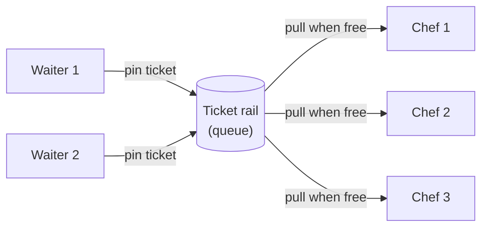

Restaurant B gets four superpowers from that one rail:

| Superpower | What it means in the restaurant | What it means in software |
|---|---|---|
| **Speed for the customer** | The waiter is free in 5 seconds | The API replies in 50 ms instead of 3 s |
| **Decoupling** | Waiters don't need to know which chef cooks | The sender doesn't know or care who processes the message |
| **Buffering** | A rush of 40 orders just makes the rail longer | A traffic spike becomes a longer queue, not a crash |
| **Fault tolerance** | If one chef goes home sick, tickets wait for another chef | If a worker crashes, the message is redelivered to another worker |

The price you pay: the customer doesn't get the pizza *right now*, tickets can occasionally be cooked twice, and when something goes wrong it's harder to see where. This whole chapter is about getting the four superpowers while keeping those costs under control.

> 💡 **The core insight:** a queue turns "do this now and make me wait" into "remember to do this, and tell me when it's safe to forget". Everything else (Kafka, RabbitMQ, SQS, event sourcing) is a variation on who remembers, for how long, and who gets to read it.

---

## 🔨 Building It Up

### 1. Synchronous vs asynchronous communication

In [Chapter 07](07-apis-communication.md) we saw services calling each other with HTTP or gRPC. That is **synchronous**: the caller sends a request and *blocks* until it gets a response.

**Asynchronous** communication means the caller drops a **message** somewhere durable and moves on. Some other process picks it up later.

Let's put numbers on a checkout. When a user clicks "Place order", four things happen:

```python
# Simulated costs in milliseconds (no real waiting happens here).
STEPS = {"save_order": 20, "charge_card": 300, "send_email": 800, "update_analytics": 150}

def sync_checkout():
    """Do every step inside the user's request, one after another."""
    return sum(STEPS.values())

def async_checkout():
    """Do only what the user must wait for; queue the rest."""
    must_do_now = ["save_order", "charge_card"]
    publish_cost = 2                      # appending a message to a queue is fast
    later = [s for s in STEPS if s not in must_do_now]
    waited = sum(STEPS[s] for s in must_do_now) + publish_cost * len(later)
    return waited, later

print("sync user waits :", sync_checkout(), "ms")
waited, later = async_checkout()
print("async user waits:", waited, "ms")
print("done in background:", later)
```

```text
sync user waits : 1270 ms
async user waits: 324 ms
done in background: ['send_email', 'update_analytics']
```

What just happened: the email and analytics steps don't change what the user sees on the confirmation page, so we moved them out of the request. The user's wait dropped by about 4×. Better still, if the email provider is down, checkout **still works**: the email message just waits in the queue until the provider recovers.

**How to decide what goes async.** Ask one question per step: *does the user need the result of this step before we reply?*

| Step | User needs the result now? | Sync or async |
|---|---|---|
| Check the password at login | Yes, we can't let them in otherwise | Sync |
| Charge the card | Usually yes ("payment failed" must show) | Sync (or async with a "processing" screen) |
| Send a receipt email | No | Async |
| Resize the uploaded photo into 5 sizes | No, show a placeholder | Async |
| Update the search index | No, a few seconds of delay is fine | Async |
| Recalculate recommendations | No | Async |

> ⚠️ Async is not free. You trade **immediate consistency** for speed and resilience. The user's "My orders" page may not show the analytics count updated for a second or two. That's **eventual consistency**, which you met in [Chapter 06](06-cap-consistency.md).

### 2. The vocabulary in one place

Before going further, let's fix the words. You'll hear all of these in interviews.

| Term | Meaning |
|---|---|
| **Message** | A small piece of data (usually JSON, Avro or Protobuf, a few KB) that one program sends to another |
| **Producer** (publisher) | The program that sends messages |
| **Consumer** (subscriber, worker) | The program that receives and processes messages |
| **Broker** | The server in the middle that stores messages and hands them out (RabbitMQ, Kafka, SQS) |
| **Queue** | A buffer where each message is processed by **one** consumer |
| **Topic** | A named channel where each message can be read by **many** independent subscribers |
| **Ack** (acknowledgement) | The consumer telling the broker "I've finished this message, you can forget it" |
| **Command** vs **Event** | A command says "please do X" (`SendEmail`). An event says "X happened" (`OrderPlaced`). |

The command/event difference matters more than it looks. A **command** has one intended handler and can be refused. An **event** is a fact about the past: you can't refuse it, and any number of services may react to it. Name events in the past tense: `OrderPlaced`, `PaymentFailed`, `UserSignedUp`.

### 3. Model #1: The message queue (point-to-point)

A **message queue** is the ticket rail. Each message goes to exactly **one** of possibly many consumers. Many consumers reading the same queue are called **competing consumers**: they compete for messages, which spreads the work.

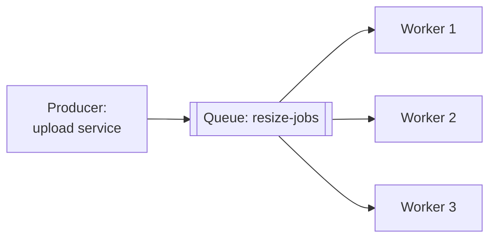

The key mechanism that makes a queue *safe* is the **receive → process → ack** cycle with a **visibility timeout**:

1. A worker **receives** a message. The broker doesn't delete it; it **hides** it for, say, 30 seconds.
2. The worker processes it.
3. The worker **acks** (deletes) it.
4. If the worker crashes and never acks, the 30 seconds run out, the message becomes visible again, and another worker gets it.

Let's build a tiny version with a simulated clock:

```python
from collections import deque

class SimpleQueue:
    """A tiny SQS-like queue. receive() hides a message; ack() deletes it.
    If nobody acks before the visibility timeout, the message reappears."""

    def __init__(self, visibility_timeout):
        self.ready = deque()
        self.in_flight = {}              # msg_id -> (body, deadline)
        self.timeout = visibility_timeout
        self.next_id = 1

    def send(self, body):
        self.ready.append((self.next_id, body))
        self.next_id += 1

    def receive(self, now):
        self._requeue_expired(now)
        if not self.ready:
            return None
        msg_id, body = self.ready.popleft()
        self.in_flight[msg_id] = (body, now + self.timeout)
        return msg_id, body

    def ack(self, msg_id):
        self.in_flight.pop(msg_id, None)

    def _requeue_expired(self, now):
        expired = [m for m, (_, deadline) in self.in_flight.items() if deadline <= now]
        for m in expired:
            body, _ = self.in_flight.pop(m)
            self.ready.append((m, body))

q = SimpleQueue(visibility_timeout=30)
for order in ["order-1", "order-2", "order-3"]:
    q.send(order)

a = q.receive(now=0)      # worker A
b = q.receive(now=1)      # worker B ... which crashes and never acks
q.ack(a[0])
print("A got", a, "| B got", b)

c = q.receive(now=10)     # worker C
q.ack(c[0])
print("t=10 C got", c)
print("t=40 redelivered:", q.receive(now=40))
print("t=41 queue empty:", q.receive(now=41))
```

```text
A got (1, 'order-1') | B got (2, 'order-2')
t=10 C got (3, 'order-3')
t=40 redelivered: (2, 'order-2')
t=41 queue empty: None
```

What just happened: worker B crashed while holding `order-2`. Nobody lost it. At t=31 its timeout expired, and at t=40 the next worker that asked got it again. This is the heart of **at-least-once delivery**: the broker would rather give you a message twice than lose it once. Keep that sentence in your head; it's coming back in section 10.

> 💡 Pick a visibility timeout comfortably longer than the slowest normal processing time. Too short, and a slow-but-healthy worker's message gets handed to a second worker while the first is still on it (duplicate work). Too long, and a crashed worker's message sits hidden for ages.

### 4. Model #2: Publish/subscribe (fan-out)

Now a different need. When an order is placed, *three* teams care: email, inventory, analytics. With a queue, only one of them would get each message. With **pub/sub**, the producer publishes to a **topic**, and **every subscriber gets its own copy**.

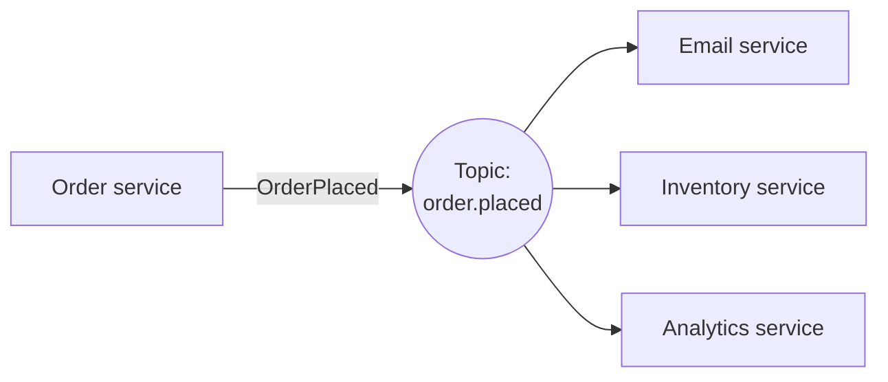

Here is the difference side by side:

```python
from collections import defaultdict

class PubSub:
    def __init__(self):
        self.subscribers = defaultdict(list)    # topic -> list of handlers

    def subscribe(self, topic, handler):
        self.subscribers[topic].append(handler)

    def publish(self, topic, event):
        for handler in self.subscribers[topic]:  # EVERY subscriber gets a copy
            handler(event)

bus = PubSub()
bus.subscribe("order.placed", lambda e: print("  email     -> receipt for", e["id"]))
bus.subscribe("order.placed", lambda e: print("  inventory -> reserve items for", e["id"]))
bus.subscribe("order.placed", lambda e: print("  analytics -> revenue +", e["total"]))
print("Pub/sub: one event, every subscriber reacts")
bus.publish("order.placed", {"id": "A17", "total": 499})

print("Queue: many jobs, each handled by ONE worker")
workers = ["w1", "w2", "w3"]
jobs = [f"resize-{n}" for n in range(1, 7)]
for i, job in enumerate(jobs):
    print(" ", workers[i % len(workers)], "handles", job)
```

```text
Pub/sub: one event, every subscriber reacts
  email     -> receipt for A17
  inventory -> reserve items for A17
  analytics -> revenue + 499
Queue: many jobs, each handled by ONE worker
  w1 handles resize-1
  w2 handles resize-2
  w3 handles resize-3
  w1 handles resize-4
  w2 handles resize-5
  w3 handles resize-6
```

What just happened: pub/sub **copies** a message to every interested party. A queue **splits** messages among workers. Real systems combine them: the order event is published to a topic, and *each* subscribing team has its own queue behind it with several competing workers. On AWS this is the classic **SNS → SQS fan-out**: one SNS topic, one SQS queue per subscriber.

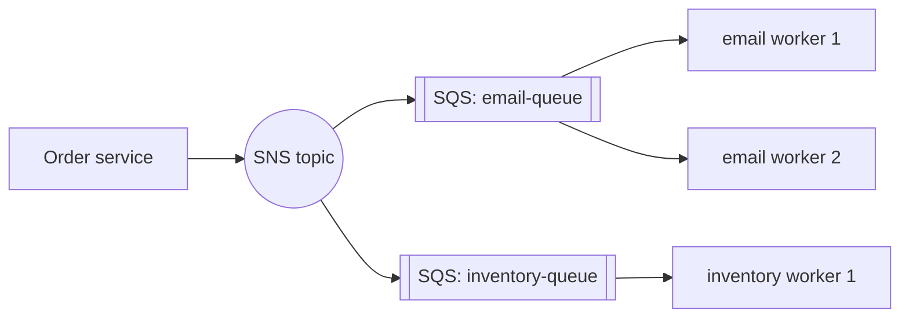

The magic word is **decoupling**. The order service doesn't know the email service exists. Next month, a fraud team can subscribe to `order.placed` and the order service's code doesn't change at all.

### 5. Model #3: Event streaming (the log)

Classic queues *delete* a message once it's acked. That's fine for jobs, but it means:
- A new service that subscribes tomorrow can't see yesterday's events.
- If you deploy a bug that mis-processes messages, you can't "rewind" and process them again.

**Event streaming** platforms, with **Apache Kafka** as the famous one (others: Amazon Kinesis, Apache Pulsar, Redpanda), keep messages in an **append-only log** for a configured time (days, weeks, or forever), whether or not anyone has read them. Each consumer just remembers **how far it has read**, like a bookmark.

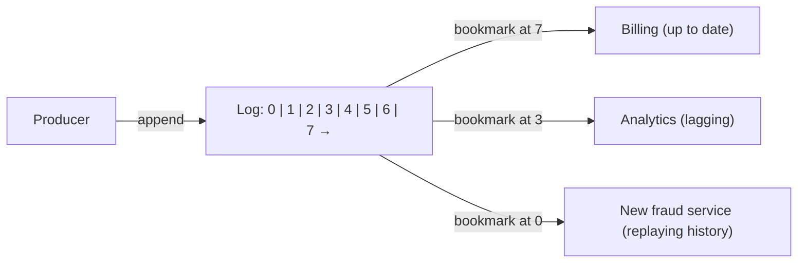

Think of it like a **newspaper archive** instead of a ticket rail. The rail throws a ticket away once cooked. The archive keeps every edition on the shelf, and each reader keeps their own bookmark. Reading doesn't remove anything.

| | Message queue (RabbitMQ, SQS) | Event log (Kafka, Kinesis) |
|---|---|---|
| After a message is processed | Deleted | Kept until retention expires |
| "Where am I?" is tracked by | The broker (per message) | The consumer (an offset number) |
| Many independent readers | Need one queue each | Free: each group has its own offset |
| Replay old messages | No | Yes, just move the offset back |
| Per-message routing and priorities | Rich | Minimal |
| Typical throughput | Thousands to tens of thousands of msg/s per queue | Hundreds of thousands to millions of msg/s per cluster |

### 6. Kafka architecture, piece by piece

Kafka's design has six ideas. Let's take them one at a time.

#### 6a. Topics and partitions

A **topic** is a named stream, e.g. `orders`. One log on one machine would be a bottleneck, so a topic is split into **partitions**. Each partition is its own ordered, append-only log, and different partitions live on different servers (**brokers**). Partitions are Kafka's unit of **parallelism**.

When a producer sends a message with a **key** (say, a user ID), Kafka picks the partition as `hash(key) % number_of_partitions`. Same key → same partition → **those messages stay in order**. Messages without a key are spread across partitions.

#### 6b. Offsets

Inside a partition, each message gets a sequential number called its **offset**: 0, 1, 2, ... Offsets never change and are never reused. A message's address is `(topic, partition, offset)`.

Let's build a mini Kafka topic:

```python
import zlib

class Topic:
    def __init__(self, name, partitions):
        self.name = name
        self.logs = [[] for _ in range(partitions)]     # one append-only list per partition

    def partition_for(self, key):
        # Same key -> same partition -> per-key ordering.
        # crc32 is stable across runs (Python's hash() of a str is randomised per run).
        return zlib.crc32(key.encode()) % len(self.logs)

    def produce(self, key, value):
        p = self.partition_for(key)
        self.logs[p].append((key, value))
        return p, len(self.logs[p]) - 1                 # (partition, offset)

orders = Topic("orders", partitions=3)
events = [("asha", "cart"), ("ravi", "cart"), ("asha", "pay"),
          ("meera", "cart"), ("ravi", "pay"), ("asha", "ship")]
for user, action in events:
    p, off = orders.produce(user, action)
    print(f"{user:5} {action:4} -> partition {p}, offset {off}")

for p, log in enumerate(orders.logs):
    print("partition", p, log)
```

```text
asha  cart -> partition 1, offset 0
ravi  cart -> partition 2, offset 0
asha  pay  -> partition 1, offset 1
meera cart -> partition 1, offset 2
ravi  pay  -> partition 2, offset 1
asha  ship -> partition 1, offset 3
partition 0 []
partition 1 [('asha', 'cart'), ('asha', 'pay'), ('meera', 'cart'), ('asha', 'ship')]
partition 2 [('ravi', 'cart'), ('ravi', 'pay')]
```

What just happened: all of Asha's events landed in partition 1, in the order she did them: cart, pay, ship. Meera happens to share partition 1 with her, and Ravi's two events sit in partition 2, each user's events still in their own order. Notice partition 0 is empty: with only three keys, hashing can be lumpy. With millions of users it evens out, but a single **hot key** (one celebrity, one giant customer) can overload one partition. That's the same hot-spot problem as hot shards in [Chapter 05](05-replication-sharding.md).

> ⚠️ Kafka guarantees order **within a partition only**. There is no global order across partitions. If you need "all events about order #42 in order", make `order_id` the key.

#### 6c. Consumer groups

A **consumer group** is a set of consumers that share the work of reading a topic. The rule:

> **Each partition is read by exactly one consumer in a group.** A consumer can read several partitions.

That one rule gives you both models from earlier:
- **Queue behaviour:** put all your workers in *one* group. They split the partitions.
- **Pub/sub behaviour:** give each service *its own* group. Each group reads every message.

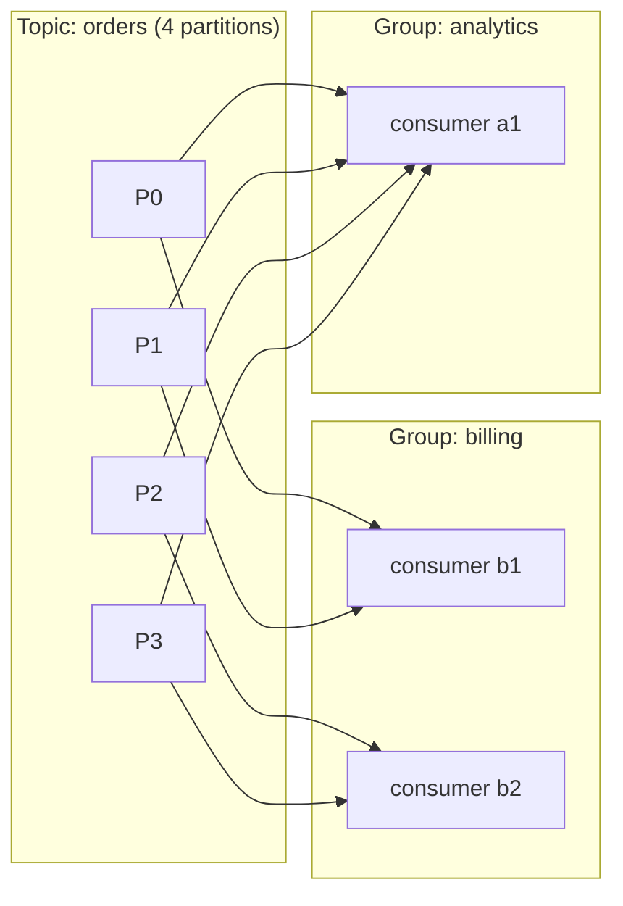

```python
def assign(num_partitions, consumers):
    """Round-robin: each partition goes to exactly one consumer in the group."""
    plan = {c: [] for c in consumers}
    for p in range(num_partitions):
        plan[consumers[p % len(consumers)]].append(p)
    return plan

print(assign(6, ["c1", "c2"]))
print(assign(6, ["c1", "c2", "c3"]))
print(assign(3, ["c1", "c2", "c3", "c4"]))
```

```text
{'c1': [0, 2, 4], 'c2': [1, 3, 5]}
{'c1': [0, 3], 'c2': [1, 4], 'c3': [2, 5]}
{'c1': [0], 'c2': [1], 'c3': [2], 'c4': []}
```

What just happened: look at the last line. With 3 partitions and 4 consumers, **c4 sits idle**. The number of partitions is the ceiling on parallelism inside a group. That's why teams create topics with more partitions than they need today (say 12, 24 or 48), so they can add consumers later. Adding partitions afterwards is possible but changes which partition each key maps to, which breaks per-key ordering for a moment.

When a consumer joins, leaves or crashes, the group **rebalances**: partitions are reassigned among the live consumers. During a rebalance, consumption pauses briefly. Frequent rebalances (for example, a consumer that takes so long per batch that Kafka thinks it died) are a classic production headache.

#### 6d. Committed offsets: the bookmark

Each group stores, per partition, the offset of the **next message it will read**. This is the **committed offset**, and Kafka keeps it in an internal topic. If a consumer crashes, its replacement resumes from the committed offset. Because groups have separate bookmarks, they never interfere:

```python
log = ["o1", "o2", "o3", "o4", "o5", "o6"]          # one partition
committed = {"billing": 0, "analytics": 0}           # group -> next offset to read

def poll(group, max_records):
    start = committed[group]
    batch = log[start:start + max_records]
    committed[group] = start + len(batch)            # commit after processing
    return batch

print("billing   reads", poll("billing", 10))
print("analytics reads", poll("analytics", 2))
print("analytics reads", poll("analytics", 2))
print("lag:", {g: len(log) - off for g, off in committed.items()})

committed["analytics"] = 0                           # a bug was fixed: replay from the start
print("analytics replays", poll("analytics", 10))
```

```text
billing   reads ['o1', 'o2', 'o3', 'o4', 'o5', 'o6']
analytics reads ['o1', 'o2']
analytics reads ['o3', 'o4']
lag: {'billing': 0, 'analytics': 2}
analytics replays ['o1', 'o2', 'o3', 'o4', 'o5', 'o6']
```

What just happened: two groups read the *same* log at their own pace. **Consumer lag** (latest offset minus committed offset) is the single most important Kafka health metric: if lag keeps growing, consumers can't keep up. And replay is just "move the bookmark back", which is impossible with a delete-on-ack queue.

#### 6e. Replication: surviving broker failure

Each partition is copied to several brokers, set by the **replication factor** (commonly 3). One copy is the **leader**: all writes and (by default) reads go to it. The others are **followers** that copy the leader's log. Followers that are fully caught up form the **ISR** (in-sync replicas). If the leader's broker dies, a follower from the ISR becomes the new leader.

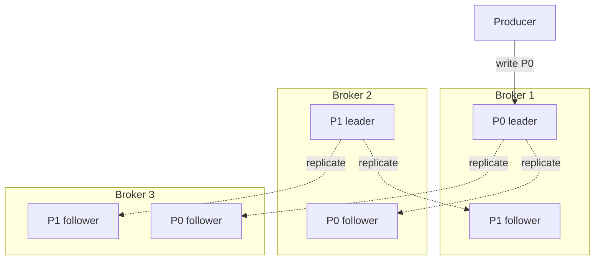

The producer chooses how much safety it wants with the **`acks`** setting:

| `acks` | Producer waits for | Speed | Can lose data when... |
|---|---|---|---|
| `0` | Nothing (fire and forget) | Fastest | Any network blip or broker crash |
| `1` | Leader wrote it | Fast | Leader dies before followers copy it |
| `all` (`-1`) | Every in-sync replica wrote it | Slower | Practically never, if `min.insync.replicas` ≥ 2 |

The durable production recipe: replication factor 3, `acks=all`, `min.insync.replicas=2`. A write then succeeds only when at least 2 copies have it, so you can lose one broker without losing data or availability. This is the leader–follower replication from [Chapter 05](05-replication-sharding.md), and choosing the new leader is a consensus problem from [Chapter 06](06-cap-consistency.md): Kafka's controller uses its built-in Raft-based **KRaft** mode (older versions used ZooKeeper).

#### 6f. Retention and compaction

Kafka deletes old data by **retention policy**, not by acks:
- **Time-based:** keep 7 days (a common default), then delete old **segments** (the log is stored as a series of segment files).
- **Size-based:** keep at most N GB per partition.
- **Log compaction:** keep only the **latest message per key**. Great for "current state" topics, e.g. the latest profile per user ID. A message with a key and a null value (a **tombstone**) deletes that key.

```python
def compact(log):
    """Keep only the last value for each key, preserving offset order."""
    latest = {}
    for offset, (key, value) in enumerate(log):
        latest[key] = (offset, value)
    kept = sorted((off, key, val) for key, (off, val) in latest.items() if val is not None)
    return kept

log = [("u1", "Asha, Pune"), ("u2", "Ravi, Delhi"), ("u1", "Asha, Mumbai"),
       ("u3", "Meera, Goa"), ("u2", None)]        # None = tombstone: u2 deleted
for row in compact(log):
    print(row)
```

```text
(2, 'u1', 'Asha, Mumbai')
(3, 'u3', 'Meera, Goa')
```

What just happened: user u1's older address is gone, u2 was deleted by a tombstone, and the offsets of the survivors stayed the same. A new service can rebuild "current state of every user" by reading this compacted topic from offset 0.

#### The whole Kafka picture

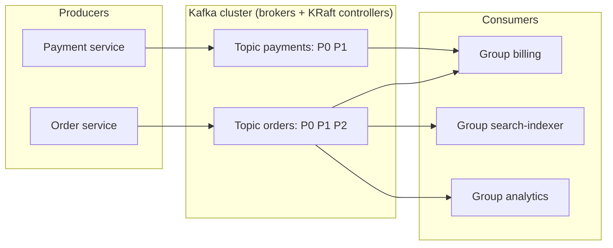

### 7. The RabbitMQ model: smart broker, simple consumers

**RabbitMQ** is a classic **message broker** built around the AMQP protocol. Its design is the opposite of Kafka's: the broker is *smart* (routing, per-message acks, priorities, delivery tracking) and the consumer is *simple*.

Producers never write to a queue directly. They publish to an **exchange**, and **bindings** (rules) decide which queues get a copy:

| Exchange type | Routes a message to... | Use for |
|---|---|---|
| **direct** | Queues whose binding key equals the message's routing key exactly | Work queues per job type |
| **topic** | Queues whose pattern matches the routing key (`order.*.india`, `order.#`) | Flexible pub/sub by category |
| **fanout** | Every bound queue, ignoring the key | Broadcast |
| **headers** | Queues whose header rules match | Rare; routing by attributes |

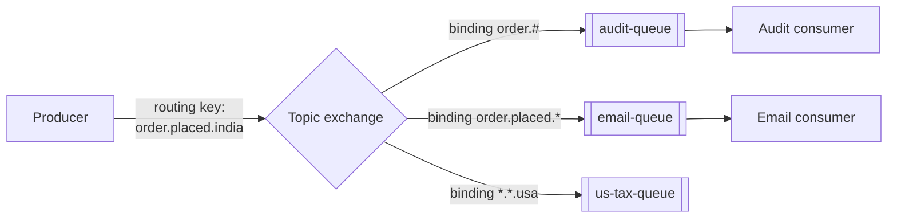

(`*` matches exactly one word, `#` matches zero or more words. Here `us-tax-queue` gets nothing because the key ends in `india`.)

Key RabbitMQ ideas:
- **Push with prefetch:** the broker pushes messages to consumers, but at most `prefetch` un-acked messages each (set by `basic.qos`). That's built-in backpressure: a slow consumer simply receives fewer messages.
- **Acks and requeue:** an un-acked message from a dead connection is requeued. A consumer can also **nack** (negative ack) it, with or without requeue.
- **Messages are deleted once acked.** No replay (RabbitMQ *Streams*, a newer feature, adds a Kafka-like log, but the classic model is delete-on-ack).
- **Durability:** mark queues durable and messages persistent, and use **quorum queues** (replicated via Raft) for high availability.

### 8. The Amazon SQS model: queues as a managed service

**SQS** (Simple Queue Service) is a fully managed queue: no servers to run, effectively unlimited scale for standard queues, pay per request. Its model is exactly the visibility-timeout queue we built in section 3.

| Feature | SQS Standard | SQS FIFO |
|---|---|---|
| Delivery | At-least-once (rare duplicates) | Exactly-once *processing* within a 5-minute deduplication window |
| Ordering | Best effort (can be out of order) | Strict order within a **message group ID** |
| Throughput | Nearly unlimited | Limited per queue (hundreds to thousands of messages per second, more with batching and high-throughput mode) |

Other knobs you should know by name:
- **Visibility timeout** (default 30 seconds, max 12 hours): how long a received message stays hidden.
- **Long polling** (wait up to 20 seconds): the receive call waits for messages instead of returning empty immediately, saving cost and CPU.
- **Retention**: 4 days by default, up to 14 days.
- **Redrive policy**: after `maxReceiveCount` failed receives, the message moves to a **dead-letter queue** (section 13).
- **SNS** is the pub/sub partner; **SNS → SQS** is the standard fan-out. **EventBridge** is AWS's event bus with content-based routing rules.

> 💡 The FIFO "message group ID" is the same idea as Kafka's key: ordering is guaranteed *per group*, and different groups are processed in parallel.

### 9. Choosing between them

| You need... | Choose | Because |
|---|---|---|
| Background jobs (emails, thumbnails, PDFs) with retries | **SQS** or **RabbitMQ** | Per-message acks, visibility timeouts, DLQs out of the box |
| Complex routing (by region, type, priority) | **RabbitMQ** | Exchanges and bindings do the routing for you |
| Many teams reading the same events independently | **Kafka** | Each consumer group has its own offset; no copies needed |
| Replay history, rebuild a database, reprocess after a bug | **Kafka** | Retention + movable offsets |
| Very high throughput (logs, clicks, metrics, IoT) | **Kafka / Kinesis** | Sequential disk writes, batching, partitions |
| Stream processing (windows, joins, aggregates) | **Kafka** + Flink / Kafka Streams | The log is the input to stream processors |
| Zero ops, AWS-native, simple jobs | **SQS (+ SNS)** | Fully managed, scales without thought |
| Strict per-entity order with simple queue semantics | **SQS FIFO** or **Kafka with a key** | Ordering per group/key |

### 10. Delivery semantics: at-most-once, at-least-once, exactly-once

Here is the uncomfortable truth of distributed systems: a consumer can crash **between** doing the work and telling the broker it's done. There are only two orders in which to do those two things, and each fails differently.

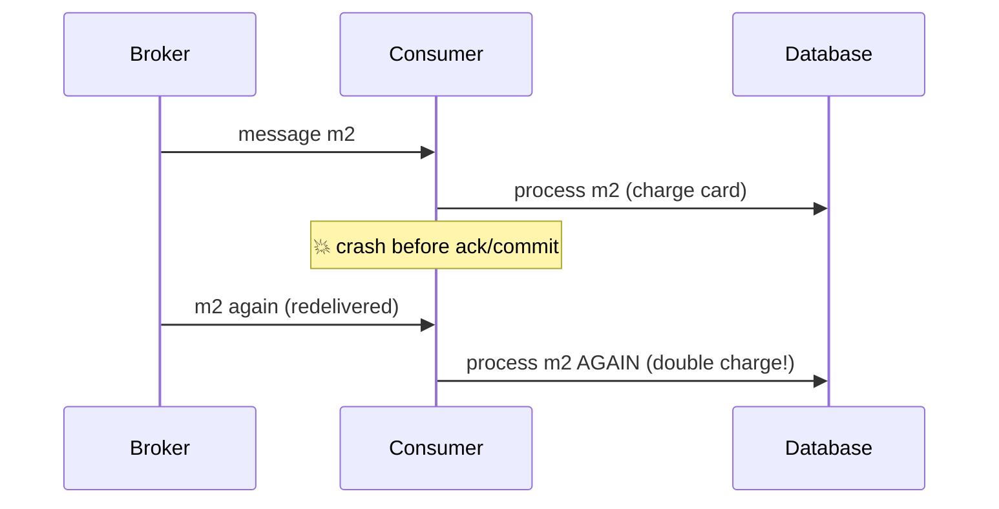

Let's simulate both choices with a crash in the middle:

```python
def consume(log, commit_first):
    committed = 0           # offset stored in the broker: survives crashes
    processed = []          # side effects we caused (rows written, emails sent)
    crashed_once = False
    while committed < len(log):
        offset = committed                  # (re)start from the committed offset
        msg = log[offset]
        if commit_first:
            committed = offset + 1          # 1. commit
            if msg == "m2" and not crashed_once:
                crashed_once = True         # 💥 crash before processing
                continue
            processed.append(msg)           # 2. process
        else:
            processed.append(msg)           # 1. process
            if msg == "m2" and not crashed_once:
                crashed_once = True         # 💥 crash before committing
                continue
            committed = offset + 1          # 2. commit
    return processed

log = ["m0", "m1", "m2", "m3"]
print("commit, then process (at-most-once): ", consume(log, commit_first=True))
print("process, then commit (at-least-once):", consume(log, commit_first=False))
```

```text
commit, then process (at-most-once):  ['m0', 'm1', 'm3']
process, then commit (at-least-once): ['m0', 'm1', 'm2', 'm2', 'm3']
```

What just happened:

| Semantics | How | What can go wrong | OK for |
|---|---|---|---|
| **At-most-once** | Ack/commit first, then process | Messages **lost** (m2 vanished) | Metrics, logs, live location pings where the next update replaces this one |
| **At-least-once** | Process first, then ack/commit | Messages **duplicated** (m2 twice) | Almost everything, *if the consumer is idempotent* |
| **Exactly-once** | At-least-once delivery + deduplication / transactions | Complexity and some throughput | Payments, ledgers, counters |

**Is exactly-once delivery possible?** Over an unreliable network, a sender can never be sure a message arrived *and* was processed exactly one time; this is the same fundamental limit behind the Two Generals problem. What *is* achievable is **exactly-once processing** (also called **effectively-once**): the message may be delivered twice, but its *effect* happens once. There are two ways to get it:

1. **Idempotent consumers** (works with any broker; next section).
2. **Transactions inside one system.** Kafka offers an *idempotent producer* (the broker drops duplicate retries using a producer ID and sequence numbers) and *transactions* that atomically write output messages and commit input offsets together, read by consumers with `isolation.level=read_committed`. This gives exactly-once for **Kafka-to-Kafka** pipelines. The moment your consumer touches an outside system (sends an email, calls a payment API), you're back to needing idempotency.

> 💡 **Interview one-liner:** "Delivery is at-least-once; I make *processing* exactly-once by making the consumer idempotent."

### 11. Idempotent consumers

An operation is **idempotent** if doing it twice has the same effect as doing it once. "Set the status to SHIPPED" is idempotent. "Add ₹100 to the balance" is not.

Three ways to make consumers idempotent:

1. **Use naturally idempotent operations:** `SET status = 'SHIPPED'`, upserts (`INSERT ... ON CONFLICT DO UPDATE`), `PUT` with the full new value.
2. **Deduplicate by message ID:** every message carries a unique `event_id`. Record processed IDs, ideally **in the same database transaction** as the business change, so either both happen or neither does.
3. **Version / sequence checks:** only apply an update if its version is newer than what you've stored (section 12).

Here's approach 2 using Python's built-in `sqlite3` with an in-memory database:

```python
import sqlite3

db = sqlite3.connect(":memory:")
db.execute("CREATE TABLE accounts (id TEXT PRIMARY KEY, balance INTEGER)")
db.execute("CREATE TABLE processed_events (event_id TEXT PRIMARY KEY)")
db.execute("INSERT INTO accounts VALUES ('A', 0)")
db.commit()

def handle(event):
    """Apply a deposit exactly once, even if the event is delivered many times."""
    try:
        with db:   # one transaction: both statements commit, or neither does
            db.execute("INSERT INTO processed_events VALUES (?)", (event["event_id"],))
            db.execute("UPDATE accounts SET balance = balance + ? WHERE id = ?",
                       (event["amount"], event["account"]))
        return "applied"
    except sqlite3.IntegrityError:          # primary key clash: seen this event before
        return "duplicate, skipped"

deliveries = [
    {"event_id": "e1", "account": "A", "amount": 100},
    {"event_id": "e2", "account": "A", "amount": 50},
    {"event_id": "e1", "account": "A", "amount": 100},   # redelivered after a crash
]
for ev in deliveries:
    print(ev["event_id"], "->", handle(ev))
print("balance:", db.execute("SELECT balance FROM accounts").fetchone()[0])
```

```text
e1 -> applied
e2 -> applied
e1 -> duplicate, skipped
balance: 150
```

What just happened: the `processed_events` primary key acts as a "have I done this?" lock. Because the insert and the balance update are in **one transaction**, there's no gap where one happened without the other. A naive consumer would have reported 250.

> ⚠️ Where does `event_id` come from? The **producer** must create it once (a UUID, or a natural key like `order_42_payment`) and reuse it on every retry. If the producer generates a fresh ID on each retry, dedup can't work. Payment APIs call the same idea an **idempotency key**; [Chapter 09](09-microservices-reliability.md) covers it for HTTP APIs.

### 12. Ordering

Ordering is expensive, so the honest answer to "do you need ordering?" is usually "only per entity".

**Where order breaks:**
- Multiple partitions or multiple competing consumers process in parallel.
- A message fails, is retried later, and the next message overtakes it.
- Producers on different machines send at "the same time" with different clocks.

**Strategies:**

| Need | Strategy |
|---|---|
| Order per user/order/account | Partition (Kafka) or message group ID (SQS FIFO) by that key |
| Global total order | One partition, one consumer. Simple but no parallelism. Rarely truly needed. |
| Tolerate out-of-order delivery | Put a **version** or **sequence number** in each event; ignore stale ones |

The version trick is cheap and powerful:

```python
latest = {}      # order_id -> (version, status) as stored by this consumer

def apply(event):
    order, version, status = event["order"], event["version"], event["status"]
    current_version = latest.get(order, (0, None))[0]
    if version <= current_version:
        return f"ignored stale v{version}"
    latest[order] = (version, status)
    return f"applied v{version} -> {status}"

arrivals = [   # network and retries delivered these out of order
    {"order": "42", "version": 1, "status": "PLACED"},
    {"order": "42", "version": 3, "status": "SHIPPED"},
    {"order": "42", "version": 2, "status": "PACKED"},
    {"order": "42", "version": 3, "status": "SHIPPED"},   # duplicate
]
for ev in arrivals:
    print(apply(ev))
print("final:", latest["42"])
```

```text
applied v1 -> PLACED
applied v3 -> SHIPPED
ignored stale v2
ignored stale v3
final: (3, 'SHIPPED')
```

What just happened: the late `PACKED` event would have moved the order *backwards* from SHIPPED to PACKED. The version check stopped it, and as a bonus it also swallowed the duplicate. One check, two problems solved.

> ⚠️ Kafka producers that retry can reorder their own messages if several batches are in flight at once. Enabling the **idempotent producer** (default in modern Kafka clients) keeps per-partition order even with retries.

### 13. Retries, backoff and dead-letter queues

Failures come in two flavours:
- **Transient**: the database was busy, a network timeout, a 503 from a partner. Trying again later will probably work.
- **Permanent**: malformed JSON, a product ID that doesn't exist, a bug in our code for this input. Retrying forever won't help. Such a message is called a **poison message**.

A poison message is dangerous: in a strictly ordered partition it blocks everything behind it ("head-of-line blocking"), and in any queue it burns CPU forever. The cure is a retry budget plus a **dead-letter queue (DLQ)**: after N failed attempts, move the message to a separate queue where humans and alerts can inspect it.

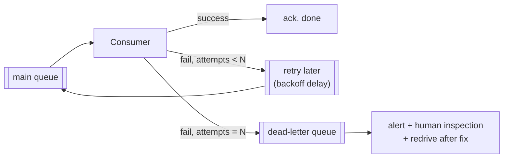

Between retries we wait with **exponential backoff and jitter**: 1 s, 2 s, 4 s, 8 s... times a random factor, so that a thousand failed messages don't all retry at the exact same instant and knock the database over again (the "thundering herd"). [Chapter 09](09-microservices-reliability.md) goes deep on backoff; here's how it fits a consumer:

```python
import random

rng = random.Random(42)              # seeded so the output is reproducible
MAX_ATTEMPTS = 4
calls = {}

def handler(msg):
    calls[msg] = calls.get(msg, 0) + 1
    if msg == "bad-json":
        raise ValueError("cannot parse")                 # permanent failure
    if msg == "flaky" and calls[msg] < 3:
        raise TimeoutError("db busy")                    # transient: works on 3rd try
    return "ok"

def backoff(attempt, base=1.0, cap=30.0):
    """Full jitter: random delay between 0 and min(cap, base * 2^attempt)."""
    return rng.uniform(0, min(cap, base * 2 ** attempt))

dead_letters = []
for msg in ["good", "flaky", "bad-json"]:
    for attempt in range(1, MAX_ATTEMPTS + 1):
        try:
            handler(msg)
            print(f"{msg}: success on attempt {attempt}")
            break
        except (ValueError, TimeoutError) as err:
            if attempt == MAX_ATTEMPTS:
                dead_letters.append((msg, repr(err)))
                print(f"{msg}: attempt {attempt} failed -> sent to DLQ")
            else:
                print(f"{msg}: attempt {attempt} failed ({err}), retry in {backoff(attempt):.2f}s")

print("DLQ:", dead_letters)
```

```text
good: success on attempt 1
flaky: attempt 1 failed (db busy), retry in 1.28s
flaky: attempt 2 failed (db busy), retry in 0.10s
flaky: success on attempt 3
bad-json: attempt 1 failed (cannot parse), retry in 0.55s
bad-json: attempt 2 failed (cannot parse), retry in 0.89s
bad-json: attempt 3 failed (cannot parse), retry in 5.89s
bad-json: attempt 4 failed -> sent to DLQ
DLQ: [('bad-json', "ValueError('cannot parse')")]
```

What just happened: the flaky message recovered on its own. The poison message was retried a bounded number of times, then parked in the DLQ, and the consumer moved on. A smarter version would send `ValueError` (clearly permanent) straight to the DLQ without retrying at all.

**DLQ checklist for production:**
- Alert when the DLQ is non-empty. A DLQ nobody watches is a black hole.
- Store the error and attempt count with the message.
- Provide a **redrive** tool: after fixing the bug, push DLQ messages back into the main queue.
- With Kafka, which has no built-in DLQ, use **retry topics** (`orders.retry.1m`, `orders.retry.10m`) and a `orders.dlq` topic, so the main partition isn't blocked while waiting.

### 14. Backpressure: when producers are faster than consumers

If producers send 5,000 messages per second and consumers handle 3,000, the backlog grows by 2,000 every second, forever. **Backpressure** is any mechanism that pushes "slow down" back towards the source.

```python
def simulate(ticks, produce_rate, consume_rate, capacity=None):
    backlog, rejected = 0, 0
    for _ in range(ticks):
        incoming = produce_rate
        if capacity is not None:
            space = capacity - backlog
            accepted = min(incoming, space)
            rejected += incoming - accepted      # e.g. HTTP 429 "slow down" to the client
            incoming = accepted
        backlog += incoming
        backlog -= min(backlog, consume_rate)
    return backlog, rejected

print("unbounded       (backlog, rejected):", simulate(10, 5, 3))
print("bounded cap=8   (backlog, rejected):", simulate(10, 5, 3, capacity=8))
print("scaled consumers(backlog, rejected):", simulate(10, 5, 6))
```

```text
unbounded       (backlog, rejected): (20, 0)
bounded cap=8   (backlog, rejected): (5, 15)
scaled consumers(backlog, rejected): (0, 0)
```

What just happened: unbounded, the backlog grows by 2 every tick, which in real life means memory or disk eventually runs out, or messages expire before anyone reads them. Bounded, the queue stays small but the excess is *rejected* and the producer must deal with it. Adding consumers fixed the root cause.

Your backpressure toolbox:

| Technique | Where | Example |
|---|---|---|
| **Scale consumers** | Consumer side | Autoscale workers on queue depth or consumer lag (needs enough partitions!) |
| **Bounded queue + reject** | Broker / API | Return 429 Too Many Requests; RabbitMQ max-length policy |
| **Block the producer** | Producer side | Kafka producer blocks when its buffer is full; Python `queue.Queue(maxsize=...)` |
| **Prefetch / pull-based consumption** | Consumer side | RabbitMQ prefetch; Kafka consumers *pull* at their own pace |
| **Shed load / sample** | Anywhere | Drop low-priority analytics events under stress |
| **Batching** | Consumer side | Process 500 messages per DB write instead of 1 |

> 💡 A queue absorbs **bursts**. It cannot fix a **sustained** rate mismatch. If the average input rate is above the average processing rate, the only cures are faster/more consumers or less input.

### 15. The dual-write problem and the outbox pattern

Here's a bug that hides in almost every first event-driven design. The order service does:

```py
db.save(order)                                  # step 1
broker.publish("OrderPlaced", order)            # step 2
```

What if the process crashes between step 1 and step 2? The order exists, but no event was sent: no email, no inventory reservation, forever. Swap the steps and it's worse: an event for an order that was never saved. You can't wrap a database and a broker in one transaction (distributed two-phase commit across them is slow and often unsupported). This is the **dual-write problem**.

The **transactional outbox** pattern fixes it:
1. In the **same database transaction** as the business change, insert the event into an `outbox` table.
2. A separate **relay** process reads unsent rows from `outbox`, publishes them, and marks them sent.

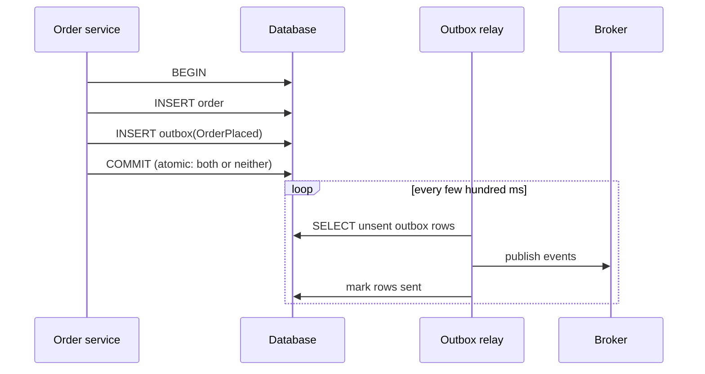

```python
import sqlite3, json

db = sqlite3.connect(":memory:")
db.execute("CREATE TABLE orders (id TEXT PRIMARY KEY, total INTEGER)")
db.execute("CREATE TABLE outbox (seq INTEGER PRIMARY KEY AUTOINCREMENT,"
           " event_id TEXT, payload TEXT, sent INTEGER DEFAULT 0)")
broker = []                                   # stands in for Kafka/RabbitMQ

def place_order(order_id, total):
    with db:                                  # ONE local transaction
        db.execute("INSERT INTO orders VALUES (?, ?)", (order_id, total))
        event = {"type": "OrderPlaced", "order": order_id, "total": total}
        db.execute("INSERT INTO outbox (event_id, payload) VALUES (?, ?)",
                   (f"evt-{order_id}", json.dumps(event)))

def relay_once(crash_before_marking=False):
    rows = db.execute("SELECT seq, event_id, payload FROM outbox WHERE sent = 0 ORDER BY seq").fetchall()
    for seq, event_id, payload in rows:
        broker.append((event_id, json.loads(payload)["order"]))
        if crash_before_marking:
            return "relay crashed after publishing!"
        with db:
            db.execute("UPDATE outbox SET sent = 1 WHERE seq = ?", (seq,))
    return f"published {len(rows)}"

place_order("o1", 300)
place_order("o2", 150)
print(relay_once(crash_before_marking=True))
print(relay_once())                           # relay restarts and catches up
print("broker received:", broker)
```

```text
relay crashed after publishing!
published 2
broker received: [('evt-o1', 'o1'), ('evt-o1', 'o1'), ('evt-o2', 'o2')]
```

What just happened: the orders and their events were saved atomically, so nothing can be lost. The relay crashed after publishing `o1` but before marking it sent, so after restart it published `o1` **again**. The outbox gives you **at-least-once** publishing, which is exactly why consumers must be idempotent, and why each event carries a stable `event_id` (`evt-o1` both times) for them to dedupe on.

Instead of a polling relay, many teams use **Change Data Capture (CDC)**: a tool such as Debezium reads the database's own replication log (MySQL binlog, PostgreSQL WAL) and streams outbox inserts to Kafka. Lower latency, no polling load on the database.

> 💡 The mirror image on the consumer side is the **inbox pattern**: record the incoming `event_id` in an `inbox`/`processed_events` table in the same transaction as the side effect, which is exactly what section 11's code did.

### 16. Event-driven architecture (EDA)

In an **event-driven architecture**, services communicate mainly by publishing and reacting to events instead of calling each other directly.

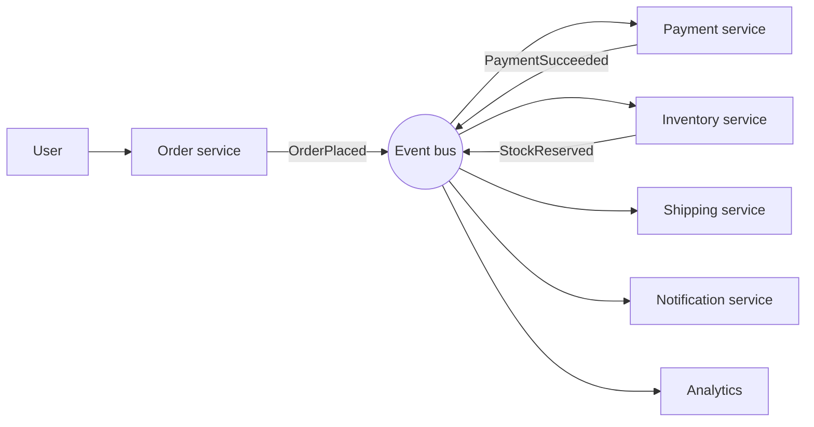

**Three flavours of event**, from thin to fat:

| Style | Event carries | Pro | Con |
|---|---|---|---|
| **Event notification** | Just the ID: `{"type": "OrderPlaced", "order_id": 42}` | Tiny, no stale data | Consumers must call back the order service for details (coupling, load) |
| **Event-carried state transfer** | The full data needed: items, address, totals | Consumers are self-sufficient, even if the producer is down | Bigger messages, schema must be managed carefully |
| **Event sourcing** | Events *are* the source of truth (section 17) | Full history, replay | Biggest mindset change |

**Sagas: transactions across services.** In one database you'd wrap "charge card + reserve stock + create shipment" in a transaction. Across services you can't. A **saga** is a sequence of local transactions where each step publishes an event that triggers the next, and each step has a **compensating action** that undoes it if a later step fails.

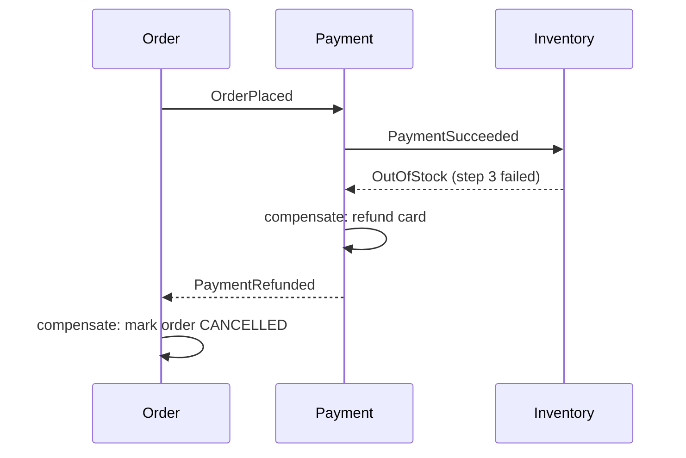

- **Choreography:** no central brain; each service listens and reacts (as above). Simple for 2–4 steps, hard to follow beyond that.
- **Orchestration:** one **orchestrator** service tells each participant what to do and tracks the saga's state. Easier to reason about and monitor for long flows (tools: Temporal, AWS Step Functions, Camunda).

| | Choreography | Orchestration |
|---|---|---|
| Control | Distributed | Central orchestrator |
| Coupling | Low, but the flow is implicit | Orchestrator knows every step |
| Visibility / debugging | Hard ("where is order 42 stuck?") | Easy: one place holds the state |
| Best for | Short, simple flows | Long, business-critical flows |

**The honest downsides of EDA:**
- Harder to debug: a request becomes a chain of events across five services. You need **correlation IDs** and distributed tracing ([Chapter 09](09-microservices-reliability.md)).
- Eventual consistency everywhere: UI must handle "processing..." states.
- Schema evolution: once 12 consumers read `OrderPlaced`, changing it carelessly breaks them. Use a **schema registry** with compatibility rules (add optional fields; never rename or remove fields without a migration).

### 17. Event sourcing

Normal databases store the **current state**: `balance = 150`. **Event sourcing** stores the **sequence of events** that led to it, and computes the state by replaying them. Your bank statement is event sourcing: the list of transactions is the truth; the balance is derived.

```python
from functools import reduce

events = [
    ("AccountOpened",  {"owner": "Asha"}),
    ("MoneyDeposited", {"amount": 500}),
    ("MoneyWithdrawn", {"amount": 120}),
    ("MoneyDeposited", {"amount": 75}),
    ("MoneyWithdrawn", {"amount": 200}),
]

def apply(state, event):
    """Pure function: (old state, event) -> new state. Never mutate history."""
    kind, data = event
    if kind == "AccountOpened":
        return {"owner": data["owner"], "balance": 0, "txns": 0}
    if kind == "MoneyDeposited":
        return {**state, "balance": state["balance"] + data["amount"], "txns": state["txns"] + 1}
    if kind == "MoneyWithdrawn":
        return {**state, "balance": state["balance"] - data["amount"], "txns": state["txns"] + 1}
    return state

current = reduce(apply, events, None)
print("current state:", current)

as_of_event_3 = reduce(apply, events[:3], None)          # time travel
print("state after 3 events:", as_of_event_3)

snapshot = reduce(apply, events[:4], None)               # saved periodically
rebuilt = reduce(apply, events[4:], snapshot)            # replay only the tail
print("from snapshot:", rebuilt, rebuilt == current)
```

```text
current state: {'owner': 'Asha', 'balance': 255, 'txns': 4}
state after 3 events: {'owner': 'Asha', 'balance': 380, 'txns': 2}
from snapshot: {'owner': 'Asha', 'balance': 255, 'txns': 4} True
```

What just happened: state is a **fold** (`reduce`, from [Chapter 11 of Part 1](../part-1-python/11-comprehensions-functional.md)) over events. We got **time travel** for free ("what was the balance after event 3?"). And **snapshots** keep replay fast: instead of replaying 10 million events, load the latest snapshot and replay only what came after.

| Event sourcing gives you | It costs you |
|---|---|
| A perfect audit log (finance, healthcare, legal love this) | Queries like "all accounts with balance > 1000" are hard on raw events (you need projections, i.e. CQRS) |
| Time travel and debugging ("replay production up to the bug") | Events are forever: schema changes need **upcasting** old events |
| New read models can be built from history at any time | Higher complexity and storage; a steeper learning curve for the team |
| Natural fit with event streaming | Deleting personal data (e.g. GDPR) needs care: tombstones or crypto-shredding |

> ⚠️ Event sourcing is a power tool, not a default. Use it for domains where history *is* the product (ledgers, orders, inventory movements, collaborative editing). Don't use it for a user-profile CRUD service.

### 18. CQRS: separate the writes from the reads

**CQRS** (Command Query Responsibility Segregation) means using **different models for writing and for reading**. The write side validates commands and records changes. The read side keeps one or more **projections** (read models) shaped exactly for the screens that query them, updated by consuming events.

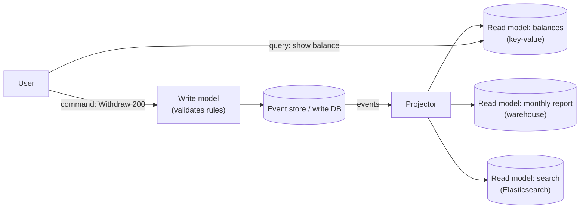

```python
events = [
    {"account": "A", "type": "deposit", "amount": 500, "month": "2026-01"},
    {"account": "B", "type": "deposit", "amount": 900, "month": "2026-01"},
    {"account": "A", "type": "withdraw", "amount": 120, "month": "2026-02"},
    {"account": "B", "type": "withdraw", "amount": 50, "month": "2026-02"},
    {"account": "A", "type": "deposit", "amount": 75, "month": "2026-02"},
]

balances = {}                 # read model 1: "what's my balance?" in O(1)
monthly_outflow = {}          # read model 2: "how much left the bank each month?"

def project(event):
    sign = 1 if event["type"] == "deposit" else -1
    balances[event["account"]] = balances.get(event["account"], 0) + sign * event["amount"]
    if event["type"] == "withdraw":
        m = event["month"]
        monthly_outflow[m] = monthly_outflow.get(m, 0) + event["amount"]

for e in events:
    project(e)
print("balances:", balances)
print("monthly outflow:", monthly_outflow)
```

```text
balances: {'A': 455, 'B': 850}
monthly outflow: {'2026-02': 170}
```

What just happened: the same event stream fed two completely different read models, each optimised for one question. Need a third view next quarter? Write a new projector and replay the events from the start.

CQRS does **not** require event sourcing (you can project from a normal DB via CDC), and event sourcing almost always comes with CQRS. The price is **read-your-writes lag**: right after a withdrawal, the balance read model may be a few hundred milliseconds behind. Common fixes: return the new state in the command's response, or have the UI wait until the projection has processed the event's version.

### 19. Stream processing basics

**Batch processing** runs over a fixed pile of data ("compute yesterday's revenue at 2 AM"). **Stream processing** computes continuously over never-ending events ("revenue in the last minute, updated every few seconds"). Engines: **Apache Flink**, **Kafka Streams**, **Spark Structured Streaming**.

The central idea is the **window**, because "count clicks" has no answer on an infinite stream but "count clicks per minute" does:

| Window | Shape | Example |
|---|---|---|
| **Tumbling** | Fixed size, no overlap: [0–60), [60–120) | Clicks per minute |
| **Hopping / sliding** | Fixed size, overlapping: 5-minute window every 1 minute | "Last 5 minutes", refreshed each minute |
| **Session** | Ends after a gap of inactivity | One user's browsing session (ends after 30 idle minutes) |

```python
from collections import Counter, defaultdict

clicks = [  # (event_time_seconds, page)
    (3, "home"), (15, "cart"), (42, "home"), (59, "home"),
    (61, "cart"), (75, "home"), (118, "cart"), (121, "home"),
]

def tumbling_counts(events, size):
    windows = defaultdict(Counter)
    for t, page in events:
        start = (t // size) * size              # which window this event belongs to
        windows[start][page] += 1
    return {f"[{s},{s + size})": dict(c) for s, c in sorted(windows.items())}

for window, counts in tumbling_counts(clicks, 60).items():
    print(window, counts)
```

```text
[0,60) {'home': 3, 'cart': 1}
[60,120) {'cart': 2, 'home': 1}
[120,180) {'home': 1}
```

What just happened: each event was dropped into the bucket its timestamp falls in, which is exactly what a stream processor does continuously, keeping each window's counter as **state**.

Three ideas you should be able to name:
- **Event time vs processing time:** event time is when the click happened on the phone; processing time is when the server saw it. A phone in a tunnel can send a 10-minute-old click. Correct analytics use **event time**.
- **Watermarks:** a stream processor's estimate that "all events up to time T have probably arrived", so it can close the window for T and emit results. Events arriving after that are **late events**: drop them, or allow a grace period and update the result.
- **Stateful processing and checkpoints:** counts, joins and aggregates are state. Engines like Flink periodically **checkpoint** state together with input offsets, so after a crash they resume consistently, which is how they offer exactly-once results.

### 20. Real use cases

| System | How queues/events are used |
|---|---|
| **E-commerce order flow** | `OrderPlaced` fans out to payment, inventory, email, analytics; saga with compensation for failures |
| **Image/video upload** | Upload service drops a job in a queue; transcoding workers scale with queue depth ([Chapter 13](13-case-studies-2.md)) |
| **Notifications** | A notification service consumes events and pushes to email/SMS/push queues with per-channel workers and retries ([Chapter 12](12-case-studies-1.md)) |
| **Social feed fan-out** | A new post event triggers fan-out workers that write into followers' feed caches |
| **Ride-hailing** | Driver location pings stream through Kafka to matching and ETA services (at-most-once is fine for pings: the next one replaces it) |
| **Activity tracking & analytics** | Clicks and page views stream into Kafka, then to a data warehouse and real-time dashboards |
| **Search indexing** | CDC from the main DB into Kafka, consumed by an indexer that updates Elasticsearch ([Chapter 10](10-storage-search-ids.md)) |
| **Log and metrics pipelines** | Thousands of servers ship logs to Kafka; consumers write to storage and alerting systems |
| **Fraud detection** | Stream processor joins payments with recent user behaviour within a time window and flags anomalies in seconds |
| **Database migration / cache invalidation** | CDC streams every row change so caches and new databases stay in sync |

---

## 🔬 Under the Hood

### Why Kafka is so fast

Kafka routinely handles millions of messages per second on ordinary hardware. Five design choices explain it:

1. **Append-only sequential writes.** Disks (even SSDs) are far faster at sequential writes than random ones. A partition is just a file that only grows at the end, so Kafka never seeks around the disk.
2. **The OS page cache.** Kafka doesn't keep its own big in-memory cache. It writes to files and lets the operating system cache recently written pages in RAM. Consumers that keep up read straight from memory.
3. **Zero-copy transfer.** To send log data to a consumer, Kafka asks the OS (`sendfile`) to copy bytes straight from the page cache to the network socket, skipping a round-trip through the application's memory.
4. **Batching and compression.** Producers group many messages into one batch (`linger.ms`, `batch.size`) and compress the whole batch (lz4, zstd, snappy). One network request and one disk write carry hundreds of messages.
5. **Dumb broker, smart consumer.** The broker doesn't track which message each consumer has acked. It only stores one offset per group per partition. That's a few bytes of bookkeeping instead of a state machine per message.

A consumer reading from offset X is cheap too: each segment file has a sparse **offset index** mapping offsets to byte positions, so Kafka binary-searches ([Part 2, Chapter 08](../part-2-dsa/08-binary-search.md)) the index and starts streaming.

### What "committed" means for a Kafka write

With `acks=all`, a message is **committed** once every replica in the ISR has it. The leader tracks the **high watermark**: the highest offset copied to all in-sync replicas. Consumers can only read up to the high watermark. This prevents a nasty case: a consumer reads offset 100 from the leader, the leader dies before replicating it, and the new leader never had offset 100. By only exposing replicated data, Kafka ensures consumers never see a message that might later "un-happen".

### How a RabbitMQ classic queue differs internally

A RabbitMQ queue tracks **each message's state** (ready, delivered-unacked, acked). Acked messages are removed, and the queue tries to stay short and mostly in memory. That's why RabbitMQ is excellent at low-latency job distribution with per-message features (priorities, TTLs, per-message routing) but struggles when queues grow to tens of millions of messages: it was designed for queues that are usually near-empty. Kafka is the opposite: it is designed for logs that are always huge.

### Why exactly-once delivery is impossible but exactly-once processing isn't

The sender of a message can never distinguish "the message was lost" from "the message arrived but the acknowledgement was lost". Both look like silence. So it must either resend (risking a duplicate) or not resend (risking a loss). No protocol escapes this, which is why the industry settles for at-least-once delivery. But if the receiver can recognise a duplicate (a unique ID it has already recorded, inside the same atomic transaction as the effect), then the *effect* happens exactly once. Kafka's transactions do this internally by making "write outputs + commit input offsets" one atomic unit inside Kafka.

### Consumer lag: the number that tells you everything

```text
partition:            P0      P1      P2
log end offset:      9,812   9,790   9,905
committed offset:    9,800   6,100   9,900
lag:                    12   3,690       5
```

Total lag is small on P0 and P2 but P1 is far behind. That pattern (one partition lagging) usually means a **hot key** or a stuck consumer on P1, not a capacity problem. Lag growing on *all* partitions means you need more consumers (or faster processing). Turn lag into time: if lag is 3,690 and the consumer processes 100 messages/s, data on P1 is about 37 seconds stale.

---

## 🧩 Pattern Decoder

### Signals: when an interviewer wants you to add a queue

| You hear... | Think |
|---|---|
| "send an email / SMS / push after X" | Async job queue + workers + retries + DLQ |
| "process uploads, transcode video, generate thumbnails/PDFs" | Job queue; autoscale workers on queue depth |
| "traffic spikes", "flash sale", "handle bursts" | Queue as a buffer between the API and the slow part |
| "multiple services need to react to the same thing" | Pub/sub topic (Kafka topic or SNS→SQS fan-out) |
| "replay", "audit", "rebuild", "history" | Event log with retention (Kafka) or event sourcing |
| "real-time analytics / counts / trending / last N minutes" | Event stream + stream processor with windows |
| "keep search index / cache / warehouse in sync with the DB" | CDC → Kafka → consumers |
| "transaction across services", "book flight + hotel" | Saga with compensations (orchestrated for long flows) |
| "must not double-charge / double-send" | At-least-once + idempotency keys / dedup table |
| "updates must be in order per user/order" | Partition by that key (Kafka) / message group ID (SQS FIFO) |

### Decision guide

- **If you need** a background job processed once by any one worker, **choose** a message queue (SQS/RabbitMQ), **because** it gives per-message acks, visibility timeouts and DLQs with no extra code.
- **If you need** several independent consumers of the same events, **choose** pub/sub (Kafka consumer groups or SNS→SQS), **because** it decouples producers from an unknown, growing set of consumers.
- **If you need** replay, very high throughput or stream processing, **choose** Kafka/Kinesis, **because** the retained log plus consumer-held offsets make re-reading free.
- **If you need** ordering, **choose** per-key ordering, **because** global ordering kills parallelism. Ask: "ordered with respect to *what*?"
- **If you need** a reliable "save to DB and publish an event", **choose** the outbox pattern or CDC, **because** dual writes lose events on crashes.
- **If you need** exactly-once effects, **choose** at-least-once delivery plus an idempotent consumer, **because** that's the only form of exactly-once that survives contact with external systems.
- **If you need** a cross-service workflow with more than 3–4 steps, **choose** an orchestrated saga, **because** choreography becomes impossible to trace.
- **If you need** a complete audit history and time travel, **choose** event sourcing + CQRS, **because** state derived from immutable events can always be recomputed.
- **If** the caller needs the answer to continue (login, price check, "is this seat free?"), **don't** use a queue. Use a synchronous call ([Chapter 07](07-apis-communication.md)).

### Template: a production-grade consumer loop

```py
def consumer_loop(broker, handler, dedup_store, max_attempts=5):
    while running:
        batch = broker.poll(max_records=100, timeout_s=1)      # pull: natural backpressure
        for msg in batch:
            if dedup_store.seen(msg.event_id):                 # idempotency
                continue
            try:
                with db.transaction():                         # effect + dedup record atomically
                    handler(msg)
                    dedup_store.record(msg.event_id)
            except PermanentError as err:                      # bad data, bug: don't retry
                broker.send_to_dlq(msg, reason=repr(err))
            except TransientError as err:
                if msg.attempts + 1 >= max_attempts:
                    broker.send_to_dlq(msg, reason=repr(err))
                else:
                    broker.retry_later(msg, delay=backoff_with_jitter(msg.attempts))
        broker.commit(batch)                                   # AFTER processing: at-least-once
        metrics.gauge("consumer_lag", broker.lag())            # alert if it keeps growing
```

### Trade-off table: the whole messaging landscape

| | RabbitMQ | Amazon SQS | Kafka | Redis Streams / Pub/Sub |
|---|---|---|---|---|
| Core model | Smart broker, queues + exchanges | Managed queue | Partitioned, replicated log | In-memory streams; fire-and-forget pub/sub |
| Retention | Until acked | Up to 14 days | Configurable: hours to forever | Memory-bound (pub/sub: none) |
| Replay | No (classic queues) | No | Yes | Streams: yes |
| Ordering | Per queue (single consumer) | FIFO per group ID | Per partition | Per stream |
| Routing | Rich (exchanges) | None (use SNS/EventBridge) | By key → partition | Minimal |
| Throughput | High | Very high (standard) | Very high | Very high, memory-limited |
| Ops burden | Run it yourself (or managed) | None | Significant (or managed: MSK, Confluent) | Low |
| Sweet spot | Task queues, complex routing, RPC-style work | AWS jobs, zero ops | Event backbone, analytics, CDC, replay | Lightweight, low-latency, ephemeral |

### Variation: designing the async part of "upload a photo"

**Problem:** users upload photos; we must create 3 thumbnail sizes, run content moderation, and update the user's gallery.

**Idea:** the upload API stores the original in object storage ([Chapter 10](10-storage-search-ids.md)), writes a `photos` row with `status = PROCESSING` and an outbox event `PhotoUploaded`, and returns 202 Accepted. Fan-out to two consumer groups: thumbnailer and moderator. Each is idempotent (thumbnail paths are deterministic, e.g. `photo_id/320.jpg`, so redoing the work just overwrites the same file). When both finish, a small orchestrator (or a status table with a counter) flips the photo to `READY` and notifies the user.

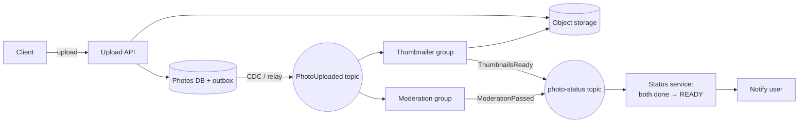

### When NOT to use a queue

- **The caller needs the result to continue.** A login check through a queue just adds latency and complexity.
- **Tiny systems.** One service, one database, low traffic: a background thread or a cron job may be enough. A broker is one more thing to run, monitor and secure.
- **Strong read-after-write consistency is a hard requirement** and you can't design the UI around a "processing" state.
- **As a database.** Kafka can keep data forever, but it can't answer "find the order with ID 42" efficiently. Use it to feed databases, not to replace them (compacted topics + a materialised view are the exception, not the rule).

---

## ⚠️ Traps & Common Mistakes

1. **Assuming exactly-once delivery.** Every real broker can deliver a message twice. Design every consumer to be idempotent from day one.
2. **Committing offsets before processing** (often by accident with auto-commit on a timer). A crash then silently loses messages. Commit after the work is done.

```py
# ❌ auto-commit every 5 s, regardless of whether processing finished
consumer = KafkaConsumer("orders", enable_auto_commit=True)

# ✅ commit explicitly after the batch is processed
consumer = KafkaConsumer("orders", enable_auto_commit=False)
for batch in poll_batches(consumer):
    process(batch)
    consumer.commit()
```

3. **Generating a new message ID on every retry.** Dedup then sees each retry as a brand-new message. Create the ID once, at the source, and reuse it.
4. **Expecting global order from a multi-partition topic.** Order holds only within a partition. Choose the partition key deliberately (the entity whose events must stay ordered).
5. **More consumers than partitions.** Extra consumers sit idle. Plan partition counts for future scale.
6. **No DLQ, or a DLQ nobody watches.** A poison message either blocks the queue forever or disappears silently. Alert on DLQ depth.
7. **Retrying immediately in a tight loop.** It hammers an already-struggling dependency. Use exponential backoff with jitter and a max attempt count.
8. **The dual write** (`db.save(); broker.publish()`). A crash between them loses or invents events. Use the outbox pattern or CDC.
9. **Visibility timeout shorter than processing time.** The message is redelivered while the first worker is still working on it, causing duplicates and wasted work. Set it above your p99 processing time, or extend it while working (heartbeat).
10. **Huge messages.** Brokers are for small messages. Put the 50 MB video in object storage and send its URL/key (the **claim-check pattern**).
11. **Breaking event schemas.** Renaming a field breaks every consumer you've forgotten about. Use a schema registry and backward-compatible changes only.
12. **Hot partitions.** Keying by `country` when 70% of users are in one country makes one partition do 70% of the work. Pick a high-cardinality key, or add a suffix to spread a hot key (losing strict order for that key).
13. **Using a queue where a synchronous call was needed**, then building a fragile "wait for the reply message" mechanism. If you need an answer now, call synchronously.

---

## 💡 Tips & Tricks

- In interviews, the moment you say "queue", also say three things: **delivery guarantee** ("at-least-once"), **idempotency** ("consumers dedupe on event ID"), and **failure handling** ("retries with backoff, then a DLQ"). That's what separates juniors from seniors.
- Name the partition key out loud and say why: "partition by `order_id` so all events for an order stay in order".
- Default production Kafka settings worth quoting: replication factor 3, `acks=all`, `min.insync.replicas=2`, idempotent producer on.
- Watch **consumer lag** (Kafka) or **queue depth + age of oldest message** (SQS/RabbitMQ). Age of the oldest message is the best "are users affected?" signal.
- Autoscale consumers on queue depth/lag, not on CPU.
- Keep messages small and self-describing: `event_id`, `type`, `version`, `occurred_at`, `correlation_id`, and the payload.
- For "process once per day per user" style jobs, a deterministic idempotency key like `digest:user42:2026-10-31` beats a random UUID.
- If you're asked "Kafka or RabbitMQ?", don't pick a favourite. Ask: "Do we need replay and multiple independent consumers (Kafka), or per-message routing and task distribution (RabbitMQ)?"
- Claim-check: big payload in object storage, small pointer in the message.
- A queue in front of a database turns a write spike into a smooth stream, a pattern called **queue-based load leveling**.

---

## 🎯 Interview Questions

### 1. What's the difference between a message queue, pub/sub, and an event stream like Kafka? 🔥🔥🔥

<details><summary>Answer</summary>

- **Message queue (point-to-point):** each message is delivered to **one** consumer among many competing consumers and deleted after it's acked. Used for distributing work: emails, thumbnails. Examples: SQS, RabbitMQ queues.
- **Pub/sub:** each message published to a topic is delivered to **every** subscriber. Used to broadcast events to many independent services. Examples: SNS, Google Pub/Sub, RabbitMQ fanout exchange.
- **Event stream / log:** messages are appended to a partitioned, durable log and **retained** for a configured time regardless of consumption. Consumers track their own offsets, so many consumer groups can read independently and **replay** history. Example: Kafka, Kinesis.

Kafka can behave like both: consumers in one group split the partitions (queue semantics); different groups each see every message (pub/sub semantics). Pick a queue for jobs, pub/sub for fan-out, and a log when you also need replay, very high throughput or stream processing.

</details>

### 2. How does Kafka guarantee ordering, and how would you keep all events of one order in sequence? 🔥🔥🔥

<details><summary>Answer</summary>

Kafka guarantees order **only within a partition**: messages in a partition have increasing offsets and are read in offset order. There's no order across partitions.

To keep all events of one order in sequence:
1. Use `order_id` as the message **key**. The default partitioner sends the same key to the same partition.
2. Within a consumer group, each partition is read by a single consumer, so they're processed in order.
3. Enable the **idempotent producer** so producer retries can't reorder or duplicate messages within a partition.
4. Don't process messages from one partition with an unordered thread pool. If you parallelise inside a consumer, parallelise *by key*.
5. Beware: increasing the partition count changes the key→partition mapping. Plan partition counts up front.

For extra safety, include a per-entity **version** in each event and have consumers ignore stale versions.

</details>

### 3. Can you achieve exactly-once delivery? How would you guarantee a payment is processed exactly once? 🔥🔥🔥

<details><summary>Answer</summary>

Exactly-once **delivery** over an unreliable network isn't achievable: a sender can't distinguish a lost message from a lost acknowledgement, so it must either resend (duplicate risk) or not (loss risk). What we build is exactly-once **processing** (effectively-once): at-least-once delivery + idempotent handling.

For payments:
1. The producer attaches a stable **idempotency key** (e.g. `payment:order_42`) created once and reused on retries.
2. The consumer, in **one database transaction**, inserts the key into a `processed_payments` table (unique constraint) and performs the ledger update. A duplicate violates the constraint and is skipped.
3. Calls to an external payment provider pass the same idempotency key, which providers like Stripe support, so a retried charge request doesn't double-charge.
4. Commit the offset / ack the message only after the transaction commits.

Inside Kafka-only pipelines, Kafka transactions (idempotent producer + atomic offset commit + `read_committed` consumers) give exactly-once semantics without your own dedup table.

</details>

### 4. What are at-most-once, at-least-once and exactly-once semantics? Give a use case for each. 🔥🔥

<details><summary>Answer</summary>

- **At-most-once:** ack/commit before processing. A crash loses the message; never duplicates. Use for data where losing a little is fine and freshness matters: metrics samples, live GPS pings, debug logs.
- **At-least-once:** process, then ack/commit. A crash after processing but before ack causes redelivery, so duplicates happen; never loses. The default for most business events (orders, emails) with idempotent consumers.
- **Exactly-once (processing):** at-least-once delivery plus dedup or transactions so the effect happens once. Use for money movement, inventory counts, billing.

The difference is literally the order of two lines of code: commit-then-process vs process-then-commit.

</details>

### 5. Kafka vs RabbitMQ: when would you choose each? 🔥🔥🔥

<details><summary>Answer</summary>

| Choose **Kafka** when | Choose **RabbitMQ** when |
|---|---|
| Many independent consumers need the same events | Work must be distributed among workers with per-message acks |
| You need replay / reprocessing / long retention | Messages are transient tasks, deleted when done |
| Throughput is very high (clickstreams, logs, CDC) | You need rich routing (topic/headers exchanges), priorities, per-message TTLs |
| You'll do stream processing (Flink, Kafka Streams) | You want low-latency push delivery with simple consumers |
| Ordering per key at scale matters | Queues are usually short and the broker should track message state |

Architecture summary: Kafka is a **dumb broker with smart consumers** (a replicated log; consumers keep offsets). RabbitMQ is a **smart broker with simple consumers** (it tracks each message's delivery state and routes via exchanges). Many companies run both: Kafka as the event backbone, RabbitMQ/SQS for task queues.

</details>

### 6. What is the dual-write problem and how does the outbox pattern solve it? 🔥🔥🔥

<details><summary>Answer</summary>

A service that writes to its database *and* publishes to a broker can crash between the two, leaving them inconsistent: an order saved with no event (downstream never hears about it), or an event published for an order that rolled back. You can't wrap both in one transaction without heavyweight distributed transactions.

**Transactional outbox:** in the same local DB transaction as the business change, insert the event into an `outbox` table. A relay process (polling, or CDC like Debezium reading the DB's log) publishes outbox rows to the broker and marks them sent. Since the event and the state change commit atomically, no event is lost. The relay may publish a row twice (crash after publish, before marking), so delivery is at-least-once and consumers must dedupe on the event ID.

</details>

### 7. Consumer lag keeps increasing. How do you investigate and fix it? 🔥🔥

<details><summary>Answer</summary>

1. **Is lag growing on all partitions or one?**
   - **One partition:** hot key (skewed partitioning) or a stuck/slow consumer instance, or a poison message being retried in a loop. Fix the key choice, split the hot key, move poison messages to a DLQ.
   - **All partitions:** consumers can't keep up overall.
2. **Can we add consumers?** Only up to the number of partitions in the group. If consumers ≥ partitions, increase partitions (accepting the key remapping) or speed up each consumer.
3. **Speed up processing:** batch DB writes, remove synchronous calls to slow services from the hot path, use async I/O, cache lookups, parallelise by key within a consumer.
4. **Check rebalances:** if processing a batch exceeds `max.poll.interval.ms`, Kafka thinks the consumer died and rebalances repeatedly. Reduce `max.poll.records` or speed up processing.
5. **Check downstream:** often the real bottleneck is the database the consumer writes to.
6. **Short-term:** autoscale on lag; for non-critical data, temporarily skip or sample.

</details>

### 8. How do you handle a poison message? 🔥🔥

<details><summary>Answer</summary>

A poison message fails every time (bad format, unexpected data, a bug). Without a plan it either blocks the partition/queue or loops forever.

- Classify errors: **permanent** errors (validation, parse) go straight to the DLQ; **transient** errors (timeouts, 503s) get retried with exponential backoff and jitter, up to N attempts, then the DLQ.
- In SQS, set a **redrive policy** (`maxReceiveCount`) to move it automatically. In RabbitMQ, use a dead-letter exchange. In Kafka, use retry topics plus a DLQ topic so the main partition isn't blocked.
- Store the error, stack trace and attempt count with the message; alert on DLQ depth; provide a redrive tool to replay after a fix.
- If strict per-key ordering matters, consider parking *all* later messages of the same key, or the consumer will process later events for that entity out of order.

</details>

### 9. What is a saga? Choreography vs orchestration? 🔥🔥

<details><summary>Answer</summary>

A **saga** implements a business transaction that spans several services as a sequence of **local transactions**. Each step commits in its own service and triggers the next; if a step fails, previously completed steps are undone by **compensating actions** (refund the card, release the stock). It gives eventual consistency without distributed locks or two-phase commit.

- **Choreography:** services react to each other's events; no coordinator. Low coupling and simple for short flows, but the overall flow is implicit and hard to monitor or change.
- **Orchestration:** a central orchestrator sends commands to each service and tracks saga state (often as a state machine, with tools like Temporal or Step Functions). Easier to understand, monitor, time out and retry; the orchestrator must itself be durable.

Compensations must be idempotent too, and some actions can't be undone (an email was sent), so you design "semantic" compensations (send a cancellation email).

</details>

### 10. Explain event sourcing and CQRS. When would you use them and when not? 🔥🔥

<details><summary>Answer</summary>

**Event sourcing** stores every state change as an immutable event in an append-only event store; current state is derived by replaying events (with snapshots to keep replay fast). Benefits: complete audit trail, time travel, rebuilding new views from history, natural integration via events. Costs: complexity, event schema evolution (upcasting), harder ad-hoc queries, careful handling of data deletion.

**CQRS** splits the write model (validates commands, records changes) from read models (projections tailored to queries), kept up to date asynchronously from events. Benefits: each side scales and is optimised independently; many specialised read models (KV for lookups, Elasticsearch for search, warehouse for reports). Cost: read models are eventually consistent.

Use for ledgers, order lifecycles, inventory, collaborative or compliance-heavy domains. Avoid for simple CRUD where current state is all anyone needs.

</details>

### 11. Why is Kafka so fast? 🔥🔥

<details><summary>Answer</summary>

- **Sequential, append-only disk I/O** per partition, which is much faster than random I/O.
- **OS page cache** instead of an application cache; up-to-date consumers read from RAM.
- **Zero-copy** (`sendfile`) from page cache to socket.
- **Batching + compression** on the producer, reused end to end, so one request carries many messages.
- **Partitioning** spreads load across brokers and consumers in parallel.
- **Minimal broker bookkeeping:** one committed offset per group per partition rather than per-message ack state.
- Pull-based consumers fetch large batches at their own pace.

</details>

### 12. A flash sale sends 50× normal traffic to the "place order" API. How do queues help, and what are the limits? 🔥🔥

<details><summary>Answer</summary>

Put a queue between the API and the order processing (**queue-based load leveling**): the API validates the request, enqueues it with an idempotency key and returns 202 Accepted with an order-tracking ID. Workers drain the queue at the rate the database and payment provider can handle, and autoscale on queue depth. The UI shows "Order received, confirming..." and updates via polling or push.

Limits:
- A queue absorbs bursts but not a sustained overload; the backlog must be drained before users give up, so watch the age of the oldest message.
- Inventory still needs a correct, atomic reservation (e.g. conditional decrement in the DB or Redis) to avoid overselling; the queue doesn't solve that by itself.
- Add a waiting room / rate limiter in front if even enqueueing would overwhelm the system, and reject with 429 when the queue is too deep (backpressure).
- Partition by product or user if per-entity ordering matters.

</details>

### 13. How do you evolve an event's schema without breaking consumers? 🔥

<details><summary>Answer</summary>

- Use a schema format with explicit schemas (Avro, Protobuf, or JSON Schema) and a **schema registry** enforcing compatibility rules.
- Make **backward-compatible** changes only: add new optional fields with defaults; never remove, rename or change the type of an existing field in place.
- For breaking changes, publish a new event version (`OrderPlaced.v2`) or a new topic, run both in parallel while consumers migrate, then retire the old one.
- Consumers should ignore unknown fields (the "tolerant reader" principle).
- In event-sourced systems, old events stay in the store forever, so you **upcast** them (convert v1 to v2 when read).

</details>

---

## 🏋️ Practice

**🟢 1. Classify these as sync or async in a food-delivery app, and justify each in one line:** (a) check the restaurant is open, (b) send the "order confirmed" SMS, (c) assign a delivery partner, (d) compute the price with coupons, (e) update the restaurant's monthly sales dashboard.

<details><summary>Solution</summary>

- (a) **Sync:** the user can't order from a closed restaurant; the answer is needed now.
- (b) **Async:** the confirmation page doesn't need the SMS to have been delivered; queue it with retries.
- (c) **Async:** matching can take seconds; return "finding a partner..." and push the update to the app.
- (d) **Sync:** the user must see the final price before paying.
- (e) **Async:** analytics can lag by seconds or minutes; stream the event.

</details>

**🟢 2. A topic has 8 partitions. Group A has 3 consumers, group B has 10. How many partitions does each consumer get, and how many consumers sit idle?**

<details><summary>Solution</summary>

```python
def assign(num_partitions, consumers):
    plan = {c: [] for c in consumers}
    for p in range(num_partitions):
        plan[consumers[p % len(consumers)]].append(p)
    return plan

a = assign(8, [f"a{i}" for i in range(3)])
b = assign(8, [f"b{i}" for i in range(10)])
print("group A:", {c: len(ps) for c, ps in a.items()})
print("group B idle:", [c for c, ps in b.items() if not ps])
```

```text
group A: {'a0': 3, 'a1': 3, 'a2': 2}
group B idle: ['b8', 'b9']
```

Group A: 3, 3 and 2 partitions, none idle. Group B: 8 consumers get one partition each and **2 sit idle**. Both groups independently receive every message.

</details>

**🟡 3. Write an idempotent "send welcome email" consumer.** Deliveries may repeat and arrive for the same user from two different event IDs (the sign-up service retried with a new ID by mistake). Make sure each user gets at most one welcome email.

<details><summary>Solution</summary>

Dedupe on a **business key** (`welcome:<user_id>`), not only the event ID, since the producer's retry produced a fresh ID.

```python
sent_keys = set()          # in production: a DB table with a UNIQUE constraint
outbox = []                # emails we "sent"

def on_user_signed_up(event):
    key = f"welcome:{event['user_id']}"
    if key in sent_keys:
        return "skip"
    sent_keys.add(key)
    outbox.append(f"Welcome email to {event['email']}")
    return "sent"

deliveries = [
    {"event_id": "e1", "user_id": 7, "email": "asha@example.com"},
    {"event_id": "e1", "user_id": 7, "email": "asha@example.com"},   # broker redelivery
    {"event_id": "e9", "user_id": 7, "email": "asha@example.com"},   # producer retry, new ID
    {"event_id": "e2", "user_id": 8, "email": "ravi@example.com"},
]
print([on_user_signed_up(d) for d in deliveries])
print(outbox)
```

```text
['sent', 'skip', 'skip', 'sent']
['Welcome email to asha@example.com', 'Welcome email to ravi@example.com']
```

Real-world caveat: record the key and send the email as atomically as you can (or record "sending" first and reconcile), because an email provider call can't join your DB transaction. Passing the same key as the provider's idempotency key closes the gap if the provider supports it.

</details>

**🟡 4. Sliding (hopping) window counts.** Given click timestamps, print the number of clicks in a 60-second window that advances every 30 seconds, for windows starting at 0, 30, 60, 90.

<details><summary>Solution</summary>

A hopping window of size 60 and hop 30 means each event belongs to **two** windows.

```python
clicks = [3, 15, 42, 59, 61, 75, 118, 121]
size, hop = 60, 30
for start in range(0, 120, hop):
    count = sum(1 for t in clicks if start <= t < start + size)
    print(f"[{start},{start + size}) -> {count}")
```

```text
[0,60) -> 4
[30,90) -> 4
[60,120) -> 3
[90,150) -> 2
```

A real engine doesn't rescan: it adds each event to every window it falls into and emits a window when the watermark passes its end.

</details>

**🟡 5. Design question:** your team publishes `UserUpdated` events to a Kafka topic with 12 partitions, keyed by a random UUID per event. Consumers sometimes apply an older profile update after a newer one. Explain why and give two fixes.

<details><summary>Solution</summary>

**Why:** the key is random per event, so two updates of the same user land in **different partitions**, which are consumed in parallel by different consumers with no relative order. The older update can be processed last and overwrite the newer one.

**Fix 1:** key by `user_id`, so all of a user's updates go to one partition and are consumed in order.

**Fix 2:** add a monotonically increasing `version` (or the DB row's update sequence) to each event and have consumers do a conditional write: `UPDATE profiles SET ... WHERE user_id = ? AND version < ?`. Stale events become no-ops.

Use both in practice: keying gives order in the normal case; versions protect against retries, replays and producer bugs. Also consider a **compacted** topic for "latest profile per user".

</details>

**🔴 6. Build a mini broker with consumer groups, offsets and a DLQ.** Implement a single-partition log, `poll(group, n)`, commit-after-process semantics, and a per-message retry limit after which the message goes to a DLQ and the group moves on. Show two groups: one healthy, one whose handler always fails on message `"m3"`.

<details><summary>Solution</summary>

```python
class MiniBroker:
    def __init__(self, max_attempts=3):
        self.log, self.offsets, self.attempts, self.dlq = [], {}, {}, []
        self.max_attempts = max_attempts

    def produce(self, msg):
        self.log.append(msg)

    def run_group(self, group, handler):
        """Process the whole log for a group, retrying failures, then DLQ."""
        done = []
        off = self.offsets.get(group, 0)
        while off < len(self.log):
            msg = self.log[off]
            try:
                handler(msg)
                done.append(msg)
                off += 1                                   # commit after success
            except Exception as err:
                key = (group, off)
                self.attempts[key] = self.attempts.get(key, 0) + 1
                if self.attempts[key] >= self.max_attempts:
                    self.dlq.append((group, off, msg, str(err)))
                    off += 1                               # give up on it, move on
            self.offsets[group] = off
        return done

def picky(msg):
    if msg == "m3":
        raise ValueError("cannot handle m3")

b = MiniBroker(max_attempts=3)
for i in range(1, 6):
    b.produce(f"m{i}")

print("billing  :", b.run_group("billing", lambda m: None))
print("analytics:", b.run_group("analytics", picky))
print("offsets  :", b.offsets)
print("dlq      :", b.dlq)
```

```text
billing  : ['m1', 'm2', 'm3', 'm4', 'm5']
analytics: ['m1', 'm2', 'm4', 'm5']
offsets  : {'billing': 5, 'analytics': 5}
dlq      : [('analytics', 2, 'm3', 'cannot handle m3')]
```

Note how the failure in one group didn't affect the other group at all: independent offsets are what make consumer groups isolated. Extensions to try: add backoff delays, separate permanent and transient errors, and add a `redrive(group)` method that re-processes DLQ entries.

</details>

**🔴 7. Outbox + idempotent consumer, end to end.** Combine the outbox relay (which may publish duplicates) with a consumer that updates a "total revenue" counter. Prove with a simulation that revenue is correct even when the relay crashes after publishing.

<details><summary>Solution</summary>

```python
import sqlite3

db = sqlite3.connect(":memory:")
db.execute("CREATE TABLE orders (id TEXT PRIMARY KEY, total INTEGER)")
db.execute("CREATE TABLE outbox (seq INTEGER PRIMARY KEY AUTOINCREMENT, event_id TEXT, amount INTEGER, sent INTEGER DEFAULT 0)")
broker = []

def place_order(oid, total):
    with db:
        db.execute("INSERT INTO orders VALUES (?, ?)", (oid, total))
        db.execute("INSERT INTO outbox (event_id, amount) VALUES (?, ?)", (f"evt-{oid}", total))

def relay(crash_after_publish=False):
    for seq, eid, amount in db.execute("SELECT seq, event_id, amount FROM outbox WHERE sent = 0 ORDER BY seq").fetchall():
        broker.append((eid, amount))
        if crash_after_publish:
            return
        with db:
            db.execute("UPDATE outbox SET sent = 1 WHERE seq = ?", (seq,))

revenue, seen = 0, set()
def consume_all():
    global revenue
    for eid, amount in broker:
        if eid in seen:          # idempotent consumer
            continue
        seen.add(eid)
        revenue += amount

for oid, total in [("o1", 300), ("o2", 150), ("o3", 50)]:
    place_order(oid, total)
relay(crash_after_publish=True)
relay()
consume_all()
expected = db.execute("SELECT SUM(total) FROM orders").fetchone()[0]
print("messages delivered:", len(broker))
print("revenue:", revenue, "| expected:", expected, "| correct:", revenue == expected)
```

```text
messages delivered: 4
revenue: 500 | expected: 500 | correct: True
```

Four deliveries for three orders (one duplicate from the crash), yet revenue is exactly right. At-least-once + idempotency = exactly-once effect.

</details>

---

## 🧠 Never-Forget Summary

- **Async = "remember to do this later".** Move work the user doesn't need right now out of the request: faster responses, buffering of spikes, isolation from failures.
- **Queue** splits messages among competing workers; **pub/sub** copies each message to every subscriber; an **event log** (Kafka) retains messages and lets each consumer group keep its own offset and replay.
- **Kafka** = topics → partitions (unit of parallelism and ordering) → offsets; consumer groups (one consumer per partition per group); replication with leader + ISR (`acks=all`, `min.insync.replicas=2`); retention by time/size or compaction.
- **RabbitMQ** = smart broker: exchanges + bindings route to queues; push with prefetch; delete on ack. **SQS** = managed visibility-timeout queue; Standard vs FIFO; SNS for fan-out.
- **Delivery:** commit-then-process = at-most-once (loss); process-then-commit = at-least-once (duplicates). Exactly-once *processing* = at-least-once + idempotency (or Kafka transactions inside Kafka).
- **Idempotent consumers:** dedupe on a stable event ID in the same transaction as the effect; use upserts and version checks.
- **Ordering** is per partition/group key. Choose the key = the entity that needs order. Versions guard against stragglers.
- **Failures:** retries with exponential backoff + jitter, bounded attempts, then a **DLQ** that someone watches.
- **Backpressure:** queues absorb bursts, not sustained overload. Scale consumers, bound queues, reject with 429, pull at your own pace.
- **Outbox** fixes the dual write: event + state change in one local transaction, relay/CDC publishes (at-least-once).
- **EDA** decouples services; **sagas** replace distributed transactions with local steps + compensations.
- **Event sourcing** stores events as truth (state = fold over events); **CQRS** builds query-optimised projections from them. Stream processing computes over windows using event time and watermarks.

**Memory hook: "SPLIT, COPY, KEEP"**
- **Split** the work → queue
- **Copy** to everyone → pub/sub
- **Keep** it all with bookmarks → log (Kafka)

**And for reliability: "At-least-once, Idempotent, Backoff, DLQ, Outbox" → "A-I-B-D-O": *"Always Idempotent, Back off, Dead-letter, Outbox."***

**One picture:**

| Concern | Tool / pattern | One-line rule |
|---|---|---|
| Slow side work | Job queue + workers | If the user doesn't need it now, queue it |
| Many reactors | Pub/sub / consumer groups | Producers shouldn't know their consumers |
| History & replay | Kafka log + offsets | Reading never deletes; move the bookmark |
| Parallelism | Partitions | Max consumers per group = partitions |
| Ordering | Partition key / group ID / versions | Order per entity, never global |
| Duplicates | Idempotent consumer | Dedupe on event ID inside the same transaction |
| Failures | Backoff + jitter, DLQ | Retry transient, park permanent |
| Overload | Backpressure | Buffer bursts, scale or reject sustained load |
| DB + event consistency | Outbox / CDC | Never dual-write |
| Cross-service transactions | Saga | Local steps + compensations |
| Audit & time travel | Event sourcing + CQRS | State is a fold over events |

> **If you remember only one thing:** every message will eventually be delivered twice, late, or out of order, so design consumers that don't care: idempotent, version-aware, and backed by a DLQ.

---
**Next:** [Chapter 09 · Microservices, Reliability & Observability](09-microservices-reliability.md)  ·  **Back to** [Contents](../README.md)
