# Chapter 09 · Microservices, Reliability & Observability

> At 9:00 pm on sale day, the "recommended for you" service slows down. By 9:04 the checkout page is timing out, by 9:06 the whole site is down, and the root cause was a widget nobody even looks at. This chapter is about making sure that never happens to you: how to split a system into services, how to stop one sick part from killing the rest, and how to *see* what's going on inside.

**You will learn:**
- Monoliths vs microservices, honestly: when splitting helps and when it's a trap
- How services find and talk to each other: service discovery, API gateways, sidecars and service meshes
- The reliability toolkit: **timeouts, retries with exponential backoff + jitter, circuit breakers, bulkheads**, load shedding and graceful degradation
- Five **rate-limiting algorithms** (token bucket, leaky bucket, fixed window, sliding log, sliding window counter) with runnable code
- **Idempotency**: how to retry a payment without charging twice
- **Observability**: logs, metrics, traces, and SLI / SLO / SLA with error budgets
- How to ship safely: rolling, blue-green, canary deployments and feature flags
- Disaster recovery (RPO / RTO, backups) and an intuitive picture of containers and Kubernetes

**Before this:** [Scalability & Load Balancing](02-scalability-load-balancing.md) · [Replication, Sharding & Consistent Hashing](05-replication-sharding.md) · [APIs & Communication Protocols](07-apis-communication.md) · [Message Queues & Event-Driven Architecture](08-queues-events.md)

---

## 🧠 The Big Idea

Think of a **ship**.

An old wooden ship is one big open hull. Simple to build, easy to walk around in. But one hole below the waterline and the whole ship fills with water and sinks.

A modern ship is split into **watertight compartments** (called *bulkheads*). A hole floods one compartment, the doors shut, and the ship keeps sailing a bit lower in the water. The price: the ship is harder to design, you need doors, pumps, and sensors in every compartment, and walking from one end to the other means opening many doors.

That's the whole chapter in one picture:

| Ship | Software |
|---|---|
| One open hull | A **monolith**: one program, one deploy, one database |
| Watertight compartments | **Microservices**: many small programs, each owning its own data |
| Doors between compartments | Network calls between services (slow, can fail) |
| Doors that slam shut on flooding | **Circuit breakers, bulkheads, timeouts** |
| Gauges and alarms on the bridge | **Observability**: logs, metrics, traces, alerts |
| Lifeboats and drills | **Disaster recovery**: backups, failover, RPO/RTO |

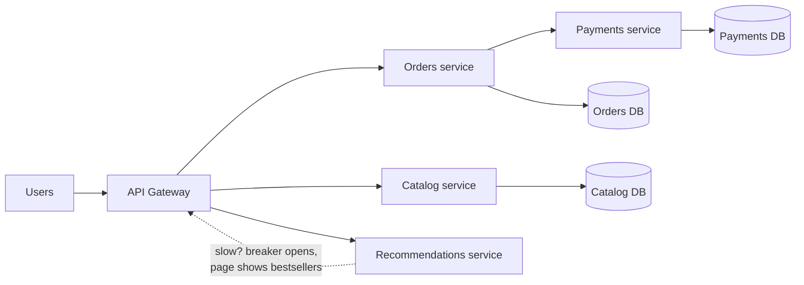

> 💡 **The core insight:** splitting a system doesn't make it reliable. It makes failures *smaller* only if you also add the doors (timeouts, breakers, bulkheads) and the gauges (observability). Without them, microservices fail *more* than a monolith, because now there are more parts and a network between them.

---

## 🔨 Building It Up

### 1. Start with the monolith (it's not a dirty word)

A **monolith** is one application, built and deployed as a single unit. All features (users, catalog, orders, payments) live in one codebase, run in one process, and usually share one database.

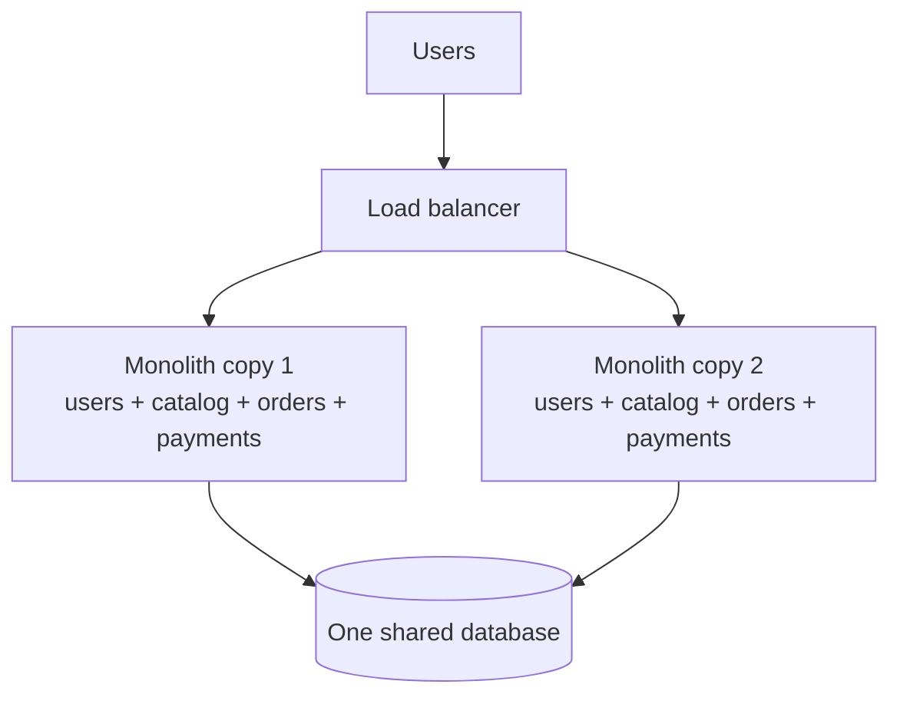

Notice that a monolith **can scale**: you run many identical copies behind a load balancer ([Chapter 02](02-scalability-load-balancing.md)). Shopify, Stack Overflow and Basecamp have run hugely successful businesses on (well-organised) monoliths.

**What's great about a monolith:**
- A function call between "orders" and "payments" takes nanoseconds and never fails because of the network.
- One database means real **transactions**: "create order AND reduce stock" either both happen or neither does ([Chapter 03](03-databases.md)).
- One thing to build, test, deploy, and debug. A stack trace shows the whole story.

**Where it starts to hurt (usually at 50+ engineers, not 5):**
- 200 developers committing to one codebase step on each other. Every deploy contains everyone's changes, so one bug blocks everyone.
- You can't scale parts separately. If image resizing needs 40 CPUs, you must run 40 copies of *everything*.
- One memory leak in a minor feature crashes the whole process.
- You're stuck with one language and one framework version forever.

A good middle step is the **modular monolith**: still one deployable, but the code is split into modules with strict boundaries (the orders module can only call the payments module through a public interface, never touch its tables). If you ever need to split, the seams are already there.

### 2. Microservices: what actually changes

A **microservice** is a small, independently deployable service that owns one business capability *and its data*. "Independently deployable" is the key phrase: the payments team can ship at 3 pm on Tuesday without asking anyone.

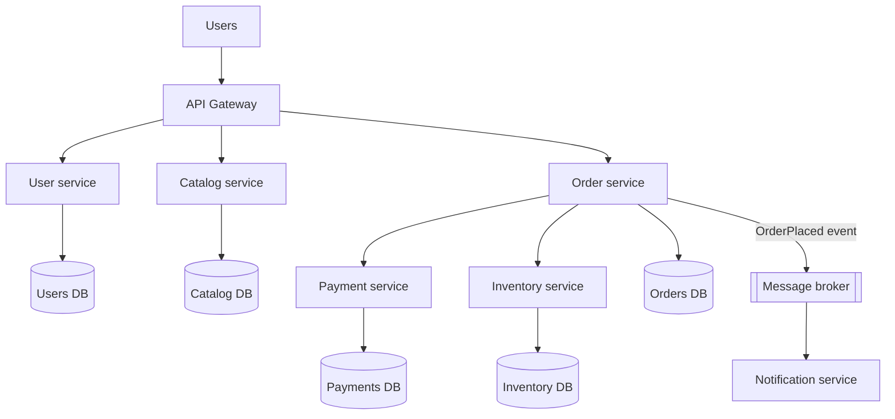

The rule that surprises beginners: **each service owns its database, and nobody else touches it.** If the order service needs a user's email, it asks the user service through its API (or keeps a copy from events). Why so strict? If two services share tables, you can't change one without breaking the other, and you're back to a monolith, except now with network calls. That nightmare has a name: the **distributed monolith**.

### 3. The honest trade-off table

| | Monolith | Microservices |
|---|---|---|
| Call between features | In-process, ~nanoseconds, never "lost" | Network, ~milliseconds, can time out or fail |
| Transactions | Easy, one database | Hard: sagas, outbox, eventual consistency ([Chapter 08](08-queues-events.md)) |
| Deploy | All or nothing; one bad change blocks all | Each service independently, many times a day |
| Scaling | Scale the whole app | Scale only the hot service |
| Fault isolation | One crash can take everything down | A failure *can* be contained (if you build the doors) |
| Team autonomy | Shared codebase, coordination overhead | Teams own services end to end |
| Tech choice | One stack | Each service can pick (but too many stacks is chaos) |
| Debugging | One stack trace, one log file | Need distributed tracing, central logs |
| Testing | Run one app | Contract tests, many moving parts |
| Operational cost | Low | High: CI/CD per service, discovery, mesh, monitoring |
| Best for | Small/medium teams, new products, unclear domains | Large orgs, clear domains, very different scaling needs |

> ⚠️ **The honest truth:** microservices are mainly a solution to an **organisational** problem (many teams working on one product), not a technical one. If you have 6 engineers, a modular monolith will almost always ship faster. Interviewers love hearing you say this, followed by "...and here is when I *would* split."

This idea is known as **Conway's Law**: a system's structure ends up mirroring the communication structure of the organisation that builds it. Companies often use it on purpose (the "inverse Conway manoeuvre"): design team boundaries the way you want service boundaries to look.

### 4. Drawing service boundaries

Bad boundaries are the #1 way microservices go wrong. If placing one order needs 12 synchronous calls across 8 services, your boundaries are wrong.

**Good guidelines:**

1. **Split by business capability, not by technical layer.** "Payments", "Inventory", "Shipping" are good services. "Database service", "Validation service" are bad: every feature would need all of them.
2. **Use bounded contexts** (an idea from Domain-Driven Design). A "Product" means different things to different teams: to the catalog it's a title, images and description; to inventory it's a SKU and stock count; to shipping it's weight and dimensions. Each context gets its own model and its own service. They share only an ID.
3. **High cohesion, low coupling.** Things that change together live together. If every change to orders also needs a change to pricing, maybe they're one service.
4. **Data ownership decides it.** Ask "who is the single source of truth for this data?" That's the owning service.
5. **Avoid chatty boundaries.** If A calls B 50 times per request, merge them or redesign.
6. **Start bigger, split later.** Splitting a service is easier than merging two that have drifted apart.

**Migrating a monolith?** Use the **strangler fig pattern** (named after a vine that slowly grows around a tree). Put a router in front of the monolith. Build one new service (say, notifications), and route just those requests to it. Repeat, feature by feature, until the old monolith has nothing left and can be switched off. No risky "big-bang rewrite".

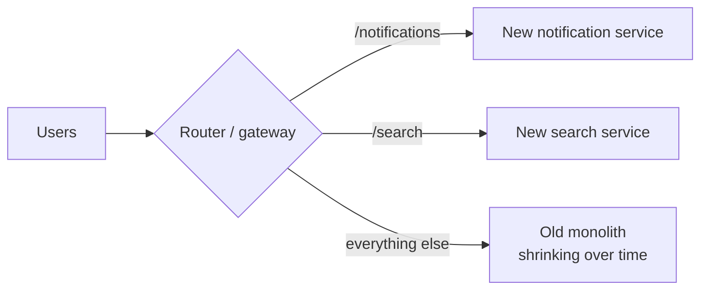

### 5. How services talk to each other

There are two families, and you met both earlier:

| Style | How | Examples | Good for | Danger |
|---|---|---|---|---|
| **Synchronous** request/response | Caller waits for the answer | REST over HTTP, gRPC ([Chapter 07](07-apis-communication.md)) | Reads, "I need the answer now" (price, auth) | Caller is blocked; failures cascade up the chain |
| **Asynchronous** messaging | Caller drops a message and moves on | Kafka, RabbitMQ, SQS ([Chapter 08](08-queues-events.md)) | "Something happened, whoever cares, react" | Eventual consistency, harder to trace |

Rules of thumb:
- Use **gRPC** for internal service-to-service calls where speed matters (binary Protobuf, HTTP/2, generated clients). Use **REST/JSON** for public APIs.
- Prefer **events** for anything that doesn't need an immediate answer: "OrderPlaced" → email, analytics, loyalty points. The order service doesn't need to know these listeners exist.
- Keep synchronous chains **short**. Every hop multiplies latency and failure probability (we'll do the maths in Under the Hood).

A **saga** handles a business transaction across services without one big database transaction: a sequence of local transactions, each with a **compensating action** to undo it if a later step fails ("reserve stock" ↔ "release stock", "charge card" ↔ "refund"). It can be coordinated by a central **orchestrator** or by services reacting to each other's events (**choreography**). [Chapter 08](08-queues-events.md) covers the outbox pattern that makes the events reliable.

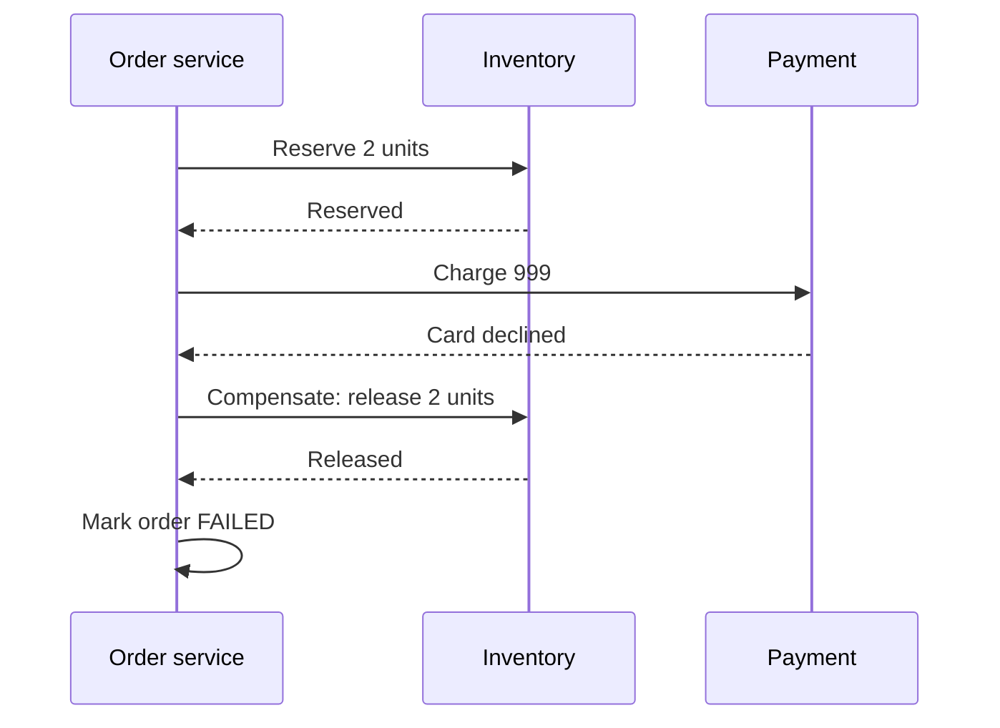

### 6. Service discovery: "where is the payment service right now?"

In the cloud, service instances come and go all the time: autoscaling adds 5, a crash removes 1, a deploy replaces all of them. IP addresses keep changing. Hard-coding `10.0.0.7` in a config file won't survive the afternoon.

**Service discovery** solves this with a **service registry**: a live phone book of `service name → healthy addresses`.

1. When an instance starts, it **registers** itself ("orders is at 10.0.0.1:8080").
2. It sends a **heartbeat** every few seconds. If heartbeats stop, the registry drops it.
3. Callers look up the name and pick one of the healthy addresses.

```python
import itertools

class ServiceRegistry:
    def __init__(self, ttl):
        self.ttl = ttl                       # seconds without heartbeat -> considered dead
        self.instances = {}                  # service -> {address: last_heartbeat}
        self._rr = {}

    def register(self, service, address, now):
        self.instances.setdefault(service, {})[address] = now

    heartbeat = register                     # a heartbeat is just "I'm still here"

    def healthy(self, service, now):
        return sorted(a for a, seen in self.instances.get(service, {}).items()
                      if now - seen <= self.ttl)

    def pick(self, service, now):
        """Client-side load balancing: round robin over healthy instances."""
        alive = self.healthy(service, now)
        if not alive:
            raise LookupError(f"no healthy {service}")
        counter = self._rr.setdefault(service, itertools.count())
        return alive[next(counter) % len(alive)]

reg = ServiceRegistry(ttl=10)
for addr in ("10.0.0.1:8080", "10.0.0.2:8080", "10.0.0.3:8080"):
    reg.register("orders", addr, now=0)

print("t=0 :", [reg.pick("orders", 0) for _ in range(4)])
# Instances 1 and 2 keep heartbeating; instance 3 crashed silently.
reg.heartbeat("orders", "10.0.0.1:8080", now=8)
reg.heartbeat("orders", "10.0.0.2:8080", now=8)
print("t=15 healthy:", reg.healthy("orders", 15))
print("t=15:", [reg.pick("orders", 15) for _ in range(4)])
```

```text
t=0 : ['10.0.0.1:8080', '10.0.0.2:8080', '10.0.0.3:8080', '10.0.0.1:8080']
t=15 healthy: ['10.0.0.1:8080', '10.0.0.2:8080']
t=15: ['10.0.0.1:8080', '10.0.0.2:8080', '10.0.0.1:8080', '10.0.0.2:8080']
```

What just happened: instance 3 crashed without saying goodbye. Its last heartbeat was at t=0, and by t=15 it's older than the 10-second TTL, so the registry quietly stops handing it out. Nobody had to edit a config file.

There are two ways to use the registry:

| | Client-side discovery | Server-side discovery |
|---|---|---|
| Who looks up the registry | The calling service (with a library) | A load balancer / proxy in between |
| Example | Netflix Eureka + client library | Kubernetes Services, AWS ALB, Consul + Envoy |
| Pro | No extra hop; smart client-side balancing | Callers stay dumb; works for any language |
| Con | Every language needs the library | One more hop/component to run |

Real registries: **Consul**, **etcd**, **ZooKeeper**, **Eureka**. Kubernetes has discovery built in: you call `http://orders` and its internal DNS plus a virtual IP route you to a healthy pod. The registry itself must be highly available, which is why etcd and ZooKeeper run consensus (Raft / ZAB, [Chapter 06](06-cap-consistency.md)) across 3 or 5 nodes.

### 7. The API gateway: one front door

If a mobile app had to call 8 services directly, it would need to know 8 addresses, handle 8 auth schemes, and make 8 round trips over a slow phone network. Instead we put an **API gateway** in front: a single entry point that does the boring-but-essential work once.

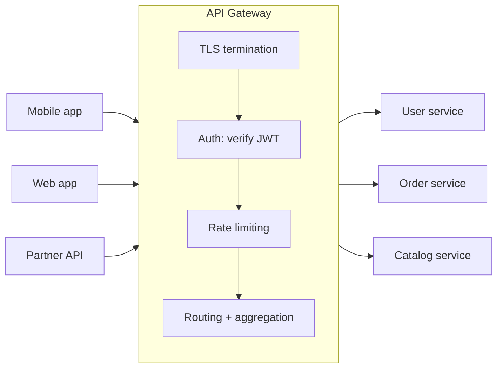

**What a gateway typically does:**
- **Routing**: `/orders/*` → order service, `/users/*` → user service
- **Authentication** (verify the token once, pass the user ID downstream)
- **Rate limiting** and quotas per API key (section 14)
- **TLS termination**, request/response transformation, compression
- **Aggregation**: one client call fans out to 3 services and returns a combined response
- Caching, logging, metrics, request IDs for tracing

**API gateway vs load balancer:** a load balancer spreads traffic across copies of *the same* service (mostly layer 4/7 plumbing). A gateway understands *your API*: users, keys, routes, quotas. In practice a gateway often sits behind or includes a load balancer. Examples: Kong, AWS API Gateway, Apigee, NGINX, Envoy.

**BFF (Backend for Frontend):** a separate small gateway per client type (one for mobile, one for web), because a phone wants a smaller, differently shaped response than a desktop browser.

> ⚠️ Keep business logic **out** of the gateway. It's shared by everyone; if it becomes smart, it becomes a new monolith that every team must change.

### 8. Sidecars and the service mesh

Every service needs the same networking features: retries, timeouts, TLS between services, metrics, tracing. Writing them in every language (Python, Go, Java) is wasteful and inconsistent.

The **sidecar** pattern: run a tiny helper proxy *next to* each service instance (in the same pod / machine). The service talks only to `localhost`; the sidecar handles the real network: encryption, retries, timeouts, metrics. Like a motorbike sidecar: attached, travels everywhere with it, carries the extra luggage.

A **service mesh** is what you get when *every* service has a sidecar and a central **control plane** configures all of them.

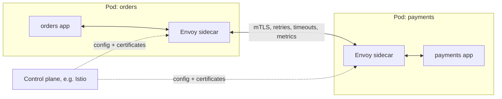

- **Data plane**: the sidecar proxies (usually **Envoy**) that carry the traffic.
- **Control plane**: pushes rules ("payments: 2 s timeout, 3 retries, 5% traffic to v2") and certificates. Examples: **Istio**, **Linkerd**.

**What you get for free:** mutual TLS (every service proves who it is), uniform retries/timeouts/circuit breaking, traffic splitting for canaries, golden metrics for every call, and tracing headers propagated.

**What it costs:** an extra network hop per call (usually a millisecond or less, but not zero), more CPU and memory per pod, and a complex system to learn and operate. Rule of thumb: worth it with dozens of services in several languages; overkill for five.

### 9. Why distributed systems fail: the network is not your friend

Inside one process, a function call either returns or throws. Over a network, there's a third, nastier outcome: **you don't know.** You sent "charge ₹500" and got no reply. Did the request get lost? Did it succeed and the *reply* get lost? Is the server just slow?

The classic **fallacies of distributed computing** (things beginners silently assume, all false):
1. The network is reliable.
2. Latency is zero.
3. Bandwidth is infinite.
4. The network is secure.
5. Topology doesn't change.
6. There is one administrator.
7. Transport cost is zero.
8. The network is homogeneous.

And the most dangerous failure isn't a service that's *down* (that fails fast, you get "connection refused" in a millisecond). It's a service that's **slow**. Here's how a slow service kills everything, a **cascading failure**:

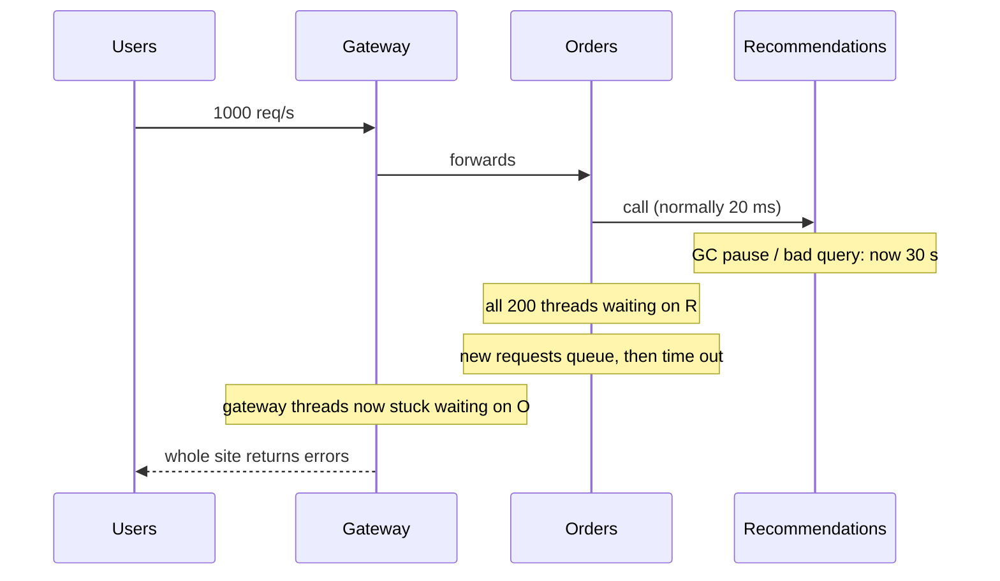

Every thread in Orders is stuck waiting on Recommendations. Orders can't serve *anything*, including requests that don't even need recommendations. Then the gateway's threads pile up waiting on Orders. One slow leaf took down the tree.

The next five sections are the doors that stop the flood: **timeouts, retries, circuit breakers, bulkheads, rate limiting**.

### 10. Timeouts: never wait forever

The first rule of reliability: **every network call gets a timeout.** Many HTTP libraries default to *no timeout* (Python's `requests` waits forever unless you pass `timeout=`). One hung connection then holds a thread forever.

```py
import requests
resp = requests.get("http://inventory/stock/42", timeout=(0.5, 2.0))  # (connect, read) seconds
```

**How to pick the number:** look at the dependency's latency **p99** (the time 99% of calls finish within) and set the timeout a bit above it. If inventory's p99 is 300 ms, a 500 ms timeout is reasonable; 30 seconds is not.

**Deadline propagation.** A user will wait about 1 second. If the gateway gives up after 1 s but the services behind it each have their own 5 s timeouts, they keep working on a request nobody is waiting for anymore. The fix: pass a **deadline** (the remaining time budget) along with the request, and let each hop check it. gRPC does this natively.

```python
class DeadlineExceeded(Exception):
    pass

def call(service_name, cost_ms, remaining_ms):
    """Each hop checks the remaining budget before doing work."""
    if cost_ms > remaining_ms:
        raise DeadlineExceeded(f"{service_name} needs {cost_ms} ms, only {remaining_ms} ms left")
    print(f"  {service_name:<10} took {cost_ms:>3} ms, {remaining_ms - cost_ms:>3} ms left")
    return remaining_ms - cost_ms

def handle_request(budget_ms, costs):
    remaining = budget_ms
    try:
        for name, cost in costs:
            remaining = call(name, cost, remaining)
        print("  -> response sent")
    except DeadlineExceeded as e:
        print("  -> give up early:", e)

print("Normal day (budget 500 ms):")
handle_request(500, [("gateway", 10), ("orders", 120), ("inventory", 90), ("pricing", 60)])
print("Inventory is slow today:")
handle_request(500, [("gateway", 10), ("orders", 120), ("inventory", 340), ("pricing", 60)])
```

```text
Normal day (budget 500 ms):
  gateway    took  10 ms, 490 ms left
  orders     took 120 ms, 370 ms left
  inventory  took  90 ms, 280 ms left
  pricing    took  60 ms, 220 ms left
  -> response sent
Inventory is slow today:
  gateway    took  10 ms, 490 ms left
  orders     took 120 ms, 370 ms left
  inventory  took 340 ms,  30 ms left
  -> give up early: pricing needs 60 ms, only 30 ms left
```

What just happened: on the slow day, pricing is never even called, because there's no way to finish in time. That saves pricing from doing useless work and frees resources immediately. (In real life you don't know the cost in advance; each hop simply sets its own timeout to `min(own_timeout, remaining_deadline)`.)

### 11. Retries with exponential backoff and jitter

Many failures are **transient**: a packet dropped, a pod restarting, a brief overload. Retrying often succeeds. But naive retries are dangerous: if a service is struggling because it's overloaded, and every client instantly retries 3 times, you just **quadrupled** its load. That's a **retry storm**, and it turns a hiccup into an outage.

Three rules make retries safe:

1. **Only retry what's safe to retry.** Transient errors (timeouts, 503, 429, connection reset), yes. A 400 "bad request" will fail forever, so don't. And only retry operations that are **idempotent** (section 16), or a retried "charge card" charges twice.
2. **Back off exponentially.** Wait 100 ms, then 200, 400, 800... giving the service room to recover. Always cap the wait and the number of attempts.
3. **Add jitter (randomness).** Without it, 10,000 clients that failed at the same moment all retry at exactly 100 ms, then all at 200 ms, hitting the server in synchronised waves (the **thundering herd**). Jitter spreads them out.

The popular **"full jitter"** formula: `wait = random(0, min(cap, base × 2^attempt))`.

```python
import random

def backoff_delays(attempts, base=0.1, cap=5.0, rng=None):
    """Return the wait before each retry, using 'full jitter'."""
    delays = []
    for attempt in range(attempts):
        ceiling = min(cap, base * (2 ** attempt))   # 0.1, 0.2, 0.4, 0.8 ...
        delays.append(round(rng.uniform(0, ceiling), 3))
    return delays

rng = random.Random(42)
print("no jitter :", [min(5.0, 0.1 * 2 ** a) for a in range(6)])
print("client A  :", backoff_delays(6, rng=rng))
print("client B  :", backoff_delays(6, rng=rng))
```

```text
no jitter : [0.1, 0.2, 0.4, 0.8, 1.6, 3.2]
client A  : [0.064, 0.005, 0.11, 0.179, 1.178, 2.165]
client B  : [0.089, 0.017, 0.169, 0.024, 0.35, 1.617]
```

What just happened: without jitter, every client would wait exactly 0.1, 0.2, 0.4 s, all in lockstep. With jitter, clients A and B pick different random waits under the same growing ceiling, so their retries no longer collide.

Now a full retry wrapper against a flaky fake service. We add up the waits instead of really sleeping, so the demo is instant:

```python
import random

class TransientError(Exception):
    pass

class FlakyService:
    """Fails the first `failures` calls, then succeeds."""
    def __init__(self, failures):
        self.failures = failures
        self.calls = 0

    def get_price(self, item):
        self.calls += 1
        if self.calls <= self.failures:
            raise TransientError(f"503 on call {self.calls}")
        return 499

def call_with_retry(fn, *args, max_attempts=4, base=0.1, cap=2.0, seed=7):
    rng = random.Random(seed)
    total_wait = 0.0
    for attempt in range(max_attempts):
        try:
            result = fn(*args)
            print(f"  attempt {attempt + 1}: success -> {result}")
            return result, round(total_wait, 3)
        except TransientError as err:
            if attempt == max_attempts - 1:
                print(f"  attempt {attempt + 1}: {err}, giving up")
                raise
            wait = rng.uniform(0, min(cap, base * 2 ** attempt))
            total_wait += wait        # a real client would time.sleep(wait) here
            print(f"  attempt {attempt + 1}: {err}, retrying in {wait:.3f}s")

print("Service that fails twice:")
print(call_with_retry(FlakyService(failures=2).get_price, "book"))

print("Service that fails five times:")
try:
    call_with_retry(FlakyService(failures=5).get_price, "book")
except TransientError as err:
    print("  caller sees:", err)
```

```text
Service that fails twice:
  attempt 1: 503 on call 1, retrying in 0.032s
  attempt 2: 503 on call 2, retrying in 0.030s
  attempt 3: success -> 499
(499, 0.063)
Service that fails five times:
  attempt 1: 503 on call 1, retrying in 0.032s
  attempt 2: 503 on call 2, retrying in 0.030s
  attempt 3: 503 on call 3, retrying in 0.260s
  attempt 4: 503 on call 4, giving up
  caller sees: 503 on call 4
```

What just happened: a brief glitch (2 failures) was invisible to the caller. A real outage (5 failures) was given up on after 4 attempts, so the caller can fail fast or degrade instead of hanging.

**Two more retry protections used in production:**
- **Retry budget**: retries may add at most, say, 10% extra traffic. If more than 10% of calls are already retries, stop retrying. Google's SRE book and gRPC use this idea.
- **Retry at one layer only.** If the gateway, orders, and inventory clients *each* retry 3 times, one user click can become 3 × 3 × 3 = 27 calls at the bottom. Pick one layer (usually closest to the failure, or at the edge) to retry.
- Respect the server's **`Retry-After`** header on 429/503 responses.

### 12. Circuit breaker: stop calling the broken thing

Retries help with blips. But if the payment service is *really* down, retrying every request just wastes time and keeps hammering a service that's trying to restart. A **circuit breaker** works like the electrical breaker in your house: when there's a fault, it trips, cutting off the flow, so the house doesn't burn.

It has three states:

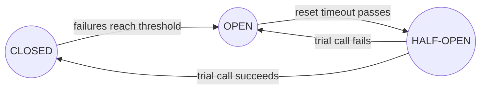

- **CLOSED** (normal): calls flow through. Count failures.
- **OPEN** (tripped): don't even try. **Fail fast** in microseconds, return a fallback. This gives the sick service breathing room and frees your threads.
- **HALF-OPEN** (testing): after a cool-down, let one (or a few) trial requests through. Success → CLOSED. Failure → OPEN again.

```python
class CircuitOpenError(Exception):
    pass

class CircuitBreaker:
    def __init__(self, failure_threshold=3, reset_timeout=10.0):
        self.failure_threshold = failure_threshold
        self.reset_timeout = reset_timeout
        self.state = "CLOSED"
        self.failures = 0
        self.opened_at = None

    def call(self, fn, now):
        if self.state == "OPEN":
            if now - self.opened_at >= self.reset_timeout:
                self.state = "HALF_OPEN"          # let ONE trial request through
            else:
                raise CircuitOpenError("fail fast: circuit is open")
        try:
            result = fn()
        except Exception:
            self._on_failure(now)
            raise
        self._on_success()
        return result

    def _on_failure(self, now):
        self.failures += 1
        if self.state == "HALF_OPEN" or self.failures >= self.failure_threshold:
            self.state = "OPEN"
            self.opened_at = now

    def _on_success(self):
        self.state = "CLOSED"
        self.failures = 0

# A fake downstream that is broken between t=0 and t=15
def make_downstream(clock):
    def payment_service():
        if clock["t"] < 15:
            raise ConnectionError("payment service down")
        return "paid"
    return payment_service

clock = {"t": 0}
breaker = CircuitBreaker(failure_threshold=3, reset_timeout=10)
service = make_downstream(clock)

for t in [0, 1, 2, 3, 5, 12, 13, 23, 24]:
    clock["t"] = t
    try:
        outcome = breaker.call(service, now=t)
    except CircuitOpenError as e:
        outcome = str(e)
    except ConnectionError as e:
        outcome = f"error: {e}"
    print(f"t={t:>2}  {breaker.state:<9} {outcome}")
```

```text
t= 0  CLOSED    error: payment service down
t= 1  CLOSED    error: payment service down
t= 2  OPEN      error: payment service down
t= 3  OPEN      fail fast: circuit is open
t= 5  OPEN      fail fast: circuit is open
t=12  OPEN      error: payment service down
t=13  OPEN      fail fast: circuit is open
t=23  CLOSED    paid
t=24  CLOSED    paid
```

**Trace it:**

| t | What happened | State after |
|---|---|---|
| 0, 1 | Real calls fail (failures = 1, 2) | CLOSED |
| 2 | Third failure hits the threshold → trip | OPEN (opened at 2) |
| 3, 5 | Within 10 s of opening: rejected instantly, service not called | OPEN |
| 12 | 10 s passed → HALF_OPEN, one trial call... still down | OPEN (opened at 12) |
| 13 | Rejected instantly | OPEN |
| 23 | 11 s since 12 → trial call succeeds (service recovered at 15) | CLOSED |

Production breakers (Resilience4j in Java, Polly in .NET, `pybreaker` in Python, or the service mesh) usually trip on a **failure rate over a sliding window** (e.g. "more than 50% of the last 100 calls failed, with at least 20 calls") rather than a raw count, and treat slow calls as failures too.

> 💡 **Retry vs circuit breaker:** retry says "try again, it's probably a blip." The breaker says "stop, it's clearly broken." Use both: the retry goes *inside* the breaker, so once the breaker opens, no retries happen.

### 13. Bulkheads: don't let one leak sink the ship

Back to the ship. A **bulkhead** limits how much of your resources any single dependency can use. If your service has 10 worker threads and all of them can be grabbed by calls to slow recommendations, checkout starves. Give each dependency its own small pool (or a cap on concurrent calls), and a slow dependency can only exhaust *its own* pool.

```python
class Bulkhead:
    """A fixed number of 'seats' per dependency. No seat -> reject immediately."""
    def __init__(self, name, max_concurrent):
        self.name, self.max_concurrent, self.in_use = name, max_concurrent, 0

    def try_enter(self):
        if self.in_use < self.max_concurrent:
            self.in_use += 1
            return True
        return False

    def leave(self):
        self.in_use -= 1

# 10 worker threads total. Without bulkheads, a slow recommendations service
# can grab all 10 and checkout starves. With bulkheads: 4 + 6.
pools = {"recommendations": Bulkhead("recommendations", 4),
         "checkout": Bulkhead("checkout", 6)}

# Recommendations is hanging, so every request to it holds its seat.
rejected = 0
for _ in range(20):
    if not pools["recommendations"].try_enter():
        rejected += 1        # fail fast, show "no recommendations" instead
print("recommendation calls stuck:", pools["recommendations"].in_use, "| rejected fast:", rejected)

served = 0
for _ in range(6):
    if pools["checkout"].try_enter():
        served += 1
        pools["checkout"].leave()
print("checkout requests still served:", served, "of 6")
```

```text
recommendation calls stuck: 4 | rejected fast: 16
checkout requests still served: 6 of 6
```

What just happened: the hung dependency could only trap 4 "seats". The other 16 recommendation calls were rejected instantly (and the page could show a fallback), while checkout, the thing that earns money, kept working. In real code a bulkhead is a `threading.Semaphore`, a separate thread pool, or a connection-pool limit per downstream. At a bigger scale, bulkheads are separate **clusters** per customer tier or region ("cell-based architecture"), so one bad tenant can't hurt everyone.

### 14. Rate limiting: five algorithms

**Rate limiting** caps how many requests a client may make in a time period: "100 requests per minute per API key". Why?
- Protect services from overload, bugs (a client stuck in a loop), and abuse (scraping, brute-force logins, DDoS).
- Fairness: one big customer shouldn't starve everyone else.
- Cost control and business plans ("free tier: 1,000 calls/day").

When a client is over the limit, the server answers **HTTP 429 Too Many Requests**, usually with headers like `Retry-After: 30` and `X-RateLimit-Remaining: 0`. Limits are keyed by user ID, API key, or IP address, and usually enforced at the API gateway.

Here are the five classic algorithms. All demos use fake timestamps so they're instant and deterministic.

#### 14a. Token bucket (the most popular)

A bucket holds up to `capacity` tokens. Tokens drip in at `refill_rate` per second. Each request takes one token; no token, no entry. A full bucket allows a **burst** of `capacity` requests, then the long-run rate is the refill rate. Used by AWS API Gateway, Stripe, and most cloud APIs.

```python
class TokenBucket:
    def __init__(self, capacity, refill_rate):
        self.capacity = capacity          # max burst size
        self.refill_rate = refill_rate    # tokens added per second
        self.tokens = capacity            # start full
        self.last = 0.0

    def allow(self, now):
        # Lazy refill: add the tokens earned since we last looked.
        elapsed = now - self.last
        self.tokens = min(self.capacity, self.tokens + elapsed * self.refill_rate)
        self.last = now
        if self.tokens >= 1:
            self.tokens -= 1
            return True
        return False

bucket = TokenBucket(capacity=3, refill_rate=1)   # burst of 3, then 1 req/sec
times = [0.0, 0.1, 0.2, 0.3, 0.4, 1.4, 1.5, 3.5, 3.6, 3.7, 3.8]
for t in times:
    print(f"t={t:<4} {'ALLOW' if bucket.allow(t) else 'deny '}  tokens left={bucket.tokens:.1f}")
```

```text
t=0.0  ALLOW  tokens left=2.0
t=0.1  ALLOW  tokens left=1.1
t=0.2  ALLOW  tokens left=0.2
t=0.3  deny   tokens left=0.3
t=0.4  deny   tokens left=0.4
t=1.4  ALLOW  tokens left=0.4
t=1.5  deny   tokens left=0.5
t=3.5  ALLOW  tokens left=1.5
t=3.6  ALLOW  tokens left=0.6
t=3.7  deny   tokens left=0.7
t=3.8  deny   tokens left=0.8
```

What just happened: the first 3 requests burst through on a full bucket. Then the bucket is nearly empty and fills at 1 token/second, so requests are allowed only as tokens earn back. Notice we never run a background timer: we compute the refill **lazily** from the elapsed time when a request arrives. That's why a token bucket needs only two numbers per user (`tokens`, `last`), which makes it cheap to store in Redis for millions of users.

#### 14b. Leaky bucket

Requests pour into a queue (the bucket) and "leak" out to be processed at a **fixed, steady rate**. If the queue is full, new requests spill over and are dropped. Where the token bucket allows bursts *through*, the leaky bucket **smooths** them into a constant stream. Good when the thing behind you needs a steady pace (e.g. an SMS provider that accepts 2 messages per second). NGINX's `limit_req` is based on it.

```python
from collections import deque

class LeakyBucket:
    """A queue of fixed size that drains (processes) at a constant rate."""
    def __init__(self, capacity, leak_rate):
        self.capacity = capacity
        self.leak_rate = leak_rate        # requests processed per second
        self.queue = deque()
        self.last_leak = 0.0
        self.processed = []

    def _leak(self, now):
        # How many whole requests could have drained since last_leak?
        can_drain = int((now - self.last_leak) * self.leak_rate)
        if can_drain > 0:
            for _ in range(min(can_drain, len(self.queue))):
                self.processed.append(self.queue.popleft())
            self.last_leak += can_drain / self.leak_rate

    def submit(self, request_id, now):
        self._leak(now)
        if len(self.queue) < self.capacity:
            self.queue.append(request_id)
            return True
        return False                      # bucket overflowing: drop

bucket = LeakyBucket(capacity=3, leak_rate=2)     # 2 req/sec out, queue of 3
for i, t in enumerate([0.0, 0.0, 0.0, 0.0, 0.0, 0.6, 1.0, 1.0]):
    ok = bucket.submit(f"r{i}", t)
    print(f"t={t}  r{i} {'queued ' if ok else 'DROPPED'}  queue={list(bucket.queue)}")
bucket._leak(3.0)
print("processed by t=3.0:", bucket.processed)
```

```text
t=0.0  r0 queued   queue=['r0']
t=0.0  r1 queued   queue=['r0', 'r1']
t=0.0  r2 queued   queue=['r0', 'r1', 'r2']
t=0.0  r3 DROPPED  queue=['r0', 'r1', 'r2']
t=0.0  r4 DROPPED  queue=['r0', 'r1', 'r2']
t=0.6  r5 queued   queue=['r1', 'r2', 'r5']
t=1.0  r6 queued   queue=['r2', 'r5', 'r6']
t=1.0  r7 DROPPED  queue=['r2', 'r5', 'r6']
processed by t=3.0: ['r0', 'r1', 'r2', 'r5', 'r6']
```

What just happened: a burst of 5 arrived at once; 3 fit in the queue, 2 spilled. Every half second one request leaked out for processing, making room. The output rate is perfectly steady no matter how bursty the input. The downside: queued requests wait (added latency), and a burst of old requests can block fresh ones.

#### 14c, 14d, 14e. The window family: fixed window, sliding log, sliding window counter

**Fixed window counter:** chop time into windows (e.g. each minute) and keep one counter per window. Simple: one integer per user, an `INCR` in Redis. The flaw is the **boundary burst**: a client can send the full limit at 0:59 and again at 1:01, getting **2× the limit in 2 seconds**.

**Sliding log:** store the timestamp of every accepted request. On each request, drop timestamps older than the window, and count what's left. Perfectly accurate, but stores one entry per request, so memory is O(limit) per user. Expensive at high limits.

**Sliding window counter:** the clever compromise. Keep only two counters, the current window and the previous one, and *estimate* the requests in the last 60 seconds by weighting the previous window by how much of it still overlaps:

```text
estimate = previous_count × (1 − elapsed_in_current / window) + current_count
```

Let's attack all three with the boundary burst:

```python
from collections import deque

class FixedWindow:
    def __init__(self, limit, window):
        self.limit, self.window = limit, window
        self.current_window, self.count = None, 0

    def allow(self, now):
        w = int(now // self.window)            # which window are we in?
        if w != self.current_window:
            self.current_window, self.count = w, 0
        if self.count < self.limit:
            self.count += 1
            return True
        return False

class SlidingLog:
    def __init__(self, limit, window):
        self.limit, self.window = limit, window
        self.log = deque()                     # timestamps of accepted requests

    def allow(self, now):
        while self.log and self.log[0] <= now - self.window:
            self.log.popleft()                 # forget requests older than the window
        if len(self.log) < self.limit:
            self.log.append(now)
            return True
        return False

class SlidingWindowCounter:
    def __init__(self, limit, window):
        self.limit, self.window = limit, window
        self.curr_start, self.curr_count, self.prev_count = 0, 0, 0

    def allow(self, now):
        start = int(now // self.window) * self.window
        if start != self.curr_start:
            # Moved into a new window. If we skipped a whole window, prev is 0.
            self.prev_count = self.curr_count if start - self.curr_start == self.window else 0
            self.curr_start, self.curr_count = start, 0
        overlap = 1 - (now - start) / self.window   # share of previous window still "inside"
        estimate = self.prev_count * overlap + self.curr_count
        if estimate < self.limit:
            self.curr_count += 1
            return True
        return False

# Limit: 5 requests per 60 s. A sneaky client fires 5 at t=59 and 5 at t=61.
burst = [59.0] * 5 + [61.0] * 5
for limiter in (FixedWindow(5, 60), SlidingLog(5, 60), SlidingWindowCounter(5, 60)):
    accepted = sum(limiter.allow(t) for t in burst)
    print(f"{type(limiter).__name__:<21} accepted {accepted} of 10 within 2 seconds")
```

```text
FixedWindow           accepted 10 of 10 within 2 seconds
SlidingLog            accepted 5 of 10 within 2 seconds
SlidingWindowCounter  accepted 6 of 10 within 2 seconds
```

What just happened:
- **Fixed window** was fooled completely: t=59 is in window 0, t=61 is in window 1, fresh counter, 10 accepted (double the limit).
- **Sliding log** was exact: at t=61, the five t=59 timestamps are still within the last 60 s, so nothing more is allowed.
- **Sliding window counter** estimated: at t=61 we're 1 s into the new window, so the previous window counts 5 × (59/60) ≈ 4.92. That's under 5, so one request slipped through; then 5.92 is over. Slightly generous, but with only two integers of memory. Cloudflare reported that this approximation was very close to exact on their real traffic, which is why it's a favourite at scale.

#### Rate limiters compared

| Algorithm | Memory per key | Bursts | Accuracy | Use when |
|---|---|---|---|---|
| Token bucket | 2 numbers | Allows bursts up to capacity | Good | General API limits; you want to allow short bursts (most common answer) |
| Leaky bucket | Queue up to capacity | Smooths bursts out | Good | Downstream needs a steady rate (SMS, payments partner) |
| Fixed window | 1 counter | Up to 2× at boundaries | Weakest | Simple quotas ("10,000 per day") where edges don't matter |
| Sliding log | 1 timestamp per request | None | Exact | Low limits where precision matters (login attempts) |
| Sliding window counter | 2 counters | Tiny overshoot | Very close | High-traffic APIs needing accuracy and low memory |

**Distributed rate limiting:** with 20 gateway servers, each can't keep its own counter (a user would get 20× the limit). Store counters centrally in **Redis**, and do the read-check-update **atomically** (a Lua script or `INCR` + `EXPIRE`), or two servers can both read "4" and both allow the 5th request. To save a Redis round trip on every request, some systems keep local counters and sync periodically, accepting slight inaccuracy. We design a full distributed rate limiter in [Chapter 12](12-case-studies-1.md).

### 15. Load shedding and graceful degradation

When demand is more than you can serve, you have two choices: **everyone** gets a slow, broken experience, or **some** requests are rejected quickly so the rest work perfectly. Always choose the second.

**Load shedding** = deliberately dropping excess work. A server watches its own health (queue length, CPU, in-flight requests) and returns a quick 503 when overloaded. Smart shedding drops the *least important* traffic first: background sync and prefetch before checkout; free tier before paid; requests that have already waited longer than the client's timeout (the client gave up anyway!).

**Graceful degradation** = when a non-critical dependency fails, serve a reduced version of the page instead of an error. Decide in advance what's **core** (must work) and what's **optional**:

```python
class ServiceDown(Exception):
    pass

def recommendations_service(user):
    raise ServiceDown("recommendations timed out")

def reviews_service(product):
    return ["Great phone!", "Battery lasts 2 days"]

POPULAR_FALLBACK = ["Bestseller #1", "Bestseller #2"]   # precomputed, cached list

def product_page(user, product):
    page = {"product": product, "price": 19999}          # the CORE: must work
    try:
        page["recommended"] = recommendations_service(user)
    except ServiceDown:
        page["recommended"] = POPULAR_FALLBACK            # degrade: generic list
    try:
        page["reviews"] = reviews_service(product)
    except ServiceDown:
        page["reviews"] = []                              # degrade: hide section
    return page

print(product_page("asha", "Phone X"))
```

```text
{'product': 'Phone X', 'price': 19999, 'recommended': ['Bestseller #1', 'Bestseller #2'], 'reviews': ['Great phone!', 'Battery lasts 2 days']}
```

What just happened: personalised recommendations failed, so the user saw bestsellers instead. They can still buy the phone. Real-world examples: Netflix shows a generic "Popular on Netflix" row when personalisation is down; a feed can serve slightly stale cached content; a search page can turn off spell-correction under heavy load.

**Fallback options, from best to worst:** cached (stale) data → a sensible default → hide the feature → a friendly error for just that part.

### 16. Idempotency: safe to do twice

An operation is **idempotent** if doing it twice has the same effect as doing it once. `SET balance = 100` is idempotent. `ADD 100 to balance` is not.

Why it matters: in section 9 we saw that after a timeout **you don't know** if the request succeeded. The only safe way to retry is if the retry can't cause damage. HTTP methods: `GET`, `PUT`, `DELETE` are meant to be idempotent; `POST` is not.

So how do you make "charge the card" (a POST) safe to retry? With an **idempotency key**: the client generates a unique ID (a UUID) for the *intent* ("pay for order 9917"), sends it with every attempt, and the server remembers which keys it has already processed. Stripe's API works exactly like this, using an `Idempotency-Key` header.

```python
import uuid

class PaymentService:
    def __init__(self):
        self.processed = {}        # idempotency_key -> stored response
        self.balance_charged = 0

    def charge(self, idempotency_key, amount):
        if idempotency_key in self.processed:
            return self.processed[idempotency_key] + " (replayed)"
        self.balance_charged += amount
        response = f"charged {amount}"
        self.processed[idempotency_key] = response
        return response

svc = PaymentService()
key = str(uuid.UUID(int=12345))   # fixed for a deterministic demo; real code: uuid.uuid4()

# The client sends, the response is lost on the network, so it retries twice.
for attempt in range(3):
    print(f"attempt {attempt + 1}:", svc.charge(key, 500))
print("total charged:", svc.balance_charged)
```

```text
attempt 1: charged 500
attempt 2: charged 500 (replayed)
attempt 3: charged 500 (replayed)
total charged: 500
```

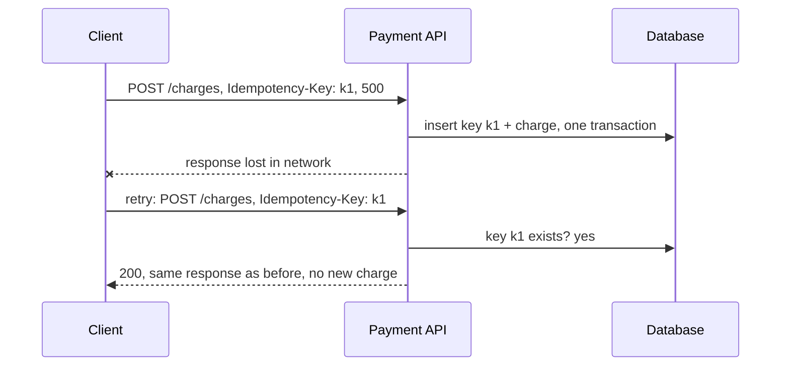

**Production details that interviewers probe:**
- Store the key and the result **in the same database transaction** as the side effect, or a crash between "charge" and "save key" breaks the guarantee. A `UNIQUE` constraint on the key column makes concurrent duplicates fail safely.
- Two copies of the same request can arrive **at the same time**. Insert the key first with status `IN_PROGRESS`; the second request sees it and waits or gets a 409 Conflict.
- Keys expire after a while (Stripe keeps them for 24 hours).
- Message consumers need the same idea, since queues usually deliver "at least once" ([Chapter 08](08-queues-events.md)): record processed message IDs, or make the update naturally idempotent (`UPDATE ... SET status='PAID' WHERE status='PENDING'`).

### 17. Observability: logs, metrics, traces

A monolith crashes and you read one log file. With 40 services, a user says "checkout was slow at 9:03" and the request touched 7 services on 30 machines. **Observability** is how well you can understand what's happening inside a system from what it outputs. Its three pillars:

| Pillar | What it is | Answers | Tools |
|---|---|---|---|
| **Logs** | Timestamped records of events | "What exactly happened to *this* request?" | ELK (Elasticsearch, Logstash, Kibana), Loki, Splunk |
| **Metrics** | Numbers aggregated over time | "How is the system doing *overall*? Is it getting worse?" | Prometheus + Grafana, Datadog, CloudWatch |
| **Traces** | The path of one request across services, with timings | "*Where* did this slow request spend its time?" | Jaeger, Zipkin, Tempo, OpenTelemetry |

**Logs: make them structured.** `"payment failed for user 42"` is hard to search. JSON with fields is easy to filter: `{"level":"ERROR","service":"payments","user_id":42,"trace_id":"abc123","msg":"card declined"}`. Ship all logs to one central place. Log levels (DEBUG, INFO, WARN, ERROR) control noise. Never log passwords, card numbers or tokens.

**Metrics: the golden signals.** Google's SRE book names four things to watch for every service:
1. **Latency**: how long requests take (track success and error latency separately)
2. **Traffic**: requests per second
3. **Errors**: the rate of failed requests
4. **Saturation**: how "full" you are (CPU, memory, queue depth, connection pool)

(Two related checklists: **RED** = Rate, Errors, Duration, for services; **USE** = Utilisation, Saturation, Errors, for resources like disks and CPUs.)

**Never trust the average latency.** Use **percentiles**: p50 (median), p95, p99. Watch what averages hide:

```python
import random

rng = random.Random(1)
# 1,000 request latencies: most are fast, 2% hit a slow database path.
latencies = [rng.gauss(80, 15) if rng.random() > 0.02 else rng.gauss(1500, 200)
             for _ in range(1000)]

def percentile(values, p):
    ordered = sorted(values)
    index = min(len(ordered) - 1, int(round(p / 100 * len(ordered))) - 1)
    return ordered[max(index, 0)]

print(f"average : {sum(latencies) / len(latencies):7.1f} ms")
for p in (50, 90, 99, 99.9):
    print(f"p{p:<5}  : {percentile(latencies, p):7.1f} ms")
```

```text
average :   107.1 ms
p50     :    78.9 ms
p90     :    99.6 ms
p99     :  1579.3 ms
p99.9   :  1929.2 ms
```

What just happened: the average says "107 ms, all fine." The p99 says 1 in 100 users waits **1.5 seconds**. That's the user who complains on Twitter, and on a busy site it's thousands of people an hour. Also notice the average (107) describes *nobody*: almost everyone is at ~80 ms and a few are at ~1,500 ms. Percentiles show the real shape.

**Traces: follow one request.** The edge (gateway) creates a **trace ID** and passes it in a header (the W3C `traceparent` standard) to every service it calls; they pass it on. Each unit of work records a **span**: name, start, duration, and parent span. Put the spans together and you get a waterfall:

```python
import json

class Tracer:
    def __init__(self):
        self.spans = []
        self._next = 0

    def span(self, trace_id, name, parent, start_ms, end_ms):
        self._next += 1
        span_id = f"s{self._next}"
        self.spans.append({"trace_id": trace_id, "span_id": span_id, "parent": parent,
                           "name": name, "start": start_ms, "ms": end_ms - start_ms})
        return span_id

t = Tracer()
trace = "abc123"                     # created at the edge, passed in a header to every hop
root = t.span(trace, "GET /checkout (gateway)", None, 0, 480)
cart = t.span(trace, "cart-service", root, 5, 40)
pay = t.span(trace, "payment-service", root, 45, 470)
t.span(trace, "fraud-check", pay, 50, 430)
t.span(trace, "bank API", pay, 432, 465)

# A waterfall view: indentation = parent/child, bar length = duration
depth = {None: -1}
for s in t.spans:
    depth[s["span_id"]] = depth[s["parent"]] + 1
    bar = " " * (s["start"] // 20) + "#" * max(1, s["ms"] // 20)
    print(f"{'  ' * depth[s['span_id']] + s['name']:<28}{s['ms']:>4} ms |{bar}")

slowest_leaf = max((s for s in t.spans if s["name"] in ("cart-service", "fraud-check", "bank API")),
                   key=lambda s: s["ms"])
print("\nbottleneck:", slowest_leaf["name"])
print("structured log line:", json.dumps({"level": "WARN", "trace_id": trace,
      "service": "payment-service", "msg": "slow fraud check", "ms": slowest_leaf["ms"]}))
```

```text
GET /checkout (gateway)      480 ms |########################
  cart-service                35 ms |#
  payment-service            425 ms |  #####################
    fraud-check              380 ms |  ###################
    bank API                  33 ms |                     #

bottleneck: fraud-check
structured log line: {"level": "WARN", "trace_id": "abc123", "service": "payment-service", "msg": "slow fraud check", "ms": 380}
```

What just happened: one look at the waterfall says "checkout is slow because fraud-check takes 380 of the 480 ms." And because the log line carries the same `trace_id`, you can jump from the trace straight to that service's logs for this exact request. **Connecting the three pillars via the trace ID** is the real superpower. **OpenTelemetry** is the vendor-neutral standard for producing all three.

**Alerting:** alert on **symptoms users feel** (error rate, latency SLO breached), not on every cause (CPU at 80%). Every page that wakes an engineer at 3 am must be urgent and actionable, or people start ignoring alerts ("alert fatigue").

### 18. SLI, SLO, SLA and error budgets

These three acronyms get mixed up constantly. Here's the clean version:

| Term | Meaning | Example | Who cares |
|---|---|---|---|
| **SLI** (Indicator) | A *measurement* of service health | "% of checkout requests that succeed in under 300 ms" | Engineers |
| **SLO** (Objective) | A *target* for an SLI over a period | "99.9% of checkout requests succeed in under 300 ms, over 30 days" | Engineers + product |
| **SLA** (Agreement) | A *contract* with customers, with a penalty if broken | "99.9% monthly uptime or we refund 10% of your bill" | Customers, lawyers |

The SLA is always looser than the SLO (e.g. SLO 99.95%, SLA 99.9%), so you notice and fix trouble before you owe money.

**The nines**, and how much downtime each allows:

```python
def error_budget(slo_percent, days=30):
    minutes = days * 24 * 60
    allowed_bad = minutes * (100 - slo_percent) / 100
    return allowed_bad

for slo in (99.0, 99.9, 99.95, 99.99, 99.999):
    m = error_budget(slo)
    print(f"SLO {slo:>7}%  -> downtime budget per 30 days: {m:8.1f} min ({m / 60:5.2f} h)")

# Budget burn: an SLO of 99.9% over 1,000,000 requests this month
slo, total, failed = 99.9, 1_000_000, 650
budget = total * (100 - slo) / 100
print(f"\nbudget = {budget:.0f} failed requests, used = {failed} ({failed / budget:.0%})")
print("decision:", "keep shipping" if failed < budget else "freeze features, fix reliability")
```

```text
SLO    99.0%  -> downtime budget per 30 days:    432.0 min ( 7.20 h)
SLO    99.9%  -> downtime budget per 30 days:     43.2 min ( 0.72 h)
SLO   99.95%  -> downtime budget per 30 days:     21.6 min ( 0.36 h)
SLO   99.99%  -> downtime budget per 30 days:      4.3 min ( 0.07 h)
SLO  99.999%  -> downtime budget per 30 days:      0.4 min ( 0.01 h)

budget = 1000 failed requests, used = 650 (65%)
decision: keep shipping
```

(That last 0.4 minutes is about **26 seconds** a month for "five nines". No human can even log in to fix something that fast; five nines needs fully automatic failover.)

**The error budget** is the clever part. If your SLO is 99.9%, then 0.1% failure is *allowed*. That 0.1% is a budget you can **spend**: on risky deploys, experiments, planned maintenance. While budget remains, ship fast. When it's used up, freeze feature launches and spend the time on reliability. This turns the eternal fight between "developers want to ship" and "operations want stability" into a number both sides agreed on.

> 💡 100% is the wrong target. It's impossibly expensive, and users can't tell 99.99% from 100% because their own Wi-Fi and phone fail more often than that.

### 19. Deploying without fear

Most outages are caused by **changes**: a new deploy, a config edit, a migration. So *how* you release matters as much as what you release.

**Rolling deployment:** replace instances a few at a time. At every moment most servers are up, so there's no downtime. If health checks fail, stop and roll back. It's the default in Kubernetes.

```python
def rolling_update(servers, new_version, batch_size, healthy):
    """Replace servers batch by batch. Stop (and roll back) if a batch fails its health check."""
    fleet = list(servers)
    for start in range(0, len(fleet), batch_size):
        batch = range(start, min(start + batch_size, len(fleet)))
        for i in batch:
            fleet[i] = new_version
        live = sum(v == new_version for v in fleet)
        if not healthy(new_version):
            print(f"  batch at {start}: health check FAILED -> rolling back")
            return list(servers)
        print(f"  batch at {start}: ok, fleet = {fleet}  ({live}/{len(fleet)} on {new_version})")
    return fleet

print("Deploy v2 (healthy):")
rolling_update(["v1"] * 6, "v2", 2, healthy=lambda v: True)
print("Deploy v3 (broken):")
print("  final fleet:", rolling_update(["v2"] * 6, "v3", 2, healthy=lambda v: v != "v3"))
```

```text
Deploy v2 (healthy):
  batch at 0: ok, fleet = ['v2', 'v2', 'v1', 'v1', 'v1', 'v1']  (2/6 on v2)
  batch at 2: ok, fleet = ['v2', 'v2', 'v2', 'v2', 'v1', 'v1']  (4/6 on v2)
  batch at 4: ok, fleet = ['v2', 'v2', 'v2', 'v2', 'v2', 'v2']  (6/6 on v2)
Deploy v3 (broken):
  batch at 0: health check FAILED -> rolling back
  final fleet: ['v2', 'v2', 'v2', 'v2', 'v2', 'v2']
```

Catch: during a rolling deploy, **v1 and v2 run at the same time**, so they must be compatible with each other and with the database.

**Blue-green deployment:** run two full environments. **Blue** serves live traffic (v1). Deploy v2 to **green**, test it privately, then flip the load balancer to green in one step. If anything breaks, flip back: rollback takes seconds. Cost: double the infrastructure during the switch, and the database is shared, so schema changes still need care.

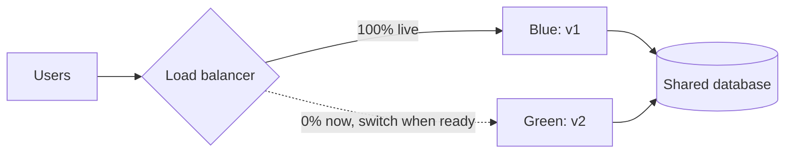

**Canary deployment:** named after canaries miners carried to detect gas. Send a small slice of real traffic (1%, then 5%, 25%, 100%) to the new version and compare its error rate and latency with the old version. If the canary looks sick, only 1% of users were affected and you roll back. Many teams automate the analysis ("if the canary's error rate is 2× the baseline, abort").

**Feature flags:** separate **deploy** (code is on the servers) from **release** (users see it). The new code ships turned off, wrapped in `if flags.is_enabled("new_checkout", user):`, and you turn it on for employees, then 1%, then everyone, without redeploying. If it misbehaves, flip it off in seconds. The key trick is a **stable hash**, so a user doesn't flicker between old and new on every page load:

```python
import hashlib

def bucket_of(user_id, flag_name):
    """Stable 0-99 bucket: the same user always lands in the same bucket."""
    digest = hashlib.sha256(f"{flag_name}:{user_id}".encode()).hexdigest()
    return int(digest, 16) % 100

def is_enabled(user_id, flag_name, rollout_percent):
    return bucket_of(user_id, flag_name) < rollout_percent

users = [f"user{i}" for i in range(10_000)]
for percent in (1, 10, 50, 100):
    on = sum(is_enabled(u, "new_checkout", percent) for u in users)
    print(f"rollout {percent:>3}% -> {on:>5} of 10000 users see the new checkout")

# Growing the rollout never flips someone back OFF:
early = {u for u in users if is_enabled(u, "new_checkout", 10)}
later = {u for u in users if is_enabled(u, "new_checkout", 50)}
print("everyone from the 10% group still in at 50%:", early <= later)
```

```text
rollout   1% ->   104 of 10000 users see the new checkout
rollout  10% ->   977 of 10000 users see the new checkout
rollout  50% ->  4886 of 10000 users see the new checkout
rollout 100% -> 10000 of 10000 users see the new checkout
everyone from the 10% group still in at 50%: True
```

What just happened: hashing gives each user a fixed number from 0 to 99. "Rollout 10%" means "buckets 0–9". Raising it to 50% adds buckets 10–49, so the early users stay in. Including the flag name in the hash means different flags pick different users (so the same unlucky 1% doesn't test everything). Remember to **delete old flags**; hundreds of stale flags become a maze of untested code paths.

**Database changes: expand and contract.** Because old and new code run side by side, never make a breaking schema change in one step. To rename a column: (1) **expand**: add the new column, write to both; (2) backfill old rows; (3) switch reads to the new column; (4) **contract**: stop writing the old one and drop it, in a later release.

| Strategy | Rollback speed | Extra cost | Risk exposure | Best for |
|---|---|---|---|---|
| Rolling | Minutes (roll forward/back gradually) | None | Grows batch by batch | Default for stateless services |
| Blue-green | Seconds (flip back) | 2× infra during switch | All users at once after the flip | When fast, clean rollback matters |
| Canary | Seconds (route away) | Small | Only the canary % | High-traffic services, risky changes |
| Feature flag | Seconds (toggle) | Code complexity | Any % you choose, per user | Product features, experiments, kill switches |

### 20. Disaster recovery: RPO, RTO and backups

Replication ([Chapter 05](05-replication-sharding.md)) protects you from one machine dying. But what if a whole region goes dark, or someone runs `DELETE FROM orders` without a `WHERE`? Replication would faithfully copy the delete to every replica within milliseconds. You need **backups** and a **disaster recovery (DR)** plan.

Two numbers define any DR plan:

- **RPO (Recovery Point Objective):** how much **data** can you afford to lose, measured in time. "RPO = 5 minutes" means after a disaster you may lose at most the last 5 minutes of writes. It's set by how often you back up or replicate.
- **RTO (Recovery Time Objective):** how long can you be **down**. "RTO = 1 hour" means service must be back within an hour.


Memory hook: **RPO = Point = how far back in time you go. RTO = Time = how long until you're back.**

**DR strategies, from cheap and slow to expensive and fast:**

| Strategy | How it works | RPO | RTO | Cost |
|---|---|---|---|---|
| Backup & restore | Regular backups copied to another region; rebuild everything from them | Hours | Hours to a day | $ |
| Pilot light | Core data replicated live to region B; servers there are off, start them on disaster | Minutes | Tens of minutes | $$ |
| Warm standby | A scaled-down but running copy in region B; scale up on disaster | Seconds to minutes | Minutes | $$$ |
| Multi-site active-active | Both regions serve live traffic all the time | ~0 | ~0 (automatic) | $$$$ |

**Backup rules that save careers:**
- **3-2-1 rule:** 3 copies of data, on 2 different kinds of storage, 1 of them off-site (another region/account).
- Combine full backups with incremental backups and database **write-ahead logs** for **point-in-time recovery** ("restore to 14:31:59, one second before the bad DELETE").
- Keep at least one copy **immutable** (can't be modified or deleted for N days), so ransomware or a stolen admin password can't erase your backups too.
- **A backup you haven't restored is not a backup, it's a hope.** Test restores regularly. Run DR drills ("game days"). Netflix's **Chaos Monkey** randomly kills production instances so that surviving failure becomes routine.

### 21. Containers and Kubernetes, intuitively

"It works on my machine" happens because your laptop and the server have different Python versions, libraries and settings. A **container** packages your code **plus everything it needs** (runtime, libraries, config) into one **image** that runs the same way everywhere.

The shipping-container analogy is literal: before standard containers, loading a ship meant handling sacks, barrels and crates of every shape. A standard steel box made cranes, ships and trucks all interchangeable. Software containers did the same for servers.

**Container vs virtual machine:** a VM fakes a whole computer, including its own operating system kernel (gigabytes, boots in a minute). A container shares the host's kernel and only isolates the process (using Linux namespaces for "what can I see" and cgroups for "how much CPU/memory can I use"). Result: megabytes, starts in about a second, dozens per machine. **Docker** made containers popular: a `Dockerfile` describes how to build the image.

```py
# Dockerfile (not Python, shown for flavour)
FROM python:3.11-slim
WORKDIR /app
COPY requirements.txt .
RUN pip install -r requirements.txt
COPY . .
CMD ["gunicorn", "app:server", "--bind", "0.0.0.0:8000"]
```

Running 3 containers by hand is fine. Running 3,000 across 200 machines, restarting the ones that crash, rolling out new versions, and routing traffic to them, is not. That's **container orchestration**, and **Kubernetes** (K8s) is the standard.

The key Kubernetes words:

| Concept | Plain meaning |
|---|---|
| **Cluster** | A group of machines (**nodes**) managed together |
| **Pod** | The smallest unit: one or more containers that run together (e.g. your app + its sidecar) |
| **Deployment** | "I want 3 copies of `orders:v7` running." Handles rolling updates and rollbacks |
| **Service** | A stable name and virtual IP (`http://orders`) that load-balances to healthy pods: built-in service discovery |
| **Ingress** | Routes outside HTTP traffic into services (like a mini gateway) |
| **ConfigMap / Secret** | Configuration and passwords injected into pods |
| **HorizontalPodAutoscaler** | Adds/removes pods based on CPU or custom metrics |
| **Liveness / readiness probes** | "Are you alive?" (restart if not) and "Are you ready for traffic?" (don't route to you yet) |

The core idea that makes Kubernetes click: it's **declarative**. You don't say "start a pod". You say "**there should be 3**", and a **control loop** keeps comparing *desired state* with *actual state* and fixing the difference, forever:

```python
def reconcile(desired, actual):
    """One pass of a Kubernetes-style control loop: make actual look like desired."""
    actions = []
    running = [p for p in actual if p["status"] == "Running"]
    for p in actual:
        if p["status"] != "Running":
            actions.append(f"delete {p['name']} ({p['status']})")
    missing = desired["replicas"] - len(running)
    for i in range(missing):
        actions.append(f"create pod {desired['app']}-new{i + 1} from image {desired['image']}")
    for p in running[desired["replicas"]:]:
        actions.append(f"delete {p['name']} (too many)")
    return actions

desired = {"app": "orders", "image": "orders:v7", "replicas": 3}
actual = [{"name": "orders-a", "status": "Running"},
          {"name": "orders-b", "status": "CrashLoopBackOff"},
          {"name": "orders-c", "status": "Running"}]
for action in reconcile(desired, actual):
    print(action)

print("--- someone scales down to 1 ---")
desired["replicas"] = 1
for action in reconcile(desired, [{"name": "orders-a", "status": "Running"},
                                  {"name": "orders-c", "status": "Running"},
                                  {"name": "orders-new1", "status": "Running"}]):
    print(action)
```

```text
delete orders-b (CrashLoopBackOff)
create pod orders-new1 from image orders:v7
--- someone scales down to 1 ---
delete orders-c (too many)
delete orders-new1 (too many)
```

What just happened: we never told the system *how* to fix things; we told it *what* we want, and the loop worked out the actions. A crashed pod gets replaced. A machine dies, its pods are recreated elsewhere. Change the image to `v8`, and the Deployment controller does a rolling update. This "desired state + reconcile loop" idea is the heart of Kubernetes.

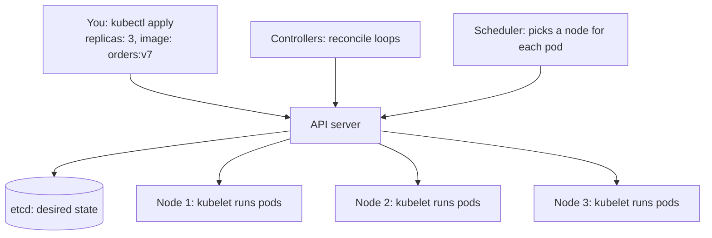

---

## 🔬 Under the Hood

### The maths of "more services = more failure"

Three small calculations explain almost every reliability rule in this chapter.

```python
# 1) Fan-out: one page calls N backends in parallel. Each backend is slow
#    (above its p99) 1% of the time. How often is the WHOLE page slow?
for n in (1, 10, 50, 100):
    print(f"fan-out {n:>3}: page is slow {1 - 0.99 ** n:6.1%} of the time")

# 2) Retry amplification: 5 layers deep, every layer tries up to 3 times.
layers, attempts = 5, 3
print(f"\nworst-case calls hitting the bottom service: {attempts ** layers}")

# 3) Availability in series vs in parallel
a = 0.999
print(f"\n3 services in series   : {a ** 3:.4%}")
print(f"2 replicas in parallel : {1 - (1 - a) ** 2:.4%}")
```

```text
fan-out   1: page is slow   1.0% of the time
fan-out  10: page is slow   9.6% of the time
fan-out  50: page is slow  39.5% of the time
fan-out 100: page is slow  63.4% of the time

worst-case calls hitting the bottom service: 243

3 services in series   : 99.7003%
2 replicas in parallel : 99.9999%
```

**1. Tail latency amplifies with fan-out.** The page waits for the *slowest* of its N calls. The chance that all N are fast is 0.99ᴺ, so the chance at least one is slow is 1 − 0.99ᴺ. With 100 backends, a "rare" 1% slowness hits **63%** of pages. This is why big companies obsess over p99 and p99.9, not averages (Google's well-known paper on this is "The Tail at Scale"). Fixes: fewer, shorter call chains; **hedged requests** (if a call hasn't returned by the p95 time, send a duplicate to another replica and take whichever answers first); and timeouts.

**2. Retries multiply across layers.** If each of 5 layers tries 3 times, a single failure at the bottom becomes 3⁵ = **243** calls. The bottom service, already struggling, is hit with a 243× storm. Hence: retry at one layer, use retry budgets, and put retries inside circuit breakers.

**3. Series multiplies uptime down; parallel multiplies downtime down.** When a request needs A *and* B *and* C, availabilities multiply: three 99.9% services give 99.7% (about 3× the downtime of any single one). When you have redundant copies and need only *one* to be up, the *failure* probabilities multiply: two 99.9% replicas give 99.9999%. That's the mathematical reason for replicas, and for keeping synchronous chains short. (The parallel formula assumes failures are independent. Two replicas in the same rack, hit by the same bad deploy, are *not* independent, which is why we spread replicas across zones.)

### Why a slow service is worse than a dead one: Little's Law

**Little's Law** says: `requests in flight = arrival rate × time each request takes`.

Say orders gets 100 requests/second and each call to recommendations normally takes 50 ms: 100 × 0.05 = **5** requests in flight. Fine with a 200-thread pool. Now recommendations slows to 30 s: 100 × 30 = **3,000** requests would be in flight. The pool of 200 is full in two seconds, and everything else queues behind it. A *dead* service fails in about a millisecond (connection refused), so it barely holds threads at all. This is why the first line of defence is a **timeout**: it caps "time each request takes", which caps the in-flight count.

### How the patterns stack together

Without a timeout, a breaker can't even see failures: calls just hang, and hanging isn't "failed" yet. Timeouts turn slowness into errors; breakers turn repeated errors into fast rejections; fallbacks turn fast rejections into a degraded-but-working page. The usual order, outer to inner:

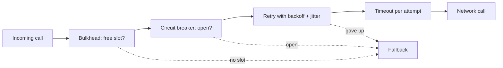

### How a service mesh intercepts traffic

How does the sidecar "see" calls the app makes to `http://payments`? In Kubernetes, when a pod starts, the mesh installs **iptables** rules (Linux kernel packet-routing rules) inside the pod's network namespace that redirect all incoming and outgoing TCP traffic to the sidecar's port. The app has no idea. The sidecar looks up its routing table (pushed by the control plane), opens an mTLS connection to the destination's sidecar, applies timeouts and retries, and records metrics. Newer "ambient" or eBPF-based meshes move this work out of every pod to cut the cost, but the idea is the same: networking policy lives outside your code.

### How a token bucket lives in Redis with no timer

The token bucket never needs a background job to "drip" tokens. When a request arrives, it computes `tokens = min(capacity, tokens + (now − last) × rate)`. So per user you store just `(tokens, last)`. In Redis, the read-compute-write runs as one **Lua script**, which Redis executes atomically (it runs commands one at a time), so two gateway servers can't both spend the last token. An `EXPIRE` on the key means idle users cost nothing.

### What Kubernetes actually does when a node dies

1. Each node's agent (the **kubelet**) regularly reports to the API server.
2. Reports stop. After a grace period, the node controller marks the node `NotReady`, and after a further timeout its pods are evicted.
3. The Deployment's controller sees "desired 3, running 2" and creates a new pod object.
4. The **scheduler** picks a node with enough free CPU/memory that satisfies the pod's constraints.
5. That node's kubelet pulls the image and starts the container. The readiness probe passes, and the Service starts routing traffic to it.

Every step is a separate loop watching shared state stored in **etcd**. No single component "orchestrates" the whole thing; each reconciles its own piece. That design is why Kubernetes heals itself.

---

## 🧩 Pattern Decoder

### Decision guide: monolith or microservices?

| If... | Choose | Because |
|---|---|---|
| Small team (roughly under 20 engineers), new product, domain still changing | **Modular monolith** | Fast to change; boundaries still unknown; low ops cost |
| Many teams blocked by each other's deploys | **Microservices** along team lines | Independent deploys are the main benefit |
| One part needs very different scaling (video encoding, ML inference) | **Extract just that part** | Scale it alone; keep the rest simple |
| Cross-entity transactions needed everywhere | **Monolith** (or keep those entities in one service) | Distributed transactions are painful |
| Migrating a legacy system | **Strangler fig**, one capability at a time | No big-bang rewrite |

### Decision guide: which reliability pattern?

| Problem you see | Pattern | Why it works |
|---|---|---|
| Calls hang, threads pile up | **Timeout** (+ deadline propagation) | Caps time per call, so caps in-flight work |
| Occasional transient errors | **Retry + exponential backoff + jitter** | Most blips heal fast; jitter avoids synchronised herds |
| Dependency down for minutes | **Circuit breaker** + fallback | Fail fast, free resources, let it recover |
| One slow dependency starves unrelated features | **Bulkhead** | Separate pools contain the damage |
| Clients send too much (bugs, abuse, spikes) | **Rate limiting** at the gateway | Fair share; protects backends |
| Over capacity right now | **Load shedding** (low priority first) | Some users served well beats all served badly |
| Optional feature failing | **Graceful degradation** | Core path stays up with cached/default content |
| Retried writes might double-apply | **Idempotency keys** / dedup | Safe retries |
| Need uniform network behaviour across many services | **Service mesh / sidecar** | Policy outside the code |

### Decision guide: which rate limiter?

- "Allow bursts, cap the average" → **token bucket**. (The default interview answer.)
- "Downstream must receive a steady pace" → **leaky bucket**.
- "Simple daily/monthly quota" → **fixed window**.
- "Exact, low limit, e.g. 5 login attempts per 15 minutes" → **sliding log**.
- "High traffic, accurate, cheap memory" → **sliding window counter**.

### Decision guide: which deployment strategy?

- Stateless service, routine change → **rolling**.
- Need instant, clean rollback and can afford 2× capacity briefly → **blue-green**.
- Risky change on a high-traffic service → **canary** with automated metric comparison.
- Product feature, gradual rollout, A/B test, kill switch → **feature flag**.
- Always: **expand-and-contract** for schema changes.

### Decision guide: which DR tier?

| Business says | RPO / RTO | Strategy |
|---|---|---|
| "Internal tool, a day down is OK" | Hours / a day | Backup & restore |
| "Can lose minutes of data, need it back within an hour" | Minutes / under 1 h | Pilot light |
| "Customers notice within minutes" | Seconds / minutes | Warm standby |
| "Payments, must never stop" | ~0 / ~0 | Active-active multi-region |

### The resilient call: a reusable template

```py
def call_dependency(request, deadline):
    if not bulkhead.try_enter():                  # 1. limit concurrency
        return fallback(request)
    try:
        if breaker.is_open():                     # 2. fail fast if known-broken
            return fallback(request)
        for attempt in range(MAX_ATTEMPTS):       # 3. bounded retries
            timeout = min(PER_CALL_TIMEOUT, deadline.remaining())   # 4. timeout <= deadline
            if timeout <= 0:
                break
            try:
                result = client.call(request, timeout=timeout,
                                     idempotency_key=request.key)   # 5. safe to retry
                breaker.record_success()
                return result
            except RetryableError:
                breaker.record_failure()
                sleep(random.uniform(0, min(CAP, BASE * 2 ** attempt)))  # 6. backoff + jitter
        return fallback(request)                  # 7. degrade, don't explode
    finally:
        bulkhead.leave()
```

### When NOT to use these tools

- **Don't retry non-idempotent operations** without an idempotency key.
- **Don't retry 4xx client errors** (except 408/429): they'll fail again.
- **Don't add a service mesh** for a handful of services in one language; a good HTTP client library is enough.
- **Don't split into microservices** to "be like Netflix". They had hundreds of engineers and a specific scaling problem.
- **Don't aim for 100% availability**: the cost explodes and users can't tell the difference.

---

## ⚠️ Traps & Common Mistakes

1. **No timeout (or a default of "forever").** The single most common cause of cascading failures.

```py
# ❌ wrong: waits forever if the server hangs
resp = requests.get(url)

# ✅ right: connect + read timeouts, a bit above the dependency's p99
resp = requests.get(url, timeout=(0.5, 2.0))
```

2. **Retrying without backoff or jitter.** Instant retries from thousands of clients form a synchronised wave that keeps the service down.

```py
# ❌ wrong: hammer it, swallow every error
for _ in range(5):
    try:
        return call()
    except Exception:
        pass

# ✅ right: transient errors only, exponential backoff, full jitter, capped attempts
for attempt in range(4):
    try:
        return call()
    except TransientError:
        time.sleep(random.uniform(0, min(2.0, 0.1 * 2 ** attempt)))
raise ServiceUnavailable()
```

3. **Retrying at every layer.** 3 tries × 5 layers = 243 calls. Retry in one place.
4. **Retrying a POST that isn't idempotent.** Customer charged twice. Use idempotency keys.
5. **Shared database between services.** A distributed monolith: all the network pain, none of the independence.
6. **Nano-services.** One service per function turns every request into a dozen network calls.
7. **Long synchronous chains.** A → B → C → D → E: latencies add up, availabilities multiply down. Use events or merge services.
8. **Watching averages.** The average hides the slow 1%. Alert on p99 and error rate.
9. **Logs without a trace ID.** You can't follow a request across 7 services. Propagate one ID everywhere.
10. **Fixed-window limiter where precision matters.** Allows 2× the limit at window edges.
11. **Rate limiting per server instead of globally.** 20 gateway servers with local counters = 20× the intended limit.
12. **Breaking schema changes in one deploy.** Old pods still running mid-rollout crash on the new schema. Expand, migrate, then contract.
13. **Treating replication as a backup.** A bad `DELETE` replicates in milliseconds. You need point-in-time backups, and you must test restoring them.
14. **Health checks that lie (or over-check).** A `/health` returning 200 while the DB is unreachable keeps a broken pod in rotation. But a *liveness* probe that checks the database makes Kubernetes restart every pod whenever the DB blips. Liveness = "is my process OK?"; readiness = "can I serve traffic right now?".

---

## 💡 Tips & Tricks

- In interviews, say "**timeouts, retries with backoff and jitter, circuit breakers, bulkheads**" together. It's the standard resilience quartet.
- Pick timeouts from data: **slightly above the dependency's p99**, and never more than the caller's remaining deadline.
- The default answer for "design a rate limiter" is **token bucket in Redis with an atomic Lua script**, keyed by user/API key, enforced at the gateway, returning 429 + `Retry-After`.
- Put the **trace ID in every log line**. It links logs, metrics and traces.
- Watch the **four golden signals**: latency, traffic, errors, saturation.
- Write SLOs from the **user's point of view** ("checkout succeeds within 300 ms"), not the machine's ("CPU below 70%").
- "Deploy" ≠ "release". Feature flags let you deploy dark and release with a toggle.
- A fallback you've never triggered is untested code. Use chaos experiments and game days.
- Memorise the nines: **99.9% ≈ 43 minutes/month, 99.99% ≈ 4.3 minutes/month**.
- When asked "monolith or microservices?", start with "it depends on team size and how well we understand the domain," then describe the modular monolith → extract-when-needed path. It sounds senior because it is.

---

## 🎯 Interview Questions

### 1. Monolith vs microservices: when would you choose each? 🔥🔥🔥

<details><summary>Answer</summary>

**Monolith** (ideally modular) when the team is small, the product is new and the domain boundaries aren't clear yet. Benefits: simple deploys, in-process calls, real ACID transactions, easy debugging, low operational cost.

**Microservices** when many teams need to deploy independently, parts of the system have very different scaling or reliability needs, and domains are well understood. Benefits: independent deploys and scaling, fault isolation, team autonomy, freedom of technology.

**Costs of microservices:** network latency and partial failures, distributed transactions (sagas, eventual consistency), harder testing, the need for discovery, gateways, tracing and per-service CI/CD, and usually a platform team.

A strong answer ends with: "I'd start with a modular monolith with strict module boundaries, and extract a service when there's a concrete reason: a team bottleneck, a scaling hotspot, or a different reliability or security need. When migrating, I'd use the strangler fig pattern." Mention that each service must own its data; a shared database gives a distributed monolith.

</details>

### 2. What is a circuit breaker and how does it work? 🔥🔥🔥

<details><summary>Answer</summary>

A wrapper around calls to a dependency that stops calling it when it's clearly failing. Three states:

- **Closed:** calls go through; failures (errors and timeouts) are counted, often as a failure rate over a sliding window.
- **Open:** once the threshold is crossed, calls fail immediately without touching the network, and a fallback is returned. This protects the caller's threads and gives the dependency time to recover.
- **Half-open:** after a cool-down, a few trial calls are let through. Success → closed. Failure → open again.

Why it matters: it prevents cascading failures and retry storms. It pairs with timeouts (so slowness counts as failure) and fallbacks (so an open circuit degrades gracefully). Libraries: Resilience4j, Polly, pybreaker; service meshes do similar things at the network layer (Envoy's "outlier detection" ejects bad hosts). See the runnable code in section 12.

</details>

### 3. Why use exponential backoff with jitter for retries? 🔥🔥🔥

<details><summary>Answer</summary>

**Exponential backoff** (100 ms, 200, 400, 800... capped) gives an overloaded or restarting service growing room to recover, instead of hammering it at a constant rate.

**Jitter** (randomising each wait, e.g. full jitter `random(0, min(cap, base × 2^n))`) prevents the **thundering herd**: when thousands of clients fail at the same instant, plain backoff makes them all retry at the same instants too, in synchronised spikes. Randomness spreads retries evenly over time.

Also: retry only transient errors (timeouts, 429, 502/503/504), only idempotent operations (or with an idempotency key), cap the attempts, retry at a single layer, honour `Retry-After`, and consider a retry budget (e.g. retries ≤ 10% of traffic).

</details>

### 4. Compare rate-limiting algorithms. Which would you use for a public API? 🔥🔥🔥

<details><summary>Answer</summary>

| Algorithm | Idea | Pros | Cons |
|---|---|---|---|
| Token bucket | Tokens refill at rate r up to capacity b; each request spends one | Allows bursts, smooth average, 2 numbers per key | Two parameters to tune |
| Leaky bucket | Queue drained at a constant rate | Perfectly smooth output | Bursts wait (latency) or are dropped |
| Fixed window | Counter per time window | Simplest, 1 counter | Up to 2× limit at window boundaries |
| Sliding log | Store each request's timestamp | Exact | Memory grows with requests per key |
| Sliding window counter | Weighted previous + current window counts | Accurate and cheap | Approximation |

For a public API: **token bucket** (or sliding window counter), keyed by API key, enforced at the gateway, state in Redis updated atomically by a Lua script, returning **429 Too Many Requests** with `Retry-After` and `X-RateLimit-*` headers. Decide what happens if Redis is unreachable: usually **fail open** (allow traffic) so the limiter isn't a single point of failure, unless it protects something critical.

</details>

### 5. How do you make a payment API safe to retry? 🔥🔥🔥

<details><summary>Answer</summary>

Use **idempotency keys**. The client generates a unique key (a UUID) per logical operation and sends it on every attempt (`Idempotency-Key` header). The server:

1. Looks up the key. If the operation finished, returns the **stored response** without charging again.
2. If the key is new, inserts it with status `IN_PROGRESS` (a unique constraint prevents two concurrent inserts), performs the work, and stores the result **in the same transaction** as the side effect.
3. If a duplicate arrives while the first is still `IN_PROGRESS`, returns 409 Conflict (or waits).
4. Expires keys after a period (e.g. 24 h).

Also check that a reused key comes with the same request body, and reject mismatches. Downstream, message consumers dedupe by message ID because queues deliver at least once. This is how Stripe's API works.

</details>

### 6. Explain SLI, SLO, SLA and error budgets. 🔥🔥

<details><summary>Answer</summary>

- **SLI:** a measured indicator, e.g. "fraction of requests that succeed in under 300 ms".
- **SLO:** an internal target for an SLI over a window, e.g. "99.9% over 30 days".
- **SLA:** an external contract with consequences (refunds/credits) if missed; set looser than the SLO.

**Error budget** = 100% − SLO. At 99.9% over 30 days that's about 43 minutes of full downtime, or 1 failed request in 1,000. While budget remains, teams ship and take risks; when it's spent, launches freeze and effort shifts to reliability. It aligns product and reliability goals with one agreed number. Alert on **burn rate** (how fast the budget is being consumed), e.g. page someone if you'd burn a month's budget in a few hours.

</details>

### 7. What are the three pillars of observability? How does distributed tracing work? 🔥🔥

<details><summary>Answer</summary>

**Logs** (detailed events, structured, centralised), **metrics** (aggregated numbers over time: latency percentiles, traffic, errors, saturation; cheap to store and alert on), and **traces** (the path of one request through all services, with timings).

**Tracing:** the first service generates a **trace ID**; every outgoing call carries it in a header (W3C `traceparent`). Each operation records a **span** (trace ID, span ID, parent span ID, name, start, duration, attributes). Spans are sent to a collector (Jaeger, Zipkin, Tempo) and assembled into a tree/waterfall that shows where time went. Tracing everything is expensive, so systems **sample** (e.g. 1% of requests, or keep all errors and slow requests with "tail-based sampling"). OpenTelemetry is the standard SDK. Put the trace ID in log lines to jump between pillars.

</details>

### 8. Blue-green vs canary vs rolling deployments? 🔥🔥

<details><summary>Answer</summary>

- **Rolling:** replace instances in batches; no extra infrastructure; old and new versions coexist; rollback is another rolling deploy.
- **Blue-green:** two full environments; switch all traffic at once at the load balancer; instant rollback by switching back; needs 2× capacity during the switch; the shared database still needs backward-compatible migrations.
- **Canary:** send a small percentage of real traffic to the new version, compare its metrics with the baseline, then increase gradually or abort; limits the blast radius; needs good metrics and traffic splitting.

Plus **feature flags** to separate deploy from release. All of them require **backward-compatible** changes (expand-and-contract for schemas), because two versions run at the same time.

</details>

### 9. How do services find each other? What does an API gateway do? 🔥🔥

<details><summary>Answer</summary>

**Service discovery:** instances register with a registry (Consul, etcd, ZooKeeper, Eureka, or the Kubernetes API) and send heartbeats; dead instances expire. Callers either query the registry and load-balance themselves (**client-side**) or call a stable name/virtual IP and let a proxy choose (**server-side**, e.g. Kubernetes Services, DNS + load balancer).

**API gateway:** the single entry point for external clients: routing, authentication, rate limiting, TLS termination, request aggregation, caching, logging, request-ID injection. It differs from a load balancer, which just spreads traffic across copies of one service. Keep business logic out of it; consider a Backend-for-Frontend per client type.

</details>

### 10. What is a service mesh? When is it worth it? 🔥

<details><summary>Answer</summary>

An infrastructure layer for service-to-service traffic. Each service instance gets a **sidecar proxy** (usually Envoy) that intercepts its traffic (the **data plane**); a **control plane** (Istio, Linkerd) configures all proxies and issues certificates.

It gives mTLS everywhere, uniform retries/timeouts/circuit breaking, traffic splitting for canaries, and consistent metrics and tracing, without changing application code, in any language.

It costs extra latency per hop, CPU and memory per pod, and real operational complexity. Worth it with many services in several languages and strict security needs; overkill for a few services.

</details>

### 11. How do you prevent cascading failures? 🔥🔥🔥

<details><summary>Answer</summary>

First explain the mechanism: a slow dependency holds threads (Little's Law), the caller's pools fill, the caller becomes slow, and the slowness propagates upward. Then layer defences:

1. **Timeouts** on every call, with propagated deadlines.
2. **Retries** only with backoff + jitter, bounded, at one layer, with a retry budget.
3. **Circuit breakers** to fail fast when a dependency is unhealthy.
4. **Bulkheads**: separate thread/connection pools per dependency; cell-based isolation at larger scale.
5. **Rate limiting** and **load shedding** to reject excess early and cheaply, low-priority first.
6. **Graceful degradation**: cached or default responses for non-critical features.
7. **Async messaging** for non-critical work, so slow consumers don't block the request path.
8. **Autoscaling** plus headroom; add jitter to cron jobs and cache expiries so clients don't synchronise.
9. Prove it works: load tests and chaos engineering.

</details>

### 12. What are RPO and RTO? Sketch a DR plan for an e-commerce orders database. 🔥🔥

<details><summary>Answer</summary>

**RPO** = maximum acceptable data loss, measured in time. **RTO** = maximum acceptable downtime.

For an orders database with, say, RPO ≤ 1 minute and RTO ≤ 15 minutes:
- A synchronous replica in another availability zone with automatic failover, for zone failures (RPO ≈ 0).
- An asynchronous replica in another region (warm standby) for region failures: RPO = replication lag (seconds), RTO = minutes with scripted promotion and a traffic/DNS switch.
- Daily snapshots plus continuous write-ahead-log archiving to object storage in another region and account, with immutability, for **point-in-time recovery** from logical errors (bad deploy, accidental delete) that replication would happily copy.
- Regular restore tests and failover drills, runbooks, and alerts on replication lag and backup failures.

</details>

### 13. How do you handle a business transaction that spans multiple services? 🔥🔥

<details><summary>Answer</summary>

First, try to avoid it: keep entities that must change atomically in one service. Otherwise use a **saga**: a sequence of local transactions, each with a **compensating action** (release stock, refund payment). Coordinate it by **orchestration** (a central coordinator; easier to follow and monitor) or **choreography** (services react to each other's events; looser coupling, harder to trace). Make every step idempotent, publish events reliably with the **transactional outbox** ([Chapter 08](08-queues-events.md)), and expose intermediate states to users ("order pending"). Two-phase commit exists but blocks if the coordinator fails and couples services tightly, so it's rarely used between microservices.

</details>

### 14. What is Kubernetes, in simple terms? 🔥

<details><summary>Answer</summary>

A container orchestrator. You declare desired state ("3 replicas of image `orders:v7`, half a CPU each, reachable as service `orders`"), and Kubernetes' control loops continuously make reality match: scheduling pods onto nodes, restarting crashed containers, replacing pods from dead nodes, rolling updates, autoscaling, and service discovery plus load balancing through Services and DNS. Key objects: Pod, Deployment, Service, Ingress, ConfigMap/Secret, HorizontalPodAutoscaler, plus liveness and readiness probes. Cluster state lives in etcd (replicated with Raft). Containers package an app with its dependencies and share the host kernel, so they're much lighter than VMs.

</details>

---

## 🏋️ Practice

**🟢 1. Availability arithmetic.** A request goes gateway (99.9%) → orders (99.9%) → payments (99.9%). Separately, the orders database alone is 99.5%, but you can run two replicas with automatic failover. Compute the chain's availability, the replicated DB's availability, and a chain of gateway → orders → replicated DB.

<details><summary>Solution</summary>

```python
def series(*avail):
    total = 1.0
    for a in avail:
        total *= a                      # ALL must be up
    return total

def parallel(a, copies):
    return 1 - (1 - a) ** copies        # at least ONE must be up

print(f"gateway -> orders -> payments (each 99.9%): {series(0.999, 0.999, 0.999):.4%}")
print(f"one DB at 99.5%                          : {0.995:.4%}")
print(f"two DB replicas with failover            : {parallel(0.995, 2):.4%}")
print(f"chain with replicated DB                 : {series(0.999, 0.999, parallel(0.995, 2)):.4%}")
```

```text
gateway -> orders -> payments (each 99.9%): 99.7003%
one DB at 99.5%                          : 99.5000%
two DB replicas with failover            : 99.9975%
chain with replicated DB                 : 99.7976%
```

Lesson: redundancy lifts a weak component above the strong ones, and every extra hop in series pulls the total down.

</details>

**🟢 2. Per-user fixed-window limiter.** Allow each user at most `limit` requests per `window_seconds`. Users must not affect each other.

<details><summary>Solution</summary>

Key the counter by `(user, window number)`. In production you'd expire old keys (Redis `INCR` + `EXPIRE`).

```python
from collections import defaultdict

class PerUserFixedWindow:
    def __init__(self, limit, window_seconds):
        self.limit, self.window = limit, window_seconds
        self.counts = defaultdict(int)          # (user, window_number) -> count

    def allow(self, user, now):
        key = (user, int(now // self.window))
        if self.counts[key] >= self.limit:
            return False
        self.counts[key] += 1
        return True

rl = PerUserFixedWindow(limit=2, window_seconds=10)
events = [("asha", 1), ("asha", 2), ("asha", 3), ("ravi", 3), ("asha", 11)]
for user, t in events:
    print(user, t, "ALLOW" if rl.allow(user, t) else "429")
```

```text
asha 1 ALLOW
asha 2 ALLOW
asha 3 429
ravi 3 ALLOW
asha 11 ALLOW
```

</details>

**🟡 3. Should I retry?** Write `should_retry(method, status, attempt)` that retries only retryable statuses (429, 502, 503, 504), only for idempotent methods (or a POST carrying an idempotency key), and allows at most 3 attempts.

<details><summary>Solution</summary>

```python
RETRYABLE_STATUS = {429, 502, 503, 504}
IDEMPOTENT_METHODS = {"GET", "PUT", "DELETE", "HEAD"}

def should_retry(method, status, attempt, max_attempts=3, has_idempotency_key=False):
    if attempt >= max_attempts:
        return False
    if status not in RETRYABLE_STATUS:
        return False                         # 400, 404, 401... will fail again
    return method in IDEMPOTENT_METHODS or has_idempotency_key

cases = [("GET", 503, 1, False), ("GET", 404, 1, False), ("POST", 503, 1, False),
         ("POST", 503, 1, True), ("PUT", 429, 3, False)]
for method, status, attempt, key in cases:
    print(f"{method:<4} {status} attempt={attempt} key={key!s:<5} -> retry? {should_retry(method, status, attempt, has_idempotency_key=key)}")
```

```text
GET  503 attempt=1 key=False -> retry? True
GET  404 attempt=1 key=False -> retry? False
POST 503 attempt=1 key=False -> retry? False
POST 503 attempt=1 key=True  -> retry? True
PUT  429 attempt=3 key=False -> retry? False
```

</details>

**🟡 4. Token bucket with `Retry-After`.** Build a per-user token bucket that returns `(200, 0)` when allowed and `(429, seconds_to_wait)` when not, where the wait is the time until one full token is available, rounded up.

<details><summary>Solution</summary>

```python
import math

class PerUserTokenBucket:
    def __init__(self, capacity, refill_per_sec):
        self.capacity, self.rate = capacity, refill_per_sec
        self.state = {}                                  # user -> (tokens, last_time)

    def check(self, user, now):
        tokens, last = self.state.get(user, (self.capacity, now))
        tokens = min(self.capacity, tokens + (now - last) * self.rate)
        if tokens >= 1:
            self.state[user] = (tokens - 1, now)
            return 200, 0
        self.state[user] = (tokens, now)
        retry_after = math.ceil((1 - tokens) / self.rate)  # seconds until 1 token
        return 429, retry_after

rl = PerUserTokenBucket(capacity=2, refill_per_sec=0.5)   # 1 token every 2 s
for user, t in [("u1", 0), ("u1", 0), ("u1", 0), ("u2", 0), ("u1", 1), ("u1", 2)]:
    status, retry_after = rl.check(user, t)
    extra = f"  Retry-After: {retry_after}" if status == 429 else ""
    print(f"t={t} {user} -> {status}{extra}")
```

```text
t=0 u1 -> 200
t=0 u1 -> 200
t=0 u1 -> 429  Retry-After: 2
t=0 u2 -> 200
t=1 u1 -> 429  Retry-After: 1
t=2 u1 -> 200
```

</details>

**🟡 5. Failure-rate circuit breaker.** Instead of counting failures, open the breaker when **more than 50%** of the last 10 calls failed, but only once at least 5 calls have been seen (so 1 failure out of 1 call doesn't trip it).

<details><summary>Solution</summary>

A `deque(maxlen=10)` is a ready-made sliding window: old results fall off automatically.

```python
from collections import deque

class RateBreaker:
    """Opens when the failure RATE over the last `window` calls exceeds `threshold`."""
    def __init__(self, window=10, threshold=0.5, min_calls=5):
        self.results = deque(maxlen=window)   # True = failure
        self.threshold, self.min_calls = threshold, min_calls
        self.open = False

    def record(self, failed):
        self.results.append(failed)
        if len(self.results) >= self.min_calls:
            rate = sum(self.results) / len(self.results)
            self.open = rate > self.threshold
        return self.open

br = RateBreaker()
pattern = [False, True, False, True, True, True, False, True]
for i, failed in enumerate(pattern, 1):
    state = "OPEN" if br.record(failed) else "closed"
    rate = sum(br.results) / len(br.results)
    print(f"call {i}: {'FAIL' if failed else 'ok  '}  failure rate={rate:.2f}  breaker={state}")
```

```text
call 1: ok    failure rate=0.00  breaker=closed
call 2: FAIL  failure rate=0.50  breaker=closed
call 3: ok    failure rate=0.33  breaker=closed
call 4: FAIL  failure rate=0.50  breaker=closed
call 5: FAIL  failure rate=0.60  breaker=OPEN
call 6: FAIL  failure rate=0.67  breaker=OPEN
call 7: ok    failure rate=0.57  breaker=OPEN
call 8: FAIL  failure rate=0.62  breaker=OPEN
```

Call 2 has a 50% failure rate but only 2 calls, so `min_calls` keeps the breaker closed. (A complete breaker would add the OPEN → HALF_OPEN timer from section 12; this demo just records results so you can watch the rate.)

</details>

**🔴 6. Idempotency store with in-progress and expiry.** Implement `begin(key, now)` that returns `"PROCEED"` for a new key, a 409 message if the same key is still being processed, a replay of the saved response if it finished, and `"PROCEED"` again once the key is older than its TTL.

<details><summary>Solution</summary>

```python
class IdempotencyStore:
    def __init__(self, ttl):
        self.ttl = ttl
        self.records = {}          # key -> {"status", "response", "created"}

    def begin(self, key, now):
        rec = self.records.get(key)
        if rec and now - rec["created"] > self.ttl:
            del self.records[key]                     # expired: treat as new
            rec = None
        if rec is None:
            self.records[key] = {"status": "IN_PROGRESS", "response": None, "created": now}
            return "PROCEED"
        if rec["status"] == "IN_PROGRESS":
            return "409 CONFLICT (same request still running)"
        return "REPLAY: " + rec["response"]

    def finish(self, key, response):
        self.records[key].update(status="DONE", response=response)

store = IdempotencyStore(ttl=86_400)            # 24 hours
print(store.begin("k1", now=0))                 # first request starts work
print(store.begin("k1", now=1))                 # duplicate arrives while working
store.finish("k1", "charged 500")
print(store.begin("k1", now=5))                 # retry after success
print(store.begin("k1", now=90_000))            # a day later: key expired
```

```text
PROCEED
409 CONFLICT (same request still running)
REPLAY: charged 500
PROCEED
```

In a real system the "check and insert" must be atomic: an `INSERT` into a table with a `UNIQUE` key (the loser of a race gets a constraint error), or Redis `SET key value NX EX 86400`. Also handle a worker that crashes while `IN_PROGRESS`: give that state its own shorter timeout so the key can be retried.

</details>

**🔴 7. Adaptive concurrency limit (AIMD).** Fixed limits are hard to tune. Implement a limiter that raises its allowed in-flight requests by 1 after each healthy response and **halves** it on an overload signal (timeout or 503), staying between 1 and 100. Starting at 10, print the limit after each signal: 5 healthy, 1 overload, 3 healthy, 2 overloads, 2 healthy.

<details><summary>Solution</summary>

This is **AIMD** (additive increase, multiplicative decrease), the same idea TCP uses for congestion control, and the idea behind Netflix's `concurrency-limits` library. It probes upward slowly and backs off fast.

```python
class AdaptiveLimiter:
    """AIMD: +1 allowed in-flight request on success, halve on overload signal."""
    def __init__(self, start=10, floor=1, ceiling=100):
        self.limit, self.floor, self.ceiling = start, floor, ceiling

    def on_result(self, overloaded):
        if overloaded:
            self.limit = max(self.floor, self.limit // 2)
        else:
            self.limit = min(self.ceiling, self.limit + 1)

lim = AdaptiveLimiter()
signals = [False] * 5 + [True] + [False] * 3 + [True, True] + [False] * 2
history = []
for overloaded in signals:
    lim.on_result(overloaded)
    history.append(lim.limit)
print(history)
```

```text
[11, 12, 13, 14, 15, 7, 8, 9, 10, 5, 2, 3, 4]
```

</details>

**🔴 8. Design exercise: split a food-delivery monolith.** A food-delivery app is one Django monolith on one Postgres database: users, restaurants and menus, orders, payments, delivery-partner tracking, notifications. 80 engineers in 8 teams complain about slow, risky deploys, and live location updates (thousands per second) overload the database. Propose which services to extract first, who owns which data, how they communicate, and the reliability patterns on the order path.

<details><summary>Solution</summary>

**Don't split everything at once.** Use the strangler fig and extract where the pain is:

1. **Location/tracking service first**: the scaling hotspot. Writes go to an in-memory geo store (e.g. Redis geo indexes) instead of Postgres, and updates flow through a stream (Kafka) to consumers (ETA calculation, customer app over WebSockets). This isolates the main database from the location firehose.
2. **Notification service**: naturally async; consumes `OrderPlaced` and `OrderPickedUp` events. Low risk, quick win.
3. **Payments service**: separate for security and compliance (smaller audit scope) and a different change pace; owns the payments DB; idempotency keys on every charge.
4. Later, as team ownership settles: **Catalog/menus** (read-heavy, cacheable, images on a CDN) and **Orders** (the core, owning the order state machine).

**Communication:** synchronous gRPC only where an immediate answer is needed (orders → payments authorisation, with an idempotency key); everything else through events published with the outbox pattern. Place-order runs as a **saga**: create order (PENDING) → authorise payment → notify restaurant; on failure, compensate (void the authorisation, cancel the order).

**Reliability on the order path:** gateway with auth and per-user rate limiting; timeouts with deadline propagation; retries with backoff + jitter only on idempotent calls; circuit breakers around payments and the restaurant-tablet integration; bulkheads so slow menu-image loading can't starve order placement; graceful degradation (if recommendations or ETA are down, show the menu without them; if notifications are down, queue them).

**Ops:** each service in a container with a Kubernetes Deployment; canary releases for orders and payments; SLOs such as "99.95% of order placements succeed within 1 s"; distributed tracing across the saga; cross-region replicas for orders and payments (low RPO), backups for everything, tested restores.

</details>

---

## 🧠 Never-Forget Summary

- A **monolith** is simple and fast; **microservices** buy independent deploys and scaling at the price of a network, distributed data and heavy operations. Start modular, split for team or scaling reasons, migrate with the **strangler fig**.
- **Each service owns its data.** A shared database makes a distributed monolith.
- Services find each other through a **registry + heartbeats**; outsiders enter through an **API gateway**; a **service mesh** moves networking policy into **sidecars**.
- The network has a third outcome: **"I don't know."** Design for it.
- A **slow** dependency is deadlier than a dead one: it holds threads (Little's Law) and the slowness cascades upward.
- Reliability quartet: **timeouts → retries (backoff + jitter) → circuit breakers → bulkheads**, then rate limiting, load shedding and graceful degradation.
- **Rate limiters:** token bucket (bursts OK, default), leaky bucket (steady output), fixed window (simple, 2× edge burst), sliding log (exact, memory-heavy), sliding window counter (accurate and cheap).
- **Idempotency keys** make retried writes safe.
- **Observability** = logs + metrics + traces, joined by a **trace ID**. Watch **p99**, not averages.
- **SLI** measures, **SLO** targets, **SLA** promises. **Error budget** = 100% − SLO, spent on change.
- Ship with **rolling / blue-green / canary** and **feature flags**; change schemas with **expand-and-contract**.
- **RPO** = data you can lose, **RTO** = time you can be down. Replication is not a backup; test your restores.
- **Kubernetes** = desired state + reconcile loops over containers.

**Memory hooks:**
- **"TRCB: Try Really Carefully, Buddy"**: **T**imeout, **R**etry with jitter, **C**ircuit breaker, **B**ulkhead.
- **"Tokens let you sprint, leaks make you walk."** Token bucket allows bursts; leaky bucket enforces a steady pace.
- **"Point back, Time forward."** RPO looks back at lost data; RTO looks forward to recovery.
- **"Logs tell the story, metrics take the pulse, traces draw the map."**
- **"Deploy dark, release bright."** Feature flags separate shipping from showing.

**One picture:**

| Problem | Tool | One-line rule |
|---|---|---|
| Team collisions, uneven scaling | Microservices by business capability | Each owns its data; split for a reason |
| Finding instances | Service registry / K8s Service | Register + heartbeat + TTL |
| One front door | API gateway | Auth, routing, rate limits; no business logic |
| Uniform networking | Sidecar / service mesh | mTLS, retries, metrics outside the code |
| Hanging calls | Timeout + deadline | Slightly above p99, never above the remaining budget |
| Blips | Retry + backoff + jitter | Transient errors, idempotent ops, one layer |
| Dependency down | Circuit breaker | Closed → Open → Half-open |
| Noisy neighbour | Bulkhead | Separate pools per dependency |
| Too much traffic | Rate limit / shed load | Token bucket in Redis, 429 + Retry-After |
| Optional feature fails | Graceful degradation | Cached → default → hide |
| Double charges | Idempotency key | Store key + result in one transaction |
| "What's going on?" | Logs, metrics, traces | Trace ID everywhere; golden signals; p99 |
| How reliable is enough? | SLO + error budget | 99.9% ≈ 43 min/month |
| Risky releases | Rolling, blue-green, canary, flags | Small blast radius, fast rollback |
| Disasters | Backups + DR tiers | Know your RPO/RTO; test restores |

> **If you remember only one thing:** in a distributed system, failure is normal. Put a timeout on every call, make every retry safe and polite, and design each service so that when its neighbour sinks, it keeps floating.

---
**Next:** [Chapter 10 · Storage, Search & Unique IDs](10-storage-search-ids.md)  ·  **Back to** [Contents](../README.md)
