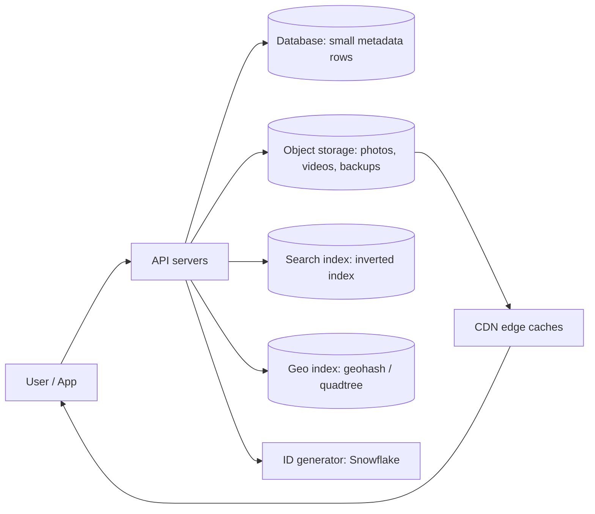
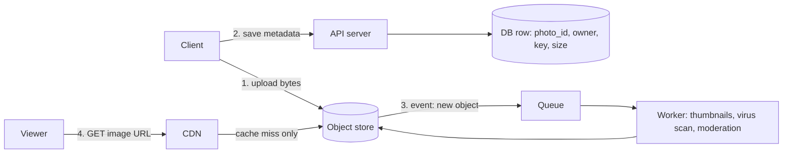
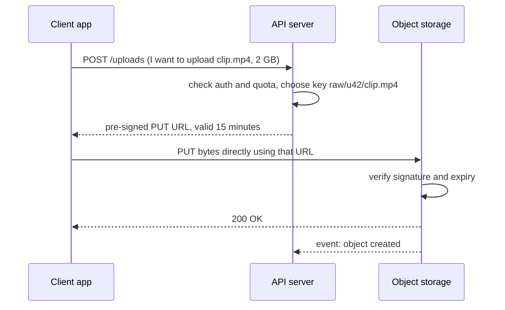
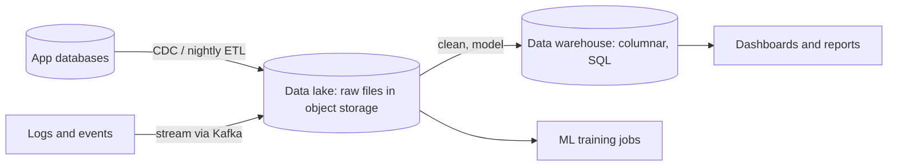
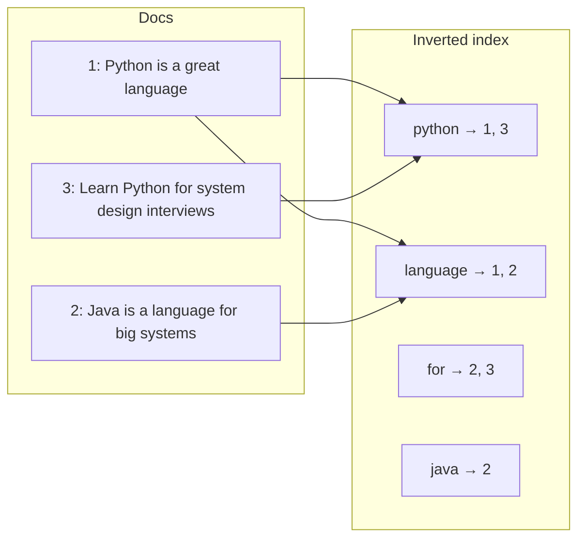
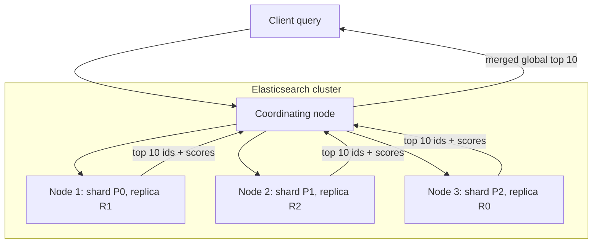
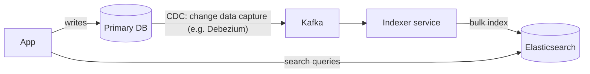
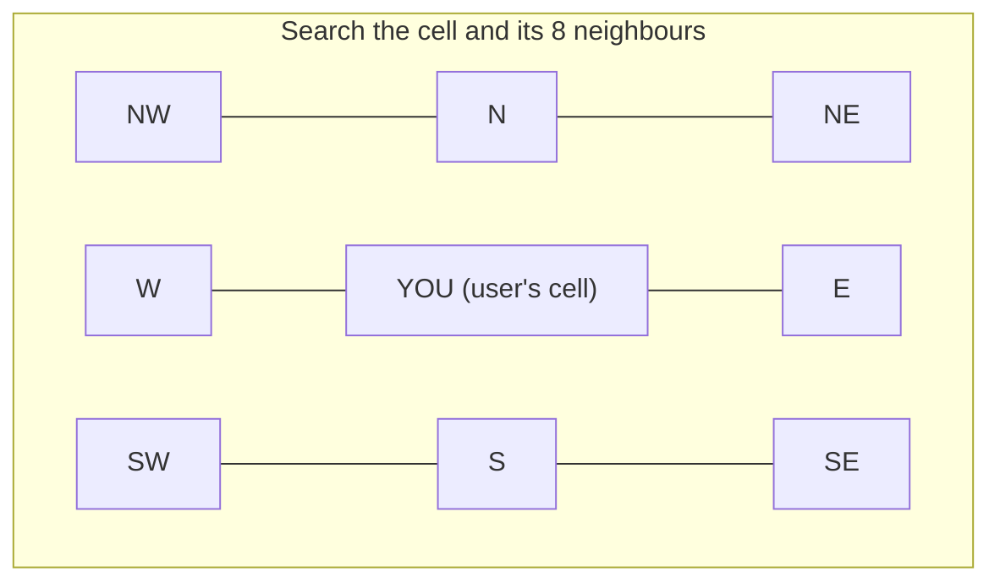
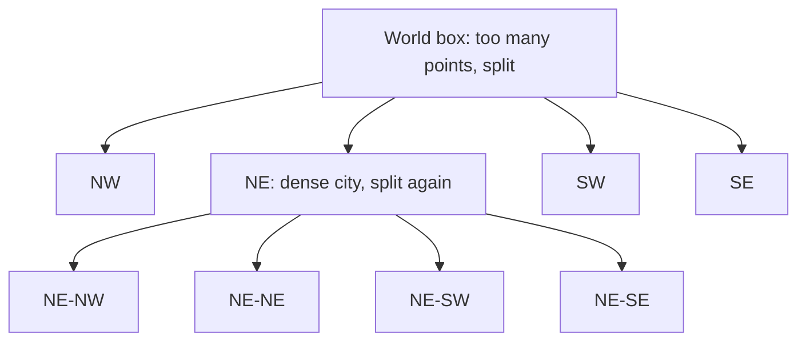
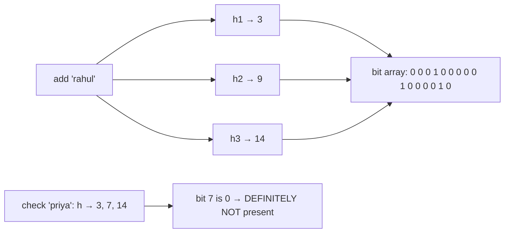

# Chapter 10 · Storage, Search & Unique IDs

> Every app you love quietly answers four questions billions of times a day: *Where do I keep this 2 GB video? How do I find the one post that mentions "biryani" among a billion? Which restaurants are within 2 km of you? What do I call this new tweet so that no other tweet on Earth has the same name?* This chapter gives you the toolkit for all four, plus a few "magic" data structures that answer questions with a tiny fraction of the memory you'd expect.

**You will learn:**
- **Block vs file vs object storage**, how the S3 model works, and why photos and videos never live inside your database
- **Pre-signed URLs** and **chunked, resumable uploads** (and how to build both)
- **Data lakes and warehouses** in one page
- How search engines work: an **inverted index** built from scratch, tokenisation, phrase queries, and ranking with **TF-IDF and BM25**
- **Elasticsearch** architecture and **typeahead** (autocomplete) basics
- **Geospatial indexing:** geohash, quadtree and an overview of H3
- **Unique ID generation:** auto-increment, UUID, ticket servers and **Snowflake** (with a runnable bit layout)
- Probabilistic data structures: **Bloom filters** (runnable), **HyperLogLog** and **count-min sketch**

**Before this:** [Databases](03-databases.md) · [Caching & CDNs](04-caching-cdn.md) · [Replication, Sharding & Consistent Hashing](05-replication-sharding.md) · [Message Queues](08-queues-events.md) · helpful from Part 2: [Two Pointers](../part-2-dsa/03-two-pointers.md), [Tries](../part-2-dsa/19-tries.md), [Bit Manipulation](../part-2-dsa/23-bits-math.md)

---

## 🧠 The Big Idea

Think of a huge city library.

- The **books themselves** are heavy and big. You don't keep them on the librarian's desk. They sit in a giant warehouse, each with a numbered tag. That's **object storage**.
- The **catalogue cards** (title, author, which shelf) are small and you search them all the time. They live in a neat cabinet. That's your **database**.
- The **index at the back of every book** ("dragons: pages 4, 19, 210") lets you jump straight to the right page instead of reading the whole book. Build one giant index for *all* books and you have a **search engine**.
- The **map on the wall**, divided into numbered zones, lets you find "libraries near me" without measuring the distance to every library in the country. That's **geospatial indexing**.
- Every new book gets an **accession number** that no other book will ever have, even when ten branches add books at the same moment. That's **unique ID generation**.
- And the guard at the door who can say instantly "this person is *definitely not* a member" without opening the member register? That's a **Bloom filter**.



> 💡 **The one rule behind this whole chapter:** *each kind of data and each kind of question deserves its own specialised structure.* A database is brilliant at "give me row 42". It is terrible at "store this 2 GB file", "which documents contain these three words?" and "what's near this point?". Senior engineers win interviews by naming the right specialised tool and explaining *why*.

---

## 🔨 Building It Up

We'll go in five parts: **Storage** (sections 1–7), **Search** (8–15), **Geospatial** (16–19), **Unique IDs** (20–24) and **Probabilistic structures** (25–27).

### 1. Three kinds of storage: block, file, object

All storage is ultimately bytes on disks (spinning hard drives or SSDs). What differs is **the interface**: how you ask for those bytes.

| | **Block storage** | **File storage** | **Object storage** |
|---|---|---|---|
| Analogy | A numbered row of empty lockers. You decide what goes where. | A filing cabinet with folders inside folders. | A cloakroom: hand over your coat, get a ticket, show the ticket to get it back. |
| You address data by | Block number (e.g. "block 81,920") | Path (`/home/asha/notes.txt`) | Key in a bucket (`photos/users/42/avatar.jpg`) |
| Can edit 1 byte in the middle? | Yes, very fast | Yes | No. You replace the whole object (or append via special APIs) |
| Typical latency | Sub-millisecond | Low milliseconds | Tens of milliseconds to first byte |
| Scale | One disk volume, usually attached to one machine | Shared by many machines, but hard to scale to billions of files | Practically unlimited: trillions of objects, exabytes |
| Examples | AWS EBS, a laptop SSD, SAN volumes | NFS, AWS EFS, Windows file shares | AWS S3, Google Cloud Storage, Azure Blob, MinIO |
| Best for | Databases, VM boot disks | Shared folders, legacy apps, home directories | Images, videos, backups, logs, data lakes, static websites |

**Block storage** is the lowest level. The disk is a giant array of fixed-size blocks (often 4 KB). It knows nothing about files. Your operating system's file system, or a database engine like PostgreSQL, sits on top and decides which block holds what. Because you can overwrite any block in place, it's the right home for databases, which constantly update small pieces of pages.

**File storage** adds the familiar tree of folders and files, permissions and locking. A network file system lets many servers mount the same folder. The tree is its weakness at huge scale: listing a folder with 50 million files, or keeping the folder tree consistent across many machines, is painful.

**Object storage** throws the tree away. There is a **flat** namespace: a **bucket** (a top-level container) holds **objects**, each identified by a **key** (a string). Each object is the bytes plus **metadata** (size, content type, custom tags) plus a version or checksum (often called an **ETag**). Keys can *contain* slashes, like `users/42/avatar.jpg`, and tools *show* them as folders, but that's an illusion: it's one long string.

> 💡 Why does throwing away the tree help? Because a flat key → bytes map is just a giant distributed hash map. You can shard it across thousands of machines with [consistent hashing](05-replication-sharding.md) without ever coordinating a folder tree. Simplicity scales.

### 2. The S3 model in code

Here is the object-storage *interface*, shrunk to a toy that fits on one screen. The real thing is an HTTP API (`PUT`, `GET`, `HEAD`, `DELETE`, `LIST`), but the shape is identical.

```python
import hashlib

class ToyObjectStore:
    """A tiny in-memory 'S3': a flat map of bucket/key -> (bytes, metadata)."""
    def __init__(self):
        self.objects = {}

    def put(self, bucket, key, data, content_type="application/octet-stream"):
        etag = hashlib.md5(data).hexdigest()
        self.objects[(bucket, key)] = (data, {"size": len(data),
                                              "content_type": content_type,
                                              "etag": etag})
        return etag

    def get(self, bucket, key):
        return self.objects[(bucket, key)][0]

    def head(self, bucket, key):
        return self.objects[(bucket, key)][1]

    def list(self, bucket, prefix=""):
        return sorted(k for (b, k) in self.objects if b == bucket and k.startswith(prefix))

s3 = ToyObjectStore()
s3.put("photos", "users/42/avatar.jpg", b"\xff\xd8 fake jpeg", "image/jpeg")
s3.put("photos", "users/42/trip/goa-1.jpg", b"beach", "image/jpeg")
s3.put("photos", "users/7/avatar.jpg", b"cat", "image/jpeg")

print(s3.list("photos", prefix="users/42/"))
print(s3.head("photos", "users/7/avatar.jpg"))
print(s3.get("photos", "users/42/trip/goa-1.jpg"))
```

```text
['users/42/avatar.jpg', 'users/42/trip/goa-1.jpg']
{'size': 3, 'content_type': 'image/jpeg', 'etag': 'd077f244def8a70e5ea758bd8352fcd8'}
b'beach'
```

What just happened:
- `list(prefix="users/42/")` *looks* like opening a folder, but it is a **prefix scan** over sorted keys. That's all "folders" are in S3.
- `head` returns only metadata, without downloading the bytes. Real systems use it to check size or existence cheaply.
- The **ETag** here is an MD5 of the content. Clients use it to detect corruption and to ask "has this changed since I last downloaded it?"

Key facts about real S3-style stores that interviewers like to hear:
- **Durability vs availability.** AWS designs S3 Standard for 99.999999999% ("eleven nines") **durability**: the chance of *losing* an object is tiny, because data is spread across multiple devices and data centres. **Availability** (can I read it *right now*?) is a separate, lower number.
- **Consistency.** Since December 2020, S3 gives strong read-after-write consistency: after a successful `PUT`, a `GET` sees the new data. Older articles say "eventually consistent"; that's outdated.
- **Objects are replaced, not edited.** To change one byte of a 1 GB object you upload a new 1 GB object. That's fine for photos and videos, which are written once and read many times.
- **Cheap tiers.** You can move old objects to colder, cheaper storage classes (for example S3 Glacier) with lifecycle rules: "after 90 days, move to cold storage; after 1 year, delete".

### 3. Storing images and videos: bytes in blobs, facts in the database

The beginner instinct is to store an uploaded photo in a database column (a `BLOB`). Don't. The standard design splits a photo into two parts:

1. **The bytes** go to object storage, under some key.
2. **The facts** (owner, key, size, width, height, upload time, privacy setting) go into a normal database row.



Why this split wins:

| Concern | Photo in a DB column | Photo in object storage + DB row |
|---|---|---|
| DB size and backups | Explodes; backups take hours | DB stays small and fast |
| Serving to users | Every view hits your DB and app servers | CDN serves it from the edge ([Chapter 04](04-caching-cdn.md)) |
| Cost per GB | Expensive SSD storage, replicated | Very cheap, with cold tiers |
| Scaling | Hard: DB sharding | Practically unlimited |

Extra tricks for media:
- **Multiple renditions.** A background worker (fed by a queue, see [Chapter 08](08-queues-events.md)) produces thumbnails (150 px, 600 px, 1080 px) so a phone on 4G never downloads a 12 MB original just to show a tiny avatar. Videos get **transcoded** into many resolutions and cut into small segments for adaptive streaming; we design that end to end in [Chapter 13](13-case-studies-2.md).
- **Immutable keys.** If an image changes, give it a *new* key (e.g. include a version or hash). Then CDNs can cache forever, and you never fight stale caches.
- **Content-addressed storage.** Use the *hash of the bytes* as the key. Identical files (the same viral meme forwarded by a million people) are stored once:

```python
import hashlib

store = {}           # object key -> bytes     (the blob store, e.g. S3)
photos = []          # metadata rows           (the database)

def upload_photo(user_id, data):
    digest = hashlib.sha256(data).hexdigest()
    key = f"photos/{digest[:2]}/{digest}"        # content-addressed key
    is_new = key not in store
    if is_new:
        store[key] = data                         # only store bytes we've never seen
    photos.append({"user": user_id, "key": key, "size": len(data)})
    return key[:20] + "...", "stored" if is_new else "deduplicated"

meme = b"<same viral meme bytes>" * 1000
print(upload_photo(1, meme))
print(upload_photo(2, meme))        # 2nd user forwards the same meme
print(upload_photo(3, b"<a unique holiday photo>"))
print("metadata rows:", len(photos), "| blobs stored:", len(store),
      "| bytes stored:", sum(len(v) for v in store.values()))
```

```text
('photos/5a/5a34db93ad...', 'stored')
('photos/5a/5a34db93ad...', 'deduplicated')
('photos/24/24c75ad929...', 'stored')
metadata rows: 3 | blobs stored: 2 | bytes stored: 23024
```

What just happened: three users, three metadata rows, but only two blobs. Each user still "owns" a photo (their row), while the bytes are shared. Deleting needs care: you can only delete a blob when **no** row points to it any more (reference counting).

### 4. Pre-signed URLs: let clients talk to storage directly

If every upload went *through* your API servers, a 2 GB video would tie up an app server for minutes, and you'd pay for the bandwidth twice (client → you → storage). Instead, your server hands the client a **pre-signed URL**: a normal URL with a cryptographic signature attached that says "the holder may `PUT` exactly *this* key, until *this* time".



How can the storage service trust a URL it never saw before? Both sides share a **secret key** that clients never see. The server computes an **HMAC** (a keyed hash) over "method + bucket + key + expiry". Change any letter of the URL, and the signature no longer matches. Here's the whole idea in code:

```python
import hashlib
import hmac
from urllib.parse import urlencode, urlparse, parse_qs

SECRET = b"server-side-secret-never-sent-to-clients"

def presign(bucket, key, method, expires_at):
    """Return a URL that allows exactly this method on this object until expires_at."""
    message = f"{method}\n{bucket}\n{key}\n{expires_at}".encode()
    sig = hmac.new(SECRET, message, hashlib.sha256).hexdigest()[:16]
    query = urlencode({"expires": expires_at, "sig": sig})
    return f"https://storage.example.com/{bucket}/{key}?{query}"

def verify(url, method, now):
    """What the storage service does when the request arrives."""
    parts = urlparse(url)
    bucket, key = parts.path.lstrip("/").split("/", 1)
    q = parse_qs(parts.query)
    expires_at, sig = int(q["expires"][0]), q["sig"][0]
    if now > expires_at:
        return "403 expired"
    message = f"{method}\n{bucket}\n{key}\n{expires_at}".encode()
    expected = hmac.new(SECRET, message, hashlib.sha256).hexdigest()[:16]
    if not hmac.compare_digest(sig, expected):
        return "403 bad signature"
    return "200 OK"

now = 1_700_000_000                      # pretend clock (Unix seconds)
url = presign("videos", "raw/u42/clip.mp4", "PUT", expires_at=now + 900)
print(url)
print(verify(url, "PUT", now + 60))      # within 15 minutes
print(verify(url, "PUT", now + 1000))    # too late
print(verify(url, "GET", now + 60))      # different method -> different signature
tampered = url.replace("u42", "u43")     # try to write someone else's file
print(verify(tampered, "PUT", now + 60))
```

```text
https://storage.example.com/videos/raw/u42/clip.mp4?expires=1700000900&sig=08d395b777164f78
200 OK
403 expired
403 bad signature
403 bad signature
```

What just happened:
- The URL carries its own permission. Storage only needs the shared secret to check it; no database lookup.
- Changing the user id, the method or the expiry breaks the signature. `hmac.compare_digest` compares in constant time, so attackers can't guess the signature byte by byte from timing differences.
- Real systems (AWS Signature Version 4) sign more fields (headers, content type, region), but the idea is exactly this.

Pre-signed URLs work for **downloads** too: private files (your bank statements, a paid course video) get short-lived `GET` URLs, so a link copied to a forum stops working in minutes.

### 5. Chunked and resumable uploads

Uploading a 2 GB file in one request is fragile. On a train, the connection drops at 1.9 GB and you start from zero. The fix is **multipart (chunked) upload**:

1. **Initiate:** the server creates an upload session and returns an `upload_id`.
2. **Upload parts:** the client splits the file into chunks (S3 parts are 5 MiB to 5 GiB, except the last which can be smaller; up to 10,000 parts) and uploads each with its part number and a checksum. Parts can go **in parallel**.
3. **Resume:** after a failure, the client asks "which parts do you have?" and sends only the missing ones.
4. **Complete:** the server stitches the parts together, in part-number order, into one object.

```python
import hashlib

CHUNK = 4  # bytes per part; real systems use 5-100 MB parts

class MultipartUpload:
    """Server side: remembers which parts arrived, then stitches them together."""
    def __init__(self, total_parts):
        self.total_parts = total_parts
        self.parts = {}                      # part_number -> bytes

    def upload_part(self, number, data, checksum):
        if hashlib.md5(data).hexdigest() != checksum:
            return "corrupted, resend"
        self.parts[number] = data            # re-uploading a part just overwrites it
        return "ok"

    def missing_parts(self):
        return [n for n in range(1, self.total_parts + 1) if n not in self.parts]

    def complete(self):
        assert not self.missing_parts(), "cannot complete yet"
        return b"".join(self.parts[n] for n in range(1, self.total_parts + 1))

file_bytes = b"HELLO-WORLD-THIS-IS-A-BIG-VIDEO!"
chunks = [file_bytes[i:i + CHUNK] for i in range(0, len(file_bytes), CHUNK)]
upload = MultipartUpload(total_parts=len(chunks))

# First attempt: the Wi-Fi dies after part 5.
for number, data in enumerate(chunks, start=1):
    if number == 6:
        print("connection lost!")
        break
    upload.upload_part(number, data, hashlib.md5(data).hexdigest())

# Later: ask the server what is missing and send only that.
print("missing:", upload.missing_parts())
for number in upload.missing_parts():
    data = chunks[number - 1]
    upload.upload_part(number, data, hashlib.md5(data).hexdigest())

result = upload.complete()
print(result == file_bytes, len(chunks), "parts")
```

```text
connection lost!
missing: [6, 7, 8]
True 8 parts
```

What just happened: the server keeps a set of received part numbers. Re-sending a part is **idempotent** (it just overwrites the same slot), so retries are always safe. The per-part checksum catches corrupted chunks. This is exactly how Google Drive, YouTube and Dropbox uploads survive flaky networks.

> 💡 Bonus: once files are chunked, you can **deduplicate per chunk**. Dropbox-style sync hashes each chunk; if you edit one page of a 100 MB document, only the changed chunks are uploaded.

> ⚠️ Abandoned multipart uploads keep their parts (and you keep paying for them) until you abort them. Set a lifecycle rule like "abort incomplete uploads after 7 days".

### 6. A quick word on video

Video is just "big media" with extra steps, and [Chapter 13](13-case-studies-2.md) designs a full YouTube. The storage-side summary:
- Raw upload → object storage (via pre-signed multipart upload).
- A queue triggers **transcoding** workers that produce many resolutions (240p … 4K) and codecs, each cut into short segments (a few seconds each) with a playlist file (HLS or DASH).
- Players download the playlist and pick the segment quality that matches their bandwidth, switching up or down as the network changes: **adaptive bitrate streaming**.
- Segments are served through a CDN. Popular videos are pre-warmed at the edge; the long tail stays in cheaper storage.

### 7. Data lakes and warehouses (the one-page version)

Your app's database is built for **OLTP** (online transaction processing): many tiny reads and writes like "insert this order", "fetch user 42". Analysts ask a different kind of question, **OLAP** (online analytical processing): "total revenue per city per month for 3 years". That query reads *billions* of rows but only a few columns, and it would crush your production database.

So companies copy data into separate analytics systems:



| | **Data lake** | **Data warehouse** |
|---|---|---|
| What it stores | Everything, raw: JSON logs, CSVs, Parquet files, images | Cleaned, structured tables |
| Where | Object storage (S3, GCS, ADLS) | Specialised engines: Snowflake, BigQuery, Redshift |
| Schema | **Schema-on-read** (decide structure when you query) | **Schema-on-write** (data must fit tables when loaded) |
| Users | Data engineers, ML teams | Analysts, business dashboards |
| Strength | Cheap, flexible, keeps everything | Fast SQL on huge tables, well-governed |

Both rely on **columnar storage** (formats like Parquet and ORC): instead of storing row by row, each column is stored together. A query that needs only `city` and `revenue` reads just those two columns, and similar values next to each other compress extremely well. A **lakehouse** (for example Delta Lake, Apache Iceberg, Apache Hudi table formats) adds warehouse features like transactions and schemas on top of lake files.

> 💡 In a system design interview, one sentence is often enough: "Events go to Kafka, land in an S3 data lake as Parquet, and analytics runs in a warehouse, so analytical queries never touch the production database."

### 8. Why databases are bad at search

Suppose you store 100 million product descriptions and a user types `wireless headphones`. The obvious SQL:

```sql
SELECT id, title FROM products
WHERE description LIKE '%wireless%' AND description LIKE '%headphones%';
```

This is a disaster at scale:
- A normal B-tree index ([Chapter 03](03-databases.md)) is sorted by the *start* of the value, so it can help `LIKE 'wireless%'` but **not** `LIKE '%wireless%'`. The database must scan **every row**: O(total text size) per query.
- It matches substrings, so `%cat%` finds "**cat**alogue" and "lo**cat**ion".
- `Headphones`, `headphone` and `HEADPHONES` are different strings to it.
- It can't say which match is *best*. Search users expect the most relevant result first.

Search engines flip the problem around. Instead of "for each document, which words does it contain?" they precompute **"for each word, which documents contain it?"**

### 9. The inverted index, from scratch

Remember the index at the back of a textbook: `recursion → 112, 140, 301`. An **inverted index** is the same thing for a whole collection: a map from each **term** (word) to a **posting list**, the sorted list of document ids that contain it.



```python
from collections import defaultdict

docs = {
    1: "Python is a great language",
    2: "Java is a language for big systems",
    3: "Learn Python for system design interviews",
}

def tokenize(text):
    return text.lower().split()

# Build: word -> sorted list of document ids (the "posting list")
index = defaultdict(list)
for doc_id in sorted(docs):
    for word in set(tokenize(docs[doc_id])):
        index[word].append(doc_id)

print("python ->", index["python"])
print("language ->", index["language"])
print("for ->", index["for"])

def search_and(query):
    """Documents containing ALL query words."""
    postings = [set(index.get(w, [])) for w in tokenize(query)]
    return sorted(set.intersection(*postings)) if postings else []

def search_or(query):
    """Documents containing ANY query word."""
    result = set()
    for w in tokenize(query):
        result |= set(index.get(w, []))
    return sorted(result)

print(search_and("python language"))
print(search_or("java interviews"))
print(search_and("system"))       # only doc 3: doc 2 says "systems", a different token
```

```text
python -> [1, 3]
language -> [1, 2]
for -> [2, 3]
[1]
[2, 3]
[3]
```

What just happened:
- **Indexing** costs one pass over all the text, done once (and incrementally for new documents).
- **Querying** only touches the posting lists of the query words. If "python" appears in 3,000 of 100 million documents, we look at 3,000 ids, not 100 million documents. That is the entire reason search is fast.
- The last query exposes a weakness: `system` didn't match `systems`. We fix that with text analysis in section 11.

### 10. Intersecting posting lists: two pointers strike again

A real index stores posting lists **sorted** and compressed on disk, not as Python sets. To answer `python AND design`, the engine walks two sorted lists at once, exactly the "two arrays, one pointer each" shape from [Two Pointers](../part-2-dsa/03-two-pointers.md):

```python
def intersect(a, b):
    """Merge-walk two sorted posting lists: O(len(a) + len(b))."""
    i = j = 0
    out = []
    while i < len(a) and j < len(b):
        if a[i] == b[j]:
            out.append(a[i]); i += 1; j += 1
        elif a[i] < b[j]:
            i += 1
        else:
            j += 1
    return out

python_docs = [3, 8, 15, 21, 42, 99]
design_docs = [2, 8, 21, 50, 99, 120]
print(intersect(python_docs, design_docs))
```

```text
[8, 21, 99]
```

Engine tricks on top of this:
- **Start with the rarest term.** For `the AND python AND kubernetes`, intersect the two shortest lists first; the result is tiny, and the huge list for "the" barely gets touched.
- **Skip pointers.** Posting lists store "jump ahead" markers so that when `a[i]` is far behind `b[j]`, the pointer leaps over many entries at once instead of stepping one by one.
- **Compression.** Store the *gaps* between sorted ids (3, 8, 15 → 3, 5, 7). Gaps are small numbers, so they fit in a byte or two (variable-byte encoding). Posting lists shrink several times over.

### 11. Text analysis: tokenisation, stop words, stemming

Before words go into the index, an **analyzer** cleans them up. The *same* analyzer must run on both documents and queries, otherwise they won't meet in the middle.

1. **Tokenisation:** split text into tokens. Not just on spaces: "don't", "e-mail", "C++", "₹500" and languages without spaces (Chinese, Japanese) all need rules.
2. **Normalisation:** lowercase, strip accents (`café` → `cafe`).
3. **Stop words:** drop super-common words ("the", "is", "a") that match almost everything. Modern engines often *keep* them and let ranking down-weight them, because phrases like "to be or not to be" are all stop words.
4. **Stemming / lemmatisation:** reduce word forms to a common root: `running`, `runs` → `run`. Stemming chops suffixes by rules (fast, sometimes wrong). Lemmatisation uses a dictionary (`better` → `good`).
5. Optional: **synonyms** (`tv` ↔ `television`), **n-grams** for partial matching, **phonetic** codes for misspelled names.

```python
import re

STOP_WORDS = {"a", "an", "the", "is", "are", "for", "of", "to", "and", "in", "on"}

def stem(word):
    """A toy stemmer: chop a few common English endings.
    Real engines use Porter/Snowball stemmers or dictionary lemmatisers."""
    for suffix in ("ing", "ers", "er", "es", "s", "ed"):
        if word.endswith(suffix) and len(word) - len(suffix) >= 3:
            word = word[: -len(suffix)]
            if word[-1] == word[-2]:          # "runn" -> "run"
                word = word[:-1]
            return word
    return word

def analyze(text):
    words = re.findall(r"[a-z0-9]+", text.lower())      # 1. lowercase + split on non-letters
    words = [w for w in words if w not in STOP_WORDS]   # 2. drop stop words
    return [stem(w) for w in words]                     # 3. normalise word forms

print(analyze("The Running Dogs are RUNNING in the park!"))
print(analyze("Designing systems for millions of users"))
print(analyze("system design, designers & user"))
```

```text
['run', 'dog', 'run', 'park']
['design', 'system', 'million', 'user']
['system', 'design', 'design', 'user']
```

What just happened: two very different sentences ("Designing systems for millions of users" and "system design, designers & user") now produce overlapping tokens, so a search for one finds the other. Our stemmer is a toy (it wrongly turns "news" into "new", and it can't handle "mice" → "mouse"), which is why real engines use well-tested stemmers and language-specific analyzers.

### 12. Phrase queries need positions

`"new york"` in quotes means *these words next to each other in this order*. A plain posting list can't answer that: a document can contain "new" and "york" far apart. So engines store **positions** too: `york → {doc 1: [1], doc 2: [0, 13]}`.

```python
from collections import defaultdict

docs = {
    1: "new york is big",
    2: "york is a city in england and new jersey is not new york",
    3: "is new delhi in york",
}

# Positional index: word -> {doc_id: [positions]}
index = defaultdict(lambda: defaultdict(list))
for d, text in docs.items():
    for pos, word in enumerate(text.split()):
        index[word][d].append(pos)

def phrase_search(phrase):
    words = phrase.split()
    first, rest = words[0], words[1:]
    hits = []
    for d, positions in index[first].items():
        for p in positions:
            # every following word must sit exactly one step further along
            if all(p + i + 1 in index[w].get(d, []) for i, w in enumerate(rest)):
                hits.append(d)
                break
    return sorted(hits)

print(phrase_search("new york"))     # doc 3 has both words but not side by side
print(phrase_search("york is"))
```

```text
[1, 2]
[1, 2]
```

Positions also power **proximity** ranking: documents where the query words appear close together score higher, even without quotes.

### 13. Ranking: TF-IDF and BM25

Finding *matching* documents is half the job. With a million matches, the order is everything. Two intuitions drive almost all classic ranking:

1. **Term frequency (TF):** a document that mentions "python" 10 times is probably more about Python than one that mentions it once.
2. **Inverse document frequency (IDF):** a word that appears in *every* document ("tips", "the") tells you little. A rare word ("kubernetes") is a strong signal. IDF is roughly `log(N / df)`, where N is the number of documents and **df** (document frequency) is how many contain the word.

**TF-IDF** score of a document for a query = sum over query words of `TF × IDF`.

**BM25** (Best Matching 25, the default in Elasticsearch, OpenSearch and Lucene) fixes two flaws of raw TF-IDF:
- **TF saturation:** the 10th mention of "python" should add much less than the 1st. BM25 uses `tf × (k1 + 1) / (tf + k1 × ...)`, which grows quickly at first then flattens out. `k1` (about 1.2) controls how fast it saturates.
- **Length normalisation:** a 5,000-word page mentions everything a few times just by being long. BM25 divides by the document's length relative to the average, controlled by `b` (about 0.75).

```python
import math
from collections import Counter, defaultdict

docs = {
    1: "python python python tips",
    2: "python for data science and machine learning with python",
    3: "cooking tips for beginners",
    4: "machine learning interview tips",
}
tokenized = {d: text.split() for d, text in docs.items()}
N = len(docs)
avg_len = sum(len(t) for t in tokenized.values()) / N

# Inverted index that also stores term frequency: word -> {doc_id: count}
index = defaultdict(dict)
for d, words in tokenized.items():
    for word, count in Counter(words).items():
        index[word][d] = count

def idf(word):
    df = len(index.get(word, {}))                 # how many docs contain the word
    return math.log((N - df + 0.5) / (df + 0.5) + 1)   # BM25's IDF (always > 0)

def tf_idf(query):
    scores = defaultdict(float)
    for word in query.split():
        for d, tf in index.get(word, {}).items():
            scores[d] += tf * idf(word)
    return sorted(scores.items(), key=lambda x: -x[1])

def bm25(query, k1=1.2, b=0.75):
    scores = defaultdict(float)
    for word in query.split():
        for d, tf in index.get(word, {}).items():
            length_norm = 1 - b + b * len(tokenized[d]) / avg_len
            scores[d] += idf(word) * tf * (k1 + 1) / (tf + k1 * length_norm)
    return sorted(scores.items(), key=lambda x: -x[1])

def show(name, ranked):
    print(name, [(d, round(s, 2)) for d, s in ranked])

show("idf:", [(w, idf(w)) for w in ("python", "tips", "machine", "cooking")])
show("tf-idf python tips   :", tf_idf("python tips"))
show("bm25   python tips   :", bm25("python tips"))
show("bm25   machine tips  :", bm25("machine tips"))
```

```text
idf: [('python', 0.69), ('tips', 0.36), ('machine', 0.69), ('cooking', 1.2)]
tf-idf python tips   : [(1, 2.44), (2, 1.39), (3, 0.36), (4, 0.36)]
bm25   python tips   : [(1, 1.54), (2, 0.79), (3, 0.4), (4, 0.4)]
bm25   machine tips  : [(4, 1.16), (2, 0.54), (1, 0.4), (3, 0.4)]
```

What just happened:
- `tips` is in 3 of 4 documents, so its IDF (0.36) is low. `cooking` is in just one, so its IDF (1.2) is high. Rare words matter more.
- Under TF-IDF, doc 1 scores 3 × 0.69 + 0.36 = 2.44: three "python"s count three times as much as one. Under BM25 the extra mentions are **saturated**, so doc 1 leads by less.
- For "machine tips", doc 4 beats doc 2 even though both contain "machine": doc 4 is short (4 words) and also contains "tips", while doc 2 is long (9 words), so BM25's length normalisation shrinks its score.

> 💡 Modern search adds layers on top of BM25: business signals (popularity, freshness, ratings, personalisation), **learning-to-rank** models that combine hundreds of features, and **semantic / vector search**, which turns text into embedding vectors and finds "nearest" vectors, so "cheap phone" can match "budget smartphone". Many systems do **hybrid search**: BM25 for exact keywords + vectors for meaning, then re-rank.

### 14. Elasticsearch architecture

You almost never build an inverted index yourself in production. You use **Elasticsearch** or **OpenSearch** (both built on the Java library **Lucene**), or Solr. Here's how they scale your toy index to billions of documents.



Vocabulary:
- **Document:** a JSON object (a product, a tweet, a log line).
- **Index:** a collection of documents, like a table. (Confusingly, "index" means both this and the inverted-index structure.)
- **Shard:** an index is split into N **primary shards**; each shard is a complete Lucene index holding a slice of the documents. A document goes to shard `hash(doc_id) % number_of_primary_shards`. This is why the number of primary shards is fixed at index creation (changing it would move every document; you **reindex** or use the split/shrink APIs instead).
- **Replica:** a copy of a primary shard on a *different* node. Replicas give fault tolerance and extra read capacity.
- **Node:** one server in the cluster. Some are **master-eligible** (manage cluster state: which shard lives where), some are **data** nodes, some just **coordinate**.

**How a search runs (scatter-gather, "query then fetch"):**
1. The coordinating node sends the query to one copy (primary or replica) of **every** shard.
2. **Query phase:** each shard searches its local inverted index and returns just the ids and scores of its local top k.
3. The coordinator merges these into the global top k (a merge of sorted lists, or a heap).
4. **Fetch phase:** it fetches the full documents for only those k ids.

**How writes work (near real-time):**
- A new document is written to an in-memory buffer and a **translog** (a write-ahead log, for durability).
- Every **refresh** interval (1 second by default) the buffer becomes a new small, **immutable segment** that is searchable. That's why Elasticsearch is called **near real-time**: a document may take about a second to appear in results.
- Segments are never edited. A delete just marks the doc as deleted; an update is "delete + add new". Background **merging** combines small segments into bigger ones and finally drops deleted docs.

**Keeping search in sync with your database.** Elasticsearch is usually *not* your source of truth. The database is. Common pipelines:



Writing to both DB and ES directly from the app ("dual writes") is tempting but risky: if one write fails, they drift apart. Using **change data capture** or the **outbox pattern** ([Chapter 08](08-queues-events.md)) gives you an ordered, retryable stream of changes. Accept that search is **eventually consistent** with the DB (usually lagging by seconds), and keep the ability to rebuild the whole index from the DB.

### 15. Typeahead (autocomplete) basics

As you type `sys`, a box suggests "system design", "system of a down"... That needs answers in **well under 100 ms per keystroke**, so we can't scan anything at query time. The classic structure is a [trie](../part-2-dsa/19-tries.md) (prefix tree) where every node **caches the top k completions** for its prefix. Lookup is then just "walk down `len(prefix)` nodes and return the cached list".

```python
import heapq

class Node:
    __slots__ = ("children", "top")
    def __init__(self):
        self.children = {}
        self.top = []          # cached best completions for this prefix: [(-count, phrase)]

class Autocomplete:
    def __init__(self, k=3):
        self.root = Node()
        self.k = k

    def add(self, phrase, count):
        node = self.root
        for ch in phrase:
            node = node.children.setdefault(ch, Node())
            # keep only the k most popular phrases at every prefix node
            node.top.append((-count, phrase))
            node.top = heapq.nsmallest(self.k, node.top)

    def suggest(self, prefix):
        node = self.root
        for ch in prefix:
            if ch not in node.children:
                return []
            node = node.children[ch]
        return [phrase for _, phrase in node.top]   # O(len(prefix)), no subtree walk

searches = {"system design": 900, "system of a down": 300, "sys admin jobs": 150,
            "python": 1000, "python list": 700, "pycharm": 400, "pyramid": 50}
ac = Autocomplete(k=3)
for phrase, count in searches.items():
    ac.add(phrase, count)

print(ac.suggest("sys"))
print(ac.suggest("py"))
print(ac.suggest("pyt"))
print(ac.suggest("java"))
```

```text
['system design', 'system of a down', 'sys admin jobs']
['python', 'python list', 'pycharm']
['python', 'python list']
[]
```

What just happened: we trade **memory** (each node stores k phrases) for **speed** (no subtree search at query time). In production:
- Counts come from search logs, aggregated **offline** (e.g. hourly or daily) and the trie is rebuilt and shipped to servers; the read path never waits on the write path.
- Results are cached aggressively (CDN, browser), and the client **debounces** (waits ~100 ms after the last keystroke) so we don't fire a request per letter.
- The trie is sharded by prefix (`a–f` on one server...) or replicated whole if it fits in memory.

The complete design (data collection, sampling, trending terms, filtering offensive suggestions) is a case study in [Chapter 13](13-case-studies-2.md).

### 16. Geospatial: why "near me" is hard

"Show restaurants within 2 km" sounds like a simple filter:

```sql
SELECT id, name FROM restaurants
WHERE lat BETWEEN 28.60 AND 28.64
  AND lon BETWEEN 77.20 AND 77.24;
```

Even with an index on `lat` and another on `lon`, the database can use one index well, not both together. The latitude filter alone matches a thin strip that circles the *entire planet* (every restaurant at that latitude, from Delhi to Mexico), and then it filters that strip by longitude. Two-dimensional data doesn't fit naturally into one-dimensional sorted indexes.

The trick behind every geospatial index: **turn 2D locations into something 1D and sortable (or into a tree of boxes), such that points close on the map are usually close in the index.**

### 17. Geohash: the map as nested boxes with names

**Geohash** repeatedly halves the world:
1. Is the longitude in the left half (−180..0) or the right half (0..180)? Write 0 or 1.
2. Is the latitude in the bottom half or the top half? 0 or 1.
3. Repeat inside the chosen half, alternating longitude and latitude bits.
4. Every 5 bits become one character in a base-32 alphabet.

Each extra character makes the box 32 times smaller. Points with a **common prefix** are in the same box. So "find nearby" becomes a **prefix query**, which ordinary sorted indexes, B-trees and even Redis handle well.

```python
BASE32 = "0123456789bcdefghjkmnpqrstuvwxyz"   # geohash alphabet (no a, i, l, o)

def geohash(lat, lon, precision=6):
    lat_lo, lat_hi = -90.0, 90.0
    lon_lo, lon_hi = -180.0, 180.0
    bits, even = [], True                  # bits alternate: lon, lat, lon, lat, ...
    while len(bits) < precision * 5:
        if even:
            mid = (lon_lo + lon_hi) / 2
            if lon >= mid:
                bits.append(1); lon_lo = mid    # right half
            else:
                bits.append(0); lon_hi = mid    # left half
        else:
            mid = (lat_lo + lat_hi) / 2
            if lat >= mid:
                bits.append(1); lat_lo = mid    # top half
            else:
                bits.append(0); lat_hi = mid    # bottom half
        even = not even
    out = ""
    for i in range(0, len(bits), 5):        # every 5 bits -> one base-32 character
        value = int("".join(map(str, bits[i:i + 5])), 2)
        out += BASE32[value]
    return out

places = {
    "India Gate, Delhi":        (28.6129, 77.2295),
    "Connaught Place, Delhi":   (28.6315, 77.2167),
    "Gateway of India, Mumbai": (18.9220, 72.8347),
}
for name, (lat, lon) in places.items():
    print(f"{name:26} {geohash(lat, lon, 7)}")
```

```text
India Gate, Delhi          ttnfv2u
Connaught Place, Delhi     ttnfvh5
Gateway of India, Mumbai   te7g9ks
```

What just happened: India Gate and Connaught Place (about 2 km apart) share the prefix `ttnfv`. Mumbai shares only `t`. To find places near India Gate, look up keys starting with `ttnfv`.

Approximate cell sizes (they vary with latitude):

| Geohash length | Cell size (approx.) | Good for |
|---|---|---|
| 4 | 39 km × 20 km | "in this city region" |
| 5 | 4.9 km × 4.9 km | "within a few km" |
| 6 | 1.2 km × 0.6 km | nearby restaurants, drivers |
| 7 | 153 m × 153 m | "on this street" |
| 8 | 38 m × 19 m | building level |

**The edge problem.** Two points can be 10 metres apart but on opposite sides of a cell border, so they share a short prefix (or none at all, at the equator or the 0° meridian). The standard fix: search the user's cell **plus its 8 neighbours**, then compute the true distance for each candidate and filter. Nine prefix lookups, still fast.



Geohash is popular because it's *just a string*: store it in a column with an index, or use Redis `GEOADD` / `GEOSEARCH` (Redis stores a 52-bit geohash-style score in a sorted set).

### 18. Quadtree: boxes that split only where it's crowded

Geohash cells are a fixed size everywhere. But a city centre has 10,000 restaurants per km² while a desert has none. A **quadtree** adapts: start with one box covering the map; when a box holds more than some capacity, **split it into four** children (NW, NE, SW, SE). Dense areas get deep, tiny boxes; empty areas stay as one big box.



```python
import random

class QuadTree:
    CAPACITY = 4                     # split a box when it holds more than this

    def __init__(self, x0, y0, x1, y1):
        self.box = (x0, y0, x1, y1)
        self.points = []
        self.children = None         # four sub-trees once split

    def insert(self, p):
        x0, y0, x1, y1 = self.box
        if not (x0 <= p[0] < x1 and y0 <= p[1] < y1):
            return False             # not my area
        if self.children is None:
            self.points.append(p)
            if len(self.points) > self.CAPACITY:
                self._split()
            return True
        return any(child.insert(p) for child in self.children)

    def _split(self):
        x0, y0, x1, y1 = self.box
        mx, my = (x0 + x1) / 2, (y0 + y1) / 2
        self.children = [QuadTree(x0, y0, mx, my), QuadTree(mx, y0, x1, my),
                         QuadTree(x0, my, mx, y1), QuadTree(mx, my, x1, y1)]
        for p in self.points:
            any(child.insert(p) for child in self.children)
        self.points = []

    def query(self, qx0, qy0, qx1, qy1, found, stats):
        x0, y0, x1, y1 = self.box
        if qx1 < x0 or qx0 >= x1 or qy1 < y0 or qy0 >= y1:
            return found             # no overlap: skip this whole subtree
        stats["boxes"] += 1
        for p in self.points:
            stats["points"] += 1
            if qx0 <= p[0] <= qx1 and qy0 <= p[1] <= qy1:
                found.append(p)
        if self.children:
            for child in self.children:
                child.query(qx0, qy0, qx1, qy1, found, stats)
        return found

    def depth(self):
        return 1 + (max(c.depth() for c in self.children) if self.children else 0)

random.seed(7)
tree = QuadTree(0, 0, 100, 100)
# a dense "city centre" near (20, 20) plus a few scattered points
points = [(random.uniform(15, 25), random.uniform(15, 25)) for _ in range(200)]
points += [(random.uniform(0, 100), random.uniform(0, 100)) for _ in range(50)]
for p in points:
    tree.insert(p)

stats = {"boxes": 0, "points": 0}
nearby = tree.query(18, 18, 19, 19, [], stats)
brute = [p for p in points if 18 <= p[0] <= 19 and 18 <= p[1] <= 19]
print("tree depth:", tree.depth())
print("found:", len(nearby), "| brute force agrees:", sorted(nearby) == sorted(brute))
print("points examined:", stats["points"], "of", len(points))
```

```text
tree depth: 9
found: 2 | brute force agrees: True
points examined: 6 of 250
```

What just happened: the dense city centre forced the tree 9 levels deep there, while the empty countryside stayed shallow. The range query skipped every box that doesn't overlap the search area, so it looked at only 6 of 250 points and still got exactly the brute-force answer.

Quadtrees are usually kept **in memory** on dedicated location servers (a few hundred million points fit in tens of GB) and rebuilt or updated as places are added. For **moving** objects (drivers updating every few seconds), constantly splitting and merging boxes is costly, which is one reason ride-hailing systems prefer fixed grids like geohash or H3 for live locations. (We design that in [Chapter 13](13-case-studies-2.md).)

### 19. H3, S2 and friends: a quick tour

- **H3** (open-sourced by Uber) covers the globe with **hexagons** at 16 resolutions (0 to 15). Why hexagons? Every neighbour of a hexagon is the **same distance** from its centre (a square has 4 edge neighbours and 4 farther corner neighbours). That makes "expand my search ring by one" and smooth heatmaps (surge pricing per area, demand forecasting) clean. Each cell has a 64-bit id, and functions like "cells within k rings" are built in.
- **S2** (Google) projects the Earth onto a cube and numbers cells along a **Hilbert curve**, a space-filling curve that keeps nearby cells close in the 1D ordering even better than geohash's Z-order curve. Cell ids are 64-bit integers. Used in Google Maps, and by databases like MongoDB and CockroachDB for geo indexes.
- **R-trees** (used by PostGIS in PostgreSQL) group nearby objects into overlapping bounding rectangles. Great for shapes (polygons, roads), not only points.

| | Geohash | Quadtree | H3 | S2 |
|---|---|---|---|---|
| Cell shape | Rectangles | Rectangles, adaptive | Hexagons | Quadrilaterals on a cube |
| Adapts to density? | No (choose a precision) | Yes | No (choose a resolution) | No (but can mix levels) |
| Storage | A string in any DB / Redis | In-memory tree | 64-bit int | 64-bit int |
| Neighbour search | 8 neighbours, uneven | Tree walk | k-rings, uniform | Region covering |
| Typical users | Redis geo, Elasticsearch geo, simple apps | Yelp-style "nearby" servers | Uber, analytics, pricing zones | Google Maps, MongoDB |

### 20. Unique IDs: what we actually need

Every tweet, order, message and photo needs an ID. In one database, `AUTO_INCREMENT` does it. Across hundreds of servers creating 100,000 objects per second, we must choose deliberately. Typical requirements:

1. **Unique** across the whole system, forever.
2. **Scalable / available:** generating an ID must not need a single central bottleneck on every request.
3. Often **sortable by time** ("roughly k-sorted"): newer IDs are bigger, so "latest 20 tweets" is just `ORDER BY id DESC`, and B-tree inserts land at the end of the index.
4. Often **compact:** 64 bits fits a `BIGINT` and is cheap to index; 128 bits is bigger.
5. Sometimes **not guessable:** sequential IDs leak business info ("order #1052" says you have few customers) and invite people to scrape `/orders/1053`, `/orders/1054`...

### 21. Database auto-increment (and the odd/even trick)

The simplest generator: let the database count. It's unique, compact, sortable. The problems: one database is a **single point of failure** and a write bottleneck, and after sharding each shard counts on its own, so two shards both create id 1.

The classic patch: give each of N databases a different **offset** and a **step** of N. With 2 servers: server A issues 1, 3, 5, …; server B issues 2, 4, 6, …. (MySQL supports this via `auto_increment_increment` and `auto_increment_offset`.) It works, but adding a third server means changing the step everywhere, and IDs are no longer ordered by time across servers.

### 22. UUIDs: generate anywhere, no coordination

A **UUID** (universally unique identifier) is 128 bits, written as 36 characters like `bdd640fb-0667-4ad1-9c80-317fa3b1799d`. The common **version 4** is 122 random bits (6 bits mark the version and variant). Any machine can create one with no network call at all. The chance of a collision is so small that you'd need to generate about a billion UUIDs per second for decades to expect one.

```python
import random
import uuid

random.seed(42)

def seeded_uuid4():
    """uuid.uuid4() uses the OS random source; we use a seeded one so the output is repeatable."""
    return uuid.UUID(int=random.getrandbits(128), version=4)

a, b = seeded_uuid4(), seeded_uuid4()
print(a)
print(b)
print("version:", a.version, "| bits:", len(a.bytes) * 8, "| as text:", len(str(a)), "chars")
print("sortable by time?", str(a) < str(b), "(v4 has no time order at all)")

# uuid5: same namespace + same name -> always the same id (deterministic)
print(uuid.uuid5(uuid.NAMESPACE_URL, "https://example.com/u/42"))
print(uuid.uuid5(uuid.NAMESPACE_URL, "https://example.com/u/42"))
```

```text
bdd640fb-0667-4ad1-9c80-317fa3b1799d
23b8c1e9-3924-46de-beb1-3b9046685257
version: 4 | bits: 128 | as text: 36 chars
sortable by time? False (v4 has no time order at all)
593fa2df-baa2-5fe0-b8a4-9b08fe0306ae
593fa2df-baa2-5fe0-b8a4-9b08fe0306ae
```

(In real code just call `uuid.uuid4()`. We seeded it only so this book's output is reproducible.)

UUID trade-offs:
- ✅ No coordination, works offline, great for client-generated ids and idempotency keys.
- ❌ 128 bits is twice a `BIGINT`, and as a 36-char string it's even bigger.
- ❌ **Random v4 keys hurt B-tree indexes:** each insert lands at a random place in the index, touching random pages, splitting pages and wasting cache. Sequential keys always append at the right edge.
- ✅ **UUIDv7** (standardised in RFC 9562, 2024) fixes the sorting problem: it starts with a 48-bit Unix millisecond timestamp, then random bits. Time-ordered and still coordination-free. If you need UUIDs as primary keys today, prefer v7.
- `uuid5` (hash of a namespace + name) is **deterministic**: handy when the same input must always map to the same id.

### 23. Ticket servers: a central counter, used cleverly

Flickr famously used **ticket servers**: dedicated tiny databases whose only job is handing out numbers. Calling one for *every* id makes it a bottleneck, so the smart version hands out **blocks**: "you get 1–1000". Each app server then assigns ids from its block in memory and only calls back when the block runs out.

```python
class TicketServer:
    """Hands out blocks of ids. App servers then assign ids from memory."""
    def __init__(self, block_size):
        self.next_start = 1
        self.block_size = block_size
        self.calls = 0

    def get_block(self):
        self.calls += 1                     # in real life: one DB transaction
        start = self.next_start
        self.next_start += self.block_size
        return start, start + self.block_size - 1

class AppServer:
    def __init__(self, name, ticket_server):
        self.name, self.ts = name, ticket_server
        self.current, self.end = 1, 0       # empty block

    def next_id(self):
        if self.current > self.end:         # block used up: fetch a new one
            self.current, self.end = self.ts.get_block()
        value = self.current
        self.current += 1
        return value

ts = TicketServer(block_size=1000)
s1, s2 = AppServer("s1", ts), AppServer("s2", ts)
ids = [s1.next_id(), s2.next_id(), s1.next_id(), s2.next_id()]
print(ids)
for _ in range(2000):
    s1.next_id()
print("s1 next:", s1.next_id(), "| ticket server calls:", ts.calls)
```

```text
[1, 1001, 2, 1002]
s1 next: 3003 | ticket server calls: 4
```

What just happened: 2,004 ids cost only 4 calls to the central server. The trade-offs: ids are unique and compact but only **roughly** time-ordered (s2's 1001 was created before s1's 2), and if a server crashes, the rest of its block is simply **skipped** (gaps are fine; uniqueness is what matters). Run two ticket servers (odd/even, as in section 21) to avoid a single point of failure.

### 24. Snowflake: 64 bits with a timestamp inside

Twitter's **Snowflake** generates ids on each machine with **no coordination per id**, packs them into 64 bits and keeps them time-sortable. The layout:

```text
| 1 bit  |        41 bits         |     10 bits     |   12 bits    |
| sign=0 | milliseconds since a   | machine id      | sequence no. |
|        | custom epoch           | (0..1023)       | (0..4095)    |
```

- **Timestamp first** → sorting ids sorts them by creation time.
- **Machine id** → two machines can never produce the same id (assigned at deploy time, e.g. from config or a coordination service like ZooKeeper).
- **Sequence** → up to 4,096 ids per millisecond per machine. If a machine exhausts them, it waits for the next millisecond.

```python
class Snowflake:
    """64-bit id = 1 sign bit | 41 bits ms timestamp | 10 bits machine | 12 bits sequence."""
    EPOCH = 1_288_834_974_657          # Twitter's custom epoch (Nov 2010), in ms
    MACHINE_BITS, SEQ_BITS = 10, 12
    MAX_SEQ = (1 << SEQ_BITS) - 1      # 4095

    def __init__(self, machine_id, clock):
        assert 0 <= machine_id < (1 << self.MACHINE_BITS)
        self.machine_id = machine_id
        self.clock = clock               # injected so the demo is deterministic
        self.last_ms = -1
        self.seq = 0

    def next_id(self):
        now = self.clock()
        if now < self.last_ms:
            raise RuntimeError("clock moved backwards: refuse to make duplicates")
        if now == self.last_ms:
            self.seq = (self.seq + 1) & self.MAX_SEQ
            if self.seq == 0:            # 4096 ids already used this ms: wait for the next ms
                while now <= self.last_ms:
                    now = self.clock()
        else:
            self.seq = 0
        self.last_ms = now
        return ((now - self.EPOCH) << (self.MACHINE_BITS + self.SEQ_BITS)) \
               | (self.machine_id << self.SEQ_BITS) | self.seq

def decode(id_):
    seq = id_ & 0xFFF
    machine = (id_ >> 12) & 0x3FF
    ms = (id_ >> 22) + Snowflake.EPOCH
    return ms, machine, seq

# A fake clock: the same millisecond is returned 3 times, then time moves on.
ticks = iter([1_700_000_000_000] * 3 + [1_700_000_000_001] * 2)
gen = Snowflake(machine_id=5, clock=lambda: next(ticks))
ids = [gen.next_id() for _ in range(5)]
for i in ids:
    print(i, decode(i))
print("sorted == generated order:", sorted(ids) == ids)
bits = f"{ids[0]:064b}"
print("sign | timestamp | machine | sequence")
print(bits[0], bits[1:42], bits[42:52], bits[52:])
```

```text
1724551110456266752 (1700000000000, 5, 0)
1724551110456266753 (1700000000000, 5, 1)
1724551110456266754 (1700000000000, 5, 2)
1724551110460461056 (1700000000001, 5, 0)
1724551110460461057 (1700000000001, 5, 1)
sorted == generated order: True
sign | timestamp | machine | sequence
0 00101111110111011010110000110010000111111 0000000101 000000000000
```

What just happened:
- Within the same millisecond, only the last 12 bits (the sequence) changed: …752, …753, …754.
- When the clock ticked, the timestamp part grew by 1, which is a jump of 2²² = 4,194,304 in the id, and the sequence reset to 0. The ids stay sorted.
- `decode` reverses the packing with shifts and masks ([Bit Manipulation](../part-2-dsa/23-bits-math.md)). You can read the creation time straight out of any id, which is handy for debugging and for time-range queries without a separate column.
- The **custom epoch** matters: counting from 2010 instead of 1970 means the 41-bit timestamp lasts about 69 years *from 2010*.

The big danger is the **clock**. If NTP (the network time protocol) moves a server's clock *backwards*, it could reissue old timestamps and create duplicates. Our code refuses to generate ids until the clock catches up. Real implementations either wait (for small jumps) or raise an alarm.

> 💡 Variants: Instagram generated similar 64-bit ids *inside PostgreSQL* (41-bit time + 13-bit shard id + 10-bit sequence). Discord, Mastodon and many others use Snowflake-style ids. Sonyflake uses 10 ms ticks and 16 machine bits for more machines but fewer ids per second.

### 25. Bloom filters: "definitely not" or "probably yes"

You're building sign-up. Is the username `rahul_99` taken? There are 500 million usernames. Hitting the database for every keystroke is expensive, and storing every name in memory takes gigabytes.

A **Bloom filter** answers set-membership questions using a tiny bit array:
- **Add** an item: run it through **k** hash functions, get k positions, set those bits to 1.
- **Check** an item: compute the same k positions. If **any** bit is 0, the item was **definitely never added**. If **all** are 1, it was **probably** added (or other items happened to set those bits: a **false positive**).



It never gives **false negatives**: if you added it, all its bits are 1, forever. That one-sidedness is exactly what makes it useful as a cheap **filter in front of an expensive lookup**.

```python
import hashlib
import math

class BloomFilter:
    def __init__(self, n_expected, fp_rate):
        # standard sizing formulas
        self.m = math.ceil(-n_expected * math.log(fp_rate) / (math.log(2) ** 2))  # bits
        self.k = max(1, round(self.m / n_expected * math.log(2)))                  # hash functions
        self.bits = bytearray((self.m + 7) // 8)

    def _positions(self, item):
        # double hashing: derive k positions from two hash values
        digest = hashlib.sha256(item.encode()).digest()
        h1 = int.from_bytes(digest[:8], "big")
        h2 = int.from_bytes(digest[8:16], "big")
        return [(h1 + i * h2) % self.m for i in range(self.k)]

    def add(self, item):
        for p in self._positions(item):
            self.bits[p // 8] |= 1 << (p % 8)

    def might_contain(self, item):
        return all(self.bits[p // 8] & (1 << (p % 8)) for p in self._positions(item))

bf = BloomFilter(n_expected=10_000, fp_rate=0.01)
print("bits:", bf.m, "| bytes:", len(bf.bits), "| hash functions:", bf.k)

taken = [f"user{i}" for i in range(10_000)]
for name in taken:
    bf.add(name)

print("all added names found:", all(bf.might_contain(n) for n in taken))   # never a false negative
trials = [f"newbie{i}" for i in range(20_000)]
false_pos = sum(bf.might_contain(n) for n in trials)
print(f"false positive rate: {false_pos / len(trials):.2%}")
print("raw strings would need about", sum(len(n) for n in taken), "bytes")
```

```text
bits: 95851 | bytes: 11982 | hash functions: 7
all added names found: True
false positive rate: 0.91%
raw strings would need about 78890 bytes
```

What just happened:
- 10,000 names fit in about 12 KB at a 1% false-positive target: under **10 bits per item**, no matter how long the names are. (The raw characters alone take 79 KB, and a Python set would take several times more.)
- The measured false-positive rate (0.91%) matches the 1% we designed for.
- We used **double hashing**: two hash values combined as `h1 + i·h2` behave like k independent hashes, so we only compute one SHA-256 per item.

Where Bloom filters live in real systems:
- **LSM-tree databases** (Cassandra, RocksDB, HBase, ScyllaDB): each on-disk file (SSTable) has a Bloom filter, so a read skips files that definitely don't contain the key. That saves disk reads on every lookup.
- **Web crawlers:** "have I already crawled this URL?" across billions of URLs ([Chapter 13](13-case-studies-2.md)).
- **CDNs / caches:** Akamai described caching an object only on its *second* request ("one-hit wonders" never get cached), tracked with Bloom filters.
- **Safe browsing, weak-password checks, "recommended articles you haven't seen"**.

Limitations: you **can't delete** (clearing a bit might erase another item's bit; a **counting Bloom filter**, with small counters instead of bits, fixes this), you can't list the items, and the false-positive rate rises as you add more items than you sized for.

### 26. HyperLogLog: count distinct visitors with 1 KB

"How many **unique** users visited today?" The exact answer needs a set of every user id seen: 100 million ids × 8 bytes = 800 MB, per counter, per day. **HyperLogLog (HLL)** estimates the count with about 1–2% error using around **12 KB** (Redis's `PFADD`/`PFCOUNT` implementation), whether you have a thousand visitors or a billion.

**The intuition (coin flips):** if someone tells you "the longest run of heads I got at the start of a sequence was 10 in a row", you'd guess they flipped about 2¹⁰ = 1,024 sequences, because a run of 10 heads has probability 1/1024. Hash each item to random-looking bits and look at the number of leading zeros: seeing a hash that starts with many zeros means you've probably seen many *distinct* items. Duplicates hash identically, so they never change the answer. One such estimate is very noisy, so HLL splits items into m buckets (registers) by the first few hash bits, keeps the maximum per bucket, and combines them with a **harmonic mean**. The standard error is about `1.04 / √m`.

```python
import hashlib
import math

class HyperLogLog:
    def __init__(self, b=10):
        self.b = b
        self.m = 1 << b                      # 1024 registers
        self.registers = [0] * self.m
        self.alpha = 0.7213 / (1 + 1.079 / self.m)

    def add(self, item):
        h = int.from_bytes(hashlib.sha1(item.encode()).digest()[:8], "big")  # 64-bit hash
        bucket = h >> (64 - self.b)                     # first b bits pick a register
        rest = h & ((1 << (64 - self.b)) - 1)           # remaining 54 bits
        rank = (64 - self.b) - rest.bit_length() + 1    # position of the first 1-bit
        self.registers[bucket] = max(self.registers[bucket], rank)

    def count(self):
        estimate = self.alpha * self.m * self.m / sum(2.0 ** -r for r in self.registers)
        zeros = self.registers.count(0)
        if estimate <= 2.5 * self.m and zeros:          # small-range correction
            estimate = self.m * math.log(self.m / zeros)
        return round(estimate)

hll = HyperLogLog(b=10)
for i in range(50_000):
    hll.add(f"visitor-{i % 20_000}")      # 50,000 visits, only 20,000 distinct people
est = hll.count()
print("true distinct: 20000 | HLL estimate:", est,
      f"| error: {abs(est - 20000) / 20000:.1%}")
print("memory: 1024 registers x 6 bits = 768 bytes, vs 20,000 stored ids")
```

```text
true distinct: 20000 | HLL estimate: 19886 | error: 0.6%
memory: 1024 registers x 6 bits = 768 bytes, vs 20,000 stored ids
```

What just happened: 50,000 visits from 20,000 people, estimated within 0.6% using 1,024 tiny registers (each fits in 6 bits). The expected error for m = 1024 is about 1.04/√1024 ≈ 3.3%, so we got a bit lucky; more registers mean less error. A superpower: two HLLs can be **merged** by taking the max of each register, so you can count unique visitors per server and combine them, or merge 7 daily HLLs into a weekly unique count, without double-counting people who came on several days.

### 27. Count-min sketch: approximate counts for heavy hitters

"How many times was each hashtag used in the last hour?" With millions of distinct hashtags, an exact dictionary of counters gets huge. A **count-min sketch** is a small 2D table of counters with `depth` rows, each row with its own hash function:
- **Add** item: in each row, hash it to a column and increment that counter.
- **Estimate** item: look up its counter in every row and take the **minimum**.

Collisions only ever *add* other items' counts, so each row **over-estimates**, never under-estimates. The minimum across rows is the row with the fewest collisions: the best guess.

```python
import hashlib

class CountMinSketch:
    def __init__(self, width=200, depth=4):
        self.width, self.depth = width, depth
        self.table = [[0] * width for _ in range(depth)]

    def _cols(self, item):
        for row in range(self.depth):
            h = hashlib.md5(f"{row}:{item}".encode()).digest()   # a different hash per row
            yield row, int.from_bytes(h[:4], "big") % self.width

    def add(self, item, count=1):
        for row, col in self._cols(item):
            self.table[row][col] += count

    def estimate(self, item):
        # every row over-counts (collisions only ADD), so the smallest row is the best guess
        return min(self.table[row][col] for row, col in self._cols(item))

cms = CountMinSketch()
true_counts = {"#ipl": 5000, "#python": 1200, "#diwali": 800}
for i in range(1000):
    true_counts[f"#rare{i}"] = 3                     # a long tail of rare hashtags
for tag, c in true_counts.items():
    cms.add(tag, c)

for tag in ("#ipl", "#python", "#diwali", "#rare7"):
    print(f"{tag:9} true={true_counts[tag]:5}  estimate={cms.estimate(tag)}")
print("cells used:", cms.width * cms.depth, "for", len(true_counts), "distinct tags")
```

```text
#ipl      true= 5000  estimate=5006
#python   true= 1200  estimate=1203
#diwali   true=  800  estimate=812
#rare7    true=    3  estimate=15
cells used: 800 for 1003 distinct tags
```

What just happened: 800 counters tracked 1,003 hashtags. The popular tags are almost exact (error under 2%), because a few stray collisions are tiny compared to their real counts. The rare tag `#rare7` is over-counted (15 instead of 3), because collisions with other tags are large *relative* to its count. That's the deal with count-min: the error is bounded relative to the **total** of all counts, so it's great for **heavy hitters** (top trending hashtags, the IPs sending the most requests, the most-played songs) and poor for rare items. Pair it with a small heap of the current top k ([Heaps](../part-2-dsa/15-heaps.md)) to track "top 10 trending" in a stream.

---

## 🔬 Under the Hood

### How object stores reach "eleven nines"

Keeping three full copies of every object (3× replication) costs 200% extra disk. Large object stores instead use **erasure coding**, the same idea as RAID or the error-correcting codes on a CD. Split an object into, say, 6 data fragments, compute 3 extra **parity** fragments with a Reed–Solomon code, and store the 9 fragments on 9 different disks (ideally in different racks and data centres). **Any 6 of the 9** are enough to rebuild the object. You survive 3 simultaneous failures with only 50% overhead (9/6 = 1.5×) instead of 200%. Background "scrubbers" constantly read data, verify checksums and rebuild fragments from failed disks before a second failure can strike. Durability comes from that combination: spreading, parity and fast repair.

Under the hood, an object store is three systems:
- A **front-end** fleet that handles HTTP, authentication and signature checks (section 4).
- A **metadata service**: a huge, sharded, strongly consistent key-value store mapping `bucket/key` → (version, size, where the fragments live). This is the hard part, and the reason S3's `LIST` is a prefix scan of sorted keys.
- A **storage node** fleet that stores fragments on disk, mostly append-only.

### Why search engines love immutable segments

Lucene never edits an index file. New documents create new small segments; deletes are a bitmap of "deleted doc ids"; merges write fresh bigger segments and throw old ones away. Immutability makes everything easier:
- Readers need **no locks**: a segment never changes under them.
- Segments are **cached** by the operating system's page cache very effectively.
- Compression can be aggressive because the data never needs in-place updates.

The cost is write amplification (data is rewritten during merges) and the ~1 second "near real-time" delay. This is the same trade-off as the **LSM trees** used by Cassandra and RocksDB, which also use Bloom filters to skip segments: these ideas belong to one family.

### Why posting lists are cheap to intersect

With sorted posting lists of sizes p and q, the merge walk is O(p + q). With skip pointers or galloping (exponential) search, intersecting a tiny list with a huge one approaches O(p log q). Search engines also stop early: for top-k queries, algorithms like **WAND** and **block-max WAND** skip documents whose maximum possible score can't enter the current top k, so most matching documents are never even scored.

### The Bloom filter math

With m bits, k hash functions and n items inserted, the probability a particular bit is still 0 is about `e^(−kn/m)`. A false positive needs all k bits to be 1:

```text
p ≈ (1 − e^(−kn/m))^k
best k = (m/n) · ln 2
bits needed m = −n · ln(p) / (ln 2)²   ≈ 9.6 bits per item for p = 1%
                                         ≈ 14.4 bits per item for p = 0.1%
```

Each extra 4.8 bits per item cuts the false-positive rate by 10×. The size depends on **n and p only**, not on how big the items are. A URL of 200 bytes and a user id of 8 bytes cost the same ~10 bits.

### Snowflake capacity, in numbers

- 41 bits of milliseconds: 2⁴¹ ms ≈ 2.2 × 10¹² ms ≈ **69.7 years** after the custom epoch.
- 10 machine bits: **1,024** generators.
- 12 sequence bits: **4,096 ids per ms per machine** ≈ 4.1 million ids per second per machine.
- Whole system: about 4 **billion** ids per second. You'll run out of money before you run out of ids.

You can re-split the 22 non-time bits for your needs: more machine bits (e.g. datacentre id + worker id) and fewer sequence bits, or vice versa.

### Geohash is a Z-order curve

Interleaving longitude and latitude bits (lon, lat, lon, lat…) traces a **Z-order (Morton) curve**: it visits the map in a recursive "Z" pattern. Sorting by the interleaved bits mostly keeps neighbours close, but at every "Z" jump two neighbouring cells end up far apart in the order. That's the mathematical reason for the edge problem and the 8-neighbour search. S2's **Hilbert curve** has smaller jumps, so it preserves locality better, at the cost of more complex code.

---

## 🧩 Pattern Decoder

### Decision guide: storage

- If you need to store **large binary files** (images, video, PDFs, backups) → **object storage + metadata row in a DB + CDN for reads**, because it's cheap, practically unlimited and offloads traffic from your servers.
- If a **database or VM** needs a disk with fast random writes → **block storage**.
- If **many servers must share a folder** with normal file semantics (legacy apps, ML training files, CMS uploads) → **file storage** (NFS/EFS).
- If clients upload or download big files → **pre-signed URLs**, so bytes bypass your app servers.
- If files are bigger than ~100 MB or networks are flaky → **multipart, resumable uploads** with per-part checksums.
- If analysts need to query years of data → **data lake** (raw, in object storage) **+ warehouse** (clean, columnar), never the production DB.

### Decision guide: search

- If you need **exact lookups by key or simple filters** → your database and its indexes are enough.
- If you need **full-text search, relevance ranking, typo tolerance, facets** ("filter by brand, price range") → **Elasticsearch/OpenSearch**, fed by CDC/outbox from the DB.
- If search is small (a few million rows) and you already run PostgreSQL → its built-in **full-text search** (`tsvector` + GIN index) may be enough. One less system to operate.
- If you need **prefix suggestions as the user types** → a **trie with cached top-k** (or an engine's completion suggester), precomputed offline.
- If you need **meaning, not just words** → vector search / hybrid search.

### Decision guide: geospatial

- **Simple "nearby" on mostly static places, using an existing DB or Redis** → **geohash** (prefix + 8 neighbours).
- **Very uneven density, in-memory location service** → **quadtree**.
- **Moving objects, uniform neighbour rings, area analytics (surge pricing, heatmaps)** → **H3**.
- **Need polygons, roads, "is this point inside this area?"** → **PostGIS (R-tree)** or S2.

### Decision guide: unique IDs

| Need | Choose | Why |
|---|---|---|
| One database, simple app | Auto-increment | Simplest; compact; sorted |
| Ids created on clients / offline / idempotency keys | UUID (v4, or v7 if used as a DB key) | No coordination at all |
| 64-bit, time-sortable, very high scale | Snowflake | Local generation, sortable, compact |
| Compact, dense numbers, moderate scale | Ticket server with block allocation | Simple; few central calls |
| Public-facing ids that shouldn't be guessable | Random (UUIDv4) or encode/obfuscate a numeric id | Hides volume and order |
| Short codes (URL shortener) | Counter / Snowflake → **base-62** encoding | Short strings ([Chapter 12](12-case-studies-1.md)) |

### Trade-off table: ID schemes

| | Auto-increment | Multi-master step | UUIDv4 | UUIDv7 | Ticket server (blocks) | Snowflake |
|---|---|---|---|---|---|---|
| Size | 64-bit | 64-bit | 128-bit | 128-bit | 64-bit | 64-bit |
| Time-sortable | Yes | Per server only | No | Yes | Roughly | Yes (roughly, across machines) |
| Coordination per id | Central DB | Each DB | None | None | Rare (per block) | None |
| Single point of failure | Yes | Partial | No | No | Yes, unless doubled | No (needs unique machine ids) |
| Guessable | Very | Very | No | Partly (time visible) | Very | Partly (time visible) |
| Main danger | Bottleneck | Hard to add servers | Index fragmentation | Larger keys | Gaps, central service | Clock going backwards |

### Decision guide: probabilistic structures

| Question | Structure | Error type | Memory |
|---|---|---|---|
| "Have I seen this before?" | **Bloom filter** | False positives only (never false negatives) | ~10 bits/item for 1% |
| "How many **distinct** things?" | **HyperLogLog** | ~1–2% relative error | ~1–12 KB total, for any count |
| "How many times did X occur?" / top-k | **Count-min sketch** (+ heap) | Over-estimates only | Fixed table, width × depth |
| "Exact answer, small data" | Set / dict | None | Grows with the data |

> 💡 Signal phrases: "billions of URLs, avoid re-crawling", "check username availability fast", "skip disk reads" → **Bloom filter**. "Unique visitors / distinct users per day" → **HyperLogLog**. "Trending / top-k / heavy hitters in a stream" → **count-min sketch + heap**.

---

## ⚠️ Traps & Common Mistakes

1. **Storing images or videos in the database.** It bloats backups, kills cache hit rates, and makes every view hit your DB. Store bytes in object storage; keep only the key and metadata in the DB.

2. **Streaming uploads through your app servers.** A 2 GB upload pins a server thread or connection for minutes. Use pre-signed URLs so the client talks to storage directly.

3. **Long-lived or over-broad pre-signed URLs.** A URL valid for a week, or one that allows writing *any* key, is a leaked password. Keep them short (minutes), scoped to one key and one method, and validate size/type limits.

4. **Overwriting objects under the same key and expecting CDNs to notice.** Caches will happily serve the old version. Use versioned or content-hashed keys.

    ```text
    ❌ /img/avatar/42.jpg            (same URL after every change → stale caches)
    ✅ /img/avatar/42-v7.jpg         (new version → new URL → fresh everywhere)
    ```

5. **Using `LIKE '%term%'` for search at scale.** Full table scans, no ranking, no stemming. Use an inverted index.

6. **Different analyzers at index time and query time.** If documents are stemmed but queries aren't, `running` (query) never matches `run` (index). Use the same analyzer on both sides.

7. **Treating Elasticsearch as the source of truth.** It's an index that can be rebuilt. Keep the truth in a database and sync via CDC/outbox. And remember new documents become searchable only after a refresh (~1 s by default): a "create then immediately search" test may fail.

8. **Dual writes without a safety net.**

    ```py
    # ❌ if the second write fails, DB and search disagree forever
    db.insert(product)
    es.index(product)

    # ✅ write once, propagate reliably
    with db.transaction():
        db.insert(product)
        db.insert_outbox_event("product_created", product)   # relayed to the indexer
    ```

9. **Searching only the user's own geohash cell.** Points just across the border are missed. Always include the 8 neighbours, then filter by true distance.

10. **Using a single latitude/longitude B-tree index for "nearby".** It scans a band around the whole planet. Use geohash, a geo index (PostGIS, Redis GEO, Elasticsearch `geo_point`), or a quadtree.

11. **Random UUIDv4 as a clustered primary key on a write-heavy table.** Random inserts scatter across the B-tree, causing page splits and poor cache use. Use a time-ordered id (UUIDv7, Snowflake) or a separate sequential key.

12. **Ignoring clock skew in Snowflake.** A clock that jumps backwards can produce duplicate ids. Detect it and wait or fail; also make sure no two live generators share a machine id.

13. **Exposing sequential ids publicly.** `/invoice/1001` invites someone to try `/invoice/1002`. Ids are not access control: always check authorisation, and consider non-guessable public ids.

14. **Expecting a Bloom filter to say "yes, definitely".** It can only say "definitely not" or "maybe". Always confirm a "maybe" with the real data store if the answer matters. And size it for the item count you'll actually reach.

---

## 💡 Tips & Tricks

- In interviews, say the split out loud: **"bytes in S3, metadata in the DB, reads via CDN, uploads via pre-signed URLs."** It's the expected answer for almost any media feature.
- Prefix object keys sensibly: `user/{id}/...` makes per-user listing and deletion easy. (S3 no longer needs random key prefixes for performance; it scales request rate per prefix automatically, so don't cargo-cult old advice.)
- Thumbnails: generate the common sizes eagerly in a background job; generate rare sizes lazily on first request and cache them.
- For search, think in two pipelines: **indexing** (DB → CDC → indexer → engine) and **querying** (user → API → engine → maybe DB for fresh details).
- Elasticsearch shard sizing rule of thumb from Elastic: aim for shards in the **tens of GB** (roughly 10–50 GB). Thousands of tiny shards waste memory; one giant shard can't spread across nodes.
- Use **aliases** in Elasticsearch: build a new index in the background, then atomically switch the alias. Zero-downtime reindexing.
- Geohash precision: pick the **smallest** precision whose cell is at least as big as your search radius, then search 9 cells.
- Don't build your own geo math for production: use `haversine` formulas only for the final distance filter, and let a geo index find candidates.
- Snowflake ids are 64-bit integers, but JavaScript numbers lose precision above 2⁵³. That's why Twitter's and Discord's APIs return ids as **strings** (`id_str`). Do the same.
- Interview line for IDs: "I'll use Snowflake-style 64-bit ids: time-sortable, no coordination per id, 4,096 per ms per machine; clock skew is the risk, and I'll handle it by waiting."
- Redis gives you probabilistic structures for free: `PFADD`/`PFCOUNT` (HyperLogLog) built in; Bloom filters and count-min sketches via the RedisBloom module.


---

## 🎯 Interview Questions

### 1. Block vs file vs object storage: what's the difference, and when do you use each? 🔥🔥

<details><summary>Answer</summary>

They differ in the **interface**:
- **Block** storage exposes raw numbered blocks; a file system or database sits on top. Lowest latency, supports in-place updates. Use it for **databases and VM disks** (AWS EBS).
- **File** storage exposes a folder tree with paths, permissions and locking, shareable over the network (NFS, EFS). Use it when **many servers need a shared file system** or a legacy app expects files.
- **Object** storage exposes a flat `bucket/key → bytes + metadata` API over HTTP. Objects are written whole, not edited in place. It scales practically without limit and is cheap and very durable. Use it for **media, backups, logs, static assets and data lakes** (S3, GCS).

One-line summary: "Block for databases, file for shared folders, object for everything big and write-once."

</details>

### 2. Users upload photos and videos. Where do you store them and how does the upload flow work? 🔥🔥🔥

<details><summary>Answer</summary>

- **Bytes** go to object storage; **metadata** (owner, key, size, dimensions, status) goes into the database. Reads are served through a **CDN**.
- **Upload flow:** client calls `POST /uploads`; the API checks auth and quota, picks a key and returns a **pre-signed URL** (short expiry, one key, one method). The client uploads **directly** to storage, in **multipart** chunks for big files so it can resume and parallelise. Storage emits an "object created" event to a queue.
- **Processing:** workers consume the event, scan for viruses/abuse, create thumbnails or transcode videos into multiple resolutions, write the renditions back to storage and mark the DB row `ready`.
- **Why:** app servers never carry the heavy bytes, storage scales independently, the CDN absorbs read traffic, and immutable/versioned keys make caching simple.

</details>

### 3. Why shouldn't you store images in a relational database? 🔥🔥

<details><summary>Answer</summary>

You *can*, but at scale it hurts: the DB grows huge, so backups, replication and restores get slow; large values push useful rows out of the buffer cache; every image view consumes DB connections and I/O; DB storage is far more expensive per GB than object storage; and you can't easily put a CDN in front of a DB. Keep the image in object storage and store only its key in the DB. (Tiny images like a 1 KB icon in a small app are an acceptable exception.)

</details>

### 4. How does a search engine find documents so fast? Explain the inverted index. 🔥🔥🔥

<details><summary>Answer</summary>

At **index time**, each document is run through an **analyzer** (tokenise, lowercase, remove stop words, stem). For every resulting term, the document id (plus term frequency and positions) is appended to that term's **posting list**. The structure `term → sorted list of doc ids` is the **inverted index**.

At **query time**, the query goes through the same analyzer. The engine fetches the posting lists for the query terms only, **intersects** them for AND (a merge walk over sorted lists, rarest term first, with skip pointers) or unions them for OR, and **ranks** the matches with BM25 plus other signals, keeping only the top k with a heap.

It's fast because work is proportional to the size of the relevant posting lists, not to the total size of the collection. Positions enable phrase and proximity queries; compression (delta + variable-byte encoding) keeps lists small enough to cache.

</details>

### 5. How would you add search to an existing product database, and keep it in sync? 🔥🔥

<details><summary>Answer</summary>

Use Elasticsearch/OpenSearch as a **secondary index**, with the database as the **source of truth**:
1. **Initial load:** bulk-index all products into a new index.
2. **Ongoing sync:** capture changes with **CDC** (e.g. Debezium reading the DB's write-ahead log) or the **outbox pattern**, publish them to Kafka, and have an indexer service apply them in bulk. This avoids inconsistent dual writes and gives retries and ordering per product (partition by product id).
3. **Reads:** search queries hit Elasticsearch; if the page needs perfectly fresh data (price, stock), fetch those fields from the DB/cache by id.
4. **Schema changes:** build a new index in the background and switch an **alias** atomically.

Mention the consistency trade-off: search lags the DB by about seconds (CDC lag + ~1 s refresh). That's acceptable for search but not for, say, a checkout stock check.

</details>

### 6. Explain how Elasticsearch scales and what happens when a node dies. 🔥🔥

<details><summary>Answer</summary>

An index is split into **primary shards** (each a full Lucene index); documents are routed by `hash(id) % primaries`. Each primary has **replica** shards on other nodes. A search fans out to one copy of every shard (query phase returns top-k ids and scores), the coordinating node merges them and fetches the winning documents (fetch phase). More replicas → more read throughput; more primary shards → more data and write parallelism (but the primary count is fixed at creation, so plan or reindex).

When a node dies, the **master** node notices. For each primary shard that was on it, a replica on another node is **promoted** to primary, and new replicas are rebuilt elsewhere to restore the replica count. With at least one replica, no data is lost and searches continue (cluster health goes yellow, then green once replicas are rebuilt).

</details>

### 7. TF-IDF vs BM25: what's the difference? 🔥

<details><summary>Answer</summary>

Both score a document as the sum over query terms of (how often the term is in the doc) × (how rare the term is across docs). **TF-IDF** uses raw term frequency, so a document repeating a word 50 times scores 50× higher, and long documents win just by being long. **BM25** adds **term-frequency saturation** (parameter k1 ≈ 1.2: each extra occurrence adds less) and **document-length normalisation** (parameter b ≈ 0.75: scores are scaled down for documents longer than average). BM25 is the default ranking function in Lucene, Elasticsearch and OpenSearch.

</details>

### 8. Design a distributed unique ID generator. 🔥🔥🔥

<details><summary>Answer</summary>

**Clarify:** 64-bit or any size? Must ids be sortable by time? Throughput (say 100k ids/s)? Must they be non-guessable?

**Options:** DB auto-increment (bottleneck, SPOF), multi-master step (hard to add nodes), UUID (128 bits, not sortable unless v7, bad for B-trees if random), ticket server with blocks (central dependency), **Snowflake**.

**Pick Snowflake:** `1 sign bit | 41 bits ms since custom epoch | 10 bits machine id | 12 bits sequence`. Each generator creates ids locally: same millisecond → increment sequence; sequence overflow (4,096) → wait for next ms; new ms → reset sequence.
- Capacity: ~69 years, 1,024 machines, 4,096 ids/ms/machine.
- Ids are roughly time-ordered across machines (exactly ordered per machine), which makes "latest first" queries and B-tree inserts efficient.
- **Machine ids** are assigned from config or leased from ZooKeeper/etcd so no two live generators share one.
- **Clock skew:** use NTP; if the clock moves backwards, wait until it catches up (small jumps) or stop and alert (large jumps). Never issue ids from the past.

The generator can be a library inside each service (no network hop) or a small stateless service. Full case study: [Chapter 12](12-case-studies-1.md).

</details>

### 9. What's wrong with using UUIDs as primary keys? 🔥🔥

<details><summary>Answer</summary>

- **Size:** 16 bytes (36 as text) vs 8 for a `BIGINT`. Every secondary index that stores the primary key also grows.
- **Random insert order (v4):** inserts land all over the B-tree, causing page splits, fragmentation, and a working set that doesn't fit in cache. Write throughput drops on big tables.
- **Not sortable** by creation time.

Fixes: use **UUIDv7** (time-ordered prefix), or Snowflake-style 64-bit ids, or keep a sequential internal key and a UUID as the public id. UUIDs are still great when ids must be created on clients or offline, or as idempotency keys.

</details>

### 10. How would you find restaurants within 2 km of a user? 🔥🔥🔥

<details><summary>Answer</summary>

A plain lat/lon index doesn't work well (it scans a whole latitude band). Use a geospatial index:
- **Geohash:** store each restaurant's geohash (e.g. precision 6, cells about 1.2 km × 0.6 km, or precision 5 at ~4.9 km for a 2 km radius) in an indexed column or Redis GEO. For a query, compute the user's geohash at a precision whose cell covers the radius, fetch the cell **and its 8 neighbours** by prefix, then compute the exact (haversine) distance and filter/sort.
- **Quadtree:** an in-memory tree that splits crowded boxes, so dense cities and empty areas are both handled; query by walking only boxes that intersect the search circle. Good for a dedicated location service; rebuild it periodically as restaurants change rarely.
- Mention **H3/S2** for uniform neighbourhoods and **PostGIS** if polygons are needed.

Restaurants are read-heavy and rarely move, so cache results per geohash cell. Contrast with drivers (constantly moving): update their cell in an in-memory store every few seconds.

</details>

### 11. What is a Bloom filter? Give real uses. 🔥🔥

<details><summary>Answer</summary>

A bit array of m bits plus k hash functions. Adding an item sets its k bits; querying checks them. Any 0 → **definitely not present**; all 1 → **probably present** (false-positive rate set by m, n and k; about 9.6 bits per item gives 1%). No false negatives, can't delete (unless counting Bloom filter), can't list items.

Uses: LSM-tree databases (Cassandra, RocksDB) skip SSTables that don't contain a key; web crawlers avoid re-crawling URLs; caches avoid caching one-hit wonders; username/weak-password checks before hitting the DB; recommendation systems filter already-seen items.

</details>

### 12. Count unique daily visitors for a site with 500 million users. 🔥🔥

<details><summary>Answer</summary>

Exact counting needs a set of all ids per day (gigabytes per counter). If ~1% error is acceptable (it usually is for analytics), use **HyperLogLog**: a fixed ~12 KB per counter in Redis (`PFADD page:2024-06-01 user_id`, `PFCOUNT ...`), regardless of the count. HLLs **merge** (max of registers), so you can compute weekly uniques by merging 7 daily HLLs (`PFMERGE`) and combine counts from many servers without double counting. If exact numbers are required (billing), count exactly in a batch job over the data lake instead.

</details>

### 13. How would you find the top 10 trending hashtags in a stream? 🔥

<details><summary>Answer</summary>

Exact counts for every hashtag can be too big, so use a **count-min sketch** to estimate counts with fixed memory, plus a **min-heap of size 10** holding the current top candidates. For each hashtag: update the sketch, read its estimate, and if it beats the smallest in the heap, push it in. Count-min only over-estimates and is accurate for heavy hitters, which is exactly what "top k" needs. For "trending in the last hour", keep one sketch per minute and sum the last 60 (or use decaying counts). At large scale, partition the stream by hashtag across workers and merge per-worker top lists. A simpler exact alternative for moderate scale: Kafka + a stream processor with windowed counts.

</details>

### 14. Data lake vs data warehouse? 🔥

<details><summary>Answer</summary>

A **data lake** stores raw data of any shape (JSON, CSV, Parquet, images) cheaply in object storage with **schema-on-read**: you decide structure at query time. A **data warehouse** stores cleaned, modelled tables with **schema-on-write**, optimised (columnar storage, compression) for fast SQL analytics by analysts. Typical flow: production DBs and event streams → lake (raw) → transformation jobs → warehouse (curated) → dashboards. A **lakehouse** (Iceberg, Delta Lake, Hudi) adds transactions and schemas directly over lake files. Both exist so heavy analytical (OLAP) queries never touch production (OLTP) databases.

</details>

---

## 🏋️ Practice

**🟢 1. Pick the storage.** For each, choose block, file or object storage: (a) PostgreSQL data directory, (b) 5 years of nightly DB backups, (c) a profile-picture feature, (d) 20 legacy servers that all read and write the same `/shared/reports` folder, (e) the raw clickstream for a data lake.

<details><summary>Solution</summary>

(a) **Block**: the database needs fast in-place random writes. (b) **Object**, with a lifecycle rule moving old backups to a cold tier. (c) **Object** + DB row + CDN + pre-signed uploads. (d) **File** (NFS/EFS): they expect POSIX folder semantics. (e) **Object**: data lakes are built on object storage, ideally in a columnar format like Parquet.

</details>

**🟢 2. Pick the geohash precision.** You want "drivers within about 500 m". Which geohash length do you use, and how many cells do you query?

<details><summary>Solution</summary>

Precision 7 cells (about 153 m) are smaller than the radius, so 9 cells would not cover 500 m in every direction. Precision 6 cells are about 1.2 km × 0.6 km: at least 500 m in both directions. So query the user's precision-6 cell plus its **8 neighbours** (9 cells): any point within 500 m must fall in one of them. Then filter candidates by exact distance. (Precision 5, at ~4.9 km, would also be correct but returns far more candidates to filter.)

</details>

**🟢 3. Deletes and updates in an inverted index.** Extend the toy index so you can delete a document and update one (an update should remove its old words).

<details><summary>Solution</summary>

Keep a forward map `doc id → words` so you know which posting lists to clean. Update = delete + add, exactly like Lucene.

```python
from collections import defaultdict

class Index:
    def __init__(self):
        self.postings = defaultdict(set)      # word -> doc ids
        self.doc_words = {}                   # doc id -> its words (needed to delete)

    def add(self, doc_id, text):
        if doc_id in self.doc_words:
            self.delete(doc_id)               # update = delete + add
        words = set(text.lower().split())
        self.doc_words[doc_id] = words
        for w in words:
            self.postings[w].add(doc_id)

    def delete(self, doc_id):
        for w in self.doc_words.pop(doc_id, ()):
            self.postings[w].discard(doc_id)
            if not self.postings[w]:
                del self.postings[w]          # don't keep empty posting lists

    def search(self, word):
        return sorted(self.postings.get(word.lower(), ()))

idx = Index()
idx.add(1, "cheap flights to goa")
idx.add(2, "goa beach hotels")
print(idx.search("goa"))
idx.delete(1)
print(idx.search("goa"), idx.search("flights"))
idx.add(2, "manali hotels")                   # an edit
print(idx.search("goa"), idx.search("manali"))
```

```text
[1, 2]
[2] []
[] [2]
```

</details>

**🟡 4. Size a Bloom filter for a crawler.** A crawler has seen 1 billion URLs (average 100 bytes). How much memory does a Bloom filter need for 1% and 0.1% false positives, and how many hash functions? Compare with storing the URLs.

<details><summary>Solution</summary>

Use `m = −n·ln(p)/(ln 2)²` and `k = (m/n)·ln 2`.

```python
import math

def bloom_size(n, p):
    m = -n * math.log(p) / (math.log(2) ** 2)
    k = m / n * math.log(2)
    return m, k

n = 1_000_000_000
for p in (0.01, 0.001):
    m, k = bloom_size(n, p)
    print(f"p={p}: {m / n:.1f} bits/item, {m / 8 / 2**30:.2f} GiB, k={round(k)}")
print(f"exact set of 100-byte URLs: about {n * 100 / 2**30:.0f} GiB")
```

```text
p=0.01: 9.6 bits/item, 1.12 GiB, k=7
p=0.001: 14.4 bits/item, 1.67 GiB, k=10
exact set of 100-byte URLs: about 93 GiB
```

About 1.1 GiB fits comfortably in one machine's RAM, versus ~93 GiB just for the raw URL bytes (before any hash-set overhead). The cost: 1 in 100 genuinely new URLs is wrongly skipped. For a crawler that's usually acceptable; if not, pick 0.1% for only 50% more memory.

</details>

**🟡 5. Re-design the Snowflake layout.** Your company has 5,000 generator instances but each needs at most 300,000 ids per second. Propose a bit layout and compute its lifetime and per-machine capacity.

<details><summary>Solution</summary>

5,000 machines need 13 machine bits (8,192). That leaves 9 sequence bits: 512 per ms = 512,000 per second, enough. The timestamp keeps 41 bits.

```python
def layout(machine_bits, seq_bits, tick_ms=1):
    time_bits = 63 - machine_bits - seq_bits
    years = (2 ** time_bits) * tick_ms / 1000 / 3600 / 24 / 365.25
    per_sec = (2 ** seq_bits) * (1000 / tick_ms)
    return time_bits, 2 ** machine_bits, per_sec, years

for name, args in [("Snowflake", (10, 12)), ("More machines", (13, 9)),
                   ("Sonyflake-like (10 ms ticks)", (16, 8, 10))]:
    t, machines, per_sec, years = layout(*args)
    print(f"{name:29} time={t} bits, machines={machines:6}, "
          f"ids/s/machine={per_sec:>9,.0f}, lifetime={years:6.1f} years")
```

```text
Snowflake                     time=41 bits, machines=  1024, ids/s/machine=4,096,000, lifetime=  69.7 years
More machines                 time=41 bits, machines=  8192, ids/s/machine=  512,000, lifetime=  69.7 years
Sonyflake-like (10 ms ticks)  time=39 bits, machines= 65536, ids/s/machine=   25,600, lifetime= 174.2 years
```

Bits are a budget: every bit moved from sequence to machine doubles the machines and halves the per-machine rate. Coarser ticks (10 ms) buy a longer lifetime with fewer time bits.

</details>

**🟡 6. Wildcard search.** Support queries like `pyt*` (any term starting with `pyt`) using a sorted term dictionary.

<details><summary>Solution</summary>

Keep the vocabulary sorted. All terms with a given prefix form one contiguous range, which two binary searches find in O(log V).

```python
import bisect

postings = {"pycharm": [4], "pygame": [2, 9], "python": [1, 3, 7],
            "pytorch": [3, 8], "rust": [5], "java": [6]}
vocab = sorted(postings)                      # the term dictionary, kept sorted

def wildcard(prefix):
    """All docs containing any term that starts with prefix (query: 'pyt*')."""
    start = bisect.bisect_left(vocab, prefix)
    end = bisect.bisect_left(vocab, prefix + "￿")   # just past the last match
    terms = vocab[start:end]
    docs = sorted({d for t in terms for d in postings[t]})
    return terms, docs

print(wildcard("pyt"))
print(wildcard("py"))
print(wildcard("go"))
```

```text
(['python', 'pytorch'], [1, 3, 7, 8])
(['pycharm', 'pygame', 'python', 'pytorch'], [1, 2, 3, 4, 7, 8, 9])
([], [])
```

Lucene's term dictionary works on the same principle (it uses a compact automaton called an FST rather than a Python list). A leading wildcard like `*thon` can't use this range trick, which is why such queries are slow in real engines unless you also index reversed terms.

</details>

**🔴 7. K nearest drivers with a grid.** Drivers are bucketed into 1 km grid cells (like geohash buckets). Return the k nearest to a rider by searching outward ring by ring, and stop as soon as no unseen driver can be closer.

<details><summary>Solution</summary>

After scanning all cells up to ring r, any unseen driver is in a cell at least r+1 cells away, so it is at least r km away. Stop when the k-th best distance found is ≤ r km.

```python
import heapq
import math
import random
from collections import defaultdict

CELL = 1.0                                   # grid cell size in km

def cell_of(x, y):
    return (math.floor(x / CELL), math.floor(y / CELL))

random.seed(3)
drivers = {f"d{i}": (random.uniform(0, 20), random.uniform(0, 20)) for i in range(300)}
grid = defaultdict(list)                     # cell -> driver ids (like a geohash bucket)
for d, (x, y) in drivers.items():
    grid[cell_of(x, y)].append(d)

def k_nearest(x, y, k):
    cx, cy = cell_of(x, y)
    found, ring = [], 0
    while True:
        # visit only the cells on the border of the current square ring
        for i in range(cx - ring, cx + ring + 1):
            for j in range(cy - ring, cy + ring + 1):
                if max(abs(i - cx), abs(j - cy)) == ring:
                    for d in grid.get((i, j), []):
                        dx, dy = drivers[d][0] - x, drivers[d][1] - y
                        found.append((math.hypot(dx, dy), d))
        # anything outside this ring is at least ring*CELL km away
        if len(found) >= k and heapq.nsmallest(k, found)[-1][0] <= ring * CELL:
            return [(d, round(dist, 2)) for dist, d in heapq.nsmallest(k, found)], ring
        ring += 1

result, rings = k_nearest(10.0, 10.0, 3)
brute = sorted((math.hypot(x - 10, y - 10), d) for d, (x, y) in drivers.items())[:3]
print(result, "| rings searched:", rings + 1)
print("matches brute force:", [d for d, _ in result] == [d for _, d in brute])
```

```text
[('d49', 0.89), ('d267', 0.92), ('d212', 1.31)] | rings searched: 3
matches brute force: True
```

This is the "expand the search ring" idea used with geohash neighbours and H3 k-rings. (A real system would also stop at a maximum radius, so a rider in an empty area doesn't loop forever.)

</details>

**🔴 8. A Bloom filter that supports delete.** Users can delete accounts, freeing usernames. Modify the Bloom filter so items can be removed.

<details><summary>Solution</summary>

Replace each bit with a small **counter** (a **counting Bloom filter**). Add increments the k counters; remove decrements them; "present" means all k counters are > 0. Real implementations use 4-bit counters, so it costs ~4× the memory of a plain Bloom filter.

```python
import hashlib

class CountingBloomFilter:
    def __init__(self, m=1000, k=5):
        self.m, self.k = m, k
        self.counters = [0] * m              # small counters instead of single bits

    def _positions(self, item):
        d = hashlib.sha256(item.encode()).digest()
        h1, h2 = int.from_bytes(d[:8], "big"), int.from_bytes(d[8:16], "big")
        return [(h1 + i * h2) % self.m for i in range(self.k)]

    def add(self, item):
        for p in self._positions(item):
            self.counters[p] += 1

    def remove(self, item):
        # only safe for items that were really added, otherwise you corrupt others
        if not self.might_contain(item):
            raise KeyError(item)
        for p in self._positions(item):
            self.counters[p] -= 1

    def might_contain(self, item):
        return all(self.counters[p] > 0 for p in self._positions(item))

cbf = CountingBloomFilter()
for name in ("asha", "ravi", "meera"):
    cbf.add(name)
print(cbf.might_contain("ravi"))
cbf.remove("ravi")
print(cbf.might_contain("ravi"), cbf.might_contain("asha"), cbf.might_contain("meera"))
```

```text
True
False True True
```

Caveat: removing an item that was never added (but is a false positive) decrements other items' counters and can create false negatives. Only remove items you know you added (e.g. confirmed via the database). Cuckoo filters are a modern alternative that support deletes with less memory.

</details>

---

## 🧠 Never-Forget Summary

- **Block** = raw disk for databases; **file** = shared folder tree; **object** = flat `bucket/key → bytes` for everything big and write-once.
- Media pattern: **bytes in object storage, metadata in the DB, reads via CDN, uploads via pre-signed URLs, big files in resumable multipart chunks**, processing via a queue.
- Analytics goes to a **data lake** (raw, cheap) and **warehouse** (clean, columnar), never the production DB.
- Search = **inverted index**: term → sorted posting list. Same analyzer on documents and queries. Positions for phrases.
- AND queries = **two-pointer merge** of posting lists, rarest first. Ranking = **BM25** (TF with saturation × IDF × length normalisation).
- **Elasticsearch**: shards + replicas, scatter-gather (query then fetch), immutable segments, ~1 s near real-time, synced from the DB via CDC/outbox.
- **Typeahead** = trie with cached top-k per node, built offline, cached hard.
- **Geo**: geohash (prefix + 8 neighbours), quadtree (adaptive, in memory), H3 (hexagons, uniform rings), S2 (Hilbert curve).
- **IDs**: auto-increment (simple, central), UUID (no coordination; prefer v7 as a key), ticket server (blocks), **Snowflake** (41 time | 10 machine | 12 seq, sortable, watch the clock).
- **Bloom** = "definitely not / maybe", ~10 bits per item for 1%. **HLL** = distinct counts in KB. **Count-min** = over-estimating counters for heavy hitters.

**Memory hooks:**
- **"Locker, Cabinet, Cloakroom"**: block is a row of lockers you organise, file is a cabinet of folders, object is a cloakroom ticket.
- **"Bytes to the bucket, facts to the table."**
- **"Search flips the book: word → pages, not page → words."**
- **"Time, Machine, Counter"** for Snowflake: *T-M-C*, "**T**witter **M**akes **C**ounters".
- **"Bloom says No for sure, Yes maybe."**

**One picture:**

| Problem | Tool | Key idea | Watch out for |
|---|---|---|---|
| Store big files | Object storage + CDN | Flat keys, write-once, erasure coding | Don't route bytes through app servers |
| Upload big files | Pre-signed URL + multipart | Signed permission; resumable idempotent parts | Short expiry; abort stale uploads |
| Analytics | Lake + warehouse | Columnar, schema-on-read vs write | Never query prod for OLAP |
| Full-text search | Inverted index / Elasticsearch | term → posting list, BM25 | Same analyzer; DB is source of truth |
| Autocomplete | Trie + top-k per node | Precompute, O(prefix) lookups | Rebuild offline, debounce |
| Nearby | Geohash / quadtree / H3 | 2D → prefix or tree of boxes | Search 8 neighbours |
| Unique IDs | Snowflake / UUIDv7 | Time-first bits, local generation | Clock skew, JS 53-bit limit |
| Seen before? | Bloom filter | k hashes, bit array | False positives |
| Distinct count | HyperLogLog | Leading zeros, registers | ~1–2% error |
| Top-k counts | Count-min + heap | Min over rows | Over-counts rare items |

> **If you remember only one thing:** every question your system asks deserves a structure shaped for it: **object storage for bytes, inverted indexes for words, geo cells for places, time-first bits for IDs, and sketches when "almost exact" is good enough.**

---
**Next:** [Chapter 11 · Estimation & The Interview Framework](11-estimation-framework.md)  ·  **Back to** [Contents](../README.md)
