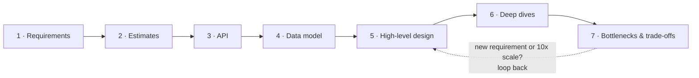
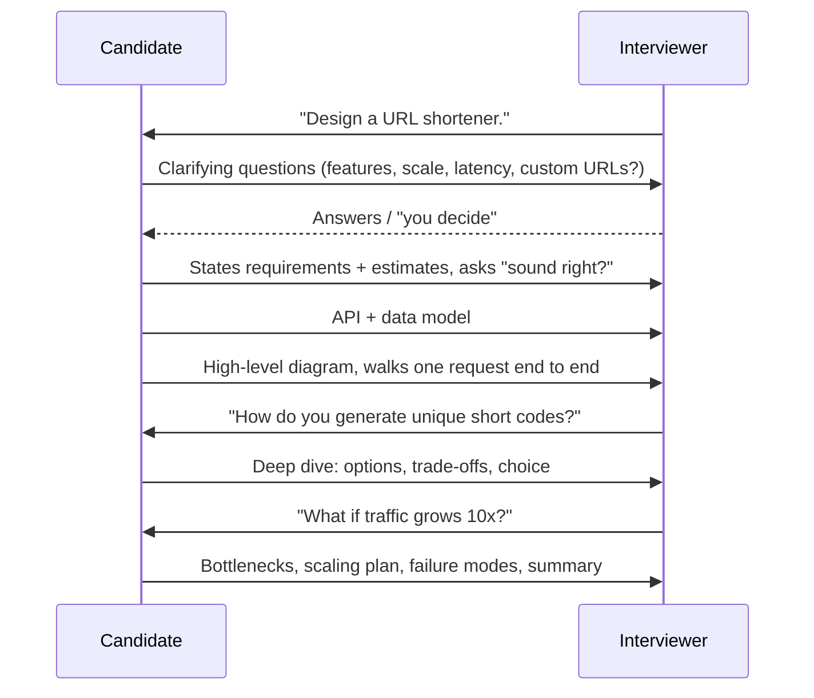
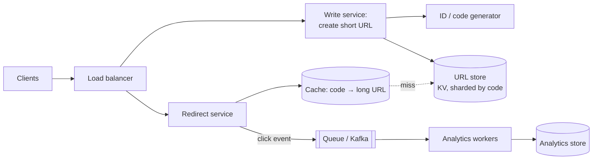
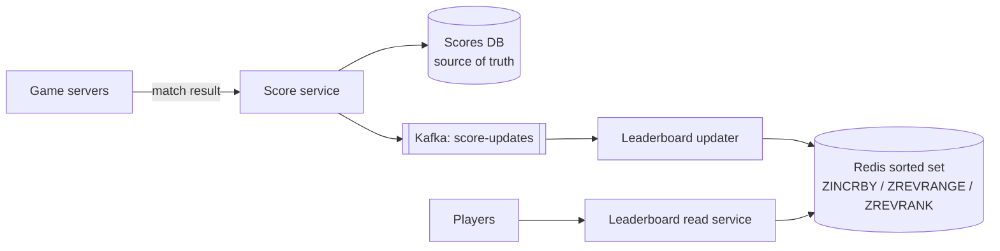

# Chapter 11 · Estimation & The Interview Framework

> An architect who designs a bridge without asking "how many trucks a day?" builds either a footpath or a monument. Ten minutes of rough arithmetic is what tells you which one the problem needs, and a calm, repeatable plan for the remaining 35 minutes is what turns knowledge into a "strong hire".

**You will learn:**
- The handful of numbers every system designer carries in their head (powers of 10, seconds per day, latency and size cheat sheets)
- How to estimate QPS, peak load, storage, bandwidth, cache memory and server count in under five minutes
- A dozen fully worked estimation examples you can reuse
- The **7-step interview framework** and exactly how to spend 45 minutes on it
- How to communicate: thinking out loud, driving the conversation, handling hints and pushback
- What interviewers look for at each level (SDE-1 to Staff) and the mistakes that sink candidates
- A reusable answer template you can fill in for any "Design X" question

**Before this:** [Chapters 01–10 of Part 3](01-foundations-internet.md), especially [Scalability](02-scalability-load-balancing.md), [Databases](03-databases.md), [Caching](04-caching-cdn.md) and [Queues](08-queues-events.md). This chapter turns those building blocks into an interview performance.

---

## 🧠 The Big Idea

A system design interview is not a quiz with one right answer. It's a **45-minute simulation of a design meeting** in which you are the lead engineer. The interviewer wants to see how you take a vague request ("design WhatsApp") and turn it into a sensible plan, while explaining your reasons.

Think of it like a doctor's appointment:

| Doctor | You in the interview |
|---|---|
| "What symptoms? Since when?" | **Clarify requirements**: what must the system do, for how many users? |
| Takes temperature, blood pressure | **Estimate**: how big is the load, the data, the traffic? |
| Forms a diagnosis | **High-level design**: the main boxes and arrows |
| Orders specific tests for the risky parts | **Deep dives**: the hard component in detail |
| Explains the risks of each treatment | **Trade-offs**: why this, what we gave up |

A doctor who prescribes before asking a single question is dangerous, however clever. Same with you: the most common reason good engineers fail design rounds is not missing knowledge, it's jumping to boxes and arrows in minute two.



And estimation is the thread that ties it together. The numbers decide the design: 50 writes per second fits one database with room to spare; 500,000 writes per second needs sharding, queues and a very different conversation.

> 💡 **The core insight:** you are graded on *how you think*, not on whether you reproduce some company's real architecture. Clear requirements, rough-but-sane numbers, a simple design that you then stress-test and improve: that sequence *is* the answer.

---

## 🔨 Building It Up

### 1. Why estimate at all?

Back-of-the-envelope estimation means computing **approximate** answers with simple arithmetic, rounding aggressively. The goal is the **order of magnitude**: is it 10, 1,000 or 1,000,000 per second? Is it gigabytes or petabytes?

The numbers answer design questions directly:

| If the estimate says... | The design consequence |
|---|---|
| Write QPS ~ 50 | One SQL primary is plenty |
| Write QPS ~ 50,000 | Shard the database or use a write-optimised store; maybe queue writes |
| Read:write = 100:1 | Caching and read replicas will carry the load |
| Storage ~ 500 GB total | Fits on one machine; don't over-engineer |
| Storage ~ 5 PB | Object storage, tiering, sharding are mandatory |
| Hot data ~ 30 GB | Fits in RAM of one cache node (or a small cluster) |
| Egress ~ 10 Gbps+ | You need a CDN |

> ⚠️ Precision is not the goal. "About 12,000 QPS" and "11,574 QPS" lead to the same design. Interviewers actively prefer quick, rounded, clearly stated math over slow exactness.

### 2. Numbers you must know by heart

#### Powers of ten and two

Computers count in powers of 2, but 2¹⁰ = 1,024 ≈ 1,000 = 10³, so for estimation we treat them as equal.

| Power of 2 | ≈ Power of 10 | Name | Bytes unit |
|---|---|---|---|
| 2¹⁰ | 10³ | Thousand | 1 KB |
| 2²⁰ | 10⁶ | Million | 1 MB |
| 2³⁰ | 10⁹ | Billion | 1 GB |
| 2⁴⁰ | 10¹² | Trillion | 1 TB |
| 2⁵⁰ | 10¹⁵ | Quadrillion | 1 PB |

Handy multiplications: thousand × thousand = million; million × thousand = billion; 1 million users × 1 KB = 1 GB; 1 billion × 1 KB = 1 TB.

#### Time

```python
SECONDS_PER_DAY = 24 * 60 * 60
print("seconds in a day  :", SECONDS_PER_DAY)
print("seconds in a month:", SECONDS_PER_DAY * 30)
print("seconds in a year :", SECONDS_PER_DAY * 365)
for per_day in [1_000_000, 10_000_000, 100_000_000, 1_000_000_000]:
    print(f"{per_day:>13,} per day = {per_day / SECONDS_PER_DAY:>8,.0f} per second")
```

```text
seconds in a day  : 86400
seconds in a month: 2592000
seconds in a year : 31536000
    1,000,000 per day =       12 per second
   10,000,000 per day =      116 per second
  100,000,000 per day =    1,157 per second
1,000,000,000 per day =   11,574 per second
```

What just happened: the whole of QPS estimation is "divide by 86,400". Round it to **100,000 (10⁵)** for mental math. That gives the most useful rule in this chapter:

> 💡 **1 million per day ≈ 12 per second.** (With the 10⁵ shortcut, ≈ 10 per second.) So 100 million per day ≈ 1,200/s and 1 billion per day ≈ 12,000/s.

Also handy: a month ≈ 2.5 million seconds; a year ≈ 30 million seconds (π × 10⁷ if you want to impress).

#### Sizes of common things

| Thing | Rough size |
|---|---|
| A character (ASCII / UTF-8 English) | 1 byte (UTF-8 can be up to 4 bytes per character) |
| An integer / timestamp (64-bit) | 8 bytes |
| A UUID | 16 bytes binary, 36 bytes as text |
| A short text post with metadata | ~0.5–1 KB |
| A user profile row | ~1 KB |
| A compressed photo (phone, web-optimised) | ~200 KB – 2 MB |
| A thumbnail | ~10–50 KB |
| 1 minute of video, 720p–1080p streaming quality | ~20–100 MB (depends heavily on bitrate) |
| A web page (HTML only) | ~50–100 KB |

#### Latency numbers (orders of magnitude)

These come from the famous "latency numbers every programmer should know" list. Exact values change with hardware; the **ratios** are what matter.

| Operation | Approx. time | Think of it as |
|---|---|---|
| L1 cache reference | ~1 ns | instant |
| Main memory (RAM) reference | ~100 ns | 100× L1 |
| Read 1 MB sequentially from RAM | ~10–250 µs | |
| SSD random read | ~10–100 µs | 1,000× RAM |
| Round trip within a data centre | ~0.5 ms | |
| Read 1 MB sequentially from SSD | ~0.2–1 ms | |
| HDD disk seek | ~10 ms | 100,000× RAM |
| Round trip India ↔ US | ~150–250 ms | |

Three lessons from this table:
1. **Memory is ~1,000× faster than disk/network**: that's why caches ([Chapter 04](04-caching-cdn.md)) exist.
2. **Sequential beats random**: that's why Kafka and LSM-tree databases append ([Chapter 08](08-queues-events.md)).
3. **Cross-continent round trips are expensive**: that's why CDNs and multi-region deployments exist.

#### Rough capacity of common components

These vary 10× depending on hardware and query complexity. Use them as **starting assumptions** and say so out loud.

| Component | Ballpark per node |
|---|---|
| Web/app server, simple API calls | ~1,000–10,000 requests/s |
| Relational DB (SQL), simple indexed queries | ~1,000s–10,000s of reads/s; fewer writes |
| Redis / Memcached | ~100,000+ ops/s |
| Kafka broker | ~100s of MB/s of throughput |
| A modern server's RAM | ~64–512 GB |
| A modern server's network | ~10–25 Gbps |

### 3. Estimating QPS (and peak)

**QPS** (queries per second) is the request rate. The recipe:

```text
daily requests  = daily active users (DAU) × actions per user per day
average QPS     = daily requests / 86,400   (≈ / 100,000)
peak QPS        = average QPS × peak factor (usually 2–3×; 10× or more for flash events)
```

Always split **reads** and **writes**: they hit different parts of the system and scale differently.

**Worked example 1: a photo-sharing app.**
Assume 100 million DAU. Each user uploads 0.5 photos/day and views 50 photos/day.

```text
uploads/day = 100M × 0.5 = 50M        → write QPS ≈ 50M / 100k = 500/s,   peak ≈ 1,500/s
views/day   = 100M × 50  = 5B         → read QPS  ≈ 5B / 100k  = 50,000/s, peak ≈ 150,000/s
read : write = 100 : 1  → read-heavy → cache + CDN + read replicas
```

What just happened: two multiplications and two divisions gave us the single most important design fact: this system is overwhelmingly read-heavy, so most of the design effort goes into serving reads fast.

> 💡 Where does "peak factor 2–3×" come from? Traffic follows the day: busy evenings, quiet nights. Peak hours typically run a few times the daily average. Events (a cricket final, New Year's midnight, a flash sale) can spike 10× or more, and *those* are often the requirement that matters. Ask: "Do we have predictable spikes?"

### 4. Estimating storage

```text
storage/day   = new items/day × size per item
total storage = storage/day × 365 × years to keep × replication factor
```

**Worked example 2: the same photo app, 5 years.**

```text
photos/day     = 50M × 1 MB (stored original, compressed) = 50 TB/day
5 years        = 50 TB × 365 × 5 ≈ 50 × 1,800 ≈ 90 PB
+ thumbnails   ~ a few % extra; replication handled by object storage
metadata/day   = 50M × 1 KB = 50 GB/day → ~90 TB over 5 years (DB, sharded)
```

Lesson: **media dominates storage**; metadata is tiny in comparison. Photos go to object storage ([Chapter 10](10-storage-search-ids.md)); the metadata goes to a database you shard by user or photo ID.

### 5. Estimating bandwidth

```text
ingress (upload)   = write QPS × average upload size
egress (download)  = read QPS  × average response size
```

**Worked example 3: photo app bandwidth.**

```text
ingress = 500 uploads/s × 1 MB       = 500 MB/s ≈ 4 Gbps
egress  = 50,000 views/s × 200 KB    = 10 GB/s  ≈ 80 Gbps (average!) → CDN is mandatory
```

(Bytes to bits: multiply by 8. 1 GB/s = 8 Gbps.)

**Worked example 4: video streaming egress.**
1 million concurrent viewers × 5 Mbps (a typical HD bitrate) = 5,000,000 Mbps = **5 Tbps**. No single data centre serves that; this is exactly what CDNs with edge servers inside ISPs are for ([Chapter 13](13-case-studies-2.md)).

### 6. Estimating cache memory

The **80/20 rule** (Pareto): roughly 20% of items get 80% of the traffic. So caching ~20% of a day's hot data serves most reads.

```text
cache memory ≈ 0.2 × (daily read requests × response size)       ← upper bound, counts repeats
           or ≈ 0.2 × (unique items read per day × item size)     ← better if you know uniques
```

**Worked example 5: cache for a URL shortener.**
Reads: 1 billion redirects/day; each cached entry (short code + long URL + overhead) ≈ 500 bytes.

```text
0.2 × 1B × 500 B = 100 GB
```

100 GB fits in the RAM of a single large server, or comfortably in a 3–4 node Redis cluster with replicas. Many of those billion reads hit the same popular links, so unique hot data is even smaller: this is an upper bound.

### 7. Estimating server count

```text
servers = peak QPS / (QPS one server handles × target utilisation)
then add redundancy: survive a server, or a whole availability zone, failing
```

Running servers at 100% is asking for trouble: latency explodes near full load, and a single failure overloads the rest. Target 50–70% utilisation at peak.

```python
import math

def servers_needed(peak_qps, per_server_qps, target_util=0.6, zones=3):
    """Servers for peak load at target utilisation, then spread so the
    system survives losing an entire availability zone."""
    base = math.ceil(peak_qps / (per_server_qps * target_util))
    per_zone = math.ceil(base / (zones - 1))      # remaining zones must carry it all
    return base, per_zone * zones

base, with_zone_failure = servers_needed(peak_qps=30_000, per_server_qps=2_000)
print("servers for peak load      :", base)
print("servers to survive a zone  :", with_zone_failure)
```

```text
servers for peak load      : 25
servers to survive a zone  : 39
```

What just happened: 30,000 / (2,000 × 0.6) = 25 servers carry the peak. But if one of 3 zones dies, the other two must carry it all, so each zone needs 13 (25 / 2, rounded up), giving 39 in total. Saying "and to survive a zone failure, I'd provision about 40" is a lovely senior-level touch.

### 8. Little's Law: how many requests are "in flight"?

**Little's Law:** the average number of items inside a system = arrival rate × average time each spends inside.

```text
L = λ × W        (concurrency = throughput × latency)
```

It answers questions like "how many threads / connections do I need?"

```python
def in_flight(qps, latency_ms):
    return qps * latency_ms / 1000

print("API: 5,000 QPS at 200 ms ->", in_flight(5_000, 200), "requests in flight")
print("DB : 2,000 QPS at 5 ms   ->", in_flight(2_000, 5), "busy connections")
print("Slow DB: same QPS at 50 ms ->", in_flight(2_000, 50), "busy connections")
```

```text
API: 5,000 QPS at 200 ms -> 1000.0 requests in flight
DB : 2,000 QPS at 5 ms   -> 10.0 busy connections
Slow DB: same QPS at 50 ms -> 100.0 busy connections
```

What just happened: if the database slows from 5 ms to 50 ms, the same traffic needs **10× more connections**. If the connection pool is capped at 20, requests start queueing and timing out. This is how a slow dependency quietly takes a whole system down, and why timeouts and circuit breakers ([Chapter 09](09-microservices-reliability.md)) matter.

### 9. A complete estimation in code

Let's put everything together for a Twitter-like service. Every number at the top is an **assumption** we'd state out loud and agree with the interviewer.

```python
def human(n, unit="B"):
    """Format with decimal prefixes (K, M, G, ...), the convention for estimation."""
    for prefix in ["", "K", "M", "G", "T", "P", "E"]:
        if abs(n) < 1000:
            return f"{n:,.1f} {prefix}{unit}"
        n /= 1000
    return f"{n:,.1f} Z{unit}"

SECONDS_PER_DAY = 86_400
a = dict(dau=200e6, posts_per_user=2, reads_per_user=100, post_bytes=1_000,
         media_fraction=0.10, media_bytes=500e3, peak_factor=3, years=5)

writes_per_day = a["dau"] * a["posts_per_user"]
reads_per_day = a["dau"] * a["reads_per_user"]
write_qps = writes_per_day / SECONDS_PER_DAY
read_qps = reads_per_day / SECONDS_PER_DAY

text_per_day = writes_per_day * a["post_bytes"]
media_per_day = writes_per_day * a["media_fraction"] * a["media_bytes"]
total_storage = (text_per_day + media_per_day) * 365 * a["years"]

avg_read_bytes = a["post_bytes"] + a["media_fraction"] * a["media_bytes"]
egress = read_qps * avg_read_bytes
cache = 0.2 * text_per_day

print(f"write QPS : {write_qps:,.0f} avg, {write_qps * a['peak_factor']:,.0f} peak")
print(f"read QPS  : {read_qps:,.0f} avg, {read_qps * a['peak_factor']:,.0f} peak")
print(f"text/day  : {human(text_per_day)}   media/day: {human(media_per_day)}")
print(f"5 years   : {human(total_storage)} (before replication)")
print(f"egress    : {human(egress)}/s = {human(egress * 8, 'bps')}")
print(f"cache     : {human(cache)} (20% of a day's posts)")
```

```text
write QPS : 4,630 avg, 13,889 peak
read QPS  : 231,481 avg, 694,444 peak
text/day  : 400.0 GB   media/day: 20.0 TB
5 years   : 37.2 PB (before replication)
egress    : 11.8 GB/s = 94.4 Gbps
cache     : 80.0 GB (20% of a day's posts)
```

What just happened, and **what it means for the design**:
- Reads outnumber writes 50:1 and peak near 700k/s: precomputed timelines in a cache, read replicas, CDN for media.
- Writes peak near 14k/s: more than a single SQL primary should take for this workload, so shard posts (by user ID or post ID).
- Media is 98% of storage: object storage + CDN, with metadata in the database.
- 80 GB of hot text fits in a small cache cluster.

Notice how **every number became a design decision**. Numbers that don't change any decision are wasted time: skip them.

### 10. More worked examples (rapid fire)

Practise saying these out loud in under two minutes each.

**Example 6: chat app messages.** 500M DAU × 40 messages/day = 20B messages/day → 20B / 10⁵ = **200k msgs/s** average (≈ 230k precisely), peak ~500k–700k/s. At 100 bytes per message: 20B × 100 B = **2 TB/day**, ≈ 3.6 PB over 5 years before replication. Conclusion: write-heavy, needs a horizontally scalable write-optimised store (wide-column like Cassandra/HBase), partitioned by conversation ID.

**Example 7: URL shortener keys.** 100M new URLs/month for 10 years = 12 billion URLs. How long must the short code be with base62 characters (a–z, A–Z, 0–9)?

```python
import math

needed = 100e6 * 12 * 10
for length in range(5, 9):
    print(f"base62 length {length}: {62 ** length:,} codes")
print("minimum length for", f"{needed:,.0f}", "URLs:", math.ceil(math.log(needed, 62)))
```

```text
base62 length 5: 916,132,832 codes
base62 length 6: 56,800,235,584 codes
base62 length 7: 3,521,614,606,208 codes
base62 length 8: 218,340,105,584,896 codes
minimum length for 12,000,000,000 URLs: 6
```

Six characters give 56.8 billion codes, enough for 12 billion, but 7 characters (3.5 trillion) give lots of headroom and make random codes hard to guess. Pick 7. ([Chapter 12](12-case-studies-1.md) designs the whole service.)

**Example 8: URL shortener QPS.** Writes: 100M/month ÷ 2.5M s/month = **40/s**. Reads at 100:1 = **4,000/s**, peak ~10–12k/s. Storage: 12B × 500 B = **6 TB** over 10 years. Small enough that a few shards (or even one big machine plus replicas) can hold it.

**Example 9: notification system.** 50M notifications/day → ~600/s average; but marketing campaigns send 10M in 10 minutes → 10M / 600 s ≈ **17k/s burst**. The burst is the real requirement: queue + scalable workers + per-channel rate limits ([Chapter 12](12-case-studies-1.md)).

**Example 10: ride-hailing location updates.** 1M active drivers send their GPS every 4 seconds → **250k writes/s**. Each update ~100 bytes → 25 MB/s. Keep only the latest position in memory (geo index in Redis-like stores) and stream history to cold storage. Don't put 250k/s into a relational table.

**Example 11: web crawler.** Crawl 1B pages/month → 1B / 2.5M s ≈ **400 pages/s**. Average page 100 KB → 40 MB/s of download ≈ 320 Mbps, and 1B × 100 KB = **100 TB/month** of raw HTML. Conclusion: distributed fetchers, politeness per domain, compression, object storage.

**Example 12: video uploads.** Assume 100k uploads/day, average 10 minutes, stored in 4 resolutions totalling ~1 GB per 10 minutes. 100k × 1 GB = **100 TB/day**, ≈ 36 PB/year. Transcoding 100k videos/day ≈ 1.2 videos/s, each taking minutes of CPU: thousands of transcoding workers fed by a queue.

### 11. The 7-step interview framework

Now the main event. Here's the plan for a 45-minute round (about 40 minutes of design after introductions). Times are a guide, not a stopwatch.

| Step | Minutes | Goal | Output on the whiteboard |
|---|---|---|---|
| 1. Requirements | 0–5 | Agree what to build and how big | 3–5 functional, 3–5 non-functional requirements |
| 2. Estimates | 5–9 | Size the problem | QPS (read/write, peak), storage, bandwidth, cache |
| 3. API | 9–13 | Define the contract | 3–5 endpoints with inputs/outputs |
| 4. Data model | 13–17 | Decide what's stored where | Entities, key fields, DB choice, partition key |
| 5. High-level design | 17–27 | An end-to-end working design | Diagram: clients → LB → services → stores, caches, queues |
| 6. Deep dives | 27–40 | Prove depth on the hardest parts | 2–3 components in detail with alternatives |
| 7. Bottlenecks & trade-offs | 40–45 | Show judgement, wrap up | Failure modes, scaling limits, what you'd do next |



Let's go through each step.

### 12. Step 1: Requirements (0–5 min)

Never start drawing before you know what you're building. Split requirements into two kinds:

- **Functional requirements (FRs):** what the system *does*. Features, as user stories: "users can shorten a URL", "users get redirected", "users can see click counts".
- **Non-functional requirements (NFRs):** how *well* it does it: scale, latency, availability, consistency, durability, security, cost.

**Questions that work for almost any problem:**

| Category | Questions |
|---|---|
| Users & scale | How many users (DAU)? How many actions per user per day? Growth expected? |
| Features | Which 3–4 features are in scope? What's explicitly out of scope? |
| Read/write pattern | More reads or writes? Any burst events? |
| Latency | What response time is acceptable? (e.g. p99 < 200 ms for reads) |
| Consistency | Is it OK if a user sees slightly stale data? Where is it *not* OK (money, inventory)? |
| Availability | How bad is downtime? (99.9% vs 99.99%) |
| Data | How long do we keep data? Any size limits (message length, file size)? |
| Clients & geography | Mobile, web, both? One country or global? |

**Then prioritise and write it down.** Example for a URL shortener:

```text
Functional (in scope)
  1. Create a short URL for a long URL (optional custom alias, optional expiry)
  2. Redirect short URL -> long URL
  3. Basic click analytics (count per link)
Out of scope: user accounts UI, link editing, spam detection (mention, don't design)

Non-functional
  - 100M new URLs/month, reads 100x writes
  - Redirect latency p99 < 50 ms (it sits in front of every click)
  - Highly available for redirects (99.99%); creation can be slightly less
  - Short codes must be unique and not easily guessable
  - Links kept 10 years by default
```

> 💡 If the interviewer says "you decide", **decide, say it, and move on**: "I'll assume 100 million DAU, global users, and that a few seconds of staleness in counts is fine." Indecision costs more than a slightly wrong assumption.

### 13. Step 2: Estimates (5–9 min)

Do exactly the math from sections 3–7, **only for numbers that change the design**. Typically:

1. Read QPS and write QPS (average and peak) → tells you read-heavy vs write-heavy and whether one DB can cope.
2. Storage over N years → tells you single node vs sharding, hot vs cold storage.
3. Bandwidth (only if media is involved) → tells you whether a CDN is needed.
4. Cache size (only if read-heavy) → tells you how many cache nodes.

Write the result as a tiny table on the board, then **say the conclusion**: "So we're read-heavy at ~100:1, with ~4k reads/s average and ~6 TB over 10 years. A cache will absorb most reads, and storage fits on a few shards."

> ⚠️ Some interviewers say "skip the estimates". Then skip them gracefully and state the scale assumptions in one sentence. Don't argue.

### 14. Step 3: API design (9–13 min)

Define the contract between clients and your system. Usually REST ([Chapter 07](07-apis-communication.md)). Name the endpoints, key parameters, and responses. Include auth and pagination where relevant.

```text
POST /v1/urls
  body: { "long_url": "https://...", "custom_alias": "diwali-sale" (optional),
          "expires_at": "2027-01-01T00:00:00Z" (optional) }
  auth: API key / user token
  201 -> { "short_url": "https://sho.rt/aZ3kP9q", "code": "aZ3kP9q" }
  409 -> alias already taken

GET /{code}
  302 Found, Location: https://...        (or 301 if we never need analytics)
  404 if unknown or expired

GET /v1/urls/{code}/stats
  200 -> { "clicks": 12873, "created_at": "..." }
```

Keep it short: the API's job in the interview is to make the features concrete. Mention idempotency keys for create endpoints that clients may retry, and cursor-based pagination for lists (feeds, messages).

### 15. Step 4: Data model (13–17 min)

List the core entities, their key fields, and **where they live**. Then choose the database type with a reason ([Chapter 03](03-databases.md)) and the **partition key** if you'll shard ([Chapter 05](05-replication-sharding.md)).

```sql
-- urls: one row per short link. Access pattern: lookup by code (very hot), insert.
CREATE TABLE urls (
    code        VARCHAR(10) PRIMARY KEY,   -- partition key if sharded
    long_url    TEXT NOT NULL,
    user_id     BIGINT,
    created_at  TIMESTAMP NOT NULL,
    expires_at  TIMESTAMP
);
```

Say the reasoning: "The access pattern is a simple key lookup by `code` with no joins, so a key-value or wide-column store works well and shards trivially by `code`. A relational DB also works at this scale. I'll pick a KV store for horizontal scaling, and keep click counts in a separate analytics pipeline so redirects stay fast."

> 💡 Design the data model from the **access patterns** (the queries you'll run), not from the nouns in the problem. "What are the top 3 queries, and how does each hit the index?"

### 16. Step 5: High-level design (17–27 min)

Draw the simplest end-to-end design that satisfies the functional requirements, then walk one request through it.



**Narrate a request:** "A redirect hits the load balancer, goes to a stateless redirect server, which checks the cache; on a hit (most of the time) it returns a 302 in a few ms. On a miss it reads the KV store and fills the cache. It also publishes a click event to Kafka asynchronously, so analytics never slows the redirect."

Rules for this step:
- **Start simple, then evolve.** One box per responsibility. Add caches, queues, replicas when a requirement or estimate demands them, and say which one.
- **Separate read and write paths** when their scale differs a lot.
- **Stateless services** behind load balancers; state lives in databases, caches and queues.
- **Every arrow should be explainable:** sync or async? what protocol? what happens if it fails?

### 17. Step 6: Deep dives (27–40 min)

This is where levels are decided. Pick (or let the interviewer pick) the 2–3 hardest components and go deep: alternatives, trade-offs, a choice, and failure handling.

How to choose what to deep-dive:
- **The unique challenge of this problem** (URL shortener: code generation; chat: message delivery and ordering; feed: fan-out; ride-hailing: geo-matching).
- **The biggest scaling bottleneck** your estimates revealed.
- **Whatever the interviewer is steering towards.** If they ask about something, that's the deep dive. Follow them.

A good deep dive has a shape. Use it every time:

```text
1. The problem:     "We need globally unique 7-char codes at 40 writes/s, not guessable."
2. Options:         (a) hash + truncate, (b) counter + base62, (c) pre-generated key pool
3. Trade-offs:      collisions vs coordination vs predictability (a table)
4. Choice + why:    "(b) with a ticket range per server: no collisions, no hot path coordination;
                     I'll shuffle/encode the counter so codes aren't sequential."
5. Failure modes:   "If a server dies, it loses its unused range: we waste some IDs, which is fine."
```

### 18. Step 7: Bottlenecks, trade-offs and wrap-up (40–45 min)

Finish by stress-testing your own design. Interviewers love candidates who find their design's weaknesses before being asked.

Checklist to walk through quickly:
- **Single points of failure?** Load balancer, DB primary, ID generator, cache. Each needs redundancy or a failover plan.
- **What breaks at 10× traffic?** Usually the database writes, a hot key, or a fan-out step.
- **Hot spots:** celebrity users, viral links, popular products. Mitigation: replicated hot keys, local caches, request coalescing.
- **Consistency gaps:** where can users see stale or conflicting data? Is that acceptable?
- **Monitoring:** which metrics and alerts (latency p99, error rate, queue lag) ([Chapter 09](09-microservices-reliability.md)).
- **Security & abuse:** rate limiting, auth, input validation (e.g. malicious URLs).
- **Cost:** storage tiering (hot → cold), CDN, right-sizing.

Then **summarise in 30 seconds**: "To recap: a stateless redirect tier behind a CDN-cacheable 302, Redis cache absorbing ~90% of reads, a sharded KV store, counter-based codes with per-server ranges, and an async analytics pipeline over Kafka. The main trade-off is eventual consistency of click counts in exchange for fast redirects. Next I'd look at multi-region replication."

### 19. Communicating like a senior engineer

Knowing the material is half the battle. The other half is how you present it.

1. **Think out loud.** Silence is the worst signal: the interviewer can't grade thoughts they can't hear. Narrate: "I'm considering two options here..."
2. **Drive, don't wait.** You lead the meeting. Announce the plan at the start: "I'll clarify requirements, do quick estimates, sketch the API and data model, then a high-level design, and then dive into the hard parts. Sound good?"
3. **Check in at milestones**, not every sentence: "Before I go deeper, does this high-level design make sense, or is there an area you'd like me to focus on?"
4. **Every choice gets a "because".** Not "I'll use Cassandra" but "I'll use Cassandra because we have 200k writes/s, simple key access by conversation ID, and we can tolerate eventual consistency."
5. **Name the alternative you rejected.** "Fan-out on read would save storage, but celebrity reads would be slow, so I'll use a hybrid." That one sentence demonstrates trade-off thinking.
6. **Treat hints as gifts.** If the interviewer asks "what about a celebrity with 50M followers?", they're pointing at a weakness. Say "Good point, that breaks fan-out on write. Let me adjust..." Never get defensive.
7. **Be honest about gaps.** "I haven't used Cassandra in production, but my understanding is..." beats bluffing. Bluffing gets caught by the next follow-up.
8. **Keep the board tidy.** Requirements top-left, estimates under them, diagram in the middle. Number your components so you can refer to them.
9. **Use precise words**: p99 latency, read replica, partition key, idempotent, eventual consistency. Each is a small signal of experience.
10. **Manage time.** If you're at minute 25 and still on the data model, say "Let me move to the high-level design so we have time for deep dives" and go.

### 20. What interviewers evaluate, by level

Every company's rubric differs, but most grade four or five dimensions:

| Dimension | What they look for |
|---|---|
| **Problem navigation** | Clarifies scope, identifies what matters, prioritises, doesn't get lost |
| **Solution design** | A working, coherent end-to-end design that meets the requirements |
| **Technical depth** | Real understanding of components: how they work, scale and fail |
| **Trade-offs & judgement** | Considers alternatives, justifies choices with requirements and numbers |
| **Communication** | Clear, structured, collaborative, receptive to feedback |

And the bar rises with level:

| Level | Expected performance |
|---|---|
| **New grad / SDE-1** | Often no HLD round, or a simpler one. Show the basics: clients, servers, DB, cache, load balancer. Sensible API and schema. Interviewer may guide a lot. LLD/machine-coding rounds ([Chapter 14](14-low-level-design.md)) are more common at this level. |
| **SDE-2 / mid-level** | Drives a complete, working design with standard components used correctly. Handles 1–2 deep dives competently. Some trade-off discussion. Needs only light guidance. |
| **Senior (SDE-3)** | Drives the whole interview. Deep dives show real depth (failure modes, consistency, data partitioning, hot spots). Proactively raises bottlenecks and trade-offs. Estimates guide decisions. |
| **Staff+** | All of the above, plus: handles heavy ambiguity, compares fundamentally different architectures, considers operations, cost, migrations, multi-region, team/org boundaries and how the system evolves over years. Often goes deeper than the interviewer expected. |

> 💡 Same question, different bar. "Design a URL shortener" can be an SDE-2 interview or a Staff interview. The difference is how deep and how self-driven your answer is.

### 21. Common mistakes (and their fixes)

| Mistake | Why it hurts | Fix |
|---|---|---|
| Jumping straight to the diagram | You may solve the wrong problem; looks junior | Spend the first 5 minutes on requirements, always |
| Endless requirements gathering | Burns 15 minutes, no design | Cap it at ~5 minutes; make assumptions |
| Estimating everything to 3 decimal places | Wastes time, adds no insight | Round hard; compute only what drives decisions |
| Buzzword soup ("Kafka, Kubernetes, microservices, GraphQL...") | Signals memorisation without understanding | Add each component only with a reason tied to a requirement |
| Over-engineering from minute one | Complexity without need | Start simple; scale when the numbers demand it |
| Ignoring the interviewer's hints | Misses the signal they're testing | Follow their questions; they *are* the rubric |
| Only the happy path | Real systems fail | Discuss failure: retries, timeouts, failover, duplicates |
| No trade-offs | Looks like you think there's one right answer | For every major choice, name an alternative and why not |
| Single points of failure left in the design | Availability requirement unmet | Replicate, add failover, and say so |
| Going silent while thinking | Interviewer can't evaluate you | Narrate, even if it's "let me think about the write path for a second" |
| Running out of time before deep dives | The level-deciding section never happens | Watch the clock; HLD done by ~minute 27 |
| Refusing to commit ("it depends...") without concluding | Looks indecisive | "It depends on X; given our requirement Y, I choose Z" |

### 22. A worked mini-interview: "Design a game leaderboard"

Let's run the whole framework once, compactly, the way you'd say it.

**1. Requirements.** "Players get scores in matches. Features: (1) update a player's score after a match, (2) show the global top 100, (3) show a player's own rank. Out of scope: friends leaderboards, anti-cheat. Scale: 50M DAU, each plays 10 matches/day. Leaderboard should feel real-time (updates visible within a few seconds). High availability; a slightly stale rank is fine."

**2. Estimates.** "Score updates: 50M × 10 = 500M/day ≈ 5,000/s average, ~15k/s peak. Reads of top-100: assume 20 views per user per day = 1B/day ≈ 12k/s. Storage: 50M players × ~50 bytes (ID + score) = 2.5 GB. That fits in memory on one machine."

**3. API.**

```text
POST /v1/scores        { "player_id": "p42", "match_id": "m9", "points": 120 }   (match_id = idempotency key)
GET  /v1/leaderboard/top?limit=100
GET  /v1/leaderboard/rank/{player_id}  -> { "rank": 18342, "score": 98120 }
```

**4. Data model.** "Source of truth: a `scores` table (player_id, total_score, updated_at) in a durable DB, plus a `match_results` table keyed by match_id for idempotency. Serving structure: a Redis **sorted set** `leaderboard` with member = player_id, score = total. Sorted sets keep members ordered by score using a skip list, so add/update is O(log n) and rank lookup is O(log n), and top-100 is O(log n + 100)."

**5. High-level design.**



**6. Deep dives.** (a) *Idempotency:* the same match result may be retried; the score service records `match_id` with a unique constraint and only then increments, so duplicates don't inflate scores. (b) *Scaling Redis:* 2.5 GB and ~30k ops/s fit one primary with replicas for reads; if we needed 100× more, shard by score range or keep per-shard top-K and merge, since top-100 across shards = merge of each shard's top-100 (a heap merge, [Part 2 Chapter 15](../part-2-dsa/15-heaps.md)). (c) *Recovery:* if Redis is lost, rebuild the sorted set from the scores DB.

**7. Trade-offs.** "Redis gives real-time ranks but is memory-bound; the DB stays the source of truth. Updates through Kafka make ranks eventually consistent by a second or two, accepted in requirements. Bottleneck at 10×: a single Redis primary's write rate; mitigate by batching increments per player in the updater. For 'rank among friends' we'd compute on read from a small friend set."

That's a complete, levelled answer in miniature. [Chapters 12](12-case-studies-1.md) and [13](13-case-studies-2.md) do this at full depth for 14 classic systems.

### 23. The reusable answer template

Copy this structure onto the whiteboard (or doc) at the start of every system design interview and fill it in as you go:

```text
=== 1. REQUIREMENTS ===================================== (~5 min)
Functional (in scope):   1. ...  2. ...  3. ...
Out of scope:            ...
Non-functional:          scale (DAU, actions/user) | latency (p99) | availability |
                         consistency (where strong? where eventual?) | durability | retention

=== 2. ESTIMATES ======================================== (~4 min)
Write QPS: avg ... / peak ...      Read QPS: avg ... / peak ...    Read:Write = ...
Storage:   per item ... × items/day ... × 365 × years = ...
Bandwidth: egress = read QPS × size = ...  (CDN?)
Cache:     20% of hot data = ...
=> Conclusions: read-heavy? write-heavy? fits one node? needs sharding/CDN?

=== 3. API =============================================== (~4 min)
POST /v1/...   GET /v1/...   (auth, pagination, idempotency key)

=== 4. DATA MODEL ======================================== (~4 min)
Entities + key fields | access patterns | DB choice + why | partition key

=== 5. HIGH-LEVEL DESIGN ================================= (~10 min)
Client → CDN/LB → stateless services → cache → DB; async work via queue
Walk one write request and one read request end to end

=== 6. DEEP DIVES ======================================== (~13 min)
For each: problem → options → trade-off table → choice + why → failure modes

=== 7. BOTTLENECKS & WRAP-UP ============================= (~5 min)
SPOFs | 10x scale | hot keys | consistency gaps | monitoring | security | cost
30-second summary + "next steps I'd take"
```

---

## 🔬 Under the Hood

### Why rough numbers are good enough

Design decisions change at **order-of-magnitude** boundaries, not at the second significant digit. Whether you need sharding doesn't depend on 4,630 vs 5,000 writes/s; it depends on 500 vs 50,000. Estimation errors also partly cancel: you over-estimate one factor and under-estimate another. That's why physicists call these **Fermi estimates** (after Enrico Fermi, who famously estimated quantities with startling accuracy from rough guesses): break the unknown into factors you can guess within 2–3×, multiply, and the result is usually within 10× of the truth, which is exactly the precision design needs.

### Why the 86,400 → 100,000 rounding is safe

Using 10⁵ instead of 86,400 makes your QPS about 14% too *low*. Since you then multiply by a peak factor of 2–3 (itself a rough guess) and provision at 50–70% utilisation, a 14% error disappears inside the safety margins. If you want to be safe, round in the *conservative* direction: when in doubt, assume more load, not less.

### Why we provision for peak, not average

Queueing theory says that as a server's utilisation approaches 100%, waiting time grows sharply, not linearly. For a simple single-server queue model, the average time in the system is proportional to 1 / (1 − utilisation): at 50% load that factor is 2, at 90% it's 10, at 99% it's 100. That's why systems feel fine at 60% and fall off a cliff at 95%, and why target utilisation of 50–70% at **peak** is the standard advice.

```python
for util in [0.5, 0.7, 0.8, 0.9, 0.95, 0.99]:
    slowdown = 1 / (1 - util)
    print(f"utilisation {util:>4.0%}: requests take ~{slowdown:5.1f}x the bare service time")
```

```text
utilisation  50%: requests take ~  2.0x the bare service time
utilisation  70%: requests take ~  3.3x the bare service time
utilisation  80%: requests take ~  5.0x the bare service time
utilisation  90%: requests take ~ 10.0x the bare service time
utilisation  95%: requests take ~ 20.0x the bare service time
utilisation  99%: requests take ~100.0x the bare service time
```

What just happened: going from 80% to 95% load *quadruples* latency. That's the mathematical reason behind "keep headroom", autoscaling triggers around 60–70% CPU, and load shedding.

### What the interviewer's rubric is really measuring

A design interview is a proxy for one question: *"Would I trust this person to lead the design of a system on my team?"* Every behaviour maps onto it. Clarifying requirements shows you won't build the wrong thing. Estimation shows you size solutions to problems. Trade-offs show you know there's no free lunch. Deep dives show you can go below the boxes. Communication shows the team will understand and follow your design. When unsure what to do in an interview, ask yourself what a trustworthy tech lead would do in a real design review, and do that.

---

## 🧩 Pattern Decoder

### Decision guide: turning numbers into architecture

- **If** write QPS is below ~1k/s and data fits on one machine (< a few TB), **choose** a single relational primary with replicas, **because** it's simple, consistent and battle-tested ([Chapter 03](03-databases.md)).
- **If** write QPS is in the tens of thousands or more, **choose** sharding or a horizontally scalable store (Cassandra, DynamoDB), **because** one primary can't absorb it ([Chapter 05](05-replication-sharding.md)).
- **If** read:write is 10:1 or higher, **choose** a cache (and read replicas), **because** most reads repeat ([Chapter 04](04-caching-cdn.md)).
- **If** responses are large static media and egress is many Gbps, **choose** a CDN + object storage, **because** serving from the edge is cheaper and faster ([Chapter 10](10-storage-search-ids.md)).
- **If** bursts are much larger than the average, **choose** a queue in front of the slow part, **because** queues absorb spikes ([Chapter 08](08-queues-events.md)).
- **If** work doesn't need to finish before the response, **choose** async processing, **because** it cuts latency and isolates failures.
- **If** hot data fits in RAM, **choose** an in-memory store for serving and a durable DB as the source of truth, **because** memory is ~1,000× faster.
- **If** data must be strongly consistent (money, inventory, bookings), **choose** a transactional store and avoid caching the critical decision, **because** stale reads there cost real money ([Chapter 06](06-cap-consistency.md)).
- **If** the system is global and latency-sensitive, **choose** multi-region deployment with geo-routing, **because** cross-continent round trips cost 150 ms+.

### The estimation cheat-sheet

| Quantity | Formula | Shortcut |
|---|---|---|
| Avg QPS | daily requests / 86,400 | ÷ 10⁵; 1M/day ≈ 12/s |
| Peak QPS | avg × 2–3 (×10 for events) | Ask about spikes |
| Storage | items/day × size × 365 × years × replicas | 1B × 1 KB = 1 TB |
| Bandwidth | QPS × response size; × 8 for bits | 1 GB/s = 8 Gbps |
| Cache | 20% × daily hot data | 80/20 rule |
| Servers | peak QPS / (per-server QPS × 0.6), then + zone redundancy | Keep 30–50% headroom |
| Concurrency | QPS × latency (s) | Little's Law |
| Key length | ⌈log_base(count)⌉ | base62: 7 chars ≈ 3.5 trillion |

### Template: the first 60 seconds of any design interview

```text
"Before I start designing, I'd like to clarify a few things.
 1. Which features matter most? I'm thinking A, B and C; is D in scope?
 2. Roughly how many users, and how active are they?
 3. Any latency or availability targets? Is eventual consistency OK for X?
 4. Global or single region? Mobile, web, or both?
 Then my plan is: requirements, quick estimates, API, data model,
 a high-level design, and deep dives into the hardest parts. Sound good?"
```

### Variation: when the interviewer hands you the requirements

Some interviewers give a detailed spec up front. Don't re-ask everything. Instead, **restate** it in your own words (2–3 sentences), confirm the one or two ambiguities that matter, and move to estimates. Restating proves you listened and catches misunderstandings early.

### Variation: when the interviewer says "now make it 10× bigger"

Walk your diagram from left to right and ask at each component: "does this survive 10×?" Typical answers:

| Component | At 10× | Fix |
|---|---|---|
| Stateless app servers | Fine | Add more behind the LB, autoscale |
| Cache | Maybe more memory/ops | Add nodes (consistent hashing) |
| DB writes | Usually the first to break | Shard; batch writes; queue them |
| Hot keys | Gets worse | Replicate hot keys, local caches, split counters |
| Fan-out steps | Explodes | Hybrid fan-out, async workers |
| Single-region | Latency + blast radius | Multi-region, geo-routing |

### Variation: the "product-style" vs "infrastructure-style" question

- **Product-style** ("design Instagram", "design Uber"): emphasise features, data model, read/write paths, feeds, caching. Most common at product companies.
- **Infrastructure-style** ("design a rate limiter", "design a distributed KV store", "design a message queue"): emphasise algorithms, consistency, replication, partitioning, failure handling. Expect deeper questions on consensus and correctness.

Same framework; shift the weight of your deep dives.

### When NOT to follow the framework rigidly

- When the interviewer clearly wants to jump to a specific component ("let's just talk about how you'd store the messages"). Follow them.
- When the problem is narrow (design a rate limiter's algorithm): requirements and estimates may take two minutes total.
- In LLD/machine-coding rounds, use the LLD method from [Chapter 14](14-low-level-design.md) instead.

---

## ⚠️ Traps & Common Mistakes

1. **Confusing bytes and bits.** Network speeds are in **bits** per second (Gbps); storage is in **bytes**. 1 GB/s = 8 Gbps. Mixing them is an 8× error.
2. **Forgetting the peak.** Designing for the average means falling over every evening. Always state a peak factor.
3. **Forgetting replication in storage totals.** Three replicas means 3× the disk. Say "before replication" or include it.
4. **Mixing up daily and monthly figures.** 100M per *month* is ~40/s; 100M per *day* is ~1,200/s. Write the unit next to every number.
5. **Estimating things that don't affect the design.** If you're not going to use a number, don't compute it.
6. **Assuming one server can do anything.** "One Postgres box handles 500k writes/s" is not a believable assumption. Know the rough capacity table.
7. **Treating the framework as a script.** It's a map, not a cage. If the interviewer pulls you towards a deep dive at minute 12, go.
8. **Saying "it depends" and stopping there.** Always finish the sentence: "...it depends on X; here, because Y, I'd pick Z."
9. **Drawing a design that doesn't match your own requirements.** You said "99.99% available" and drew a single database with no replica. Interviewers notice.
10. **Hiding a weakness instead of naming it.** Calling out "this is a single point of failure; here's how I'd fix it" scores points. Being caught out loses them.

```text
❌ "We'll have 100 million users so we need Kafka, Cassandra and Kubernetes."
✅ "100M DAU × 2 posts = 200M writes/day ≈ 2.3k/s avg, ~7k/s peak. That's beyond a
    comfortable single SQL primary for this workload, so I'll shard posts by user_id.
    Fan-out to followers is async through a queue, because it's slow and can lag a bit."
```

---

## 💡 Tips & Tricks

- Memorise just three anchors: **86,400 s/day (≈10⁵)**, **1M/day ≈ 12/s**, **2¹⁰ ≈ 10³**. Everything else follows.
- Use scientific notation for big multiplications: 2×10⁸ × 5×10² = 10×10¹⁰ = 10¹¹. Add exponents, multiply the small numbers.
- Round assumptions to friendly numbers: 86,400 → 100,000; 1,024 → 1,000; 365 → 400 (or 365 × 5 ≈ 1,800).
- Write units on everything: "/s", "/day", "B", "b". It prevents 8× and 30× errors.
- After every number, say the **"so what"**: "...so we need a CDN", "...so it fits in RAM".
- Before the deep dives, ask "Which area would you like me to go deeper into?" It's collaborative *and* reveals what's on their rubric.
- Practise with a timer. Do 10 designs out loud in 45 minutes each and you'll feel the pacing.
- Keep a personal list of "deep dive" stock answers: ID generation, cache invalidation, fan-out, rate limiting, consistent hashing, idempotency, hot keys. They appear in many questions.
- When stuck, go back to requirements: "which requirement am I failing?" usually unsticks you.
- End with next steps: monitoring, multi-region, cost. It shows you think beyond the whiteboard.

---

## 🎯 Interview Questions

### 1. Estimate the QPS and storage for a service with 100 million daily users who each post 5 messages a day. 🔥🔥🔥

<details><summary>Answer</summary>

```text
writes/day = 100M × 5 = 500M
avg write QPS = 500M / 10^5 ≈ 5,000/s   (precisely ~5,800/s)
peak (×3) ≈ 15–17k/s
size per message ≈ 200 B (text ~100 B + metadata) → 500M × 200 B = 100 GB/day
5 years ≈ 100 GB × 1,800 ≈ 180 TB, ×3 replication ≈ 540 TB
```

Conclusions to state: ~15k writes/s at peak needs sharding or a write-scalable store; 180 TB needs many nodes; reads (not given) are likely much higher, so ask about the read pattern and plan caching. State assumptions explicitly (message size, peak factor) and round.

</details>

### 2. How do you start a system design interview? What do you ask first? 🔥🔥🔥

<details><summary>Answer</summary>

Clarify before designing. Announce the plan, then ask about:
- **Core features** in scope (and explicitly out of scope), as 3–5 user stories.
- **Scale**: DAU, actions per user, read/write ratio, growth, bursts.
- **Non-functional needs**: latency targets (p99), availability, consistency (where stale is OK, where it isn't), durability, retention.
- **Context**: clients (mobile/web), geography (single region/global), any constraints.

Write them down, prioritise, make reasonable assumptions where the interviewer says "you decide", and confirm: "I'll focus on A, B, C at this scale; does that work?" Keep it to about 5 minutes.

</details>

### 3. What's the difference between functional and non-functional requirements? Give examples. 🔥🔥🔥

<details><summary>Answer</summary>

**Functional** requirements describe *what* the system does: behaviours and features. "Users can send a message to a group", "users can see their order history", "drivers receive ride requests".

**Non-functional** requirements describe *how well* it does it: qualities and constraints. Scalability ("50M DAU"), latency ("p99 < 200 ms"), availability ("99.99%"), consistency ("payments strongly consistent; likes eventually consistent"), durability ("never lose a message"), security, cost, compliance.

NFRs drive the architecture more than FRs: the same feature list at 1,000 users and at 100M users produces completely different designs.

</details>

### 4. How many servers would you need to handle 1 million requests per second? 🔥🔥

<details><summary>Answer</summary>

It depends on the per-request work, so state an assumption:

```text
assume one app server handles ~5,000 simple req/s (measured by load testing)
target 60% utilisation at peak → effective 3,000 req/s per server
1,000,000 / 3,000 ≈ 334 servers
survive losing 1 of 3 zones → each zone must carry half → 167 per zone × 3 ≈ 500 servers
```

Then mention: the app tier is the easy part (stateless, horizontally scalable); the real question is the data tier behind it (caches, sharded DB) and whether a CDN can absorb a large share of requests so they never reach the servers.

</details>

### 5. How much memory do you need to cache the hot data of a service with 500M reads per day? 🔥🔥

<details><summary>Answer</summary>

Use the 80/20 rule with an item size:

```text
assume each cached response ≈ 2 KB
0.2 × 500M × 2 KB = 200 GB (upper bound: repeated reads of the same item counted many times)
```

200 GB → e.g. 4–5 cache nodes with ~64 GB usable each, plus replicas for availability. If you know the number of *unique* items read per day, use that instead; it's usually far smaller. Also mention eviction (LRU) and the expected hit ratio.

</details>

### 6. What is Little's Law and how is it useful in system design? 🔥🔥

<details><summary>Answer</summary>

**L = λ × W**: the average number of requests in a system (concurrency) equals the arrival rate times the average time spent in the system.

Uses:
- **Sizing thread pools / connection pools:** 2,000 DB queries/s × 10 ms = 20 concurrent connections needed.
- **Understanding cascading failures:** if a dependency's latency rises 10×, required concurrency rises 10×; pools exhaust and requests queue, which is why timeouts matter.
- **Capacity planning for long-lived connections:** 1M concurrent WebSocket users means 1M open connections regardless of QPS.

</details>

### 7. Walk me through how you'd structure a 45-minute system design interview. 🔥🔥🔥

<details><summary>Answer</summary>

1. **Requirements (≈5 min):** functional + non-functional, scope, scale.
2. **Estimates (≈4 min):** QPS (read/write, peak), storage, bandwidth, cache, only what drives decisions.
3. **API (≈4 min):** key endpoints with inputs/outputs.
4. **Data model (≈4 min):** entities, access patterns, DB choice, partition key.
5. **High-level design (≈10 min):** simple end-to-end diagram; walk a read and a write.
6. **Deep dives (≈13 min):** the 2–3 hardest parts: options, trade-offs, choice, failure modes.
7. **Bottlenecks & wrap-up (≈5 min):** SPOFs, 10× scale, hot spots, monitoring, a 30-second summary.

Throughout: think out loud, justify every choice, check in at milestones, follow the interviewer's steering.

</details>

### 8. Estimate the bandwidth needed for a video streaming service with 2 million concurrent viewers. 🔥🔥

<details><summary>Answer</summary>

```text
mix of qualities: assume average bitrate ≈ 3 Mbps (some HD at 5+, mobile at ~1)
2M × 3 Mbps = 6,000,000 Mbps = 6 Tbps of egress
```

Conclusions: impossible from one origin; requires a CDN with edge caches close to users (often inside ISPs), adaptive bitrate streaming so clients drop quality under congestion, and popularity-based pre-positioning of content. Origin traffic is just the CDN's cache misses, a small fraction.

</details>

### 9. How do you decide what to deep-dive into? 🔥🔥

<details><summary>Answer</summary>

Pick the components that are (1) **unique to this problem** (chat: delivery guarantees and ordering; feed: fan-out; Uber: geo-matching; URL shortener: code generation), (2) the **bottleneck your estimates revealed** (e.g. 200k writes/s → storage partitioning), or (3) **where the interviewer steers you**. Ask: "I think the interesting parts are X and Y; which would you like me to dive into?" Then for each: problem, 2–3 options, trade-off comparison, choice with justification, failure handling.

</details>

### 10. The interviewer says your design won't scale. How do you respond? 🔥🔥

<details><summary>Answer</summary>

Treat it as a hint, not an attack. Ask a clarifying question if needed ("is it the write path you're concerned about?"), then reason out loud: find the bottleneck (often DB writes, a hot key, or a fan-out step), quantify it with your estimates, propose 1–2 fixes (sharding, caching, async queues, replication, precomputation), and state the new trade-off you're accepting ("this makes counts eventually consistent"). Update the diagram. Interviewers score how you adapt far more than whether your first draft was perfect.

</details>

### 11. What do interviewers look for differently in senior vs mid-level candidates? 🔥

<details><summary>Answer</summary>

Mid-level: a correct, complete design using standard components, with competent answers to the interviewer's deep-dive questions and some trade-off awareness; moderate guidance is fine.

Senior: drives the entire interview without prompting; scopes sharply; uses estimates to make decisions; deep dives show mastery of failure modes, consistency, partitioning and hot spots; proactively surfaces bottlenecks and trade-offs; explains alternatives.

Staff: all of that plus handling deep ambiguity, comparing fundamentally different architectures, operations/cost/migration/multi-region concerns, and long-term evolution.

</details>

### 12. How long should a short URL be if you expect 50 billion URLs? 🔥🔥

<details><summary>Answer</summary>

With base62 characters, a length-k code gives 62^k combinations. 62⁶ ≈ 56.8 billion, barely above 50 billion (too tight: collisions with random generation, no headroom). 62⁷ ≈ 3.5 trillion gives ~70× headroom. Answer: **7 characters**. General formula: k = ⌈log₆₂(N × safety factor)⌉.

</details>

---

## 🏋️ Practice

**🟢 1. Convert:** (a) 300 million requests/day to average QPS, (b) 40 Gbps to GB/s, (c) 2 billion rows × 500 bytes to TB.

<details><summary>Solution</summary>

```python
print("a)", round(300e6 / 86_400), "QPS")
print("b)", 40 / 8, "GB/s")
print("c)", 2e9 * 500 / 1e12, "TB")
```

```text
a) 3472 QPS
b) 5.0 GB/s
c) 1.0 TB
```

Mental math: (a) 300M / 10⁵ = 3,000/s (≈3,500 precisely); (b) divide by 8; (c) 2×10⁹ × 5×10² = 10×10¹¹ = 10¹² bytes = 1 TB.

</details>

**🟢 2. Requirements drill.** For "design a food-delivery app's order tracking", write 3 functional and 4 non-functional requirements.

<details><summary>Solution</summary>

Functional:
1. Customer sees the order status (placed, preparing, picked up, delivered).
2. Customer sees the delivery partner's live location on a map.
3. Customer gets push notifications on status changes.

Non-functional:
1. Scale: e.g. 2M concurrent active orders at dinner peak; partner location every 5 s → 400k location updates/s.
2. Latency: location shown within ~2–5 s of reality; status changes within seconds.
3. Availability: 99.9%+ for tracking; brief staleness acceptable.
4. Consistency: eventual for location (latest wins); status transitions must be in order (never go from "delivered" back to "preparing").

Bonus: location history retained only briefly (privacy and cost).

</details>

**🟡 3. Full estimate.** A short-video app has 150M DAU. Each user watches 60 videos/day and uploads 0.1 videos/day. Average video: 30 s at 2 Mbps when watched; stored originals are 30 MB, plus 3 transcoded versions totalling 20 MB. Estimate: upload QPS, view QPS, storage per day, 3-year storage, and average egress.

<details><summary>Solution</summary>

```python
dau = 150e6
uploads_day = dau * 0.1
views_day = dau * 60
upload_qps = uploads_day / 86_400
view_qps = views_day / 86_400
storage_day = uploads_day * (30e6 + 20e6)
storage_3y = storage_day * 365 * 3
egress_bps = view_qps * 30 * 2e6          # each view streams 30 s at 2 Mbps

print(f"upload QPS : {upload_qps:,.0f}")
print(f"view QPS   : {view_qps:,.0f}")
print(f"storage/day: {storage_day / 1e12:,.0f} TB")
print(f"3 years    : {storage_3y / 1e15:,.1f} PB")
print(f"egress     : {egress_bps / 1e12:,.1f} Tbps (average)")
```

```text
upload QPS : 174
view QPS   : 104,167
storage/day: 750 TB
3 years    : 821.2 PB
egress     : 6.2 Tbps (average)
```

Note the egress formula: on average ~104k views start per second and each streams 60 Mb (30 s × 2 Mbps), which equals ~6.2 Tbps of data. Conclusions: CDN mandatory; storage needs tiering (move old, rarely watched videos to cold storage, maybe drop the original after transcoding); upload QPS is modest but transcoding is heavy, so use a queue + worker fleet.

</details>

**🟡 4. Server and connection sizing.** An API serves 40k requests/s at peak with average latency 150 ms. Each server handles 500 concurrent requests and its CPU allows 4,000 req/s. How many servers? Which limit binds?

<details><summary>Solution</summary>

```python
import math

peak_qps, latency_s = 40_000, 0.150
in_flight = peak_qps * latency_s                       # Little's Law
by_concurrency = math.ceil(in_flight / 500)
by_cpu = math.ceil(peak_qps / 4_000)
need = max(by_concurrency, by_cpu)
print("in flight:", in_flight)
print("servers by concurrency:", by_concurrency, "| by CPU:", by_cpu)
print("servers with 60% target utilisation:", math.ceil(need / 0.6))
```

```text
in flight: 6000.0
servers by concurrency: 12 | by CPU: 10
servers with 60% target utilisation: 20
```

Concurrency binds (12 > 10). Add headroom → ~20 servers, then zone redundancy on top. Also: if latency doubles because a dependency slows down, you'd need 24 servers' worth of concurrency, which is why timeouts matter.

</details>

**🟡 5. Timing drill.** You're 22 minutes into an interview and still discussing the data model. What do you do, and what do you say?

<details><summary>Solution</summary>

Wrap up the data model in one or two sentences, explicitly park the remaining details, and move on: "I'll leave secondary indexes for later; let me sketch the high-level design now so we have time to go deep on the hard parts." Then draw the simplest end-to-end diagram quickly (5–7 minutes), walk one request, and ask the interviewer which part to dive into. Deep dives are where levels are decided, so protecting time for them matters more than polishing the schema.

</details>

**🔴 6. Run the full framework yourself:** "Design a distributed counter for YouTube-style view counts." Spend 45 minutes with a timer, using the template from section 23. Then compare with the outline below.

<details><summary>Solution outline</summary>

1. **Requirements:** increment views per video; read count per video; counts can lag by seconds and be approximate during spikes; never lose views permanently (eventual accuracy); scale: e.g. 5B views/day, viral videos get 100k views/s.
2. **Estimates:** 5B / 10⁵ ≈ 50k increments/s average, ~150k/s peak; a single viral video could alone receive 100k/s, so the **hot key** is the core problem. Reads ~similar or higher; storage tiny (video_id → count).
3. **API:** `POST /videos/{id}/view` (fire-and-forget, 202) and `GET /videos/{id}/views`.
4. **Data model:** `video_counts(video_id PK, count BIGINT)` in a durable store; raw view events in a log for audit/fraud.
5. **HLD:** clients → view-ingest service → Kafka (partitioned by video_id) → aggregator workers that **batch** increments in memory (e.g. sum per video every 1–5 s) → one write per video per interval to the counts DB → cache for reads.
6. **Deep dives:** (a) hot keys: batching + **sharded counters** (split a hot video's counter into N sub-counters, sum on read) so no single row takes 100k writes/s; (b) exactly-once-ish counting: Kafka offsets committed together with aggregated writes, or idempotent upserts per (video, window); (c) fraud/bot filtering via stream processing before counting.
7. **Trade-offs:** counts lag a few seconds (acceptable); sharded counters make reads slightly costlier (cache the sum); approximate counting (HyperLogLog, [Chapter 10](10-storage-search-ids.md)) for *unique* viewers if needed.

</details>

**🔴 7. Critique this answer.** A candidate's whole answer to "design a URL shortener" was: *"I'll use microservices on Kubernetes, Kafka for events, Cassandra for storage, Redis for cache and Elasticsearch for search."* List at least five problems and how to fix them.

<details><summary>Solution</summary>

1. **No requirements clarified**: no scope, no scale, no latency targets. Fix: start with FRs/NFRs.
2. **No estimates**: so none of these choices is justified. 40 writes/s doesn't need Cassandra. Fix: compute QPS/storage first, then choose.
3. **Buzzword soup**: Elasticsearch has no purpose here (no search requirement). Fix: every component must map to a requirement.
4. **No API or data model**: unclear what's stored or how redirects work (301 vs 302). Fix: define endpoints and the `urls` table.
5. **No request flow**: never explains how a redirect is served or how codes are generated, the core deep dive. Fix: walk a read and a write; deep-dive code generation (counter + base62, key ranges, collisions).
6. **No failure handling or trade-offs**: SPOFs, cache misses, hot links, abuse. Fix: discuss replication, rate limiting, eventual consistency of analytics.
7. **Over-engineering**: Kubernetes and microservices are deployment choices, not a design. Fix: start with a simple design and scale with evidence.

</details>

---

## 🧠 Never-Forget Summary

- System design interviews test **how you think**: a 45-minute simulation of leading a design meeting.
- Estimates exist to drive decisions. Round hard, state assumptions, and say the "so what" after every number.
- **86,400 s/day ≈ 10⁵; 1M/day ≈ 12/s; 2¹⁰ ≈ 10³; 1B × 1 KB = 1 TB; bytes × 8 = bits.**
- QPS = daily actions / 86,400; peak = 2–3× (10×+ for events). Always split reads and writes.
- Storage = items/day × size × 365 × years × replicas. Media dominates; metadata is small.
- Cache ≈ 20% of hot daily data. Servers = peak / (per-server × 0.6), plus zone redundancy. Concurrency = QPS × latency (Little's Law).
- Utilisation near 100% explodes latency (∝ 1/(1−ρ)); provision for peak with headroom.
- The **7 steps**: Requirements → Estimates → API → Data model → High-level design → Deep dives → Bottlenecks & trade-offs. Timings ≈ 5 / 4 / 4 / 4 / 10 / 13 / 5 minutes.
- Deep dive shape: problem → options → trade-offs → choice + why → failure modes.
- Communicate: think aloud, drive, justify ("because..."), name rejected alternatives, follow hints, check in at milestones.
- The bar rises with level: from a working design (mid) to self-driven depth and trade-offs (senior) to ambiguity, operations and evolution (staff).

**Memory hook for the framework: "Really Every Architect Designs Huge Deep Buildings"**
**R**equirements · **E**stimates · **A**PI · **D**ata model · **H**igh-level design · **D**eep dives · **B**ottlenecks

**Memory hook for estimation: "Day is 10⁵, million is twelve, bits are bytes times eight."**

**One picture:**

| Step | Time | Key question | Must-have output |
|---|---|---|---|
| Requirements | 0–5 | What and how big? | FRs, NFRs, scope |
| Estimates | 5–9 | What does the scale force? | QPS, storage, bandwidth, cache + conclusions |
| API | 9–13 | What's the contract? | 3–5 endpoints |
| Data model | 13–17 | What's stored, where, keyed how? | Entities, DB choice, partition key |
| High-level design | 17–27 | Does it work end to end? | Diagram + walked request |
| Deep dives | 27–40 | Can you go below the boxes? | 2–3 components: options, trade-offs, failures |
| Bottlenecks | 40–45 | What breaks, and what next? | SPOFs, 10× plan, summary |

> **If you remember only one thing:** clarify before you design, let the numbers choose the architecture, and justify every box with a "because".

---
**Next:** [Chapter 12 · Case Studies I: URL Shortener, Rate Limiter, Notifications, KV Store](12-case-studies-1.md)  ·  **Back to** [Contents](../README.md)
