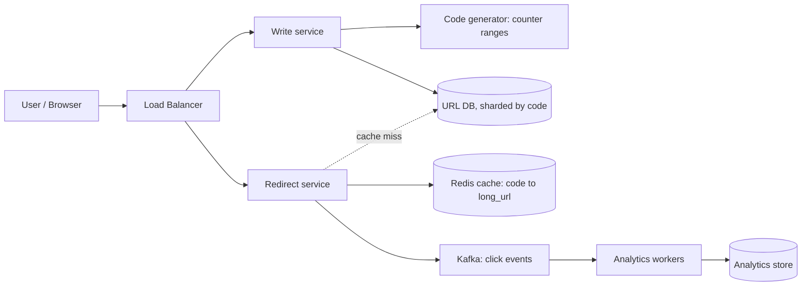
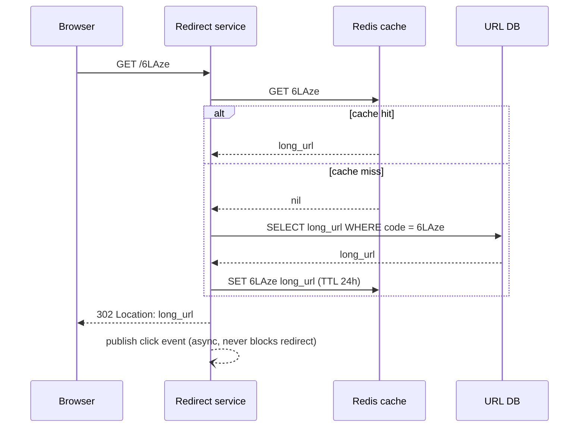
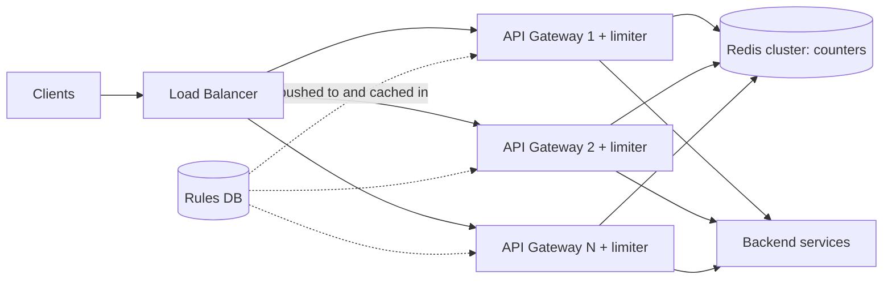
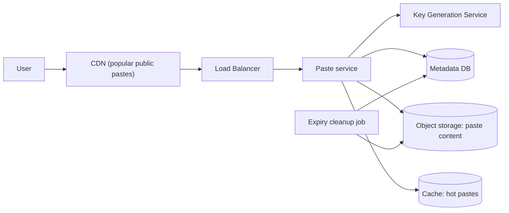
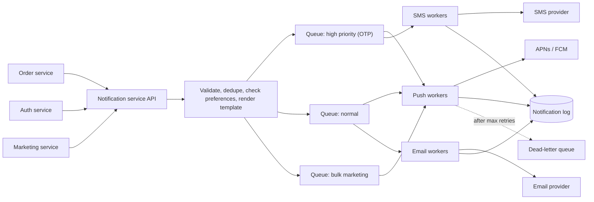
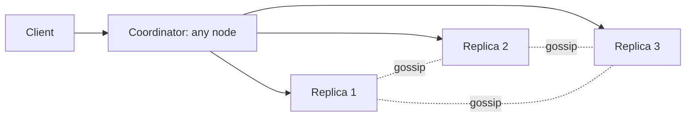
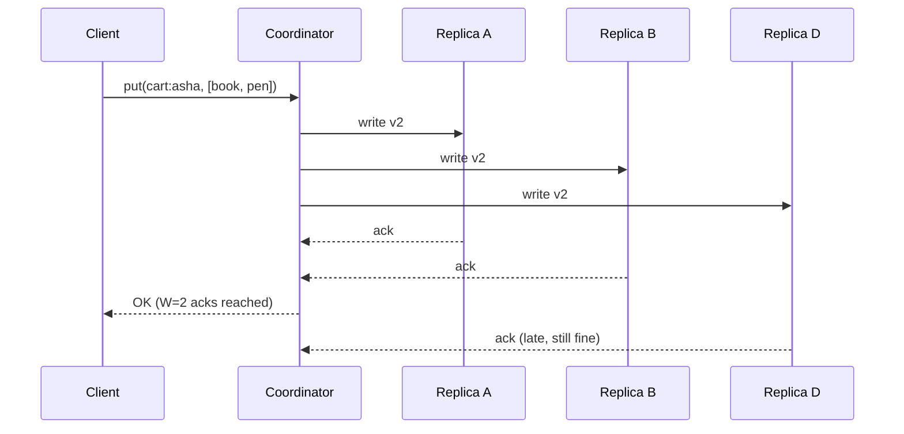
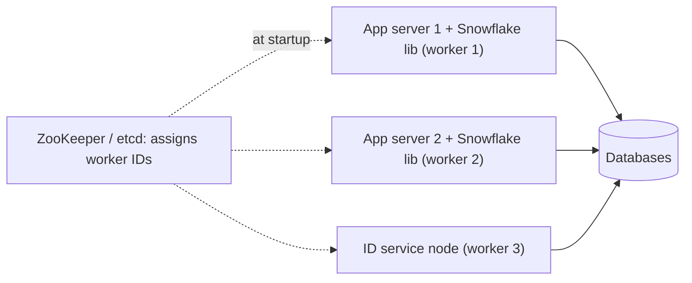

# Chapter 12 · Case Studies I: URL Shortener, Rate Limiter, Notifications, KV Store

> Learning system design from theory alone is like learning to cook from a list of ingredients. This chapter is the kitchen. We take six classic interview problems and cook each one from start to finish, out loud, the way you will in the interview room.

**You will learn:**
- How to run the 7-step framework end to end on six real problems: **URL shortener**, **distributed rate limiter**, **Pastebin**, **notification system**, **distributed key-value store** and **unique ID generator**
- The one "core trick" inside each problem that interviewers are really waiting for
- How to turn requirements into numbers, numbers into decisions, and decisions into a diagram
- Runnable Python simulations of the hard parts: base-62 codes, atomic rate limiting, quorum reads and writes, vector clocks, Merkle trees and Snowflake IDs
- The follow-up questions interviewers ask after your first design, and strong answers to them
- Reusable building blocks you'll recognise again in [Chapter 13](13-case-studies-2.md)

**Before this:** [Estimation & The Interview Framework](11-estimation-framework.md) · [Scalability & Load Balancing](02-scalability-load-balancing.md) · [Databases](03-databases.md) · [Caching & CDNs](04-caching-cdn.md) · [Replication, Sharding & Consistent Hashing](05-replication-sharding.md) · [CAP & Consensus](06-cap-consistency.md) · [Message Queues](08-queues-events.md) · [Microservices & Reliability](09-microservices-reliability.md) · [Storage, Search & Unique IDs](10-storage-search-ids.md)

---

## 🧠 The Big Idea

Every system design answer is built from the **same small pantry** of parts: load balancers, app servers, caches, databases, queues, object storage, CDNs. What changes between problems is **which part is under stress** and **which one decision makes or breaks the design**.

Think of a doctor. Every patient has the same organs. A good doctor doesn't re-learn anatomy for each patient; they run the same examination (temperature, pulse, blood pressure...) and then zoom in on the organ that's in trouble. Your examination is the 7-step framework from [Chapter 11](11-estimation-framework.md):


And each problem in this chapter has one organ in trouble:

| Problem | What's under stress | The core trick |
|---|---|---|
| URL shortener | Reads (100× more than writes) | Unique short codes without collisions + heavy caching |
| Rate limiter | Shared counters touched by every request | Atomic counter updates in a fast shared store |
| Pastebin | Large blobs of text | Metadata in a DB, content in object storage |
| Notification system | Unreliable third-party providers, bursts | Queues + retries + dedup + per-user preferences |
| Key-value store | Availability while machines fail | Consistent hashing + replication + quorums |
| Unique ID generator | Coordination between machines | Pack time + machine + sequence into 64 bits |

> 💡 **How to read each case study:** first read only the requirements and try the design yourself for 10 minutes on paper. Then read on. Comparing your attempt with the model answer teaches you 3× more than reading passively.

A note on numbers: the traffic figures below are **assumptions we choose** so the maths is concrete, the same way you will state assumptions in an interview. They are not real statistics about any company.

---

## 🔨 Building It Up

### 1. URL Shortener (TinyURL / bit.ly)

**The story:** you paste `https://www.example.com/blog/2026/10/how-we-scaled-our-checkout-flow?utm_source=newsletter` and get back `https://sho.rt/6LAze`. Anyone who clicks the short link lands on the long page. It looks like a toy problem. It isn't: it's the cleanest way for an interviewer to test hashing, encoding, caching, read-heavy scaling and database choice in 45 minutes.

#### 1.1 Requirements

Always split them into functional (what it does) and non-functional (how well it does it). Ask questions; don't assume silently.

**Functional:**
1. Given a long URL, return a short URL.
2. Visiting the short URL redirects to the long URL.
3. Optional: custom alias (`sho.rt/diwali-sale`), expiry time.
4. Optional: click analytics (how many clicks, from where).

**Non-functional:**
- **Very low redirect latency** (a redirect is in the user's critical path; aim for well under 100 ms server-side).
- **Highly available**: if redirects break, every link ever shared on the internet breaks.
- Short codes must be **unique** and **not easily guessable** in sequence (nice to have).
- Read-heavy: people click far more than they create.

**Out of scope (say it out loud):** user accounts, link editing, spam detection (we'll mention it at the end).

#### 1.2 Estimates

Assumptions: **100 million new URLs per day**, read:write ratio **100:1**, keep links for **5 years**, about **500 bytes** per record (long URL up to ~2 KB but most are short, plus code, timestamps, owner).

| Quantity | Maths | Result |
|---|---|---|
| Write QPS | 100M / 86,400 s | ≈ **1,200/s** (peak ×2 ≈ 2,400/s) |
| Read QPS | 1,200 × 100 | ≈ **120,000/s** (peak ≈ 240,000/s) |
| Records in 5 years | 100M × 365 × 5 | ≈ **182.5 billion** |
| Storage | 182.5B × 500 B | ≈ **91 TB** (before replication) |
| Code length | 62⁷ ≈ 3.5 trillion > 182.5B | **7 characters** of base-62 |
| Cache | Hot set ≈ 20% of the links clicked in a day; assume ~100M distinct links clicked/day → 0.2 × 100M × 500 B | ≈ **10 GB**; provision a few tens of GB with overhead |

What these numbers tell us:
- 120k reads/s will crush a single database. **Caching is mandatory.**
- 1,200 writes/s is modest. A sharded database handles it easily.
- 91 TB is too big for one machine. We'll **shard** (or use a database that shards for us).
- 7 characters is enough. Good: short is the whole point.

#### 1.3 API

```text
POST /api/v1/urls
Body:    { "long_url": "https://...", "custom_alias": "diwali-sale", "expires_at": "2027-01-01T00:00:00Z" }
Returns: 201 Created  { "short_url": "https://sho.rt/6LAze", "code": "6LAze" }
Errors:  400 invalid URL or alias · 409 alias already taken · 429 too many requests

GET /{code}
Returns: 302 Found, header  Location: https://www.example.com/blog/...
Errors:  404 unknown code · 410 Gone (expired)

GET /api/v1/urls/{code}/stats       (optional analytics)
Returns: 200 { "clicks": 18234, "by_country": {...} }
```

Two small things that impress interviewers: the create call requires an **API key** (so you can rate-limit abusers), and you mention **301 vs 302** (deep dive below).

#### 1.4 Data model

```sql
CREATE TABLE urls (
    code        VARCHAR(16) PRIMARY KEY,   -- the short code (or custom alias)
    long_url    TEXT        NOT NULL,
    user_id     BIGINT,                    -- who created it (nullable for anonymous)
    created_at  TIMESTAMP   NOT NULL,
    expires_at  TIMESTAMP                  -- NULL means never
);
```

The access pattern is almost entirely **"given code, give me long_url"**: a pure key-value lookup with no joins. That means either works:
- a **relational DB** (PostgreSQL/MySQL) sharded by `code`, or
- a **key-value / wide-column store** (DynamoDB, Cassandra) with `code` as the partition key, which shards and replicates automatically.

Both are defensible. Say why you chose one: "No joins, simple key lookups, 91 TB and growing, so I'll use a horizontally scalable key-value store like DynamoDB or Cassandra."

#### 1.5 High-level design



The redirect path, step by step:



We split **write** and **redirect** services because they scale very differently (2k/s vs 240k/s at peak). Separate services let us add redirect servers without touching the write path.

#### 1.6 Deep dive: generating the short code

This is *the* question. Three approaches; know all three and their trade-offs.

**First, base-62 encoding.** Letters (a–z, A–Z) plus digits (0–9) = 62 URL-safe characters. Turning a number into base 62 is exactly like turning a number into decimal digits, just with 62 "digits".

```python
ALPHABET = "0123456789abcdefghijklmnopqrstuvwxyzABCDEFGHIJKLMNOPQRSTUVWXYZ"
BASE = len(ALPHABET)  # 62

def encode(n):
    """Turn a non-negative integer into a base-62 string."""
    if n == 0:
        return ALPHABET[0]
    chars = []
    while n > 0:
        n, rem = divmod(n, BASE)
        chars.append(ALPHABET[rem])
    return "".join(reversed(chars))

def decode(s):
    n = 0
    for ch in s:
        n = n * BASE + ALPHABET.index(ch)
    return n

for n in [0, 61, 62, 125, 1_000_000, 3_521_614_606_207]:
    code = encode(n)
    print(f"{n:>16} -> {code:>8} -> {decode(code)}")
print("7 chars can hold", f"{BASE ** 7:,}", "codes")
```

```text
               0 ->        0 -> 0
              61 ->        Z -> 61
              62 ->       10 -> 62
             125 ->       21 -> 125
         1000000 ->     4c92 -> 1000000
   3521614606207 ->  ZZZZZZZ -> 3521614606207
7 chars can hold 3,521,614,606,208 codes
```

What just happened: `62` becomes `"10"` for the same reason ten becomes `"10"` in decimal. Seven base-62 characters hold 3.5 trillion values, comfortably above our 182.5 billion.

**Approach A: hash the long URL.** Take MD5/SHA-256 of the URL, base-62 encode it, keep the first 7 characters.
- ✅ Same long URL always gives the same code (free deduplication).
- ❌ **Collisions**: two different URLs can share the same first 7 characters. You must check the DB and, on collision, retry with a salt. Every write becomes "read then write", and at 91 TB, collision checks need an index lookup each time.

**Approach B: a unique counter + base-62.** Every new URL gets the next integer; encode it. No collisions *by construction*. The problem: a single global counter is a bottleneck and a single point of failure. The fix is **range allocation**: a coordinator (ZooKeeper, or a single DB row updated in a transaction) hands each app server a **block** of, say, 1,000 numbers. The server uses them from memory and asks for a new block only when it runs out.

**Approach C: a Key Generation Service (KGS).** Pre-generate random codes offline into an `unused_keys` table; app servers grab batches. We'll build it in the Pastebin case study.

Here are A and B side by side:

```python
import hashlib

ALPHABET = "0123456789abcdefghijklmnopqrstuvwxyzABCDEFGHIJKLMNOPQRSTUVWXYZ"

def encode(n):
    chars = []
    while True:
        n, rem = divmod(n, 62)
        chars.append(ALPHABET[rem])
        if n == 0:
            return "".join(reversed(chars))

class RangeAllocator:
    """Stands in for ZooKeeper / a DB row that hands out blocks of IDs."""
    def __init__(self, block_size):
        self.next_start = 100_000_000      # start high so codes are not tiny
        self.block_size = block_size

    def grab_block(self):
        start = self.next_start
        self.next_start += self.block_size
        return start, start + self.block_size

class AppServer:
    def __init__(self, name, allocator, db):
        self.name, self.allocator, self.db = name, allocator, db
        self.cur, self.end = allocator.grab_block()

    def shorten(self, long_url):
        if self.cur == self.end:                     # block used up: get another
            self.cur, self.end = self.allocator.grab_block()
        code = encode(self.cur)
        self.cur += 1
        self.db[code] = long_url                     # code is unique: no collision check
        return code

db = {}
alloc = RangeAllocator(block_size=3)
s1, s2 = AppServer("s1", alloc, db), AppServer("s2", alloc, db)
for i, server in enumerate([s1, s1, s2, s1, s1, s2]):
    url = f"https://example.com/page/{i}"
    print(server.name, server.shorten(url), "->", url)
print("rows:", len(db))

# The hashing approach: take the first 7 chars of a hash, check for collisions
def hash_code(long_url, salt=""):
    digest = hashlib.md5((long_url + salt).encode()).hexdigest()
    return encode(int(digest, 16))[:7]

store = {}
def shorten_by_hash(long_url):
    salt = ""
    while True:
        code = hash_code(long_url, salt)
        if code not in store or store[code] == long_url:
            store[code] = long_url
            return code
        salt += "!"                                   # collision: change input, retry

a = shorten_by_hash("https://example.com/a")
b = shorten_by_hash("https://example.com/a")
print("same URL, same code:", a == b, a)
```

```text
s1 6LAze -> https://example.com/page/0
s1 6LAzf -> https://example.com/page/1
s2 6LAzh -> https://example.com/page/2
s1 6LAzg -> https://example.com/page/3
s1 6LAzk -> https://example.com/page/4
s2 6LAzi -> https://example.com/page/5
rows: 6
same URL, same code: True 6fBJVPc
```

What just happened: `s1` took numbers 100,000,000–100,000,002 and `s2` took the next block. Each server hands out codes **without talking to anyone**, and the codes never clash. When `s1` ran out (4th URL), it grabbed the block after `s2`'s. If a server crashes, the unused part of its block is simply wasted, which is fine: we have trillions of codes.

| | Hash + truncate | Counter ranges | KGS (pre-generated) |
|---|---|---|---|
| Collisions | Possible, must check | Impossible | Impossible |
| Coordination | None | One call per block | One call per batch |
| Same URL → same code | Yes (free dedup) | No (needs a lookup table) | No |
| Guessable | No | Yes, sequential (fix: shuffle bits or encrypt the counter) | No (random) |
| Interview verdict | Fine, mention collisions | **Most common good answer** | Great, slightly more machinery |

> ⚠️ **Sequential codes leak information.** With counters, a competitor can shorten two links an hour apart and learn how many links you created in that hour, or crawl every code in order. If that matters, apply a reversible bit-shuffle (or a block cipher) to the counter before encoding: still unique, no longer sequential.

#### 1.7 Deep dive: 301 or 302?

- **301 Moved Permanently**: the browser caches the redirect. Next time, it skips your server entirely. Less load, but you **lose analytics** for repeat clicks and can't change or expire the link for that browser.
- **302 Found (temporary)**: the browser asks your server every time. More load, but every click is counted and expiry works.

Good answer: "302 if analytics matter (bit.ly's business), 301 if we only care about load." Say the trade-off; that's what's being tested.

#### 1.8 Deep dive: making reads fast

- **Cache**: Redis cluster keyed by `code`. Link popularity is very skewed (a viral link gets millions of clicks; most get a handful), so even a small cache gives a high hit rate. Use **cache-aside** with a TTL and **LRU** eviction ([Chapter 04](04-caching-cdn.md)).
- **CDN / edge**: for extremely hot links, the redirect itself can be cached at the edge for a short time.
- **Replicas**: the database has read replicas for cache misses.
- **Negative caching**: cache "not found" for unknown codes for a short time, so bots scanning random codes don't hammer the DB.

#### 1.9 Deep dive: analytics without slowing redirects

Never write a click counter to the main DB in the redirect path. Instead, publish a small click event (`code, timestamp, country, referrer`) to **Kafka** asynchronously and return the redirect immediately. Consumers aggregate in batches and write to an analytics store (a columnar DB or time-series store). If the analytics pipeline is down, redirects still work: that's the point of decoupling ([Chapter 08](08-queues-events.md)).

#### 1.10 Bottlenecks and trade-offs

| Concern | Decision | Trade-off accepted |
|---|---|---|
| 240k reads/s | Redis cache + read replicas + separate redirect service | Cache can be briefly stale after an update/delete |
| Code uniqueness | Counter ranges + base-62 | Codes are sequential unless shuffled |
| 91 TB | Key-value store sharded by `code` | No complex queries (we don't need them) |
| Analytics | Async via Kafka | Stats lag by seconds |
| Expired links | Lazy check on read + nightly cleanup job | Expired rows sit on disk for up to a day |
| Hot link | Cache + CDN | A tiny window of serving an expired link from the edge |

**Single points of failure?** The range allocator: if it's down, servers keep using their current block, which buys time. Run it as a replicated ZooKeeper ensemble or a primary/replica DB.

#### 1.11 Follow-up questions

- *"How do you support custom aliases?"* Insert with the alias as the primary key; a uniqueness violation means 409. Reserve words like `api`, `admin`. Make sure generated codes can't collide with aliases (different length range, or check before use).
- *"Same long URL submitted twice: same code?"* Only if you keep a `long_url_hash → code` index. Usually not worth it per user; can be done per (user, URL).
- *"How do you stop abuse (phishing links)?"* Rate-limit creation per API key (next case study), check URLs against a blocklist / safe-browsing service asynchronously, allow reports and takedown.
- *"Multi-region?"* Redirect service and cache in every region, DB replicated across regions. Writes go to one region or use per-region counter ranges so codes never clash.

---

### 2. Distributed Rate Limiter

**The story:** your public API allows **100 requests per minute per user**. You have 50 API gateway servers behind a load balancer. A user's requests are spread over all 50. How does gateway #17 know the user already made 99 requests through the other 49? That shared-state question is the whole problem.

The algorithms themselves (token bucket, leaky bucket, fixed window, sliding log, sliding window counter) are built in [Chapter 09](09-microservices-reliability.md). Here we focus on making them work **across many machines**.

#### 2.1 Requirements

**Functional:**
1. Limit requests by a key: user ID, API key, IP address, or (user, endpoint).
2. Rules are configurable: e.g. `POST /login: 5 per minute per IP`, `GET /search: 1,000 per hour per API key`.
3. When over the limit, reject with **HTTP 429 Too Many Requests** and tell the client when to retry.

**Non-functional:**
- **Very low added latency**: it runs on *every* request. Budget: about 1–2 ms.
- **Highly available**: if the limiter is down, the API must keep working (**fail open**) for most endpoints.
- **Accurate enough**: small overshoot (101 instead of 100) is acceptable; 2× is not.
- Distributed: consistent limits across all gateway servers.

#### 2.2 Estimates

Assume **1 million requests/second** at peak and **10 million active users** at a time.

| Quantity | Maths | Result |
|---|---|---|
| Limiter checks | 1 per request | **1M ops/s** on the counter store |
| Memory per key | key ~50 B + counters/timestamps ~30 B + overhead | ~**100 B** |
| Memory total | 10M keys × 100 B (× a few rules) | ~**1–3 GB**: fits in RAM easily |
| Store nodes | One Redis node does on the order of 100k simple ops/s | ~**10–20 shards** (+ replicas) |

Conclusion: the data is small; the **op rate** is what we size for. An in-memory store like **Redis** fits perfectly.

#### 2.3 API

The limiter is usually **not** a public API; it's a check inside the gateway. Internally:

```text
check(key="user:42", rule="api_default", cost=1)
  -> { allowed: true, remaining: 57, reset_after_ms: 21000 }
```

What the **client** sees on rejection:

```text
HTTP/1.1 429 Too Many Requests
Retry-After: 21
X-RateLimit-Limit: 100
X-RateLimit-Remaining: 0
X-RateLimit-Reset: 1761900000
```

`Retry-After` is a standard HTTP header; the `X-RateLimit-*` headers are a widely used convention.

#### 2.4 Data model

Rules (rarely change, cached in every gateway):

```sql
CREATE TABLE rate_limit_rules (
    rule_id        VARCHAR(64) PRIMARY KEY,   -- 'login_per_ip'
    key_type       VARCHAR(16),               -- 'ip' | 'user' | 'api_key'
    endpoint       VARCHAR(128),              -- 'POST /login' or '*'
    algorithm      VARCHAR(32),               -- 'token_bucket' | 'sliding_window'
    limit_count    INT,
    window_seconds INT
);
```

Counters (hot, in Redis), for example:
- fixed window: `rl:{user:42}:{minute 29358812}` → integer, with a TTL of a bit more than the window
- token bucket: `rl:{user:42}` → hash `{tokens: 3.5, last_refill_ms: 1761899979000}`

#### 2.5 High-level design



Where should the limiter live? Options:
1. **In the API gateway / middleware** (shown above): one place, all services protected. Most common answer.
2. **A separate rate-limit service** the gateway calls: cleaner separation, but an extra network hop.
3. **In each service**: fine for per-service rules, but duplicated logic.
4. **Client side**: never trust it for protection; only for being polite.

#### 2.6 Deep dive: the race condition

The naive approach in each gateway is: read the counter, if below limit then write counter + 1. With two gateways handling the same user at the same moment, both read the **same** old value. Watch it break:

```python
class FakeRedis:
    """A tiny shared key-value store. Real Redis runs one command at a time."""
    def __init__(self):
        self.data = {}

    def get(self, key, default=0):
        return self.data.get(key, default)

    def set(self, key, value):
        self.data[key] = value

    def incr(self, key):                 # atomic: read + add + write in ONE step
        self.data[key] = self.data.get(key, 0) + 1
        return self.data[key]

LIMIT = 3
redis = FakeRedis()

# --- Naive: two gateways each do GET, then decide, then SET (race!) ---
key = "user:42:minute:0"
seen = []
for _ in range(3):                       # 3 rounds, two gateways per round
    a = redis.get(key)                   # gateway A reads
    b = redis.get(key)                   # gateway B reads the SAME old value
    if a < LIMIT:
        redis.set(key, a + 1); seen.append("A allowed")
    if b < LIMIT:
        redis.set(key, b + 1); seen.append("B allowed")
print("naive allowed:", len(seen), "requests (limit was", LIMIT, ")")

# --- Correct: atomic INCR, then compare ---
redis = FakeRedis()
allowed = 0
for _ in range(3):
    for gateway in "AB":
        if redis.incr(key) <= LIMIT:
            allowed += 1
print("atomic allowed:", allowed, "requests")
```

```text
naive allowed: 6 requests (limit was 3 )
atomic allowed: 3 requests
```

What just happened: with read-then-write, the two gateways' updates overwrite each other ("lost update"), so the user got **double** the limit. With `INCR`, the store does the read and the write as one indivisible step, so every request sees a distinct count.

In real Redis you have two tools:
- **`INCR` + `EXPIRE`**: perfect for the fixed-window counter.
- **Lua scripts** (`EVAL`): Redis runs a whole script **atomically** (it executes commands one at a time, and a script runs without interruption). Token bucket and sliding window need several reads and writes, so they go into a Lua script.

#### 2.7 Deep dive: token bucket in a shared store

The trick that makes the token bucket cheap: **don't refill on a timer**. Store only `tokens` and `last_refill_time`, and on each request compute how many tokens *would have* dripped in since then. This is called **lazy refill**. The function below is exactly what the Lua script does, atomically, inside Redis:

```python
class TokenBucketStore:
    """What the Redis Lua script does, atomically, per request.
    State per user is just two numbers: tokens left and last refill time."""
    def __init__(self, capacity, refill_per_sec):
        self.capacity, self.rate = capacity, refill_per_sec
        self.state = {}                                   # key -> [tokens, last_ts]

    def allow(self, key, now):
        tokens, last = self.state.get(key, [self.capacity, now])
        tokens = min(self.capacity, tokens + (now - last) * self.rate)  # lazy refill
        if tokens >= 1:
            self.state[key] = [tokens - 1, now]
            return True, int(tokens - 1)
        self.state[key] = [tokens, now]
        return False, 0

bucket = TokenBucketStore(capacity=5, refill_per_sec=1)
timeline = [0, 0, 0, 0, 0, 0, 0.5, 1.0, 3.0, 3.0, 3.0]
for t in timeline:
    ok, left = bucket.allow("ip:1.2.3.4", t)
    print(f"t={t:<4} {'ALLOW' if ok else '429  '} tokens_left={left}")
```

```text
t=0    ALLOW tokens_left=4
t=0    ALLOW tokens_left=3
t=0    ALLOW tokens_left=2
t=0    ALLOW tokens_left=1
t=0    ALLOW tokens_left=0
t=0    429   tokens_left=0
t=0.5  429   tokens_left=0
t=1.0  ALLOW tokens_left=0
t=3.0  ALLOW tokens_left=1
t=3.0  ALLOW tokens_left=0
t=3.0  429   tokens_left=0
```

What just happened: a burst of 5 is allowed instantly (the bucket's capacity), then the client is limited to the refill rate of 1 per second. At t=0.5 only half a token had dripped in; at t=1.0 a full token was there. Use the **store's clock** (Redis `TIME`) or pass a timestamp from synchronised servers; gateways with skewed clocks give slightly unfair results.

#### 2.8 Deep dive: sliding window counter (the accuracy/memory sweet spot)

A **fixed window** (count per calendar minute) lets a user send 100 requests at 12:00:59 and 100 more at 12:01:00: 200 in two seconds. A **sliding log** (store every timestamp) is exact but costs memory per request. The **sliding window counter** keeps just two counters (this window and the previous one) and estimates:

`estimate = previous_count × (fraction of previous window still inside the last 60 s) + current_count`

```python
class SlidingWindowCounter:
    """Approximate sliding window: weight the previous window by how much
    of it still overlaps the last `window` seconds."""
    def __init__(self, limit, window):
        self.limit, self.window = limit, window
        self.counts = {}                         # (user, window_index) -> count

    def allow(self, user, now):
        idx = int(now // self.window)
        cur = self.counts.get((user, idx), 0)
        prev = self.counts.get((user, idx - 1), 0)
        elapsed = (now % self.window) / self.window   # 0.0 .. 1.0 into window
        estimate = prev * (1 - elapsed) + cur
        if estimate < self.limit:
            self.counts[(user, idx)] = cur + 1
            return True
        return False

rl = SlidingWindowCounter(limit=10, window=60)
# 10 requests late in minute 0 use up the budget
print([rl.allow("u1", 50 + i) for i in range(10)].count(True), "allowed in minute 0")
# Minute 1: the previous window still "counts" for part of the time
for t in [70, 100]:
    results = [rl.allow("u1", t) for _ in range(5)]
    print(f"burst of 5 at t={t}s -> {results.count(True)} allowed")
```

```text
10 allowed in minute 0
burst of 5 at t=70s -> 2 allowed
burst of 5 at t=100s -> 5 allowed
```

What just happened: at t=70 we're 1/6 into minute 1, so the previous window still weighs 10 × 5/6 ≈ 8.3 and only 2 more requests fit. A plain fixed window would have allowed all 5 (and 5 more). By t=100 most of the old window has slid out. This approximation assumes requests in the previous window were evenly spread; in practice it's accurate enough and is what many production limiters use.

#### 2.9 Deep dive: scaling and failure

- **Shard counters by key** (Redis Cluster hashes keys to slots). All counters for one user live on one shard, so a single atomic script works.
- **Latency**: the Redis call is one network round trip. Keep Redis in the **same region/zone** as the gateways. Use pipelining or combine rules into one script.
- **Redis down?** Choose deliberately:
  - **Fail open** (allow everything): protects user experience; used for normal API traffic.
  - **Fail closed** (reject): used where abuse is costly, like login or OTP-sending endpoints.
  - **Fall back to local limits**: each gateway enforces `limit / number_of_gateways` in memory. Rough, but still a safety net.
- **Hot keys**: one abusive client hammering one key can overload one shard. Add a cheap **local pre-check** in each gateway (e.g. a local token bucket) so obvious floods are rejected before reaching Redis.
- **Multi-region**: either separate limits per region (simple, allows N× overshoot globally) or asynchronous syncing of counts between regions (eventually consistent). Strict global limits across continents cost a cross-region round trip per request, which is usually not worth it.

#### 2.10 Trade-offs

| Decision | Option chosen | Alternative | Why |
|---|---|---|---|
| Where | API gateway middleware | Separate service | One fewer network hop |
| Store | Redis cluster | DB, local memory | Sub-ms atomic ops; local memory can't share state |
| Algorithm | Token bucket (APIs), sliding window counter (strict quotas) | Fixed window, sliding log | Bursts allowed but bounded; tiny memory |
| Atomicity | Lua script / INCR | Locks | Locks add round trips and can deadlock |
| On store failure | Fail open (fail closed for login/OTP) | Always closed | Availability of the product matters more |

#### 2.11 Follow-up questions

- *"How do you rate-limit by multiple dimensions at once?"* Check several keys in one Lua script (per IP, per user, per endpoint) and reject if any is over.
- *"How do clients behave well?"* Honour `Retry-After`; retry with exponential backoff and jitter ([Chapter 09](09-microservices-reliability.md)).
- *"Rate limiting vs. load shedding?"* Rate limiting is per client fairness. **Load shedding** drops work when the *server* is overloaded, regardless of who sends it. You usually want both.
- *"Different tiers (free vs paid)?"* The rule lookup takes the user's plan into account: the key includes the tier, or the limit value comes from the plan.

---
### 3. Pastebin

**The story:** a user pastes a block of text (a log, a code snippet, a config) and gets a link like `paste.it/aZ3kQ9pL` to share. It looks like a URL shortener, and an interviewer often asks it right after one to see if you notice **the one big difference: the payload is large**. A URL is 100 bytes; a paste can be 10 MB.

#### 3.1 Requirements

**Functional:**
1. Create a paste (text up to **10 MB**), get a unique link.
2. Read a paste by its link.
3. Optional expiry (10 minutes, 1 day, never), optional "private / unlisted".
4. Optional: syntax highlighting, custom URL, user accounts.

**Non-functional:**
- Highly available and durable: a paste must never be silently lost.
- Low read latency.
- Links of private pastes must be **unguessable**.

#### 3.2 Estimates

Assume **1 million new pastes/day**, read:write **5:1**, average paste **10 KB**, keep data **10 years**.

| Quantity | Maths | Result |
|---|---|---|
| Write QPS | 1M / 86,400 | ≈ **12/s** |
| Read QPS | × 5 | ≈ **60/s** (peaks higher when something goes viral) |
| Content per day | 1M × 10 KB | **10 GB/day** |
| Content, 10 years | 10 GB × 3,650 | ≈ **36.5 TB** |
| Metadata | 1M × ~200 B × 3,650 | ≈ **0.7 TB** |
| Pastes in 10 years | 1M × 3,650 | 3.65 billion; 62⁸ ≈ 218 trillion, so **8-char random keys** are sparse enough to be unguessable |

Notice how different this is from the URL shortener: QPS is tiny, but **bytes** are big. The design question shifts from "how do we handle the request rate?" to "where do we put 36 TB of text?"

#### 3.3 API

```text
POST /api/v1/pastes
Body:    { "content": "...", "expires_in": "1d", "visibility": "unlisted", "language": "python" }
Returns: 201 { "key": "aZ3kQ9pL", "url": "https://paste.it/aZ3kQ9pL" }

GET /api/v1/pastes/{key}
Returns: 200 { "content": "...", "language": "python", "created_at": "...", "expires_at": "..." }
         or 404 / 410

DELETE /api/v1/pastes/{key}      (owner only)
```

For very large pastes, an even better API: the server returns a **pre-signed upload URL** and the client uploads the text directly to object storage ([Chapter 10](10-storage-search-ids.md)). The app servers never touch the 10 MB body.

#### 3.4 Data model

Split **metadata** (small, queried) from **content** (big, just fetched by key):

```sql
CREATE TABLE pastes (
    paste_key    CHAR(8)      PRIMARY KEY,
    user_id      BIGINT,                      -- NULL for anonymous
    object_path  VARCHAR(256) NOT NULL,       -- e.g. 's3://pastes/aZ/aZ3kQ9pL'
    size_bytes   INT          NOT NULL,
    language     VARCHAR(32),
    visibility   VARCHAR(16)  NOT NULL,       -- public | unlisted | private
    created_at   TIMESTAMP    NOT NULL,
    expires_at   TIMESTAMP
);
CREATE INDEX idx_pastes_expiry ON pastes (expires_at);   -- for the cleanup job
CREATE INDEX idx_pastes_user   ON pastes (user_id, created_at);
```

Content goes into **object storage** (S3 or similar) under `object_path`. Object storage is cheap per GB, extremely durable (it replicates for you), and scales without you sharding anything.

> 💡 **Rule of thumb:** "Is it a big blob that's written once and read whole?" → object storage. "Is it small structured data I query by fields?" → database. Pastebin uses both.

#### 3.5 High-level design



Write flow: get a key from the KGS → upload content to object storage → insert metadata row → return the link. (Upload **before** inserting metadata, so a row never points to missing content. If the metadata insert fails, an orphan object is left behind, which a periodic sweeper can delete.)

Read flow: cache → metadata DB → object storage. Popular public pastes are cached by the CDN.

#### 3.6 Deep dive: the Key Generation Service (KGS)

Random 8-character keys are unguessable, but generating them on the fly means checking for collisions. A **KGS** pre-generates random unique keys offline and stores them in an `unused_keys` table. App servers fetch a **batch** at a time and keep them in memory.

```python
import random

random.seed(1)
ALPHABET = "0123456789abcdefghijklmnopqrstuvwxyzABCDEFGHIJKLMNOPQRSTUVWXYZ"

class KeyGenerationService:
    """Pre-generates random 8-char keys offline; hands them out in batches."""
    def __init__(self, pool_size):
        keys = set()
        while len(keys) < pool_size:
            keys.add("".join(random.choice(ALPHABET) for _ in range(8)))
        self.unused = sorted(keys)        # stands in for the 'unused_keys' table
        self.used = set()                 # stands in for the 'used_keys' table

    def take_batch(self, n):
        batch, self.unused = self.unused[:n], self.unused[n:]
        self.used.update(batch)           # marked used BEFORE handing out
        return batch

kgs = KeyGenerationService(pool_size=10)
server_a_keys = kgs.take_batch(3)        # app server A keeps these in memory
server_b_keys = kgs.take_batch(3)
print("A got", server_a_keys)
print("B got", server_b_keys)
print("overlap:", set(server_a_keys) & set(server_b_keys))
server_a_keys = []                       # server A crashes: its 3 keys are lost
print("unused left:", len(kgs.unused), "| used (incl. lost):", len(kgs.used))
```

```text
A got ['1Fy0YUoH', '6v1VRorC', '8ASPM4g7']
B got ['MN0IshKP', 'MtYiX1qR', 'WzXF6bEK']
overlap: set()
unused left: 4 | used (incl. lost): 6
```

What just happened: keys are marked used **before** they leave the KGS, so two servers can never receive the same key, even if one crashes. The price is that a crash wastes its batch; with trillions of possible keys, nobody cares. The KGS itself must not be a single point of failure: run a standby replica, and in the real system the "take a batch" step is a database transaction (or `SELECT ... FOR UPDATE SKIP LOCKED`) so concurrent KGS instances don't hand out the same rows.

Key space math: 8 base-62 chars = 218 trillion keys; we need ~3.65 billion. Only about 1 in 60,000 possible keys is ever used, so guessing a valid private link by brute force is impractical, especially with rate limiting on reads.

#### 3.7 Deep dive: expiry and cleanup

Two layers:
1. **Lazy expiry**: on read, if `expires_at < now`, return 410 and treat it as gone.
2. **Active cleanup**: a scheduled job scans `idx_pastes_expiry` for expired rows in small batches, deletes the object, then the row. Object storage **lifecycle rules** can also auto-delete objects by prefix/age.

Freed keys can be returned to the KGS pool, but most designs don't bother.

#### 3.8 Trade-offs and follow-ups

| Decision | Why | Cost |
|---|---|---|
| Content in object storage | Cheap, durable, infinitely scalable | Extra hop on reads (mitigated by cache/CDN) |
| Metadata in SQL | Small, needs indexes (by user, by expiry) | Needs sharding only far in the future |
| KGS keys | Unguessable, no collision checks | One more service to run |
| Compression | Text compresses well (often several ×) | CPU on write/read |

Follow-ups:
- *"How would you add view counts?"* Same as URL analytics: async events, batched counters.
- *"Small pastes: is object storage overkill?"* A good optimisation: store pastes under a size threshold (e.g. a few KB) inline in the DB row, and only big ones in object storage.
- *"How do you avoid storing the same paste twice?"* Content-address it: object path = SHA-256 of the content. Two identical pastes share one object (and a reference count decides when to delete).

---

### 4. Notification System

**The story:** an e-commerce app needs to tell users "Your OTP is 4821" (SMS, *now*), "Your order shipped" (push + email, soon) and "50% off this weekend!" (push, whenever, and please not at 2 a.m.). Dozens of internal services want to send notifications. You design the one platform they all call.

This problem tests **asynchronous processing**: queues, retries, deduplication, priorities and talking to unreliable third parties.

#### 4.1 Requirements

**Functional:**
1. Send notifications over **push** (iOS/Android), **SMS**, **email** (and in-app).
2. Called by internal services, either for one user ("order shipped") or for a large segment ("all users in Mumbai").
3. Respect **user preferences** (opt-outs per channel and per category) and **quiet hours**.
4. Templates with variables (`"Hi {name}, your order {id} shipped"`), with localisation.
5. Track status: sent, delivered, opened, failed.

**Non-functional:**
- **Reliable**: never lose a notification. Prefer at-least-once delivery + deduplication.
- **Low latency for urgent kinds** (OTP within seconds) even during a huge marketing blast.
- Scalable to bursts, and **no spamming**: don't send the same notification twice.

#### 4.2 Estimates

Assume **500 million notifications/day** total, and a marketing campaign may target **10 million users within 10 minutes**.

| Quantity | Maths | Result |
|---|---|---|
| Average rate | 500M / 86,400 | ≈ **5,800/s** |
| Campaign burst | 10M / 600 s | ≈ **17,000/s** extra |
| Log storage | 500M × ~1 KB per record | ≈ **500 GB/day**; keep 30–90 days |
| Third-party limits | providers enforce their own rate limits | we must **throttle ourselves** |

The burst number is the interesting one. If OTPs share a queue with a 10-million-message campaign, an OTP could wait behind millions of promos. That single observation drives the design: **separate queues per priority and per channel**.

#### 4.3 API

```text
POST /api/v1/notifications
Body: {
  "idempotency_key": "order-5512-shipped",
  "user_ids": [42],                       // or "segment_id": "mumbai_active"
  "category": "transactional",            // otp | transactional | marketing
  "template_id": "order_shipped",
  "params": { "order_id": "5512" },
  "channels": ["push", "email"]           // optional; default from preferences
}
Returns: 202 Accepted { "notification_id": "n_8f3a..." }

GET /api/v1/notifications/{id}   -> per-channel status
PUT /api/v1/users/{id}/preferences  { "marketing": { "push": true, "sms": false }, "quiet_hours": ["22:00", "08:00"] }
```

`202 Accepted` (not 200) says "I've queued it; it will happen". That's honest for an async system.

#### 4.4 Data model

```sql
CREATE TABLE user_devices (            -- where to send push
    user_id      BIGINT,
    device_token VARCHAR(256),
    platform     VARCHAR(8),           -- ios | android
    last_seen    TIMESTAMP,
    PRIMARY KEY (user_id, device_token)
);

CREATE TABLE preferences (
    user_id   BIGINT,
    category  VARCHAR(32),             -- marketing | transactional
    channel   VARCHAR(16),             -- push | sms | email
    enabled   BOOLEAN,
    PRIMARY KEY (user_id, category, channel)
);

CREATE TABLE notification_log (        -- high volume: a wide-column store suits it
    notification_id VARCHAR(40),
    channel         VARCHAR(16),
    user_id         BIGINT,
    status          VARCHAR(16),       -- queued | sent | delivered | failed
    attempts        INT,
    updated_at      TIMESTAMP,
    PRIMARY KEY (notification_id, channel)
);
```

Templates live in a small table/config store and are heavily cached.

#### 4.5 High-level design



In a real system you'd have one queue (or topic) per **(channel × priority)**, so a stuck email provider can't block SMS, and a marketing flood can't delay OTPs. Workers for high-priority queues get reserved capacity.

For segment sends ("all 10M Mumbai users"), the API doesn't expand the list inline. It enqueues **one job**; a **fan-out worker** pages through the segment and enqueues per-user messages in chunks.

#### 4.6 Deep dive: reliability = queue + retry + dedup + DLQ

Here's the whole pipeline in miniature: an idempotency-key check, preferences, a priority queue, a flaky provider, retries, and a dead-letter queue.

```python
import heapq
import random

random.seed(13)

PRIORITY = {"otp": 0, "transactional": 1, "marketing": 2}   # lower = sooner

preferences = {                       # user -> channels they allow
    "asha": {"push", "email"},
    "ravi": {"sms"},
    "meera": set(),                   # opted out of everything
}

class FlakyProvider:
    """Pretends to be APNs / Twilio / SES: fails 30% of the time."""
    def __init__(self, name):
        self.name = name

    def send(self, user, text):
        return random.random() > 0.3

providers = {c: FlakyProvider(c) for c in ["push", "sms", "email"]}
queue, seen_keys, dead_letters, delivered = [], set(), [], []
seq = 0

def enqueue(idem_key, user, kind, text):
    global seq
    if idem_key in seen_keys:                       # producer retried: drop dup
        print(f"  dedup: {idem_key}")
        return
    seen_keys.add(idem_key)
    for channel in sorted(preferences.get(user, set())):
        seq += 1                                     # tie-breaker keeps FIFO order
        heapq.heappush(queue, (PRIORITY[kind], seq, user, channel, text, 0))

def worker(max_attempts=3):
    global seq
    while queue:
        prio, _, user, channel, text, attempt = heapq.heappop(queue)
        if providers[channel].send(user, text):
            delivered.append((user, channel, text))
        elif attempt + 1 < max_attempts:            # retry later (real system: backoff)
            seq += 1
            heapq.heappush(queue, (prio, seq, user, channel, text, attempt + 1))
        else:
            dead_letters.append((user, channel, text))

enqueue("promo-1-asha", "asha", "marketing", "50% off!")
enqueue("otp-9-ravi", "ravi", "otp", "Your OTP is 4821")
enqueue("otp-9-ravi", "ravi", "otp", "Your OTP is 4821")   # duplicate
enqueue("order-5-asha", "asha", "transactional", "Order shipped")
enqueue("promo-1-meera", "meera", "marketing", "50% off!")
worker()
for d in delivered:
    print("delivered:", d)
print("dead letters:", dead_letters)
```

```text
  dedup: otp-9-ravi
delivered: ('ravi', 'sms', 'Your OTP is 4821')
delivered: ('asha', 'email', 'Order shipped')
delivered: ('asha', 'push', 'Order shipped')
delivered: ('asha', 'email', '50% off!')
dead letters: [('asha', 'push', '50% off!')]
```

What just happened:
- The OTP was enqueued **after** the promo but delivered **first**: priority beats arrival order.
- The duplicate OTP request (the auth service retried after a timeout) was dropped by its **idempotency key**. Without this, Ravi gets two OTP SMS messages and you pay twice.
- Meera opted out, so nothing was even queued for her.
- One push failed three times and went to the **dead-letter queue** instead of retrying forever. An engineer (or an automated job) can inspect and replay DLQ messages later.

In production the retry would wait with **exponential backoff and jitter**, the dedup set would be Redis with a TTL (`SET key 1 NX EX 86400`), and the queue would be Kafka/SQS/RabbitMQ ([Chapter 08](08-queues-events.md)).

> ⚠️ **Exactly-once delivery to a phone is impossible.** If the SMS provider accepted the message but the acknowledgement got lost, you can't know whether the SMS went out. You pick **at-least-once** (retry; risk a rare duplicate) for OTPs and order updates, and you dedupe everywhere you can: in your queue consumers (idempotency key), and in the client app (notification ID) for push.

#### 4.7 Deep dive: respecting users

- **Preferences check** happens before enqueueing (cheap) and again just before sending (a user may have opted out in the meantime).
- **Quiet hours** need the user's **time zone**. Marketing messages in quiet hours are **deferred** to a delayed queue, not dropped.
- **Frequency caps**: "at most 2 marketing pushes per user per day", kept as a counter in Redis keyed by `(user, date)`.
- **Unsubscribe links** in email are a legal requirement in many countries.
- **Invalid tokens**: APNs/FCM tell you when a device token is no longer valid. Delete it, or you'll waste capacity forever.

#### 4.8 Deep dive: tracking status

Providers report delivery via **callbacks (webhooks)**: "message X delivered", "email bounced", "user opened". A small callback service updates `notification_log`. For opens and clicks, emails embed a tracking pixel/link, and the app reports when a push is opened. These events also flow to analytics through Kafka.

#### 4.9 Trade-offs and follow-ups

| Decision | Why | Cost |
|---|---|---|
| Async queues | Absorb bursts, decouple from slow providers | Seconds of delay, more moving parts |
| Queue per channel × priority | Isolation (bulkheads) | More queues to operate |
| At-least-once + idempotency keys | Never lose messages | Need dedup storage |
| Multiple providers per channel | Failover if one SMS provider is down | Integration effort, cost differences |
| Self-throttling | Providers rate-limit us | Campaigns take longer to finish |

Follow-ups:
- *"How do you handle a provider outage?"* Circuit breaker per provider; fail over to a secondary provider; messages stay in the queue meanwhile.
- *"How do you send 10M emails without getting marked as spam?"* Warm up sending IPs, follow email authentication standards (SPF, DKIM, DMARC), honour unsubscribes, throttle per receiving domain.
- *"How do you guarantee ordering (e.g. 'order placed' before 'order shipped')?"* Partition the queue by `user_id` so one user's messages are processed in order by one consumer; or include a sequence number and let the client app reorder.

---

### 5. Distributed Key-Value Store (Dynamo / Cassandra style)

**The story:** design a store with just two operations, `put(key, value)` and `get(key)`, that runs on hundreds of machines, keeps working when some of them die, and never says "sorry, can't take your write" during a sale. This is Amazon's **Dynamo** paper in interview form, and it ties together almost everything from [Chapter 05](05-replication-sharding.md) and [Chapter 06](06-cap-consistency.md).

#### 5.1 Requirements

**Functional:**
1. `put(key, value)` and `get(key)`. Values are small (typically under 10 KB; cap at around 1 MB).
2. Optional: `delete(key)`, TTL per key.

**Non-functional:**
- **Highly available**, especially for writes ("always writable": a shopping cart must accept items even during failures).
- **Scalable**: add machines to grow storage and throughput linearly.
- **Tunable consistency**: callers choose between faster/more-available and more-consistent per operation.
- Low latency (single-digit ms at the median).
- **Durable**: no data loss when a machine dies.

Because we favour availability during partitions, this is an **AP** system with **eventual consistency** by default (CAP, [Chapter 06](06-cap-consistency.md)). Say this explicitly; it shapes every later decision.

#### 5.2 Estimates

Assume **10 TB** of data, **100,000 operations/second** (70% reads), replication factor **3**.

| Quantity | Maths | Result |
|---|---|---|
| Raw storage | 10 TB × 3 replicas | **30 TB** |
| Nodes for storage | 30 TB / ~2 TB usable per node | ~**15 nodes**, say 20 for headroom |
| Ops per node | 100k ops × ~2–3 replicas touched / 20 nodes | ~**10–15k ops/s per node**: comfortable |

#### 5.3 API

```text
put(key, value, context)  -> ok          // context carries version info from a previous get
get(key)                  -> (value(s), context)
// Per-call consistency knobs (Cassandra style): consistency = ONE | QUORUM | ALL
```

Notice `get` may return **several values**: if two writes conflicted, the store can hand both "siblings" back and let the application merge them (the shopping cart merges by union).

#### 5.4 The building blocks

A KV store answers eight questions. Here's the cheat sheet; we'll go deep on each.

| Question | Technique |
|---|---|
| Which node stores key K? | **Consistent hashing** with **virtual nodes** |
| How do we survive a node dying? | **Replication** to N nodes (the "preference list") |
| How consistent are reads? | **Quorums**: N, R, W |
| Two writes conflicted: who wins? | **Vector clocks** (or last-write-wins timestamps) |
| A node was down briefly | **Sloppy quorum + hinted handoff** |
| Replicas drifted apart over time | **Read repair** + **anti-entropy with Merkle trees** |
| Who's alive? | **Gossip** protocol |
| How is data stored on one node? | **LSM tree**: commit log + memtable + SSTables |

#### 5.5 High-level design

There's no master. Every node is equal (**peer-to-peer**), and any node can coordinate any request.



A write with N=3, W=2:



#### 5.6 Deep dive: partitioning and replication

Keys are hashed onto a ring; each physical node owns many **virtual nodes** (points on the ring) so load spreads evenly and, when a node joins or leaves, only its neighbours' ranges move (roughly 1/N of the keys, not all of them). To replicate, walk clockwise from the key's position and pick the first **N distinct physical nodes**: that's the key's **preference list**.

#### 5.7 Deep dive: quorums (N, R, W)

- **N** = number of replicas.
- **W** = acks needed before a write is reported successful.
- **R** = replies needed before a read returns.

If **R + W > N**, every read set overlaps every write set in at least one node, so a read sees the latest acknowledged write (assuming no sloppy quorum shenanigans; see below). Common setting: N=3, R=2, W=2.

| Setting | Behaviour |
|---|---|
| W=1, R=1 | Fastest, most available, can read stale data |
| W=2, R=2 (N=3) | Balanced; tolerates 1 node down for both reads and writes |
| W=3, R=1 | Fast reads, writes fail if any replica is down |
| W=1, R=3 | Fast writes, slow fragile reads |

Here's a working mini store: consistent hashing with virtual nodes, a preference list, quorum writes and reads, versioned values and read repair.

```python
import bisect
import hashlib

def h(key):
    return int(hashlib.md5(key.encode()).hexdigest(), 16) % (2 ** 32)

class Node:
    def __init__(self, name):
        self.name, self.data, self.up = name, {}, True   # data: key -> (version, value)

class KVStore:
    def __init__(self, names, vnodes=8, n=3, r=2, w=2):
        self.nodes = {name: Node(name) for name in names}
        self.n, self.r, self.w = n, r, w
        self.ring = sorted((h(f"{name}#{i}"), name) for name in names for i in range(vnodes))
        self.positions = [pos for pos, _ in self.ring]

    def preference_list(self, key):
        """Walk clockwise from the key's position; collect N DISTINCT nodes."""
        i = bisect.bisect(self.positions, h(key)) % len(self.ring)
        owners = []
        while len(owners) < self.n:
            name = self.ring[i][1]
            if name not in owners:
                owners.append(name)
            i = (i + 1) % len(self.ring)
        return owners

    def put(self, key, value, version):
        acks = 0
        for name in self.preference_list(key):
            node = self.nodes[name]
            if node.up:
                node.data[key] = (version, value)
                acks += 1
        return "OK" if acks >= self.w else f"FAIL ({acks} acks < W={self.w})"

    def get(self, key):
        replies = []
        for name in self.preference_list(key):
            node = self.nodes[name]
            if node.up:
                replies.append((node.data.get(key, (0, None)), name))
        if len(replies) < self.r:
            return f"FAIL ({len(replies)} replies < R={self.r})"
        (version, value), _ = max(replies)               # newest version wins
        for (v, _), name in replies:                     # read repair stale replicas
            if v < version:
                self.nodes[name].data[key] = (version, value)
                print(f"  read-repair: {name} updated to v{version}")
        return value

store = KVStore(["A", "B", "C", "D", "E"])
owners = store.preference_list("cart:asha")
print("replicas for cart:asha ->", owners)
print(store.put("cart:asha", ["book"], version=1))

store.nodes[owners[0]].up = False                        # one replica crashes
print(store.put("cart:asha", ["book", "pen"], version=2))
store.nodes[owners[0]].up = True                         # it comes back, stale
print("stale copy on", owners[0], "=", store.nodes[owners[0]].data["cart:asha"])
print("get ->", store.get("cart:asha"))

store.nodes[owners[1]].up = store.nodes[owners[2]].up = False
print(store.put("cart:asha", ["laptop"], version=3))     # only 1 replica alive
```

```text
replicas for cart:asha -> ['C', 'A', 'D']
OK
OK
stale copy on C = (1, ['book'])
  read-repair: C updated to v2
get -> ['book', 'pen']
FAIL (1 acks < W=2)
```

What just happened:
1. `cart:asha` hashed to a spot on the ring; walking clockwise gave replicas C, A, D.
2. With C down, the write still reached W=2 (A and D): **the store stayed writable** during a failure.
3. C came back with the old `['book']`. The next read asked all reachable replicas, picked the newest version, and **repaired** C on the spot.
4. With two replicas down, the write could only reach one node, so the coordinator reported failure. Note that the one live node *did* store v3: Dynamo-style stores don't roll back partial writes. A "failed" write may still show up later. That's why clients retry with the same version info and why **idempotent writes** matter.

(For simplicity the demo contacts all replicas and uses a single integer version. Real systems send to all N, return after R or W replies, and use vector clocks or timestamps as versions.)

#### 5.8 Deep dive: conflicts and vector clocks

With W < N and failures, two clients can update the same key on different replicas without seeing each other's write. Who wins?

- **Last-write-wins (LWW)**: attach a timestamp; the larger one wins. Simple, used by Cassandra. Danger: clock skew can make an older write "win", and concurrent updates are silently lost.
- **Vector clocks**: each version carries a small map `{node: counter}`. Comparing two clocks tells you whether one version **descends** from the other (safe to drop the older) or whether they are **concurrent** (a real conflict to resolve).

```python
def compare(a, b):
    """Return 'a<b', 'a>b', 'equal' or 'concurrent' for two vector clocks."""
    nodes = set(a) | set(b)
    a_le_b = all(a.get(n, 0) <= b.get(n, 0) for n in nodes)
    b_le_a = all(b.get(n, 0) <= a.get(n, 0) for n in nodes)
    if a_le_b and b_le_a:
        return "equal"
    if a_le_b:
        return "a<b  (b is newer, drop a)"
    if b_le_a:
        return "a>b  (a is newer, drop b)"
    return "concurrent (conflict: keep both, let client merge)"

def bump(clock, node):
    new = dict(clock)
    new[node] = new.get(node, 0) + 1
    return new

v1 = bump({}, "A")                  # write handled by node A
v2 = bump(v1, "A")                  # another write via A, building on v1
v3 = bump(v2, "B")                  # client read v2, wrote via B
v4 = bump(v2, "C")                  # a different client read v2, wrote via C

print("v1 vs v2:", compare(v1, v2))
print("v3 vs v2:", compare(v3, v2))
print("v3 vs v4:", compare(v3, v4))
merged = {n: max(v3.get(n, 0), v4.get(n, 0)) for n in set(v3) | set(v4)}
v5 = bump(merged, "A")              # client merges both siblings, writes via A
print("v5 =", dict(sorted(v5.items())), "| v5 vs v4:", compare(v5, v4))
```

```text
v1 vs v2: a<b  (b is newer, drop a)
v3 vs v2: a>b  (a is newer, drop b)
v3 vs v4: concurrent (conflict: keep both, let client merge)
v5 = {'A': 3, 'B': 1, 'C': 1} | v5 vs v4: a>b  (a is newer, drop b)
```

What just happened: v3 and v4 both built on v2 but neither saw the other. Each has a counter the other lacks (`B:1` vs `C:1`), so they're **concurrent**. The store keeps both; the next reader merges them (for a cart: the union of items) and writes v5, which dominates both.

**Analogy:** vector clocks are like two people editing copies of the same Google Doc offline. When they reconnect, you can tell "Priya's copy already contains all of Rahul's edits" (just take Priya's) from "they both made different edits" (someone must merge).

#### 5.9 Deep dive: handling failures

**Temporary failures: sloppy quorum and hinted handoff.** If a replica in the preference list is down, the coordinator writes to the **next healthy node** on the ring instead, along with a **hint**: "this really belongs to B". When B recovers, the stand-in hands the data back and deletes its copy. Writes keep succeeding during short outages. (This is why R + W > N is not a strict guarantee in Dynamo: the W acks may come from stand-ins outside the normal preference list.) You'll build this in Practice exercise 6.

**Permanent drift: anti-entropy with Merkle trees.** Read repair only fixes keys that get read. For the rest, replicas periodically compare data. Sending every key would be too much, so each replica builds a **Merkle tree**: leaves are hashes of key ranges, each parent is the hash of its children. Compare roots: if equal, the whole range matches (one hash compared!). If not, descend only into differing children.

```python
import hashlib

def sha(text):
    return hashlib.sha256(text.encode()).hexdigest()[:8]

def build_merkle(items):
    """items: sorted list of 'key=value'. Returns list of levels, leaves first."""
    level = [sha(x) for x in items]
    levels = [level]
    while len(level) > 1:
        if len(level) % 2:
            level = level + [level[-1]]           # duplicate last if odd
        level = [sha(level[i] + level[i + 1]) for i in range(0, len(level), 2)]
        levels.append(level)
    return levels

def diff(t1, t2, level=None, idx=0):
    """Walk down only where hashes differ; return differing leaf indexes."""
    if level is None:
        level = len(t1) - 1
    if t1[level][idx] == t2[level][idx]:
        return []                                  # whole subtree identical: skip
    if level == 0:
        return [idx]
    out = []
    for child in (2 * idx, 2 * idx + 1):
        if child < len(t1[level - 1]):
            out += diff(t1, t2, level - 1, child)
    return out

replica1 = [f"k{i}=v{i}" for i in range(8)]
replica2 = list(replica1)
replica2[5] = "k5=STALE"

t1, t2 = build_merkle(replica1), build_merkle(replica2)
print("roots:", t1[-1][0], t2[-1][0])
print("keys that differ:", [replica1[i].split("=")[0] for i in diff(t1, t2)])
```

```text
roots: a6051995 e9d25c8c
keys that differ: ['k5']
```

What just happened: the roots differ, so we descend. At each level only one child differs, so we compare O(log n) hashes along one path instead of all 8 keys. With millions of keys and few differences, this saves enormous bandwidth.

**Membership: gossip.** Each node, every second or so, picks a few random peers and exchanges its view of "who's alive, with what heartbeat counter". News spreads through the cluster like a rumour, in O(log n) rounds, with no central coordinator to fail.

#### 5.10 Deep dive: storage on one node (LSM tree)

Write path on a single node (this is how Cassandra, RocksDB, LevelDB and others work):
1. Append the write to a **commit log** on disk (sequential, fast, survives crashes).
2. Insert into an in-memory sorted table, the **memtable**.
3. When the memtable is full, flush it to disk as an immutable sorted file, an **SSTable**.
4. Background **compaction** merges SSTables and drops overwritten/deleted values.

Read path: memtable → SSTables from newest to oldest. Each SSTable has a **Bloom filter** ([Chapter 10](10-storage-search-ids.md)) that says "this key is definitely not here", so most SSTables are skipped without a disk read.

Deletes are writes too: a **tombstone** marker that compaction eventually removes. (If a replica misses a tombstone and the tombstone is purged before repair, the deleted value can come back from the dead. Real systems keep tombstones for a grace period long enough for repairs to run.)

#### 5.11 Trade-offs and follow-ups

| Choice | Our pick | Alternative | Trade-off |
|---|---|---|---|
| CAP | AP (available, eventually consistent) | CP (e.g. Raft per shard) | Stale reads possible vs. unavailability during partitions |
| Topology | Leaderless, peer-to-peer | Leader per shard | No failover needed vs. simpler conflict-free writes |
| Conflicts | Vector clocks + client merge | LWW timestamps | Correctness vs. simplicity |
| Storage engine | LSM tree | B-tree | Fast writes vs. faster reads / less compaction |

Follow-ups:
- *"How do you make it strongly consistent?"* Use R + W > N with strict (not sloppy) quorums, or switch to a leader-per-partition design with consensus (Raft) like etcd or Spanner-style systems. Writes become unavailable when a majority is unreachable.
- *"How do you add a node?"* It takes virtual-node positions on the ring; only neighbouring ranges stream over to it. The cluster learns about it via gossip.
- *"Hot key?"* Cache it at the client/coordinator; for writes, split the key (e.g. `counter#1..#10`) and sum on read.

---
### 6. Unique ID Generator Service

**The story:** your app creates tweets, orders and messages on hundreds of servers at once. Every one needs an ID that is **unique across all servers**, fits in a **64-bit integer** (so it indexes fast), and is **roughly sorted by time** (so "newest first" is just "biggest ID first"). A single database's `AUTO_INCREMENT` can't keep up and is a single point of failure. The ID families were introduced in [Chapter 10](10-storage-search-ids.md); here we design the *service*.

#### 6.1 Requirements

**Functional:**
1. Generate unique IDs on demand.
2. IDs are numeric and fit in 64 bits.
3. IDs are ordered by creation time (k-sorted: roughly sorted, within a millisecond or so).

**Non-functional:**
- **High throughput**: assume 10,000+ IDs/second overall, with bursts much higher.
- **Low latency**: generating an ID should cost microseconds, ideally with no network call.
- **Highly available**: if ID generation stops, every write in the company stops.

#### 6.2 Estimates

| Quantity | Value |
|---|---|
| Needed | ~10k IDs/s average, plan for 100× bursts |
| Snowflake capacity per worker | 4,096 per ms = ~4 million/s |
| Workers possible | 2¹⁰ = 1,024 |
| Lifetime of 41-bit ms timestamp | ~69 years from the chosen epoch |

Plenty of headroom. The design question is about **coordination**, not capacity.

#### 6.3 The options

| Option | How | Pros | Cons |
|---|---|---|---|
| DB auto-increment (single) | `AUTO_INCREMENT` | Simple, sorted | Bottleneck, SPOF |
| Multi-master step | Server k of m starts at k, steps by m | No coordination | Not time-sorted across servers; hard to add servers |
| UUID v4 | 122 random bits | No coordination at all | 128 bits, random order hurts B-tree index locality, not sortable |
| UUID v7 | Timestamp prefix + random | Sortable, no coordination | Still 128 bits |
| Ticket server / ranges | Central DB hands out IDs or blocks | Simple, numeric | Central dependency (mitigated by blocks) |
| **Snowflake** | time + worker ID + sequence in 64 bits | Sortable, 64-bit, no per-ID coordination | Depends on clocks; worker IDs must be assigned |

The multi-master trick (Flickr's ticket servers used it with two MySQL servers), in miniature:

```python
class TicketServer:
    """Flickr-style: a DB with auto_increment_increment=2 and a fixed offset."""
    def __init__(self, offset, step=2):
        self.next_value, self.step = offset, step
    def next_id(self):
        value = self.next_value
        self.next_value += self.step
        return value

odd, even = TicketServer(offset=1), TicketServer(offset=2)
print("server 1:", [odd.next_id() for _ in range(4)])
print("server 2:", [even.next_id() for _ in range(4)])
```

```text
server 1: [1, 3, 5, 7]
server 2: [2, 4, 6, 8]
```

What just happened: two servers never collide because one only makes odd numbers and the other only even. But if server 1 is busy and server 2 idle, ID 7 may be created *after* ID 50: not time-ordered. And adding a third server means changing the step everywhere.

#### 6.4 High-level design: Snowflake

```text
| 1 bit | 41 bits                         | 10 bits   | 12 bits     |
| sign  | milliseconds since custom epoch | worker ID | sequence    |
|  0    | ~69 years of range              | 1,024     | 4,096 / ms  |
```

The 10 worker bits are often split as 5 bits datacenter + 5 bits machine.



Two deployment styles:
- **Library** inside each app server: no network call per ID. Fastest.
- **Small ID service** that apps call over RPC: easier to manage worker IDs and clock monitoring in one place, at the cost of a hop. Batch requests ("give me 100 IDs") reduce the cost.

Here's a complete Snowflake generator with a scripted clock so the output is deterministic:

```python
EPOCH_MS = 1_288_834_974_657          # Twitter's custom epoch (Nov 2010)
WORKER_BITS, SEQ_BITS = 10, 12
MAX_SEQ = (1 << SEQ_BITS) - 1         # 4095

class FakeClock:
    """Real code uses time.time_ns() // 1_000_000. We script the clock."""
    def __init__(self, ticks):
        self.ticks = list(ticks)
    def now_ms(self):
        return self.ticks.pop(0) if len(self.ticks) > 1 else self.ticks[0]

class Snowflake:
    def __init__(self, worker_id, clock):
        assert 0 <= worker_id < (1 << WORKER_BITS)
        self.worker_id, self.clock = worker_id, clock
        self.last_ms, self.seq = -1, 0

    def next_id(self):
        now = self.clock.now_ms()
        if now < self.last_ms:
            raise RuntimeError("clock moved backwards: refuse to make IDs")
        if now == self.last_ms:
            self.seq = (self.seq + 1) & MAX_SEQ
            if self.seq == 0:                       # 4096 IDs this ms: wait for next ms
                while now <= self.last_ms:
                    now = self.clock.now_ms()
        else:
            self.seq = 0
        self.last_ms = now
        return ((now - EPOCH_MS) << (WORKER_BITS + SEQ_BITS)) \
            | (self.worker_id << SEQ_BITS) | self.seq

def parse(snowflake_id):
    return {
        "ms_since_epoch": snowflake_id >> (WORKER_BITS + SEQ_BITS),
        "worker": (snowflake_id >> SEQ_BITS) & ((1 << WORKER_BITS) - 1),
        "seq": snowflake_id & MAX_SEQ,
    }

t = 1_700_000_000_000
gen = Snowflake(worker_id=37, clock=FakeClock([t, t, t, t + 1]))
ids = [gen.next_id() for _ in range(4)]
for i in ids:
    print(i, parse(i))
b = f"{ids[-1]:064b}"
print("bit layout:", " | ".join([b[0], b[1:42], b[42:52], b[52:]]))
print("sorted by time?", ids == sorted(ids))
print("years until 41-bit timestamp runs out:", round((1 << 41) / (1000 * 3600 * 24 * 365.25), 1))
```

```text
1724551110456397824 {'ms_since_epoch': 411165025343, 'worker': 37, 'seq': 0}
1724551110456397825 {'ms_since_epoch': 411165025343, 'worker': 37, 'seq': 1}
1724551110456397826 {'ms_since_epoch': 411165025343, 'worker': 37, 'seq': 2}
1724551110460592128 {'ms_since_epoch': 411165025344, 'worker': 37, 'seq': 0}
bit layout: 0 | 00101111110111011010110000110010001000000 | 0000100101 | 000000000000
sorted by time? True
years until 41-bit timestamp runs out: 69.7
```

What just happened: three IDs in the same millisecond differ only in the sequence (0, 1, 2). In the next millisecond the sequence resets to 0, and because the timestamp sits in the **high bits**, the new ID is bigger than all earlier ones. You can read the creation time, worker and sequence straight out of any ID, which is great for debugging. `0000100101` is 37 in binary: our worker ID.

#### 6.5 Deep dive: the hard parts

**Assigning worker IDs.** Two machines with the same worker ID will create duplicate IDs. Options: static config (fine for small fleets), or a coordination service (ZooKeeper/etcd) where each instance claims a free ID with an **ephemeral** node/lease at startup and releases it automatically if it dies. In Kubernetes, a StatefulSet's stable pod ordinal (`id-gen-0`, `id-gen-1`...) is a neat source.

**Clock going backwards.** NTP can step a clock back. If the clock moves back by 5 ms, we might regenerate timestamps we already used: duplicates! Options:
- **Refuse** (as the code does) and alert; or wait until the clock catches up if the jump is small.
- Configure NTP to **slew** (gradually adjust) rather than **step** the clock.
- Persist the last timestamp so a restarted process with a behind clock notices.

**Sequence exhaustion.** More than 4,096 IDs in one ms on one worker: spin until the next millisecond (as in the code). At 4 million IDs/s per worker, this is rare.

**Ordering is only "roughly" sorted.** Two workers' clocks may differ by a few ms, so IDs from different workers are ordered only to within clock skew. That's fine for "newest first" timelines; it is **not** a substitute for a strict global order (that needs a single sequencer or consensus).

**Security.** IDs reveal creation time and roughly how many IDs were made. If that's sensitive (e.g. order counts), expose a different public ID.

#### 6.6 Trade-offs and follow-ups

| Need | Pick |
|---|---|
| Must fit 64 bits, time-sorted, huge scale | Snowflake (or variants like Sonyflake, Instagram's DB-based scheme) |
| No coordination at all, 128 bits OK | UUID v7 (sortable) or v4 (random) |
| Small scale, simple | Database auto-increment / ticket server with blocks |
| Short user-facing codes | Counter ranges + base-62 (URL shortener) |

Follow-ups:
- *"Need more than 1,024 workers?"* Re-balance the bits: e.g. 39 bits of 10 ms units (Sonyflake uses 10 ms time units), 16 bits of machine, 8 bits of sequence. Every layout is a trade between lifetime, machines and per-tick throughput.
- *"How does Instagram do it?"* Each logical shard in PostgreSQL generates IDs in a stored procedure: 41 bits time + 13 bits shard ID + 10 bits per-shard sequence. Same idea, the "worker" is the shard.
- *"Can we make IDs strictly increasing globally?"* Only with a single sequencer (a bottleneck) or a consensus-backed counter. Ask whether "roughly sorted" is really insufficient first.

---

## 🔬 Under the Hood

### Why caching works so well for URL shorteners

Real-world access patterns are **skewed**: a small fraction of items receives most of the traffic (a viral link, a trending paste). If 20% of links get 80% of clicks, then caching just that 20% removes 80% of database reads. The cache doesn't need to hold everything; it needs to hold the **hot set**. This is why "cache the hot 20%" is the default estimate, and why LRU eviction works: popular items keep getting touched and stay in.

### Why R + W > N guarantees overlap

Think of N replicas as N chairs. A write "sits on" W chairs; a later read checks R chairs. If R + W > N, the two groups can't fit side by side without sharing a chair: by the **pigeonhole principle**, at least one chair is in both groups. That replica has the latest acknowledged write, and versions let the reader pick it. With R + W ≤ N, you can pick the groups to be disjoint, so a read may miss the latest write entirely.

The guarantee assumes the W acks came from the key's real preference list. Sloppy quorums (writing to stand-ins) trade this guarantee for availability, which is exactly why Dynamo is "eventually" consistent.

### Why atomic operations beat locks for rate limiting

A distributed lock means: acquire lock (round trip), read counter (round trip), write counter (round trip), release lock (round trip). Four network hops, plus what happens if the lock holder crashes. An atomic `INCR` or a Lua script is **one** round trip, and Redis guarantees nothing else runs in the middle because it executes commands one at a time. Fewer hops, no deadlocks, nothing to clean up.

### Why consistent hashing moves only ~1/N of keys

With `hash(key) % N`, changing N changes almost every key's server: adding a 5th server to 4 remaps about 80% of keys. With a ring, a new node takes over only the arcs just before its positions, which totals about 1/N of the ring. Virtual nodes cut the ring into many small arcs, so that 1/N is taken evenly from **all** existing nodes rather than all from one unlucky neighbour.

### Why Snowflake IDs sort by time

Comparing two integers compares their highest differing bit first. The timestamp occupies the highest bits, so any ID from a later millisecond is larger than any ID from an earlier millisecond, regardless of worker or sequence. Within a millisecond, the worker bits come next, then the sequence. It's the same reason "2026-10-31" sorts correctly as a string: most significant part first.

### Why at-least-once + idempotency ≈ exactly-once

A sender can't distinguish "the message was lost" from "the acknowledgement was lost". So a reliable sender must retry, and a retry may duplicate. If the receiver remembers each **idempotency key** it has processed and ignores repeats, then the *effect* happens once even though the *delivery* happened twice. That's the whole trick behind "exactly-once processing" in queues, payment APIs and our notification system.

---

## 🧩 Pattern Decoder

### Decision guide: what the requirement is really telling you

| If the problem says... | Reach for... | Because... |
|---|---|---|
| "read-heavy", "100:1" | Cache (Redis) + read replicas + CDN | Most reads never touch the DB |
| "short unique code" | Counter ranges + base-62, or a KGS | Uniqueness by construction, no collision checks |
| "large blobs", "files", "up to 10 MB" | Object storage + metadata DB | Cheap, durable, scales without sharding |
| "per user limit", "throttle" | Atomic counters in Redis (Lua) | Shared state across many gateways |
| "send to third parties", "bursts" | Queues + workers + retries + DLQ | Decouple speed and failures |
| "never send twice" | Idempotency keys | At-least-once + dedup |
| "urgent vs bulk" | Separate queues per priority | Bulkheads: bulk can't starve urgent |
| "always writable", "survive node failures" | Leaderless replication + quorums | No failover pause |
| "concurrent updates", "conflicts" | Vector clocks or LWW | Detect or resolve divergence |
| "replicas out of sync" | Read repair + Merkle trees | Cheap convergence |
| "IDs sorted by time, 64-bit" | Snowflake | Time in the high bits |
| "no coordination at all" | UUID (v7 if sortable) | Randomness instead of coordination |

### The reusable template for any case study

```text
1. Requirements (5 min)
   Functional: 3-5 bullets. Non-functional: latency, availability, consistency, durability.
   Out of scope: say it.
2. Estimates (5 min)
   QPS (avg, peak), storage over N years, read:write ratio, bandwidth, cache size.
   Write ONE line of "so what" for each number.
3. API (5 min)
   3-5 endpoints with request/response and status codes. Idempotency keys for writes.
4. Data model (5 min)
   Tables/keys, the main access pattern, SQL vs NoSQL with a reason.
5. High-level design (10 min)
   Boxes and arrows: client -> LB -> services -> cache/DB/queue/object storage.
   Walk one read and one write through the diagram.
6. Deep dives (10-15 min)
   The core trick of THIS problem. Offer 2-3 options, compare, pick one.
7. Bottlenecks and trade-offs (5 min)
   SPOFs, hot keys, failure modes, what you'd monitor, what you'd do at 10x.
```

### The core trick of each problem (memorise this table)

| Problem | Interviewer is waiting for you to say |
|---|---|
| URL shortener | "base-62 of a unique counter, with ranges so servers don't coordinate; 302 for analytics; cache because 100:1" |
| Rate limiter | "token bucket / sliding window in Redis with a Lua script for atomicity; fail open; return 429 + Retry-After" |
| Pastebin | "content in object storage, metadata in DB; KGS for unguessable keys; lifecycle cleanup" |
| Notifications | "queues per channel and priority, retries with backoff, DLQ, idempotency keys, preferences, provider failover" |
| KV store | "consistent hashing + vnodes, N/R/W quorums, vector clocks, hinted handoff, Merkle trees, gossip, LSM" |
| ID generator | "Snowflake: 41 time + 10 worker + 12 sequence; worker IDs via ZooKeeper; handle clock going backwards" |

### Trade-off table: consistency knobs you can offer

| Knob | Turn it up | Turn it down |
|---|---|---|
| Cache TTL | Fresher data, more DB load | Staler data, less load |
| W (write quorum) | Durable writes, less write availability | Faster, riskier writes |
| R (read quorum) | Fresher reads, slower | Faster, possibly stale reads |
| Retry count | Fewer lost messages, more duplicates | Fewer duplicates, more DLQ |
| Rate limit strictness | Better protection, more false 429s | Happier users, more abuse |

### When NOT to over-engineer

- 12 writes/s (Pastebin) does **not** need sharding on day one. Say "one primary + replicas, shard later by key if needed".
- Don't add Kafka to a design that has no asynchronous work.
- Don't build a custom KV store in an interview about a URL shortener: "use DynamoDB/Cassandra" is a complete answer there. Build it only when the question *is* the KV store.

---

## ⚠️ Traps & Common Mistakes

1. **Jumping to boxes before requirements.** You design a feature nobody asked for and miss the one they wanted (e.g. analytics). Spend the first 5 minutes asking.
2. **Estimates with no conclusion.** "120,000 QPS" means nothing until you add "so a single DB can't serve it; we need a cache". Every number must change a decision.
3. **Hash-and-truncate without mentioning collisions.** Interviewers will immediately ask "what if two URLs give the same 7 chars?" Mention the collision check (or avoid it with counters).
4. **Read-then-write counters in a distributed limiter.**

```py
# ❌ race: two gateways read the same value and both allow
count = redis.get(key)
if count < limit:
    redis.set(key, count + 1)

# ✅ atomic increment, then compare (fixed window)
count = redis.incr(key)
if count == 1:
    redis.expire(key, window_seconds)
allowed = count <= limit
```

   (Even the ✅ version has a tiny gap: if the process dies between `INCR` and `EXPIRE`, the key never expires. Put both in a Lua script or use `SET key 0 EX 60 NX` first.)

5. **Storing big blobs in the database.** A 10 MB paste per row bloats the DB, its backups and its replicas. Put blobs in object storage; keep a pointer in the DB.
6. **One queue for everything.** A marketing blast delays OTPs. Separate by priority and channel.
7. **Unlimited retries.** A message that can never succeed (invalid phone number) retries forever and clogs the queue. Cap attempts, then DLQ.
8. **Forgetting idempotency on the producer side.** The caller times out and retries; without an idempotency key the user gets two SMS messages.
9. **Claiming R + W > N gives linearizability.** It gives overlap with the latest acknowledged write in the simple case. Sloppy quorums, concurrent writes and LWW clock skew can still give surprising results. Say "stronger consistency", not "perfect".
10. **Ignoring clock problems in Snowflake.** Clock going backwards = duplicate IDs. Always mention it.
11. **Using 301 and promising analytics.** Browsers cache 301s; you won't see repeat clicks.
12. **No failure story.** Every box you draw invites "what if it dies?" Have an answer for each: replicas, failover, fail open, queues buffering.

---

## 💡 Tips & Tricks

- Say the **read:write ratio** out loud early. It decides whether you lead with caching (read-heavy) or with write scaling (write-heavy).
- For every design, walk **one request** through the diagram from client to storage and back. It catches missing boxes.
- Name real technologies, but justify them by property: "Redis, because I need sub-millisecond atomic increments", not "Redis because everyone uses it".
- When you're unsure which option an interviewer wants, present two with a comparison table and pick one. That *is* the skill being tested.
- Keep a mental list of "always mention" items: **cache, replicas, sharding key, async queue, idempotency, monitoring, rate limiting**.
- Use `202 Accepted` for anything that's queued, `201 Created` for synchronous creation, `429` for rate limits, `410 Gone` for expired resources.
- Base-62 lengths to remember: 6 chars ≈ 56.8 billion, 7 chars ≈ 3.5 trillion, 8 chars ≈ 218 trillion.
- Snowflake numbers to remember: **1 + 41 + 10 + 12**, 4,096 per ms per worker, ~69 years.
- Quorum default to remember: **N=3, R=2, W=2**.
- If the interviewer pushes on a deep dive you don't know, reason from first principles out loud ("the risk here is two servers doing X at the same time, so I need either atomicity or a single owner...") rather than going silent.

---

## 🎯 Interview Questions

### 1. Design a URL shortener. How do you generate short codes without collisions? 🔥🔥🔥

<details><summary>Answer</summary>

Lead with the estimates (≈1.2k writes/s, ≈120k reads/s, 182B URLs over 5 years → 7 base-62 chars). Then options:

1. **Hash + truncate** (MD5 → base-62 → first 7 chars): deterministic, but collisions require a DB check and retry with a salt.
2. **Counter + base-62**: unique by construction. Avoid a single counter bottleneck with **range allocation**: each app server reserves a block (e.g. 1,000 IDs) from ZooKeeper or a DB row, and uses it from memory. Lost blocks on crash are acceptable.
3. **Key Generation Service**: random keys pre-generated, handed out in batches, marked used before handing out.

I'd pick counter ranges (simple, no collisions) and shuffle the counter bits if sequential codes are a concern. Reads go through Redis (cache-aside, LRU) because traffic is 100:1 read-heavy and skewed; redirects use 302 so analytics see every click, with click events sent asynchronously to Kafka.

</details>

### 2. 301 vs 302 redirects for a URL shortener? 🔥🔥

<details><summary>Answer</summary>

301 is permanent: browsers cache it and stop asking your server, which reduces load but hides repeat clicks from analytics and makes expiry/edit impossible for those browsers. 302 is temporary: every click hits your server, so you can count it and enforce expiry, at the cost of more traffic. Pick 302 when analytics or link management matter (most commercial shorteners), 301 when you purely want to minimise load.

</details>

### 3. Design a distributed rate limiter for an API with 50 gateway servers. 🔥🔥🔥

<details><summary>Answer</summary>

- **Where**: middleware in the API gateway, rules cached locally.
- **State**: counters in a Redis cluster, sharded by the rate-limit key (user/API key/IP).
- **Algorithm**: token bucket for general APIs (allows bounded bursts; state = tokens + last refill timestamp with lazy refill), sliding window counter where quotas must be smooth. Fixed window is simplest but allows 2× bursts at window edges.
- **Atomicity**: the read-modify-write runs as a Redis Lua script (or `INCR` for fixed window), because GET-then-SET from multiple gateways loses updates.
- **Response**: 429 with `Retry-After` and `X-RateLimit-*` headers.
- **Failure**: fail open for normal traffic, fail closed for sensitive endpoints like login/OTP; optional local fallback limits.
- **Scale**: ~1M checks/s → 10–20 Redis shards with replicas; small memory (GBs). Local pre-check to absorb floods from a single client.

</details>

### 4. Token bucket vs leaky bucket vs sliding window: which would you use? 🔥🔥

<details><summary>Answer</summary>

- **Token bucket**: tokens refill at rate r up to capacity b; each request spends one. Allows bursts up to b, average rate r. Best general-purpose API limiter (used by many cloud providers).
- **Leaky bucket**: requests enter a queue that drains at a fixed rate. Output is perfectly smooth; bursts are queued or dropped. Good when protecting a downstream that needs a steady rate.
- **Fixed window**: one counter per calendar window. Cheapest, but up to 2× the limit across a window boundary.
- **Sliding log**: store each timestamp; exact but memory grows with traffic.
- **Sliding window counter**: two counters weighted by overlap. Nearly exact with tiny memory.

My default: token bucket for APIs, sliding window counter for strict quotas.

</details>

### 5. Design Pastebin. How is it different from a URL shortener? 🔥🔥

<details><summary>Answer</summary>

The traffic is lower (≈12 writes/s, 60 reads/s for 1M pastes/day) but the payload is large (up to 10 MB, 10 GB/day, ~36 TB over 10 years). So: store **content in object storage** (S3) and **metadata in a database** (key, owner, size, expiry, object path). Keys come from a **Key Generation Service** that hands out pre-generated random 8-char keys in batches, so private pastes are unguessable. Large uploads can go directly to object storage via pre-signed URLs. Popular pastes are served via cache/CDN. Expiry: lazy check on read + a cleanup job scanning an index on `expires_at` + object lifecycle rules.

</details>

### 6. Design a notification system that supports push, SMS and email. 🔥🔥🔥

<details><summary>Answer</summary>

- **API**: `POST /notifications` with an idempotency key, user(s) or segment, category, template, params. Returns 202.
- **Pipeline**: validate → dedupe (idempotency key in Redis with TTL) → check preferences and quiet hours → render template → enqueue into **queues per channel × priority**.
- **Workers** per channel call providers (APNs/FCM, SMS gateway, email service), with **retries + exponential backoff + jitter**, a **circuit breaker** per provider, failover to a secondary provider, and a **DLQ** after max attempts.
- **Segment sends**: one job, fanned out in chunks by a fan-out worker.
- **Tracking**: notification log (wide-column store), provider webhooks update status.
- **Delivery semantics**: at-least-once with dedup; exactly-once to a device is impossible because acks can be lost.
- **User respect**: opt-outs, frequency caps, quiet hours in the user's time zone, invalid token cleanup.

</details>

### 7. How do you guarantee a notification is not sent twice? 🔥🔥

<details><summary>Answer</summary>

You can't guarantee it end-to-end (a provider may deliver and the ack may be lost), but you can make duplicates rare:
1. **Producer idempotency key** checked at the API (`SET key NX EX 86400` in Redis): retried calls are ignored.
2. **Consumer dedup**: workers record `(notification_id, channel)` as sent before/after calling the provider, and skip already-sent ones on redelivery.
3. Pass the notification ID to the provider/client where supported so they can dedupe too.
State the trade-off: at-least-once + dedup, because at-most-once would lose OTPs.

</details>

### 8. Design a distributed key-value store like Dynamo. 🔥🔥🔥

<details><summary>Answer</summary>

Requirements: put/get, highly available (always writable), scalable, tunable consistency → an **AP**, eventually consistent design.
- **Partitioning**: consistent hashing with virtual nodes.
- **Replication**: N replicas on the next N distinct nodes clockwise (preference list).
- **Consistency**: quorums; R + W > N (e.g. 3/2/2) for read-your-latest-ack in the normal case; R=W=1 for speed.
- **Conflicts**: vector clocks to detect concurrent versions; return siblings to the client for merge, or LWW timestamps for simplicity.
- **Temporary failures**: sloppy quorum + hinted handoff.
- **Permanent drift**: read repair + Merkle-tree anti-entropy.
- **Membership/failure detection**: gossip.
- **Node storage**: LSM tree (commit log, memtable, SSTables, compaction, Bloom filters), tombstones for deletes.

</details>

### 9. What do N, R and W mean, and why does R + W > N matter? 🔥🔥🔥

<details><summary>Answer</summary>

N = replicas per key, W = acks required for a successful write, R = replies required for a read. If R + W > N, any read set and any write set share at least one replica (pigeonhole), so the read sees the latest acknowledged write and versioning picks it. Example: N=3, W=2, R=2 tolerates one node down for both reads and writes. R=1/W=1 is fastest but can be stale; W=N makes writes fragile. With sloppy quorums the guarantee weakens because acks may come from stand-in nodes.

</details>

### 10. What are vector clocks, and when would you prefer last-write-wins? 🔥🔥

<details><summary>Answer</summary>

A vector clock is a map `{node: counter}` attached to each version. If every entry of A ≤ the matching entry of B, B descends from A and A can be discarded; if each has an entry larger than the other's, the versions are **concurrent** and conflict, so the store keeps both and the application merges them. LWW keeps the version with the larger timestamp: simpler, smaller metadata, no client merge logic, but concurrent updates are silently lost and clock skew can make an older write win. Prefer LWW when updates rarely conflict or losing one is harmless (e.g. a "last seen" field); prefer vector clocks (or CRDTs) when merges matter (shopping cart).

</details>

### 11. Design a unique ID generator for a distributed system. 🔥🔥🔥

<details><summary>Answer</summary>

Ask: numeric? 64-bit? sorted by time? throughput? Then compare: DB auto-increment (bottleneck), multi-master step (not time-sorted), UUID (128-bit, v4 not sortable), ticket server with ranges, **Snowflake**.

Snowflake: 1 sign bit + 41 bits ms since a custom epoch (~69 years) + 10 bits worker ID (1,024 workers) + 12 bits sequence (4,096/ms/worker). Generated locally with no network call; IDs are roughly time-sorted because time is in the high bits. Hard parts: assigning unique worker IDs (ZooKeeper/etcd leases or StatefulSet ordinals), clock moving backwards (refuse/wait, use NTP slewing), sequence exhaustion (wait for next ms), and cross-worker ordering only to within clock skew.

</details>

### 12. What happens when a Snowflake generator's clock moves backwards? 🔥

<details><summary>Answer</summary>

It could generate a timestamp it already used, and with the same worker ID and a reset sequence, produce **duplicate IDs**. Defences: remember the last timestamp; if `now < last`, either wait until the clock passes `last` (small jumps) or refuse and raise an alert (large jumps); configure NTP to slew rather than step; persist the last timestamp across restarts; or temporarily switch to a spare worker ID.

</details>

---

## 🏋️ Practice

**🟢 1. Code length.** Write a function that returns the minimum number of base-62 characters needed to give every URL a unique code. Check it for 1 thousand, 1 million, 182.5 billion and 10 trillion URLs.

<details><summary>Solution</summary>

```python
def min_code_length(total_urls, alphabet_size=62):
    length, capacity = 1, alphabet_size
    while capacity < total_urls:
        length += 1
        capacity *= alphabet_size
    return length

for total in [1_000, 1_000_000, 182_500_000_000, 10 ** 13]:
    print(f"{total:>18,} URLs -> {min_code_length(total)} chars")
```

```text
             1,000 URLs -> 2 chars
         1,000,000 URLs -> 4 chars
   182,500,000,000 URLs -> 7 chars
10,000,000,000,000 URLs -> 8 chars
```

</details>

**🟢 2. Estimate it.** An image-hosting service gets 2 million uploads/day, average image 300 KB, read:write 20:1, keeps images forever. Estimate write QPS, read QPS, storage per year, and say what each number means for the design.

<details><summary>Solution</summary>

- Write QPS: 2M / 86,400 ≈ **23/s** (peak ~50/s): trivial for the app tier.
- Read QPS: × 20 ≈ **460/s** average, peaks a few thousand: serve images from a **CDN** so origin sees a fraction.
- Storage: 2M × 300 KB = 600 GB/day ≈ **220 TB/year** (before replication): **object storage**, not a DB; metadata (a few hundred bytes per image) in a DB.
- Bandwidth out: 460/s × 300 KB ≈ **138 MB/s** average: another reason for a CDN.

</details>

**🟡 3. Custom aliases and expiry.** Extend a counter-based shortener to support custom aliases (alphanumeric, 4–16 chars, reserved words blocked, 409 if taken) and optional TTLs (410 after expiry). Make sure generated codes never collide with aliases.

<details><summary>Solution</summary>

```python
ALPHABET = "0123456789abcdefghijklmnopqrstuvwxyzABCDEFGHIJKLMNOPQRSTUVWXYZ"

def encode(n):
    chars = []
    while True:
        n, rem = divmod(n, 62)
        chars.append(ALPHABET[rem])
        if n == 0:
            return "".join(reversed(chars))

class Shortener:
    RESERVED = {"api", "admin", "login", "help"}

    def __init__(self):
        self.counter = 10_000
        self.rows = {}                    # code -> (long_url, expires_at or None)

    def shorten(self, long_url, now, alias=None, ttl=None):
        if alias is not None:
            if not alias.isalnum() or not 4 <= len(alias) <= 16:
                return "400 invalid alias"
            if alias.lower() in self.RESERVED or alias in self.rows:
                return "409 alias taken"
            code = alias
        else:
            while True:                   # skip counter values a custom alias took
                code = encode(self.counter)
                self.counter += 1
                if code not in self.rows:
                    break
        self.rows[code] = (long_url, None if ttl is None else now + ttl)
        return code

    def resolve(self, code, now):
        row = self.rows.get(code)
        if row is None:
            return "404"
        url, expires = row
        if expires is not None and now >= expires:
            del self.rows[code]           # lazy delete; a cron job sweeps the rest
            return "410 expired"
        return "302 " + url

s = Shortener()
print(s.shorten("https://a.com", now=0))
print(s.shorten("https://b.com", now=0, alias="sale2026", ttl=100))
print(s.shorten("https://c.com", now=0, alias="sale2026"))
print(s.shorten("https://d.com", now=0, alias="admin"))
print(s.resolve("sale2026", now=50))
print(s.resolve("sale2026", now=150))
print(s.resolve("nope", now=0))
```

```text
2Bi
sale2026
409 alias taken
409 alias taken
302 https://b.com
410 expired
404
```

(`admin` is 5 alphanumeric characters, so it passes the format check and is then rejected as reserved.) In a real DB, the `code` primary key's uniqueness constraint does the "taken" check atomically: insert and catch the duplicate-key error rather than check-then-insert.

</details>

**🟡 4. Marketing guard.** Write the per-user rule engine for a notification system: OTP/transactional messages always go out; marketing messages are capped at 2 per user per day and deferred (not dropped) during quiet hours 22:00–08:00.

<details><summary>Solution</summary>

```python
class MarketingGuard:
    """Max `cap` marketing messages per user per day, none in quiet hours."""
    def __init__(self, cap=2, quiet_start=22, quiet_end=8):
        self.cap, self.quiet = cap, (quiet_start, quiet_end)
        self.sent = {}                                   # (user, day) -> count

    def decide(self, user, kind, day, hour):
        if kind != "marketing":
            return "send"                                # OTPs are never throttled
        start, end = self.quiet
        if hour >= start or hour < end:
            return "defer to 08:00"
        key = (user, day)
        if self.sent.get(key, 0) >= self.cap:
            return "drop (daily cap)"
        self.sent[key] = self.sent.get(key, 0) + 1
        return "send"

g = MarketingGuard()
events = [("asha", "marketing", 1, 9), ("asha", "marketing", 1, 12),
          ("asha", "marketing", 1, 15), ("asha", "otp", 1, 23),
          ("asha", "marketing", 1, 23), ("asha", "marketing", 2, 9)]
for user, kind, day, hour in events:
    print(f"day {day} {hour:02}:00 {kind:<9} -> {g.decide(user, kind, day, hour)}")
```

```text
day 1 09:00 marketing -> send
day 1 12:00 marketing -> send
day 1 15:00 marketing -> drop (daily cap)
day 1 23:00 otp       -> send
day 1 23:00 marketing -> defer to 08:00
day 2 09:00 marketing -> send
```

In production, the `sent` counter is a Redis key `cap:{user}:{date}` with `INCR` + a TTL of a day, and `hour` is computed in the **user's** time zone.

</details>

**🟡 5. Design the bits.** You need IDs for 4,000 machines, each generating up to 200,000 IDs per second, and the scheme must last at least 30 years. Can it fit in 63 bits (keeping the sign bit 0)? Use millisecond timestamps.

<details><summary>Solution</summary>

- Machines: 4,000 ≤ 2¹² = 4,096 → **12 bits**.
- Per ms: 200,000 / 1,000 = 200 IDs ≤ 2⁸ = 256 → **8 bits**.
- Time: 30 years ≈ 30 × 365.25 × 86,400,000 ms ≈ 9.47 × 10¹¹ ms; 2⁴⁰ ≈ 1.1 × 10¹² → **40 bits** (≈ 34.8 years).
- Total: 40 + 12 + 8 = **60 bits** ≤ 63. It fits, with 3 spare bits you could give to time (→ ~278 years) or sequence.

```python
import math

ms_needed = 30 * 365.25 * 86_400_000
time_bits = math.ceil(math.log2(ms_needed))
machine_bits = math.ceil(math.log2(4_000))
seq_bits = math.ceil(math.log2(200_000 / 1_000))
total = time_bits + machine_bits + seq_bits
print(time_bits, machine_bits, seq_bits, "->", total, "bits; fits in 63:", total <= 63)
```

```text
40 12 8 -> 60 bits; fits in 63: True
```

</details>

**🔴 6. Hinted handoff.** Simulate a 5-node ring (A–E, one position each, N=3, W=2). When an intended replica is down, write to the next healthy node beyond the preference list with a hint. When the node recovers, hand the data back.

<details><summary>Solution</summary>

```python
class Node:
    def __init__(self, name):
        self.name, self.up, self.data, self.hints = name, True, {}, []

nodes = {n: Node(n) for n in "ABCDE"}
ring_order = list("ABCDE")                     # simplified ring: one token each

def ring_walk(start):
    """All nodes clockwise starting at `start`."""
    i = ring_order.index(start)
    return [ring_order[(i + k) % len(ring_order)] for k in range(len(ring_order))]

def put(key, value, home, n=3, w=2):
    walk = ring_walk(home)
    intended, extras = walk[:n], walk[n:]
    acks = 0
    for target in intended:
        if nodes[target].up:
            nodes[target].data[key] = value
            acks += 1
        else:                                  # sloppy quorum: borrow the next healthy node
            stand_in = next(nodes[e] for e in extras if nodes[e].up)
            extras.remove(stand_in.name)
            stand_in.hints.append((target, key, value))
            acks += 1
            print(f"  {stand_in.name} holds a hint for {target}")
    return "OK" if acks >= w else "FAIL"

def handoff():
    for node in nodes.values():
        still_waiting = []
        for target, key, value in node.hints:
            if nodes[target].up:
                nodes[target].data[key] = value
                print(f"  {node.name} handed {key} back to {target}")
            else:
                still_waiting.append((target, key, value))
        node.hints = still_waiting

nodes["B"].up = False
print(put("k1", "v1", home="A"))
nodes["B"].up = True
handoff()
print("B now has:", nodes["B"].data)
```

```text
  D holds a hint for B
OK
  D handed k1 back to B
B now has: {'k1': 'v1'}
```

Note that D's hinted copy is kept *separately* from D's own data: D is not a real owner of `k1`, so a normal read of `k1` (which asks A, B, C) wouldn't see it until handoff. That's exactly why sloppy quorums weaken the R + W > N guarantee.

</details>

**🔴 7. Design challenge: a "Pastebin for images" with view-once links.** Requirements: upload an image (≤ 20 MB), get a link; the image can be viewed **exactly once**, then it's gone. 5M uploads/day. Sketch the design and explain how you guarantee "once" when two people click at the same instant.

<details><summary>Solution</summary>

- **Estimates**: 5M/day ≈ 58 uploads/s; at ~2 MB average ≈ 10 TB/day of uploads, but data is short-lived (deleted on view or after a max TTL, say 7 days), so steady-state storage ≈ at most 70 TB.
- **Upload**: client asks for a pre-signed URL, uploads directly to object storage; metadata row `{key, object_path, status='active', expires_at}`; keys from a KGS (unguessable).
- **View once**: the "claim" must be **atomic**: `UPDATE images SET status='viewed' WHERE key=? AND status='active'` and check the affected row count (1 = you won, 0 = someone else already viewed). Or `DEL` / `GETDEL` in Redis, where only one caller receives the value. The winner gets a **short-lived pre-signed download URL** (e.g. 60 s); the loser gets 410.
- **Cleanup**: delete the object asynchronously after the claim; lifecycle rule deletes anything past its TTL.
- **No CDN caching** for these responses (`Cache-Control: no-store`), or "once" breaks.
- **Trade-off**: if the winner's download fails mid-way, the image is gone. Option: allow re-download of the pre-signed URL within its 60-second window.

</details>

---

## 🧠 Never-Forget Summary

- Every design = the same 7 steps; what changes is **which component is under stress**.
- **URL shortener**: 100:1 read-heavy → cache; unique codes via **counter ranges + base-62** (7 chars ≈ 3.5T); 302 for analytics; clicks to Kafka asynchronously.
- **Rate limiter**: shared counters in **Redis**, updated **atomically** (INCR / Lua); token bucket with **lazy refill**; 429 + `Retry-After`; fail open (closed for login/OTP).
- **Pastebin**: small QPS, big bytes → **object storage for content, DB for metadata**; KGS for unguessable keys; lazy + scheduled expiry.
- **Notifications**: queues **per channel × priority**, retries with backoff, DLQ, **idempotency keys**, preferences + quiet hours, provider failover.
- **KV store**: consistent hashing + vnodes, **N/R/W** quorums (3/2/2), vector clocks or LWW, hinted handoff, read repair, Merkle trees, gossip, LSM storage.
- **ID generator**: **Snowflake = 1 + 41 + 10 + 12** bits; 4,096 IDs/ms/worker; ~69 years; watch worker-ID assignment and clocks going backwards.
- Every number in an estimate must lead to a decision.
- At-least-once + idempotency is how real systems get "exactly-once effects".

**Memory hook: "CRAQ-IN"** for the six problems' core tricks:
- **C**ounter + base-62 (URL shortener)
- **R**edis atomic counters (rate limiter)
- **A**side storage for blobs (Pastebin: object store aside the DB)
- **Q**ueues with retries and dedup (notifications)
- **I**dempotent, quorum-replicated ring (KV store)
- **N**umber packing: time | worker | sequence (Snowflake)

**One picture:**

| Problem | Scale driver | Storage | Core trick | Key trade-off |
|---|---|---|---|---|
| URL shortener | 120k reads/s | KV store + Redis | Counter ranges + base-62 | 301 (load) vs 302 (analytics) |
| Rate limiter | 1M checks/s | Redis | Atomic Lua token bucket | Fail open vs fail closed |
| Pastebin | 10 GB/day | Object storage + SQL | Blob/metadata split, KGS | Inline small pastes vs always S3 |
| Notifications | 17k/s bursts | Queues + log store | Priority queues, retry, DLQ, dedup | Duplicates vs lost messages |
| KV store | Node failures | LSM on each node | Ring + quorums + vector clocks | Consistency vs availability |
| ID generator | Coordination | None (in memory) | Snowflake bit packing | Clock dependence vs coordination |

> **If you remember only one thing:** find the one part of the problem that's under the most stress, design *that* part with two or three compared options, and let every number you estimated justify a decision.

---
**Next:** [Chapter 13 · Case Studies II: Chat, News Feed, Video, Ride-Hailing, Crawler, Autocomplete](13-case-studies-2.md)  ·  **Back to** [Contents](../README.md)
