# Chapter 13 · Case Studies II: Chat, News Feed, Video, Ride-Hailing, Crawler, Autocomplete

> Every famous app you use daily hides one genuinely hard problem. WhatsApp's is "deliver this message exactly once, in order, to a phone that keeps going into tunnels". Instagram's is "show 300 million people a fresh feed in 200 ms". Uber's is "find the nearest free car among a million moving dots". Learn to spot the one hard problem, and the rest of the design is plumbing you already know.

**You will learn:**
- Full, interview-ready designs for **chat**, **news feed**, **video streaming**, **ride-hailing**, **web crawler** and **autocomplete**, plus shorter designs for **e-commerce checkout** and **ticket booking**
- Each design walked through the same 7 steps from [Chapter 11](11-estimation-framework.md), with real numbers
- The signature techniques: WebSockets and per-conversation sequence numbers, **fan-out on write vs read**, **adaptive bitrate streaming**, **geohash** cells, the **URL frontier** with politeness, **top-k tries**, **seat holds with expiry**, and **optimistic locking**
- Runnable Python simulations of the tricky core of each system
- The follow-up questions interviewers ask after your first design, and how to answer them

**Before this:** [Estimation & The Interview Framework](11-estimation-framework.md) · [Case Studies I](12-case-studies-1.md) · and the building blocks: [Caching & CDNs](04-caching-cdn.md), [Replication & Sharding](05-replication-sharding.md), [APIs & Protocols](07-apis-communication.md), [Message Queues](08-queues-events.md), [Storage, Search & IDs](10-storage-search-ids.md)

---

## 🧠 The Big Idea

Think of a big system design question like a **heist movie**. Every heist has guards, cameras, a getaway car and a vault. The guards and the car are the same in every movie (load balancers, caches, databases, queues). What makes each movie different is **the vault**: the one lock nobody has picked before.

In an interview, your job is to set up the crew quickly (standard architecture in 10 minutes), then spend most of your time **cracking the vault** (the deep dive). Candidates who fail usually spend 30 minutes describing the getaway car.

Here is the vault for each system in this chapter:

| System | The vault (the one hard problem) | The key that opens it |
|---|---|---|
| Chat app | Real-time delivery to flaky phones, in order, no duplicates | Persistent WebSocket connections + per-conversation sequence numbers + sync on reconnect |
| News feed | Building a fresh, ranked feed from hundreds of people fast | Precomputed feeds (fan-out on write) with a pull path for celebrities |
| Video streaming | Huge files, every kind of device and network | Chunk + transcode into many bitrates, adaptive streaming via a CDN |
| Ride-hailing | "Nearest free driver" among millions of moving points | Geospatial cells (geohash / H3) held in memory, sharded by region |
| Web crawler | Billions of pages without hammering any one site or looping forever | URL frontier with per-host politeness queues + URL and content dedup |
| Autocomplete | Answering on every keystroke in under 100 ms | A trie with the top-k results cached at every node, rebuilt offline |
| Checkout | Never oversell, never charge twice | Optimistic locking on inventory + idempotency keys + a saga |
| Ticket booking | Two people clicking the same seat at the same millisecond | Temporary seat holds with expiry, made atomic by the database |

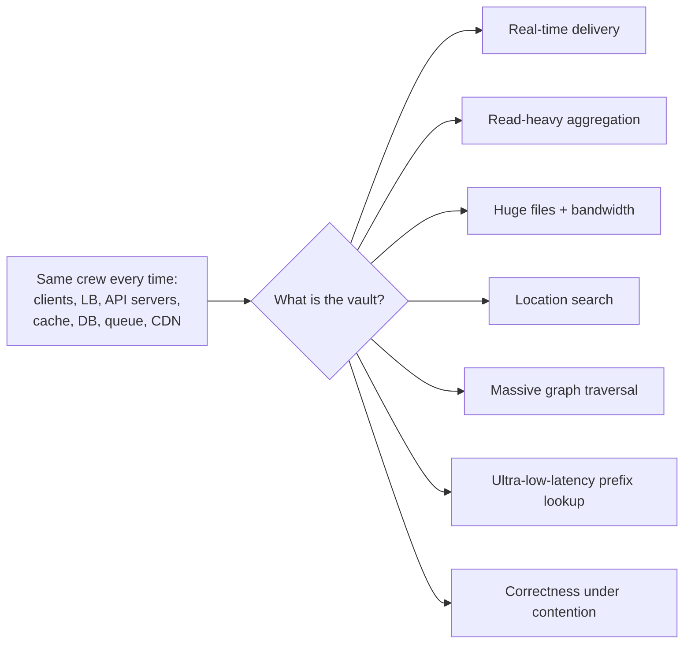

> 💡 **The core insight:** every design below is the same skeleton plus one or two specialised ideas. If you can name the vault in the first five minutes ("the hard part here is X"), the interviewer already knows you are senior-minded.

---

## 🔨 Building It Up

### 1. How to read each case study

Each design follows the 7 steps from [Chapter 11](11-estimation-framework.md):

1. **Requirements**: functional (what it does) and non-functional (how well: latency, availability, consistency, scale).
2. **Estimates**: QPS, storage, bandwidth. Only the numbers that change a decision.
3. **API**: the few endpoints or events that matter.
4. **Data model**: tables or key layouts, and which database and why.
5. **High-level design**: one architecture diagram, then the main flows (often as a sequence diagram).
6. **Deep dives**: the vault. This is where the score is decided.
7. **Bottlenecks and trade-offs**: what breaks first, what you chose, what you gave up.

Then **follow-up questions**: the curveballs interviewers throw once your first design is on the board.

The numbers below use the usual shortcuts: **1 day ≈ 86,400 s ≈ 10⁵ s** for quick math, peak ≈ **2–3× average**, and storage rounded generously. Your interviewer cares that the numbers are *reasonable and used*, not that they are precise.

---

### 2. Chat / Messaging App (WhatsApp, Messenger, Slack)

#### Step 1 · Requirements

**Functional**
- 1:1 chat and group chat (groups up to, say, 500 members).
- Messages delivered in real time when the receiver is online, and stored for later when offline.
- **Delivery receipts**: sent ✓, delivered ✓✓, read (blue ticks).
- **Presence**: online / last seen.
- Message history synced across a user's devices.
- Push notifications when the app is closed.
- (Mention, then park: media messages, end-to-end encryption, voice calls.)

**Non-functional**
- **Low latency**: a message should arrive in well under a second.
- **Ordering**: within one conversation, everyone sees messages in the same order.
- **No loss, no duplicates**: a message is never lost once the sender sees ✓, and it never appears twice.
- **High availability**: chat must keep working even if a data centre has trouble.
- Scale: hundreds of millions of daily users.

> 💡 Say it out loud: "For chat I will favour availability and low latency, but within a conversation I need ordering and no duplicates. Those two are my vault."

#### Step 2 · Estimates

| Quantity | Assumption | Result |
|---|---|---|
| Daily active users (DAU) | 500 million | |
| Messages per user per day | 40 | 20 billion messages/day |
| Average send rate | 20 × 10⁹ / 86,400 | ≈ **230,000 messages/s** |
| Peak send rate | ×3 | ≈ **700,000 messages/s** |
| Message size | ~100 bytes text + ~100 bytes metadata | ~200 bytes |
| Storage per day | 20 × 10⁹ × 200 B | ≈ **4 TB/day**, ~1.5 PB/year before replication |
| Concurrent connections at peak | ~50% of DAU online | ≈ **250 million** open connections |
| Gateway servers | ~100,000 connections per server (conservative) | ≈ **2,500 connection servers** |

What these numbers tell us:
- **250 million long-lived connections** is the defining number. Normal request/response servers won't do; we need dedicated **connection (gateway) servers**.
- **700k writes/s** and petabytes per year: the message store must be a **horizontally scalable, write-optimised** database (a wide-column store like Cassandra/ScyllaDB or HBase), not a single SQL box.

#### Step 3 · API

The client keeps one **WebSocket** open (a long-lived, two-way TCP connection, see [Chapter 07](07-apis-communication.md)). Messages travel as small JSON (or binary) frames over it.

```text
Client -> Server  (over WebSocket)
  {"type":"send", "client_msg_id":"a1b2-...", "conv_id":"c42", "text":"hi"}
  {"type":"ack_delivered", "conv_id":"c42", "seq":1051}
  {"type":"ack_read", "conv_id":"c42", "seq":1051}
  {"type":"heartbeat"}

Server -> Client
  {"type":"sent", "client_msg_id":"a1b2-...", "conv_id":"c42", "seq":1051, "ts":...}
  {"type":"message", "conv_id":"c42", "seq":1051, "sender":"u7", "text":"hi"}
  {"type":"receipt", "conv_id":"c42", "seq":1051, "user":"u9", "status":"read"}

Plain HTTPS (REST) for everything that is not real-time:
  GET  /v1/conversations/{conv_id}/messages?after_seq=1000&limit=50   # sync / history
  POST /v1/groups                     {"name": "...", "members": [...]}
  POST /v1/media/upload-url           -> pre-signed URL for photos/videos
```

Two fields deserve attention:
- **`client_msg_id`**: a UUID the phone generates *before* sending. If the network drops and the phone retries, the server sees the same ID and doesn't store the message twice. This is an **idempotency key** ([Chapter 09](09-microservices-reliability.md)).
- **`seq`**: a per-conversation sequence number the server assigns. It defines the one true order.

#### Step 4 · Data model

```sql
-- Wide-column store (Cassandra-style). Partition = one conversation (bucketed by time
-- so a busy group doesn't create one giant partition). Rows sorted by seq inside it.
CREATE TABLE messages (
    conv_id     text,
    bucket      int,          -- e.g. month number, keeps partitions bounded
    seq         bigint,       -- per-conversation order
    msg_id      bigint,       -- globally unique (Snowflake-style)
    sender_id   bigint,
    body        text,
    created_at  timestamp,
    PRIMARY KEY ((conv_id, bucket), seq)
) WITH CLUSTERING ORDER BY (seq DESC);

-- Which conversations a user is in, newest activity first (powers the chat list screen)
CREATE TABLE user_inbox (
    user_id       bigint,
    last_activity timestamp,
    conv_id       text,
    last_read_seq bigint,
    PRIMARY KEY (user_id, last_activity, conv_id)
);

-- Relational DB (small, needs consistency): users, groups, membership
CREATE TABLE group_members (
    group_id  bigint,
    user_id   bigint,
    role      varchar(10),
    joined_at timestamp,
    PRIMARY KEY (group_id, user_id)
);
```

Why a wide-column store for messages? The access pattern is always "**the latest N messages of one conversation**", writes are huge, and we never need joins. Putting a whole conversation in one partition, sorted by `seq`, makes that query a single sequential disk read.

Hot, short-lived state lives in an in-memory store such as Redis:
- `session:{user_id} -> gateway server id` (which connection server holds this user's socket)
- `presence:{user_id} -> last heartbeat` (with a TTL)
- `seq:{conv_id} -> counter` (atomic `INCR` gives the next sequence number)

#### Step 5 · High-level design

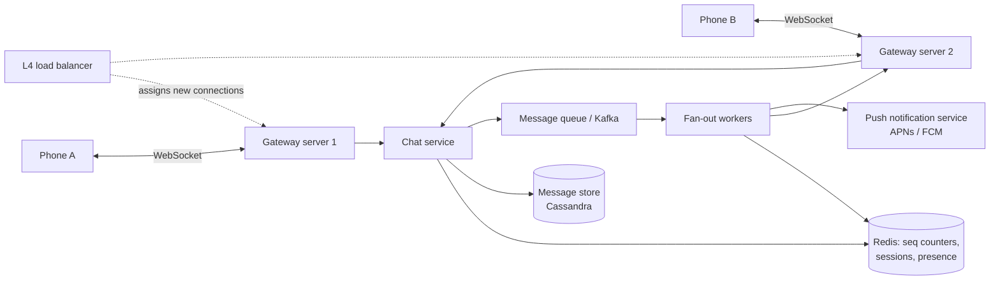

**Sending a 1:1 message, step by step:**

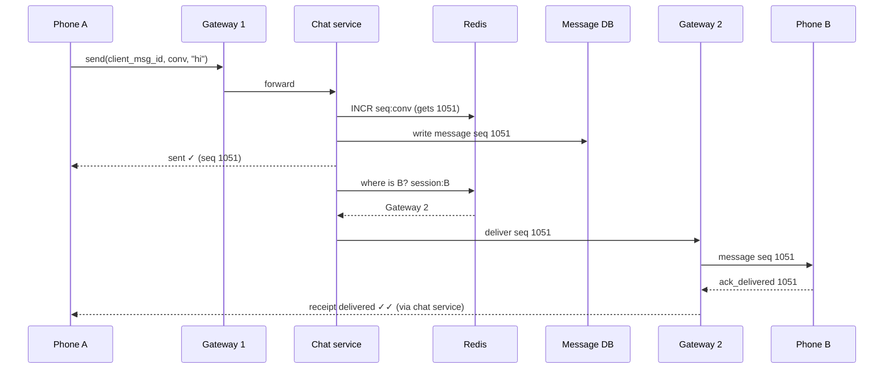

The rule that makes this safe: **the server only says "sent ✓" after the message is durably written**. From that moment, it cannot be lost: if B is offline, the message just waits in the database.

If B is **offline** (no session in Redis), the chat service hands the message to the **push notification service**, which wakes B's phone via Apple's APNs or Google's FCM. When B opens the app, it reconnects and **syncs**.

#### Step 6 · Deep dives

**Deep dive 1: ordering and duplicates (the vault).**

Phones disconnect constantly. Three bad things can happen: a message is retried and stored twice; messages arrive out of order; a reconnecting phone misses messages. One small set of ideas fixes all three:

- **Idempotent send** with `client_msg_id`: the server remembers recent IDs and ignores repeats.
- **Server-assigned per-conversation `seq`**: the order is whatever the server assigned, not the sender's clock (phone clocks are wrong all the time).
- **Sync by cursor**: every device remembers the last `seq` it has for each conversation. On reconnect it asks "give me everything after seq N". Gaps are impossible because the cursor is exact.

Here's the whole idea as a runnable simulation:

```python
from collections import defaultdict

class ChatServer:
    """One conversation = one ordered log. Each message gets the next sequence number."""

    def __init__(self):
        self.logs = defaultdict(list)        # conversation_id -> list of messages
        self.next_seq = defaultdict(int)     # conversation_id -> next sequence number
        self.seen_client_ids = set()         # for idempotent retries
        self.read_upto = {}                  # (conversation_id, user) -> last seq read

    def send(self, conv, sender, client_msg_id, text):
        if client_msg_id in self.seen_client_ids:      # a retry of a message we already stored
            return "duplicate ignored"
        self.seen_client_ids.add(client_msg_id)
        self.next_seq[conv] += 1
        seq = self.next_seq[conv]
        self.logs[conv].append((seq, sender, text))
        return f"stored seq={seq}"

    def sync(self, conv, user, last_seen_seq):
        """A client that reconnects asks: 'give me everything after seq N'."""
        return [m for m in self.logs[conv] if m[0] > last_seen_seq]

    def mark_read(self, conv, user, seq):
        self.read_upto[(conv, user)] = max(seq, self.read_upto.get((conv, user), 0))

    def status(self, conv, seq, members, sender):
        readers = [u for u in members if u != sender and self.read_upto.get((conv, u), 0) >= seq]
        return "read by " + ", ".join(readers) if readers else "delivered"

server = ChatServer()
print(server.send("c1", "asha", "m-001", "hi!"))
print(server.send("c1", "ravi", "m-002", "hey asha"))
print(server.send("c1", "asha", "m-001", "hi!"))          # network retry of the same message
print(server.send("c1", "asha", "m-003", "lunch?"))
print("ravi was offline after seq 1, syncs:", server.sync("c1", "ravi", 1))
server.mark_read("c1", "ravi", 3)
print("seq 3 status:", server.status("c1", 3, ["asha", "ravi"], "asha"))
```

```text
stored seq=1
stored seq=2
duplicate ignored
stored seq=3
ravi was offline after seq 1, syncs: [(2, 'ravi', 'hey asha'), (3, 'asha', 'lunch?')]
seq 3 status: read by ravi
```

What just happened: the retry of `m-001` was dropped instead of becoming a second "hi!". Ravi, who reconnected knowing only seq 1, got exactly seqs 2 and 3. And read receipts became one number per user ("read up to seq 3"), which is much cheaper than storing a flag on every message.

> 💡 **Read receipts trick:** store a **high-water mark** (`last_read_seq` per user per conversation), not a "read" flag per message. "Read up to 1051" implies everything before it is read too. One write instead of hundreds.

**Deep dive 2: who holds the connection, and how do we find it?**

A user is connected to exactly one gateway server (per device). The gateways are **stateful** (they hold sockets), so:
- An **L4 load balancer** spreads new connections across gateways ([Chapter 02](02-scalability-load-balancing.md)).
- On connect, the gateway writes `session:{user_id} = gateway_id` to Redis (with a TTL refreshed by heartbeats).
- To deliver, the chat service looks up the session and sends the message to that gateway over an internal channel (gRPC, or a per-gateway queue / Redis pub/sub channel).
- If a gateway dies, its users' sockets drop, their phones reconnect to another gateway, rewrite the session, and **sync from their cursor**. Nothing is lost because the database is the source of truth.

**Deep dive 3: group chat fan-out.**

A message to a group of 500 must reach 500 people. Two options:

| Approach | How | Good for |
|---|---|---|
| **Fan-out on write** (copy into each member's inbox) | Write the message once, then push a pointer to each member's inbox / gateway | Small groups (WhatsApp caps groups at a modest size) |
| **Fan-out on read** (one shared log) | Store once in the group's log; members pull with their cursor | Huge channels (Slack, Discord, Telegram channels with thousands of members) |

Typical answer: store the message **once** in the group's log (partitioned by `conv_id`), then put one event on Kafka. Fan-out workers look up members, find which are online (session lookup), push to their gateways, and send push notifications to the offline ones. For channels with 100k members, don't push to everyone; just notify "new activity" and let clients pull.

**Deep dive 4: presence ("online" / "last seen").**

Presence is high-churn and low-importance. If it's 10 seconds stale, nobody cares. So:
- The client sends a **heartbeat** every few seconds over the socket.
- The server writes `presence:{user} = now` in Redis with a TTL.
- A user is "online" if their last heartbeat is recent. Missing **several** heartbeats (not one) marks them offline, so a 2-second tunnel doesn't flicker their status.
- Only push presence changes to people who are **currently looking** at that user (chat screen open), never to all their contacts. Otherwise one person coming online would trigger hundreds of messages.

```python
HEARTBEAT_EVERY = 5      # client pings every 5 s
TIMEOUT = 3 * HEARTBEAT_EVERY   # miss 3 pings in a row -> offline (tolerates brief network blips)

last_seen = {}           # user -> time of last heartbeat (in Redis this is a key with a TTL)

def heartbeat(user, now):
    last_seen[user] = now

def presence(user, now):
    t = last_seen.get(user)
    if t is None:
        return "offline"
    return "online" if now - t < TIMEOUT else f"last seen {now - t}s ago"

heartbeat("asha", 0); heartbeat("ravi", 0)
for t in range(5, 35, 5):
    heartbeat("asha", t)                 # asha keeps the app open
    if t == 5:
        heartbeat("ravi", t)             # ravi's phone goes into a tunnel after t=5
    print(f"t={t:2}s  asha: {presence('asha', t):8}  ravi: {presence('ravi', t)}")
```

```text
t= 5s  asha: online    ravi: online
t=10s  asha: online    ravi: online
t=15s  asha: online    ravi: online
t=20s  asha: online    ravi: last seen 15s ago
t=25s  asha: online    ravi: last seen 20s ago
t=30s  asha: online    ravi: last seen 25s ago
```

What just happened: Ravi's last heartbeat was at t=5. At t=10 and t=15 he has only missed one or two pings, so we still show him online. At t=20 he has been silent for 15 seconds (3 missed pings), so he flips to "last seen".

**Deep dive 5: multiple devices.** Each device has its own socket and its own cursor per conversation. The session key becomes `session:{user_id} -> {device_id: gateway_id}`. Delivery goes to every device; "delivered" is shown when **any** device acks; "read" when any device reads.

#### Step 7 · Bottlenecks and trade-offs

- **Sequence counter hot spot**: a single Redis `INCR` per conversation is fine (one conversation rarely exceeds a few hundred messages/s). Shard counters by `conv_id`. Alternative: let the partition leader of the message store assign `seq`.
- **Hot groups**: a group with thousands of active writers concentrates load on one partition. Time-bucketing the partition key (`(conv_id, bucket)`) keeps partitions bounded.
- **Trade-off: availability vs strict ordering across devices.** We guarantee order **within a conversation** (one counter), not across conversations, which nobody needs.
- **Trade-off: push vs pull for big groups** (above).
- **Storage**: older messages can move to cheaper storage; WhatsApp-style designs even delete messages from the server once delivered to all devices (the phone becomes the archive). That's a product decision worth mentioning.

#### Follow-up questions

- *"How would you add end-to-end encryption?"* Clients exchange public keys (Signal protocol); the server only stores and forwards ciphertext. Consequence: the server can't search messages or generate previews, and multi-device sync needs per-device keys.
- *"How do you handle a user with 5 devices where one is offline for a month?"* Its cursor is old; on reconnect it pages through history with `after_seq` in batches of 50–200.
- *"How do typing indicators work?"* Ephemeral events sent over the socket, never stored, dropped if the receiver is offline.
- *"What if the Redis session store goes down?"* Gateways can re-register; meanwhile messages still get stored, and clients still sync on reconnect. Delivery is delayed, not lost, because the database is the source of truth.

---
### 3. Social News Feed (Facebook, Instagram, X/Twitter, LinkedIn)

#### Step 1 · Requirements

**Functional**
- Users create posts (text, images).
- Users follow other users.
- The **home feed** shows posts from people you follow, newest (or best-ranked) first, with infinite scroll.
- (Park: likes/comments counts, ads, stories, search.)

**Non-functional**
- **Fast feed loads**: p99 under ~200–300 ms. This is the screen everyone opens first.
- **Read-heavy**: feeds are read far more often than posts are written.
- **Eventual consistency is fine**: if your friend's post shows up 5 seconds late, nobody is hurt.
- Highly available.

#### Step 2 · Estimates

| Quantity | Assumption | Result |
|---|---|---|
| DAU | 300 million | |
| Feed loads per user per day | 10 | 3 × 10⁹/day ≈ **35,000 reads/s**, peak ≈ **100,000/s** |
| New posts | 1 post per 5 users per day | 60 million/day ≈ **700 posts/s** |
| Average followers | 200 | fan-out = 60M × 200 = 12 × 10⁹ feed inserts/day ≈ **140,000 inserts/s** |
| Feed cache per user | 500 post IDs × 8 bytes | 4 KB/user → 300M × 4 KB ≈ **1.2 TB** of RAM across a cache cluster |
| Post storage | 1 KB text + metadata | 60 GB/day of text; images go to object storage + CDN |

What the numbers tell us: reads (100k/s) dominate writes (700/s). That's a strong hint to **do work at write time so reads are cheap**. And 1.2 TB of feed cache is very achievable with a sharded Redis cluster.

#### Step 3 · API

```text
POST /v1/posts                         {"text": "...", "media_ids": ["m1"]}   -> {"post_id": 987}
POST /v1/users/{id}/follow
DELETE /v1/users/{id}/follow
GET  /v1/feed?cursor=<opaque>&limit=20 -> {"posts": [...], "next_cursor": "..."}
```

Use **cursor-based pagination** (the cursor encodes "the last post ID / score I showed you"), not `page=7`. With page numbers, new posts arriving at the top shift everything and you see duplicates while scrolling.

#### Step 4 · Data model

```sql
CREATE TABLE posts (
    post_id    BIGINT PRIMARY KEY,     -- Snowflake ID: roughly time-sortable
    author_id  BIGINT NOT NULL,
    body       TEXT,
    media_urls TEXT,
    created_at TIMESTAMP NOT NULL
);
CREATE INDEX idx_posts_author_time ON posts (author_id, created_at DESC);

CREATE TABLE follows (
    follower_id BIGINT,
    followee_id BIGINT,
    created_at  TIMESTAMP,
    PRIMARY KEY (follower_id, followee_id)
);
-- Also store the reverse direction (followee -> followers) for fan-out,
-- e.g. a second table or a graph store keyed by followee_id.
```

- **Posts**: sharded by `post_id` (or `author_id`), heavily cached.
- **Follow graph**: needs both "who do I follow" and "who follows me". Two tables (one per direction), each sharded by its first column.
- **Feed cache** (Redis): `feed:{user_id}` → a sorted set of the latest ~500 `post_id`s, scored by time (or rank). We store **IDs only**, never full posts: a post appears in thousands of feeds, and if we copied the body we could never edit or delete it cheaply.

#### Step 5 · High-level design

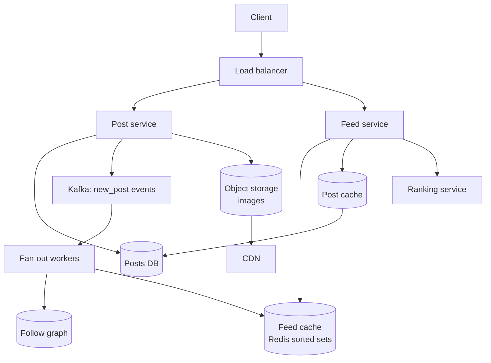

**Write path:** save the post → publish `new_post` to Kafka → return "posted" to the user immediately → fan-out workers asynchronously push the `post_id` into each follower's feed cache.

**Read path:** read `feed:{me}` from Redis (IDs) → fetch the post bodies in one batch from the post cache (`MGET`) → optionally rank → return 20 posts.

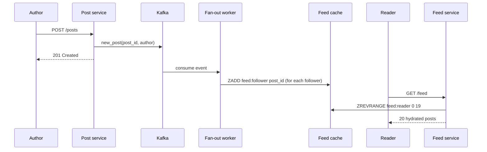

#### Step 6 · Deep dives

**Deep dive 1: fan-out on write vs fan-out on read (the vault).**

- **Fan-out on write (push):** when you post, copy your post ID into every follower's feed. Reading becomes one cache lookup. Cost: a post by someone with 50 million followers means 50 million writes, and it takes minutes to finish (the "**celebrity problem**"). Also wasted work for followers who never log in.
- **Fan-out on read (pull):** store posts only in the author's timeline. When you open your feed, fetch the latest posts of everyone you follow and merge them (a k-way merge with a heap, [Chapter 15 of Part 2](../part-2-dsa/15-heaps.md)). Writes are trivial. Cost: if you follow 1,000 people, every feed load does 1,000 lookups. Slow and expensive at 100k reads/s.
- **Hybrid (what real systems do):** push for normal users, **pull for celebrities**. Your feed = your precomputed cache **+** a fresh fetch of recent posts from the few celebrities you follow, merged at read time.

| | Fan-out on write | Fan-out on read | Hybrid |
|---|---|---|---|
| Read cost | O(1) cache read | O(people you follow) | O(1) + O(celebrities you follow) |
| Write cost | O(followers) | O(1) | O(followers) for normal users only |
| Freshness | Delayed by fan-out lag | Always fresh | Mostly instant |
| Celebrity post | Disaster | Fine | Fine |
| Inactive users | Wasted work | No waste | Skip fan-out to inactive users |

Here's the hybrid in miniature:

```python
import heapq
from collections import defaultdict

CELEBRITY_THRESHOLD = 3          # tiny for the demo; real systems use something like 10k+ followers

followers = {                    # author -> people who follow them
    "virat": ["asha", "ravi", "meera", "dev"],   # a "celebrity"
    "asha":  ["ravi"],
    "ravi":  ["asha", "meera"],
}
following = defaultdict(list)    # user -> authors they follow
for author, fans in followers.items():
    for fan in fans:
        following[fan].append(author)

feed_cache = defaultdict(list)   # user -> [(timestamp, author, text)] pre-built (push)
celebrity_posts = defaultdict(list)  # celebrity -> their own posts (pulled at read time)
writes = 0

def post(author, ts, text):
    global writes
    if len(followers.get(author, [])) >= CELEBRITY_THRESHOLD:
        celebrity_posts[author].append((ts, author, text))     # store once, no fan-out
        writes += 1
    else:
        for fan in followers.get(author, []):                   # fan-out on write
            feed_cache[fan].append((ts, author, text))
            writes += 1

def read_feed(user, k=3):
    candidates = list(feed_cache[user])                          # pushed part
    for author in following[user]:                               # pulled part
        if len(followers.get(author, [])) >= CELEBRITY_THRESHOLD:
            candidates.extend(celebrity_posts[author])
    return [f"{a}: {t}" for ts, a, t in heapq.nlargest(k, candidates)]

post("ravi", 1, "Morning run done")
post("virat", 2, "Match day!")
post("asha", 3, "New blog post")
post("ravi", 4, "Coffee time")

print("feed writes:", writes)
print("asha sees:", read_feed("asha"))
print("ravi sees:", read_feed("ravi"))
print("meera sees:", read_feed("meera"))
```

```text
feed writes: 6
asha sees: ['ravi: Coffee time', 'virat: Match day!', 'ravi: Morning run done']
ravi sees: ['asha: New blog post', 'virat: Match day!']
meera sees: ['ravi: Coffee time', 'virat: Match day!', 'ravi: Morning run done']
```

What just happened: Virat's post cost **one** write instead of four, yet all his followers still see it, because `read_feed` pulls celebrity posts at read time and merges them with the pushed ones by timestamp. Scale Virat's followers to 50 million and the saving is 50 million writes per post.

**Deep dive 2: ranking.** A pure time-ordered feed is easy (sorted set by timestamp). A ranked feed works in two stages:
1. **Candidate generation**: take the ~500 IDs from the feed cache (plus celebrity pulls).
2. **Scoring**: a ranking service scores each candidate with features (affinity with the author, post age, likes so far, content type) using an ML model, and returns the top 20.

Keep scoring cheap (a few hundred candidates, not thousands) so the 200 ms budget holds.

**Deep dive 3: caching layers.** Feed cache (IDs per user), post cache (post body by ID), user cache (name, avatar), and counters (likes) kept in Redis and flushed to the DB in batches. Hot posts can also sit in a small local in-process cache on each feed server.

**Deep dive 4: new follow / unfollow / delete.**
- Follow: backfill the new followee's last few posts into your feed cache (or just let them appear from now on).
- Unfollow: lazily filter at read time (cheap) rather than scanning the cache.
- Delete post: mark it deleted in the posts DB; the read path drops IDs whose post is missing or deleted. This is why we store IDs, not copies.

#### Step 7 · Bottlenecks and trade-offs

- **Fan-out lag** during spikes: Kafka absorbs bursts; add workers; prioritise active users.
- **Feed cache memory**: cap at ~500 IDs per user; don't build caches for users inactive for 30+ days (rebuild on demand via pull when they return).
- **Trade-off:** freshness and simplicity (pull) vs read speed (push). Hybrid wins at scale.
- **Consistency:** eventual. Your own post should appear in **your** feed immediately: insert it into your own cache synchronously ("read-your-own-writes").

#### Follow-up questions

- *"How do you pick the celebrity threshold?"* Based on follower count and fan-out cost; tune with metrics. Some systems also treat **very active followers** differently from inactive ones.
- *"How would you show 'X new posts' while the user is scrolling?"* Poll a cheap endpoint (or use a long-lived connection) comparing the newest ID in the cache with the client's newest ID.
- *"How do you handle a viral post getting millions of likes per minute?"* Shard the counter (N sub-counters summed on read) and batch writes; show approximate counts.

---

### 4. Video Streaming Platform (YouTube, Netflix)

#### Step 1 · Requirements

**Functional**
- Creators **upload** videos (up to several GB).
- Viewers **watch** videos on any device (phone on 3G, smart TV on fibre), with seeking.
- Videos play in multiple qualities and **switch automatically** when the network changes.
- Basic metadata: title, description, view count, thumbnails.
- (Park: comments, recommendations, live streaming, monetisation.)

**Non-functional**
- **Smooth playback**: start fast (under ~2 s), rarely buffer.
- **Massive read bandwidth**; uploads are rarer but huge.
- Highly available for viewing; upload processing can take minutes (eventual).
- Durable: an uploaded video is never lost.

#### Step 2 · Estimates

| Quantity | Assumption | Result |
|---|---|---|
| DAU | 500 million | |
| Views | 5 videos per user per day | 2.5 × 10⁹ views/day ≈ **29,000 views/s** |
| Average watch time | 5 minutes | ≈ 29,000 × 300 ≈ **8.7 million concurrent streams** |
| Average bitrate | 3 Mbps | 8.7M × 3 Mbps ≈ **26 Tbps** of egress |
| Uploads | 1 million videos/day, average 300 MB original | ≈ **300 TB/day** of originals |
| Transcoded copies | ~5 renditions, together roughly the size of the original | ≈ **600 TB/day** total, before replication |

What the numbers tell us: **26 terabits per second** cannot come out of one data centre, or ten. Video must be served from a **CDN** at the edge ([Chapter 04](04-caching-cdn.md)), close to viewers. And 600 TB/day of new files means **object storage** ([Chapter 10](10-storage-search-ids.md)), never a database.

#### Step 3 · API

```text
POST /v1/videos                          {"title": "...", "size_bytes": 3200000000}
     -> {"video_id": "v123", "upload_id": "...", "part_urls": [pre-signed URLs, one per chunk]}
PUT  <pre-signed part URL>               (client uploads each ~10 MB chunk directly to object storage)
POST /v1/videos/v123/complete            {"parts": [{"n":1,"etag":"..."}, ...]}
GET  /v1/videos/v123                     -> metadata + manifest URL + status (PROCESSING / READY)
GET  https://cdn.example.com/v123/master.m3u8      (player fetches the manifest, then segments)
```

The upload goes **straight from the client to object storage** using pre-signed URLs and multipart (chunked) upload. Our API servers never touch the gigabytes: they just hand out permission slips. A failed chunk is retried alone; a dropped connection resumes from the last finished chunk.

#### Step 4 · Data model

```sql
CREATE TABLE videos (
    video_id     VARCHAR(16) PRIMARY KEY,
    owner_id     BIGINT NOT NULL,
    title        VARCHAR(200),
    description  TEXT,
    status       VARCHAR(12),        -- UPLOADING, PROCESSING, READY, FAILED
    duration_s   INT,
    manifest_url TEXT,               -- e.g. s3://videos/v123/master.m3u8
    created_at   TIMESTAMP
);

CREATE TABLE renditions (
    video_id   VARCHAR(16),
    resolution VARCHAR(8),           -- 240p ... 2160p
    codec      VARCHAR(10),          -- h264, vp9, av1
    bitrate_kbps INT,
    playlist_url TEXT,
    PRIMARY KEY (video_id, resolution, codec)
);
```

Video **bytes** live in object storage, laid out like `videos/v123/720p/seg_00042.ts`. **Metadata** lives in a SQL DB (sharded by `video_id`) with a cache in front. **View counts** are counted approximately in a stream processor and written in batches.

#### Step 5 · High-level design

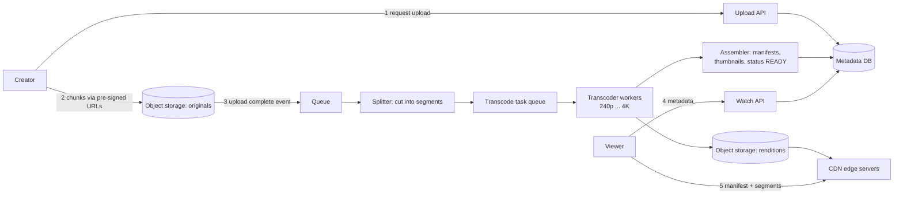

#### Step 6 · Deep dives

**Deep dive 1: the transcoding pipeline.**

A raw upload might be a 4K, 3 GB `.mov` file. Phones need small H.264 files; TVs want 4K in a modern codec. **Transcoding** converts the original into a **ladder** of renditions (240p, 360p, 480p, 720p, 1080p, 4K), each cut into short **segments** of 2–10 seconds.

Transcoding one long video on one machine would take hours. So the pipeline is a **DAG of tasks** (a directed acyclic graph, [Part 2 Chapter 17](../part-2-dsa/17-graphs-advanced.md)):

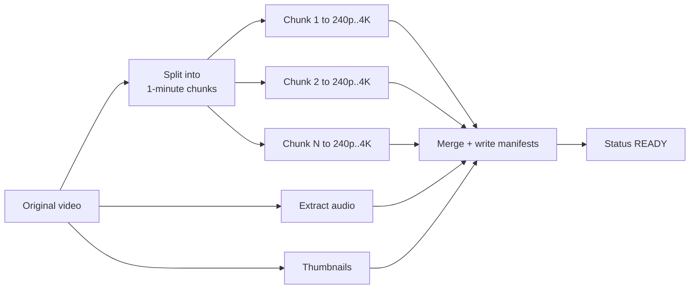

- Chunks transcode **in parallel** across hundreds of workers, so a 1-hour video finishes in minutes.
- Tasks go through a queue ([Chapter 08](08-queues-events.md)); each task is **idempotent** (re-running "transcode chunk 7 to 720p" just overwrites the same output file), so retries after a worker crash are safe.
- A failed task retries a few times, then goes to a dead-letter queue and the video is marked FAILED.
- Also run safety checks (malware, copyright, content moderation) as branches of the DAG.

**Deep dive 2: adaptive bitrate streaming (ABR).**

The player does **not** download "the video file". It downloads a small **manifest** (HLS `.m3u8` or MPEG-DASH `.mpd`) listing every rendition and the URL of every segment. Then it fetches segments one by one with plain HTTP GETs, and **before each segment it chooses the quality** based on the measured download speed and how much video is buffered.

```text
#EXTM3U                                   (master manifest, simplified)
#EXT-X-STREAM-INF:BANDWIDTH=800000,RESOLUTION=640x360
360p/playlist.m3u8
#EXT-X-STREAM-INF:BANDWIDTH=2800000,RESOLUTION=1280x720
720p/playlist.m3u8
#EXT-X-STREAM-INF:BANDWIDTH=5000000,RESOLUTION=1920x1080
1080p/playlist.m3u8
```

A tiny ABR simulation:

```python
# Bitrate ladder: (label, kilobits per second needed)
LADDER = [("240p", 400), ("360p", 800), ("480p", 1400), ("720p", 2800), ("1080p", 5000)]
SEGMENT_SECONDS = 4

def pick_rendition(measured_kbps, buffer_s):
    """Throughput rule with a safety margin; be more careful when the buffer is low."""
    safety = 0.8 if buffer_s >= 10 else 0.5
    budget = measured_kbps * safety
    choice = LADDER[0]
    for label, kbps in LADDER:
        if kbps <= budget:
            choice = (label, kbps)
    return choice

network = [6000, 6500, 3000, 1200, 900, 4000, 7000, 7000]   # kbps measured per segment
buffer_s = 0.0
for i, bw in enumerate(network):
    label, kbps = pick_rendition(bw, buffer_s)
    download_s = kbps * SEGMENT_SECONDS / bw          # time to fetch this segment
    buffer_s = max(0.0, buffer_s - download_s) + SEGMENT_SECONDS
    print(f"seg {i}: net={bw:>4} kbps -> {label:>5}  buffer={buffer_s:4.1f}s")
```

```text
seg 0: net=6000 kbps ->  720p  buffer= 4.0s
seg 1: net=6500 kbps ->  720p  buffer= 6.3s
seg 2: net=3000 kbps ->  480p  buffer= 8.4s
seg 3: net=1200 kbps ->  240p  buffer=11.1s
seg 4: net= 900 kbps ->  240p  buffer=13.3s
seg 5: net=4000 kbps ->  720p  buffer=14.5s
seg 6: net=7000 kbps -> 1080p  buffer=15.6s
seg 7: net=7000 kbps -> 1080p  buffer=16.8s
```

What just happened: when the network dropped to 1,200 kbps (the train entered a tunnel), the player stepped down to 240p **instead of stopping to buffer**, and the buffer kept growing. When the network recovered, it climbed back to 1080p. Low quality for a few seconds beats a spinning wheel every time. (Real players use smarter rules, such as buffer-based algorithms, but the idea is the same.)

**Deep dive 3: the CDN does almost all the work.**
- Segments are plain, **immutable** files over HTTP, which is perfect for CDN caching (cache them for a long time; they never change).
- Popular videos are **pre-pushed** to edge locations; the long tail is pulled on first request from the **origin** (object storage, often behind an origin-shield cache layer to protect it).
- Large platforms place cache servers **inside ISPs' networks** (Netflix's Open Connect is the well-known example) so traffic doesn't even cross the internet backbone.
- Segment-level caching means the first 30 seconds of a video are far hotter than minute 47. Edges naturally cache what's watched.

**Deep dive 4: resumable uploads.** Multipart upload: split into ~10 MB parts, upload in parallel, retry individual parts, then a final "complete" call stitches them together. The client stores `upload_id` locally so it can resume after the app restarts.

#### Step 7 · Bottlenecks and trade-offs

- **Egress cost** is the biggest bill. Trade-off: more renditions and better codecs (AV1 saves bandwidth) vs more transcoding CPU and storage. A common compromise: transcode popular videos into expensive modern codecs; keep the long tail in H.264 only.
- **Storage growth**: tier old, rarely-watched renditions to colder storage; delete intermediate files.
- **Transcoding backlog** on spikes: queue plus autoscaling workers; prioritise short or popular uploads.
- **View counts**: exact counting at 29k/s is wasteful. Aggregate in a stream processor, write every few seconds; approximate is fine.

#### Follow-up questions

- *"How would you support live streaming?"* The creator pushes a stream (RTMP/SRT) to an ingest server that transcodes in real time into a few renditions with short segments (1–2 s); the manifest keeps updating. Latency is a trade-off with segment size.
- *"How do you let users seek to minute 47 instantly?"* The manifest lists every segment's URL and time, so the player requests the segment for 47:00 directly.
- *"How do you prevent hotlinking / piracy?"* Signed CDN URLs with expiry, DRM (Widevine/FairPlay) for premium content.

---
### 5. Ride-Hailing / Location Matching (Uber, Ola, Lyft)

#### Step 1 · Requirements

**Functional**
- Drivers send their location continuously while online.
- A rider requests a ride from point A; the system finds **nearby available drivers** and offers the trip to one (or a few) of them.
- The driver accepts; both see each other's live location until pickup and during the trip.
- Fare estimate before booking, payment after the trip.
- (Park: surge pricing details, pooling, ratings, scheduled rides.)

**Non-functional**
- **Matching latency**: find candidates in well under a second.
- **High write rate** of location updates.
- **Consistency where it matters**: a driver must never be assigned to two trips at once. Location data, in contrast, can be a few seconds stale.
- Available in every city, even if one region has issues.

#### Step 2 · Estimates

| Quantity | Assumption | Result |
|---|---|---|
| Drivers online at peak | 1 million | |
| Location update interval | every 4 seconds | **250,000 location writes/s** |
| Rides | 20 million/day | ≈ 230 ride requests/s average, **≈ 1,000/s peak** |
| Location record | driver_id, lat, lon, timestamp, status ≈ 50 bytes | 1M × 50 B = **50 MB** for "current location of every driver" |
| Location history (for trip replay, analytics) | 250k/s × 50 B | ≈ 1 TB/day, written to a log, not the hot path |

What the numbers tell us: the **current** location of every driver is just 50 MB. It fits in RAM on one machine! The challenge isn't size, it's **250,000 updates per second** plus fast "who is near this point?" queries. So: keep current locations **in memory**, partitioned by geography, and write the history asynchronously to cheap storage.

#### Step 3 · API

```text
Driver app  -> PUT  /v1/drivers/me/location   {"lat": 12.97, "lon": 77.59, "ts": ..., "status": "AVAILABLE"}
               (often over a persistent connection instead of one HTTP call every 4 s)
Rider app   -> POST /v1/rides                  {"pickup": {...}, "dropoff": {...}, "idempotency_key": "..."}
               -> {"ride_id": "r55", "status": "MATCHING"}
Driver app  <- push: {"type": "offer", "ride_id": "r55", "expires_in_s": 15}
Driver app  -> POST /v1/rides/r55/accept
Rider app   <- push: {"type": "matched", "driver": {...}, "eta_s": 240}
Both        <- live location of the other party over WebSocket
```

#### Step 4 · Data model

```sql
-- Durable, relational: trips must be correct (money, disputes, history)
CREATE TABLE rides (
    ride_id     BIGINT PRIMARY KEY,
    rider_id    BIGINT NOT NULL,
    driver_id   BIGINT,
    status      VARCHAR(12),     -- MATCHING, ACCEPTED, ARRIVED, IN_TRIP, COMPLETED, CANCELLED
    pickup_lat  DOUBLE PRECISION, pickup_lon  DOUBLE PRECISION,
    dropoff_lat DOUBLE PRECISION, dropoff_lon DOUBLE PRECISION,
    fare_paise  BIGINT,          -- money as integers, never floats
    created_at  TIMESTAMP
);

CREATE TABLE drivers (
    driver_id   BIGINT PRIMARY KEY,
    status      VARCHAR(12),     -- OFFLINE, AVAILABLE, OFFERED, ON_TRIP
    current_ride BIGINT,
    version     INT              -- for compare-and-set when assigning trips
);
```

In memory (the location index): `cell_id -> set of available driver_ids` and `driver_id -> (lat, lon, ts)`. Redis has built-in geo commands (`GEOADD`, `GEOSEARCH`) that do this with geohash-encoded sorted sets; at very large scale companies build custom in-memory services sharded by region.

#### Step 5 · High-level design

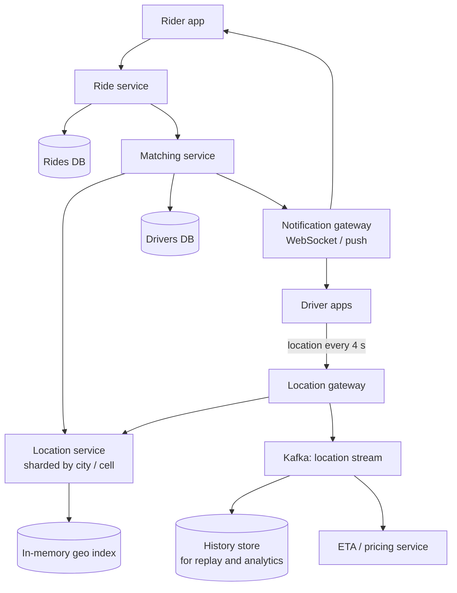

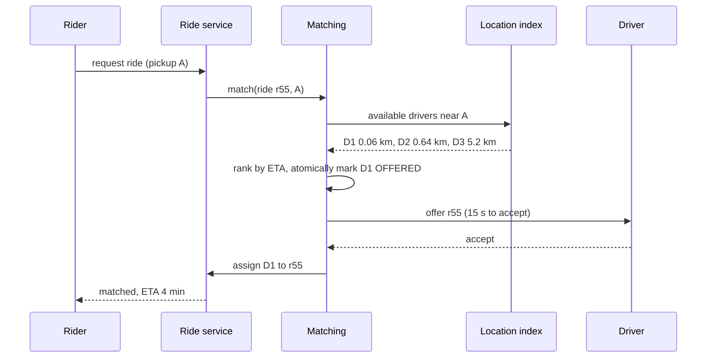

#### Step 6 · Deep dives

**Deep dive 1: how do you find nearby drivers fast? (the vault)**

The naive way, "compute distance from the rider to all 1 million drivers", is O(n) per request. At 1,000 requests/s, that's a billion distance computations per second. No.

The trick is to **cut the map into cells** and keep a dictionary `cell -> drivers in it`. To find nearby drivers, look only in the rider's cell **and its neighbours**. Popular cell systems ([Chapter 10](10-storage-search-ids.md) covers them in detail):
- **Geohash**: repeatedly halve longitude and latitude, interleave the bits, encode as base-32. Nearby points usually share a prefix. A 5-character geohash cell is about 4.9 km × 4.9 km; 6 characters ≈ 1.2 km × 0.6 km.
- **Quadtree**: split a square into 4 whenever it holds too many drivers. Dense cities get small cells, deserts get big ones.
- **H3** (Uber's open-source system): the world tiled with **hexagons** at many resolutions. Every neighbour of a hexagon is the same distance away, which makes "ring around me" searches clean.

```python
import math
from collections import defaultdict

BASE32 = "0123456789bcdefghjkmnpqrstuvwxyz"

def geohash(lat, lon, precision=6):
    """Alternate halving longitude and latitude; every 5 bits become one character."""
    lat_rng, lon_rng = [-90.0, 90.0], [-180.0, 180.0]
    bits, out, even = [], [], True
    while len(out) < precision:
        rng, val = (lon_rng, lon) if even else (lat_rng, lat)
        mid = (rng[0] + rng[1]) / 2
        if val >= mid:
            bits.append(1); rng[0] = mid
        else:
            bits.append(0); rng[1] = mid
        even = not even
        if len(bits) == 5:
            out.append(BASE32[int("".join(map(str, bits)), 2)])
            bits = []
    return "".join(out)

def km_between(a, b):
    """Haversine distance in km."""
    lat1, lon1, lat2, lon2 = map(math.radians, (*a, *b))
    h = math.sin((lat2 - lat1) / 2) ** 2 + math.cos(lat1) * math.cos(lat2) * math.sin((lon2 - lon1) / 2) ** 2
    return 6371 * 2 * math.asin(math.sqrt(h))

drivers = {
    "D1": (12.9716, 77.5946),   # central Bengaluru
    "D2": (12.9750, 77.6000),
    "D3": (12.9352, 77.6245),   # Koramangala
    "D4": (13.1986, 77.7066),   # airport, far away
}
cells = defaultdict(set)        # geohash prefix (5 chars, about 4.9 km x 4.9 km) -> drivers
for d, (lat, lon) in drivers.items():
    cells[geohash(lat, lon, 5)].add(d)

rider = (12.9720, 77.5950)
cell = geohash(*rider, 5)
print("rider cell:", cell, "| driver cells:", {d: geohash(*p, 5) for d, p in drivers.items()})
nearby = sorted(cells[cell], key=lambda d: km_between(rider, drivers[d]))
for d in nearby:
    print(f"{d} is {km_between(rider, drivers[d]):.2f} km away")
```

```text
rider cell: tdr1v | driver cells: {'D1': 'tdr1v', 'D2': 'tdr1v', 'D3': 'tdr1w', 'D4': 'tdr70'}
D1 is 0.06 km away
D2 is 0.64 km away
```

What just happened: instead of measuring the distance to every driver, we looked up one cell and measured only the drivers inside it. Notice **D3 is in the neighbouring cell `tdr1w`**. If the rider stood near the edge of their cell, the closest driver could be just across the border. That's why real searches always check **the cell plus its 8 neighbours** (or, with H3, a ring of hexagons), then sort the candidates by actual distance or, better, by **road ETA**.

**Updating the index** when a driver moves: compute the new cell; if it changed, remove the driver from the old cell's set and add to the new one. Store the driver's last timestamp too, and **ignore drivers whose last update is older than ~30 s** (their app probably died).

**Deep dive 2: never double-assign a driver.**

Two riders' matching requests might pick the same nearest driver at the same moment. The fix is a **compare-and-set** on the driver's state:

```sql
UPDATE drivers
SET status = 'OFFERED', current_ride = 55, version = version + 1
WHERE driver_id = 1 AND status = 'AVAILABLE' AND version = 12;
-- 1 row updated  -> you won the driver
-- 0 rows updated -> someone else got them first; try the next candidate
```

The offer has a timeout (say 15 s). If the driver declines or ignores it, the status goes back to AVAILABLE and the matching service moves to the next candidate. Matching itself can be **per-city single-threaded** (one owner per region processes requests in order), which removes most contention entirely, a trick used widely in dispatch systems.

**Deep dive 3: sharding by geography.** Rides are local: a rider in Mumbai never needs a driver in Delhi. Shard the location and matching services **by city or by large cell**, so each shard is small, fast and independent. Use [consistent hashing](05-replication-sharding.md) over cell IDs to assign cells to servers. Drivers crossing a cell boundary move between shards (a remove + add).

**Deep dive 4: ETA and pricing.** Straight-line distance lies (rivers, one-way streets). Rank candidates by road-network ETA from a routing service (graph shortest paths, [Part 2 Chapter 17](../part-2-dsa/17-graphs-advanced.md), with precomputation tricks). Surge pricing compares demand (requests) and supply (available drivers) per cell over the last few minutes, computed by a stream processor reading the location and request streams.

#### Step 7 · Bottlenecks and trade-offs

- **Location write storm** (250k/s): in-memory index, no disk on the hot path; history goes to Kafka → batch storage.
- **Hot cells** (airport, stadium after a match): use finer cells (higher resolution) where density is high, or a quadtree that splits dense areas.
- **Trade-off:** location freshness vs battery/bandwidth (update every 4 s vs 1 s). Adaptive: update more often when on a trip or moving fast.
- **Trade-off:** consistency is strict for assignment (SQL / CAS), relaxed for locations (in-memory, eventually consistent).

#### Follow-up questions

- *"What if the location service node for Bengaluru dies?"* Replicas per shard; drivers re-send location every 4 s anyway, so a fresh node rebuilds the full index within seconds. The data is **self-healing**.
- *"How would you do ride pooling?"* Matching becomes an optimisation over routes: find a driver already on a trip whose route detour to pick you up is small. Much harder; batch requests every few seconds and solve a matching problem.
- *"Why not just use a SQL database with a spatial index?"* PostGIS can answer radius queries, but 250k updates/s to an on-disk index is the bottleneck. Memory wins for the hot "current location" data.

---

### 6. Web Crawler (Googlebot, Common Crawl)

#### Step 1 · Requirements

**Functional**
- Start from **seed URLs**, download pages, extract links, follow them, repeat.
- Store page content for an indexer (search engine) to process.
- Re-crawl pages periodically to keep content fresh.

**Non-functional**
- **Scale**: billions of pages.
- **Politeness**: never overload a website; respect `robots.txt`.
- **Robustness**: survive malformed HTML, slow servers, infinite **crawler traps** (calendars with endless "next month" links), duplicate content.
- **Extensibility**: new content types later (images, PDFs).

#### Step 2 · Estimates

| Quantity | Assumption | Result |
|---|---|---|
| Pages per month | 1 billion | 1 × 10⁹ / (30 × 86,400) ≈ **400 pages/s**, peak ≈ 800/s |
| Average page size | 100 KB (HTML) | 100 TB/month; ≈ **6 PB over 5 years** (compressed: much less) |
| URLs discovered | ~50 links per page | 50 billion URL sightings/month → dedup must be fast |
| URL-seen set | 10 billion URLs × ~8-byte hash | ≈ 80 GB, or a Bloom filter at a fraction of that |

What the numbers tell us: 400 fetches/s sounds small, but each fetch can take seconds (slow servers), so we need **thousands of concurrent connections** across many workers. Dedup across billions of URLs needs compact structures (hash sets sharded across machines, or Bloom filters, [Chapter 10](10-storage-search-ids.md)).

#### Step 3 · API

A crawler is mostly an internal pipeline, so its "API" is its components' interfaces:

```text
frontier.add(url, priority)                 -> enqueue if not seen
frontier.next() -> url                      -> respects per-host delays
fetcher.fetch(url) -> (status, headers, body)
parser.extract_links(body, base_url) -> [url]
store.put(url, content_hash, body, fetched_at)
Admin: POST /v1/seeds  {"urls": [...]}       GET /v1/stats
```

#### Step 4 · Data model

```sql
CREATE TABLE url_state (            -- sharded by hash(url); one row per known URL
    url_hash      BIGINT PRIMARY KEY,
    url           TEXT,
    host          TEXT,
    last_fetched  TIMESTAMP,
    next_fetch_at TIMESTAMP,        -- re-crawl schedule
    status_code   INT,
    content_hash  CHAR(64),
    priority      REAL
);
```

Page bodies go to **object storage** (or a distributed file system) in large batched files, keyed by URL hash. `robots.txt` rules are cached per host in memory with a TTL. DNS answers are cached too (DNS lookups are a surprise bottleneck at crawl scale).

#### Step 5 · High-level design

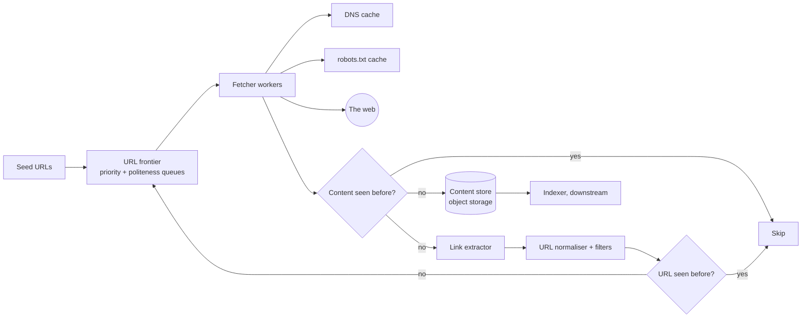

#### Step 6 · Deep dives

**Deep dive 1: the crawl loop with dedup and robots.** At its heart, a crawler is **BFS over the web graph** ([Part 2 Chapter 16](../part-2-dsa/16-graphs-bfs-dfs.md)), with two kinds of "visited" sets: one for URLs (don't queue the same link twice) and one for content (two different URLs serving the same page).

```python
import hashlib
from collections import deque
from urllib.parse import urlparse

# A fake, in-memory "internet": url -> (page text, outgoing links)
WEB = {
    "https://a.com/":      ("welcome to a", ["https://a.com/blog", "https://b.com/", "https://a.com/admin"]),
    "https://a.com/blog":  ("a blog post",  ["https://a.com/", "https://b.com/copy"]),
    "https://a.com/admin": ("secret",       []),
    "https://b.com/":      ("b home",       ["https://b.com/copy", "https://c.com/"]),
    "https://b.com/copy":  ("a blog post",  []),        # same content as a.com/blog
    "https://c.com/":      ("c home",       ["https://a.com/"]),
}
ROBOTS_DISALLOW = {"a.com": ["/admin"]}

def allowed(url):
    p = urlparse(url)
    return not any(p.path.startswith(rule) for rule in ROBOTS_DISALLOW.get(p.netloc, []))

def crawl(seeds, max_pages=10):
    frontier = deque(seeds)            # BFS queue of URLs to fetch
    seen_urls = set(seeds)             # URL dedup ("have I queued this?")
    seen_content = set()               # content dedup ("have I stored this text?")
    order = []
    while frontier and len(order) < max_pages:
        url = frontier.popleft()
        if not allowed(url):
            order.append(f"SKIP (robots) {url}")
            continue
        text, links = WEB.get(url, ("", []))
        fingerprint = hashlib.sha256(text.encode()).hexdigest()
        if fingerprint in seen_content:
            order.append(f"DUPLICATE     {url}")
            continue
        seen_content.add(fingerprint)
        order.append(f"STORED        {url}")
        for link in links:
            if link not in seen_urls:
                seen_urls.add(link)
                frontier.append(link)
    return order

for line in crawl(["https://a.com/"]):
    print(line)
```

```text
STORED        https://a.com/
STORED        https://a.com/blog
STORED        https://b.com/
SKIP (robots) https://a.com/admin
DUPLICATE     https://b.com/copy
STORED        https://c.com/
```

What just happened: `c.com` links back to `a.com/`, but it was already in `seen_urls`, so we didn't loop forever. `b.com/copy` had identical text to `a.com/blog`, so its content hash matched and we didn't store it twice. `/admin` was blocked by robots rules. In production, exact hashes catch identical pages; **near-duplicates** (same article, different ads) need similarity fingerprints like **SimHash**.

**Deep dive 2: politeness, the URL frontier (the vault).**

If your 1,000 workers grab the next 1,000 URLs from one big queue, and 900 of them are on `wikipedia.org`, you just attacked Wikipedia. The classic frontier design (from the Mercator crawler) has two layers:
- **Front queues** ordered by **priority** (PageRank-ish importance, how often the page changes).
- **Back queues**: **one queue per host**. A heap holds each host's "earliest next allowed fetch time". A worker pops the host whose time has come, fetches one URL from it, and pushes the host back with `time + delay`.

```python
import heapq
from collections import deque, defaultdict
from urllib.parse import urlparse

DELAY = 2   # seconds to wait between two requests to the same host (simulated clock)

urls = ["https://a.com/1", "https://a.com/2", "https://a.com/3",
        "https://b.com/1", "https://b.com/2", "https://c.com/1"]

host_queues = defaultdict(deque)            # one FIFO "back queue" per host
for u in urls:
    host_queues[urlparse(u).netloc].append(u)

ready = [(0, host) for host in host_queues]  # min-heap: (time host may be hit next, host)
heapq.heapify(ready)

while ready:
    t, host = heapq.heappop(ready)
    url = host_queues[host].popleft()
    print(f"t={t}s fetch {url}")
    if host_queues[host]:                    # host still has work: come back after DELAY
        heapq.heappush(ready, (t + DELAY, host))
```

```text
t=0s fetch https://a.com/1
t=0s fetch https://b.com/1
t=0s fetch https://c.com/1
t=2s fetch https://a.com/2
t=2s fetch https://b.com/2
t=4s fetch https://a.com/3
```

What just happened: even though three `a.com` URLs were queued first, the crawler interleaved hosts and never hit the same host twice within 2 seconds. Across billions of URLs and millions of hosts, this keeps every worker busy while staying polite to each site.

**Deep dive 3: distributing the crawl.** Partition URLs **by host** (hash of the hostname) across crawler nodes. Then each host's politeness queue lives on exactly one node, and no coordination is needed to rate-limit a host. Links discovered for other hosts are forwarded to the owning node in batches.

**Deep dive 4: traps and freshness.**
- **Traps**: cap URL length and path depth, cap pages per host per crawl, detect repeating path patterns (`/a/b/a/b/a/b`), normalise URLs (lowercase host, remove `#fragments`, sort query params, drop session IDs).
- **Freshness**: news homepages change every minute, a 2009 blog post never. Re-crawl with adaptive intervals: if a page changed since last time, shorten its interval; if not, lengthen it. Use HTTP `If-Modified-Since` / `ETag` to avoid re-downloading unchanged pages.

#### Step 7 · Bottlenecks and trade-offs

- **DNS** resolution: cache aggressively, run your own resolvers.
- **URL-seen set** at 10B entries: shard by hash; a Bloom filter trades a tiny false-positive rate (occasionally skipping a never-seen URL) for big memory savings. For a crawler, skipping a few new URLs is acceptable; that's the trade-off to say aloud.
- **Trade-off:** BFS breadth (coverage) vs priority (quality). Priority queues let important pages go first.
- **Trade-off:** politeness vs throughput. Fix it by crawling **many hosts in parallel**, not one host faster.

#### Follow-up questions

- *"How would you crawl JavaScript-heavy pages?"* A separate, slower pool of headless browsers for pages that need rendering; most pages don't.
- *"How do you prioritise what to crawl?"* Link-based importance (PageRank-like), domain quality, change rate, and freshness needs.
- *"How do you make the crawler resumable after a crash?"* The frontier is persisted (disk-backed queues / Kafka), and `url_state` records what was fetched. Workers are stateless; restart and continue.

---

### 7. Search Autocomplete / Typeahead (Google search box)

#### Step 1 · Requirements

**Functional**
- As the user types, show the **top 5–10 suggestions** that start with the typed prefix.
- Ranked by popularity (how often people searched them), maybe personalised and trending.
- (Park: spelling correction, multiple languages.)

**Non-functional**
- **Very low latency**: under ~100 ms end-to-end, or it feels laggy. The server part should be a few milliseconds.
- **Very high QPS**: one request per keystroke.
- Highly available; suggestions can be a little stale (updated hourly or daily is fine; trending can be faster).

#### Step 2 · Estimates

| Quantity | Assumption | Result |
|---|---|---|
| DAU | 100 million | |
| Searches per user per day | 10 | 10⁹ searches/day |
| Suggestion requests per search | ~6 (with debouncing) | 6 × 10⁹/day ≈ **70,000 QPS**, peak ≈ **150,000 QPS** |
| Distinct popular phrases to index | ~100 million | |
| Data size | 100M phrases × ~30 bytes + counts | a few GB for phrases; the trie with cached top-k is bigger, roughly tens of GB |

What the numbers tell us: 150k QPS with a few-ms budget means **everything in memory**, results **precomputed**, and heavy **caching** (browser cache, CDN, server cache: the prefix "a" is requested millions of times).

#### Step 3 · API

```text
GET /v1/suggest?q=ind&limit=5&lang=en
-> {"prefix": "ind", "suggestions": ["india", "indigo flight status", "india vs australia", ...]}
```

Responses for short prefixes are identical for everyone (non-personalised), so they can be cached with `Cache-Control: max-age=...` at the browser and CDN.

#### Step 4 · Data model

- **Raw data**: search logs (`query, timestamp, user, region`) streamed to Kafka and stored in a data lake.
- **Aggregated counts**: `(phrase, count)` per time window, computed by a batch job (e.g. weekly decay-weighted counts).
- **Serving structure**: a **trie** where each node caches its top-k phrases, serialised and loaded into memory on suggestion servers. Alternatively a key-value store `prefix -> [top-k phrases]` for every prefix up to length ~20.

#### Step 5 · High-level design

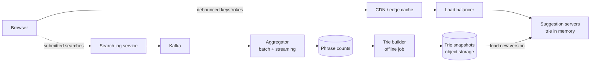

The key split: a **read path** (serve from a read-only, in-memory trie) and a **write path** (logs → aggregation → build a new trie → swap it in). They never block each other.

#### Step 6 · Deep dives

**Deep dive 1: the trie with cached top-k (the vault).**

A plain trie ([Part 2 Chapter 19](../part-2-dsa/19-tries.md)) finds the prefix node in O(length of prefix), but then you'd have to explore the **whole subtree** to find the top results. Under "a" that's millions of phrases. Too slow.

The fix: at build time, store the **top-k phrases at every node**. Then a query is: walk to the prefix node (≤ 20 steps), return its list. **O(prefix length)**, no subtree search.

```python
class TrieNode:
    __slots__ = ("children", "top")
    def __init__(self):
        self.children = {}
        self.top = []           # cached top-k (count, phrase) for this prefix

class Autocomplete:
    def __init__(self, k=3):
        self.root = TrieNode()
        self.k = k

    def build(self, counts):
        """Offline job: insert every phrase, then cache the top-k at every node."""
        for phrase, count in counts.items():
            node = self.root
            for ch in phrase:
                node = node.children.setdefault(ch, TrieNode())
                node.top.append((count, phrase))
        self._trim(self.root)

    def _trim(self, node):
        node.top = sorted(node.top, key=lambda x: (-x[0], x[1]))[: self.k]
        for child in node.children.values():
            self._trim(child)

    def suggest(self, prefix):
        """Online path: walk len(prefix) nodes, read the cached list. No subtree search."""
        node = self.root
        for ch in prefix:
            node = node.children.get(ch)
            if node is None:
                return []
        return [phrase for _, phrase in node.top]

search_log_counts = {
    "india": 900, "indigo flight status": 700, "india vs australia": 650,
    "indian railways": 500, "instagram": 950, "inshorts": 120, "iphone 16": 800,
}
ac = Autocomplete(k=3)
ac.build(search_log_counts)
for prefix in ["i", "in", "ind", "indi", "ip", "xyz"]:
    print(f"{prefix!r:7} -> {ac.suggest(prefix)}")
```

```text
'i'     -> ['instagram', 'india', 'iphone 16']
'in'    -> ['instagram', 'india', 'indigo flight status']
'ind'   -> ['india', 'indigo flight status', 'india vs australia']
'indi'  -> ['india', 'indigo flight status', 'india vs australia']
'ip'    -> ['iphone 16']
'xyz'   -> []
```

What just happened: every node remembered its own best 3 answers at build time, so `suggest("in")` didn't look at a single phrase; it walked two nodes and read a list. We traded **memory** (top-k copied at every node) and **freshness** (rebuild needed) for **speed**. That's the classic autocomplete trade-off, and saying it in those words scores points.

**Deep dive 2: updating the data.** Don't update the live trie on every search (150k writes/s into a structure being read at 150k QPS is pain). Instead:
1. Log searches to Kafka.
2. Aggregate counts (batch daily/weekly, with time decay so last week counts more than last year).
3. Build a fresh trie offline, store the snapshot, and have servers **load it and swap atomically** (blue/green style).
4. For **trending** queries ("earthquake" spiking right now), run a small streaming job that counts the last few minutes and merges a "trending" list on top of the stable results.

**Deep dive 3: scaling and sharding.** If the trie fits on one machine (tens of GB, yes with a big machine), simply **replicate** it on many servers behind a load balancer. If it doesn't fit, shard by **prefix range** (a–f, g–m, ...) but beware skew (far more words start with "s" than "x"); shard using measured traffic, not the alphabet.

**Deep dive 4: client-side tricks** (they cut load massively):
- **Debounce**: wait ~100–150 ms after the last keystroke before sending.
- **Cache** results in the browser: typing "ind", deleting to "in", re-typing "ind" needs no new request.
- **Prefetch**: one response can include the top results for the next likely characters.
- Cancel in-flight requests when a newer keystroke arrives, and ignore stale responses (responses can arrive out of order!).

#### Step 7 · Bottlenecks and trade-offs

- Memory of top-k at every node: limit k (5–10), limit depth (prefixes beyond ~20–30 chars are rare), and drop phrases below a popularity threshold.
- **Trade-off:** freshness (rebuild frequency) vs cost/complexity. Hourly or daily rebuild + streaming trending layer.
- **Personalisation** breaks caching (every user's answer differs). Common compromise: get global top-20 from the cache, re-rank with a lightweight personal signal on the server.
- Filtering: remove offensive or dangerous suggestions at build time (a blocklist applied by the builder).

#### Follow-up questions

- *"How do you support typos ('instgram')?"* Fuzzy matching with edit distance ([Part 2 Chapter 21](../part-2-dsa/21-dp-2d-advanced.md)) on a small candidate set, or a separate spelling-correction service.
- *"How do you handle multiple languages?"* Separate tries per language/region; route by the `lang` parameter.
- *"Why not just use Elasticsearch prefix queries?"* It works at small scale and is flexible, but a precomputed in-memory top-k structure is far cheaper at 150k QPS with a few-ms budget.

---
### 8. E-commerce Checkout with Inventory and Payments (shorter)

This one is less about scale and more about **correctness**: never sell an item you don't have, never charge a customer twice, never lose an order.

#### Requirements and estimates

- **Functional**: cart → checkout → reserve inventory → pay → create order → confirm. Cancel/refund.
- **Non-functional**: **strong consistency** for inventory and payments, exactly-once *effect* for charges, high availability for browsing (which can be eventually consistent and cached).
- **Estimates**: 10 million orders/day ≈ **120 orders/s** average; a flash sale might spike to **10,000+/s** on a handful of products. The total rate is modest; the danger is **contention on a few hot rows**.

#### API

```text
POST /v1/checkout        {"cart_id": "c9", "address_id": "a1", "idempotency_key": "7f3e-..."}
  -> {"order_id": "o123", "status": "PENDING_PAYMENT", "payment_url": "..."}
POST /v1/payments/webhook   (from the payment gateway: success / failure, signed)
GET  /v1/orders/o123     -> {"status": "CONFIRMED", ...}
```

#### Data model

```sql
CREATE TABLE inventory (
    sku       VARCHAR(32) PRIMARY KEY,
    available INT NOT NULL CHECK (available >= 0),
    reserved  INT NOT NULL DEFAULT 0,
    version   INT NOT NULL
);

CREATE TABLE orders (
    order_id        BIGINT PRIMARY KEY,
    user_id         BIGINT NOT NULL,
    status          VARCHAR(20),   -- PENDING_PAYMENT, CONFIRMED, CANCELLED, REFUNDED
    total_paise     BIGINT NOT NULL,
    idempotency_key VARCHAR(64) UNIQUE,   -- a retried checkout finds the same order
    created_at      TIMESTAMP
);

CREATE TABLE payments (
    payment_id     BIGINT PRIMARY KEY,
    order_id       BIGINT REFERENCES orders(order_id),
    gateway_ref    VARCHAR(64) UNIQUE,    -- the gateway's ID; a repeated webhook is a no-op
    status         VARCHAR(12),
    amount_paise   BIGINT
);
```

#### High-level design

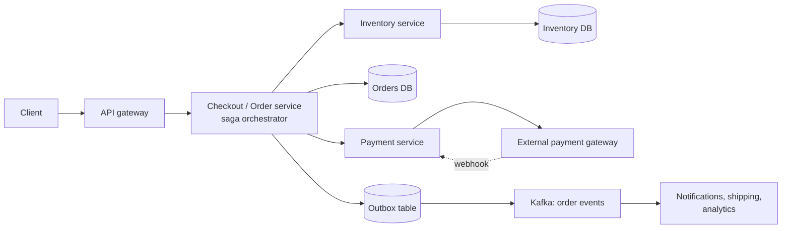

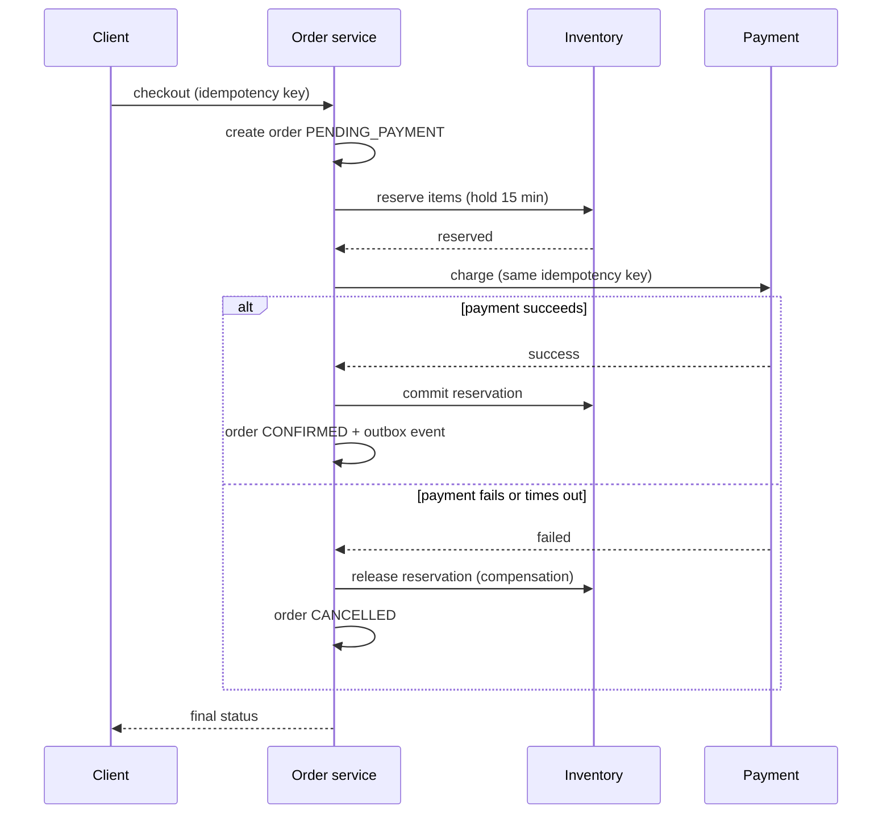

#### Deep dives

**1. Don't oversell: optimistic locking.** Two buyers read "1 left" at the same time. If both then write "0 left", you sold two items you didn't have (a **lost update**, [Chapter 03](03-databases.md)). Make the write **conditional**:

```python
class Inventory:
    """Optimistic concurrency: every row has a version; an update only wins if the version is unchanged."""

    def __init__(self):
        self.rows = {"sku-42": {"stock": 1, "version": 7}}

    def read(self, sku):
        row = self.rows[sku]
        return row["stock"], row["version"]

    def decrement_if_version(self, sku, expected_version):
        # SQL: UPDATE inventory SET stock = stock - 1, version = version + 1
        #      WHERE sku = ? AND version = ? AND stock > 0
        row = self.rows[sku]
        if row["version"] != expected_version or row["stock"] <= 0:
            return False
        row["stock"] -= 1
        row["version"] += 1
        return True

inv = Inventory()
stock_a, ver_a = inv.read("sku-42")      # buyer A reads: 1 left, version 7
stock_b, ver_b = inv.read("sku-42")      # buyer B reads the same thing at the same time
print("A sees", stock_a, "B sees", stock_b)
print("A buys:", inv.decrement_if_version("sku-42", ver_a))
print("B buys:", inv.decrement_if_version("sku-42", ver_b))   # version is now 8, so B loses
print("final row:", inv.rows["sku-42"])
```

```text
A sees 1 B sees 1
A buys: True
B buys: False
final row: {'stock': 0, 'version': 8}
```

What just happened: both buyers saw stock 1, but only the first conditional update matched `version = 7`. B's update matched zero rows, so B gets "sorry, sold out" instead of an oversold order. For simple counters you can skip the version and just write `UPDATE ... SET available = available - 1 WHERE sku = ? AND available > 0`, which the database executes atomically.

> 💡 **Optimistic vs pessimistic.** Optimistic (version check) is great when conflicts are rare. In a **flash sale** where 10,000 people fight for 100 units, most attempts fail and retry. There, use pessimistic row locks (`SELECT ... FOR UPDATE`), or better, keep the hot counter in Redis with an atomic `DECR` (or a Lua script) as the gatekeeper, and only let winners proceed to the database. Some systems also put buyers in a **queue** and process them in order.

**2. Never charge twice: idempotency keys.** The client generates an `idempotency_key` per checkout attempt. The server stores it with a UNIQUE constraint. A retried request (user double-clicks, network timeout) finds the existing order and returns it instead of creating a new one. The same key is passed to the payment gateway, which also deduplicates. Webhooks are deduplicated by `gateway_ref`.

**3. Many services, no distributed transaction: the saga.** Inventory, orders and payments are separate services with separate databases, so a single ACID transaction across them isn't available (two-phase commit exists but is slow and fragile). A **saga** is a sequence of local transactions, each with a **compensating action** if a later step fails: reserve → charge → confirm; if the charge fails, release the reservation. Events are published reliably with the **outbox pattern** ([Chapter 08](08-queues-events.md)): write the order row and the event row in the same local transaction, and a relay publishes the event to Kafka.

**4. Payment timeouts.** The gateway call timed out: did the charge happen? You don't know! Never assume. Mark the payment `UNKNOWN`, then **query the gateway** with the idempotency key (or wait for the webhook) before deciding. Reservations expire after ~15 minutes so stuck checkouts don't lock stock forever.

#### Trade-offs and follow-ups

- **Reserve at add-to-cart vs at checkout?** Reserving at add-to-cart locks stock for people who never buy. Most shops reserve at checkout with a short expiry.
- **Consistency split**: product pages and stock badges ("only 3 left!") can be cached and slightly stale; the final `UPDATE` is the source of truth.
- *"How do you handle a flash sale?"* Pre-load stock into Redis, atomic decrement as admission control, a waiting-room queue in front, rate limiting per user, static content on the CDN.

---

### 9. Ticket Booking with Seat Locking (BookMyShow, Ticketmaster) (shorter)

The vault: **two people click seat A2 at the same millisecond**. Exactly one must win, and the loser must find out immediately. On top of that, the winner needs a few minutes to pay without someone else grabbing the seat.

#### Requirements and estimates

- **Functional**: browse shows → see the seat map → select seats → **hold** them for ~10 minutes → pay → booked. Holds expire automatically if not paid.
- **Non-functional**: **no double booking** (strong consistency per seat), seat map can be a few seconds stale, survive "on-sale" spikes for a hit concert.
- **Estimates**: normal load is small (a few hundred bookings/s nationally). A blockbuster opening can bring **hundreds of thousands of users** in minutes for ~50,000 seats: the problem is the spike, plus contention on the same seats.

#### API and data model

```text
GET  /v1/shows/{show_id}/seats                -> seat map with FREE / HELD / BOOKED
POST /v1/shows/{show_id}/holds   {"seats": ["A1","A2"]}  -> {"hold_id": "h7", "expires_at": "..."} or 409 Conflict
POST /v1/holds/h7/confirm        {"payment_token": "...", "idempotency_key": "..."}
DELETE /v1/holds/h7              (user cancels)
```

```sql
CREATE TABLE show_seats (
    show_id     BIGINT,
    seat_id     VARCHAR(8),
    status      VARCHAR(8) NOT NULL,     -- FREE, HELD, BOOKED
    held_by     BIGINT,
    hold_expires_at TIMESTAMP,
    booking_id  BIGINT,
    PRIMARY KEY (show_id, seat_id)
);

-- Grab seats atomically: the WHERE clause is the lock. Run inside one transaction
-- for all requested seats; if fewer rows than requested were updated, roll back.
UPDATE show_seats
SET status = 'HELD', held_by = :user, hold_expires_at = NOW() + INTERVAL '10 minutes'
WHERE show_id = :show AND seat_id IN ('A1', 'A2')
  AND (status = 'FREE' OR (status = 'HELD' AND hold_expires_at < NOW()));
```

#### High-level design

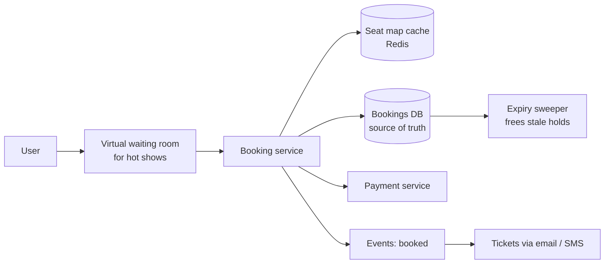

#### Deep dive: holds with expiry

```python
HOLD_SECONDS = 600     # a seat hold lasts 10 minutes

class SeatMap:
    """Each seat row behaves like: UPDATE seats SET ... WHERE seat_id=? AND <seat is free>."""

    def __init__(self, seat_ids):
        self.seats = {s: {"state": "FREE", "user": None, "expires": 0} for s in seat_ids}

    def _is_free(self, seat, now):
        return seat["state"] == "FREE" or (seat["state"] == "HELD" and seat["expires"] <= now)

    def hold(self, seat_ids, user, now):
        # All-or-nothing: check every seat first, then change them (one DB transaction in real life)
        if not all(self._is_free(self.seats[s], now) for s in seat_ids):
            return False
        for s in seat_ids:
            self.seats[s] = {"state": "HELD", "user": user, "expires": now + HOLD_SECONDS}
        return True

    def confirm(self, seat_ids, user, now, payment_ok):
        for s in seat_ids:
            seat = self.seats[s]
            if seat["state"] != "HELD" or seat["user"] != user or seat["expires"] <= now:
                return "hold lost, refund if charged"
        if not payment_ok:
            return "payment failed, seats stay held until expiry"
        for s in seat_ids:
            self.seats[s]["state"] = "BOOKED"
        return "booked"

show = SeatMap(["A1", "A2", "A3"])
print("asha holds A1,A2 :", show.hold(["A1", "A2"], "asha", now=0))
print("ravi holds A2,A3 :", show.hold(["A2", "A3"], "ravi", now=5))      # A2 taken -> whole request fails
print("ravi holds A3    :", show.hold(["A3"], "ravi", now=6))
print("asha confirms    :", show.confirm(["A1", "A2"], "asha", now=120, payment_ok=True))
print("ravi confirms late:", show.confirm(["A3"], "ravi", now=700, payment_ok=True))
print("meera holds A3   :", show.hold(["A3"], "meera", now=701))           # ravi's hold expired
print({s: v["state"] for s, v in show.seats.items()})
```

```text
asha holds A1,A2 : True
ravi holds A2,A3 : False
ravi holds A3    : True
asha confirms    : booked
ravi confirms late: hold lost, refund if charged
meera holds A3   : True
{'A1': 'BOOKED', 'A2': 'BOOKED', 'A3': 'HELD'}
```

What just happened:
- Ravi's request for A2+A3 failed **as a whole** (all-or-nothing), so he wasn't left holding a lonely A3 he didn't ask for.
- Ravi's hold expired at t=606. When he tried to confirm at t=700, the system refused, so we must refund if his card was charged. In production, **check the hold is still valid before charging**, and extend the hold slightly while payment is in progress to avoid this case.
- Meera could grab A3 at t=701 without any cleanup job running, because "expired" is checked **lazily** inside the hold condition. A background sweeper still resets old holds so the seat map looks right.

**Where to put the lock?**

| Option | How | Pros | Cons |
|---|---|---|---|
| DB conditional UPDATE (above) | Row-level atomicity in SQL | Simple, correct, durable | DB takes all contention |
| `SELECT ... FOR UPDATE` | Pessimistic row lock in a transaction | Clear semantics | Locks held across slow steps hurt throughput |
| Redis `SET seat:A2 user NX EX 600` | Atomic "set if not exists" with TTL | Very fast, auto-expiry | Redis is not the source of truth; still write the booking to the DB |

Common answer: Redis `SET NX EX` as a fast first gate for the hold, DB conditional update as the final truth at confirm time.

**Flash-sale spike:** put a **virtual waiting room** (a queue that admits users at a controlled rate) in front, serve the seat map from cache, and rate-limit per user.

---

## 🔬 Under the Hood

### How one server holds 100,000 open WebSockets

A WebSocket is just a TCP connection that stays open. An idle connection costs a **file descriptor** and a few kilobytes of kernel and application buffers, but **no CPU** while nothing is happening. The trick that makes this cheap is **event-driven I/O** (`epoll` on Linux, `kqueue` on BSD/macOS): instead of one thread per connection (100,000 threads would drown in memory and context switches), one thread asks the kernel "tell me which of these 100,000 sockets have data", and only touches those. This is the same model as Python's `asyncio` ([Part 1 Chapter 18](../part-1-python/18-internals-concurrency.md)), Node.js, Netty and Go's network runtime. The limits you actually hit: memory per connection, OS file-descriptor limits (raised in config), and the CPU cost of TLS handshakes during a mass reconnect (a "thundering herd" after a gateway restart, softened with randomised reconnect delays).

### Why video is cut into segments

HTTP caches and CDNs are built for **many small, immutable files**. A 2-hour movie as one file can't be cached in pieces well, can't switch quality halfway, and a dropped connection restarts a huge download. Cut into 4-second segments, each file is small, cacheable forever, fetched with a plain `GET`, and the player can switch quality at every segment boundary. Segment length is a trade-off: shorter = faster quality switching and lower live latency, longer = fewer requests and better compression.

### Why geohash prefixes mean "nearby" (and when they don't)

Geohash interleaves longitude and latitude bits, which traces a **Z-order curve** (a space-filling curve) across the map. Points that share the first k characters lie in the same cell. But the curve jumps: two points a metre apart on opposite sides of a cell border can have completely different prefixes (Greenwich meridian and the equator are the worst cases). That's exactly why every proximity query searches **the cell plus its neighbours**. Hexagons (H3) reduce the problem because all six neighbours share an edge and sit at equal distance.

### Why a wide-column store fits chat

In Cassandra-style stores, a **partition key** decides which node stores the data, and a **clustering key** keeps rows sorted on disk inside the partition. With `PRIMARY KEY ((conv_id, bucket), seq)`, all messages of a conversation month sit together, sorted by `seq`. "Latest 50 messages" becomes one seek and one sequential read. Writes are append-only into an in-memory table flushed to sorted files (an **LSM tree**, [Chapter 03](03-databases.md)), which is why such stores swallow hundreds of thousands of writes per second.

### Why idempotency keys make retries safe

Over a network, a request can succeed while its response is lost. The client can't tell "it failed" from "it worked but I didn't hear back", so it must retry. Without a key, a retry = a second message, a second order, a second charge. With a key stored under a UNIQUE constraint, the database itself rejects the duplicate, and the server returns the original result. This turns "at-least-once delivery" into "exactly-once **effect**" ([Chapter 08](08-queues-events.md)).

---

## 🧩 Pattern Decoder

### Decision guide: which technique for which "vault"?

| If the system needs... | Reach for... | Because... |
|---|---|---|
| Server pushing data to clients in real time | WebSockets (or SSE for one-way) + gateway servers + session registry | Polling at scale wastes requests and adds latency |
| Ordered, gap-free messages over flaky networks | Server-assigned per-conversation sequence numbers + cursor sync | Clocks lie; cursors make "what did I miss?" exact |
| Duplicate-free retries | Client-generated idempotency keys + UNIQUE constraint | Network failures make retries unavoidable |
| Fast reads of personalised aggregates (feeds) | Precompute on write (fan-out), cache IDs only | Reads outnumber writes 100:1 |
| ...but some producers have millions of consumers | Hybrid: pull for celebrities | Fan-out cost is O(followers) |
| Serving huge files to millions | Object storage + CDN + chunking | Bandwidth, not compute, is the bottleneck |
| Many device types and networks | Transcode to a bitrate ladder + adaptive streaming | Client picks quality per segment |
| "Things near me" | Geohash / quadtree / H3 cells in memory, search cell + neighbours | Turns O(n) scans into small lookups |
| Never assigning one resource twice | Compare-and-set (conditional UPDATE / version) | Atomic check-and-write in one step |
| Holding a resource temporarily | Hold with expiry (TTL), checked lazily + sweeper | Abandoned holds free themselves |
| Traversing a huge graph politely | BFS frontier + per-host queues + seen sets | Breadth, dedup and politeness in one structure |
| Prefix queries in a few ms | Trie with top-k cached per node, rebuilt offline | Query = walk the prefix, no subtree search |
| A transaction across services | Saga with compensations + outbox | No global ACID transaction across services |

### The reusable skeletons

Most designs in this chapter are one of three shapes:

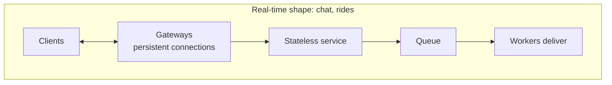

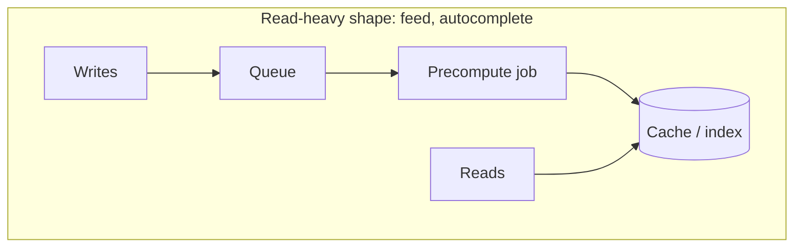

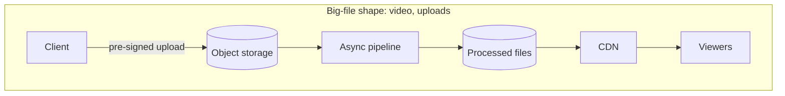

And a fourth for correctness-critical flows (checkout, booking): **idempotency key → conditional write → saga/outbox**.

### Trade-off table across the case studies

| System | Consistency need | Main bottleneck | Main trade-off |
|---|---|---|---|
| Chat | Strong ordering per conversation, eventual elsewhere | Connections, write throughput | Push vs pull for big groups |
| News feed | Eventual | Read QPS, fan-out writes | Write cost vs read cost (push vs pull) |
| Video | Eventual (metadata) | Egress bandwidth, transcoding CPU | Quality/codecs vs cost |
| Ride-hailing | Strong for assignment, eventual for location | Location writes | Freshness vs battery |
| Crawler | Eventual | Politeness, dedup memory | Coverage vs freshness vs politeness |
| Autocomplete | Eventual | QPS, latency | Freshness vs speed (precomputation) |
| Checkout | Strong | Hot-row contention | Optimistic vs pessimistic locking |
| Ticket booking | Strong per seat | On-sale spikes | Hold length vs seat availability |

### When NOT to over-engineer

- A chat app for a 500-person company doesn't need Cassandra and Kafka. Postgres + one WebSocket server is fine. Interviewers like hearing "at this scale, I'd start simple".
- Don't add the celebrity hybrid unless the numbers show huge follower counts.
- Don't shard the autocomplete trie if it fits in one machine's memory: replicate it instead.

---

## ⚠️ Traps & Common Mistakes

1. **Spending 30 minutes on boilerplate.** Login, load balancer, "and we add a cache" are expected. Get to the vault by minute ~20.
2. **Ordering chat messages by client timestamps.** Phone clocks drift and can be set by users. Order by a server-assigned sequence per conversation.
3. **Saying "sent ✓" before the message is durable.** If the server crashes after acking but before writing, the message is lost while the sender believes it went through. Ack after the write.
4. **Copying full post bodies into every feed.** Edits and deletes become impossible and memory explodes. Store IDs, hydrate at read time.
5. **Pure fan-out on write with celebrities.** One post → 50 million writes. Always mention the hybrid.
6. **Serving video from your app servers.** Bandwidth math kills this immediately. CDN + object storage, and uploads via pre-signed URLs.
7. **Searching only the rider's own geohash cell.** The nearest driver may be across the border. Search neighbours too.
8. **Read-then-write without a condition** for inventory, seats or drivers:

```py
# ❌ wrong: two requests can both see "available" and both book
seat = db.query("SELECT status FROM show_seats WHERE seat_id = 'A2'")
if seat.status == "FREE":
    db.execute("UPDATE show_seats SET status = 'HELD' WHERE seat_id = 'A2'")

# ✅ right: the check and the write are one atomic statement
rows = db.execute("""UPDATE show_seats SET status = 'HELD'
                     WHERE seat_id = 'A2' AND status = 'FREE'""")
if rows == 0:
    raise SeatTaken()
```

9. **Assuming a timed-out payment failed.** It might have succeeded. Query the gateway or wait for the webhook before retrying with a new charge.
10. **A crawler with one global queue.** It will hammer a single popular host. Per-host back queues with delays.
11. **Updating the autocomplete trie on every keystroke or search.** Separate the read path (immutable in-memory snapshot) from the write path (offline rebuild + trending layer).
12. **Forgetting estimates drive decisions.** Computing "26 Tbps" and then not mentioning a CDN wastes the number. Every number should lead to a "therefore".

---

## 💡 Tips & Tricks

- Open every design with "**the hard part here is...**". It frames your whole answer and shows seniority.
- Memorise one number per system: chat → *concurrent connections*; feed → *read:write ratio*; video → *egress Tbps*; rides → *location writes/s*; crawler → *pages/s and per-host politeness*; autocomplete → *keystroke QPS*.
- Draw the **write path** and **read path** separately for read-heavy systems. Interviewers love seeing them decoupled.
- For anything involving money, seats, or assignment, say the three words: **idempotency, conditional write, saga**.
- Use real product names as anchors ("like WhatsApp's double ticks", "like Uber's H3") but explain the mechanism, not the brand.
- When stuck in a deep dive, ask: "What happens if this component crashes halfway?" The answer usually reveals the missing piece (durability, idempotency, a cursor).
- Mention monitoring briefly: message delivery latency (chat), fan-out lag (feed), rebuffering rate (video), match time (rides), crawl rate per host (crawler), p99 latency (autocomplete) ([Chapter 09](09-microservices-reliability.md)).
- Keep a "parking lot" list on the board for features you deliberately skip. It shows you thought of them without derailing.

---

## 🎯 Interview Questions

### 1. Design WhatsApp. How do you guarantee messages are delivered in order and exactly once? 🔥🔥🔥

<details><summary>Answer</summary>

Clients keep a WebSocket to a gateway server. On send, the client attaches a `client_msg_id` (UUID). The chat service:
1. Checks the ID against recently seen IDs (idempotency) and drops duplicates.
2. Assigns the next **per-conversation sequence number** (atomic counter).
3. Writes the message durably (wide-column store partitioned by conversation), **then** acks "sent".
4. Looks up the recipient's gateway in a session registry and pushes the message; if offline, sends a push notification.

The receiver acks delivery with the seq number. Each device keeps a **cursor** (last seq received per conversation); on reconnect it fetches everything after the cursor. So delivery is *at-least-once* over the network, but *exactly-once in effect* thanks to idempotency, and order is defined by the server's sequence numbers, not client clocks.

</details>

### 2. Fan-out on write vs fan-out on read for a news feed? 🔥🔥🔥

<details><summary>Answer</summary>

- **On write (push)**: when a user posts, insert the post ID into every follower's precomputed feed. Reads are O(1) cache lookups. Writes cost O(followers): terrible for celebrities, wasteful for inactive users.
- **On read (pull)**: store posts per author; at read time fetch recent posts of everyone you follow and k-way merge. Writes are cheap; reads cost O(following) and are slow at high QPS.
- **Hybrid**: push for normal accounts, pull for accounts above a follower threshold, merge at read time. Skip fan-out to long-inactive users and rebuild their feed on demand.

Pick based on read:write ratio (feeds are read-heavy, so mostly push) and follower distribution (skewed, so hybrid).

</details>

### 3. How does YouTube/Netflix handle different devices and network speeds? 🔥🔥🔥

<details><summary>Answer</summary>

Each upload is **transcoded** into a ladder of resolutions/bitrates and codecs, each split into short segments (2–10 s), with a manifest (HLS `.m3u8` / DASH `.mpd`) listing them. The player measures throughput and buffer level and picks the rendition **per segment** (adaptive bitrate). Segments are immutable HTTP files cached at CDN edges close to users, often inside ISPs. Transcoding is parallelised by splitting the video into chunks processed by many workers as a DAG, with idempotent tasks so retries are safe.

</details>

### 4. How would you find the nearest drivers for a rider? 🔥🔥🔥

<details><summary>Answer</summary>

Keep the current location of available drivers **in memory**, indexed by spatial cells (geohash, quadtree or H3). Driver updates (every ~4 s) move the driver between cells. For a request: compute the rider's cell, gather drivers from that cell **and its neighbours** (expand rings until enough candidates), filter stale updates, then rank by road ETA. Shard by city/region since matching is local. Assign with a compare-and-set on the driver's status so two riders can't get the same driver. Location data is self-healing (drivers resend), so replicas are cheap.

</details>

### 5. Design a web crawler. How do you make it polite and avoid infinite loops? 🔥🔥

<details><summary>Answer</summary>

BFS over the web graph from seeds. **URL frontier**: priority front queues feeding **per-host back queues**; a heap tracks each host's next allowed fetch time so no host gets more than one request per delay. Respect `robots.txt` (cached per host). **Loops/dups**: normalise URLs and keep a URL-seen set (sharded hash set or Bloom filter); keep content fingerprints to skip duplicate pages (SimHash for near-duplicates). **Traps**: cap depth, URL length and pages per host. Distribute by hashing hostnames to crawler nodes so politeness is local to one node. Persist the frontier for crash recovery; re-crawl adaptively based on how often pages change.

</details>

### 6. Design search autocomplete. How do you return suggestions in under 100 ms? 🔥🔥🔥

<details><summary>Answer</summary>

Serve from an **in-memory trie where each node stores its precomputed top-k phrases**, so a query is O(prefix length): walk and read the list. Build the trie offline from aggregated search logs (with time decay), snapshot it, and hot-swap it on serving nodes; add a streaming "trending" layer for freshness. Replicate the trie (shard by measured prefix traffic only if it doesn't fit). Reduce load with client debouncing, browser caching, CDN caching of common prefixes, and cancelling stale requests.

</details>

### 7. Two users click the same seat at the same time. What happens in your design? 🔥🔥🔥

<details><summary>Answer</summary>

Both send "hold A2". The database executes `UPDATE show_seats SET status='HELD', held_by=?, hold_expires_at=now()+10min WHERE show_id=? AND seat_id='A2' AND (status='FREE' OR hold_expires_at < now())`. Row-level atomicity means only one update matches; the other sees 0 rows updated and gets a 409 "seat just taken". Multi-seat requests run in one transaction and roll back unless all seats were updated. Holds expire automatically (lazy check + sweeper). A Redis `SET NX EX` gate can absorb load first, but the DB stays the source of truth. Confirming checks the hold is still valid **before** charging, and payment uses an idempotency key.

</details>

### 8. How do you prevent overselling during a flash sale? 🔥🔥

<details><summary>Answer</summary>

Make decrements atomic and conditional: `UPDATE inventory SET available = available - 1 WHERE sku=? AND available > 0` (or a version check for optimistic locking). Under extreme contention, optimistic retries thrash, so put an atomic counter in Redis (`DECR`, reject if below zero) as admission control, a waiting-room queue in front, per-user rate limits, and only winners proceed to create orders in the DB. Reservations expire if payment isn't completed. Reconcile Redis and the DB periodically.

</details>

### 9. How do read receipts and "last seen" work at scale? 🔥🔥

<details><summary>Answer</summary>

Read receipts: store a **high-water mark** per user per conversation (`last_read_seq`), not a flag per message. A receipt event is sent to the sender's devices; in groups, aggregate ("read by 12") and fetch details lazily. Presence: clients heartbeat every few seconds; Redis keeps `presence:user` with a TTL; several missed heartbeats → offline (avoids flicker). Only push presence updates to users currently viewing that contact, and batch/throttle them. Both are eventually consistent by design.

</details>

### 10. How would you design the upload flow for large videos? 🔥🔥

<details><summary>Answer</summary>

The client asks the API to start an upload; the API creates a metadata row (UPLOADING) and returns an `upload_id` plus **pre-signed URLs** for each part (multipart upload). The client uploads ~5–100 MB parts directly to object storage, in parallel, retrying failed parts and resuming after crashes using the stored `upload_id`. A final "complete" call assembles the object; a storage event triggers the transcoding pipeline via a queue; status moves to PROCESSING and then READY. App servers never carry video bytes.

</details>

### 11. How do you implement a group chat for 100,000 members (like a Telegram channel)? 🔥

<details><summary>Answer</summary>

Don't fan out on write to 100k inboxes. Store each message once in the channel's log (partitioned by channel, bucketed by time). Push lightweight notifications only to members who are online and have the channel open; others see an unread badge computed from `latest_seq - their_last_read_seq` and pull messages when they open it. Rate-limit who can post (often only admins), and cache the latest messages of hot channels.

</details>

### 12. In checkout, the payment gateway times out. What do you do? 🔥🔥

<details><summary>Answer</summary>

Treat the result as **unknown**, never as failed. Keep the order in PENDING_PAYMENT and the stock reserved. Query the gateway's status API with the same idempotency key, or wait for its signed webhook. If it succeeded, confirm the order; if it failed, release the reservation (saga compensation). If the user retries meanwhile, the same idempotency key prevents a second charge. A reservation expiry plus a reconciliation job cleans up anything stuck.

</details>

---

## 🏋️ Practice

**🟢 1. Estimate it.** A chat app has 50 million DAU sending 30 messages each per day, 150 bytes per message. Compute average messages/s, peak (×3), and storage per year.

<details><summary>Solution</summary>

```python
dau, msgs_per_user, size_bytes = 50_000_000, 30, 150
per_day = dau * msgs_per_user
avg_per_s = per_day / 86_400
print(f"messages/day: {per_day:,}")
print(f"average: {avg_per_s:,.0f}/s, peak: {avg_per_s * 3:,.0f}/s")
print(f"storage/year: {per_day * size_bytes * 365 / 1e12:.0f} TB")
```

```text
messages/day: 1,500,000,000
average: 17,361/s, peak: 52,083/s
storage/year: 82 TB
```

About 17k/s average, ~50k/s peak, ~82 TB/year before replication (×3 with replication ≈ 250 TB).

</details>

**🟢 2. Why IDs?** Explain in two sentences why a feed cache stores post IDs instead of full posts.

<details><summary>Solution</summary>

A single post can appear in millions of feeds, so copying its body would multiply storage and make edits and deletes require millions of updates. Storing IDs keeps each feed small (~8 bytes per entry) and the post body in one place, fetched (and cached) at read time.

</details>

**🟡 3. Neighbour search.** Extend the geohash idea: write a function that returns all drivers within `radius_km` of a rider by checking a set of candidate cells, then filtering by exact distance. To keep it simple, use a square grid of 0.01° cells (about 1.1 km) instead of geohash, and check the rider's cell plus the 8 around it.

<details><summary>Solution</summary>

```python
import math
from collections import defaultdict

CELL = 0.01   # degrees, roughly 1.1 km of latitude

def cell_of(lat, lon):
    return (math.floor(lat / CELL), math.floor(lon / CELL))

def km_between(a, b):
    lat1, lon1, lat2, lon2 = map(math.radians, (*a, *b))
    h = math.sin((lat2 - lat1) / 2) ** 2 + math.cos(lat1) * math.cos(lat2) * math.sin((lon2 - lon1) / 2) ** 2
    return 6371 * 2 * math.asin(math.sqrt(h))

drivers = {"D1": (12.9716, 77.5946), "D2": (12.9801, 77.6001),
           "D3": (12.9352, 77.6245), "D4": (12.9699, 77.5899)}
grid = defaultdict(list)
for d, pos in drivers.items():
    grid[cell_of(*pos)].append(d)

def nearby(rider, radius_km):
    r, c = cell_of(*rider)
    found = []
    for dr in (-1, 0, 1):
        for dc in (-1, 0, 1):                     # own cell + 8 neighbours
            for d in grid[(r + dr, c + dc)]:
                dist = km_between(rider, drivers[d])
                if dist <= radius_km:
                    found.append((round(dist, 2), d))
    return sorted(found)

print(nearby((12.9720, 77.5950), radius_km=1.5))
```

```text
[(0.06, 'D1'), (0.6, 'D4'), (1.06, 'D2')]
```

D3 (about 5 km away) is never even examined. Note that one ring of neighbours only guarantees finding everything within one cell width (~1.1 km); for bigger radii, expand more rings.

</details>

**🟡 4. Read receipts in groups.** Given each member's `last_read_seq` in a group, write a function that, for a given message `seq`, returns how many members (excluding the sender) have read it, in O(members).

<details><summary>Solution</summary>

```python
def read_count(seq, sender, last_read):
    return sum(1 for user, upto in last_read.items() if user != sender and upto >= seq)

last_read = {"asha": 120, "ravi": 118, "meera": 121, "dev": 90}
print(read_count(118, "asha", last_read))   # ravi, meera
print(read_count(121, "asha", last_read))   # meera only
```

```text
2
1
```

Because a high-water mark means "everything up to here is read", one comparison per member is enough. For huge groups, keep the marks sorted (or a count per seq) to answer in O(log n).

</details>

**🟡 5. Design question.** Your news feed's fan-out workers fall 20 minutes behind after a celebrity-heavy evening. List four concrete fixes.

<details><summary>Solution</summary>

1. Lower the celebrity threshold so more high-follower accounts use pull instead of push.
2. Skip fan-out for inactive users (no login in N days); rebuild their feed on demand.
3. Prioritise: process fan-out for online/recently active followers first (separate high-priority topic).
4. Autoscale workers from Kafka consumer lag, and increase topic partitions so more workers can run in parallel. (Bonus: batch Redis writes with pipelining.)

</details>

**🔴 6. Merge celebrity posts efficiently.** A user's feed cache is a list of `(ts, post_id)` sorted newest first, and they follow 3 celebrities whose timelines are also sorted newest first. Return the newest `k` posts overall without concatenating and sorting everything. (Hint: k-way merge with a heap.)

<details><summary>Solution</summary>

```python
import heapq

def merge_feeds(k, *timelines):
    """Each timeline is sorted newest first. Pop the globally newest item k times."""
    heap = []
    for i, tl in enumerate(timelines):
        if tl:
            ts, pid = tl[0]
            heapq.heappush(heap, (-ts, i, 0, pid))    # negate for a max-heap
    out = []
    while heap and len(out) < k:
        neg_ts, i, j, pid = heapq.heappop(heap)
        out.append(pid)
        if j + 1 < len(timelines[i]):
            ts, nxt = timelines[i][j + 1]
            heapq.heappush(heap, (-ts, i, j + 1, nxt))
    return out

cache = [(100, "p9"), (90, "p7"), (40, "p2")]
celeb_a = [(95, "a3"), (50, "a2")]
celeb_b = [(99, "b8"), (10, "b1")]
celeb_c = []
print(merge_feeds(4, cache, celeb_a, celeb_b, celeb_c))
```

```text
['p9', 'b8', 'a3', 'p7']
```

Time O(m + k log m) for m timelines (the heap holds at most one entry per timeline), versus O(N log N) for concatenating and sorting all N posts.

</details>

**🔴 7. Full design.** Design **Google Docs-style collaborative editing** at a high level: what's the vault, and how would you open it? Write requirements, the key data flow, and two deep dives.

<details><summary>Solution</summary>

- **Vault**: many people editing the same document at once; edits must merge so everyone converges to the same text without losing anyone's typing.
- **Requirements**: real-time co-editing, cursors/presence, version history, offline edits that sync later; low latency (<100 ms echo), eventual convergence.
- **Flow**: clients hold a WebSocket to a document session server (all editors of one doc routed to the same server via consistent hashing on `doc_id`). Each edit is an operation (`insert 'x' at 42`). The server orders operations per document (a sequence number, like chat), transforms them, broadcasts, and appends them to an operation log; periodic snapshots make loading fast.
- **Deep dive 1: conflict resolution.** **Operational Transformation (OT)**: when two concurrent ops arrive, transform one against the other (if A inserts at 5 and B deletes at 3, shift A's position to 4). Needs a central ordering server, which we have. Alternative: **CRDTs** (each character gets a unique, ordered ID so merges commute), better for offline/peer-to-peer, at a metadata cost.
- **Deep dive 2: durability and history.** Op log in a durable store partitioned by `doc_id`; snapshot every N ops; version history = snapshots + ops replay. Presence and cursors are ephemeral (in memory, never stored).

</details>

---

## 🧠 Never-Forget Summary

- Every design = the **standard crew** (LB, stateless services, cache, DB, queue, CDN) + **one vault**. Name the vault early.
- **Chat**: WebSocket gateways + session registry; per-conversation **seq** numbers; `client_msg_id` for idempotency; ack after durable write; **cursor sync** on reconnect; receipts as high-water marks; presence via heartbeats + TTL.
- **Feed**: read-heavy → precompute; **push for normal users, pull for celebrities**; cache **IDs**, hydrate at read; cursor pagination.
- **Video**: pre-signed multipart upload → object storage → **DAG of parallel transcoding** → segments + manifest → **CDN**; player does **ABR** per segment.
- **Rides**: current locations **in memory** in geo cells (geohash/quadtree/H3); search cell **+ neighbours**; rank by ETA; **CAS** to assign; shard by city.
- **Crawler**: BFS + **URL frontier** (priority front queues, **per-host back queues**); URL-seen + content-seen sets; robots.txt; trap limits; hash hosts to nodes.
- **Autocomplete**: trie with **top-k cached per node**, rebuilt offline, hot-swapped; trending layer; debounce + caching on the client.
- **Checkout**: **idempotency key**, **conditional update** on inventory, **saga** + outbox; payment timeout = unknown, not failed.
- **Booking**: **holds with expiry**, atomic conditional UPDATE (or Redis `SET NX EX` + DB truth), all-or-nothing multi-seat, waiting room for spikes.
- Every estimate should end with "**therefore**...".

**Memory hook: "Chat SEQs, Feeds PUSH, Videos CHUNK, Rides CELL, Crawlers QUEUE, Typeahead TRIES, Money LOCKS."**

**One picture:**

| System | Vault | Signature move | Key number |
|---|---|---|---|
| Chat | Real-time, ordered, no dups | WebSocket + seq + cursor sync | Concurrent connections (~250M) |
| News feed | Fast personalised reads | Hybrid fan-out, cache IDs | Read:write ≈ 100:1 |
| Video | Bandwidth, devices | Transcode ladder + ABR + CDN | Egress (~26 Tbps) |
| Ride-hailing | Nearby moving points | Geo cells in memory + CAS assign | Location writes (~250k/s) |
| Crawler | Scale + politeness | Per-host frontier + dedup | Pages/s (~400) and per-host delay |
| Autocomplete | Latency per keystroke | Top-k trie, offline build | QPS (~150k) |
| Checkout | No oversell, no double charge | Conditional write + idempotency + saga | Hot-row contention |
| Ticket booking | Same seat, same moment | Hold with TTL + atomic UPDATE | On-sale spike |

> **If you remember only one thing:** find the one hard problem first ("the vault"), say it out loud, and spend your deep-dive time there; the rest is the same crew you already know.

---
**Next:** [Chapter 14 · Low-Level Design: SOLID, Patterns & Machine Coding](14-low-level-design.md)  ·  **Back to** [Contents](../README.md)
