# Chapter 14 · Low-Level Design: SOLID, Patterns & Machine Coding

> High-level design decides that a city needs a hospital, a metro line and a power station. Low-level design is the architect's floor plan for *one* building: where every door, pipe and switch goes. In the interview room, it is the round where you are given 90 minutes and a blank editor and told "build a parking lot". This chapter makes sure you walk in with a plan.

**You will learn:**
- What LLD and machine-coding rounds really test, and how they are scored
- The four OOP pillars again, in one page, plus "composition over inheritance"
- **SOLID**, with a bad → good Python example for every letter
- The 10 design patterns that cover almost every LLD interview, each with runnable code
- UML-lite: how to sketch class diagrams quickly (in Mermaid)
- A 7-step method you can apply to *any* LLD question
- Seven complete, runnable designs: parking lot, elevator, LRU cache, Splitwise, movie ticket booking, snake and ladder, vending machine
- How to make designs thread-safe, and how to talk about concurrency

**Before this:** [OOP I: Classes & Objects](../part-1-python/14-oop-classes-objects.md) · [OOP II: Inheritance, Polymorphism & Magic Methods](../part-1-python/15-oop-inheritance-magic.md) · [Python Internals & Concurrency](../part-1-python/18-internals-concurrency.md). Helpful: [Linked Lists](../part-2-dsa/10-linked-lists.md) and [Heaps](../part-2-dsa/15-heaps.md) for the LRU and Splitwise designs.

---

## 🧠 The Big Idea

Imagine you are opening a restaurant. You don't hire one superhuman who cooks, takes orders, washes dishes, handles cash and fixes the plumbing. You hire a **chef**, a **waiter**, a **cashier**, each with one clear job, and you agree on how they talk to each other: the waiter hands an *order slip* to the chef, never walks into the kitchen and starts frying things.

That is low-level design in one picture:

- **Objects are staff.** Each has one job and keeps its own tools (data) private.
- **Interfaces are the order slips.** People cooperate through agreed messages, not by reaching into each other's pockets.
- **Design patterns are well-known job roles.** "Doorman", "manager on duty", "head chef": names everyone understands, so you don't have to re-invent them.
- **SOLID is the HR handbook** that keeps the restaurant running as it grows from 1 branch to 100.

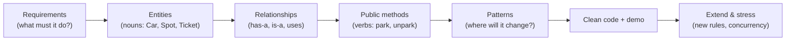

High-level design (Chapters 01–13 of this part) draws **boxes = services** and arrows = network calls. Low-level design draws **boxes = classes** and arrows = method calls. Same thinking, smaller zoom.

| | High-Level Design (HLD) | Low-Level Design (LLD) |
|---|---|---|
| Zoom level | Whole system: services, databases, queues | Inside one service: classes, methods |
| Typical question | "Design WhatsApp" | "Design the classes for a parking lot" |
| Output | Architecture diagram, estimates | Class diagram + working code |
| Main worries | Scale, availability, latency | Readability, extensibility, correctness |
| Failure looks like | System falls over at 1M users | Adding one feature means editing 12 files |

> 💡 **The one question behind all of LLD:** "When the requirements change next month, how many files do I need to touch?" Good design keeps that number small.

---

## 🔨 Building It Up

### 1. What LLD and machine-coding rounds actually test

There are two flavours of this round, and companies (especially Indian product companies like Flipkart, Swiggy, Uber, PhonePe, Razorpay) love both:

| Format | Duration | What you produce | Example |
|---|---|---|---|
| **Machine coding** | 60–120 min | Working, runnable code + a demo in `main` | "Build Splitwise. Must run." |
| **LLD discussion** | 45–60 min | Class diagram + key methods, partly coded | "Design an elevator system" |
| **Take-home** | 1–3 days | Full project with tests and README | "Build a parking lot CLI" |

What the interviewer writes on the scorecard:

| They check | What "good" looks like |
|---|---|
| **Requirement gathering** | You asked 4–6 sharp questions before coding and wrote the scope down |
| **Modelling** | Classes match real concepts. No 500-line `Manager` god class |
| **OOP & SOLID** | Small classes, clear responsibilities, abstractions where things vary |
| **Patterns** | Used where they *help* (Strategy for pricing, State for vending machine), not sprinkled for show |
| **Working code** | It runs. A demo exercises the main flows. Edge cases don't crash it |
| **Extensibility** | "Add a new vehicle type" takes one new class, not edits everywhere |
| **Concurrency awareness** | You can say where two users could collide and how to stop it |
| **Communication** | You explain trade-offs out loud while you build |

> ⚠️ In machine coding, **working beats perfect**. A clean design that doesn't run scores lower than a decent design that runs and handles edge cases. Get the happy path running first, then refine.

### 2. OOP recap in one page

You learnt these in [Chapter 14](../part-1-python/14-oop-classes-objects.md) and [Chapter 15](../part-1-python/15-oop-inheritance-magic.md) of Part 1. Here they are again, through the LLD lens:

| Pillar | Plain meaning | LLD use |
|---|---|---|
| **Encapsulation** | An object guards its own data; outsiders call methods | `account.withdraw(100)` checks the balance; nobody does `account._balance -= 100` |
| **Abstraction** | Show *what* something does, hide *how* | `PaymentMethod.pay(amount)` hides UPI vs card details |
| **Inheritance** | "is-a": a child reuses and specialises a parent | `Car` is a `Vehicle` |
| **Polymorphism** | Same call, different behaviour per object | `shape.area()` works for circles and rectangles |

In Python, an **abstract base class (ABC)** is how you write an interface: a class that says "anything that claims to be me must have these methods".

```python
from abc import ABC, abstractmethod


class Shape(ABC):
    @abstractmethod
    def area(self) -> float:
        """Every concrete shape must implement this."""

    def describe(self) -> str:          # shared behaviour, written once
        return f"{type(self).__name__} with area {self.area():.2f}"


class Circle(Shape):
    def __init__(self, radius: float):
        self._radius = radius           # leading underscore = "private by convention"

    def area(self) -> float:
        return 3.14159 * self._radius ** 2


class Rectangle(Shape):
    def __init__(self, width: float, height: float):
        self._width, self._height = width, height

    def area(self) -> float:
        return self._width * self._height


for shape in [Circle(1), Rectangle(2, 3)]:
    print(shape.describe())             # polymorphism: one call, two behaviours

try:
    Shape()
except TypeError:
    print("Cannot create a bare Shape: it is abstract")
```

```text
Circle with area 3.14
Rectangle with area 6.00
Cannot create a bare Shape: it is abstract
```

What just happened: `Shape` is a contract. `describe()` doesn't know or care which shape it is talking to; it just calls `area()`. That single idea, **code against the contract, not the concrete class**, is behind every pattern in this chapter.

**Composition over inheritance.** Inheritance says "is-a"; composition says "has-a". A `Car` *has an* `Engine`; it is not an engine. Prefer composition when you can, because:

- Inheritance trees get deep and brittle (change the parent, break 20 children).
- You can only swap a parent at write time, but you can swap a component at run time (`car.engine = ElectricEngine()`).
- Python has **duck typing**: if it has a `.pay()` method, you can call it. You don't need a family tree.

Rule of thumb: inherit to share an **interface** (an ABC). Compose to share **behaviour**.

### 3. UML-lite: drawing classes fast

UML (Unified Modelling Language) is a big standard, but interviews need only a tiny slice: boxes for classes and six kinds of arrows. In this book we draw them with Mermaid `classDiagram`.

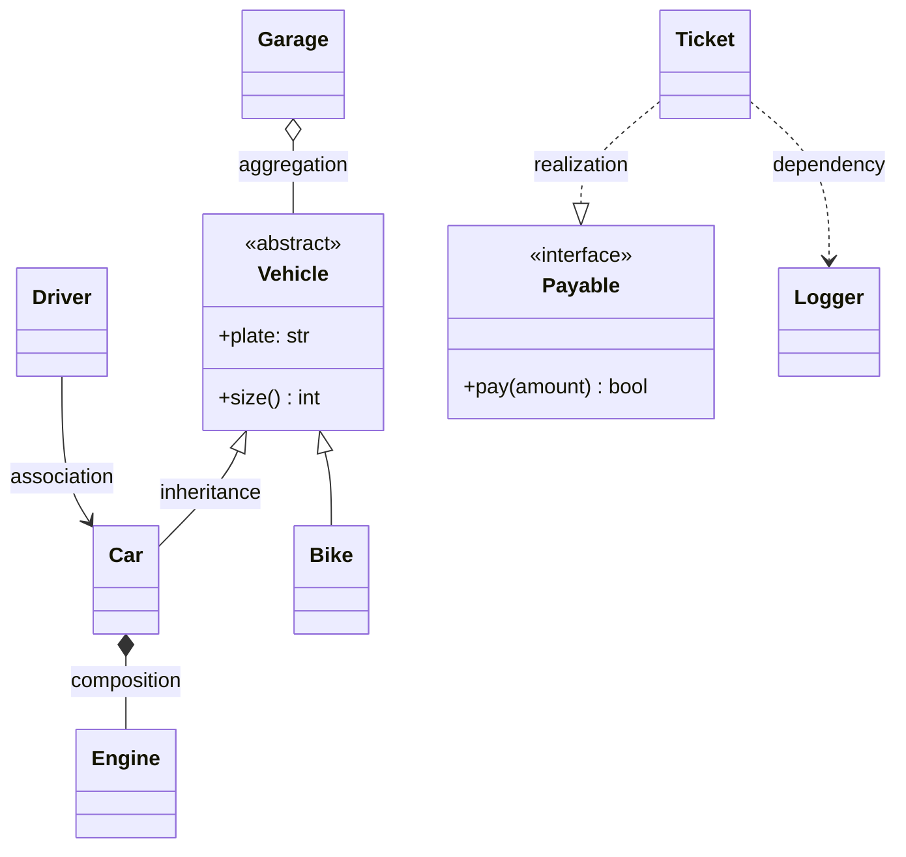

| Arrow | Name | Meaning | Lifetime | Example |
|---|---|---|---|---|
| `<\|--` | **Inheritance** | "is-a" | n/a | Car is a Vehicle |
| `..\|>` | **Realization** | "implements interface" | n/a | Ticket implements Payable |
| `*--` | **Composition** | "owns, part dies with whole" | Same as owner | Car owns Engine |
| `o--` | **Aggregation** | "has, but parts live on their own" | Independent | Garage has Vehicles |
| `-->` | **Association** | "knows about / uses long-term" | Independent | Driver drives Car |
| `..>` | **Dependency** | "uses briefly, e.g. a parameter" | Temporary | Ticket uses Logger in one method |

Member notation: `+` public, `-` private, `#` protected. `+park(vehicle) Ticket` means a public method `park` taking a `vehicle` and returning a `Ticket`. Multiplicity goes in quotes: `ParkingLot "1" *-- "many" Floor`.

> 💡 In an interview, don't stress over the exact arrow. Getting **is-a vs has-a** right and showing **who owns whom** is 90% of the value.

### 4. SOLID: the five rules that keep code changeable

SOLID is five principles collected by Robert C. Martin ("Uncle Bob"). Each one fights a specific way code rots. We'll do each as **bad code → why it hurts → good code**.

#### 4.1 S: Single Responsibility Principle (SRP)

> A class should have **one reason to change**.

"Reason to change" means one *person or team* who might ask for a change. If the finance team, the UI team and the DBA can all force edits to the same class, it has three responsibilities.

❌ Bad: one class calculates, formats *and* saves.

```py
class Invoice:
    def __init__(self, items):
        self.items = items

    def total(self):                  # finance rules
        return sum(price * qty for _, price, qty in self.items)

    def print_invoice(self):          # presentation rules
        print(f"TOTAL: {self.total()}")

    def save_to_db(self):             # persistence rules
        db.execute("INSERT INTO invoices ...")
```

Change the print format? Edit `Invoice`. Switch MySQL to Postgres? Edit `Invoice`. Every edit risks breaking the maths.

✅ Good: split by reason-to-change.

```python
class Invoice:
    """Only business data and business rules."""
    def __init__(self, items):
        self.items = items            # list of (name, price, qty)

    def total(self) -> int:
        return sum(price * qty for _, price, qty in self.items)


class InvoicePrinter:
    """Only presentation."""
    def render(self, invoice: Invoice) -> str:
        lines = [f"{name:<8}{qty} x {price}" for name, price, qty in invoice.items]
        lines.append(f"TOTAL   {invoice.total()}")
        return "\n".join(lines)


class InvoiceRepository:
    """Only persistence (in-memory here; a real one would talk to a DB)."""
    def __init__(self):
        self._rows = []

    def save(self, invoice: Invoice) -> int:
        self._rows.append(invoice)
        return len(self._rows)        # pretend this is the new row id


inv = Invoice([("pen", 10, 3), ("book", 120, 1)])
print(InvoicePrinter().render(inv))
print("saved with id", InvoiceRepository().save(inv))
```

```text
pen     3 x 10
book    1 x 120
TOTAL   150
saved with id 1
```

What just happened: each class now has exactly one boss. The printer can change freely without any risk to `total()`.

#### 4.2 O: Open/Closed Principle (OCP)

> Software should be **open for extension, closed for modification**.

Adding a feature should mean *adding* code, not *editing* tested code.

❌ Bad: every new customer type means editing this function.

```py
def discount(customer_type, amount):
    if customer_type == "regular":
        return 0
    elif customer_type == "premium":
        return amount * 0.10
    elif customer_type == "employee":     # added last month
        return amount * 0.30
    # ... and next month someone edits this again
```

✅ Good: each rule is its own class; the calculator never changes.

```python
from abc import ABC, abstractmethod


class DiscountPolicy(ABC):
    @abstractmethod
    def discount(self, amount: int) -> int: ...


class NoDiscount(DiscountPolicy):
    def discount(self, amount): return 0


class PremiumDiscount(DiscountPolicy):
    def discount(self, amount): return amount * 10 // 100


class EmployeeDiscount(DiscountPolicy):            # NEW: added without editing anything
    def discount(self, amount): return amount * 30 // 100


def final_price(amount: int, policy: DiscountPolicy) -> int:
    return amount - policy.discount(amount)        # closed for modification


for policy in [NoDiscount(), PremiumDiscount(), EmployeeDiscount()]:
    print(type(policy).__name__, final_price(1000, policy))
```

```text
NoDiscount 1000
PremiumDiscount 900
EmployeeDiscount 700
```

What just happened: `final_price` is closed (never edited again) but the system is open (new policies plug in). This is the **Strategy pattern**, which we'll meet formally in section 5.4.

#### 4.3 L: Liskov Substitution Principle (LSP)

> If `S` is a subtype of `T`, you must be able to use an `S` anywhere a `T` is expected **without surprises**.

Named after Barbara Liskov. A child class must keep the parent's promises. If the parent promises "I can fly", a child that throws an error on `fly()` breaks every caller.

❌ Bad: a penguin is a bird, so it inherits `fly()`... and explodes.

```python
class Bird:
    def fly(self) -> str:
        return f"{type(self).__name__} flies"


class Sparrow(Bird):
    pass


class Penguin(Bird):
    def fly(self) -> str:
        raise NotImplementedError("penguins can't fly")   # breaks the parent's promise


def migrate(birds):
    for bird in birds:
        try:
            print(bird.fly())
        except NotImplementedError as e:
            print("CRASH:", e)          # callers now need special cases: LSP violated


migrate([Sparrow(), Penguin()])
```

```text
Sparrow flies
CRASH: penguins can't fly
```

✅ Good: model the real capability. Only flying birds promise to fly.

```python
class Bird:
    def eat(self) -> str:
        return f"{type(self).__name__} eats"


class FlyingBird(Bird):
    def fly(self) -> str:
        return f"{type(self).__name__} flies"


class Sparrow(FlyingBird):
    pass


class Penguin(Bird):
    def swim(self) -> str:
        return "Penguin swims"


def migrate(birds: list[FlyingBird]):
    for bird in birds:
        print(bird.fly())               # every FlyingBird keeps this promise


migrate([Sparrow()])
print(Penguin().eat(), "|", Penguin().swim())
```

```text
Sparrow flies
Penguin eats | Penguin swims
```

Quick LSP smell test: does a subclass **throw "not supported"**, **ignore** a method, **demand stricter inputs** or **return weaker results** than its parent? Then the hierarchy is wrong. The famous textbook example is `Square(Rectangle)`: setting a square's width silently changes its height, which surprises any code that thinks it's holding a rectangle.

#### 4.4 I: Interface Segregation Principle (ISP)

> Don't force a class to depend on methods it doesn't use. Prefer **many small interfaces** over one fat one.

❌ Bad: one "do everything" interface.

```py
class Machine(ABC):
    @abstractmethod
    def print_doc(self, doc): ...
    @abstractmethod
    def scan(self, doc): ...
    @abstractmethod
    def fax(self, doc): ...

class CheapPrinter(Machine):
    def print_doc(self, doc): ...
    def scan(self, doc): raise NotImplementedError   # forced to fake it
    def fax(self, doc):  raise NotImplementedError   # (also an LSP violation)
```

✅ Good: small role interfaces; classes pick the ones they really support.

```python
from abc import ABC, abstractmethod


class Printer(ABC):
    @abstractmethod
    def print_doc(self, doc: str) -> str: ...


class Scanner(ABC):
    @abstractmethod
    def scan(self, doc: str) -> str: ...


class CheapPrinter(Printer):
    def print_doc(self, doc): return f"printed {doc}"


class OfficeMachine(Printer, Scanner):        # opts in to both roles
    def print_doc(self, doc): return f"printed {doc} in colour"
    def scan(self, doc): return f"scanned {doc}"


def print_all(printers: list[Printer], doc: str):
    for p in printers:
        print(p.print_doc(doc))


print_all([CheapPrinter(), OfficeMachine()], "resume.pdf")
print(OfficeMachine().scan("aadhaar.jpg"))
```

```text
printed resume.pdf
printed resume.pdf in colour
scanned aadhaar.jpg
```

#### 4.5 D: Dependency Inversion Principle (DIP)

> High-level modules should not depend on low-level modules. **Both should depend on abstractions.**

"High-level" = business logic (place an order). "Low-level" = details (MySQL, SMTP, Razorpay SDK). If business logic creates `MySQLDatabase()` inside itself, it is welded to MySQL forever and impossible to unit test.

❌ Bad:

```py
class OrderService:
    def __init__(self):
        self.db = MySQLDatabase("prod-host:3306")   # hard-wired detail

    def place(self, order):
        self.db.insert("orders", order)
```

✅ Good: depend on an abstraction, and have it **injected** (passed in). This is called **dependency injection**.

```python
from abc import ABC, abstractmethod


class OrderRepository(ABC):                       # the abstraction both sides depend on
    @abstractmethod
    def add(self, order_id: str, amount: int) -> None: ...

    @abstractmethod
    def count(self) -> int: ...


class InMemoryOrderRepository(OrderRepository):   # a low-level detail (great for tests)
    def __init__(self):
        self._orders = {}

    def add(self, order_id, amount):
        self._orders[order_id] = amount

    def count(self):
        return len(self._orders)


class OrderService:                               # high-level policy
    def __init__(self, repo: OrderRepository):    # injected, not created
        self._repo = repo

    def place(self, order_id: str, amount: int) -> str:
        if amount <= 0:
            return f"{order_id}: rejected"
        self._repo.add(order_id, amount)
        return f"{order_id}: placed"


service = OrderService(InMemoryOrderRepository())
print(service.place("o1", 499))
print(service.place("o2", 0))
```

```text
o1: placed
o2: rejected
```

What just happened: `OrderService` never mentions MySQL. In production you inject `MySQLOrderRepository`; in tests, the in-memory one. The arrow of dependency was "inverted": the detail now depends on the interface owned by the business layer.

| Letter | One-liner | Smell that it's violated |
|---|---|---|
| **S** | One reason to change | Class name contains "And" or "Manager"; 1,000 lines |
| **O** | Add, don't edit | Growing `if/elif` on a type field |
| **L** | Subtypes keep promises | `raise NotImplementedError` in a child; `isinstance` checks in callers |
| **I** | Small interfaces | Classes implementing methods as empty stubs |
| **D** | Depend on abstractions | `SomeConcreteThing()` created inside business logic; can't unit test |

### 5. Design patterns: a shared vocabulary

A **design pattern** is a named, proven solution to a problem that keeps coming up. The classic catalogue is the 1994 "Gang of Four" (GoF) book with 23 patterns in three families:

| Family | Question it answers | Patterns in this chapter |
|---|---|---|
| **Creational** | How do objects get *made*? | Singleton, Factory, Builder |
| **Structural** | How do objects *fit together*? | Decorator, Adapter |
| **Behavioural** | How do objects *talk and share work*? | Strategy, Observer, State, Command, Chain of Responsibility |

The value of a pattern is half code, half **vocabulary**. Saying "pricing is a Strategy, and the machine's modes are States" tells an interviewer your whole design in nine words.

> ⚠️ Python is not Java. Functions are objects, modules are singletons, and decorators are built into the language. Several patterns shrink to a few lines in Python. Show the classic shape *and* mention the Pythonic shortcut: interviewers love that.

#### 5.1 Singleton: exactly one instance

**Problem:** some things must exist once per process: a config object, a connection pool, a logger, the `ParkingLot` itself.

**Analogy:** a country has one Prime Minister at a time. Everyone who asks "who's the PM?" gets the same person.

```python
import threading


class AppConfig:
    _instance = None
    _lock = threading.Lock()

    def __new__(cls):
        # Double-checked locking: the cheap check skips the lock once created,
        # the second check inside the lock stops two threads both creating it.
        if cls._instance is None:
            with cls._lock:
                if cls._instance is None:
                    instance = super().__new__(cls)
                    instance.settings = {"currency": "INR"}
                    cls._instance = instance
        return cls._instance


a = AppConfig()
b = AppConfig()
a.settings["theme"] = "dark"
print(a is b, b.settings)

# Prove it under threads: 8 threads race to create it, all get the same object.
ids = set()
threads = [threading.Thread(target=lambda: ids.add(id(AppConfig()))) for _ in range(8)]
for t in threads:
    t.start()
for t in threads:
    t.join()
print("distinct instances seen by threads:", len(ids))
```

```text
True {'currency': 'INR', 'theme': 'dark'}
distinct instances seen by threads: 1
```

What just happened: `__new__` is the method that actually *creates* the object (before `__init__` fills it in). We intercept it and return the stored instance every time. We set up the instance inside `__new__`, not in `__init__`, because `__init__` would run again on *every* `AppConfig()` call and wipe the settings.

**The Pythonic shortcut:** a module is imported once and cached, so a plain module-level object *is* a singleton:

```py
# config.py
settings = {"currency": "INR"}

# anywhere else
from config import settings      # always the same dict
```

> ⚠️ **Singleton is the most overused pattern.** It is global state in a nice suit: it hides dependencies and makes tests leak into each other. In interviews, say: "I'll make `ParkingLot` a singleton for the demo, but in production I'd create one instance at startup and inject it (DIP)."

#### 5.2 Factory: one place that decides *which class* to create

**Problem:** callers know *what kind* of thing they want ("email", "sms") but shouldn't know the concrete class names or construction details.

**Analogy:** you order "a large cold coffee" at the counter. You don't walk into the kitchen and pick the machine.

```python
from abc import ABC, abstractmethod


class Notifier(ABC):
    @abstractmethod
    def send(self, to: str, msg: str) -> str: ...


class EmailNotifier(Notifier):
    def send(self, to, msg): return f"EMAIL to {to}: {msg}"


class SMSNotifier(Notifier):
    def send(self, to, msg): return f"SMS to {to}: {msg[:20]}"   # SMS has a length limit


class PushNotifier(Notifier):
    def send(self, to, msg): return f"PUSH to device of {to}: {msg}"


class NotifierFactory:
    _registry = {"email": EmailNotifier, "sms": SMSNotifier, "push": PushNotifier}

    @classmethod
    def register(cls, kind: str, notifier_cls: type) -> None:
        cls._registry[kind] = notifier_cls        # new kinds plug in: Open/Closed

    @classmethod
    def create(cls, kind: str) -> Notifier:
        try:
            return cls._registry[kind]()
        except KeyError:
            raise ValueError(f"unknown notifier: {kind}") from None


for kind in ["email", "sms", "push"]:
    print(NotifierFactory.create(kind).send("asha", "Your order has been shipped!"))

try:
    NotifierFactory.create("pigeon")
except ValueError as e:
    print(e)
```

```text
EMAIL to asha: Your order has been shipped!
SMS to asha: Your order has been 
PUSH to device of asha: Your order has been shipped!
unknown notifier: pigeon
```

What just happened: the `if/elif` on type lives in exactly one place (here, a dictionary lookup instead of `if/elif`). The rest of the code only knows the `Notifier` interface. There's also a bigger cousin, **Abstract Factory**, which creates *families* of related objects (e.g. `DarkThemeFactory` makes dark buttons *and* dark menus).

#### 5.3 Builder: construct complex objects step by step

**Problem:** an object has many optional parts, and a constructor with 12 parameters is unreadable: `Pizza("L", True, False, None, 2, ...)`. What does `True` mean?

**Analogy:** Subway sandwich: bread, then cheese, then veggies, then sauce, each step named, and "build" at the end.

```python
class HttpRequest:
    def __init__(self, method, url, headers, body, timeout):
        self.method, self.url, self.headers = method, url, headers
        self.body, self.timeout = body, timeout

    def __repr__(self):
        return (f"{self.method} {self.url} headers={self.headers} "
                f"body={self.body!r} timeout={self.timeout}s")


class HttpRequestBuilder:
    def __init__(self, url: str):
        self._method, self._url = "GET", url
        self._headers, self._body, self._timeout = {}, None, 30

    def method(self, m: str):
        self._method = m
        return self                      # returning self enables chaining

    def header(self, key: str, value: str):
        self._headers[key] = value
        return self

    def json_body(self, text: str):
        self._body = text
        return self.header("Content-Type", "application/json")

    def timeout(self, seconds: int):
        self._timeout = seconds
        return self

    def build(self) -> HttpRequest:
        # Validation happens once, at the end, with the full picture.
        if self._method == "GET" and self._body is not None:
            raise ValueError("GET requests must not have a body")
        return HttpRequest(self._method, self._url, dict(self._headers),
                           self._body, self._timeout)


req = (HttpRequestBuilder("https://api.shop.in/orders")
       .method("POST")
       .header("Auth", "token123")
       .json_body('{"item": 42}')
       .timeout(5)
       .build())
print(req)

try:
    HttpRequestBuilder("https://x.in").json_body("{}").build()
except ValueError as e:
    print("invalid:", e)
```

```text
POST https://api.shop.in/orders headers={'Auth': 'token123', 'Content-Type': 'application/json'} body='{"item": 42}' timeout=5s
invalid: GET requests must not have a body
```

**Pythonic shortcut:** keyword arguments with defaults, or a `@dataclass`, already solve the "what does `True` mean" problem: `Pizza(size="L", extra_cheese=True)`. Reach for a Builder when construction has **steps, validation across fields, or several representations** (e.g. building a SQL query or a test fixture).

#### 5.4 Strategy: swap an algorithm at run time

**Problem:** there are several ways to do one job (pay, price, sort, route), and the choice changes by user, config or time.

**Analogy:** Google Maps asks "car, bike, walk or metro?" The *destination* logic is the same; only the routing strategy changes.

```python
from abc import ABC, abstractmethod


class PaymentStrategy(ABC):
    @abstractmethod
    def pay(self, amount: int) -> str: ...


class UPIPayment(PaymentStrategy):
    def __init__(self, vpa): self.vpa = vpa
    def pay(self, amount): return f"Paid Rs {amount} via UPI ({self.vpa})"


class CardPayment(PaymentStrategy):
    def __init__(self, last4): self.last4 = last4
    def pay(self, amount):
        fee = amount * 2 // 100                    # cards carry a 2% fee here
        return f"Paid Rs {amount + fee} via card **{self.last4} (incl. fee {fee})"


class Checkout:
    def __init__(self, strategy: PaymentStrategy):
        self.strategy = strategy                   # composition: Checkout HAS a strategy

    def complete(self, amount: int) -> str:
        return self.strategy.pay(amount)


cart = Checkout(UPIPayment("asha@okbank"))
print(cart.complete(500))
cart.strategy = CardPayment("4242")                # swapped at run time
print(cart.complete(500))

# Pythonic: a strategy can just be a function.
def sort_by_price(items): return sorted(items, key=lambda x: x[1])
def sort_by_rating(items): return sorted(items, key=lambda x: -x[2])

items = [("phone", 15000, 4.1), ("earbuds", 2000, 4.6), ("watch", 5000, 3.9)]
for strategy in (sort_by_price, sort_by_rating):
    print(strategy.__name__, [name for name, *_ in strategy(items)])
```

```text
Paid Rs 500 via UPI (asha@okbank)
Paid Rs 510 via card **4242 (incl. fee 10)
sort_by_price ['earbuds', 'watch', 'phone']
sort_by_rating ['earbuds', 'phone', 'watch']
```

**Strategy vs State** (people mix these up): in Strategy, the *client* picks the algorithm and it usually stays fixed. In State, the *object itself* switches its behaviour as its internal situation changes. Same code shape, different intent.

#### 5.5 Observer: "notify me when something happens"

**Problem:** when one object changes, many others must react, and the changing object shouldn't know who they are.

**Analogy:** YouTube subscriptions. The channel just uploads; YouTube notifies every subscriber. The channel doesn't call you personally.

```python
from collections import defaultdict


class EventBus:
    def __init__(self):
        self._subscribers = defaultdict(list)     # event name -> list of callbacks

    def subscribe(self, event: str, callback) -> None:
        self._subscribers[event].append(callback)

    def unsubscribe(self, event: str, callback) -> None:
        self._subscribers[event].remove(callback)

    def publish(self, event: str, data: dict) -> None:
        for callback in list(self._subscribers[event]):   # copy: safe if a callback unsubscribes
            callback(data)


class OrderService:
    def __init__(self, bus: EventBus):
        self.bus = bus

    def place_order(self, order_id: str, user: str, amount: int) -> None:
        print(f"Order {order_id} saved")
        self.bus.publish("order_placed", {"id": order_id, "user": user, "amount": amount})


def send_email(e): print(f"  [email]     Hi {e['user']}, order {e['id']} confirmed")
def add_points(e): print(f"  [loyalty]   +{e['amount'] // 100} points for {e['user']}")
def notify_warehouse(e): print(f"  [warehouse] pack order {e['id']}")

bus = EventBus()
for handler in (send_email, add_points, notify_warehouse):
    bus.subscribe("order_placed", handler)

OrderService(bus).place_order("A17", "ravi", 2450)
bus.unsubscribe("order_placed", add_points)
OrderService(bus).place_order("A18", "meera", 900)
```

```text
Order A17 saved
  [email]     Hi ravi, order A17 confirmed
  [loyalty]   +24 points for ravi
  [warehouse] pack order A17
Order A18 saved
  [email]     Hi meera, order A18 confirmed
  [warehouse] pack order A18
```

What just happened: `OrderService` has no idea that emails, loyalty points or warehouses exist. Adding an SMS sender is one `subscribe` call. This is the in-process version of the pub/sub systems from [Chapter 08](08-queues-events.md). Classic names: the publisher is the **subject**, subscribers are **observers**.

#### 5.6 State: behaviour changes with internal state

**Problem:** an object behaves differently depending on its stage, and the `if state == ...` checks are spreading into every method.

**Analogy:** your phone's power button. Locked: it wakes the screen. Unlocked: it locks. During a call: it mutes the ringer. Same button, behaviour decided by the current state.

```python
from abc import ABC, abstractmethod


class OrderState(ABC):
    name = "?"
    def ship(self, order): print(f"  cannot ship: order is {self.name}")
    def deliver(self, order): print(f"  cannot deliver: order is {self.name}")
    def cancel(self, order): print(f"  cannot cancel: order is {self.name}")


class Placed(OrderState):
    name = "PLACED"
    def ship(self, order): order.state = Shipped()
    def cancel(self, order): order.state = Cancelled()


class Shipped(OrderState):
    name = "SHIPPED"
    def deliver(self, order): order.state = Delivered()


class Delivered(OrderState):
    name = "DELIVERED"


class Cancelled(OrderState):
    name = "CANCELLED"


class Order:
    def __init__(self):
        self.state: OrderState = Placed()

    # The order just delegates; each state decides what is legal.
    def ship(self): self.state.ship(self)
    def deliver(self): self.state.deliver(self)
    def cancel(self): self.state.cancel(self)


o = Order()
for action in ["ship", "cancel", "deliver", "ship"]:
    getattr(o, action)()
    print(f"after {action:<8} -> {o.state.name}")
```

```text
after ship     -> SHIPPED
  cannot cancel: order is SHIPPED
after cancel   -> SHIPPED
after deliver  -> DELIVERED
  cannot ship: order is DELIVERED
after ship     -> DELIVERED
```

What just happened: there is no `if` on the state anywhere. Each state class lists only the transitions it allows; the base class rejects everything else. Adding a `Returned` state means adding a class and one transition in `Delivered`, nothing else. We'll use this exact shape for the vending machine.

#### 5.7 Command: turn a request into an object

**Problem:** you want undo/redo, queues of jobs, macros, or a log of actions to replay.

**Analogy:** a restaurant order slip. The waiter writes the request on paper (an object), it can sit in a queue, be cancelled, or be re-made, without the customer talking to the chef.

```python
class TextEditor:
    def __init__(self):
        self.text = ""


class InsertCommand:
    def __init__(self, editor: TextEditor, text: str):
        self.editor, self.text = editor, text

    def execute(self):
        self.editor.text += self.text

    def undo(self):
        self.editor.text = self.editor.text[: -len(self.text)]


class DeleteCommand:
    def __init__(self, editor: TextEditor, count: int):
        self.editor, self.count, self.deleted = editor, count, ""

    def execute(self):
        self.deleted = self.editor.text[-self.count:]    # remember what we removed
        self.editor.text = self.editor.text[: -self.count]

    def undo(self):
        self.editor.text += self.deleted


class CommandManager:
    def __init__(self):
        self.undo_stack, self.redo_stack = [], []

    def run(self, cmd):
        cmd.execute()
        self.undo_stack.append(cmd)
        self.redo_stack.clear()          # a new action kills the redo history

    def undo(self):
        if self.undo_stack:
            cmd = self.undo_stack.pop()
            cmd.undo()
            self.redo_stack.append(cmd)

    def redo(self):
        if self.redo_stack:
            cmd = self.redo_stack.pop()
            cmd.execute()
            self.undo_stack.append(cmd)


ed, mgr = TextEditor(), CommandManager()
mgr.run(InsertCommand(ed, "Hello"))
mgr.run(InsertCommand(ed, " World"))
mgr.run(DeleteCommand(ed, 3))
print(repr(ed.text))
mgr.undo(); print(repr(ed.text))
mgr.undo(); print(repr(ed.text))
mgr.redo(); print(repr(ed.text))
```

```text
'Hello Wo'
'Hello World'
'Hello'
'Hello World'
```

What just happened: each command knows how to **do** and **undo** itself. Two stacks (from [Chapter 11](../part-2-dsa/11-stacks.md)) give undo/redo for free. The same idea powers job queues: a command object can be serialised and run later by a worker.

#### 5.8 Chain of Responsibility: pass the request along a chain

**Problem:** a request might be handled by one of several handlers, or by several in turn, and you don't want the sender to know which.

**Analogy:** a customer complaint goes to the agent, then the supervisor, then the manager, each handling what they can and passing the rest up. Or an ATM paying ₹3,700 using ₹2000 notes first, then ₹500, then ₹100.

```python
class NoteDispenser:
    def __init__(self, note: int, next_handler=None):
        self.note, self.next = note, next_handler

    def dispense(self, amount: int, out: list) -> int:
        count, remainder = divmod(amount, self.note)
        if count:
            out.append(f"{count} x Rs {self.note}")
        if remainder and self.next:
            return self.next.dispense(remainder, out)   # pass the rest down the chain
        return remainder                                # whatever couldn't be paid


chain = NoteDispenser(2000, NoteDispenser(500, NoteDispenser(100)))

for amount in [3700, 600, 150]:
    out = []
    left = chain.dispense(amount, out)
    status = "OK" if left == 0 else f"cannot dispense Rs {left}"
    print(amount, "->", ", ".join(out) or "nothing", "|", status)
```

```text
3700 -> 1 x Rs 2000, 3 x Rs 500, 2 x Rs 100 | OK
600 -> 1 x Rs 500, 1 x Rs 100 | OK
150 -> 1 x Rs 100 | cannot dispense Rs 50
```

Where you'll see it for real: **web middleware** (authentication → rate limit → validation → handler; any link can stop the request), logging levels, approval workflows (amount < 10k: manager; < 1L: director; else: CFO), and exception handling itself (each `except` gets a chance, then the caller's).

#### 5.9 Decorator: add behaviour by wrapping

**Problem:** you want to add features (milk, sugar, logging, caching, retries) to an object without creating a subclass for every combination. With 5 add-ons, subclassing needs up to 2⁵ = 32 classes!

**Analogy:** gift wrapping. The gift inside is unchanged; each layer of wrapping adds something, and you can stack as many as you like.

```python
from abc import ABC, abstractmethod


class Beverage(ABC):
    @abstractmethod
    def cost(self) -> int: ...
    @abstractmethod
    def description(self) -> str: ...


class Coffee(Beverage):
    def cost(self): return 100
    def description(self): return "Coffee"


class AddOn(Beverage):                       # a decorator IS-A Beverage and HAS-A Beverage
    def __init__(self, inner: Beverage):
        self.inner = inner


class Milk(AddOn):
    def cost(self): return self.inner.cost() + 20
    def description(self): return self.inner.description() + " + Milk"


class Caramel(AddOn):
    def cost(self): return self.inner.cost() + 35
    def description(self): return self.inner.description() + " + Caramel"


drink = Caramel(Milk(Milk(Coffee())))        # stack in any order, any number
print(drink.description(), "=", drink.cost())
```

```text
Coffee + Milk + Milk + Caramel = 175
```

Python has decorators built into the language with `@` ([Chapter 16 of Part 1](../part-1-python/16-iterators-generators-decorators.md)). They are the same idea applied to functions: wrap, add behaviour, keep the interface.

```python
import functools


def retry(times: int):
    def wrap(func):
        @functools.wraps(func)               # keep the original name and docstring
        def inner(*args, **kwargs):
            for attempt in range(1, times + 1):
                try:
                    return func(*args, **kwargs)
                except ConnectionError as e:
                    print(f"  attempt {attempt} failed: {e}")
            raise ConnectionError(f"{func.__name__} failed after {times} attempts")
        return inner
    return wrap


calls = {"n": 0}

@retry(times=3)
def fetch_price(item: str) -> int:
    calls["n"] += 1
    if calls["n"] < 3:                       # fail twice, then succeed (deterministic)
        raise ConnectionError("timeout")
    return 499


print("price:", fetch_price("book"))
```

```text
  attempt 1 failed: timeout
  attempt 2 failed: timeout
price: 499
```

#### 5.10 Adapter: make incompatible interfaces work together

**Problem:** your code expects one interface, but a library or legacy system offers a different one, and you can't change either.

**Analogy:** a travel plug adapter. Your Indian charger and the UK socket don't fit; the adapter sits in between and neither side changes.

```python
from abc import ABC, abstractmethod


class PaymentGateway(ABC):                    # what OUR code expects
    @abstractmethod
    def pay(self, rupees: float, user: str) -> bool: ...


class LegacyBankAPI:                          # third-party: can't change it
    def make_transfer(self, payload: dict) -> dict:
        ok = payload["amt_paise"] > 0
        return {"status": "SUCCESS" if ok else "FAILED", "ref": "TXN" + payload["cust"]}


class LegacyBankAdapter(PaymentGateway):
    def __init__(self, api: LegacyBankAPI):
        self.api = api                        # adapter WRAPS the incompatible object

    def pay(self, rupees, user):
        payload = {"amt_paise": round(rupees * 100), "cust": user.upper()}  # translate in
        response = self.api.make_transfer(payload)
        return response["status"] == "SUCCESS"                             # translate out


def checkout(gateway: PaymentGateway, amount: float, user: str):
    print(f"{user} pays {amount}: {'success' if gateway.pay(amount, user) else 'failed'}")


gateway = LegacyBankAdapter(LegacyBankAPI())
checkout(gateway, 249.50, "neha")
checkout(gateway, 0, "arjun")
```

```text
neha pays 249.5: success
arjun pays 0: failed
```

**Decorator vs Adapter vs Proxy**, the "wrapper" family: a **Decorator** keeps the same interface and *adds* behaviour. An **Adapter** *changes* the interface so it fits. A **Proxy** keeps the same interface and *controls access* (lazy loading, caching, permission checks).

### 6. A 7-step method for any LLD question

Here is the method we'll apply to every design below. Timings are for a 90-minute machine-coding round; squeeze them proportionally for 45 minutes.

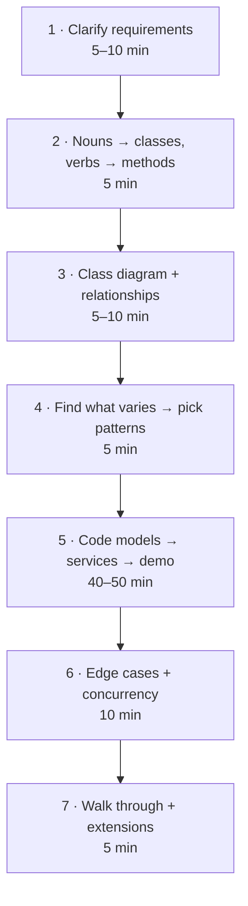

1. **Clarify requirements.** Ask questions, then *write down* the scope: functional ("park, unpark, show free spots"), non-functional ("multiple entry gates at once"), and explicitly **out of scope** ("no payments UI"). This protects you from scope creep.
2. **Nouns become classes, verbs become methods.** Read the requirements and underline: "A *vehicle* *parks* in a *spot* on a *floor* and gets a *ticket*." Not every noun deserves a class: "colour" is an attribute, not a class.
3. **Draw a class diagram.** Who owns whom? Is it is-a or has-a? What are the multiplicities?
4. **Ask "what will change?"** That's where abstractions and patterns go. Pricing rules change → Strategy. Machine modes → State. Many reactions to one event → Observer. New types of thing → Factory.
5. **Code in layers.** Enums and models first (`Vehicle`, `Spot`), then services that hold the logic (`ParkingLot`), then a `main` demo. Run it early, run it often.
6. **Edge cases and concurrency.** Full lot, invalid ticket, double unpark, two gates grabbing the same spot.
7. **Walk the interviewer through it** and pre-empt extensions: "To add EV charging spots, I'd add one enum value and one fit rule."

> 💡 **Use enums for fixed sets** (vehicle types, directions, statuses) instead of raw strings. A typo in `"COMAPCT"` silently fails; `SpotType.COMAPCT` fails loudly.

### 7. Design #1: Parking Lot 🅿️

The single most asked LLD question. Let's run the 7 steps.

**Step 1: Requirements** (what you'd confirm with the interviewer)

- Multiple floors. Each floor has spots of three sizes: `SMALL`, `COMPACT`, `LARGE`.
- Vehicles: motorcycle, car, truck. A motorcycle fits any spot, a car fits compact or large, a truck only large.
- On entry: assign the **best suitable spot**: the smallest fitting size first (so a bike doesn't waste a truck spot), then the lowest floor, then the lowest spot number. Issue a ticket.
- On exit: compute the fee (hourly, per vehicle type, partial hours rounded up, minimum 1 hour) and free the spot.
- Show free spots per floor. Several entry gates work at the same time.
- Out of scope: payment processing, reservations, EV charging (but keep it easy to add).

**Step 2: Nouns → classes:** `ParkingLot`, `ParkingFloor`, `ParkingSpot`, `Vehicle`, `Ticket`, `PricingStrategy`. **Verbs → methods:** `park`, `unpark`, `free_spots`, `fee`.

**Step 3: Class diagram**

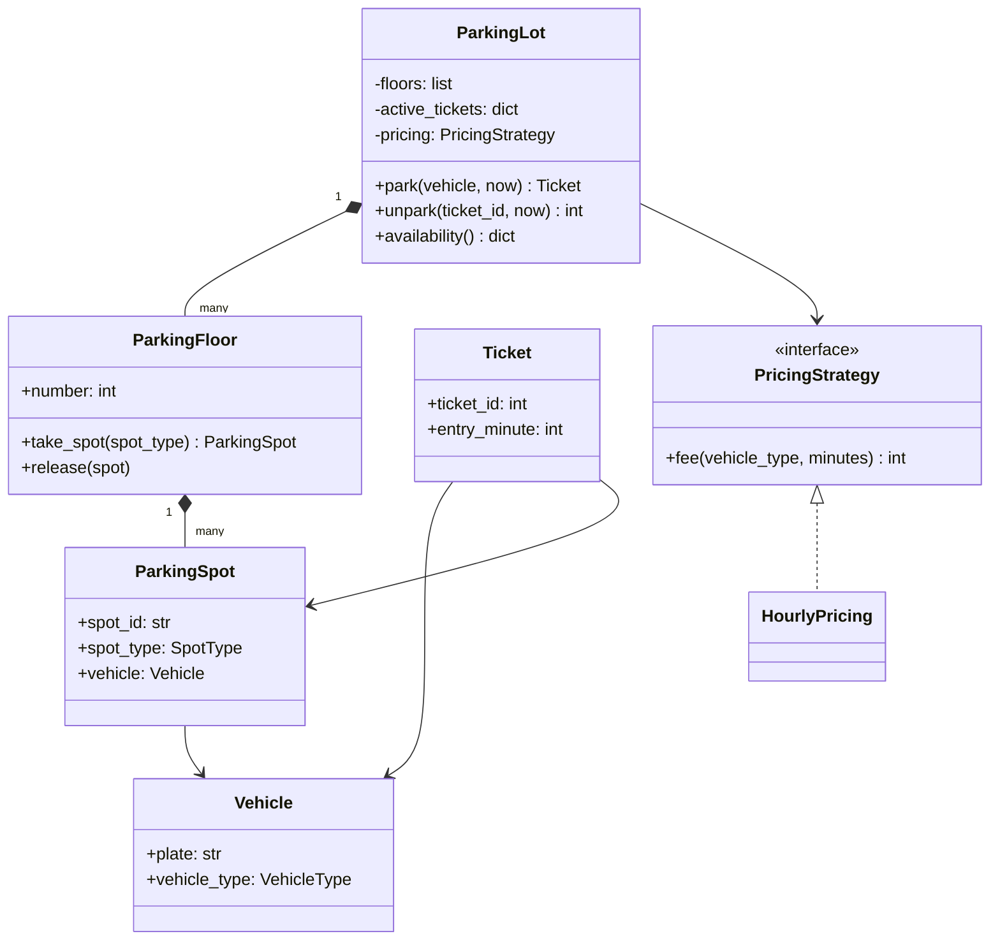

**Step 4: What varies?** Pricing rules (weekend rates, flat fees) → **Strategy**. Vehicle and spot types → **enums + a fit table**, so a new type is one line. The lot is one per process → could be a Singleton, but we inject it instead.

**Step 5: Code.** Time is passed in as `now` (minutes) instead of reading the clock, so the demo is deterministic and the class is easy to test. That's a pro move worth saying out loud.

```python
import heapq
import itertools
import math
import threading
from abc import ABC, abstractmethod
from dataclasses import dataclass
from enum import Enum


class VehicleType(Enum):
    MOTORCYCLE = "motorcycle"
    CAR = "car"
    TRUCK = "truck"


class SpotType(Enum):
    SMALL = 1
    COMPACT = 2
    LARGE = 3


# Which spot types each vehicle can use, smallest first (don't waste big spots).
FITS = {
    VehicleType.MOTORCYCLE: [SpotType.SMALL, SpotType.COMPACT, SpotType.LARGE],
    VehicleType.CAR: [SpotType.COMPACT, SpotType.LARGE],
    VehicleType.TRUCK: [SpotType.LARGE],
}


@dataclass(frozen=True)
class Vehicle:
    plate: str
    vehicle_type: VehicleType


@dataclass
class ParkingSpot:
    spot_id: str
    floor: int
    order: int                      # smaller = closer to the lift
    spot_type: SpotType
    vehicle: Vehicle | None = None


@dataclass
class Ticket:
    ticket_id: int
    vehicle: Vehicle
    spot: ParkingSpot
    entry_minute: int


class PricingStrategy(ABC):
    @abstractmethod
    def fee(self, vehicle_type: VehicleType, minutes: int) -> int: ...


class HourlyPricing(PricingStrategy):
    RATES = {VehicleType.MOTORCYCLE: 20, VehicleType.CAR: 50, VehicleType.TRUCK: 100}

    def fee(self, vehicle_type, minutes):
        hours = max(1, math.ceil(minutes / 60))       # partial hour = full hour, min 1
        return hours * self.RATES[vehicle_type]


class ParkingFloor:
    def __init__(self, number: int, layout: dict):
        self.number = number
        self.spots: dict[str, ParkingSpot] = {}
        self._free = {t: [] for t in SpotType}        # one min-heap per spot type
        order = 0
        for spot_type, count in layout.items():
            for _ in range(count):
                order += 1
                spot = ParkingSpot(f"F{number}-{order:02d}", number, order, spot_type)
                self.spots[spot.spot_id] = spot
                heapq.heappush(self._free[spot_type], (order, spot.spot_id))

    def take_spot(self, spot_type: SpotType) -> ParkingSpot | None:
        if not self._free[spot_type]:
            return None
        _, spot_id = heapq.heappop(self._free[spot_type])   # nearest free spot, O(log n)
        return self.spots[spot_id]

    def release(self, spot: ParkingSpot) -> None:
        spot.vehicle = None
        heapq.heappush(self._free[spot.spot_type], (spot.order, spot.spot_id))

    def free_count(self) -> dict:
        return {t.name: len(h) for t, h in self._free.items()}


class ParkingLot:
    def __init__(self, floors: list[ParkingFloor], pricing: PricingStrategy):
        self.floors = floors
        self.pricing = pricing
        self._active: dict[int, Ticket] = {}
        self._plates_inside: set[str] = set()
        self._ticket_ids = itertools.count(1)
        self._lock = threading.Lock()                 # many gates call park() at once

    def park(self, vehicle: Vehicle, now: int) -> Ticket | None:
        with self._lock:                              # find + take must be atomic
            if vehicle.plate in self._plates_inside:
                raise ValueError(f"{vehicle.plate} is already parked")
            for spot_type in FITS[vehicle.vehicle_type]:    # smallest fitting size first
                for floor in self.floors:                     # then lowest floor
                    spot = floor.take_spot(spot_type)
                    if spot:
                        spot.vehicle = vehicle
                        ticket = Ticket(next(self._ticket_ids), vehicle, spot, now)
                        self._active[ticket.ticket_id] = ticket
                        self._plates_inside.add(vehicle.plate)
                        return ticket
            return None                               # lot full for this vehicle type

    def unpark(self, ticket_id: int, now: int) -> int:
        with self._lock:
            ticket = self._active.pop(ticket_id, None)
            if ticket is None:
                raise KeyError(f"invalid or already used ticket {ticket_id}")
            self.floors[ticket.spot.floor].release(ticket.spot)
            self._plates_inside.discard(ticket.vehicle.plate)
            minutes = now - ticket.entry_minute
            return self.pricing.fee(ticket.vehicle.vehicle_type, minutes)

    def availability(self) -> dict:
        return {f"floor {f.number}": f.free_count() for f in self.floors}


# ---------------- demo ----------------
lot = ParkingLot(
    floors=[
        ParkingFloor(0, {SpotType.SMALL: 1, SpotType.COMPACT: 1, SpotType.LARGE: 1}),
        ParkingFloor(1, {SpotType.COMPACT: 2}),
    ],
    pricing=HourlyPricing(),
)

arrivals = [
    Vehicle("KA01-BIKE", VehicleType.MOTORCYCLE),
    Vehicle("KA02-CAR1", VehicleType.CAR),
    Vehicle("KA03-CAR2", VehicleType.CAR),
    Vehicle("KA04-TRK1", VehicleType.TRUCK),
    Vehicle("KA05-TRK2", VehicleType.TRUCK),
]
tickets = {}
for minute, v in enumerate(arrivals):
    t = lot.park(v, now=minute)
    if t:
        tickets[v.plate] = t
        print(f"{v.plate:<10} -> spot {t.spot.spot_id} ({t.spot.spot_type.name}), ticket #{t.ticket_id}")
    else:
        print(f"{v.plate:<10} -> LOT FULL for {v.vehicle_type.value}")

print(lot.availability())
fee = lot.unpark(tickets["KA02-CAR1"].ticket_id, now=1 + 130)   # stayed 130 minutes
print("KA02-CAR1 pays Rs", fee)
try:
    lot.unpark(tickets["KA02-CAR1"].ticket_id, now=200)
except KeyError as e:
    print("error:", e.args[0])
print(lot.availability())
```

```text
KA01-BIKE  -> spot F0-01 (SMALL), ticket #1
KA02-CAR1  -> spot F0-02 (COMPACT), ticket #2
KA03-CAR2  -> spot F1-01 (COMPACT), ticket #3
KA04-TRK1  -> spot F0-03 (LARGE), ticket #4
KA05-TRK2  -> LOT FULL for truck
{'floor 0': {'SMALL': 0, 'COMPACT': 0, 'LARGE': 0}, 'floor 1': {'SMALL': 0, 'COMPACT': 1, 'LARGE': 0}}
KA02-CAR1 pays Rs 150
error: invalid or already used ticket 2
{'floor 0': {'SMALL': 0, 'COMPACT': 1, 'LARGE': 0}, 'floor 1': {'SMALL': 0, 'COMPACT': 1, 'LARGE': 0}}
```

What just happened, and what to say in the interview:

- **Why a heap per spot type?** "Nearest free spot" is a min-query that changes as cars come and go. A heap gives O(log n) take and release instead of scanning all spots ([Chapter 15](../part-2-dsa/15-heaps.md)).
- **Why the lock?** `park` is a **check-then-act**: "is there a free spot?" then "take it". Two gates doing this at the same moment could both see the same spot. One lock around the whole operation makes it atomic. At bigger scale you'd lock per floor, or let the database enforce it with a unique constraint.
- **Why did car 2 go up to floor 1?** Because the allocation prefers the *smallest fitting size* over the lowest floor. Had it grabbed the large spot on floor 0, truck 1 would have been turned away. Small policy choices like this are exactly what interviewers probe.
- **Truck 2 got "LOT FULL"** even though compact spots are free: the fit table says no. That's an edge case the interviewer wants to see handled, not crash.
- **Extensions:** EV spots → add `SpotType.EV` and an entry in `FITS`. Weekend pricing → a new `PricingStrategy`. Spot assignment rule (e.g. "nearest to exit gate") → extract a `SpotAllocationStrategy`. Display boards → Observer on park/unpark events.

### 8. Design #2: Elevator System 🛗

**Requirements:** a building with N floors and M elevators. People press a **hall button** on a floor (an external request) or a **floor button** inside the car (an internal request). Each elevator should serve stops efficiently, not zig-zag. A **dispatcher** decides which elevator answers a hall call. Out of scope: weight limits, door timers, emergency mode (mention them as extensions).

**The key algorithm: LOOK (a version of the "elevator algorithm" / SCAN).** An elevator keeps going in its current direction while there are stops ahead in that direction, then reverses. Just like a disk head. It keeps two sets: `up_stops` (above it) and `down_stops` (below it).

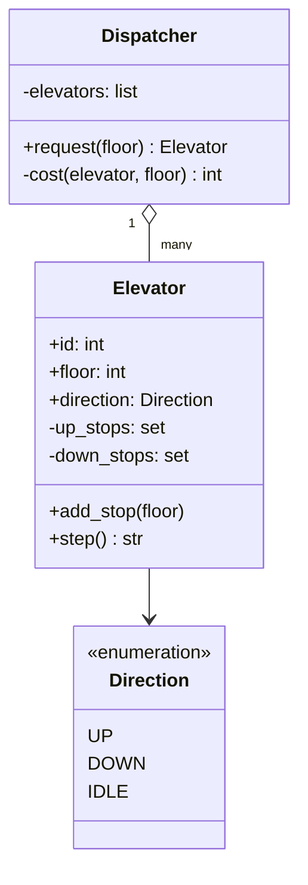

**Dispatcher strategy:** the cost of sending elevator `e` to floor `f` is the distance if `e` is idle or already moving *towards* `f`; otherwise it must finish its current sweep first, so we add a penalty. The cheapest elevator wins. (Real systems use fancier cost functions; this is a pluggable Strategy.)

```python
from enum import Enum


class Direction(Enum):
    UP = 1
    DOWN = -1
    IDLE = 0


class Elevator:
    def __init__(self, eid: int, floor: int = 0):
        self.id, self.floor = eid, floor
        self.direction = Direction.IDLE
        self.up_stops: set[int] = set()       # invariant: all > floor
        self.down_stops: set[int] = set()     # invariant: all < floor

    def add_stop(self, floor: int) -> None:
        if floor > self.floor:
            self.up_stops.add(floor)
        elif floor < self.floor:
            self.down_stops.add(floor)
        # floor == current floor: doors simply open, nothing to schedule

    def _choose_direction(self) -> None:
        if self.direction == Direction.UP and not self.up_stops:
            self.direction = Direction.DOWN if self.down_stops else Direction.IDLE
        elif self.direction == Direction.DOWN and not self.down_stops:
            self.direction = Direction.UP if self.up_stops else Direction.IDLE
        if self.direction == Direction.IDLE:
            if self.up_stops:
                self.direction = Direction.UP
            elif self.down_stops:
                self.direction = Direction.DOWN

    def step(self) -> str | None:
        """Move one floor. Return a message if we stopped somewhere."""
        self._choose_direction()
        if self.direction == Direction.IDLE:
            return None
        self.floor += self.direction.value
        stops = self.up_stops if self.direction == Direction.UP else self.down_stops
        if self.floor in stops:
            stops.discard(self.floor)
            return f"E{self.id} opens doors at floor {self.floor}"
        return None


class Dispatcher:
    def __init__(self, elevators: list[Elevator], num_floors: int):
        self.elevators, self.num_floors = elevators, num_floors

    def _cost(self, e: Elevator, floor: int) -> int:
        distance = abs(e.floor - floor)
        if e.direction == Direction.IDLE:
            return distance
        heading_there = ((e.direction == Direction.UP and floor >= e.floor) or
                         (e.direction == Direction.DOWN and floor <= e.floor))
        return distance if heading_there else distance + 2 * self.num_floors

    def request(self, floor: int) -> Elevator:
        best = min(self.elevators, key=lambda e: (self._cost(e, floor), e.id))
        best.add_stop(floor)
        return best


# ---------------- demo: 10 floors, 2 elevators ----------------
e0, e1 = Elevator(0, floor=0), Elevator(1, floor=8)
dispatcher = Dispatcher([e0, e1], num_floors=10)

# tick -> list of ("hall", floor) or ("car", elevator, floor)
script = {
    0: [("hall", 6), ("hall", 2)],
    2: [("car", e0, 5)],          # someone who boarded E0 at floor 2 presses 5
    3: [("hall", 1)],
    4: [("car", e1, 0)],          # someone who boarded E1 at floor 6 presses 0
}
for tick in range(12):
    for action in script.get(tick, []):
        if action[0] == "hall":
            chosen = dispatcher.request(action[1])
            print(f"t={tick:<2} hall call at {action[1]} -> E{chosen.id}")
        else:
            _, elevator, floor = action
            elevator.add_stop(floor)
            print(f"t={tick:<2} inside E{elevator.id}: pressed {floor}")
    for e in (e0, e1):
        msg = e.step()
        if msg:
            print(f"t={tick:<2} {msg}")
print("final:", [(f"E{e.id}", e.floor, e.direction.name) for e in (e0, e1)])
```

```text
t=0  hall call at 6 -> E1
t=0  hall call at 2 -> E0
t=1  E0 opens doors at floor 2
t=1  E1 opens doors at floor 6
t=2  inside E0: pressed 5
t=3  hall call at 1 -> E1
t=4  inside E1: pressed 0
t=4  E0 opens doors at floor 5
t=7  E1 opens doors at floor 1
t=8  E1 opens doors at floor 0
final: [('E0', 5, 'IDLE'), ('E1', 0, 'IDLE')]
```

Trace the story: E1 (at 8) is closest to floor 6, E0 (at 0) is closest to 2. E0 picks up at 2, the passenger presses 5. The hall call at floor 1 arrives at t=3 while E0 is going *up*, away from it, so E0 (now at floor 3) gets the penalty: distance 2 + 20 = 22. E1 has gone idle at floor 6, so its cost is just the distance, 5, and it wins. Then E1's passenger presses 0, and E1 serves 1 and 0 in one downward sweep. Neither elevator zig-zags.

**Extensions to mention:** hall buttons have a direction (a person at 5 wanting *down* shouldn't be picked up by a car going up: keep `(floor, direction)` requests); door open/close **State** machine (`MOVING`, `DOORS_OPEN`, `MAINTENANCE`); weight sensor rejecting stops when full; dispatcher strategies by time of day (morning rush: park idle cars at the lobby); the dispatcher runs in its own thread and receives requests through a thread-safe `queue.Queue`.

### 9. Design #3: LRU Cache 🧠

**Requirements (LeetCode 146, "LRU Cache"):** a fixed-capacity key-value cache with `get(key)` and `put(key, value)`, both **O(1)**. When full, evict the **least recently used** key. Both `get` and `put` count as "use". Caches like this sit in front of databases everywhere ([Chapter 04](04-caching-cdn.md)).

**The design insight:** we need two things at once.

- Find a key fast → **hash map** (O(1) lookup).
- Know the usage order and move an item to "most recent" fast → **doubly linked list** (O(1) unlink and insert if you already hold the node).

The map stores `key → node`, and the list orders nodes from most to least recent.

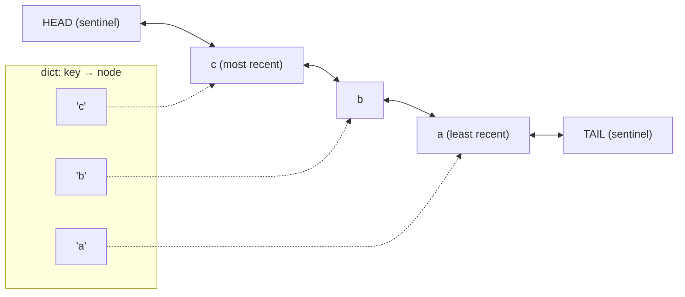

The two **sentinel** (dummy) nodes mean we never have to check for "empty list" or "first node" special cases: every real node always has a `prev` and a `next`.

```python
class Node:
    __slots__ = ("key", "value", "prev", "next")     # saves memory per node

    def __init__(self, key=None, value=None):
        self.key, self.value = key, value
        self.prev = self.next = None


class LRUCache:
    def __init__(self, capacity: int):
        if capacity <= 0:
            raise ValueError("capacity must be positive")
        self.capacity = capacity
        self.map: dict = {}
        self.head, self.tail = Node(), Node()          # sentinels
        self.head.next, self.tail.prev = self.tail, self.head

    # --- linked-list helpers, all O(1) ---
    def _unlink(self, node: Node) -> None:
        node.prev.next, node.next.prev = node.next, node.prev

    def _push_front(self, node: Node) -> None:
        node.prev, node.next = self.head, self.head.next
        self.head.next.prev = node
        self.head.next = node

    # --- public API ---
    def get(self, key):
        node = self.map.get(key)
        if node is None:
            return -1
        self._unlink(node)                              # mark as most recently used
        self._push_front(node)
        return node.value

    def put(self, key, value) -> None:
        if key in self.map:
            node = self.map[key]
            node.value = value
            self._unlink(node)
            self._push_front(node)
            return
        if len(self.map) == self.capacity:
            lru = self.tail.prev                        # least recent lives at the back
            self._unlink(lru)
            del self.map[lru.key]                       # this is why nodes store their key
            print(f"  evict {lru.key!r}")
        node = Node(key, value)
        self.map[key] = node
        self._push_front(node)

    def order(self) -> list:
        out, cur = [], self.head.next
        while cur is not self.tail:
            out.append(cur.key)
            cur = cur.next
        return out


cache = LRUCache(2)
cache.put(1, "one")
cache.put(2, "two")
print("get 1 ->", cache.get(1), "| order:", cache.order())
cache.put(3, "three")                  # evicts 2 (1 was used more recently)
print("get 2 ->", cache.get(2))
cache.put(4, "four")                   # evicts 1
print("get 1 ->", cache.get(1), "| get 3 ->", cache.get(3), "| get 4 ->", cache.get(4))
print("order:", cache.order())
```

```text
get 1 -> one | order: [1, 2]
  evict 2
get 2 -> -1
  evict 1
get 1 -> -1 | get 3 -> three | get 4 -> four
order: [4, 3]
```

**The Pythonic version** uses `collections.OrderedDict`, which is itself a dict plus a doubly linked list under the hood. Write the manual one when the interviewer wants to see data structures; mention this one to show you know the library:

```python
from collections import OrderedDict


class LRUCache:
    def __init__(self, capacity: int):
        self.capacity, self.data = capacity, OrderedDict()

    def get(self, key):
        if key not in self.data:
            return -1
        self.data.move_to_end(key)             # O(1): mark as most recent
        return self.data[key]

    def put(self, key, value):
        self.data[key] = value
        self.data.move_to_end(key)
        if len(self.data) > self.capacity:
            self.data.popitem(last=False)      # O(1): drop the oldest


c = LRUCache(2)
c.put("a", 1); c.put("b", 2); c.get("a"); c.put("c", 3)
print(list(c.data))
```

```text
['a', 'c']
```

**Thread safety:** even `get` *modifies* the list (it moves the node), so concurrent readers can corrupt the pointers. Wrap both methods in one `threading.Lock`. For heavy traffic, split the cache into N independent **shards** (each with its own lock), chosen by `hash(key) % N`, so threads rarely wait on each other. Follow-ups: **TTL** (store an expiry time per node and treat expired entries as misses) and **LFU** (evict the least *frequently* used: "LFU Cache", LeetCode 460).

### 10. Design #4: Splitwise (expense sharing) 💸

**Requirements:** users add expenses ("Asha paid ₹1,200 for the hotel, split among 4"). Splits can be **equal**, **exact** amounts, or **percentages**. Show who owes whom, and **simplify debts** so the group settles with as few payments as possible. Out of scope: currencies, groups UI, notifications.

**What varies?** The split rule → **Strategy**. Everything else is bookkeeping.

**The money rule every senior engineer will check:** never store money as `float`. `0.1 + 0.2 != 0.3` in binary floating point. Store **integer paise** (or use `decimal.Decimal`). And when ₹100 is split 3 ways, *someone* must get the extra paisa: decide who, explicitly.

**The balance trick:** instead of tracking every pair ("A owes B ₹50, B owes C ₹30..."), keep one **net balance** per person. Paying adds to your balance; your share subtracts from it. Positive = the group owes you; negative = you owe the group. The balances always sum to zero.

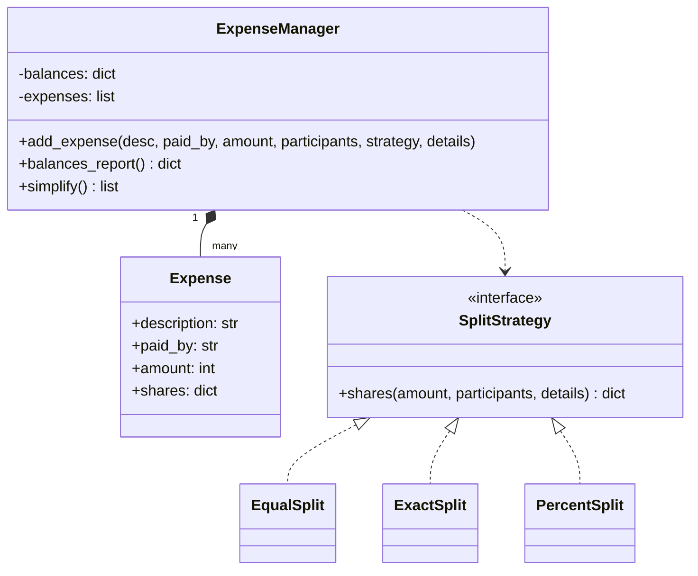

**Debt simplification (greedy):** repeatedly match the person who is owed the most with the person who owes the most, settle the smaller of the two amounts, and put whoever still has a balance back. Two heaps make each step O(log n). Every step zeroes at least one person, so there are at most **n − 1 payments** for n people.

```python
import heapq
from abc import ABC, abstractmethod
from collections import defaultdict
from dataclasses import dataclass


def rupees(paise: int) -> str:
    return f"Rs {paise // 100}.{paise % 100:02d}"


class SplitStrategy(ABC):
    @abstractmethod
    def shares(self, amount: int, participants: list[str], details) -> dict[str, int]: ...


class EqualSplit(SplitStrategy):
    def shares(self, amount, participants, details=None):
        base, extra = divmod(amount, len(participants))
        # The first `extra` people pay one more paisa, so the total is exact.
        return {p: base + (1 if i < extra else 0) for i, p in enumerate(participants)}


class ExactSplit(SplitStrategy):
    def shares(self, amount, participants, details):
        if sum(details.values()) != amount:
            raise ValueError("exact shares must add up to the total")
        return dict(details)


class PercentSplit(SplitStrategy):
    def shares(self, amount, participants, details):
        if sum(details.values()) != 100:
            raise ValueError("percentages must add up to 100")
        result = {p: amount * pct // 100 for p, pct in details.items()}
        leftover = amount - sum(result.values())          # rounding dust, in paise
        for p in list(result)[:leftover]:
            result[p] += 1
        return result


@dataclass
class Expense:
    description: str
    paid_by: str
    amount: int
    shares: dict


class ExpenseManager:
    def __init__(self):
        self.balances = defaultdict(int)       # +ve: is owed money, -ve: owes money
        self.expenses: list[Expense] = []

    def add_expense(self, description, paid_by, amount, participants, strategy, details=None):
        shares = strategy.shares(amount, participants, details)
        self.expenses.append(Expense(description, paid_by, amount, shares))
        self.balances[paid_by] += amount
        for person, share in shares.items():
            self.balances[person] -= share

    def simplify(self) -> list[tuple[str, str, int]]:
        creditors = [(-bal, name) for name, bal in self.balances.items() if bal > 0]  # max-heap
        debtors = [(bal, name) for name, bal in self.balances.items() if bal < 0]     # most negative first
        heapq.heapify(creditors)
        heapq.heapify(debtors)
        payments = []
        while creditors and debtors:
            credit, creditor = heapq.heappop(creditors)
            debt, debtor = heapq.heappop(debtors)
            amount = min(-credit, -debt)
            payments.append((debtor, creditor, amount))
            if -credit > amount:
                heapq.heappush(creditors, (credit + amount, creditor))
            if -debt > amount:
                heapq.heappush(debtors, (debt + amount, debtor))
        return payments


m = ExpenseManager()
friends = ["Asha", "Bala", "Chetan", "Divya"]
m.add_expense("Hotel", "Asha", 1200_00, friends, EqualSplit())
m.add_expense("Dinner", "Bala", 900_00, ["Asha", "Bala", "Chetan"], ExactSplit(),
              {"Asha": 200_00, "Bala": 300_00, "Chetan": 400_00})
m.add_expense("Cab", "Chetan", 1000_00, friends, PercentSplit(),
              {"Asha": 10, "Bala": 20, "Chetan": 30, "Divya": 40})
m.add_expense("Snacks", "Divya", 100_00, ["Asha", "Bala", "Chetan"], EqualSplit())

print("Net balances:")
for name in friends:
    bal = m.balances[name]
    print(f"  {name:<7} {'gets' if bal >= 0 else 'owes'} {rupees(abs(bal))}")
print("Total of balances:", sum(m.balances.values()))
print("Settle up:")
for debtor, creditor, amount in m.simplify():
    print(f"  {debtor} pays {creditor} {rupees(amount)}")
```

```text
Net balances:
  Asha    gets Rs 566.66
  Bala    gets Rs 66.67
  Chetan  owes Rs 33.33
  Divya   owes Rs 600.00
Total of balances: 0
Settle up:
  Divya pays Asha Rs 566.66
  Divya pays Bala Rs 33.34
  Chetan pays Bala Rs 33.33
```

What just happened: four expenses among four friends could need up to 12 pairwise IOUs; the greedy plan settles everything in at most 3 payments. The ₹100 snacks bill split three ways (₹33.34 + ₹33.33 + ₹33.33) was distributed to the exact paisa, which is why the balances sum to **exactly 0**. With floats you'd eventually see `-1.1368683772161603e-13` and a confused user.

> 💡 **Interview gold:** finding the *absolute minimum* number of payments is NP-hard in general (it hides a subset-sum problem: you'd want to find groups whose balances cancel out among themselves). The greedy approach is not always optimal, but it guarantees at most n − 1 payments and runs in O(n log n). Saying this unprompted shows depth. For tiny groups, the exact answer is the LeetCode problem "Optimal Account Balancing" (465), solved with backtracking.

### 11. Design #5: Movie Ticket Booking (BookMyShow) 🎬

This one is really a **concurrency** question wearing a movie costume. The data model is easy; the interesting part is: *two people click seat A1 at the same instant. Who gets it?*

**Requirements:** cities have cinemas; cinemas have screens; a **show** is one movie on one screen at one time. A user picks seats, which are **held** for a few minutes while they pay. Payment success → **booked**. Payment failure or timeout → seats released. Never double-book a seat. Out of scope: search, pricing tiers, refunds.

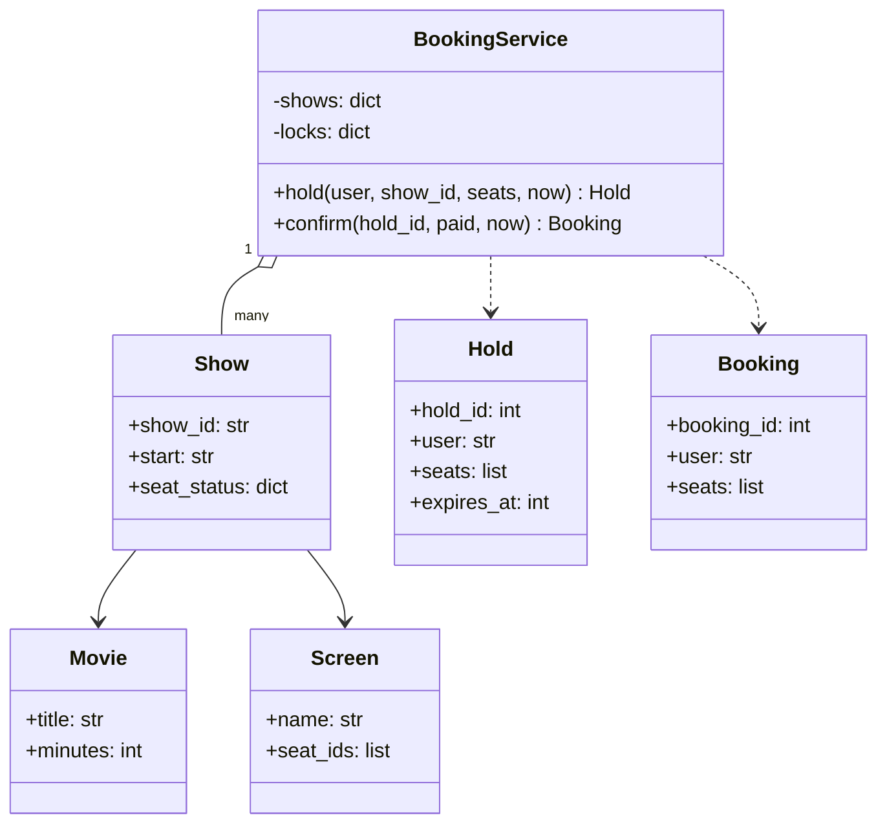

**The seat lifecycle:**


```python
import itertools
import threading
from dataclasses import dataclass
from enum import Enum

HOLD_SECONDS = 300


class SeatStatus(Enum):
    AVAILABLE = "available"
    HELD = "held"
    BOOKED = "booked"


@dataclass
class Hold:
    hold_id: int
    user: str
    show_id: str
    seats: list
    expires_at: int


@dataclass
class Booking:
    booking_id: int
    user: str
    show_id: str
    seats: list


class Show:
    def __init__(self, show_id: str, movie: str, seat_ids: list[str]):
        self.show_id, self.movie = show_id, movie
        self.status = {s: SeatStatus.AVAILABLE for s in seat_ids}


class BookingService:
    def __init__(self):
        self.shows: dict[str, Show] = {}
        self.locks: dict[str, threading.Lock] = {}     # one lock PER SHOW
        self.holds: dict[int, Hold] = {}
        self._ids = itertools.count(1)

    def add_show(self, show: Show) -> None:
        self.shows[show.show_id] = show
        self.locks[show.show_id] = threading.Lock()

    def _expire_holds(self, show_id: str, now: int) -> None:
        for hid, hold in list(self.holds.items()):
            if hold.show_id == show_id and hold.expires_at <= now:
                for seat in hold.seats:
                    self.shows[show_id].status[seat] = SeatStatus.AVAILABLE
                del self.holds[hid]

    def hold(self, user: str, show_id: str, seats: list[str], now: int) -> Hold | None:
        with self.locks[show_id]:          # check-then-act must be atomic
            self._expire_holds(show_id, now)
            show = self.shows[show_id]
            if any(show.status[s] != SeatStatus.AVAILABLE for s in seats):
                return None                # all-or-nothing: no partial holds
            for s in seats:
                show.status[s] = SeatStatus.HELD
            hold = Hold(next(self._ids), user, show_id, list(seats), now + HOLD_SECONDS)
            self.holds[hold.hold_id] = hold
            return hold

    def confirm(self, hold_id: int, paid: bool, now: int) -> Booking | str:
        hold = self.holds.get(hold_id)
        if hold is None:
            return "hold not found (expired and cleaned up, or already used)"
        with self.locks[hold.show_id]:
            self._expire_holds(hold.show_id, now)
            if hold_id not in self.holds:
                return "hold expired, seats released"
            del self.holds[hold_id]
            show = self.shows[hold.show_id]
            new_status = SeatStatus.BOOKED if paid else SeatStatus.AVAILABLE
            for s in hold.seats:
                show.status[s] = new_status
            if not paid:
                return "payment failed, seats released"
            return Booking(next(self._ids), hold.user, hold.show_id, hold.seats)


service = BookingService()
service.add_show(Show("S1", "Interstellar", ["A1", "A2", "B1", "B2"]))

# 1) Five users click A1+A2 at the same moment.
start = threading.Barrier(5)                   # release all threads together
results = {}

def try_hold(user):
    start.wait()
    results[user] = service.hold(user, "S1", ["A1", "A2"], now=0)

threads = [threading.Thread(target=try_hold, args=(f"user{i}",)) for i in range(5)]
for t in threads:
    t.start()
for t in threads:
    t.join()
winners = [h for h in results.values() if h]
print("successful holds:", len(winners), "| rejected:", len(results) - len(winners))
booking = service.confirm(winners[0].hold_id, paid=True, now=60)
print("booked seats:", booking.seats, "| A1 is now", service.shows["S1"].status["A1"].value)

# 2) Ravi holds B1+B2 but never pays. Meera tries B2 later.
ravi = service.hold("ravi", "S1", ["B1", "B2"], now=100)
print("meera at t=200:", service.hold("meera", "S1", ["B2"], now=200))
meera = service.hold("meera", "S1", ["B2"], now=450)       # Ravi's hold expired at 400
print("meera at t=450 got:", meera.seats)
print("ravi pays at t=460:", service.confirm(ravi.hold_id, paid=True, now=460))
print({s: st.value for s, st in service.shows["S1"].status.items()})
```

```text
successful holds: 1 | rejected: 4
booked seats: ['A1', 'A2'] | A1 is now booked
meera at t=200: None
meera at t=450 got: ['B2']
ravi pays at t=460: hold not found (expired and cleaned up, or already used)
{'A1': 'booked', 'A2': 'booked', 'B1': 'available', 'B2': 'held'}
```

What just happened:

- **Exactly one of five threads won**, every single run. The lock makes "check all seats are free, then mark them held" one indivisible step. Without it, two threads could both pass the check before either writes.
- **One lock per show**, not one global lock: users booking *different* shows never wait for each other. This is called **lock striping** or fine-grained locking.
- **Holds expire lazily**: we clean up expired holds whenever someone touches that show, so no background timer thread is needed. A real system would also run a periodic sweeper.
- **Ravi's late payment is rejected**: his hold expired at t=400 and was cleaned up when Meera touched the show. In real life the payment gateway would then refund him automatically.
- **All-or-nothing**: a family of four wants four seats together, never two of them.

**In a real system the database is the referee**, because many app servers run in parallel and an in-process lock only protects one process. The options, which you should be able to compare in an interview:

| Approach | How | Good for | Watch out |
|---|---|---|---|
| **Pessimistic lock** | `SELECT ... FOR UPDATE` on the seat rows inside a transaction | High contention (blockbuster opening night) | Locks held during slow steps cause waits; always lock rows in a fixed order to avoid deadlock |
| **Optimistic lock** | `version` column; `UPDATE ... WHERE version = :v`; 0 rows updated → someone beat you, retry | Low contention | Many retries under heavy contention |
| **Unique constraint** | `UNIQUE (show_id, seat_id)` on a bookings table; the second insert fails | The final safety net, always add it | Gives an error, not a queue: handle it nicely |
| **Distributed lock / cache hold** | Redis `SET seat:S1:A1 user NX EX 300` | Fast temporary holds with automatic expiry | Redis is not the source of truth; confirm in the DB |

```sql
-- Optimistic locking: succeeds only if nobody changed the row since we read it.
UPDATE show_seats
SET    status = 'HELD', held_by = 'user7', hold_expires_at = NOW() + INTERVAL '5 minutes',
       version = version + 1
WHERE  show_id = 'S1' AND seat_id = 'A1'
  AND  status = 'AVAILABLE' AND version = 12;
-- 1 row updated -> you got it. 0 rows -> someone else did; show "seat just taken".
```

### 12. Design #6: Snake and Ladder 🐍🪜

A favourite machine-coding question because it is small enough to finish and still shows modelling, validation and testability.

**Requirements:** an N-cell board (classically 100) with snakes (head → tail, going down) and ladders (bottom → top, going up). Any number of players take turns in order; each rolls the dice and moves. Land on a snake's head or a ladder's bottom and you jump. You must land **exactly** on the last cell; overshooting means you stay put. The first player to reach the last cell wins. Out of scope: UI; "roll a 6 gets another turn" (a nice extension).

**Design decisions worth saying out loud:**

- Snakes and ladders are both just **jumps**: `start → end`. One dict handles both; the only difference is the direction. Fewer classes, same behaviour.
- **Validate the board at construction:** no jump starts on the last cell, no snake and ladder share a start cell, and no jump lands on another jump's start (otherwise you get chains or infinite loops).
- The **dice takes an injected random generator** (`random.Random(seed)`). In tests and demos we seed it; the game logic never calls global `random` directly. This is Dependency Inversion again.
- Players live in a **deque** used as a circular queue ([Chapter 12](../part-2-dsa/12-queues-deques.md)): pop from the left, push to the right.

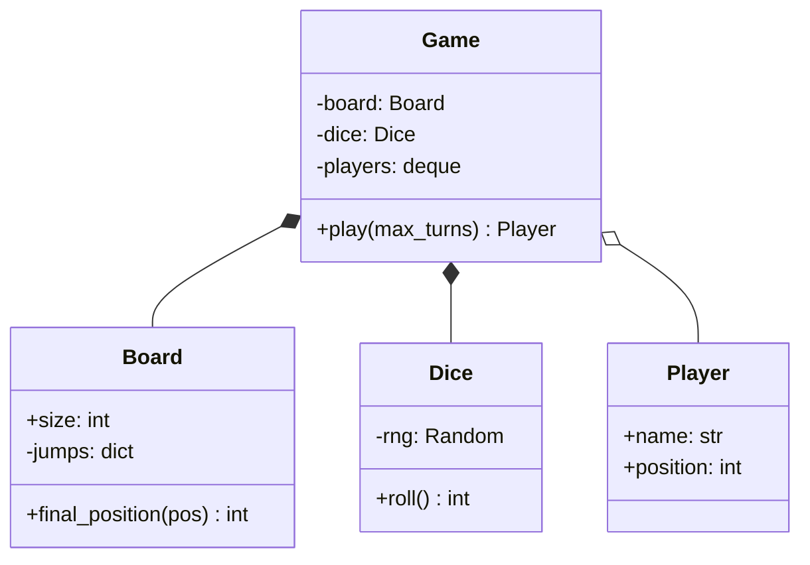

```python
import random
from collections import deque


class Board:
    def __init__(self, size: int, snakes: dict[int, int], ladders: dict[int, int]):
        for head, tail in snakes.items():
            if not 1 <= tail < head < size:
                raise ValueError(f"bad snake {head}->{tail}")
        for bottom, top in ladders.items():
            if not 1 <= bottom < top <= size:
                raise ValueError(f"bad ladder {bottom}->{top}")
        if snakes.keys() & ladders.keys():
            raise ValueError("a cell can't start both a snake and a ladder")
        self.size = size
        self.jumps = {**snakes, **ladders}
        if any(end in self.jumps for end in self.jumps.values()):
            raise ValueError("a jump may not land on another jump's start")
        self.snakes = snakes

    def final_position(self, pos: int) -> int:
        return self.jumps.get(pos, pos)


class Dice:
    def __init__(self, rng: random.Random, count: int = 1):
        self.rng, self.count = rng, count

    def roll(self) -> int:
        return sum(self.rng.randint(1, 6) for _ in range(self.count))


class Player:
    def __init__(self, name: str):
        self.name, self.position = name, 0          # 0 = off the board, before cell 1


class Game:
    def __init__(self, board: Board, dice: Dice, players: list[Player]):
        if len(players) < 2:
            raise ValueError("need at least two players")
        self.board, self.dice = board, dice
        self.turn_order = deque(players)

    def play(self, max_turns: int = 1000) -> Player | None:
        for turn in range(1, max_turns + 1):
            player = self.turn_order.popleft()
            roll = self.dice.roll()
            target = player.position + roll
            if target > self.board.size:
                note = "overshoots, stays"
            else:
                landed = self.board.final_position(target)
                if landed < target:
                    note = f"snake! {target}->{landed}"
                elif landed > target:
                    note = f"ladder! {target}->{landed}"
                else:
                    note = ""
                player.position = landed
            print(f"{turn:>2}. {player.name:<5} rolls {roll} -> {player.position:>2} {note}".rstrip())
            if player.position == self.board.size:
                return player
            self.turn_order.append(player)
        return None                                  # safety valve: no infinite games


board = Board(size=30,
              snakes={27: 1, 21: 9, 17: 4, 19: 7},
              ladders={3: 22, 5: 8, 11: 26, 20: 29})
game = Game(board, Dice(random.Random(7)), [Player("Asha"), Player("Ravi")])
winner = game.play()
print("Winner:", winner.name if winner else "nobody (turn limit)")

try:
    Board(30, snakes={10: 20}, ladders={})
except ValueError as e:
    print("invalid board:", e)
```

```text
 1. Asha  rolls 3 -> 22 ladder! 3->22
 2. Ravi  rolls 2 ->  2
 3. Asha  rolls 4 -> 26
 4. Ravi  rolls 6 ->  8
 5. Asha  rolls 1 ->  1 snake! 27->1
 6. Ravi  rolls 1 ->  9
 7. Asha  rolls 5 ->  6
 8. Ravi  rolls 1 -> 10
 9. Asha  rolls 3 ->  9
10. Ravi  rolls 5 -> 15
11. Asha  rolls 1 -> 10
12. Ravi  rolls 5 -> 29 ladder! 20->29
13. Asha  rolls 2 -> 12
14. Ravi  rolls 1 -> 30
Winner: Ravi
invalid board: bad snake 10->20
```

What just happened: the seeded `Random(7)` makes the whole game reproducible, so if a test fails you can replay it exactly. The `max_turns` limit guarantees termination even with a nasty board. **Extensions:** extra turn on a 6 (and three 6s in a row cancels the turn), multiple dice (already supported by `count`), special cells (a `Cell` class hierarchy, or a dict of cell → effect function), and a `GameObserver` to update a UI.

### 13. Design #7: Vending Machine (State pattern) 🥤

The vending machine is *the* textbook State pattern question: the same button does different things depending on what's happened so far.

**Requirements:** products in slots with a price and quantity. Accepts coins/notes of ₹5, ₹10, ₹20, ₹50, ₹100. The user inserts money, selects a product; if enough money and stock, the machine dispenses it and returns change. The user can cancel to get a refund. When everything is sold out, the machine refuses money until refilled.

**The states and transitions:**

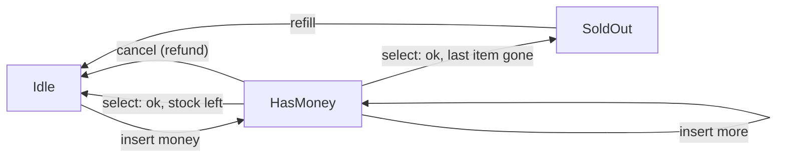

Without the pattern, every method would start with `if self.state == "IDLE": ... elif self.state == "HAS_MONEY": ...`, and adding a state means editing every method. With the pattern, **each state is a class that answers every user action for itself**.

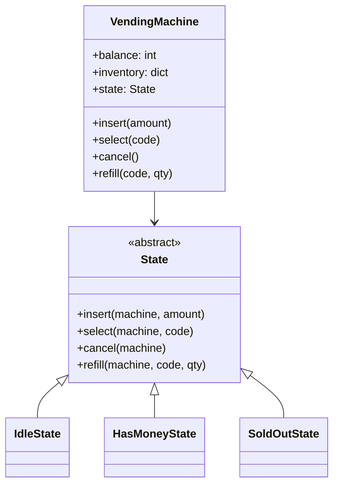

```python
from abc import ABC, abstractmethod
from dataclasses import dataclass

ACCEPTED = {5, 10, 20, 50, 100}


@dataclass
class Product:
    name: str
    price: int
    quantity: int


class State(ABC):
    @abstractmethod
    def insert(self, vm, amount): ...
    @abstractmethod
    def select(self, vm, code): ...
    @abstractmethod
    def cancel(self, vm): ...

    def refill(self, vm, code, qty):                   # same in every state
        vm.inventory[code].quantity += qty
        print(f"  refilled {vm.inventory[code].name} (+{qty})")
        if isinstance(vm.state, SoldOutState):
            vm.state = IdleState()


class IdleState(State):
    def insert(self, vm, amount):
        vm.balance += amount
        vm.state = HasMoneyState()
        print(f"  balance Rs {vm.balance}")

    def select(self, vm, code):
        print("  please insert money first")

    def cancel(self, vm):
        print("  nothing to refund")


class HasMoneyState(State):
    def insert(self, vm, amount):
        vm.balance += amount
        print(f"  balance Rs {vm.balance}")

    def select(self, vm, code):
        product = vm.inventory.get(code)
        if product is None:
            print(f"  no slot {code}")
        elif product.quantity == 0:
            print(f"  {product.name} sold out, choose another")
        elif vm.balance < product.price:
            print(f"  {product.name} costs Rs {product.price}: insert Rs {product.price - vm.balance} more")
        else:
            product.quantity -= 1
            change, vm.balance = vm.balance - product.price, 0
            print(f"  dispensed {product.name}, change Rs {change} {vm.make_change(change)}")
            vm.state = SoldOutState() if vm.all_sold_out() else IdleState()

    def cancel(self, vm):
        print(f"  refunded Rs {vm.balance} {vm.make_change(vm.balance)}")
        vm.balance = 0
        vm.state = IdleState()


class SoldOutState(State):
    def insert(self, vm, amount):
        print(f"  machine empty: returned your Rs {amount}")

    def select(self, vm, code):
        print("  machine empty")

    def cancel(self, vm):
        print("  nothing to refund")


class VendingMachine:
    def __init__(self, inventory: dict[str, Product]):
        self.inventory, self.balance = inventory, 0
        self.state: State = IdleState() if not self.all_sold_out() else SoldOutState()

    def all_sold_out(self) -> bool:
        return all(p.quantity == 0 for p in self.inventory.values())

    @staticmethod
    def make_change(amount: int) -> list[int]:
        coins = []
        for c in sorted(ACCEPTED, reverse=True):       # greedy works for this coin set
            while amount >= c:
                coins.append(c)
                amount -= c
        return coins

    # Public API: validate input, then delegate to the current state.
    def insert(self, amount):
        if amount not in ACCEPTED:
            print(f"  Rs {amount} not accepted")
            return
        self.state.insert(self, amount)

    def select(self, code): self.state.select(self, code)
    def cancel(self): self.state.cancel(self)
    def refill(self, code, qty): self.state.refill(self, code, qty)


vm = VendingMachine({"A1": Product("Chips", 20, 1), "A2": Product("Cola", 45, 1)})
actions = [("select", "A1"), ("insert", 7), ("insert", 10), ("select", "A1"),
           ("insert", 20), ("select", "A1"), ("insert", 100), ("select", "A1"),
           ("cancel",), ("insert", 50), ("select", "A2"), ("insert", 10),
           ("refill", "A2", 3), ("insert", 50), ("select", "A2")]
for action in actions:
    name, *args = action
    print(f"{name}({', '.join(map(str, args))})  [{type(vm.state).__name__}]")
    getattr(vm, name)(*args)
```

```text
select(A1)  [IdleState]
  please insert money first
insert(7)  [IdleState]
  Rs 7 not accepted
insert(10)  [IdleState]
  balance Rs 10
select(A1)  [HasMoneyState]
  Chips costs Rs 20: insert Rs 10 more
insert(20)  [HasMoneyState]
  balance Rs 30
select(A1)  [HasMoneyState]
  dispensed Chips, change Rs 10 [10]
insert(100)  [IdleState]
  balance Rs 100
select(A1)  [HasMoneyState]
  Chips sold out, choose another
cancel()  [HasMoneyState]
  refunded Rs 100 [100]
insert(50)  [IdleState]
  balance Rs 50
select(A2)  [HasMoneyState]
  dispensed Cola, change Rs 5 [5]
insert(10)  [SoldOutState]
  machine empty: returned your Rs 10
refill(A2, 3)  [SoldOutState]
  refilled Cola (+3)
insert(50)  [IdleState]
  balance Rs 50
select(A2)  [HasMoneyState]
  dispensed Cola, change Rs 5 [5]
```

What just happened: read the log top to bottom and watch the bracketed state change. The `VendingMachine` class contains **zero** state `if`s. Want a `MaintenanceState` that rejects everything? One new class. That's Open/Closed in action.

> 💡 Greedy change-making (biggest coin first) is optimal for "canonical" coin systems like ₹5/10/20/50/100, but not for every coin set: with coins {1, 3, 4} and amount 6, greedy gives 4+1+1 while 3+3 is better. A real machine also has a *limited* coin stock, which turns change-making into the "Coin Change" DP problem ([Chapter 20](../part-2-dsa/20-dp-1d.md)), plus a rule: if exact change is impossible, refuse the sale and refund.

---

## 🔬 Under the Hood

### How Python makes interfaces and patterns cheap

- **ABCs** (`abc.ABC` + `@abstractmethod`) record the abstract method names in `cls.__abstractmethods__`. `object.__new__` refuses to create an instance while that set is non-empty, which is why `Shape()` raised a `TypeError`.
- **Duck typing** means the interpreter only checks for an attribute *when you call it*. So in Python you can skip the ABC entirely and any object with a `.pay()` works. ABCs add an early, loud error; `typing.Protocol` adds a type-checker-only interface ("structural typing") without inheritance.
- **Functions are first-class objects**, so Strategy, Command and Observer often collapse into "pass a function" or "store a list of callbacks".
- **Method lookup follows the MRO** (method resolution order, `Cls.__mro__`), which is how a child's `fly()` overrides the parent's, and how multiple inheritance like `OfficeMachine(Printer, Scanner)` stays predictable.
- **Modules are cached** in `sys.modules` after the first import, which makes module-level objects natural singletons.

### Thread safety: what actually goes wrong

In [Chapter 18 of Part 1](../part-1-python/18-internals-concurrency.md) you met the **GIL** (Global Interpreter Lock): only one thread runs Python bytecode at a time. Beginners conclude "so my code is thread-safe". **It is not.** The GIL can switch threads *between* bytecodes, and most "single" operations are several bytecodes.

`count += 1` is really: **load** `count`, **add** 1, **store** `count`. If thread A loads 5, then thread B loads 5, both store 6. One increment vanished. This is a **race condition**: the result depends on timing.

The most common race in LLD code is **check-then-act**:

```py
# ❌ two threads can both pass the check before either acts
if spot.is_free():          # check
    spot.assign(vehicle)    # act

# ✅ make check + act one atomic step
with floor_lock:
    if spot.is_free():
        spot.assign(vehicle)
```

A lock (mutex) turns a block into a critical section that only one thread can be in at a time. Here it is protecting a shared counter, with a deterministic result:

```python
import threading


class Counter:
    def __init__(self):
        self.value = 0
        self._lock = threading.Lock()

    def increment(self):
        with self._lock:          # load-add-store happens as one unit
            self.value += 1


counter = Counter()

def work():
    for _ in range(10_000):
        counter.increment()

threads = [threading.Thread(target=work) for _ in range(4)]
for t in threads:
    t.start()
for t in threads:
    t.join()
print(counter.value)              # always 40000 with the lock
```

```text
40000
```

The thread-safety toolbox for LLD rounds:

| Tool | What it does | Use in |
|---|---|---|
| `threading.Lock` | One thread at a time in a block | Booking seats, parking spots, LRU cache |
| `threading.RLock` | Re-entrant: the same thread may acquire it again | A locked method that calls another locked method |
| Lock per object / shard | Less waiting: unrelated work doesn't share a lock | Per-show lock, per-floor lock, sharded cache |
| `queue.Queue` | Thread-safe FIFO with blocking `get` | Producer/consumer: elevator requests, job workers |
| `threading.Condition` / `Semaphore` | Wait for a condition / limit concurrent users | Bounded pools, rate limits |
| Immutability | Objects that never change can't race | `@dataclass(frozen=True)` for `Vehicle`, events, money |
| Atomic DB operations | Conditional `UPDATE`, unique constraints, transactions | Anything across multiple servers |

**Deadlock** happens when thread 1 holds lock A and waits for B while thread 2 holds B and waits for A. Both wait forever. The standard cure: **always acquire locks in one global order** (e.g. sort seat IDs, or lock accounts by smaller account ID first). Other cures: hold one lock at a time, or use `lock.acquire(timeout=...)` and back off.

> ⚠️ An in-process lock only protects **one process**. The moment you have two app servers, the lock must live somewhere shared: the database (row locks, conditional updates) or a distributed lock service. Say this sentence in every concurrency discussion and you'll sound senior.

### Why these designs have the complexity they do

| Design | Key structure | Core ops |
|---|---|---|
| Parking lot | Min-heap of free spots per (floor, type) | park/unpark O(F·log S) for F floors, S spots per floor |
| Elevator | Two sets per elevator; dispatcher scans M elevators | request O(M); step O(1) |
| LRU cache | Dict + doubly linked list | get/put O(1) |
| Splitwise | Net balance dict + two heaps | add expense O(k) for k people; simplify O(n log n) |
| Movie booking | Status dict per show + lock per show | hold O(k) for k seats (+ expiring holds) |
| Snake & ladder | Jump dict + deque | each turn O(1) |
| Vending machine | Dict of products + state object | each action O(1) |

---

## 🧩 Pattern Decoder

### Signals: requirement words → pattern

| The requirement says... | Reach for | Because |
|---|---|---|
| "different pricing / payment / routing / sorting rules", "configurable algorithm" | **Strategy** | The algorithm varies; the caller shouldn't |
| "behaves differently in each stage", "status", "mode", "lifecycle", "machine" | **State** | Kills the `if state ==` spaghetti |
| "notify", "subscribe", "when X happens, also do Y and Z" | **Observer** | Publisher doesn't know its listeners |
| "undo / redo", "queue of tasks", "macro", "audit log of actions" | **Command** | Requests become storable objects |
| "escalation", "approval levels", "middleware", "filters", "pass along" | **Chain of Responsibility** | Each handler decides: handle or pass |
| "create one of several types based on input" | **Factory** | One place knows the concrete classes |
| "many optional parameters", "step-by-step construction", "immutable result" | **Builder** | Readable, validated construction |
| "exactly one", "global config", "shared pool" | **Singleton** (or a module / injected instance) | One instance per process |
| "add features in combinations", "wrap with logging / caching / retry" | **Decorator** | Avoids 2ⁿ subclasses |
| "third-party / legacy API doesn't match our interface" | **Adapter** | Translate without changing either side |
| "lazy load", "access control", "remote object looks local" | **Proxy** | Same interface, controlled access |

### Decision guides

- **If** a class has a growing `if/elif` on a *type* field, **then** replace it with polymorphism (subclasses + Factory), **because** each new type should be a new class, not an edit (OCP).
- **If** the growing `if/elif` is on a *status* field that changes over the object's life, **then** use State, **because** the transitions become explicit and local.
- **If** you need different behaviour per *caller choice*, **then** Strategy; if per *object's own history*, **then** State.
- **If** you need "is-a" *and* the child keeps every promise of the parent, **then** inheritance is fine; otherwise compose, **because** a broken promise is an LSP bug waiting to happen.
- **If** a dependency talks to the outside world (DB, network, clock, randomness), **then** inject it, **because** that's what makes the class testable and deterministic (see `now=` in the parking lot and the seeded dice).
- **If** shared mutable state is touched by more than one thread, **then** guard check-then-act with a lock or make it atomic in the database, **because** the GIL won't save you.
- **If** a pattern adds more classes than it removes `if`s, **then** skip it, **because** patterns are tools, not trophies.

### Trade-off tables

**Inheritance vs composition**

| | Inheritance | Composition |
|---|---|---|
| Relationship | is-a | has-a |
| Coupling | Tight: child depends on parent internals | Loose: depends on an interface |
| Change behaviour at run time | No | Yes (swap the component) |
| Code reuse | Automatic | Explicit delegation (a bit more typing) |
| Best for | Sharing an interface; true taxonomies | Sharing behaviour; mixing features |

**The patterns' costs**

| Pattern | Benefit | Cost / risk |
|---|---|---|
| Singleton | One shared instance | Hidden global state; tests leak; hard to mock |
| Factory | Callers decoupled from concrete classes | One more indirection |
| Builder | Readable, validated construction | Extra class; overkill with kwargs/dataclasses |
| Strategy | Swappable algorithms, OCP | More small classes (or use functions) |
| Observer | Loose coupling, easy to add reactions | Hard to trace "who reacts to what"; order and error handling across observers |
| State | No state `if`s; explicit transitions | Many small classes; transitions scattered across them |
| Command | Undo, queues, logs | Every action needs an undo, which is hard for side effects (emails can't be unsent) |
| Chain of Resp. | Flexible pipelines | A request might fall off the end unhandled |
| Decorator | Combine features freely | Deep wrapping is hard to debug |
| Adapter | Reuse incompatible code | One more layer to maintain |

### When NOT to use patterns

- **The requirement doesn't vary.** If there will only ever be one pricing rule, a function is enough. YAGNI: "You Aren't Gonna Need It".
- **Python already has it.** Iterator (use generators), Decorator for functions (use `@`), Singleton (use a module), Strategy (pass a function).
- **In the first 30 minutes of machine coding.** Get the happy path running with simple classes, *then* refactor the parts that obviously vary into patterns.

---

## ⚠️ Traps & Common Mistakes

1. **Coding before clarifying.** Ten minutes in you discover trucks exist, or payments were in scope. Spend the first 5–10 minutes on requirements and write them down.
2. **The God class.** One `ParkingLotManager` with 40 methods doing allocation, pricing, printing and persistence. Split by responsibility (SRP).
3. **Strings for fixed sets.**

```py
# ❌ a typo is a silent bug
if vehicle.kind == "Truk": ...

# ✅ enums fail loudly and autocomplete
class VehicleType(Enum):
    CAR = "car"
    TRUCK = "truck"
if vehicle.kind is VehicleType.TRUCK: ...
```

4. **Money as float.** `0.1 + 0.2 == 0.30000000000000004`. Use integer paise or `Decimal`.
5. **Mutable default arguments** in model classes:

```py
# ❌ every Order shares ONE list
class Order:
    def __init__(self, items=[]):
        self.items = items

# ✅
class Order:
    def __init__(self, items=None):
        self.items = list(items) if items else []
```

6. **Inheritance for code reuse that breaks LSP** (`Penguin(Bird)` with a crashing `fly`, `Square(Rectangle)`). If the child can't keep the parent's promises, compose instead.
7. **Exposing internals.** Returning the internal dict lets callers corrupt state (`lot.spots["F0-01"].vehicle = None`). Return copies or read-only views, and change state only through methods.
8. **Reading the clock or `random` inside business logic.** Untestable and non-deterministic. Inject `now` and a seeded `Random`.
9. **"The GIL makes it thread-safe."** It doesn't. Check-then-act needs a lock (or an atomic DB operation).
10. **Locks in the wrong place:** one global lock (everything waits) or locks acquired in different orders (deadlock). Lock per show/floor/shard, and always acquire in a fixed order.
11. **Pattern-stuffing.** Using all ten patterns in a parking lot doesn't impress; it confuses. Each pattern must answer "what varies here?"
12. **No demo.** In machine coding, code that has never run is assumed broken. Always finish with a `main` that exercises happy paths *and* edge cases.

---

## 💡 Tips & Tricks

- **Start every LLD answer with: requirements → entities → diagram → code.** Say each step's name out loud so the interviewer can follow your process.
- **Write enums and dataclasses first.** `@dataclass` gives you `__init__`, `__repr__` and `__eq__` for free, which saves 10 minutes in a machine-coding round.
- **Name things after the domain:** `Ticket`, `Show`, `Hold`, not `Data`, `Info`, `Helper`.
- **Keep the public API tiny.** `park`, `unpark`, `availability`. Everything else is `_private`.
- **Prefer returning results over printing inside services**; print only in the demo. (The vending machine prints to keep the example short; mention you'd return events or messages in real code.)
- **Have a "what varies?" list ready** for each classic: parking lot (pricing, allocation), elevator (dispatch strategy, states), vending machine (states, payment), Splitwise (split types), booking (seat locking strategy).
- **Pre-empt concurrency.** Even if not asked, say: "two gates can park at once; I'm locking the allocation, and in a multi-server setup the DB enforces it with a unique constraint."
- **Use the language.** `collections.deque`, `heapq`, `OrderedDict`, `defaultdict`, `itertools.count` for IDs, `enum.Enum`, `abc.ABC`, `threading.Lock`. Knowing the standard library is a signal of seniority.
- **Test with tiny inputs**: a 2-spot lot, a 2-capacity cache, a 30-cell board. Edge cases show up immediately.
- **Leave 5 minutes for the walkthrough.** Explain one flow end to end and one extension. That's the part interviewers remember.

---

## 🎯 Interview Questions

### 1. Explain the SOLID principles with an example of each. 🔥🔥🔥

<details><summary>Answer</summary>

- **S, Single Responsibility:** a class should have one reason to change. `Invoice` computes totals; `InvoicePrinter` formats; `InvoiceRepository` saves. A format change never touches the money logic.
- **O, Open/Closed:** open for extension, closed for modification. New discount types are new `DiscountPolicy` classes; `final_price()` never changes.
- **L, Liskov Substitution:** a subclass must be usable wherever its parent is, without surprises. `Penguin(Bird)` with a `fly()` that raises breaks callers; split into `Bird` and `FlyingBird`.
- **I, Interface Segregation:** many small interfaces beat one fat one. A cheap printer implements `Printer`, not a giant `Machine` with `fax()` stubs.
- **D, Dependency Inversion:** business logic depends on abstractions, and concrete details are injected. `OrderService(repo: OrderRepository)` works with MySQL in production and an in-memory repo in tests.

Finish with *why*: together they make code cheap to change, which is the real goal of design.

</details>

### 2. Composition vs inheritance: when do you use which? 🔥🔥🔥

<details><summary>Answer</summary>

Use **inheritance** for a true "is-a" relationship where the child keeps *every* promise of the parent, typically to implement an interface (an ABC). Use **composition** ("has-a") to reuse behaviour. Composition is preferred by default because it's loosely coupled (you depend on an interface, not a parent's internals), lets you swap behaviour at run time (`checkout.strategy = CardPayment()`), and avoids deep, brittle hierarchies and class explosions (`MilkCaramelCoffee`, `DoubleMilkCoffee`, ...). Strategy, State and Decorator are all composition-based patterns.

</details>

### 3. What's the difference between Strategy and State? 🔥🔥

<details><summary>Answer</summary>

Both put varying behaviour behind an interface and hold it by composition, so the code looks similar. The difference is **who changes it and why**:

- **Strategy:** the *client* chooses the algorithm (UPI vs card); strategies usually don't know about each other, and the choice is often fixed for the operation.
- **State:** the *object itself* changes its state object as events happen (`Idle → HasMoney → Idle`); states know their successor states and encode the transitions.

Rule: "how should this be done?" → Strategy. "What can I do right now?" → State.

</details>

### 4. How do you implement a thread-safe Singleton in Python, and why do many people call Singleton an anti-pattern? 🔥🔥🔥

<details><summary>Answer</summary>

Override `__new__` with **double-checked locking**: check `cls._instance is None`, acquire a class-level `threading.Lock`, check again, then create (see section 5.1). The second check matters because two threads can both pass the first check before either takes the lock. The simplest Pythonic singleton is a **module-level instance**, since modules are imported once and cached in `sys.modules`.

Why it's criticised: it is **global mutable state**. It hides dependencies (a function secretly uses `Config()`), couples code to one concrete class, and makes tests interfere with each other because state survives between tests. The better approach is usually to **create one instance at startup and inject it** where needed: you still get one instance, without the hidden coupling.

</details>

### 5. Factory vs Abstract Factory vs Builder. 🔥🔥

<details><summary>Answer</summary>

- **Factory (method):** decides *which one class* to instantiate from an input, e.g. `NotifierFactory.create("sms")`. Hides concrete classes.
- **Abstract Factory:** creates *families* of related objects that must match, e.g. a `DarkThemeFactory` producing a dark button, dark menu and dark dialog; swap the factory to swap the whole family.
- **Builder:** constructs *one complex object step by step*, often with validation at the end (`HttpRequestBuilder(...).method("POST").header(...).build()`). It's about *how* to assemble, not *which* class.

</details>

### 6. Design an LRU cache with O(1) get and put. 🔥🔥🔥

<details><summary>Answer</summary>

Combine a **hash map** (key → node, for O(1) lookup) with a **doubly linked list** (ordered by recency, for O(1) move-to-front and remove-from-back). Use head/tail sentinel nodes to avoid edge cases. `get`: look up the node, unlink it, push it to the front. `put`: update and move to front if present; otherwise, if full, remove `tail.prev` (the least recently used) and delete its key from the map (nodes store their key for exactly this reason), then insert at the front. Full code in section 9. In Python you can also use `OrderedDict.move_to_end` and `popitem(last=False)`.

Follow-ups: thread safety (one lock, or shard into N caches each with its own lock), TTL expiry, and LFU (LeetCode 460: a map of frequency → ordered set of keys and a `min_freq` pointer).

</details>

### 7. How would you prevent two users from booking the same seat? 🔥🔥🔥

<details><summary>Answer</summary>

Make "check the seat is free, then take it" **atomic**:

1. **Temporary hold:** mark seats `HELD` with an expiry (e.g. 5 minutes) while the user pays; release on failure or timeout. The hold is all-or-nothing for multiple seats.
2. **Inside one process:** a lock per show around check + update (section 11).
3. **Across many servers (the real answer):** let the database decide. Either a conditional update with **optimistic locking** (`UPDATE ... WHERE status='AVAILABLE' AND version=:v`; 0 rows → someone else won), or **pessimistic locking** (`SELECT ... FOR UPDATE` inside a transaction, locking rows in sorted order to avoid deadlocks). Add a **unique constraint** on `(show_id, seat_id)` in the bookings table as the final safety net.
4. Optionally, hold seats in Redis with `SET key value NX EX 300` for speed, with the DB still the source of truth on confirmation.

Mention trade-offs: optimistic is great under low contention; pessimistic is better for hot shows; and payment must be idempotent so a retry doesn't double-charge.

</details>

### 8. Decorator vs Adapter vs Proxy. 🔥🔥

<details><summary>Answer</summary>

All three **wrap** an object. The difference is the intent and the interface:

| | Interface | Purpose | Example |
|---|---|---|---|
| Decorator | Same as the wrapped object | **Add** behaviour, stackable | `Milk(Coffee())`, retry/logging wrappers |
| Adapter | **Different**: converts to what the client expects | Make incompatible things fit | `LegacyBankAdapter` turning `pay(rupees)` into `make_transfer(payload)` |
| Proxy | Same | **Control access**: lazy loading, caching, auth, remote calls | An image proxy that loads the file only on first `display()` |

</details>

### 9. Where is the Observer pattern used in real systems, and what are its pitfalls? 🔥🔥

<details><summary>Answer</summary>

Uses: UI event listeners (button clicks), model-view updates, domain events in a service ("order placed" → email, loyalty, warehouse), and at system scale, pub/sub over message brokers like Kafka ([Chapter 08](08-queues-events.md)).

Pitfalls: (1) **order** of notification is usually unspecified; don't rely on it. (2) **A failing observer** can break the publisher's loop; catch and log per observer, or deliver asynchronously. (3) **Memory leaks**: a subject keeps references to observers that should have died; unsubscribe, or use `weakref`. (4) **Hard to trace** flows ("why did this email go out?"); log events. (5) Synchronous observers make the publisher as slow as the slowest observer; move slow ones to a queue.

</details>

### 10. Abstract class vs interface: what's the difference, and how do you do each in Python? 🔥🔥

<details><summary>Answer</summary>

An **interface** is a pure contract: method signatures, no state, no implementation. An **abstract class** can mix abstract methods with shared implementation and state (like `Shape.describe()` calling the abstract `area()`). In Java a class can implement many interfaces but extend one class.

Python has no `interface` keyword. You use:
- `abc.ABC` with `@abstractmethod` for both ideas (an ABC with only abstract methods *is* an interface). Python allows multiple inheritance, so a class can implement several ABCs (`OfficeMachine(Printer, Scanner)`).
- `typing.Protocol` for **structural** interfaces: any class with matching methods satisfies it, checked by type checkers, no inheritance needed. That's duck typing made explicit.

</details>

### 11. What is dependency injection and why does it matter? 🔥🔥

<details><summary>Answer</summary>

Dependency injection means a class **receives** the objects it depends on (through its constructor or a parameter) instead of **creating** them itself. `OrderService(repo)` instead of `self.repo = MySQLRepo()` inside.

Why: (1) **testability**: pass an in-memory fake, a fixed clock, a seeded random generator; (2) **flexibility**: swap implementations by configuration without editing the class; (3) it's how you follow the **Dependency Inversion Principle**; (4) dependencies become visible in the constructor signature rather than hidden in the body. In Python, plain constructor arguments are enough; frameworks like FastAPI also have built-in DI (`Depends`).

</details>

### 12. You get "Design X" in a 90-minute machine-coding round. Walk me through your approach. 🔥🔥🔥

<details><summary>Answer</summary>

1. **(5–10 min) Clarify** functional requirements, constraints, and what is out of scope; write them as comments at the top of the file.
2. **(5 min) Entities and actions**: nouns → classes/enums, verbs → methods.
3. **(5–10 min) Class diagram**: relationships and multiplicities; agree on it with the interviewer.
4. **(5 min) What varies?** Put Strategy/State/Factory/Observer exactly there.
5. **(40–50 min) Code** in layers: enums and models, then services, then a demo `main`. Run early and often. Get the happy path working first.
6. **(10 min) Edge cases and concurrency**: invalid input, full capacity, duplicates, races (locks, atomic DB updates).
7. **(5 min) Walkthrough**: run the demo, explain one flow and how you'd add one new feature.

Throughout, think aloud and keep the code runnable. Working + clean beats perfect + unfinished.

</details>

### 13. Design a logger that supports levels (DEBUG, INFO, ERROR) and multiple outputs. Which patterns would you use? 🔥

<details><summary>Answer</summary>

- **Singleton** (or an injected shared instance) for the logger itself.
- **Chain of Responsibility** or a simple level threshold for filtering by level.
- **Observer / Strategy** for outputs (called *handlers* or *sinks*: console, file, remote); the logger notifies every registered sink.
- **Decorator** to add timestamps or formatting.

```python
from enum import IntEnum


class Level(IntEnum):
    DEBUG = 10
    INFO = 20
    ERROR = 40


class ConsoleSink:
    def write(self, line): print("console:", line)


class MemorySink:
    def __init__(self): self.lines = []
    def write(self, line): self.lines.append(line)


class Logger:
    def __init__(self, min_level: Level):
        self.min_level, self.sinks = min_level, []

    def add_sink(self, sink): self.sinks.append(sink)

    def log(self, level: Level, msg: str):
        if level < self.min_level:
            return                                   # filtered out
        line = f"[{level.name}] {msg}"
        for sink in self.sinks:                      # observers
            sink.write(line)


log = Logger(Level.INFO)
memory = MemorySink()
log.add_sink(ConsoleSink())
log.add_sink(memory)
log.log(Level.DEBUG, "cache miss for key 42")
log.log(Level.INFO, "user asha logged in")
log.log(Level.ERROR, "payment gateway timeout")
print("stored:", memory.lines)
```

```text
console: [INFO] user asha logged in
console: [ERROR] payment gateway timeout
stored: ['[INFO] user asha logged in', '[ERROR] payment gateway timeout']
```

Python's real `logging` module uses exactly these ideas: loggers in a hierarchy (a chain: records propagate to parent loggers), levels, and multiple handlers.

</details>

---

## 🏋️ Practice

**🟢 1. Extend the parking lot** with electric-vehicle spots: EVs may use `EV` spots first, then compact or large spots; normal cars must *not* use EV spots. List exactly what you'd change.

<details><summary>Solution</summary>

1. Add `VehicleType.ELECTRIC_CAR` and `SpotType.EV`.
2. Add one entry to the fit table: `VehicleType.ELECTRIC_CAR: [SpotType.EV, SpotType.COMPACT, SpotType.LARGE]`. Normal cars keep `[COMPACT, LARGE]`, so they never take EV spots.
3. Add a rate in `HourlyPricing.RATES` (or a new pricing strategy that adds a charging fee).
4. Floors can now be built with `{SpotType.EV: 4, ...}`.

`ParkingLot.park`, `unpark` and `ParkingFloor` don't change at all. That's the Open/Closed Principle paying off: **data and new classes, no edits to logic**.

</details>

**🟢 2. Write a `@singleton` class decorator** that makes any class a thread-safe singleton.

<details><summary>Solution</summary>

```python
import functools
import threading


def singleton(cls):
    instance, lock = None, threading.Lock()

    @functools.wraps(cls)
    def get_instance(*args, **kwargs):
        nonlocal instance
        if instance is None:
            with lock:
                if instance is None:              # double-checked
                    instance = cls(*args, **kwargs)
        return instance
    return get_instance


@singleton
class Database:
    def __init__(self, url):
        self.url = url


a = Database("postgres://main")
b = Database("postgres://other")     # ignored: already created
print(a is b, b.url)
```

```text
True postgres://main
```

Note the trade-off: `Database` is now a function, so `isinstance(a, Database)` no longer works. The `__new__` approach from section 5.1 keeps it a real class.

</details>

**🟡 3. Tic-Tac-Toe on an n×n board** with `move(row, col, player)` that returns the winner in **O(1)** per move (LeetCode 348, "Design Tic-Tac-Toe").

<details><summary>Solution</summary>

Keep a counter per row, per column, and for both diagonals. Player 1 adds +1, player 2 adds −1. If any counter reaches ±n, that player has filled the line.

```python
class TicTacToe:
    def __init__(self, n: int):
        self.n = n
        self.rows, self.cols = [0] * n, [0] * n
        self.diag = self.anti = 0
        self.taken = set()

    def move(self, row: int, col: int, player: int) -> int:
        if (row, col) in self.taken:
            raise ValueError("cell already taken")
        self.taken.add((row, col))
        delta = 1 if player == 1 else -1
        self.rows[row] += delta
        self.cols[col] += delta
        if row == col:
            self.diag += delta
        if row + col == self.n - 1:
            self.anti += delta
        target = delta * self.n
        if target in (self.rows[row], self.cols[col], self.diag, self.anti):
            return player
        return 0


game = TicTacToe(3)
moves = [(0, 0, 1), (0, 2, 2), (2, 2, 1), (1, 1, 2), (2, 0, 1), (1, 0, 2), (2, 1, 1)]
for r, c, p in moves:
    result = game.move(r, c, p)
print("winner:", result)
```

```text
winner: 1
```

O(1) per move, O(n) space. The LLD extension: `Player`, `Board`, `Game` classes, a `WinningStrategy` interface (so you can add "connect four" rules), and an undo stack with Command.

</details>

**🟡 4. LRU cache with TTL:** each `put(key, value, ttl, now)` expires `ttl` seconds after `now`; an expired key behaves as missing. Time is passed in for testability.

<details><summary>Solution</summary>

```python
from collections import OrderedDict


class TTLCache:
    def __init__(self, capacity: int):
        self.capacity = capacity
        self.data = OrderedDict()            # key -> (value, expires_at)

    def get(self, key, now: int):
        item = self.data.get(key)
        if item is None:
            return -1
        value, expires_at = item
        if now >= expires_at:
            del self.data[key]               # lazy expiry on read
            return -1
        self.data.move_to_end(key)
        return value

    def put(self, key, value, ttl: int, now: int):
        self.data[key] = (value, now + ttl)
        self.data.move_to_end(key)
        if len(self.data) > self.capacity:
            # Prefer evicting an expired entry; otherwise the LRU one.
            expired = next((k for k, (_, exp) in self.data.items() if now >= exp), None)
            if expired is not None:
                del self.data[expired]
            else:
                self.data.popitem(last=False)


c = TTLCache(2)
c.put("otp", 4821, ttl=30, now=0)
c.put("session", "abc", ttl=600, now=0)
print(c.get("otp", now=10), c.get("otp", now=31), c.get("session", now=20))
c.put("a", 1, ttl=100, now=40)
c.put("b", 2, ttl=100, now=41)            # evicts the least recently used: "session"
print(c.get("session", now=42), c.get("a", now=42), c.get("b", now=42))
```

```text
4821 -1 abc
-1 1 2
```

Scanning for an expired entry is O(n) in the worst case; production caches (Redis, for example) combine lazy expiry on access with periodic random sampling to stay fast.

</details>

**🟡 5. Bank account with undoable transactions.** Use the Command pattern so `deposit`, `withdraw` and `transfer` can be undone, and a failed withdrawal (insufficient funds) is never recorded in history.

<details><summary>Solution</summary>

```python
class Account:
    def __init__(self, name, balance=0):
        self.name, self.balance = name, balance


class Deposit:
    def __init__(self, acc, amt): self.acc, self.amt = acc, amt
    def execute(self): self.acc.balance += self.amt
    def undo(self): self.acc.balance -= self.amt


class Withdraw:
    def __init__(self, acc, amt): self.acc, self.amt = acc, amt
    def execute(self):
        if self.acc.balance < self.amt:
            raise ValueError(f"insufficient funds in {self.acc.name}")
        self.acc.balance -= self.amt
    def undo(self): self.acc.balance += self.amt


class Transfer:
    """A composite command: both halves succeed, or neither does."""
    def __init__(self, src, dst, amt):
        self.steps = [Withdraw(src, amt), Deposit(dst, amt)]
    def execute(self):
        for step in self.steps:
            step.execute()           # Withdraw raises first, before anything changed
    def undo(self):
        for step in reversed(self.steps):
            step.undo()


class Bank:
    def __init__(self): self.history = []
    def run(self, cmd):
        try:
            cmd.execute()
            self.history.append(cmd)
        except ValueError as e:
            print("rejected:", e)
    def undo_last(self):
        if self.history:
            self.history.pop().undo()


a, b, bank = Account("A", 100), Account("B", 50), Bank()
bank.run(Deposit(a, 50))
bank.run(Transfer(a, b, 120))
bank.run(Withdraw(b, 500))
print(a.balance, b.balance, len(bank.history))
bank.undo_last()
print(a.balance, b.balance)
```

```text
rejected: insufficient funds in B
30 170 2
150 50
```

</details>

**🔴 6. LFU Cache** (LeetCode 460): evict the least *frequently* used key; break ties by least recently used. `get` and `put` in O(1).

<details><summary>Solution</summary>

Keep `key → (value, freq)`, `freq → OrderedDict of keys` (recency order within the same frequency), and `min_freq`. On access, move the key from bucket `f` to bucket `f+1`; if bucket `min_freq` became empty, `min_freq += 1`. A new key always has frequency 1, so `min_freq = 1` after an insert.

```python
from collections import defaultdict, OrderedDict


class LFUCache:
    def __init__(self, capacity: int):
        self.capacity = capacity
        self.items = {}                                  # key -> [value, freq]
        self.buckets = defaultdict(OrderedDict)          # freq -> keys in LRU order
        self.min_freq = 0

    def _touch(self, key):
        value, freq = self.items[key]
        del self.buckets[freq][key]
        if not self.buckets[freq]:
            del self.buckets[freq]
            if self.min_freq == freq:
                self.min_freq += 1
        self.items[key][1] = freq + 1
        self.buckets[freq + 1][key] = None

    def get(self, key):
        if key not in self.items:
            return -1
        self._touch(key)
        return self.items[key][0]

    def put(self, key, value):
        if self.capacity == 0:
            return
        if key in self.items:
            self.items[key][0] = value
            self._touch(key)
            return
        if len(self.items) == self.capacity:
            evict, _ = self.buckets[self.min_freq].popitem(last=False)
            if not self.buckets[self.min_freq]:
                del self.buckets[self.min_freq]
            del self.items[evict]
        self.items[key] = [value, 1]
        self.buckets[1][key] = None
        self.min_freq = 1


c = LFUCache(2)
c.put(1, 1); c.put(2, 2)
out = [c.get(1)]          # freq(1)=2
c.put(3, 3)               # evicts 2 (freq 1)
out += [c.get(2), c.get(3)]
c.put(4, 4)               # 1 and 3 both freq 2; 1 is least recent -> evict 1
out += [c.get(1), c.get(3), c.get(4)]
print(out)
```

```text
[1, -1, 3, -1, 3, 4]
```

</details>

**🔴 7. Optimal Account Balancing** (LeetCode 465): given transactions `[from, to, amount]`, return the **minimum** number of transfers to settle all debts. This is the exact (exponential) version of the Splitwise greedy.

<details><summary>Solution</summary>

Compute net balances, drop zeros, then backtrack: settle `debts[i]` against every later `debts[j]` with the opposite sign, recurse, and undo. Pruning: skip duplicate values at the same depth, and stop early on a perfect cancel (`debts[j] == -debts[i]`), since that's always optimal for that position.

```python
from collections import defaultdict


def min_transfers(transactions):
    net = defaultdict(int)
    for frm, to, amt in transactions:
        net[frm] -= amt
        net[to] += amt
    debts = [v for v in net.values() if v != 0]

    def settle(i):
        while i < len(debts) and debts[i] == 0:
            i += 1
        if i == len(debts):
            return 0
        best, seen = float("inf"), set()
        for j in range(i + 1, len(debts)):
            if debts[i] * debts[j] < 0 and debts[j] not in seen:
                seen.add(debts[j])
                debts[j] += debts[i]
                best = min(best, 1 + settle(i + 1))
                debts[j] -= debts[i]
                if debts[j] + debts[i] == 0:
                    break                    # perfect cancel: can't do better here
        return best

    return settle(0)


print(min_transfers([[0, 1, 10], [2, 0, 5]]))
print(min_transfers([[0, 1, 10], [1, 0, 1], [1, 2, 5], [2, 0, 5]]))
```

```text
2
1
```

Exponential in the worst case, so it's only for small groups (LeetCode limits it to about 8 transactions' worth of people). For a real app, the greedy heap method from section 10 is the practical choice; say so.

</details>

---

## 🧠 Never-Forget Summary

- **LLD = classes and their conversations.** The goal is code that's cheap to change.
- **Method:** clarify → nouns/verbs → class diagram → "what varies?" → code in layers → edge cases & concurrency → walkthrough.
- **SOLID:** one reason to change; add don't edit; subtypes keep promises; small interfaces; depend on abstractions and inject them.
- **Prefer composition**; inherit to share an interface, compose to share behaviour.
- **Creational:** Singleton (one instance; prefer injection), Factory (which class), Builder (step-by-step construction).
- **Structural:** Decorator (same interface, add features), Adapter (convert interface), Proxy (control access).
- **Behavioural:** Strategy (swap algorithm), Observer (notify subscribers), State (behaviour by stage), Command (requests as objects, undo), Chain of Responsibility (pass along).
- **Inject the clock and randomness**; use enums for fixed sets; integer paise for money.
- **GIL ≠ thread-safe.** Check-then-act needs a lock; across servers, the database (conditional updates, unique constraints) is the referee.
- **Classic designs:** parking lot (heaps + fit table + pricing Strategy), elevator (LOOK + dispatcher cost), LRU (dict + doubly linked list), Splitwise (net balances + two heaps), booking (holds + per-show lock + DB constraints), snake & ladder (jump dict + deque + seeded dice), vending machine (State).

**Memory hooks**

- **SOLID** = "**S**ome **O**bjects **L**ove **I**njected **D**ependencies".
- Patterns as a restaurant: the **Factory** is the kitchen counter, the **Builder** is the Subway line, the **Singleton** is the one head chef, the **Strategy** is "cash, card or UPI?", the **Observer** is the "order ready" bell, the **State** is the order slip moving from *placed* to *cooking* to *served*, the **Command** is the slip itself, the **Chain** is complaints going waiter → manager → owner, the **Decorator** is extra toppings, and the **Adapter** is the plug converter for the foreign chef's blender.
- "**What varies? Wrap it.**" Wherever the requirement says *different*, *types of*, *rules*, *modes*: that's where an interface goes.

**One picture**

| Problem smell | Pattern | Seen in |
|---|---|---|
| Algorithm chosen by caller | Strategy | Parking pricing, Splitwise splits, payments |
| Behaviour depends on stage | State | Vending machine, order lifecycle |
| One event, many reactions | Observer | Order placed → email, points, warehouse |
| Undo / queue / log actions | Command | Text editor, bank transactions |
| Pass request along handlers | Chain of Responsibility | ATM notes, middleware, approvals |
| Which class to create | Factory | Notifiers |
| Many optional parts | Builder | HTTP request |
| Exactly one | Singleton | Config, lot instance |
| Add features by wrapping | Decorator | Coffee add-ons, `@retry` |
| Interface mismatch | Adapter | Legacy bank API |

> **If you remember only one thing:** find what will change, hide it behind an interface, and keep everything else simple, runnable and thread-safe.

---
**Next:** [Chapter 01 · Pattern Recognition Cheatsheet](../part-4-interview-arsenal/01-pattern-recognition.md)  ·  **Back to** [Contents](../README.md)
