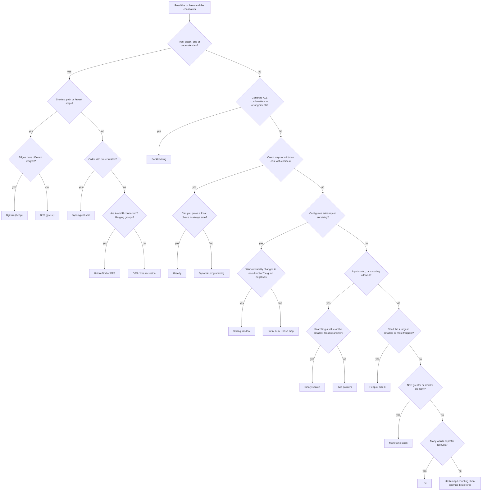

# Chapter 01 · Pattern Recognition Cheatsheet

> In an interview you don't lose because you can't code. You lose because you stare at a new problem for ten minutes without knowing *which* tool to pick. This chapter is the decoder ring: read the clues in the problem, name the pattern, pull out the template, and start talking.

**How to use this chapter:**
- **Before practice:** skim the decoder table and the flowchart so your brain starts looking for signals.
- **During practice:** when stuck, find your problem's clues in the table, then open the template.
- **Before an interview:** re-read the decoder table, the constraint table and the interview script. That's your 20-minute warm-up.

**Before this:** All of [Part 2](../part-2-dsa/01-big-o-complexity.md). Each template here is a compressed version of a full chapter. If a template feels like magic, go back to its chapter.

---

## 1. The Signal → Pattern Decoder

Read the problem once, slowly, and underline these clues. Most problems contain two or three of them, and together they point at one pattern.

### 1.1 Clues in the input and the question

| You see in the problem... | Think | Chapter |
|---|---|---|
| "sorted array", "find a pair / triplet that sums to X" | Two pointers (opposite ends) | [03](../part-2-dsa/03-two-pointers.md) |
| "palindrome", "reverse", "compare from both ends" | Two pointers (opposite ends) | [03](../part-2-dsa/03-two-pointers.md) |
| "in place", "O(1) extra space", "remove / move elements" | Two pointers (reader / writer) | [03](../part-2-dsa/03-two-pointers.md) |
| "two sorted arrays", "merge", "is subsequence" | Two pointers (one per sequence) | [03](../part-2-dsa/03-two-pointers.md) |
| "contiguous subarray / substring" + "longest / shortest / at most K" | Sliding window (variable) | [04](../part-2-dsa/04-sliding-window.md) |
| "every window of size k", "average of each k-block" | Sliding window (fixed) | [04](../part-2-dsa/04-sliding-window.md) |
| "anagram", "permutation of s1 inside s2" | Fixed window + character counts | [04](../part-2-dsa/04-sliding-window.md) |
| "seen before?", "duplicate", "pair with sum X" in an **unsorted** array | Hash set / hash map | [05](../part-2-dsa/05-hashing.md) |
| "group by", "frequency", "most common", "isomorphic" | Hash map / `Counter` | [05](../part-2-dsa/05-hashing.md) |
| "longest consecutive sequence" in O(n) | Hash set, start only from sequence starts | [05](../part-2-dsa/05-hashing.md) |
| "sum of range i..j" asked many times | Prefix sum array | [06](../part-2-dsa/06-prefix-sums.md) |
| "number of subarrays with sum = K", negatives allowed | Prefix sum + hash map | [06](../part-2-dsa/06-prefix-sums.md) |
| "add value v to range [l, r]" many times | Difference array | [06](../part-2-dsa/06-prefix-sums.md) |
| "equal number of 0s and 1s" | Turn 0 into −1, prefix sum + first-seen map | [06](../part-2-dsa/06-prefix-sums.md) |
| "kth smallest", "custom order", "arrange to form largest" | Sorting with a key / comparator | [07](../part-2-dsa/07-sorting.md) |
| "count inversions", "smaller numbers after self" | Merge sort counting (or Fenwick tree) | [07](../part-2-dsa/07-sorting.md) |
| "sorted" + "find position / first / last" | Binary search (lower bound) | [08](../part-2-dsa/08-binary-search.md) |
| "rotated sorted array" | Binary search, decide which half is sorted | [08](../part-2-dsa/08-binary-search.md) |
| "minimum capacity / speed / time such that it's possible" | Binary search on the answer | [08](../part-2-dsa/08-binary-search.md) |
| "minimise the maximum" / "maximise the minimum" | Binary search on the answer (or DP) | [08](../part-2-dsa/08-binary-search.md) |
| "all subsets / permutations / combinations", "generate all" | Backtracking | [09](../part-2-dsa/09-backtracking.md) |
| "place N queens", "solve sudoku", "word search in grid" | Backtracking with pruning | [09](../part-2-dsa/09-backtracking.md) |
| "linked list" + "middle / cycle / kth from end" | Fast & slow pointers | [10](../part-2-dsa/10-linked-lists.md) |
| "reverse a linked list (or part of it)" | Three-pointer reversal (`prev`, `cur`, `nxt`) | [10](../part-2-dsa/10-linked-lists.md) |
| "O(1) get and put with eviction" | Hash map + doubly linked list (LRU) | [10](../part-2-dsa/10-linked-lists.md) |
| "valid parentheses", "nested", "undo", "evaluate expression" | Stack | [11](../part-2-dsa/11-stacks.md) |
| "next greater / smaller element", "days until warmer", "span" | Monotonic stack | [11](../part-2-dsa/11-stacks.md) |
| "largest rectangle", "trapping water" | Monotonic stack (or two pointers) | [11](../part-2-dsa/11-stacks.md) |
| "max / min of every window of size k" | Monotonic deque | [12](../part-2-dsa/12-queues-deques.md) |
| "tree" + "depth / height / diameter / path sum" | DFS returning a value from each subtree | [13](../part-2-dsa/13-binary-trees.md) |
| "level by level", "right side view", "zigzag" | BFS with a queue, one level at a time | [13](../part-2-dsa/13-binary-trees.md) |
| "BST", "kth smallest in BST", "validate BST" | In-order traversal = sorted order; min/max bounds | [14](../part-2-dsa/14-binary-search-trees.md) |
| "k largest / smallest / closest", "top k frequent" | Heap of size k | [15](../part-2-dsa/15-heaps.md) |
| "merge k sorted lists", "smallest range from k lists" | Min-heap of the k current heads | [15](../part-2-dsa/15-heaps.md) |
| "running median", "median of a stream" | Two heaps | [15](../part-2-dsa/15-heaps.md) |
| "schedule tasks with cooldown", "always pick the biggest" | Max-heap + greedy | [15](../part-2-dsa/15-heaps.md) |
| "grid", "islands", "connected regions", "flood fill" | DFS or BFS on the grid | [16](../part-2-dsa/16-graphs-bfs-dfs.md) |
| "shortest path / minimum steps", all edges cost 1 | BFS | [16](../part-2-dsa/16-graphs-bfs-dfs.md) |
| "spreads from many places at once" (rotting, fire) | Multi-source BFS | [16](../part-2-dsa/16-graphs-bfs-dfs.md) |
| "transform word A into B one letter at a time" | BFS over states | [16](../part-2-dsa/16-graphs-bfs-dfs.md) |
| "prerequisites", "order of tasks", "dependencies", "build order" | Topological sort | [17](../part-2-dsa/17-graphs-advanced.md) |
| "shortest path" + **weighted** non-negative edges | Dijkstra | [17](../part-2-dsa/17-graphs-advanced.md) |
| "at most K stops", negative edges | Bellman-Ford (K rounds) | [17](../part-2-dsa/17-graphs-advanced.md) |
| "connect all points with minimum total cost" | Minimum spanning tree (Prim / Kruskal) | [17](../part-2-dsa/17-graphs-advanced.md) |
| "are A and B connected?", "number of groups", "redundant edge" | Union-Find (DSU) | [18](../part-2-dsa/18-union-find.md) |
| "merge accounts / groups that share something" | Union-Find | [18](../part-2-dsa/18-union-find.md) |
| "prefix", "autocomplete", "starts with", "dictionary of words" | Trie | [19](../part-2-dsa/19-tries.md) |
| "maximum XOR of two numbers" | Bitwise trie | [19](../part-2-dsa/19-tries.md) |
| "number of ways", "can you reach", "min / max cost" + choices at each step | Dynamic programming | [20](../part-2-dsa/20-dp-1d.md) |
| "can't pick adjacent", "climb 1 or 2 steps" | 1D DP on the index | [20](../part-2-dsa/20-dp-1d.md) |
| "longest increasing subsequence" | DP O(n²) or patience sorting O(n log n) | [20](../part-2-dsa/20-dp-1d.md) |
| "two strings" + "common / edit / match" | 2D DP on (i, j) | [21](../part-2-dsa/21-dp-2d-advanced.md) |
| "grid paths", "min path sum" moving right/down | 2D DP on the grid | [21](../part-2-dsa/21-dp-2d-advanced.md) |
| "pick items with a weight limit", "subset sums to target" | 0/1 knapsack | [21](../part-2-dsa/21-dp-2d-advanced.md) |
| "unlimited coins", "ways to make amount" | Unbounded knapsack | [21](../part-2-dsa/21-dp-2d-advanced.md) |
| "intervals", "meetings", "overlap", "merge ranges" | Sort by start (or end), then sweep | [22](../part-2-dsa/22-greedy-intervals.md) |
| "minimum rooms / platforms at the same time" | Sort + min-heap of end times (or sweep line) | [22](../part-2-dsa/22-greedy-intervals.md) |
| "maximum non-overlapping", "minimum arrows" | Greedy: sort by **end** | [22](../part-2-dsa/22-greedy-intervals.md) |
| "every element appears twice except one" | XOR everything | [23](../part-2-dsa/23-bits-math.md) |
| "count set bits", "power of two", "subsets of n ≤ 20" | Bit tricks / bitmask | [23](../part-2-dsa/23-bits-math.md) |
| "answer modulo 10^9 + 7" | Counting, usually DP or combinatorics | [23](../part-2-dsa/23-bits-math.md) |
| "range query" + "point update", many times | Fenwick tree / segment tree | [24](../part-2-dsa/24-advanced-structures.md) |
| "find pattern in text" in O(n + m) | KMP / Z-function / rolling hash | [24](../part-2-dsa/24-advanced-structures.md) |

### 1.2 Clues in what the problem asks you to *return*

The output type is often the strongest clue of all.

| The question asks for... | Usually means |
|---|---|
| **All** solutions (list every subset / path / arrangement) | Backtracking. Exponential output means exponential time is fine. |
| The **number of ways** | DP (or combinatorics). Backtracking would be too slow. |
| **Min / max** of something with choices at each step | DP, or greedy if you can prove a local choice is safe. |
| **Min / max** value where "is X enough?" is easy to check | Binary search on the answer. |
| **Shortest** path / fewest steps | BFS (unweighted) or Dijkstra (weighted). |
| **True / False**: can we reach / is it possible | DFS/BFS reachability, DP, or greedy. |
| **Kth** something | Heap, quickselect, or binary search on the value. |
| An **ordering** that respects rules | Topological sort, or sorting with a custom key. |
| A **length** of the longest contiguous part | Sliding window, or prefix sum + map. |
| A **length** of the longest non-contiguous part | DP (LIS / LCS family). |

### 1.3 Clues in the data structure

| Input is a... | First patterns to try |
|---|---|
| Sorted array | Binary search, two pointers |
| Unsorted array | Hash map, sort first, prefix sums, sliding window |
| String | Sliding window + counts, two pointers, hash map, DP for two strings, trie for many words |
| Linked list | Fast & slow pointers, dummy head, reversal |
| Binary tree | DFS (pre/in/post-order), BFS by level |
| BST | In-order = sorted; go left or right using the BST rule |
| Grid / matrix | BFS/DFS on cells, 2D DP, binary search if rows and columns are sorted |
| Edges / pairs / "A depends on B" | Build an adjacency list, then BFS/DFS/topo sort/DSU |
| Stream of numbers | Heap, two heaps, monotonic deque, running hash map |
| List of intervals | Sort, then sweep |

---

## 2. The Decision Flowchart

When the table doesn't jump out at you, walk this chart from the top. Each question removes a whole family of patterns.



> 💡 The chart is a starting point, not a law. "Binary search on the answer + greedy check" or "BFS + bitmask state" are combos you'll see in harder problems. If the first pattern doesn't fully fit, ask: "what *second* tool fixes the gap?"

---

## 3. Constraints Tell You the Complexity

Interviewers and online judges pick the input size so that the intended solution fits and slower ones don't. Python does very roughly **10⁶–10⁷ simple operations per second**, so aim for a total of about 10⁷ or fewer.

| Max n (input size) | Target complexity | Typical patterns |
|---|---|---|
| n ≤ 10 | O(n!) | Permutations, brute-force all orders |
| n ≤ 20 | O(2ⁿ · n) | Subsets, bitmask DP, backtracking |
| n ≤ 100 | O(n³) or O(n⁴) small | Floyd–Warshall, interval DP |
| n ≤ 1,000 | O(n²) | 2D DP, all pairs, nested loops |
| n ≤ 10⁵ | O(n log n) | Sorting, heaps, binary search, segment trees |
| n ≤ 10⁶ | O(n) | Two pointers, sliding window, hash maps, prefix sums, monotonic stack |
| n up to 10⁹ or more | O(log n) or O(1) | Binary search on the answer, math formulas, fast exponentiation |

**Other constraint clues:**

| Constraint | Hint |
|---|---|
| Values are small (e.g. 0 ≤ x ≤ 100, lowercase letters only) | Counting array of size 26 / 101 instead of sorting |
| "values can be negative" | Sliding window on sums usually breaks: use prefix sums |
| "answer modulo 10⁹ + 7" | The count is huge, so it's DP / combinatorics, not listing |
| "follow-up: O(1) extra space" | Two pointers, in-place marking, or bit tricks |
| "follow-up: what if it's a stream?" | Heap, running counts, or a deque window |
| Grid up to 500 × 500 | 250,000 cells: BFS/DFS O(R·C) is fine |
| k is tiny compared to n | Heap of size k: O(n log k) |

---

## 4. Python Toolbox: Cost of Every Operation

Picking the right pattern is half the job. The other half is not accidentally using an O(n) operation inside a loop.

| Operation | Cost | Note |
|---|---|---|
| `lst.append(x)`, `lst.pop()` | O(1) | amortised |
| `lst.pop(0)`, `lst.insert(0, x)` | **O(n)** | use `collections.deque` instead |
| `x in lst` | **O(n)** | use a `set` if you check often |
| `lst[i]`, `lst[i] = x` | O(1) | |
| `lst[a:b]` | O(b − a) | slicing copies |
| `lst.sort()`, `sorted(lst)` | O(n log n) | stable |
| `x in st`, `st.add(x)` | O(1) average | |
| `d[k]`, `d[k] = v`, `k in d` | O(1) average | |
| `deque.append / appendleft / pop / popleft` | O(1) | |
| `heapq.heappush / heappop` | O(log n) | min-heap; negate values for max-heap |
| `heapq.heapify(lst)` | O(n) | |
| `heapq.nlargest(k, it)` | O(n log k) | |
| `bisect.bisect_left(lst, x)` | O(log n) | `insort` is O(n) because of shifting |
| `s1 + s2` for strings | O(len) | build lists then `"".join(...)` in loops |
| `Counter(iterable)` | O(n) | |

---

## 5. The Template Library

Every template below is a complete, runnable program with a tiny example. Learn the **shape**, not the exact code. The comments mark the line that changes from problem to problem.

### 5.1 Two pointers (opposite ends and reader/writer)

**Signals:** sorted input, pairs, palindromes, "in place". **Cost:** O(n) time, O(1) space.

```python
def pair_sum_sorted(nums, target):
    left, right = 0, len(nums) - 1
    while left < right:
        total = nums[left] + nums[right]
        if total == target:
            return [left, right]
        if total < target:
            left += 1          # need a bigger sum: drop the smallest
        else:
            right -= 1         # need a smaller sum: drop the largest
    return []


def remove_value(nums, val):
    write = 0
    for read in range(len(nums)):
        if nums[read] != val:  # the "keep" rule: the only line that changes
            nums[write] = nums[read]
            write += 1
    return write               # nums[:write] is the answer


print(pair_sum_sorted([1, 3, 4, 6, 8, 11], 10))
arr = [3, 2, 2, 3, 4]
k = remove_value(arr, 3)
print(k, arr[:k])
```

```text
[2, 3]
3 [2, 2, 4]
```

**Key question to ask yourself:** "Which side can I safely throw away?" If you can't answer it, it's not two pointers. Full chapter: [Two Pointers](../part-2-dsa/03-two-pointers.md).

### 5.2 Sliding window (fixed size)

**Signals:** "each window of size k". **Cost:** O(n) time, O(1) space.

```python
def max_sum_window(nums, k):
    window = sum(nums[:k])
    best = window
    for right in range(k, len(nums)):
        window += nums[right] - nums[right - k]   # add the new one, drop the old one
        best = max(best, window)
    return best


print(max_sum_window([2, 1, 5, 1, 3, 2], 3))
```

```text
9
```

### 5.3 Sliding window (variable size)

**Signals:** "longest / shortest contiguous ... such that ...". **Cost:** O(n) time: each index enters once and leaves once.

Two flavours. **Longest valid window:** expand, shrink *while invalid*, then record. **Shortest valid window:** expand, then *while valid*, record and shrink.

```python
from collections import defaultdict


def longest_with_at_most_k_distinct(s, k):
    count = defaultdict(int)
    left = best = 0
    for right, ch in enumerate(s):
        count[ch] += 1                          # 1. expand: take s[right]
        while len(count) > k:                   # 2. shrink while the window is INVALID
            count[s[left]] -= 1
            if count[s[left]] == 0:
                del count[s[left]]
            left += 1
        best = max(best, right - left + 1)      # 3. window is valid: record it
    return best


def min_subarray_len(target, nums):
    left, total, best = 0, 0, float("inf")
    for right, x in enumerate(nums):
        total += x                              # 1. expand
        while total >= target:                  # 2. while VALID: record, then shrink
            best = min(best, right - left + 1)
            total -= nums[left]
            left += 1
    return 0 if best == float("inf") else best


print(longest_with_at_most_k_distinct("eceba", 2))
print(min_subarray_len(7, [2, 3, 1, 2, 4, 3]))
```

```text
3
2
```

> ⚠️ Sliding window needs **monotonic validity**: adding an element can only make the window "more invalid" and removing one can only help. With negative numbers in a sum problem, that breaks. Use prefix sums instead.

### 5.4 Prefix sum + hash map

**Signals:** "number of subarrays with sum K", negatives allowed, "range sum" queries. **Cost:** O(n) time, O(n) space.

The idea: `sum(i..j) = prefix[j+1] - prefix[i]`. A subarray ending here sums to K exactly when some earlier prefix equals `current_prefix - K`.

```python
def range_sum_builder(nums):
    prefix = [0]
    for x in nums:
        prefix.append(prefix[-1] + x)
    return lambda i, j: prefix[j + 1] - prefix[i]   # sum of nums[i..j], inclusive


def subarray_sum_equals_k(nums, k):
    seen = {0: 1}             # the empty prefix (sum 0) has been seen once
    prefix = count = 0
    for x in nums:
        prefix += x
        count += seen.get(prefix - k, 0)          # earlier prefixes that complete a sum of k
        seen[prefix] = seen.get(prefix, 0) + 1
    return count


range_sum = range_sum_builder([3, -1, 4, 1, 5])
print(range_sum(1, 3))
print(subarray_sum_equals_k([1, 1, 1], 2), subarray_sum_equals_k([1, -1, 1, -1], 0))
```

```text
4
2 4
```

**Variations:** store the *first index* of each prefix to get the **longest** subarray (Contiguous Array); store `prefix % k` for "divisible by k". Full chapter: [Prefix Sums](../part-2-dsa/06-prefix-sums.md).

### 5.5 Binary search (lower bound and "on the answer")

**Signals:** sorted data; or "minimum X such that it's possible" where bigger X is always at least as possible. **Cost:** O(log n) searches; on the answer, O(log(range) × cost of check).

One template rules them all: find the **first** position where a yes/no condition turns `True`.

```python
def lower_bound(nums, target):
    """First index with nums[i] >= target (len(nums) if none)."""
    lo, hi = 0, len(nums)
    while lo < hi:
        mid = (lo + hi) // 2
        if nums[mid] < target:
            lo = mid + 1        # mid is too small: answer is to the right
        else:
            hi = mid            # mid might be the answer: keep it
    return lo


def min_eating_speed(piles, h):
    """Koko Eating Bananas: smallest speed that finishes within h hours."""
    def can_finish(speed):      # the feasibility check: the only part that changes
        return sum((p + speed - 1) // speed for p in piles) <= h

    lo, hi = 1, max(piles)      # the answer is somewhere in this range
    while lo < hi:
        mid = (lo + hi) // 2
        if can_finish(mid):
            hi = mid            # works: try smaller
        else:
            lo = mid + 1        # too slow: must go faster
    return lo


print(lower_bound([1, 3, 3, 5, 8], 3), lower_bound([1, 3, 3, 5, 8], 4), lower_bound([1, 3, 3, 5, 8], 9))
print(min_eating_speed([3, 6, 7, 11], 8), min_eating_speed([30, 11, 23, 4, 20], 5))
```

```text
1 3 5
4 30
```

**Checklist:** (1) what's the range `[lo, hi]`? (2) is the condition monotonic (False...False True...True)? (3) `lo < hi`, `hi = mid`, `lo = mid + 1` never loops forever. Full chapter: [Binary Search](../part-2-dsa/08-binary-search.md).

### 5.6 Monotonic stack

**Signals:** "next greater / smaller", "how many days until", "previous smaller", "largest rectangle". **Cost:** O(n): each index is pushed and popped at most once.

```python
def daily_temperatures(temps):
    answer = [0] * len(temps)
    stack = []                          # indexes whose answer is still unknown
    for i, t in enumerate(temps):
        while stack and temps[stack[-1]] < t:   # t is the "next warmer day" for them
            j = stack.pop()
            answer[j] = i - j
        stack.append(i)
    return answer


print(daily_temperatures([73, 74, 75, 71, 69, 72, 76, 73]))
```

```text
[1, 1, 4, 2, 1, 1, 0, 0]
```

**Which comparison?** Next **greater** → pop while `top < current` (stack stays decreasing). Next **smaller** → pop while `top > current` (stack stays increasing). Full chapter: [Stacks](../part-2-dsa/11-stacks.md).

### 5.7 Monotonic deque

**Signals:** "maximum / minimum of every window of size k", DP where you need the best value in the last k positions. **Cost:** O(n).

```python
from collections import deque


def max_sliding_window(nums, k):
    dq = deque()                        # indexes; their values are decreasing
    out = []
    for i, x in enumerate(nums):
        while dq and nums[dq[-1]] <= x:
            dq.pop()                    # smaller values can never be a max again
        dq.append(i)
        if dq[0] <= i - k:
            dq.popleft()                # front index slid out of the window
        if i >= k - 1:
            out.append(nums[dq[0]])     # front is always the window max
    return out


print(max_sliding_window([1, 3, -1, -3, 5, 3, 6, 7], 3))
```

```text
[3, 3, 5, 5, 6, 7]
```

### 5.8 Tree DFS and BFS

**Signals:** any binary tree. DFS for "depth / path / diameter / validate"; BFS for "level / right side view / minimum depth". **Cost:** O(n) time, O(h) stack for DFS, O(width) for BFS.

The DFS question to ask: "If my children hand me their answers, how do I build mine?"

```python
from collections import deque


class TreeNode:
    def __init__(self, val, left=None, right=None):
        self.val, self.left, self.right = val, left, right


def max_depth(root):
    if root is None:
        return 0
    return 1 + max(max_depth(root.left), max_depth(root.right))


def diameter(root):
    best = 0

    def height(node):                       # returns height, updates best on the side
        nonlocal best
        if node is None:
            return 0
        lh, rh = height(node.left), height(node.right)
        best = max(best, lh + rh)           # longest path THROUGH this node
        return 1 + max(lh, rh)              # what the parent needs

    height(root)
    return best


def level_order(root):
    if root is None:
        return []
    levels, queue = [], deque([root])
    while queue:
        level = []
        for _ in range(len(queue)):         # exactly one level per outer loop
            node = queue.popleft()
            level.append(node.val)
            if node.left:
                queue.append(node.left)
            if node.right:
                queue.append(node.right)
        levels.append(level)
    return levels


root = TreeNode(3, TreeNode(9), TreeNode(20, TreeNode(15), TreeNode(7)))
print(max_depth(root), diameter(root), level_order(root))
```

```text
3 3 [[3], [9, 20], [15, 7]]
```

**The "global answer" trick** (in `diameter`): the value you *return* to the parent is often different from the value you *record*. Max path sum, diameter and longest univalue path all work this way. Full chapters: [Binary Trees](../part-2-dsa/13-binary-trees.md), [BSTs](../part-2-dsa/14-binary-search-trees.md).

### 5.9 BFS on a grid (shortest path)

**Signals:** "minimum steps", "shortest path", every move costs the same. **Cost:** O(R × C).

```python
from collections import deque


def shortest_path(grid, start, goal):
    rows, cols = len(grid), len(grid[0])
    queue = deque([(start[0], start[1], 0)])
    seen = {start}
    while queue:
        r, c, dist = queue.popleft()
        if (r, c) == goal:
            return dist
        for dr, dc in ((1, 0), (-1, 0), (0, 1), (0, -1)):
            nr, nc = r + dr, c + dc
            if 0 <= nr < rows and 0 <= nc < cols and grid[nr][nc] == 0 and (nr, nc) not in seen:
                seen.add((nr, nc))          # mark when PUSHING, not when popping
                queue.append((nr, nc, dist + 1))
    return -1


grid = [
    [0, 0, 0, 0],
    [1, 1, 0, 1],
    [0, 0, 0, 0],
    [0, 1, 1, 0],
]
print(shortest_path(grid, (0, 0), (3, 3)))
print(shortest_path([[0, 1], [1, 0]], (0, 0), (1, 1)))
```

```text
6
-1
```

**Variations:** *multi-source BFS* (Rotting Oranges, 01 Matrix): put **all** sources in the queue at distance 0 before starting. *BFS over states* (Open the Lock, Word Ladder): a "cell" is any state, neighbours are the states one move away. Full chapter: [Graphs I](../part-2-dsa/16-graphs-bfs-dfs.md).

### 5.10 DFS (grid flood fill and directed cycle detection)

**Signals:** "count islands / regions", "can I reach", "is there a cycle", explore everything. **Cost:** O(V + E), or O(R × C) on a grid.

```python
def num_islands(grid):
    rows, cols = len(grid), len(grid[0])
    seen = set()

    def dfs(r, c):
        if r < 0 or r >= rows or c < 0 or c >= cols:
            return
        if grid[r][c] != "1" or (r, c) in seen:
            return
        seen.add((r, c))
        dfs(r + 1, c)
        dfs(r - 1, c)
        dfs(r, c + 1)
        dfs(r, c - 1)

    islands = 0
    for r in range(rows):
        for c in range(cols):
            if grid[r][c] == "1" and (r, c) not in seen:
                dfs(r, c)                   # sink the whole island
                islands += 1
    return islands


def has_cycle_directed(n, edges):
    graph = [[] for _ in range(n)]
    for a, b in edges:
        graph[a].append(b)
    WHITE, GRAY, BLACK = 0, 1, 2            # unvisited, on current path, finished
    color = [WHITE] * n

    def dfs(u):
        color[u] = GRAY
        for v in graph[u]:
            if color[v] == GRAY:            # back edge to the current path: cycle
                return True
            if color[v] == WHITE and dfs(v):
                return True
        color[u] = BLACK
        return False

    return any(color[u] == WHITE and dfs(u) for u in range(n))


grid = [
    ["1", "1", "0", "0", "0"],
    ["1", "1", "0", "0", "0"],
    ["0", "0", "1", "0", "0"],
    ["0", "0", "0", "1", "1"],
]
print(num_islands(grid))
print(has_cycle_directed(3, [(0, 1), (1, 2)]), has_cycle_directed(3, [(0, 1), (1, 2), (2, 0)]))
```

```text
3
False True
```

> ⚠️ Python's default recursion limit is about 1000. A 300 × 300 grid of land can recurse 90,000 deep. In interviews, mention it and either raise `sys.setrecursionlimit(...)` or use an explicit stack.

### 5.11 Topological sort (Kahn's algorithm)

**Signals:** "prerequisites", "order of courses / builds / tasks", "is it possible to finish all". **Cost:** O(V + E).

```python
from collections import deque


def topo_order(n, edges):
    """edges (a, b) mean: a must come before b. Returns [] if there's a cycle."""
    graph = [[] for _ in range(n)]
    indegree = [0] * n
    for a, b in edges:
        graph[a].append(b)
        indegree[b] += 1
    queue = deque(i for i in range(n) if indegree[i] == 0)   # nothing blocks these
    order = []
    while queue:
        node = queue.popleft()
        order.append(node)
        for nxt in graph[node]:
            indegree[nxt] -= 1
            if indegree[nxt] == 0:          # last blocker removed
                queue.append(nxt)
    return order if len(order) == n else []


print(topo_order(4, [(0, 1), (0, 2), (1, 3), (2, 3)]))
print(topo_order(2, [(0, 1), (1, 0)]))
```

```text
[0, 1, 2, 3]
[]
```

> ⚠️ In LeetCode's Course Schedule, `[a, b]` means "to take a you must first take b", so the edge is **b → a**. Read the direction twice.

### 5.12 Dijkstra (weighted shortest path)

**Signals:** shortest / cheapest path, edge weights differ and are **non-negative**. **Cost:** O((V + E) log V).

```python
import heapq


def dijkstra(n, edges, src):
    graph = [[] for _ in range(n)]
    for u, v, w in edges:
        graph[u].append((v, w))
    dist = [float("inf")] * n
    dist[src] = 0
    heap = [(0, src)]                       # (distance so far, node)
    while heap:
        d, u = heapq.heappop(heap)
        if d > dist[u]:
            continue                        # stale entry: we already found better
        for v, w in graph[u]:
            if d + w < dist[v]:
                dist[v] = d + w
                heapq.heappush(heap, (dist[v], v))
    return dist


print(dijkstra(4, [(0, 1, 4), (0, 2, 1), (2, 1, 2), (1, 3, 1), (2, 3, 5)], 0))
```

```text
[0, 3, 1, 4]
```

**Variations:** "at most K stops" → Bellman-Ford for K+1 rounds (or BFS by stops). "Minimise the maximum edge on the path" (Path With Minimum Effort, Swim in Rising Water) → same Dijkstra with `max(d, w)` instead of `d + w`. Full chapter: [Graphs II](../part-2-dsa/17-graphs-advanced.md).

### 5.13 Union-Find (Disjoint Set Union)

**Signals:** "connected?", "number of groups", "redundant connection", edges arriving one by one. **Cost:** almost O(1) per operation (inverse Ackermann) with path compression + union by size.

```python
class DSU:
    def __init__(self, n):
        self.parent = list(range(n))
        self.size = [1] * n
        self.components = n

    def find(self, x):
        while self.parent[x] != x:
            self.parent[x] = self.parent[self.parent[x]]   # path halving
            x = self.parent[x]
        return x

    def union(self, a, b):
        ra, rb = self.find(a), self.find(b)
        if ra == rb:
            return False                    # already connected: this edge makes a cycle
        if self.size[ra] < self.size[rb]:
            ra, rb = rb, ra                 # attach the smaller tree under the bigger
        self.parent[rb] = ra
        self.size[ra] += self.size[rb]
        self.components -= 1
        return True


dsu = DSU(5)
for a, b in [(0, 1), (1, 2), (3, 4)]:
    dsu.union(a, b)
print(dsu.components, dsu.union(0, 2), dsu.find(2) == dsu.find(0))
```

```text
2 False True
```

Full chapter: [Union-Find](../part-2-dsa/18-union-find.md).

### 5.14 Trie

**Signals:** many words, "starts with", autocomplete, word search with a dictionary. **Cost:** O(L) per insert / lookup, L = word length.

```python
class TrieNode:
    __slots__ = ("children", "is_word")

    def __init__(self):
        self.children = {}
        self.is_word = False


class Trie:
    def __init__(self):
        self.root = TrieNode()

    def insert(self, word):
        node = self.root
        for ch in word:
            node = node.children.setdefault(ch, TrieNode())
        node.is_word = True

    def _walk(self, text):
        node = self.root
        for ch in text:
            if ch not in node.children:
                return None
            node = node.children[ch]
        return node

    def search(self, word):
        node = self._walk(word)
        return node is not None and node.is_word

    def starts_with(self, prefix):
        return self._walk(prefix) is not None


trie = Trie()
for w in ["apple", "app", "bat"]:
    trie.insert(w)
print(trie.search("app"), trie.search("ap"), trie.starts_with("ap"), trie.starts_with("c"))
```

```text
True False True False
```

Full chapter: [Tries](../part-2-dsa/19-tries.md).

### 5.15 Backtracking (choose → explore → un-choose)

**Signals:** "all", "every", "generate", n is small (≤ 20). **Cost:** exponential, roughly (number of answers) × (cost to copy one).

```python
def subsets(nums):
    result, path = [], []

    def backtrack(start):
        result.append(path[:])              # every node of the tree is an answer
        for i in range(start, len(nums)):
            path.append(nums[i])            # choose
            backtrack(i + 1)                # explore
            path.pop()                      # un-choose
    backtrack(0)
    return result


def permutations(nums):
    result, path, used = [], [], [False] * len(nums)

    def backtrack():
        if len(path) == len(nums):          # a leaf is an answer
            result.append(path[:])
            return
        for i in range(len(nums)):
            if used[i]:
                continue
            used[i] = True
            path.append(nums[i])
            backtrack()
            path.pop()
            used[i] = False
    backtrack()
    return result


def combination_sum(candidates, target):
    result, path = [], []
    candidates = sorted(candidates)

    def backtrack(start, remaining):
        if remaining == 0:
            result.append(path[:])
            return
        for i in range(start, len(candidates)):
            if candidates[i] > remaining:
                break                       # sorted, so every later one is too big: prune
            path.append(candidates[i])
            backtrack(i, remaining - candidates[i])   # i, not i + 1: reuse allowed
            path.pop()
    backtrack(0, target)
    return result


print(subsets([1, 2, 3]))
print(permutations([1, 2, 3]))
print(combination_sum([2, 3, 6, 7], 7))
```

```text
[[], [1], [1, 2], [1, 2, 3], [1, 3], [2], [2, 3], [3]]
[[1, 2, 3], [1, 3, 2], [2, 1, 3], [2, 3, 1], [3, 1, 2], [3, 2, 1]]
[[2, 2, 3], [7]]
```

**The three dials:** `start` index (combinations: no reordering) vs `used` array (permutations: any order); `i + 1` (use once) vs `i` (reuse); **skip duplicates** with `if i > start and nums[i] == nums[i - 1]: continue` after sorting. Full chapter: [Backtracking](../part-2-dsa/09-backtracking.md).

### 5.16 1D dynamic programming

**Signals:** "number of ways", "max / min", a decision at each index that depends on earlier decisions. **Cost:** O(n × choices).

The recipe: (1) define `dp[i]` in one English sentence, (2) write the recurrence, (3) base cases, (4) order of filling, (5) squeeze space if only the last few values are used.

```python
from bisect import bisect_left
from functools import lru_cache


def rob_top_down(nums):
    @lru_cache(maxsize=None)
    def best(i):                            # best money from houses i..end
        if i >= len(nums):
            return 0
        return max(best(i + 1), nums[i] + best(i + 2))   # skip it, or take it
    return best(0)


def rob_bottom_up(nums):
    prev2 = prev1 = 0                       # best up to i-2, best up to i-1
    for x in nums:
        prev2, prev1 = prev1, max(prev1, prev2 + x)
    return prev1


def max_subarray(nums):
    best = cur = nums[0]                    # Kadane: best sum ENDING here
    for x in nums[1:]:
        cur = max(x, cur + x)               # extend, or start fresh
        best = max(best, cur)
    return best


def lis_length(nums):
    tails = []                              # tails[k] = smallest tail of an increasing run of length k+1
    for x in nums:
        i = bisect_left(tails, x)
        if i == len(tails):
            tails.append(x)
        else:
            tails[i] = x
    return len(tails)


print(rob_top_down([2, 7, 9, 3, 1]), rob_bottom_up([2, 7, 9, 3, 1]))
print(max_subarray([-2, 1, -3, 4, -1, 2, 1, -5, 4]))
print(lis_length([10, 9, 2, 5, 3, 7, 101, 18]))
```

```text
12 12
6
4
```

Full chapter: [DP I](../part-2-dsa/20-dp-1d.md).

### 5.17 2D dynamic programming (two strings, grids)

**Signals:** two strings / arrays compared element by element, grid paths. **Cost:** O(m × n), space often reducible to O(n).

`dp[i][j]` = answer for the first `i` characters of `a` and the first `j` characters of `b`. The extra row and column of zeros handle empty prefixes.

```python
def lcs(a, b):
    m, n = len(a), len(b)
    dp = [[0] * (n + 1) for _ in range(m + 1)]
    for i in range(1, m + 1):
        for j in range(1, n + 1):
            if a[i - 1] == b[j - 1]:
                dp[i][j] = dp[i - 1][j - 1] + 1          # match: extend the diagonal
            else:
                dp[i][j] = max(dp[i - 1][j], dp[i][j - 1])  # drop one char from either
    return dp[m][n]


def edit_distance(a, b):
    m, n = len(a), len(b)
    dp = [[0] * (n + 1) for _ in range(m + 1)]
    for i in range(m + 1):
        dp[i][0] = i                        # delete everything
    for j in range(n + 1):
        dp[0][j] = j                        # insert everything
    for i in range(1, m + 1):
        for j in range(1, n + 1):
            if a[i - 1] == b[j - 1]:
                dp[i][j] = dp[i - 1][j - 1]
            else:
                dp[i][j] = 1 + min(dp[i - 1][j],      # delete
                                   dp[i][j - 1],      # insert
                                   dp[i - 1][j - 1])  # replace
    return dp[m][n]


def unique_paths(rows, cols):
    row = [1] * cols                        # one rolling row is enough
    for _ in range(1, rows):
        for c in range(1, cols):
            row[c] += row[c - 1]            # from above (old row[c]) + from the left
    return row[-1]


print(lcs("abcde", "ace"), edit_distance("horse", "ros"), unique_paths(3, 7))
```

```text
3 3 28
```

Full chapter: [DP II](../part-2-dsa/21-dp-2d-advanced.md).

### 5.18 Knapsack (0/1 and unbounded)

**Signals:** "choose items under a limit", "subset with sum", "coins". The loop direction is the whole difference:

| Variant | Inner loop over capacity | Why |
|---|---|---|
| 0/1 (each item once) | **backwards** | `dp[c - w]` still holds the value *without* this item |
| Unbounded (reuse) | **forwards** | `dp[c - w]` may already include this item, which is allowed |
| Count combinations | items **outer**, amount inner | each multiset counted once |
| Count permutations (orders) | amount **outer**, items inner | different orders counted separately |

```python
def knapsack_01(weights, values, capacity):
    dp = [0] * (capacity + 1)               # dp[c] = best value with capacity c
    for w, v in zip(weights, values):
        for c in range(capacity, w - 1, -1):     # backwards: each item used once
            dp[c] = max(dp[c], dp[c - w] + v)
    return dp[capacity]


def can_partition(nums):
    total = sum(nums)
    if total % 2:
        return False
    reachable = {0}
    for x in nums:
        reachable |= {s + x for s in reachable if s + x <= total // 2}
    return total // 2 in reachable


def coin_change_min(coins, amount):
    INF = float("inf")
    dp = [0] + [INF] * amount               # dp[a] = fewest coins to make a
    for a in range(1, amount + 1):
        for coin in coins:
            if coin <= a and dp[a - coin] + 1 < dp[a]:
                dp[a] = dp[a - coin] + 1
    return dp[amount] if dp[amount] != INF else -1


def coin_change_ways(coins, amount):
    dp = [1] + [0] * amount                 # one way to make 0: take nothing
    for coin in coins:                      # coins outer: combinations, not orders
        for a in range(coin, amount + 1):   # forwards: unlimited reuse
            dp[a] += dp[a - coin]
    return dp[amount]


print(knapsack_01([1, 3, 4, 5], [1, 4, 5, 7], 7))
print(can_partition([1, 5, 11, 5]), can_partition([1, 2, 3, 5]))
print(coin_change_min([1, 2, 5], 11), coin_change_min([2], 3), coin_change_ways([1, 2, 5], 5))
```

```text
9
True False
3 -1 4
```

### 5.19 Intervals (merge, rooms, non-overlap)

**Signals:** pairs of `[start, end]`. **Cost:** O(n log n) for the sort, then O(n) (or O(n log n) with a heap).

| Goal | Sort by | Rule |
|---|---|---|
| Merge overlapping | start | overlap if `start <= last_end`; extend `last_end` |
| Max non-overlapping / min removals | **end** | keep the interval that ends first |
| Min rooms at once | start | min-heap of end times; reuse a room if `earliest_end <= start` |

```python
import heapq


def merge_intervals(intervals):
    merged = []
    for start, end in sorted(intervals):
        if merged and start <= merged[-1][1]:
            merged[-1][1] = max(merged[-1][1], end)   # overlap: stretch the last one
        else:
            merged.append([start, end])
    return merged


def erase_overlap_intervals(intervals):
    removed, prev_end = 0, float("-inf")
    for start, end in sorted(intervals, key=lambda iv: iv[1]):
        if start >= prev_end:
            prev_end = end                  # keep it: it ends earliest
        else:
            removed += 1
    return removed


def min_meeting_rooms(intervals):
    ends = []                               # end times of rooms in use
    for start, end in sorted(intervals):
        if ends and ends[0] <= start:
            heapq.heapreplace(ends, end)    # the earliest-ending room is free again
        else:
            heapq.heappush(ends, end)       # open a new room
    return len(ends)


print(merge_intervals([[1, 3], [2, 6], [8, 10], [15, 18]]))
print(erase_overlap_intervals([[1, 2], [2, 3], [3, 4], [1, 3]]))
print(min_meeting_rooms([[0, 30], [5, 10], [15, 20]]))
```

```text
[[1, 6], [8, 10], [15, 18]]
1
2
```

Full chapter: [Greedy & Intervals](../part-2-dsa/22-greedy-intervals.md).

### 5.20 Heap: top-k and two heaps

**Signals:** "k largest / smallest / closest / most frequent", "median of a stream". **Cost:** O(n log k) for top-k; O(log n) per insert for the median.

Trick: to keep the k **largest**, use a **min**-heap of size k. The smallest of your top k sits on top, ready to be kicked out.

```python
import heapq
from collections import Counter


def k_largest(nums, k):
    heap = []
    for x in nums:
        heapq.heappush(heap, x)
        if len(heap) > k:
            heapq.heappop(heap)             # evict the smallest of the k+1
    return sorted(heap, reverse=True)


def top_k_frequent(nums, k):
    count = Counter(nums)
    return [x for x, _ in heapq.nlargest(k, count.items(), key=lambda kv: kv[1])]


class MedianFinder:
    def __init__(self):
        self.low = []                       # max-heap (negated): the smaller half
        self.high = []                      # min-heap: the larger half

    def add(self, x):
        heapq.heappush(self.low, -x)
        heapq.heappush(self.high, -heapq.heappop(self.low))   # move low's max up
        if len(self.high) > len(self.low):
            heapq.heappush(self.low, -heapq.heappop(self.high))  # rebalance

    def median(self):
        if len(self.low) > len(self.high):
            return -self.low[0]
        return (-self.low[0] + self.high[0]) / 2


print(k_largest([3, 2, 1, 5, 6, 4], 2), top_k_frequent([1, 1, 1, 2, 2, 3], 2))
mf = MedianFinder()
medians = []
for x in [5, 15, 1, 3]:
    mf.add(x)
    medians.append(mf.median())
print(medians)
```

```text
[6, 5] [1, 2]
[5, 10.0, 5, 4.0]
```

Full chapter: [Heaps](../part-2-dsa/15-heaps.md).

### 5.21 Fast & slow pointers (and list reversal)

**Signals:** linked list + "middle", "cycle", "where does the cycle start", "kth from end"; also "find the duplicate" in an array of 1..n. **Cost:** O(n) time, O(1) space.

```python
class ListNode:
    def __init__(self, val, next=None):
        self.val, self.next = val, next


def build(values):
    head = None
    for v in reversed(values):
        head = ListNode(v, head)
    return head


def to_list(head):
    out = []
    while head:
        out.append(head.val)
        head = head.next
    return out


def middle(head):
    slow = fast = head
    while fast and fast.next:
        slow, fast = slow.next, fast.next.next   # fast moves twice as fast
    return slow                                   # second middle for even length


def cycle_start(head):
    slow = fast = head
    while fast and fast.next:
        slow, fast = slow.next, fast.next.next
        if slow is fast:                          # they met inside the cycle
            slow = head
            while slow is not fast:               # walk both at speed 1
                slow, fast = slow.next, fast.next
            return slow                           # they meet at the cycle start
    return None


def reverse(head):
    prev = None
    while head:
        head.next, prev, head = prev, head, head.next   # flip one arrow at a time
    return prev


print(middle(build([1, 2, 3, 4, 5])).val, middle(build([1, 2, 3, 4, 5, 6])).val)
looped = build([1, 2, 3, 4, 5])
tail = looped
while tail.next:
    tail = tail.next
tail.next = looped.next.next                      # 5 -> 3 makes a cycle
print(cycle_start(looped).val, cycle_start(build([1, 2])))
print(to_list(reverse(build([1, 2, 3, 4, 5]))))
```

```text
3 4
3 None
[5, 4, 3, 2, 1]
```

> 💡 Many linked-list bugs vanish with a **dummy head**: `dummy = ListNode(0, head)`, work from `dummy`, return `dummy.next`. No special case for "the head changes". Full chapter: [Linked Lists](../part-2-dsa/10-linked-lists.md).

### 5.22 Bit tricks

**Signals:** "appears twice except one", "without using + or −", "count set bits", n ≤ 20 subsets. **Cost:** O(1) per trick, O(n) per pass.

| Trick | Code | Why it works |
|---|---|---|
| Is bit i set? | `(x >> i) & 1` | shift bit i to position 0 |
| Set bit i | `x \| (1 << i)` | OR with a mask |
| Clear bit i | `x & ~(1 << i)` | AND with everything except bit i |
| Drop the lowest set bit | `x & (x - 1)` | `x - 1` flips the lowest 1 and the zeros below it |
| Lowest set bit alone | `x & -x` | two's complement |
| Power of two? | `x > 0 and x & (x - 1) == 0` | exactly one bit set |
| XOR of a value with itself | `a ^ a == 0`, `a ^ 0 == a` | pairs cancel out |

```python
def single_number(nums):
    result = 0
    for x in nums:
        result ^= x                         # pairs cancel, the loner survives
    return result


def count_set_bits(x):
    count = 0
    while x:
        x &= x - 1                          # remove one set bit per loop
        count += 1
    return count


def is_power_of_two(x):
    return x > 0 and x & (x - 1) == 0


items = ["a", "b", "c"]
all_subsets = [[items[i] for i in range(3) if (mask >> i) & 1] for mask in range(1 << 3)]

print(single_number([4, 1, 2, 1, 2]), count_set_bits(11), bin(11))
print(is_power_of_two(16), is_power_of_two(18), 12 & -12)
print(all_subsets)
```

```text
4 3 0b1011
True False 4
[[], ['a'], ['b'], ['a', 'b'], ['c'], ['a', 'c'], ['b', 'c'], ['a', 'b', 'c']]
```

Full chapter: [Bits & Math](../part-2-dsa/23-bits-math.md).

### 5.23 Hash map counting (the default tool)

**Signals:** almost anything with "unsorted" and "fast lookup". When no other pattern fits, ask: "what would I want to look up in O(1)?"

```python
from collections import Counter, defaultdict


def two_sum(nums, target):
    index_of = {}                           # value -> index, for values seen so far
    for i, x in enumerate(nums):
        if target - x in index_of:
            return [index_of[target - x], i]
        index_of[x] = i
    return []


def group_anagrams(words):
    groups = defaultdict(list)
    for w in words:
        groups["".join(sorted(w))].append(w)   # same letters -> same key
    return list(groups.values())


print(two_sum([2, 7, 11, 15], 9))
print(group_anagrams(["eat", "tea", "tan", "ate", "nat", "bat"]))
print(Counter("mississippi").most_common(2))
```

```text
[0, 1]
[['eat', 'tea', 'ate'], ['tan', 'nat'], ['bat']]
[('i', 4), ('s', 4)]
```

Full chapter: [Hashing](../part-2-dsa/05-hashing.md).

---

## 6. How to Approach an Unseen Problem in an Interview

Interviewers grade four things: **problem solving**, **coding**, **communication**, and **testing**. A silent candidate who writes perfect code can still fail "communication". A candidate who talks clearly, finds a good approach and has one small bug often passes. So the script below is as much about *what you say* as what you do.

### 6.1 The 45-minute game plan

| Minutes | Phase | Your goal |
|---|---|---|
| 0–5 | **Understand** | Restate, clarify, write 2–3 examples including an edge case |
| 5–12 | **Match & plan** | Brute force first, then find the pattern, agree on the approach and complexity |
| 12–30 | **Code** | Clean code, narrate as you go |
| 30–38 | **Test** | Dry run on your example, then edge cases, fix bugs calmly |
| 38–45 | **Discuss** | Complexity, trade-offs, follow-ups, your questions |

### 6.2 Step-by-step script (with things to say out loud)

**Step 1 · Restate the problem.** Put it in your own words. This catches misunderstandings before they cost you 20 minutes.

> 🗣️ "So, just to make sure I've got it: I'm given an unsorted array of integers and a target, and I need to return the indexes of two different elements that add up to the target. Is that right?"

**Step 2 · Ask clarifying questions.** Good questions show maturity. Pick the ones that matter:

- Input size? (This tells you the target complexity, see Section 3.)
- Can values be negative? Zero? Duplicates?
- Is the input sorted? Can I modify it?
- Empty input: what should I return?
- Is there always exactly one answer? If several, which one?
- For strings: only lowercase letters? Unicode? Case-sensitive?
- For graphs: directed? Can there be cycles? Disconnected parts?

> 🗣️ "How big can n get? And can the numbers be negative? That changes whether a sliding window works."

**Step 3 · Work an example by hand.** Write a small example and its answer. Then an edge case. Solving it by hand often reveals the algorithm.

> 🗣️ "Let me try `[2, 7, 11, 15]` with target 9. By hand I'd look at 2 and ask 'is 7 here?'... yes. Interesting, so for each number I'm really asking whether its complement exists."

**Step 4 · State the brute force first.** Even if it's slow. It proves you understand the problem and gives you a fallback.

> 🗣️ "The simplest approach is to check every pair: two nested loops, O(n²) time, O(1) space. That works, but with n up to 10⁵ that's 10¹⁰ operations, too slow. Let me improve it."

**Step 5 · Find the bottleneck and match a pattern.** Ask: *what work is repeated?* Then run through the decoder table.

| The brute force repeats... | Optimise with |
|---|---|
| Searching for a value again and again | Hash map / set, or sort + binary search |
| Recomputing sums of ranges | Prefix sums or a sliding window |
| Re-scanning to find the next bigger element | Monotonic stack |
| Recomputing the same sub-problem | Memoisation / DP |
| Re-sorting to get the max / min | Heap |
| Trying every answer value one by one | Binary search on the answer |
| Exploring paths that are clearly hopeless | Pruning (backtracking) |

> 🗣️ "The inner loop is just searching for `target - x`. If I keep a hash map of values I've already seen, that search becomes O(1), so the whole thing is O(n) time and O(n) space. Does that sound good before I code it?"

**Step 6 · Get buy-in, then code.** Always ask before coding. If the interviewer wants something else (for example O(1) space), you find out now, not after 15 minutes.

While coding:
- Use **clear names** (`left`, `right`, `seen`, `best`), not `a`, `b`, `x2`.
- Write **helper functions** for messy bits (`in_bounds(r, c)`, `neighbours(node)`). You can say "I'll fill this in later".
- **Narrate the why**, not every keystroke.

> 🗣️ "I'm storing the index, not just a boolean, because the problem wants indexes back... I check the complement *before* inserting the current number, so I never pair an element with itself."

**Step 7 · Test like an engineer.** Don't say "I think it works." Prove it.

1. **Dry run** your example line by line. Track the variables in a little table.
2. **Edge cases:** empty input, one element, all same values, negatives, already sorted, maximum size.
3. Fix bugs out loud. Bugs are normal. Calm debugging is a *positive* signal.

> 🗣️ "Let me trace `[3, 3]`, target 6. At i = 0, 3 isn't in the map, I add `3 → 0`. At i = 1, the complement 3 is in the map, return `[0, 1]`. Good, duplicates work."

**Step 8 · State complexity and discuss.** Time *and* space, with a one-line reason.

> 🗣️ "Time is O(n) because each element is processed once with O(1) map operations. Space is O(n) for the map in the worst case. If memory mattered more than the original indexes, I could sort and use two pointers for O(1) extra space, but I'd lose the indexes."

Then expect follow-ups: "What if the input is a stream?", "What if it doesn't fit in memory?", "What if there are many queries?". Map them to the "other constraint clues" table in Section 3.

### 6.3 When you're stuck (it happens to everyone)

Don't go silent. Silence looks like being lost. Thinking out loud looks like problem solving.

1. **Say what you know:** "I know it's O(n²) now and I need better. The repeated work is ..."
2. **Try a tiny example** (n = 3 or 4) and solve it by hand, slowly. Watch what *you* do.
3. **Walk the flowchart** in Section 2 out loud.
4. **Simplify the problem:** "What if there were no duplicates? What if k = 1? What if the array were sorted?" Solve the easy version, then extend.
5. **Think backwards:** "If I already had the answer for the first n − 1 elements, how would I get it for n?" That's DP or induction.
6. **Ask for a hint gracefully:** "I'm deciding between a heap and sorting here. Is there a constraint I should be thinking about?" Taking a hint and running with it scores far better than staying stuck.

### 6.4 Phrases that make you sound senior

| Instead of... | Say... |
|---|---|
| "Umm... I don't know." | "Let me think out loud for a moment. The brute force would be..." |
| "Done." | "Let me test it with the example and a couple of edge cases." |
| "It's fast." | "It's O(n log n) time because of the sort, and O(n) extra space." |
| (silently changing approach) | "I'm going to switch approaches because this one can't handle negatives." |
| "Is this right?" | "I believe this handles X and Y. One case I want to double-check is Z." |

### 6.5 Before you start coding: the 30-second checklist

- [ ] I restated the problem and the interviewer agreed.
- [ ] I know the input size, and my complexity fits it.
- [ ] I have an example and at least one edge case written down.
- [ ] I said the brute force and why it's too slow.
- [ ] I named the pattern and the interviewer agreed with the plan.

---

## 7. Never-Forget Summary

- Read for **signals**: input type, what's asked (all / count / min-max / shortest), and the constraints.
- **Constraints → complexity:** n ≤ 20 exponential, 10³ quadratic, 10⁵ n log n, 10⁶ linear, 10⁹ logarithmic.
- **Contiguous** → sliding window (no negatives) or prefix sum + map (negatives).
- **Sorted** → two pointers or binary search. **"Minimum X that works"** → binary search on the answer.
- **Next greater** → monotonic stack. **Window max** → monotonic deque.
- **Top k** → heap of size k. **Median stream** → two heaps.
- **Graph**: unweighted shortest → BFS; weighted → Dijkstra; dependencies → topo sort; groups → DSU.
- **All solutions** → backtracking. **Count / optimise with choices** → DP.
- **Intervals** → sort, then sweep (by end for "max non-overlapping").
- Interview script: **Restate → Clarify → Example → Brute force → Optimise → Agree → Code → Test → Complexity.**

**Memory hook: "SCOPE"**: before writing code, check **S**ize (constraints), **C**ontiguous?, **O**utput type, **P**roperties (sorted? negatives? graph?), **E**xample by hand.

**One picture:**

| Clue | Pattern | Template |
|---|---|---|
| sorted / pair / palindrome | Two pointers | 5.1 |
| contiguous + longest/shortest | Sliding window | 5.2, 5.3 |
| subarray sum = k, negatives | Prefix sum + map | 5.4 |
| min X that works | Binary search on answer | 5.5 |
| next greater | Monotonic stack | 5.6 |
| window max | Monotonic deque | 5.7 |
| tree | DFS / BFS | 5.8 |
| shortest steps | BFS | 5.9 |
| regions / reachability | DFS | 5.10 |
| prerequisites | Topo sort | 5.11 |
| weighted shortest | Dijkstra | 5.12 |
| groups / connected | DSU | 5.13 |
| prefixes / dictionary | Trie | 5.14 |
| all combinations | Backtracking | 5.15 |
| ways / min / max with choices | DP | 5.16–5.18 |
| intervals | Sort + sweep | 5.19 |
| top k / median | Heap | 5.20 |
| linked list middle / cycle | Fast & slow | 5.21 |
| pairs cancel / subsets of 20 | Bits | 5.22 |
| fast lookup | Hash map | 5.23 |

> **If you remember only one thing:** don't hunt for the solution, hunt for the **signals**. The signals name the pattern, and the pattern hands you the template.

---
**Next:** [Chapter 02 · Python Interview Questions](02-python-interview-questions.md)  ·  **Back to** [Contents](../README.md)
