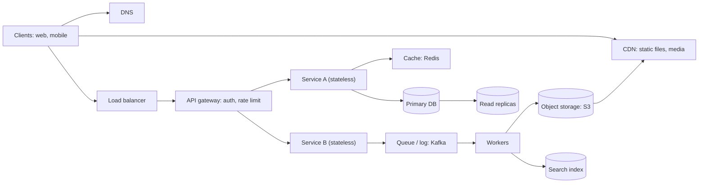

# Chapter 04 · System Design Cheatsheet

> The night before a system design round you don't want 14 chapters. You want one page that reminds you of every number, every building block and every trade-off, plus a skeleton answer for the classic questions. This is that page.

**How to use this chapter:**
- It's a **revision sheet**, not a first lesson. Each section links to the Part 3 chapter that teaches it properly.
- Before an interview: read Sections 1–3 (numbers), skim 4–10 (decision guides), then do 2–3 of the classic questions in Section 12 out loud with a timer.
- Every trade-off here is written as **"use when / costs you"**, because that's the sentence interviewers want to hear.

**Before this:** [Part 3 · System Design](../part-3-system-design/01-foundations-internet.md), especially [Estimation & The Interview Framework](../part-3-system-design/11-estimation-framework.md).

---

## 1. Latency Numbers Every Engineer Should Know

These are the classic order-of-magnitude numbers (popularised by Jeff Dean and Peter Norvig). Modern hardware beats some of them, but the **ratios** are what matter and they still hold.

| Operation | Time | In "human" terms (if 1 ns = 1 s) |
|---|---|---|
| L1 cache reference | 0.5 ns | half a second |
| Branch mispredict | 5 ns | 5 seconds |
| L2 cache reference | 7 ns | 7 seconds |
| Mutex lock / unlock | 25 ns | 25 seconds |
| Main memory (RAM) reference | 100 ns | under 2 minutes |
| Compress 1 KB (fast compressor like Snappy) | 3 µs | under an hour |
| Send 1 KB over a 1 Gbps network | 10 µs | about 3 hours |
| Read 4 KB randomly from SSD | 150 µs | under 2 days |
| Read 1 MB sequentially from RAM | 250 µs | about 3 days |
| Round trip within the same data centre | 500 µs | about 6 days |
| Read 1 MB sequentially from SSD | 1 ms | about 12 days |
| HDD disk seek | 10 ms | about 4 months |
| Read 1 MB sequentially from HDD | 20 ms | about 8 months |
| Packet round trip California → Netherlands → California | 150 ms | about 5 years |

**What to take away:**
- **Memory is ~100× faster than SSD random reads, and SSD is ~100× faster than a disk seek.** That's why caches exist.
- **Sequential beats random**, on every medium. That's why logs, Kafka and LSM trees append.
- **Network inside a data centre is cheap (~0.5 ms); across continents it's expensive (~150 ms).** That's why CDNs and multi-region deployments exist.
- **A user notices ~100 ms.** A page that makes 5 sequential cross-region calls already feels slow.

---

## 2. Powers of Two, Powers of Ten, and Handy Sizes

| Power of 2 | Exact | Approx | Name |
|---|---|---|---|
| 2¹⁰ | 1,024 | 10³ (thousand) | 1 KB |
| 2²⁰ | 1,048,576 | 10⁶ (million) | 1 MB |
| 2³⁰ | ~1.07 billion | 10⁹ (billion) | 1 GB |
| 2⁴⁰ | ~1.1 trillion | 10¹² (trillion) | 1 TB |
| 2⁵⁰ | | 10¹⁵ | 1 PB |

| Time | Seconds | Shortcut |
|---|---|---|
| 1 day | 86,400 | **≈ 10⁵** |
| 1 month | ~2.6 million | ≈ 2.5 × 10⁶ |
| 1 year | ~31.5 million | ≈ 3 × 10⁷ |

| Thing | Rough size |
|---|---|
| ASCII character | 1 byte (UTF-8: 1–4 bytes) |
| int / int64 / timestamp | 4 / 8 / 8 bytes |
| UUID | 16 bytes (36 chars as text) |
| A short text post with metadata | ~1 KB |
| A compressed photo | ~200 KB – 2 MB |
| A minute of compressed HD video | tens of MB |

| Requests per day | ≈ Average per second |
|---|---|
| 1 million | ~12 |
| 10 million | ~120 |
| 100 million | ~1,200 |
| 1 billion | ~12,000 |

### Availability "nines"

| Availability | Downtime per year | Downtime per month (approx.) |
|---|---|---|
| 99% ("two nines") | 3.65 days | 7.3 hours |
| 99.9% | 8.76 hours | 43.8 minutes |
| 99.99% | 52.6 minutes | 4.4 minutes |
| 99.999% | 5.26 minutes | 26 seconds |

Two components in **series**, each 99.9%, give 99.9% × 99.9% ≈ **99.8%**. Two **redundant** copies, each 99.9%, give 1 − (0.001)² = **99.9999%**. Redundancy multiplies the *failure* chances, which is why it's so powerful.

---

## 3. Back-of-the-Envelope Formulas

Full method: [Estimation & The Interview Framework](../part-3-system-design/11-estimation-framework.md).

| Quantity | Formula |
|---|---|
| Average QPS | `DAU × actions per user per day ÷ 86,400` (use 10⁵) |
| Peak QPS | `average × 2 to 3` (more for spiky products like flash sales) |
| Read vs write QPS | apply the read:write ratio (social apps are often 10:1 to 100:1 reads) |
| Storage per day | `new items per day × size per item` |
| Total storage | `storage per day × 365 × years × replication factor (usually 3)` |
| Bandwidth | `QPS × average response size` (separately for ingress and egress) |
| Cache memory | `~20% of daily read data` (the 80/20 rule: 20% of items get 80% of reads) |
| Number of servers | `peak QPS ÷ QPS one server can handle`, then add headroom |

The habit that impresses interviewers: **round aggressively, state assumptions, and say what the number *means* for the design** ("4 TB a year means one database is fine for storage, but 50k reads/s means we need caching").

Here's a tiny calculator you can adapt:

```python
SECONDS_PER_DAY = 86_400


def estimate(dau, writes_per_user, read_write_ratio, bytes_per_write, years, replication=3):
    write_qps = dau * writes_per_user / SECONDS_PER_DAY
    read_qps = write_qps * read_write_ratio
    storage_per_day = dau * writes_per_user * bytes_per_write
    total_storage = storage_per_day * 365 * years * replication
    return write_qps, read_qps, storage_per_day, total_storage


def human_bytes(n):
    for unit in ["B", "KB", "MB", "GB", "TB", "PB"]:
        if n < 1000:
            return f"{n:.1f} {unit}"
        n /= 1000
    return f"{n:.1f} EB"


# A Twitter-like app: 100M DAU, 2 posts each per day, 100 reads per write, 1 KB per post, 5 years
w, r, per_day, total = estimate(100_000_000, 2, 100, 1_000, 5)
print(f"writes/s ~ {w:,.0f} (peak ~ {3 * w:,.0f})")
print(f"reads/s  ~ {r:,.0f}")
print(f"storage/day ~ {human_bytes(per_day)}, 5 years x3 replicas ~ {human_bytes(total)}")
```

```text
writes/s ~ 2,315 (peak ~ 6,944)
reads/s  ~ 231,481
storage/day ~ 200.0 GB, 5 years x3 replicas ~ 1.1 PB
```

What the numbers tell you: writes are modest, but **230k reads/s** means the read path must be served from caches, and **1 PB** means media and posts must be sharded and/or put in object storage.

---

## 4. The Reference Architecture

Almost every design is a variation of this picture. Learn it, then add or remove boxes per question.



---

## 5. Building Blocks: Use When / Costs You

| Building block | Use when | Costs you / watch out for | Chapter |
|---|---|---|---|
| **DNS** | Turning names into IPs; simple geo-routing and failover | Caching (TTL) slows down changes | [01](../part-3-system-design/01-foundations-internet.md) |
| **CDN** | Static files, images, video, anything cacheable near users | Cost; invalidation delay; dynamic content gains less | [04](../part-3-system-design/04-caching-cdn.md) |
| **Load balancer (L4)** | Fast TCP-level spreading of connections | Can't route by URL/header | [02](../part-3-system-design/02-scalability-load-balancing.md) |
| **Load balancer (L7)** | Routing by path/header, TLS termination, sticky sessions | More CPU per request than L4 | [02](../part-3-system-design/02-scalability-load-balancing.md) |
| **API gateway** | One entry point: auth, rate limiting, routing, request shaping | Extra hop; can become a bottleneck or single point of failure | [07](../part-3-system-design/07-apis-communication.md) |
| **Stateless app servers** | Always: scale horizontally behind a load balancer | State must move to DB/cache/session store | [02](../part-3-system-design/02-scalability-load-balancing.md) |
| **Cache (Redis / Memcached)** | Read-heavy data, hot keys, sessions, counters, leaderboards | Staleness, invalidation complexity, memory cost | [04](../part-3-system-design/04-caching-cdn.md) |
| **Relational DB (Postgres / MySQL)** | Structured data, relations, transactions, strong consistency | Harder to scale writes horizontally (sharding is manual work) | [03](../part-3-system-design/03-databases.md) |
| **Key-value / wide-column NoSQL (DynamoDB / Cassandra)** | Huge scale, simple access by key, write-heavy | Limited queries and joins; usually eventual consistency | [03](../part-3-system-design/03-databases.md) |
| **Document DB (MongoDB)** | Flexible JSON-like records read as a whole | Cross-document joins and transactions are weaker | [03](../part-3-system-design/03-databases.md) |
| **Read replicas** | Scaling reads, isolating analytics queries | Replication lag: stale reads | [05](../part-3-system-design/05-replication-sharding.md) |
| **Sharding** | Data or write load too big for one machine | Cross-shard queries, rebalancing, hot shards | [05](../part-3-system-design/05-replication-sharding.md) |
| **Consistent hashing** | Spreading keys over nodes that come and go | Needs virtual nodes for even spread | [05](../part-3-system-design/05-replication-sharding.md) |
| **Message queue (SQS / RabbitMQ)** | Async work, smoothing spikes, decoupling services | Eventual processing; retries mean duplicates (be idempotent) | [08](../part-3-system-design/08-queues-events.md) |
| **Event log (Kafka)** | High-throughput streams, many consumers, replay, event sourcing | Operational complexity; ordering only within a partition | [08](../part-3-system-design/08-queues-events.md) |
| **Object storage (S3)** | Files, images, video, backups: cheap and durable at any size | Higher latency than block storage; no in-place edits | [10](../part-3-system-design/10-storage-search-ids.md) |
| **Search index (Elasticsearch)** | Full-text search, fuzzy matching, faceted filters | A second copy of data to keep in sync; not the source of truth | [10](../part-3-system-design/10-storage-search-ids.md) |
| **Unique ID generator (Snowflake-style)** | Distributed, time-sortable IDs without a central counter | Clock skew handling; 64-bit layout limits | [10](../part-3-system-design/10-storage-search-ids.md) |
| **Rate limiter** | Protecting services from abuse and overload | Shared counter needs fast atomic storage | [12](../part-3-system-design/12-case-studies-1.md) |
| **WebSocket servers** | Real-time two-way updates (chat, live location) | Stateful connections: harder to balance and scale | [07](../part-3-system-design/07-apis-communication.md) |
| **Bloom filter** | "Definitely not present" checks with tiny memory | False positives possible; no deletes in the basic version | [10](../part-3-system-design/10-storage-search-ids.md) |
| **Coordination service (ZooKeeper / etcd)** | Leader election, config, distributed locks, service discovery | Small data only; a cluster to run | [06](../part-3-system-design/06-cap-consistency.md) |
| **Monitoring / logging / tracing** | Always: you can't fix what you can't see | Storage cost; noisy alerts | [09](../part-3-system-design/09-microservices-reliability.md) |

---

## 6. Database Choice Guide

Full chapter: [Databases](../part-3-system-design/03-databases.md).

| If you need... | Choose | Because |
|---|---|---|
| Transactions, joins, constraints (money, orders, inventory, users) | **SQL** (PostgreSQL, MySQL) | ACID guarantees and a flexible query language |
| Lookups by key at massive scale, predictable latency | **Key-value** (DynamoDB, Redis as a store) | Partition by key, scales horizontally |
| Very high write volume, time-ordered data per key (messages, events, IoT) | **Wide-column** (Cassandra, HBase, ScyllaDB) | LSM-tree storage makes writes cheap; partition + clustering key gives fast range reads |
| Records with varying shape read as a whole (profiles, catalogues) | **Document** (MongoDB, Firestore) | Schema flexibility; one read gets the whole object |
| Deep relationship queries (friends of friends, recommendations, fraud rings) | **Graph** (Neo4j, Neptune) | Traversals without expensive self-joins |
| Full-text search, autocomplete, filters | **Search engine** (Elasticsearch, OpenSearch) | Inverted index |
| Metrics and time-stamped measurements | **Time-series** (Prometheus, InfluxDB, TimescaleDB) | Compression, downsampling, time-range queries |
| Analytics over billions of rows | **Columnar warehouse** (BigQuery, Redshift, ClickHouse, Snowflake) | Scans only the needed columns, heavy compression |
| Files, images, videos, backups | **Object storage** (S3, GCS) | Cheap, durable, effectively unlimited |
| Super-fast ephemeral data (sessions, counters, rankings) | **In-memory** (Redis) | Microsecond access, rich data structures |

**Quick rules:**
- **Default to SQL** unless you can name the reason it won't work. Most systems are fine with Postgres plus caching and read replicas for a long time.
- **Polyglot persistence** is normal: SQL for orders, Redis for sessions, S3 for images, Elasticsearch for search.
- **B-tree** storage (most SQL) is read-optimised; **LSM-tree** storage (Cassandra, RocksDB) is write-optimised.
- **Index** the columns you filter and join on; each index speeds reads but slows writes and uses space.
- **Normalise** for write correctness; **denormalise** for read speed (and accept duplicate data to keep in sync).

**SQL vs NoSQL in one table:**

| | SQL | NoSQL |
|---|---|---|
| Schema | fixed, enforced | flexible |
| Scaling | vertical first; sharding is manual | horizontal by design |
| Consistency | strong (ACID) | often eventual / tunable (BASE) |
| Queries | rich ad-hoc SQL, joins | access-pattern driven, few joins |
| Design approach | model the data, then query it | model the queries, then store data to fit them |

---

## 7. Caching Strategy Guide

Full chapter: [Caching & CDNs](../part-3-system-design/04-caching-cdn.md).

### Where to cache (closest to the user first)

Browser / app cache → CDN → load balancer or reverse proxy → application (in-process) → distributed cache (Redis) → database buffer pool.

### Read and write patterns

| Pattern | How it works | Use when | Costs you |
|---|---|---|---|
| **Cache-aside** (lazy loading) | App reads cache; on a miss, reads DB and fills the cache | The default for read-heavy workloads | First read is slow; stale data until TTL or invalidation |
| **Read-through** | The cache itself loads from the DB on a miss | You want the loading logic in one place | Needs a cache library/provider that supports it |
| **Write-through** | Write to cache and DB together, synchronously | Reads must see fresh data right after writes | Slower writes; caches data that may never be read |
| **Write-behind** (write-back) | Write to cache, flush to DB later in batches | Very write-heavy, can tolerate a little loss | Data loss if the cache dies before flushing |
| **Write-around** | Write to DB only; cache fills on later reads | Data written once, rarely read soon after | Recent writes miss the cache |

### Eviction policies

| Policy | Evicts | Good for |
|---|---|---|
| **LRU** | least recently used | general purpose (most common) |
| **LFU** | least frequently used | stable popularity (a few items always hot) |
| **TTL** | anything older than its time-to-live | data that becomes stale on a schedule |
| **FIFO** | oldest inserted | simple, rarely the best |

### Classic cache problems

| Problem | What happens | Fix |
|---|---|---|
| **Stale data** | DB changed, cache didn't | Delete the cache key on write (rather than updating it), plus a TTL as a safety net |
| **Cache stampede** (thundering herd) | A hot key expires, thousands of requests hit the DB at once | Lock/single-flight so only one request refills; refresh early; random jitter on TTLs |
| **Cache penetration** | Requests for keys that don't exist always miss and hit the DB | Cache "not found" briefly; Bloom filter in front |
| **Cache avalanche** | Many keys expire at the same moment | Randomise TTLs; warm the cache; multiple cache layers |
| **Hot key** | One key gets far more traffic than one cache node can serve | Replicate that key across nodes; local in-process cache; split the key |

**What to cache:** data read far more often than written, expensive computations, sessions, rendered pages, results of slow third-party calls. **What not to cache:** rapidly changing data that must be exact (account balance at payment time), or rarely read data.

---

## 8. Consistency Guide

Full chapter: [CAP, Consistency Models & Consensus](../part-3-system-design/06-cap-consistency.md).

### Models, strongest to weakest

| Model | Promise | Example use |
|---|---|---|
| **Linearizable (strong)** | Every read sees the latest completed write, as if there were one copy | Bank balance, seat booking, leader election, locks |
| **Sequential** | Everyone sees operations in the same order (not necessarily real time) | Replicated logs |
| **Causal** | If A caused B, everyone sees A before B | Comment replies, chat threads |
| **Read-your-writes** | You always see your own updates | Profile edits, posting a comment |
| **Monotonic reads** | You never see data go "back in time" | Feeds, timelines |
| **Eventual** | If writes stop, all replicas converge eventually | Like counts, view counts, DNS, product catalogue |

### CAP and PACELC in two lines

- **CAP:** during a network **P**artition you must choose **C**onsistency (refuse some requests) or **A**vailability (answer, maybe with stale data). Partitions will happen, so the real choice is C vs A *when they do*.
- **PACELC:** if Partition → A or C; **E**lse (normal operation) → **L**atency or **C**onsistency. Even without failures, stronger consistency costs latency.

| Choose CP when... | Choose AP when... |
|---|---|
| Wrong answers cost money or safety (payments, inventory, bookings) | Showing slightly old data is fine (feeds, likes, recommendations) |
| Examples: Zookeeper/etcd, a single-leader SQL setup with synchronous replication, Spanner | Examples: Cassandra, DynamoDB (default reads), DNS |

### Tools that buy consistency

| Tool | What it does | Note |
|---|---|---|
| **Quorum** (N replicas, W write acks, R read replies) | `R + W > N` guarantees a read overlaps the latest write | N=3, W=2, R=2 is the classic setting |
| **Consensus** (Raft, Paxos) | A majority agrees on each log entry; a leader is elected | Needs 2f + 1 nodes to survive f failures |
| **Leader-based replication** | All writes go through one leader | Simple; leader failover must be handled |
| **Two-phase commit (2PC)** | Atomic commit across several databases | Blocking if the coordinator fails; slow; avoid across services |
| **Saga** | A chain of local transactions with compensating actions on failure | The microservices answer to distributed transactions; eventually consistent |
| **Idempotency keys** | Repeating a request has the same effect as doing it once | Makes retries safe; essential for payments |
| **Version numbers / optimistic locking** | Update only `WHERE version = v` | Detects lost updates without long locks |
| **Vector clocks / CRDTs** | Detect or automatically merge concurrent updates | Used in AP stores and collaborative editing |

> 💡 "Exactly-once delivery" is practically impossible over a network. What real systems build is **at-least-once delivery + idempotent processing = exactly-once *effect***.

---

## 9. Communication Protocol Guide

Full chapter: [APIs & Communication Protocols](../part-3-system-design/07-apis-communication.md).

### API styles

| Style | Use when | Costs you |
|---|---|---|
| **REST** (HTTP + JSON) | Public APIs, CRUD on resources, browser clients, cacheable GETs | Over/under-fetching; many round trips for nested data |
| **GraphQL** | Many client types needing different shapes of data; aggregating several services | Harder caching; expensive queries need limits |
| **gRPC** (HTTP/2 + Protobuf) | Internal service-to-service calls; low latency; streaming; strict contracts | Not browser-native; binary payloads are harder to debug |

### Real-time options

| Option | How | Use when |
|---|---|---|
| **Short polling** | Client asks every N seconds | Updates are rare and a delay is fine; simplest |
| **Long polling** | Server holds the request until there's data or a timeout | Near-real-time where WebSockets aren't available |
| **Server-Sent Events (SSE)** | One long HTTP response streaming server → client | One-way live updates: notifications, scores, stock tickers, streaming text |
| **WebSocket** | A persistent two-way connection | Chat, multiplayer games, collaborative editing, live location |
| **Webhooks** | Server calls *your* URL when an event happens | Server-to-server events (payment succeeded, repo pushed) |

### Transport and HTTP

| Choice | Use when |
|---|---|
| **TCP** | You need reliable, ordered delivery (almost everything: HTTP, databases) |
| **UDP** | Speed matters more than every packet: video calls, gaming, DNS, live streams |
| **HTTP/1.1** | Simple; one request at a time per connection |
| **HTTP/2** | Many requests multiplexed over one connection; header compression |
| **HTTP/3 (QUIC over UDP)** | Faster connection set-up, no head-of-line blocking; good on mobile networks |

### Sync vs async between services

| | Synchronous call (REST/gRPC) | Asynchronous message (queue/log) |
|---|---|---|
| Caller waits? | yes | no |
| Coupling | caller depends on callee being up | decoupled in time |
| Good for | reads, things the user is waiting for | emails, video processing, analytics, fan-out |
| Failure handling | timeouts, retries, circuit breakers | retries, dead-letter queues, idempotent consumers |

**Queue vs pub/sub vs log:** a **queue** gives each message to *one* consumer (work distribution). **Pub/sub** gives each message to *every* subscriber (broadcast). A **log** (Kafka) keeps messages for a retention period so many consumer groups can read and replay at their own pace.

---

## 10. Reliability Patterns

Full chapter: [Microservices, Reliability & Observability](../part-3-system-design/09-microservices-reliability.md).

| Pattern | What it does | Use when |
|---|---|---|
| **Redundancy** (N+1, multi-AZ, multi-region) | No single point of failure | Always, for anything important |
| **Replication + failover** | A standby takes over when the primary dies | Databases, stateful services |
| **Timeouts** | Stop waiting for a slow dependency | Every network call, always |
| **Retries with exponential backoff + jitter** | Retry transient failures without stampeding | Idempotent operations only |
| **Circuit breaker** | After repeated failures, fail fast for a while, then test again | Calling a dependency that may be down |
| **Bulkhead** | Separate pools (threads, connections) per dependency | One slow dependency must not exhaust everything |
| **Rate limiting** | Cap requests per client | Public APIs, abuse protection |
| **Load shedding** | Drop low-priority work when overloaded | Traffic spikes beyond capacity |
| **Backpressure** | Slow producers down when consumers fall behind | Streaming pipelines, queues |
| **Graceful degradation** | Serve a reduced experience (cached, no recommendations) | Non-critical dependency is down |
| **Idempotency keys** | Make retries safe | Payments, orders, any "create" operation |
| **Dead-letter queue (DLQ)** | Park messages that keep failing for later inspection | Any queue consumer |
| **Transactional outbox** | Write the DB change and the event in one transaction; publish from the outbox table | "Update DB and publish an event" without losing either |
| **Health checks + auto-scaling** | Remove bad instances, add capacity under load | Every service behind a load balancer |
| **Chaos testing** | Break things on purpose to find weaknesses | Mature systems |

**Observability, the three pillars:** **metrics** (numbers over time), **logs** (what happened), **traces** (one request's path across services). Watch the **four golden signals**: **latency, traffic, errors, saturation**. Define **SLIs** (what you measure, e.g. p99 latency), **SLOs** (your target, e.g. p99 < 200 ms for 99.9% of minutes) and **SLAs** (the promise to customers, with penalties).

### Scaling playbook (in the order you usually apply it)

1. **Vertical scaling** (bigger machine): simplest, has a ceiling.
2. **Stateless app tier + load balancer** (horizontal scaling).
3. **Cache** hot reads; **CDN** for static and media.
4. **Read replicas** for read-heavy databases.
5. **Async processing** with queues for anything the user doesn't wait for.
6. **Shard** the database when writes or data size outgrow one machine (by user ID, by hash, by region).
7. **Split services** by domain when teams and deploys get in each other's way.
8. **Multi-region** for latency and disaster recovery.

---

## 11. The 7-Step Interview Framework

A 45–60 minute round, step by step. The prompts are questions to ask the interviewer (or yourself). [Chapter 11](../part-3-system-design/11-estimation-framework.md) walks through this with a full example.

| Step | Time (45 min) | Goal |
|---|---|---|
| 1. Requirements (functional + non-functional) | 0–5 min | What it must *do*, and how *well* |
| 2. Estimates | 5–9 min | Size the problem |
| 3. API design | 9–13 min | The contract |
| 4. Data model | 13–17 min | What's stored and where |
| 5. High-level design | 17–27 min | Boxes and arrows for the main flows |
| 6. Deep dives | 27–40 min | The 1–2 hardest parts, in depth |
| 7. Bottlenecks, trade-offs & wrap-up | 40–45 min | Failures, scaling, what you'd do next |

**Step 1 · Requirements: functional.** Prompts:
- "Who are the users, and what are the top 3 things they do?"
- "Which features are in scope today? (Let's park X and Y.)"
- "Is this read-heavy or write-heavy?"
- Write the core features as a short numbered list on the board.

**Step 1 (cont.) · Requirements: non-functional.** Prompts:
- "How many users? Daily active users? Growth?"
- "Latency target for the main action?"
- "Is it OK to show slightly stale data, or must it be strongly consistent?" (Pick per feature!)
- "Availability target? Any regions or compliance needs?"
- "Durability: can we ever lose data?"

**Step 2 · Estimates.** Prompts:
- QPS (average and peak), read:write ratio, storage over 5 years, bandwidth, cache size.
- Finish with **one sentence on what the numbers mean**: "So reads must be cached and storage must be sharded."

**Step 3 · API design.** Prompts:
- One endpoint per core feature: method, path, inputs, outputs.
- "REST is fine for clients; gRPC between services; WebSocket for the real-time part."
- Mention pagination (cursor-based), auth (token), idempotency keys for creates.

**Step 4 · Data model.** Prompts:
- Main entities and their key fields; the **access patterns** (how will we query them?).
- SQL or NoSQL for each, and **why**. The partition/shard key.

**Step 5 · High-level design.** Prompts:
- Draw the reference architecture (Section 4), then trace **each core flow** (write path, read path) through it.
- Keep it simple first. Make it correct, then make it scale.

**Step 6 · Deep dives.** Pick the 1–2 hardest parts (the interviewer often chooses).
- Caching details, sharding scheme, async pipelines, ID generation, real-time delivery.

**Step 7 · Bottlenecks, trade-offs & wrap-up.** Prompts:
- "What's the bottleneck at 10× load?" (hot keys, celebrity users, DB writes)
- "What happens when X fails?" (each box: redundancy, failover, retries)
- "Where could data become inconsistent, and is that OK?"
- Monitoring and alerts: what would you measure?
- **Wrap up:** summarise the design in 30 seconds and mention what you'd improve with more time.

> 💡 **Drive the conversation.** Say what you're about to do ("Let me first nail down requirements, then estimate, then sketch the design"). Check in at each step ("Does this API cover what you had in mind?"). Interviewers want to see how you think, not a memorised diagram.

---

## 12. 20 Classic Design Questions: Skeleton Answers

Each answer is a 5-line skeleton: **Requirements → Estimates → API & data → Core design → Scaling & deep dives**, plus the **key insight** the interviewer is waiting to hear. Use these to revise; learn the full designs from the linked chapters.

### 1. URL Shortener (TinyURL / bit.ly) · [Case Studies I](../part-3-system-design/12-case-studies-1.md)

1. **Requirements:** shorten a long URL, redirect fast, optional custom alias and expiry, click analytics. Very read-heavy (~100:1).
2. **Estimates:** 100M new URLs/month ≈ 40 writes/s, ~4,000 redirects/s; 5 years ≈ 6B URLs × ~500 B ≈ 3 TB.
3. **API & data:** `POST /urls {long_url} → {short_code}`, `GET /{code} → 301/302`. Key-value table `code → long_url, owner, created_at, expires_at`.
4. **Core design:** ID generator (pre-allocated counter ranges per server, or Snowflake) → **base62** encode (7 chars ≈ 3.5 trillion codes) → store. Redirect: cache (Redis) → DB on miss.
5. **Scaling:** cache hot codes (heavily skewed traffic), shard by code, analytics via an async queue, rate-limit creation to stop abuse.

> 🔑 **Key insight:** generate codes **without collisions or coordination** (counter ranges + base62, instead of hash-and-retry), and know **301 vs 302**: 301 is cached by browsers (less load), 302 lets you count every click.

### 2. Rate Limiter · [Case Studies I](../part-3-system-design/12-case-studies-1.md)

1. **Requirements:** limit requests per user / IP / API key per time window, across many servers, adding very little latency; reply `429 Too Many Requests` with retry headers.
2. **Estimates:** one check per API request, so it must be in-memory and sub-millisecond.
3. **API & data:** `allow(key) → bool`; Redis keys like `rate:{user}:{window}` holding counters or tokens with a TTL.
4. **Core design:** middleware in the API gateway. Algorithm choice: **token bucket** (allows bursts, most common), leaky bucket (smooth output), fixed window (simple, bursts at the boundary), sliding window log (exact, memory heavy), sliding window counter (good approximation, cheap).
5. **Scaling:** atomic updates with a Redis Lua script or `INCR` + `EXPIRE`; shard counters by key; decide **fail-open vs fail-closed** if Redis is down; local pre-checks to cut Redis traffic.

> 🔑 **Key insight:** the counter is **shared state across many servers**, so updates must be **atomic** in a fast central store, and the algorithm is chosen by how much **burst** you'll tolerate.

### 3. Notification System · [Case Studies I](../part-3-system-design/12-case-studies-1.md)

1. **Requirements:** send push, SMS and email; templates; user preferences and opt-outs; scheduling; retries; no duplicates or spam.
2. **Estimates:** e.g. 10M push + 1M SMS + 5M emails per day; bursts during campaigns.
3. **API & data:** `POST /notify {user_id, template, channel, data}`; tables for device tokens, preferences, a notification log with status.
4. **Core design:** API → validate + check preferences + rate limit → **one queue per channel** → channel workers → third-party providers (APNs/FCM for push, an SMS gateway, an email service).
5. **Scaling:** retries with backoff, dead-letter queue, **idempotency key** per notification to dedupe, priority queues (OTP beats marketing), tracking delivered/opened events.

> 🔑 **Key insight:** **decouple with per-channel queues** so a slow SMS provider can't block push notifications, and deliver **at-least-once + dedupe**.

### 4. Distributed Key-Value Store (Dynamo-style) · [Case Studies I](../part-3-system-design/12-case-studies-1.md)

1. **Requirements:** `get(key)`, `put(key, value)`; highly available; scales horizontally; tunable consistency; small values.
2. **Estimates:** huge key counts, high QPS, nodes failing routinely.
3. **API & data:** `get/put`; each node stores its key range on disk with an **LSM tree** (write-ahead log + memtable + sorted files + Bloom filters).
4. **Core design:** **consistent hashing with virtual nodes** to partition; replicate each key to the next N nodes on the ring; **quorum** reads/writes (R + W > N for strong-ish reads).
5. **Deep dives:** conflicts via vector clocks or last-write-wins; gossip for membership and failure detection; **hinted handoff** for temporary failures; **Merkle-tree anti-entropy** to repair replicas.

> 🔑 **Key insight:** the CAP trade-off becomes a **dial** (N, R, W), and every failure mode has a named mechanism (hinted handoff, read repair, Merkle trees).

### 5. Unique ID Generator · [Storage, Search & Unique IDs](../part-3-system-design/10-storage-search-ids.md)

1. **Requirements:** globally unique, 64-bit, roughly sortable by time, generated at very high rates without a central bottleneck.
2. **Estimates:** e.g. 100k IDs/s across the fleet.
3. **Options:** DB auto-increment (single point of failure), UUIDv4 (128-bit, random, unsortable, bad for B-tree index locality), ticket server, **Snowflake**.
4. **Core design (Snowflake):** 1 sign bit + **41-bit millisecond timestamp** (about 69 years) + **10-bit machine ID** (1,024 machines) + **12-bit sequence** (4,096 IDs per ms per machine).
5. **Deep dives:** clock going backwards (wait or refuse), assigning machine IDs (config or ZooKeeper), sequence overflow within a millisecond (wait for the next ms).

> 🔑 **Key insight:** **put time in the high bits and a machine ID in the middle**, and every node can generate sortable unique IDs independently.

### 6. Chat App (WhatsApp / Messenger) · [Case Studies II](../part-3-system-design/13-case-studies-2.md)

1. **Requirements:** 1:1 and group chat, delivery/read receipts, online presence, message history, offline delivery, multi-device.
2. **Estimates:** e.g. 500M DAU × 40 messages/day = 20B messages/day ≈ 230k messages/s; text is small, but storage grows fast.
3. **API & data:** WebSocket events (`send`, `ack`, `typing`); `messages(conversation_id, message_id, sender, body, ts)` in a wide-column store, partitioned by conversation, sorted by a time-ordered message ID.
4. **Core design:** clients hold a **WebSocket** to a chat server; a **session service** (Redis) maps user → chat server; the sender's server persists the message, then forwards it to the recipient's server, or triggers a **push notification** if the recipient is offline.
5. **Scaling:** group messages fan out per member (cap group size); presence via heartbeats with a TTL; per-conversation ordering via sequence IDs; end-to-end encryption means the server stores ciphertext.

> 🔑 **Key insight:** **stateful connections need a routing lookup** (who is connected where), and storage is **write-heavy, time-ordered per conversation**, which fits a wide-column store.

### 7. News Feed (Facebook / Twitter / Instagram) · [Case Studies II](../part-3-system-design/13-case-studies-2.md)

1. **Requirements:** publish posts; view a feed of followed users' posts (ranked or recent); low-latency feed loads.
2. **Estimates:** read-heavy (e.g. 100:1); hundreds of thousands of feed reads/s at peak.
3. **API & data:** `POST /posts`, `GET /feed?cursor=`; posts table, follow graph, and a **per-user feed cache** of post IDs.
4. **Core design:** **fan-out on write** (push a new post ID into each follower's feed cache) makes reads instant; **fan-out on read** (pull and merge at read time) avoids huge writes.
5. **Scaling:** **hybrid**: push for normal users, pull for celebrities with millions of followers; hydrate post IDs from post and user caches; media via CDN; ranking service as a separate step.

> 🔑 **Key insight:** the **celebrity problem**. Pure push explodes for accounts with 100M followers; pure pull is slow for everyone. **Hybrid fan-out** is the expected answer.

### 8. Video Streaming (YouTube / Netflix) · [Case Studies II](../part-3-system-design/13-case-studies-2.md)

1. **Requirements:** upload, process, stream smoothly on any device and network; search; view counts.
2. **Estimates:** storage dominated by video (multiple resolutions per upload); egress bandwidth is the biggest cost.
3. **API & data:** `POST /videos` returns a **pre-signed upload URL**; metadata DB (title, owner, status, renditions); raw and processed files in object storage.
4. **Core design:** upload directly to object storage → queue → **transcoding pipeline** (split into segments, encode several resolutions and codecs in parallel) → store renditions → **CDN**.
5. **Scaling:** **adaptive bitrate streaming** (HLS/DASH: the player switches quality per few-second segment), pre-warm CDN for popular content, view counts aggregated asynchronously.

> 🔑 **Key insight:** the app servers never touch the video bytes: **object storage + async parallel transcoding + CDN + adaptive bitrate** do the heavy lifting.

### 9. Ride-Hailing (Uber / Ola) · [Case Studies II](../part-3-system-design/13-case-studies-2.md)

1. **Requirements:** riders request rides; match a nearby driver quickly; live location tracking; trip lifecycle; payment.
2. **Estimates:** e.g. 1M active drivers sending location every 4 s = 250k location writes/s.
3. **API & data:** `POST /rides`, driver location updates over WebSocket; trips in a SQL database (state machine: requested → matched → started → completed).
4. **Core design:** **location service** keeps current driver positions **in memory** with a **geospatial index** (geohash / quadtree / H3); matching service queries nearby available drivers, offers the ride, and **atomically reserves** the chosen driver.
5. **Scaling:** shard location data by region; only the latest position matters (overwrite, don't append); payments and receipts are async; surge pricing from supply/demand per cell.

> 🔑 **Key insight:** location is **high-volume, short-lived data**, so keep it in an in-memory geo index rather than the main DB, and make driver assignment **atomic** so one driver never gets two rides.

### 10. Web Crawler · [Case Studies II](../part-3-system-design/13-case-studies-2.md)

1. **Requirements:** crawl billions of pages, respect `robots.txt` and politeness, avoid duplicates, refresh pages over time.
2. **Estimates:** 1B pages/month ≈ 400 pages/s; ~100 KB/page ≈ 100 TB/month of raw HTML.
3. **Data:** URL frontier, "seen URL" set, content hashes, page store in object storage.
4. **Core design:** seed URLs → **URL frontier** (priority queues + **per-host politeness queues**) → fetchers (with a DNS cache) → parser → **dedupe** URLs (Bloom filter / seen set) and content (hash or SimHash) → store → extract links → frontier.
5. **Scaling:** partition the frontier by hostname hash so one worker owns a host; handle spider traps (depth limits, URL length limits); recrawl priority by how often a page changes.

> 🔑 **Key insight:** the **frontier** is the brain: priority decides *what* to crawl, per-host queues decide *when*, and dedupe stops wasted work.

### 11. Search Autocomplete (Typeahead) · [Case Studies II](../part-3-system-design/13-case-studies-2.md)

1. **Requirements:** top 5–10 suggestions for a prefix within ~100 ms; popularity-based; updates daily is fine.
2. **Estimates:** a request per keystroke: very high read QPS; small data (the top queries).
3. **Data:** a **trie** where each node caches the **top-k completions** for its prefix.
4. **Core design:** **offline pipeline** aggregates query logs (counts per query) and rebuilds the trie periodically; **online serving** is a memory lookup, prefix → precomputed top-k.
5. **Scaling:** shard by prefix range; replicate for reads; cache popular prefixes at the CDN/browser; debounce keystrokes on the client; filter offensive terms.

> 🔑 **Key insight:** **precompute top-k per prefix** and separate the **data-collection pipeline** from the **serving path**. Never compute rankings at query time.

### 12. File Sync & Storage (Dropbox / Google Drive) · [Storage, Search & Unique IDs](../part-3-system-design/10-storage-search-ids.md)

1. **Requirements:** upload/download, sync across devices, share, version history, works with large files and flaky networks.
2. **Estimates:** storage-heavy (PBs); most files rarely change; bandwidth is precious.
3. **Data:** files split into **chunks** (a few MB each) identified by **content hash**; metadata DB (files, versions, chunk lists, permissions) with strong consistency.
4. **Core design:** client chunks the file, uploads **only the chunks the server doesn't already have** to object storage, then commits new metadata; a **notification service** (long polling / WebSocket) tells other devices to pull changes.
5. **Deep dives:** dedupe across users by hash, resumable uploads per chunk, conflict handling (save a "conflicted copy"), cold storage tiers for old versions.

> 🔑 **Key insight:** **chunking + content hashing** gives you dedupe, delta sync and resumable uploads at once; **metadata** is the part that must be strongly consistent.

### 13. Photo Sharing (Instagram) · [Case Studies II](../part-3-system-design/13-case-studies-2.md)

1. **Requirements:** upload photos, follow users, view feed, like and comment.
2. **Estimates:** e.g. 100M uploads/day × 1 MB ≈ 100 TB/day before resizing; very read-heavy.
3. **API & data:** pre-signed upload to object storage; photo metadata sharded by user ID; likes and comments in separate tables or stores; counters cached.
4. **Core design:** upload → object storage → async workers create thumbnails and multiple sizes → CDN. The feed reuses the news-feed design (#7).
5. **Scaling:** CDN for all images; like counts updated asynchronously (approximate is fine); hot-post caching; shard by user ID.

> 🔑 **Key insight:** split the **media path** (object storage + async processing + CDN) from the **metadata path** (DB + cache), and reuse the feed's fan-out strategy.

### 14. Ticket / Seat Booking (BookMyShow, airline seats) · [Databases](../part-3-system-design/03-databases.md)

1. **Requirements:** browse shows, view a seat map, hold seats for a few minutes, pay, confirm. **Never double-book.**
2. **Estimates:** modest average load, **massive spikes** when popular shows open.
3. **Data:** `seats(show_id, seat_id, status, hold_until, booking_id, version)` in a **SQL** database.
4. **Core design:** "hold" = a conditional update `UPDATE ... SET status='HELD' WHERE status='FREE'` (or a Redis key with TTL); payment with an idempotency key; confirm in a transaction; expired holds release automatically.
5. **Scaling:** virtual waiting room / queue for spikes; cache the seat map with short TTLs but re-check on hold; shard by show/venue.

> 🔑 **Key insight:** seat inventory needs **strong consistency**: atomic conditional updates or row locks, plus **holds with expiry** so abandoned checkouts don't lock seats forever.

### 15. Payment System · [Message Queues & Event-Driven Architecture](../part-3-system-design/08-queues-events.md)

1. **Requirements:** charge, refund, payouts; never double-charge; auditable; integrates with payment providers (PSPs).
2. **Estimates:** low QPS compared to social apps, but **correctness beats everything**.
3. **API & data:** `POST /payments` with an **idempotency key**; payment state machine (created → authorised → captured / failed / refunded); **double-entry ledger** (every movement is a debit and an equal credit).
4. **Core design:** payment service → PSP; PSP results arrive via **webhooks** (retried, so handlers must be idempotent); the **outbox pattern** publishes events reliably.
5. **Deep dives:** daily **reconciliation** with PSP settlement files; retries with backoff; timeouts leave status "unknown" → query the PSP before retrying; strong consistency (SQL) for the ledger.

> 🔑 **Key insight:** **exactly-once effect** = idempotency keys + a double-entry ledger + reconciliation. Assume every message can arrive twice.

### 16. Leaderboard (gaming, contests) · [Caching & CDNs](../part-3-system-design/04-caching-cdn.md)

1. **Requirements:** update scores in real time, show top N, show my rank, daily/weekly/all-time boards.
2. **Estimates:** e.g. 10M players, thousands of score updates per second.
3. **Data:** **Redis sorted set** per board (`ZINCRBY` to update, `ZREVRANGE` for top N, `ZREVRANK` for my rank, each O(log n)); durable copy of scores in a DB.
4. **Core design:** score events → service → sorted set; periodic boards as separate keys with expiry.
5. **Scaling:** for huge boards, shard by user and **merge per-shard top-k** for the global top N; approximate ranks (score buckets) for users far from the top.

> 🔑 **Key insight:** a **sorted set** (skip list + hash map inside Redis) gives updates and rank queries in O(log n); for global scale, **top-k per shard then merge**.

### 17. Distributed Message Queue (Kafka) · [Message Queues & Event-Driven Architecture](../part-3-system-design/08-queues-events.md)

1. **Requirements:** producers publish, many consumers read independently, high throughput, durable, replayable, ordered (at least per key).
2. **Estimates:** millions of messages/s across the cluster.
3. **Data:** **topics** split into **partitions**; each partition is an **append-only log** on disk; consumers track their **offset**.
4. **Core design:** producer hashes the message key → partition (same key, same partition, so ordered); each partition has a **leader** and followers (in-sync replicas); consumer groups split partitions among their members.
5. **Deep dives:** `acks=all` for durability; retention by time/size; throughput from **sequential disk writes, OS page cache, batching and zero-copy**; delivery semantics (at-most / at-least / exactly-once with idempotent producers and transactions).

> 🔑 **Key insight:** a **partitioned, replicated append-only log**: ordering per partition, scale by adding partitions, replay by moving the offset.

### 18. Proximity Service (Yelp / "restaurants near me") · [Case Studies II](../part-3-system-design/13-case-studies-2.md)

1. **Requirements:** find businesses within a radius, filter and rank; business data changes rarely.
2. **Estimates:** very read-heavy; e.g. 200M businesses fit in memory as a geo index.
3. **Data:** businesses table (SQL, source of truth) + a **geospatial index**: geohash strings, quadtree, or H3/S2 cells.
4. **Core design:** compute the user's geohash at a precision matching the radius, look up that cell **plus its 8 neighbours**, filter by exact distance, rank by distance/rating.
5. **Scaling:** read replicas and in-memory caches of the index; rebuild the index nightly; shard by region.

> 🔑 **Key insight:** **turn 2D search into 1D prefix lookups** (geohash: nearby points share prefixes), and always check **neighbouring cells** for points near a border.

### 19. Metrics & Monitoring System (Prometheus / Datadog) · [Microservices, Reliability & Observability](../part-3-system-design/09-microservices-reliability.md)

1. **Requirements:** collect metrics from thousands of hosts, dashboards, alerting, long retention at lower resolution.
2. **Estimates:** e.g. 10k hosts × 1,000 metrics every 10 s = 1M data points/s, write-heavy.
3. **Data:** **time-series DB**: series identified by name + labels; points compressed (delta and XOR encodings).
4. **Core design:** agents push (or a scraper pulls) → collectors → Kafka buffer → time-series DB; query service → dashboards; **alerting engine** evaluates rules on a schedule and routes alerts (dedupe, silencing, escalation).
5. **Scaling:** **downsampling** (keep 10 s data for days, 1 h rollups for years), shard by series, limit label cardinality, alerting kept independent so it works when the dashboards don't.

> 🔑 **Key insight:** metrics are **append-only, time-ordered and write-heavy**: compress, downsample old data, and keep the **alerting path separate and highly reliable**.

### 20. Collaborative Editor (Google Docs) · [CAP, Consistency Models & Consensus](../part-3-system-design/06-cap-consistency.md)

1. **Requirements:** many users edit the same document at once and see each other's changes in real time; offline edits; history.
2. **Estimates:** most docs have few concurrent editors; latency matters more than throughput.
3. **Data:** a document = periodic **snapshots + an operation log** (insert/delete at position, with versions).
4. **Core design:** clients connect by **WebSocket** to the server that owns the document session; concurrent edits are merged with **Operational Transformation** (server orders and transforms operations) or **CRDTs** (operations designed to merge in any order).
5. **Scaling:** route all editors of one doc to the same session server (consistent hashing on doc ID); cursors/presence are ephemeral; compact the op log into snapshots.

> 🔑 **Key insight:** concurrent edits must **converge** to the same document on every client: name **OT vs CRDT** and the trade-off (OT needs a central server; CRDTs merge peer-to-peer but carry metadata overhead).

> 💡 Many interviews also include a **low-level design** (machine coding) round: parking lot, elevator, LRU cache, splitwise. That's a different skill: classes, interfaces and design patterns. See [Low-Level Design](../part-3-system-design/14-low-level-design.md).

---

## 13. Never-Forget Summary

- **Numbers:** RAM 100 ns, SSD read ~150 µs, same-DC round trip 0.5 ms, cross-continent 150 ms. A day ≈ 10⁵ seconds.
- **QPS = DAU × actions ÷ 10⁵**, peak ×2–3. Storage = items/day × size × days × 3 replicas.
- **Default stack:** DNS → CDN → LB → stateless services → cache → SQL (+ replicas) → queue → workers → object storage.
- **Scale reads** with caches, CDNs and replicas. **Scale writes** with sharding and async queues.
- **Default to SQL**; pick NoSQL for a named reason (scale by key, write volume, flexible shape, graph, search).
- **Cache-aside + TTL + delete-on-write** is the default caching story; know stampede, penetration, avalanche, hot keys.
- **Consistency per feature:** money and inventory → strong; feeds and counters → eventual.
- **Real time:** WebSocket (two-way), SSE (server push), long polling (fallback), webhooks (server-to-server).
- **Reliability:** timeouts, retries with backoff + jitter (only if idempotent), circuit breakers, DLQs, outbox.
- **Framework:** requirements → non-functional → estimates → API → data → high-level → deep dives.

**Memory hook: "Really Nice Engineers Always Draw Hard Diagrams"**: **R**equirements, **N**on-functional, **E**stimates, **A**PI, **D**ata model, **H**igh-level design, **D**eep dives.

**One picture:**

| Problem shape | Reach for |
|---|---|
| Read-heavy | Cache + CDN + read replicas |
| Write-heavy | Sharding + LSM storage + async queues |
| Real-time | WebSocket + pub/sub |
| Huge files | Object storage + chunking + CDN |
| Search | Inverted index (Elasticsearch) |
| Location | Geohash / quadtree in memory |
| Must never be wrong | SQL transactions + idempotency + ledger |
| Spiky traffic | Queue + autoscaling + rate limiting |
| Celebrity / hot key | Hybrid fan-out, key replication |

> **If you remember only one thing:** there is no perfect design, only **trade-offs**. Say what you chose, what it costs, and what you'd pick if the requirements changed.

---
**Next:** [Chapter 05 · 12-Week Roadmap & Revision System](05-roadmap-and-revision.md)  ·  **Back to** [Contents](../README.md)
