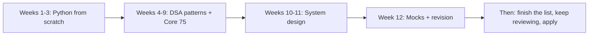

# Chapter 05 · 12-Week Roadmap & Revision System

> Most people don't fail interview prep because it's too hard. They fail because they start strong, skip a few days, forget what they learned, and quietly give up in week three. This chapter is the system that stops that: a week-by-week plan, a way to study that makes things stick, and a revision schedule that fights forgetting for you.

**How to use this chapter:**
- Read it once fully before you start. Then come back every Sunday to check the next week's plan.
- Copy the **daily routine**, the **revision tracker** and the **problem log** into a notebook or spreadsheet. Ticking boxes is surprisingly motivating.
- The plan assumes **2–3 hours a day, 6 days a week**, for a student starting from zero. If you already know Python, compress Weeks 1–3 into one week and use the spare time for problems.

**Before this:** Nothing! You can read this chapter first. The rest of Part 4 is used throughout the plan: [Pattern Recognition](01-pattern-recognition.md), [Python Interview Questions](02-python-interview-questions.md), [Must-Do Problems](03-must-do-problems.md), [System Design Cheatsheet](04-system-design-cheatsheet.md).

---

## 1. The Big Picture



| Phase | Weeks | Chapters | Goal at the end |
|---|---|---|---|
| **1 · Python** | 1–3 | [Part 1](../part-1-python/01-getting-started.md), 18 chapters | Write any small program without looking things up; answer most 🔥🔥🔥 Python questions |
| **2 · DSA** | 4–9 | [Part 2](../part-2-dsa/01-big-o-complexity.md), 24 chapters | Solve the **Core 75** and recognise the pattern of a new Medium within 5 minutes |
| **3 · System Design** | 10–11 | [Part 3](../part-3-system-design/01-foundations-internet.md), 14 chapters | Run a 45-minute design discussion using the 7-step framework |
| **4 · Interview mode** | 12 | Part 4 | Mock interviews, revision, polished resume |

> ⚠️ **Twelve weeks is a sprint.** It works if you're consistent. If life gets in the way, stretch it (see the 20-week version in Section 3) rather than skipping understanding. Being a week late is fine. Moving on without understanding is not, because every later chapter builds on the earlier ones.

---

## 2. The Daily Routine (2–3 hours)

Same structure every day, so you never waste energy deciding what to do.

| Block | Time | What you do |
|---|---|---|
| **1. Review** | 15–20 min | Revisions that are due today (chapters on the tracker, problems in the log). Always first. |
| **2. Learn** | 60–75 min | Read today's chapter section **with the editor open**. Type and run every code block. |
| **3. Practise** | 45–60 min | The chapter's Practice exercises, then that day's problems from the Must-Do list. |
| **4. Lock it in** | 10 min | Close the book. Write 3–5 bullet points from memory. Update your tracker and log. |

**Weekly rhythm:**
- **Monday–Friday:** the routine above.
- **Saturday:** catch-up + a **weekly mini-test**: 3 problems from this week, 60 minutes, no notes.
- **Sunday:** light day. A LeetCode contest or a project session, plus plan next week. Rest is part of the plan: memory consolidates while you sleep and rest.

---

## 3. The 12-Week Plan

"Problems" means new problems from the [Must-Do List](03-must-do-problems.md) (⭐ = Core 75). Reviews are on top of these.

### Phase 1 · Python (Weeks 1–3)

There are no Must-Do problems yet: each Part 1 chapter's own Practice section is your problem set. Add the warm-ups at the end of each week.

| Week | Chapters | Practice | Mini-project (weekend) |
|---|---|---|---|
| **1** | [01 Getting Started](../part-1-python/01-getting-started.md) · [02 Variables & Memory](../part-1-python/02-variables-types-memory.md) · [03 Operators](../part-1-python/03-operators-expressions.md) · [04 Strings](../part-1-python/04-strings.md) · [05 Conditionals](../part-1-python/05-conditionals.md) · [06 Loops](../part-1-python/06-loops.md) | All chapter Practice sections | Number-guessing game with a fixed seed option; a "pattern printer" (pyramids, diamonds) |
| **2** | [07 Lists](../part-1-python/07-lists.md) · [08 Tuples & Sets](../part-1-python/08-tuples-sets.md) · [09 Dictionaries](../part-1-python/09-dictionaries.md) · [10 Functions](../part-1-python/10-functions.md) · [11 Comprehensions](../part-1-python/11-comprehensions-functional.md) · [12 Recursion](../part-1-python/12-recursion.md) | All chapter Practice sections + warm-ups: Two Sum, Contains Duplicate, Valid Anagram, Majority Element, Climbing Stairs (recursion + memo) | Word-frequency counter for any text; a quiz game driven by a dictionary of questions |
| **3** | [13 Exceptions & Files](../part-1-python/13-exceptions-files.md) · [14 OOP I](../part-1-python/14-oop-classes-objects.md) · [15 OOP II](../part-1-python/15-oop-inheritance-magic.md) · [16 Iterators, Generators, Decorators](../part-1-python/16-iterators-generators-decorators.md) · [17 Modules & Stdlib](../part-1-python/17-modules-stdlib.md) · [18 Internals & Concurrency](../part-1-python/18-internals-concurrency.md) | All chapter Practice sections + warm-ups: Valid Parentheses, Best Time to Buy and Sell Stock, Move Zeroes, Single Number | Command-line expense tracker saving to JSON/CSV, with classes, exceptions and tests |

**End of Phase 1 check:** answer every 🔥🔥🔥 question in [Python Interview Questions](02-python-interview-questions.md) out loud. Can't explain one? Re-read its chapter section before Week 4.

### Phase 2 · DSA (Weeks 4–9)

About 4 chapters a week. Do each chapter's ⭐ problems the same day or the next day after reading it.

| Week | Chapters | Problems (new) | Mini-project (weekend) |
|---|---|---|---|
| **4** | [01 Big-O](../part-2-dsa/01-big-o-complexity.md) · [02 Arrays & Strings](../part-2-dsa/02-arrays-strings.md) · [03 Two Pointers](../part-2-dsa/03-two-pointers.md) · [04 Sliding Window](../part-2-dsa/04-sliding-window.md) · [05 Hashing](../part-2-dsa/05-hashing.md) | **18**: all 15 ⭐ of chapters 02–05 + 3 more | A timing experiment: measure O(n²) vs O(n) on growing inputs and print a table |
| **5** | [06 Prefix Sums](../part-2-dsa/06-prefix-sums.md) · [07 Sorting](../part-2-dsa/07-sorting.md) · [08 Binary Search](../part-2-dsa/08-binary-search.md) · [09 Backtracking](../part-2-dsa/09-backtracking.md) | **16**: 11 ⭐ + 5 more | Sorting visualiser in the terminal; a Sudoku solver (backtracking) |
| **6** | [10 Linked Lists](../part-2-dsa/10-linked-lists.md) · [11 Stacks](../part-2-dsa/11-stacks.md) · [12 Queues & Deques](../part-2-dsa/12-queues-deques.md) · [13 Binary Trees](../part-2-dsa/13-binary-trees.md) | **20**: 18 ⭐ + 2 more | An LRU cache class with unit tests; an expression calculator using stacks |
| **7** | [14 BSTs](../part-2-dsa/14-binary-search-trees.md) · [15 Heaps](../part-2-dsa/15-heaps.md) · [16 Graphs I](../part-2-dsa/16-graphs-bfs-dfs.md) · [17 Graphs II](../part-2-dsa/17-graphs-advanced.md) | **16**: 13 ⭐ + 3 more | Maze solver (BFS shortest path, printed step by step); metro route finder with Dijkstra |
| **8** | [18 Union-Find](../part-2-dsa/18-union-find.md) · [19 Tries](../part-2-dsa/19-tries.md) · [20 DP I](../part-2-dsa/20-dp-1d.md) · [21 DP II](../part-2-dsa/21-dp-2d-advanced.md) | **16**: 12 ⭐ + 4 more | Autocomplete CLI with a trie; spell-checker suggesting words by edit distance |
| **9** | [22 Greedy & Intervals](../part-2-dsa/22-greedy-intervals.md) · [23 Bits & Math](../part-2-dsa/23-bits-math.md) · [24 Advanced Structures](../part-2-dsa/24-advanced-structures.md) · [Pattern Recognition](01-pattern-recognition.md) | **18**: 6 ⭐ + 12 **mixed** (random sections) | First **DSA mock interview** (Section 7) |

DSA weeks are the heaviest. Two things keep them manageable:
1. **The Core 75 are the priority.** If you're short on time, drop the "more" problems, never the ⭐ ones or the reviews.
2. **DP (Week 8) takes longer for everyone.** If you need a second week for chapters 20–21, take it and slide the rest of the plan.

### Phase 3 · System Design (Weeks 10–11)

About one chapter a day. Keep DSA alive with **2 mixed problems a day** (12 a week), mostly from the non-⭐ rows you haven't done yet.

| Week | Chapters | Problems (new) | Project (through both weeks) |
|---|---|---|---|
| **10** | [01 Foundations](../part-3-system-design/01-foundations-internet.md) · [02 Scalability & LB](../part-3-system-design/02-scalability-load-balancing.md) · [03 Databases](../part-3-system-design/03-databases.md) · [04 Caching & CDNs](../part-3-system-design/04-caching-cdn.md) · [05 Replication & Sharding](../part-3-system-design/05-replication-sharding.md) · [06 CAP & Consensus](../part-3-system-design/06-cap-consistency.md) · [07 APIs & Protocols](../part-3-system-design/07-apis-communication.md) | **12** mixed | Build a **URL shortener** API (e.g. FastAPI or Flask + SQLite), then add a Redis cache and a token-bucket rate limiter |
| **11** | [08 Queues & Events](../part-3-system-design/08-queues-events.md) · [09 Microservices & Reliability](../part-3-system-design/09-microservices-reliability.md) · [10 Storage, Search & IDs](../part-3-system-design/10-storage-search-ids.md) · [11 Estimation & Framework](../part-3-system-design/11-estimation-framework.md) · [12 Case Studies I](../part-3-system-design/12-case-studies-1.md) · [13 Case Studies II](../part-3-system-design/13-case-studies-2.md) · [14 Low-Level Design](../part-3-system-design/14-low-level-design.md) | **12** mixed | Add a background worker (a queue for click analytics) and a Snowflake-style ID generator to the shortener; write a README with an architecture diagram |

**During Week 11:** practise 3 of the 20 classic questions from the [System Design Cheatsheet](04-system-design-cheatsheet.md) out loud, 45 minutes each, drawing on paper.

### Phase 4 · Interview mode (Week 12)

| Day | Focus |
|---|---|
| Mon | DSA mock #2 · re-solve 5 ⭐ problems you marked 🔁 |
| Tue | System design mock #1 (URL shortener or chat) · review [cheatsheet](04-system-design-cheatsheet.md) Sections 1–3 |
| Wed | Python rapid-fire: all 🔥🔥🔥 and 🔥🔥 questions in [Python Interview Questions](02-python-interview-questions.md) |
| Thu | DSA mock #3 · [Pattern Recognition](01-pattern-recognition.md) decoder table + templates |
| Fri | System design mock #2 (news feed or ride-hailing) · behavioural stories (Section 8) |
| Sat | Resume final pass · project READMEs · a full mock (DSA + SD back to back) |
| Sun | Rest. Then plan: apply, keep 1–2 problems a day, finish the remaining list |

**By the end of Week 12:** all Core 75 done and reviewed, ~135 problems total, 56 chapters read, 2 projects on GitHub, at least 5 mock interviews.

### The relaxed version (20 weeks, ~1.5 hours a day)

| Weeks | Covers |
|---|---|
| 1–5 | Part 1 (about 4 chapters a week) |
| 6–14 | Part 2 (about 3 chapters a week) + Core 75 + ~40 more problems |
| 15–18 | Part 3 (about 4 chapters a week) + 1 problem a day |
| 19–20 | Week 12's interview mode, spread over two weeks |

---

## 4. How to Study a Chapter (so you only learn it once)

Reading feels productive but is the weakest way to learn. These four techniques are what turn reading into memory.

### 4.1 The 5-step chapter method

1. **Preview (5 min).** Read the hook, "You will learn", all headings, and the Never-Forget Summary *first*. Now your brain has hooks to hang details on.
2. **Read actively (main time).** For each code block: **predict the output, type it, run it, then change one thing** and predict again. Never copy-paste. Typing makes you notice every detail.
3. **Practise before peeking.** Do the Practice exercises. Struggle for at least 15 minutes before opening a solution. The struggle *is* the learning.
4. **Active recall (10 min).** Close the book. On a blank page, write everything you remember: key ideas, a template, a trap. Then open the summary and fill the gaps in a different colour. The gaps show you exactly what to review.
5. **Teach it back (5 min).** Explain the chapter's main idea out loud as if to a friend who's never heard of it (the **Feynman technique**). Use simple words and an example. Wherever you stumble or say "basically, it just works", you've found a gap.

### 4.2 Why these work (the short version)

| Technique | Why it works |
|---|---|
| **Typing code** | Forces attention to every symbol; builds muscle memory for interviews where you can't copy anything |
| **Predicting output** | Turns reading into testing your mental model; wrong predictions are where you learn most |
| **Active recall** | Pulling information *out* of memory strengthens it far more than putting it in again by re-reading |
| **Teach-back (Feynman)** | You can't explain what you don't understand; it exposes fake understanding fast |
| **Spaced repetition** | Reviewing just as you start to forget resets the forgetting curve, and each time it gets flatter |
| **Interleaving (mixing topics)** | Practising mixed problems trains *choosing* the right method, which is what interviews test |

### 4.3 Spaced repetition: 1 / 3 / 7 / 21 days

After you finish a chapter, review it on these days. Each review is short.

| When | What to do (10–20 min) |
|---|---|
| **Day 1** (next day) | Re-read the Never-Forget Summary. Redo one Practice exercise without looking. |
| **Day 3** | Blank-page recall: write the key ideas and one template from memory, then check. |
| **Day 7** | Re-solve 1–2 problems from that chapter from scratch (or answer its Interview Questions out loud). |
| **Day 21** | Teach-back: explain the chapter in 3 minutes, then solve one *new* problem that uses it. |

If a review goes badly, do it again 2 days later before continuing the schedule.

> 💡 Problems from the Must-Do list follow their own schedule (**day 3, 10 and 30**), described in [Chapter 03](03-must-do-problems.md). Chapters and problems are reviewed separately but in the same daily review block.

### 4.4 The revision tracker (copy this)

Fill a row when you finish a chapter. Each day, look down the columns for dates that have arrived.

| Chapter | Finished | Day 1 | Day 3 | Day 7 | Day 21 | Confidence (1–5) | Weak spots |
|---|---|---|---|---|---|---|---|
| P1-07 Lists | 10-Jun | ✅ 11-Jun | ✅ 13-Jun | 17-Jun | 01-Jul | 4 | slicing with negative steps |
| P2-04 Sliding Window | 01-Jul | ✅ 02-Jul | 04-Jul | 08-Jul | 22-Jul | 3 | when to shrink: "while invalid" vs "while valid" |
| | | | | | | | |

A tiny program can work out the dates for you:

```python
from datetime import date, timedelta

REVIEW_GAPS = [1, 3, 7, 21]
XP = {"easy": 1, "medium": 3, "hard": 5, "review": 1}


def review_dates(finished_on):
    return [finished_on + timedelta(days=gap) for gap in REVIEW_GAPS]


def weekly_xp(activities):
    return sum(XP[kind] for kind in activities)


for day in review_dates(date(2025, 6, 2)):
    print(day.strftime("%a %d %b"))
print("XP this week:", weekly_xp(["easy", "medium", "medium", "hard", "review", "review"]))
```

```text
Tue 03 Jun
Thu 05 Jun
Mon 09 Jun
Mon 23 Jun
XP this week: 14
```

---

## 5. Making It Fun (so you actually keep going)

Motivation fades; systems don't. Build a few of these in.

### 5.1 Streaks and points

- **Don't break the chain.** Mark a big ✗ on a wall calendar for every day you do at least the review block. On bad days, 20 minutes of review still keeps the streak alive. That's the point: **the minimum is tiny, so you never have a reason to skip**.
- **XP system.** Easy = 1, Medium = 3, Hard = 5, successful re-solve = 1. Set a weekly XP goal (e.g. 40) and track it. Beat last week's number.
- **Levels.** Reward yourself at milestones: Core 25, Core 50, Core 75, first Hard solved alone, first contest with 3 problems solved.

### 5.2 Contests

From Week 6 onward, join one contest a week. Contests train speed, pressure and reading problems cold, exactly like interviews.
- **LeetCode** weekly and biweekly contests: interview-style problems, 4 problems in 90 minutes.
- **CodeChef** Starters and **Codeforces** Div. 3 / Div. 4 rounds: great for beginners and for building a rating you can mention on your resume.

After every contest, **upsolve**: solve the problems you couldn't during the contest, the next day. That's where most of the learning happens.

### 5.3 Study buddy or group

- Find one friend at the same level. Share your problem log daily, explain one problem to each other each day (teach-back for free), and do weekly mock interviews with each other.
- Weekly "pattern battles": each person picks 3 problems for the other without saying which chapter they're from.

### 5.4 Build things

Projects make abstract ideas real and give you something to talk about in interviews. One small project per phase is enough.

| Phase | Project ideas (pick 1–2) | What it teaches |
|---|---|---|
| **Python** | Expense tracker CLI (JSON/CSV storage, classes, exceptions) · Text adventure game · Quiz app · Password generator and strength checker · Simple web scraper (respecting the site's rules) | Clean code, files, OOP, error handling |
| **DSA** | Maze generator + solver (BFS/DFS) · Sorting visualiser · Autocomplete with a trie · Sudoku solver · Route finder with Dijkstra · Spell-checker with edit distance · LRU cache with tests | Seeing algorithms run; tests; explaining complexity |
| **System design** | URL shortener with caching and rate limiting · Real-time chat with WebSockets · Job queue with background workers · Tiny key-value store with a write-ahead log | APIs, databases, caching, async processing, trade-offs |
| **Capstone** (after week 12) | One project combining all three: e.g. a contest-practice tracker web app with spaced-repetition reminders, auth, a database, caching and a background job | A strong resume centrepiece |

---

## 6. What to Do When You're Stuck

| Stuck on... | Do this |
|---|---|
| **A concept** you've read twice | Go back to the *previous* chapter it depends on; the gap is usually there. Draw it on paper. Run the smallest possible example and print every variable. |
| **A problem** for 20+ minutes | Walk the [decision flowchart](01-pattern-recognition.md). Try a tiny input by hand. Read only the one-line key idea in the [Must-Do List](03-must-do-problems.md). Then try again for 10 minutes. |
| **A solution** you've read but don't understand | Trace it on a small input with a table of variables, line by line. Add print statements. Then close it and rewrite it from memory. |
| **A bug** you can't find | Test the smallest failing input; check boundaries (empty, one element, last index); print the state inside the loop; explain the code line by line out loud (rubber-duck debugging). |
| **Motivation** | Lower the bar, don't stop: 20 minutes of review keeps the streak. Look at your log: you've already solved a lot. Do one Easy problem for a quick win. |
| **Being behind schedule** | Drop the non-⭐ problems first, then projects. Never drop reviews or ⭐ problems. Slide the plan by a week rather than rushing understanding. |
| **Forgetting old topics** | That's normal: it's what the revision tracker is for. Check that you're actually doing the Day 7 and Day 21 reviews. |
| **Panic before an interview** | Re-read the "if you remember only one thing" lines of each Part 4 chapter. Do two Easy problems to warm up, not a new Hard. |

> 💡 **The 20-minute rule:** never stay stuck silently for more than 20–25 minutes. Getting a hint and understanding it deeply beats an hour of frustration. But always **re-solve it yourself later**, or the hint didn't count.

---

## 7. Mock Interview Plan

Practice under realistic conditions is the single biggest jump in interview performance. Solving a problem alone in your room is very different from solving it while talking, with someone watching the clock.

### Schedule

| When | Mocks |
|---|---|
| Week 9 | 1 DSA mock |
| Week 10 | 1 DSA mock |
| Week 11 | 1 DSA + 1 system design |
| Week 12 | 2 DSA + 2 system design + 1 behavioural |
| After | 1–2 per week until your interviews |

### How to run a mock

- **Who:** a friend (swap roles: being the interviewer teaches you a lot too), college seniors, free peer-to-peer mock interview platforms, or, if no one is available, yourself with a timer and a screen recording you watch afterwards.
- **DSA mock:** 45 minutes, one Medium problem the candidate hasn't seen (the interviewer picks from the Must-Do list), shared doc or plain editor without autocomplete or running code until the end. Follow the [interview script](01-pattern-recognition.md).
- **System design mock:** 45 minutes, one classic question, on paper or a whiteboard tool. Follow the [7-step framework](04-system-design-cheatsheet.md).
- **Behavioural mock:** 20 minutes, 4–5 questions ("Tell me about yourself", "a challenge you faced", "a conflict in a team", "a failure", "why this company").

### Score yourself (or have the interviewer score you)

| Area | 1 · Needs work | 2 · Getting there | 3 · Good | 4 · Strong |
|---|---|---|---|---|
| **Communication** | Silent or rambling | Explains some steps | Clear throughout | Clear, structured, checks in with the interviewer |
| **Problem solving** | No working approach | Brute force only | Optimal with hints | Optimal independently, discusses trade-offs |
| **Code** | Doesn't run | Works with bugs | Clean and correct | Clean, correct, well-named, modular |
| **Testing** | None | Ran the given example | Edge cases | Dry run + edge cases, found own bugs |

Write down the one thing to improve after each mock, and focus on just that in the next one.

---

## 8. Resume, Projects & Behavioural Prep

### Resume rules

- **One page.** Clean single-column layout, standard fonts, no photos or tables of skills with star ratings. Many companies parse resumes automatically, so plain formats are safer.
- **Order:** Education → Skills → Projects → Experience/Internships → Achievements (if you're a student, projects often matter most).
- **Every bullet = action + what + how + result.** Use numbers where they're honest.

| ❌ Weak bullet | ✅ Strong bullet |
|---|---|
| Made a URL shortener using Python. | Built a URL-shortener API in Python (FastAPI, SQLite) with Redis caching and a token-bucket rate limiter; load-tested redirects and cut median latency by serving hot links from cache. |
| Did DSA on LeetCode. | Solved 250+ algorithm problems on LeetCode; LeetCode contest rating 1,700 (only if true, and only if it helps). |
| Worked on backend in internship. | Added pagination and indexes to an orders API used by the support team, reducing a slow report query from seconds to milliseconds. |

- **Skills:** list only what you could answer questions on: e.g. *Python, SQL, Git, Linux, Data Structures & Algorithms, REST APIs, Redis*. Anything listed is fair game for questions.
- **Links:** GitHub, LinkedIn, and a live demo link if a project is deployed.

### Projects that impress

- **2–3 solid projects beat 10 tutorial clones.** Depth shows: tests, a README, a design decision you can defend.
- **Each project README** should have: what it does (one paragraph), a screenshot or demo GIF, how to run it, an architecture diagram, and "design decisions and trade-offs".
- **Be ready to answer** for every project: Why did you choose this database? What happens with 100× users? What was the hardest bug? What would you do differently? (This is a mini system design round. Section 11 of the [cheatsheet](04-system-design-cheatsheet.md) helps.)

### Behavioural stories (the STAR method)

Prepare **5–6 stories** from projects, internships, college teams, hackathons or competitions, and adapt them to different questions. Each story follows **STAR**:
- **S**ituation: the context, in one or two sentences.
- **T**ask: what you had to achieve.
- **A**ction: what **you** did (say "I", not "we"), with the reasoning.
- **R**esult: the outcome, ideally measurable, plus what you learned.

Cover these themes: a technical challenge, a conflict or disagreement, a failure or mistake, leading or taking initiative, learning something fast, a tight deadline.

---

## 9. The Final 2 Weeks Before Interviews

When you have interview dates, switch from learning to **sharpening**. No big new topics now.

### Week −2

- [ ] Re-solve all **Core 75** problems marked 🔁 in your log, timed.
- [ ] Re-type every template in [Pattern Recognition](01-pattern-recognition.md) from memory once (two-pointer, sliding window, binary search, BFS, DFS, topo sort, Dijkstra, DSU, trie, backtracking, DP, heap).
- [ ] 2 DSA mocks and 1 system design mock.
- [ ] Revise the 🔥🔥🔥 and 🔥🔥 questions in [Python Interview Questions](02-python-interview-questions.md).
- [ ] Read Sections 1–11 of the [System Design Cheatsheet](04-system-design-cheatsheet.md); practise 4 of the 20 classic questions out loud.
- [ ] Research each company: products, tech blog, the interview format (number of rounds, online assessment platform, language allowed).
- [ ] Finalise the resume and project READMEs. Make sure every project link works.

### Week −1

- [ ] 2–3 problems a day, **mixed** sections, Medium difficulty, 30-minute limit each.
- [ ] Re-read every **Never-Forget Summary** in Part 2 (one per day, a few minutes each, spread over the week is fine).
- [ ] 1 full mock (DSA + system design + behavioural).
- [ ] Rehearse "Tell me about yourself" (60–90 seconds) and your STAR stories out loud.
- [ ] Prepare 2–3 thoughtful questions to ask each interviewer.
- [ ] Set up your environment: stable internet, charged laptop, quiet room, working camera and mic, the coding platform tested, water nearby.

### The day before

- [ ] Light review only: the decoder table, the constraint table, the interview script, your "my bugs" list.
- [ ] Two Easy problems to stay warm. **No new Hards.**
- [ ] Sleep properly. A rested brain solves problems; a tired one memorises nothing new anyway.

### On the day

- [ ] Warm up with one Easy problem an hour before.
- [ ] In the interview: restate, clarify, example, brute force, optimise, agree, code, test, complexity. Talk throughout.
- [ ] If you get stuck: say what you know, try a small example, ask for a hint gracefully. Interviewers want to help you succeed.
- [ ] After each round, jot down the questions and how it went (useful for the next one), then let it go and focus on the next round.

---

## 10. Never-Forget Summary

- **12 weeks, 2–3 hours a day, 6 days a week:** Python (1–3), DSA + Core 75 (4–9), System Design (10–11), interview mode (12).
- **Daily routine:** review → learn → practise → lock it in. Reviews always come first.
- **Study method:** preview, type every code block, practise before peeking, blank-page recall, teach-back.
- **Spaced repetition:** chapters at day 1/3/7/21; problems at day 3/10/30. Failed review → repeat sooner.
- **Mix problems** from different chapters once you know the basics: it trains pattern recognition.
- **Make it fun:** streaks, XP, weekly contests with upsolving, a study buddy, one project per phase.
- **Stuck?** 20-minute rule → key idea → full solution → re-solve later.
- **Mocks** from Week 9; score communication, problem solving, code and testing.
- **Resume:** one page, action + how + result bullets, 2–3 deep projects you can defend.
- **Final two weeks:** sharpen, don't learn new topics; sleep before the interview.

**Memory hook: "R-L-P-L every day, 1-3-7-21 every chapter"**: **R**eview, **L**earn, **P**ractise, **L**ock in; then revisit after 1, 3, 7 and 21 days.

**One picture:**

| Week | Focus | ⭐ Core | New problems |
|---|---|---|---|
| 1–3 | Python | – | chapter Practice + ~9 warm-ups |
| 4 | Arrays, two pointers, sliding window, hashing | 15 | 18 |
| 5 | Prefix sums, sorting, binary search, backtracking | 11 | 16 |
| 6 | Linked lists, stacks, queues, binary trees | 18 | 20 |
| 7 | BSTs, heaps, graphs | 13 | 16 |
| 8 | Union-Find, tries, DP | 12 | 16 |
| 9 | Greedy, bits, advanced + first mock | 6 | 18 |
| 10–11 | System design + mixed DSA | – | 24 |
| 12 | Mocks + revision | – | ~8 |

> **If you remember only one thing:** consistency beats intensity. Two focused hours every day, with reviews, will take you further than a ten-hour weekend binge followed by a week off.

---
**Back to** [Contents](../README.md)  ·  **Start here:** [Chapter 01 · Getting Started](../part-1-python/01-getting-started.md)
